# Especificación de Requisitos de Software (ERS)

## Sistema de inteligencia para la prevención de conflictos sociales — AVISA-PRODUCE / SIPRECS

|                   |                                                                                                                                                                                                                                                                                                                                                                                                                                                                                                                                                                                                                                                                                                                                                                                                                                                                           |
| ----------------- | ------------------------------------------------------------------------------------------------------------------------------------------------------------------------------------------------------------------------------------------------------------------------------------------------------------------------------------------------------------------------------------------------------------------------------------------------------------------------------------------------------------------------------------------------------------------------------------------------------------------------------------------------------------------------------------------------------------------------------------------------------------------------------------------------------------------------------------------------------------------------- |
| **Versión**       | 0.6 (roles homologados contra los 11 usuarios nominales de diciembre —7 de la OAIPCS y 4 de la Alta Dirección— y los 10 roles de la base, uno de ellos —`direccion_oaipcs`— ya asignado a la Directora por el parche 21; flujo de alerta en cinco pasos, con un rol propio de aprobación; dos tableros separados por costo —Analítico Especial y Estratégico—; sincronización con Gemini automática cada 24 h y manual bajo demanda; visibilidad de la alerta con el gate G21 ejecutable desde el parche 22; prioridad de alerta con 5 factores y las 4 prioridades de `core.cat_prioridades_alerta`; cifras de la base v10 remedidas tras el parche 22, el 20-nov-2026)                                                                                                                                                                                                  |
| **Fecha**         | 2026-11-20                                                                                                                                                                                                                                                                                                                                                                                                                                                                                                                                                                                                                                                                                                                                                                                                                                                                |
| **Dirigido a**    | OAIPCS (usuarios y Dirección) y OGTI (equipo que construirá el sistema) — PRODUCE                                                                                                                                                                                                                                                                                                                                                                                                                                                                                                                                                                                                                                                                                                                                                                     |
| **Elaborado por** | Diego — OAIPCS                                                                                                                                                                                                                                                                                                                                                                                                                                                                                                                                                                                                                                                                                                                                                                                                                                                            |
| **Estado**        | Borrador para validación. Las secciones marcadas **[EN BLANCO]** no se pueden responder todavía con la información disponible                                                                                                                                                                                                                                                                                                                                                                                                                                                                                                                                                                                                                                                                                                                                             |
| **Base**          | Conversaciones del proyecto (reunión con OGTI y entrevistas a usuarios) · `mvp.md` (MVP-45, 12-nov-2026) · `DICCIONARIO_DATOS.md` (18-nov-2026) · `LEGADO_A_V10_SIMILITUDES_Y_DIFERENCIAS.md` · `mvp_prioridad_tablas.csv` · Diagnóstico y plan de diciembre tras la reunión con OGTI (R6) · Decisiones de OAIPCS posteriores a la versión 0.2 (R7) · Confirmaciones técnicas de OGTI: Angular/.NET, SQL Server, ~4 desarrolladores, inicio 24-nov-2026 (R8) · Notas sobre gravedad de alertas y marco normativo de protección de datos e IA (R9) · Actualizaciones de OAIPCS para la versión 0.6: 11 usuarios nominales (7 de la OAIPCS y 4 de la Alta Dirección), dos tableros, sincronización 24 h y manual, costos ocultos (R10) · Novena pasada sobre la base viva, con el parche 22 aplicado: visibilidad de la alerta con tres valores y gate G21 ejecutable (R12) |

---

## Índice

> **El orden de las secciones sigue el que definió OAIPCS**, pensado para presentarse tal como se lee: primero el problema y las personas, luego lo que el sistema debe hacer, luego cómo se usa día a día, y al final lo técnico y lo administrativo.

0. Cómo leer este documento, contradicciones y qué se lleva a la reunión
1. Introducción
2. Contexto y objetivos de negocio
3. Actores e interesados — **incluye el diagrama de casos de uso (§3.4)**
4. Requisitos funcionales
5. **Circuito funcional y paridad con el AVISA actual**
6. **Roles y permisos**
7. **Pantallas y tableros prioritarios**
8. **Datos maestros mínimos a precargar**
9. Requisitos no funcionales
10. Historias de usuario con criterios de aceptación
11. Reglas de negocio
12. Requisitos de datos
13. Interfaces externas (ficha por servicio) — _material interno_
14. Arquitectura del sistema (modelo C4) y servicios por integrar — _material interno_; el §14.3.3 trae el mapa completo de la base del MVP
15. Estados de error y casos límite
16. Verificación y criterios de aceptación
17. Matriz de trazabilidad
18. Plan de 20 días, dependencias, decisiones pendientes y riesgos
19. Acuerdo de alcance (borrador para firma)
20. Visión posterior
21. Catálogo de vistas y tableros del sistema futuro
22. Anexos: A glosario · B cambios respecto de versiones anteriores · C registro de secciones en blanco · **D marco normativo y cumplimiento**

---

# 0. CÓMO LEER ESTE DOCUMENTO Y QUÉ HACER CON LAS CONTRADICCIONES

## 0.1 Cómo se marcan los vacíos

Cuando falta información para responder una sección, no se inventa: se deja una marca como esta.

> **[EN BLANCO · H-00]** Falta: _qué dato falta._ Responde: _quién puede dar el dato._

Todos los vacíos están numerados (H-01, H-02…) y reunidos en el Anexo C, para poder resolverlos en las próximas reuniones.

Los servicios que hay que conectar con el sistema aparecen <u>subrayados</u> y llevan un código **SVC-nn**. Su ficha completa está en la sección 13.

## 0.2 Regla de prelación entre fuentes

Cuando dos fuentes dicen cosas distintas, manda el siguiente orden:

1. **El plan de diciembre acordado tras la reunión con OGTI (R6)**: es lo más reciente y prevalece sobre todo lo demás.
2. **Lo conversado antes de compartir los documentos** (reunión con OGTI y entrevistas a los usuarios).
3. **La versión 10 (el documento MADRE)**, en las reglas que también aparecen en el MVP (el propio MVP-45 dice que en ese caso manda v10).
4. **El MVP-45.**

## 0.3 Contradicciones detectadas y cómo se resolvieron

| N.°  | Tema                                                 | Lo conversado (prevalece)                                                                                                                                                                                                                                                                                                                                                                                                                                                                                                                                     | Lo que dicen los documentos                                                                                                                                                     | Cómo queda en este ERS                                                                                                                                                                                                                                                                                                                                                                                                                                                   |
| ---- | ---------------------------------------------------- | ------------------------------------------------------------------------------------------------------------------------------------------------------------------------------------------------------------------------------------------------------------------------------------------------------------------------------------------------------------------------------------------------------------------------------------------------------------------------------------------------------------------------------------------------------------- | ------------------------------------------------------------------------------------------------------------------------------------------------------------------------------- | ------------------------------------------------------------------------------------------------------------------------------------------------------------------------------------------------------------------------------------------------------------------------------------------------------------------------------------------------------------------------------------------------------------------------------------------------------------------------ |
| C-01 | Motor de base de datos                               | La base se **diseñó y probó en PostgreSQL**, y OGTI podría modificarla                                                                                                                                                                                                                                                                                                                                                                                                                                                                                        | El MVP-45 la traduce a **SQL Server** («stack OGTI»); el diccionario y la v10 están en PostgreSQL 16                                                                            | **Resuelto (H-01):** OGTI **solo aloja SQL Server**. Se activa la alternativa de traducción que ya preveía el MVP-45. Ver 12.1 para los tres puntos de incompatibilidad y la sección 18.2 para el plan de migración                                                                                                                                                                                                                                                      |
| C-02 | Quién construye y hasta dónde llega este equipo      | Este equipo entrega la **base de datos, el ERS y el mockup**; **OGTI construye** a partir de ellos                                                                                                                                                                                                                                                                                                                                                                                                                                                            | El MVP-45 supone un único proveedor que entrega todo el sistema en 45 días                                                                                                      | OGTI construye. El MVP-45 se usa como **fuente de funciones y reglas**, no como plan de trabajo. El plazo real es de **20 días** (ver C-13) **[Resuelto (H-02): ≈ 4 desarrolladores; falta confirmar si la dedicación es exclusiva (H-70)]**                                                                                                                                                                                                                             |
| C-03 | Lenguaje para el mantenimiento                       | OGTI **solo tiene especialistas en .NET**                                                                                                                                                                                                                                                                                                                                                                                                                                                                                                                     | El MVP-45 pone la inteligencia artificial en un servicio **Python** externo (Modal / Hetzner)                                                                                   | El procesamiento se **describe sin depender del lenguaje**. Python se conserva solo como demostración. **Resuelto (H-03):** el pipeline de procesamiento (CT-02) se construye en **.NET**, a cargo de **OAIPCS (Diego)**; el resto del sistema lo mantiene OGTI en .NET. No se adoptan servicios de terceros como Modal ni Hetzner                                                                                                                                       |
| C-04 | Modelo de lenguaje (IA)                              | OGTI ya ejecuta DeepSeek con Ollama, pero **prefiere Google** porque nadie sabe mantener Python                                                                                                                                                                                                                                                                                                                                                                                                                                                               | El MVP-45 usa modelos autoalojados como respaldo y exige dictamen legal para modelos externos                                                                                   | **Google (Gemini)** como proveedor preferente, detrás de una conexión intercambiable. El modelo local queda como posible respaldo. El dictamen legal sigue pendiente **[EN BLANCO · H-04]**                                                                                                                                                                                                                                                                              |
| C-05 | Tablero y diagramas                                  | OGTI tiene **licencia de Power BI**. Se necesitan, además, **diagramas interactivos**                                                                                                                                                                                                                                                                                                                                                                                                                                                                         | El MVP-45 usa React como pantalla principal y Power BI solo como complemento                                                                                                    | **Power BI** para indicadores, tablas y mapas. Los **diagramas interactivos** (red de actores, línea de tiempo, simulador) se piden como vistas web aparte que se incrustan; con qué tecnología lo decide OGTI **[EN BLANCO · H-05]**                                                                                                                                                                                                                                    |
| C-06 | Canales de aviso                                     | **Correo con borrador en Drive**; alertas tempranas por **WhatsApp**, cuyo costo asumirá la oficina y **aún no se conoce**                                                                                                                                                                                                                                                                                                                                                                                                                                    | El MVP-45 propone SMS y correo; el comparativo dice que el sistema actual ya tiene un módulo de WhatsApp y correo                                                               | MVP: **correo + borrador en Drive.** WhatsApp entra en diciembre con alcance acotado, sujeto a costo **[EN BLANCO · H-06]**. SMS no se incluye **[EN BLANCO · H-07]**                                                                                                                                                                                                                                                                                                    |
| C-07 | Usuarios                                             | Notas de **Edith, Iván y Esteban**                                                                                                                                                                                                                                                                                                                                                                                                                                                                                                                            | El MVP-45 usa tres perfiles de acceso (A analistas, B alta dirección, C actores externos)                                                                                       | Los tres perfiles se conservan como **roles de seguridad**. Las necesidades de los tres usuarios mandan para el caso ancla. El Perfil C (actores externos) pasa a la fase siguiente                                                                                                                                                                                                                                                                                      |
| C-08 | Tamaño del primer alcance                            | Un **caso ancla** (ficha de actor y territorio con alertas escalonadas), 1 o 2 fuentes, pocos indicadores; el análisis de la pota va después                                                                                                                                                                                                                                                                                                                                                                                                                  | El MVP-45 pide como obligatorio: método OE1–OE3, mapa de afinidad, simulador, GIS, informes y portal externo                                                                    | Solo el caso ancla es **obligatorio**. Lo demás del MVP-45 se reclasifica como **deseable** o **fase siguiente** **[EN BLANCO · H-08: confirmar con la Dirección de OAIPCS]**                                                                                                                                                                                                                                                                                            |
| C-09 | Quién recibe cada alerta                             | Si es **grave**, directo al ministro; si no, a viceministros, secretario general y jefes de gabinete, para no saturar al ministro                                                                                                                                                                                                                                                                                                                                                                                                                             | El MVP-45 exige que un analista apruebe y que la Dirección confirme antes de avisar                                                                                             | Se combinan: la **prioridad** —y su bandera `es_grave`— decide los destinatarios y la **revisión humana** se conserva. Toda alerta pasa por validación previa del Sectorista y aprobación definitiva de la Dirección (RN-04), sea grave o no. Los factores y las prioridades están en 11.1; el **peso** de cada factor sigue **[EN BLANCO · H-09]**                                                                                                                      |
| C-10 | Redes sociales                                       | Esteban indica que cerca del **70 % de las acciones** de las organizaciones pesqueras llegan por redes sociales                                                                                                                                                                                                                                                                                                                                                                                                                                               | El MVP-45 solo admite API oficial o proveedor licenciado, nunca extracción masiva; falta decidir el proveedor                                                                   | Se mantiene la regla del MVP. Entra en la fase siguiente **[EN BLANCO · H-10]**                                                                                                                                                                                                                                                                                                                                                                                          |
| C-11 | Número de tablas del MVP                             | —                                                                                                                                                                                                                                                                                                                                                                                                                                                                                                                                                             | El MVP-45 dice «≈ 38», «50» y «55» tablas en distintos apartados; el inventario generado de la base viva da **46** (34 con datos + 12 vacías)                                   | Se usan **46**; **45 migran** a SQL Server (solo `kag.aristas` se difiere a 2027)                                                                                                                                                                                                                                                                                                                                                                                        |
| C-12 | Carga de datos históricos                            | —                                                                                                                                                                                                                                                                                                                                                                                                                                                                                                                                                             | El MVP-45 planifica migrar la matriz actual en los primeros 10 días; el diccionario muestra que **la carga ya está hecha** (p. ej. 35 casos, 83 alertas, 1 160 actores)         | La migración histórica **ya existe**. Falta repetir la **reconciliación** en el entorno de OGTI                                                                                                                                                                                                                                                                                                                                                                          |
| C-13 | Alcance de diciembre                                 | Un **módulo mínimo en producción** según el uso actual de AVISA, con **login institucional, datos maestros precargados y tableros**. El **pipeline de procesamiento de documentos (CT-02, en .NET) entra en el tramo final de los 20 días**, sin que el núcleo del módulo dependa de él; lo que queda fuera es la **lectura abierta de fuentes públicas y redes sociales** y la **extracción a escala multi-fuente**, igual que todo lo que no quepa en **20 días**; la **IA acotada (Gemini) y WhatsApp sí entran en diciembre**, con reglas de costo (13.3) | La versión 0.1 de este ERS y el MVP-45 incluían procesamiento con IA, Gemini, diagrama interactivo de la red de actores y candidatos de alerta automáticos en el primer alcance | El primer alcance es el **módulo de diciembre**; su núcleo (registro, alertas, tableros) **no depende** del pipeline. **CT-02 (.NET, construido por OAIPCS/Diego) se entrega en el tramo final de los 20 días** y cubre RF-E01 a RF-E06 y RF-E11; la red de actores interactiva, la lectura abierta de fuentes (SVC-03) y la extracción multi-fuente quedan en **2027**. **Gemini y WhatsApp entran en diciembre** con alcance acotado y las reglas RM-11 a RM-21 (13.3) |
| C-14 | Cómo se aprueba el alcance                           | Idea → **prototipo en Figma** (para verlo en conjunto) → **documento de análisis** con reglas y roles → **acuerdo firmado** entre ambas partes sobre el alcance definitivo → recién entonces la parte técnica                                                                                                                                                                                                                                                                                                                                                 | La versión 0.1 suponía que OGTI construiría directamente desde el ERS y el mockup                                                                                               | Este documento hace de **documento de análisis**; la sección 19 es el borrador del **acuerdo de alcance**. El prototipo lo **diseña OAIPCS** (Diego), a partir de las secciones 5 a 8 y de la metodología 7.4                                                                                                                                                                                                                                                            |
| C-15 | Expectativa de OGTI frente al rediseño               | OGTI esperaba recibir la **aplicación actual** para levantarla tal cual; OAIPCS llegó con un **rediseño** (de Excel a modelo relacional)                                                                                                                                                                                                                                                                                                                                                                                                                      | R3 y R4 describen el modelo v10 completo (266 tablas)                                                                                                                           | La sección 5 muestra la **paridad con el AVISA actual**. **Decidido:** el módulo se levanta sobre el **modelo relacional (v10)**, traducido a **SQL Server** (H-01), sujeto a optimizaciones de OGTI; primero se presenta la necesidad y después el modelo (ver 5.4)                                                                                                                                                                                                     |
| C-16 | Nivel de la conversación                             | Hablar de LLM, WhatsApp, Python, servidores y Extranet **no corresponde a esta etapa**                                                                                                                                                                                                                                                                                                                                                                                                                                                                        | Las secciones 14 y 13 de este ERS las describen                                                                                                                                 | Se conservan como **material interno** y **no se llevan** a la reunión (ver 0.4)                                                                                                                                                                                                                                                                                                                                                                                         |
| C-17 | Necesidades de los tres usuarios                     | Notas de Edith, Iván y Esteban                                                                                                                                                                                                                                                                                                                                                                                                                                                                                                                                | El plan de diciembre habla del «uso actual de AVISA»                                                                                                                            | En diciembre entra lo que AVISA ya hace hoy; lo demás se reclasifica a 2027 **[EN BLANCO · H-45]**                                                                                                                                                                                                                                                                                                                                                                       |
| C-18 | Costo de los servicios externos                      | **Minimizar** las dependencias externas para reducir los costos que asumirá OAIPCS                                                                                                                                                                                                                                                                                                                                                                                                                                                                            | El MVP-45 prevé servicios de terceros (Modal, Hetzner, modelos externos, SMS, redes, mapas, Extranet)                                                                           | Presupuesto y requisitos de cada actor externo en 13.3 y 13.4; reglas de minimización en 13.5. En diciembre solo se usan servicios que la institución ya tiene                                                                                                                                                                                                                                                                                                           |
| C-19 | Orden de construcción                                | Falta determinar **qué capas se programan primero**                                                                                                                                                                                                                                                                                                                                                                                                                                                                                                           | R2 propone un orden por días para un solo proveedor                                                                                                                             | Capas y orden propuesto en 5.5 **[EN BLANCO · H-63]**                                                                                                                                                                                                                                                                                                                                                                                                                    |
| C-20 | Consulta de datos sensibles (requisitorias, delitos) | **Edith** realiza pedidos a **PIDE-RENIEC**; **solo ella**, como actor con privilegios, puede hacerlo                                                                                                                                                                                                                                                                                                                                                                                                                                                         | Ningún documento previo menciona este servicio                                                                                                                                  | **Nuevo:** <u>SVC-16</u> en 13.1, acceso exclusivo en RA-07 y requisito RF-D13                                                                                                                                                                                                                                                                                                                                                                                           |

## 0.4 Qué se lleva a la reunión y qué es material interno

> **Uso interno: retirar este apartado antes de compartir el documento.**

Lo que pidió Luis para el martes: **circuito funcional, pantallas y tableros prioritarios, datos mínimos, reglas y roles**. Lo demás de este documento es respaldo.

| Sección                                                  | ¿Se lleva?                  | Nota                                                              |
| -------------------------------------------------------- | --------------------------- | ----------------------------------------------------------------- |
| 0 Contradicciones                                        | Interno                     | Sirve para que OAIPCS hable con una sola voz                      |
| 2.3 y 2.4 Caso de uso y objetivos                        | Una página                  | Para encuadrar                                                    |
| 3.1 Actores                                              | Sí                          |                                                                   |
| 13 Interfaces y 14 Arquitectura                          | **No**                      | Es el nivel técnico que no corresponde esta vez                   |
| 13.3 a 13.5 Presupuesto y requisitos de actores externos | **Interno**                 | Sirve para decidir con OAIPCS qué se contrata                     |
| 7.4 a 7.7 Metodología y sistema de diseño                | Interno (método de trabajo) | Se muestra el resultado, no el método                             |
| 9 a 12 Requisitos, historias, reglas, datos              | Respaldo                    | Solo si preguntan                                                 |
| **5 Circuito funcional y paridad** (incluye 5.4 y 5.5)   | **Sí**                      | Responde a la expectativa de OGTI de recibir lo que AVISA ya hace |
| **6 Roles y permisos**                                   | **Sí**                      | Pedido por Luis                                                   |
| **7 Pantallas y tableros prioritarios**                  | **Sí**                      | Pedido por Luis                                                   |
| **8 Datos mínimos**                                      | **Sí**                      | Pedido por Luis                                                   |
| 18 Plan y 19 Acuerdo de alcance                          | Sí (borrador)               | El acuerdo es el paso que sigue al documento de análisis          |
| **20 Visión posterior**                                  | **Una línea**               | Se conversa en 2027                                               |

**Antes del martes:** enviar un avance a Dilayda y acordar dentro de OAIPCS la postura única **[EN BLANCO · H-57: rol de Luis y de Dilayda en la aprobación]**.

---

# 1. INTRODUCCIÓN

## 1.1 Propósito

Este documento dice **qué debe hacer el sistema**, para quién y con qué condiciones, de modo que OGTI pueda construirlo sin tener que interpretar. Describe lo que se necesita, no cómo programarlo.

## 1.2 Alcance

**Qué es el sistema.** Una plataforma que reúne en un solo lugar la información sobre conflictos sociales del sector producción (con énfasis en pesca artesanal, acuicultura y MYPE): actores, casos, hechos, compromisos, alertas y documentos. Ayuda al personal de la OAIPCS a **preparar reuniones, validar alertas, informar a la Alta Dirección y dar seguimiento a los compromisos**.

**Tres horizontes, y uno solo después de diciembre.** Este ERS convive con documentos más grandes y por eso cada requisito indica a qué horizonte pertenece. Después de diciembre hay **un solo horizonte, 2027**, y dentro de él **dos tramos** que se ordenan por dependencia: el segundo es el que la v10 llama **MADRE**.

| Horizonte                | Qué es                                                                                                                                            | Dónde se describe                              |
| ------------------------ | ------------------------------------------------------------------------------------------------------------------------------------------------- | ---------------------------------------------- |
| **ENTREGA**              | Lo que prepara este equipo: base de datos, este documento de análisis e información para el prototipo                                             | Este documento                                 |
| **MVP (diciembre 2026)** | **Módulo mínimo en producción en 20 días**: el uso actual de AVISA, con login institucional, datos maestros precargados y tableros                | Secciones 5 a 8 y requisitos con horizonte MVP |
| **2027**                 | Inteligencia artificial a escala, lectura abierta de fuentes públicas y redes sociales, extracción multi-fuente y todo lo que no quepa en 20 días | Requisitos con horizonte 2027                  |

**Los dos tramos de 2027.** El **tramo 1** se construye sobre el módulo de diciembre y llega en la anualidad siguiente: red de actores, los indicadores que se calculan con lo que el módulo ya registra y las piezas que no dependen de servicios ni convenios nuevos. El **tramo 2** —el que la v10 llama **MADRE**— es el proyecto completo (v10): 266 tablas, grafo de conocimiento, análisis cualitativo, agentes, indicadores y módulos de expansión —mucho más extenso—, y entra cuando estén dadas las condiciones que cada pieza exige: el índice de riesgo compuesto necesita la calibración contra el caso SANIPES Sechura (H-34) y el mapa con línea de tiempo necesita acervo histórico y el servicio de mapas (SVC-11). El orden entre tramos es de **dependencia**, no de fecha, y lo describen los documentos del v10 y el catálogo de la sección 21.

**Dentro del alcance del MVP (diciembre):** el circuito de lo que AVISA ya hace hoy —casos, hechos, alertas tempranas, demandas, actores y organizaciones, compromisos, documentos y envíos—, con **login institucional**, **datos maestros precargados**, **tableros prioritarios** y reglas y roles definidos.

**Fuera del alcance del MVP (pasa a 2027 o después):** lectura abierta de fuentes públicas y redes sociales, extracción multi-fuente a escala, diagrama interactivo de la red de actores, simulador de escenarios, mapa con línea de tiempo, portal para actores externos (Extranet), integración con SESIGUE, análisis de la pota y de los perfiles de pescadores, y el grafo de conocimiento completo.

**En el tramo final de los 20 días (dependencia externa, no bloqueante):** el **pipeline de procesamiento de documentos (CT-02)**, construido en **.NET** por OAIPCS (Diego), que cubre el procesamiento de relatorías y documentos cargados por el analista (RF-E01 a RF-E06, RF-E11). El núcleo del módulo —registro, alertas, compromisos, envíos y tableros— **funciona sin él**: si el pipeline no llega a tiempo, el módulo opera igual con carga manual.

## 1.3 Definiciones en lenguaje claro

| Término                       | Qué significa aquí                                                                                                                                                                                                                |
| ----------------------------- | --------------------------------------------------------------------------------------------------------------------------------------------------------------------------------------------------------------------------------- |
| **Caso**                      | Un conflicto social con código propio (p. ej. `CS-PA-INF-2026-01`)                                                                                                                                                                |
| **Alerta temprana**           | Aviso de que algo puede escalar; en el sistema siempre es una propuesta hasta que una persona la aprueba                                                                                                                          |
| **Actor**                     | Persona u organización que participa en un caso (autoridad, dirigente, empresa, organización pesquera, etc.); puede estar **identificado** (con DNI) o **sin identificar**                                                        |
| **Compromiso**                | Acuerdo asumido en una mesa o reunión, con hitos y estados                                                                                                                                                                        |
| **Relatoría / ayuda memoria** | Documento que resume lo conversado y acordado en una reunión                                                                                                                                                                      |
| **OSPA**                      | Organización pesquera artesanal                                                                                                                                                                                                   |
| **Revisión humana (HITL)**    | Una persona revisa y aprueba lo que propone la inteligencia artificial antes de que se use                                                                                                                                        |
| **Seguridad por fila (RLS)**  | La base decide qué filas ve cada usuario, sin copiar datos                                                                                                                                                                        |
| **MACTOR**                    | Método para medir quién influye sobre quién entre los actores de un caso                                                                                                                                                          |
| **Caso ancla**                | El primer flujo completo que se construye: ficha de actor y territorio con alertas escalonadas; en diciembre llega hasta los contactos (RF-F04) y la exportación (RF-F08), y las fichas y directorios completos son de 2027 (4.6) |
| **Sistema anterior (legado)** | Hojas de Google Sheets con código Apps Script que hoy están en producción                                                                                                                                                         |

> **Nota (D5, cerrada y aplicada).** Los 35 casos están recodificados con el formato del Anexo 15 de la Guía: `CS–PA/MI–Temática–Año–Correlativo` (p. ej. `CS-PA-INF-2026-01`). El código anterior (`CS-PRODUCE-…`) se conserva en `codigo_legado` y la sigla `GEN` cubre los casos sin subsector o sin temática (migración 19); la Guía fija solo `INF` y las demás siglas de temática son acuerdo de la migración 16.

El glosario completo está en el Anexo A.

## 1.4 Referencias

| Código | Documento                                                               | Para qué se usa                                                                                                                                                          |
| ------ | ----------------------------------------------------------------------- | ------------------------------------------------------------------------------------------------------------------------------------------------------------------------ |
| R1     | Conversaciones del proyecto (reunión con OGTI y entrevistas a usuarios) | Fuente que **prevalece**                                                                                                                                                 |
| R2     | `mvp.md` — AVISA-PRODUCE MVP-45                                         | Funciones, perfiles, indicadores, ciclo de la alerta                                                                                                                     |
| R3     | `DICCIONARIO_DATOS.md`                                                  | Qué existe hoy en la base (266 tablas lógicas, 26 esquemas con tablas, 37 objetos derivados: 31 vistas y 6 tablas materializadas, 313 columnas)                          |
| R4     | `LEGADO_A_V10_SIMILITUDES_Y_DIFERENCIAS.md`                             | Qué cambia del sistema anterior a la v10                                                                                                                                 |
| R5     | `mvp_prioridad_tablas.csv`                                              | Qué tablas son del MVP (T0 y T1) y cuáles quedan para después                                                                                                            |
| R6     | Diagnóstico y plan de diciembre acordado tras la reunión con OGTI       | Plazos de 20 días, alcance inicial y reparto de responsabilidades                                                                                                        |
| R7     | Decisiones de OAIPCS posteriores a la versión 0.2                       | Privilegio RENIEC y reglas de consulta a PIDE-RENIEC                                                                                                                     |
| R8     | Confirmaciones técnicas de OGTI                                         | Angular/.NET, SQL Server, ≈4 desarrolladores, inicio 24-nov-2026                                                                                                         |
| R9     | Notas de OAIPCS sobre gravedad de alertas y marco normativo             | Factores y prioridades de alerta; Ley N.° 29733 y marco de confianza digital                                                                                             |
| R10    | Actualizaciones de OAIPCS para la versión 0.6                           | 11 usuarios nominales (7 de la OAIPCS y 4 de Alta Dirección), dos tableros separados por costo y autenticación, sincronización 24 h y manual, análisis de costos ocultos |

## 1.5 Visión general del documento

Las secciones 2 y 3 explican el negocio y las personas; la 4 lista los requisitos funcionales; de la 5 a la 8 está lo que se lleva a la reunión (circuito funcional, roles y permisos, pantallas y tableros, datos maestros); de la 9 a la 12 van los requisitos no funcionales, las historias, las reglas de negocio y los requisitos de datos; la 13 y la 14 son material interno (interfaces externas y arquitectura); de la 15 a la 17 están los estados de error, la verificación y la trazabilidad; la 18 y la 19 contienen el plan, los riesgos y el borrador del acuerdo de alcance; de la 20 a la 22 quedan la visión posterior, el catálogo de vistas y tableros, y los anexos.

---

# 2. CONTEXTO Y OBJETIVOS DE NEGOCIO

> Esta sección es una **inferencia** a partir de las notas de la reunión, de las entrevistas y de los documentos. Debe validarse con la Dirección de la OAIPCS **[EN BLANCO · H-11]**.

## 2.1 Situación actual

Según R4, el sistema que hoy está en producción tiene estas características:

- **86 hojas de Google Sheets** (75 con datos, 11 vacías) con **244 funciones** en el servidor y **450 nombres** en el navegador; cerca de un cuarto del código ya no se usa.
- Las hojas **no tienen llaves entre sí ni reglas de unicidad**: el mismo conflicto puede escribirse hasta cuatro veces con distinto detalle y el DNI hace de identificador de persona.
- Los permisos se aplican en la pantalla, con una clave numérica guardada en una hoja.
- El sistema **captura, guarda e imprime**: 12 funciones `generar*` rearman documentos que alguien escribió a mano y se archivan **153 PDF en Drive**. **No existe ningún proceso** que convierta texto libre en datos ordenados.
- Datos relevantes hoy: **35 casos, 83 alertas tempranas, 325 demandas, 1 160 actores, 153 documentos, 21 mesas de diálogo, 27 locales, 31 usuarios y 17 envíos**.

Según R3, esos datos ya fueron cargados a la base PostgreSQL (modelo v10), que además contiene un grafo de conocimiento inicial (1 520 nodos, 450 relaciones).

## 2.2 Problema que se quiere resolver

1. **No existe control de acceso por rol.** Los permisos se aplican en la pantalla, con una clave guardada en una hoja; cualquiera con el enlace puede ver datos de actores, incluidos teléfonos y DNI, sin que quede registro de quién los consultó. Esto no cumple con el estándar de **Nivel Alto de seguridad** que exige la Ley N.° 29733 para datos personales vinculados a la afiliación sindical o gremial de una persona en conflicto (ver el marco normativo del Anexo D).
2. **Las alertas no tienen una fuente única ni trazabilidad.** Se cargan y validan a mano, sin una regla clara de a quién informar según su gravedad, y sin que quede registrado el origen de cada dato ni quién lo aprobó.
3. **Los tableros no son confiables.** El sistema no tiene de dónde sacar indicadores (la tabla de resultados está vacía) y lo poco que se calcula no se puede verificar contra un registro auditable; la Alta Dirección no puede apoyar decisiones en esas cifras.
4. Los **documentos (relatorías, reportes, noticias) no se convierten en datos consultables**; solo se guardan como PDF.
5. El modelo actual (86 hojas sin llaves ni reglas de unicidad) hace que un mismo conflicto pueda escribirse varias veces con distinto detalle, lo que añade trabajo de digitación y dificulta precisamente el control de acceso, la trazabilidad y la confiabilidad de los tableros de los puntos 1 a 3.
6. Quien mantendrá el sistema (OGTI) **solo cuenta con especialistas en .NET**.

## 2.3 Caso de uso de negocio (inferido)

**CAS-01 — Prepararse, alertar y dar seguimiento con información confiable.**
La OAIPCS necesita, ante cada zona o caso, **saber rápidamente quiénes actúan, qué ha pasado, qué se acordó y a quién avisar según la prioridad de la alerta**, con la certeza de que lo que ve fue revisado por una persona y se puede rastrear hasta su fuente.

| Sub-caso                                                                | Quién lo pide            | Qué resuelve                                                                                                                                              | Horizonte                                                                            |
| ----------------------------------------------------------------------- | ------------------------ | --------------------------------------------------------------------------------------------------------------------------------------------------------- | ------------------------------------------------------------------------------------ |
| **CAS-01a** Ficha de actor y territorio                                 | Edith, Iván, Esteban     | Antes de una reunión: perfil de actores, directorios de autoridades, contactos, OSPA a la que pertenecen, últimos reportes remitidos y locales apropiados | MVP parcial (contactos y exportación); la ficha y los directorios completos, en 2027 |
| **CAS-01b** Alertas tempranas con envío escalonado                      | Edith, Iván              | Cargar, validar y enviar alertas, decidiendo destinatarios según la prioridad                                                                             | MVP                                                                                  |
| **CAS-01c** Compromisos y relatorías                                    | Edith, Iván              | Registrar y consultar compromisos de ayudas memoria y transcripciones de reuniones                                                                        | MVP                                                                                  |
| **CAS-02** Análisis de controversias (la pota) y perfiles de pescadores | Esteban                  | Ver a través del tiempo conflictos, capa normativa y acciones de las OSPA, y la diversidad de perfiles de pescadores y sus alineamientos                  | 2027, tramo 2 (fase siguiente)                                                       |
| **CAS-03** Riesgos, condiciones de diálogo y escenarios                 | Dirección (según MVP-45) | Evaluar riesgo y probar escenarios («¿qué pasa si…?»)                                                                                                     | 2027, tramo 2                                                                        |

> Con el plan de diciembre, CAS-01a, CAS-01b y CAS-01c entran **en lo que AVISA ya hace hoy** más la **carga asistida por IA** que aporta el pipeline .NET en el tramo final de los 20 días (RF-E01, CU-20), mientras que el envío por WhatsApp entra en diciembre con alcance acotado (RM-16 a RM-19) **[EN BLANCO · H-45]**.

## 2.4 Objetivos de negocio

Cada objetivo está escrito como meta de gestión: qué se quiere lograr, con qué criterio y para cuándo. Los identificadores OBJ-nn son los que usan la sección 3.4 (página 4) y la matriz de la sección 17.

| ID     | Objetivo (con su criterio de logro)                                                                                                                                                                                                                                                                                                         | Origen                         | Horizonte                                      |
| ------ | ------------------------------------------------------------------------------------------------------------------------------------------------------------------------------------------------------------------------------------------------------------------------------------------------------------------------------------------- | ------------------------------ | ---------------------------------------------- |
| OBJ-01 | **Preparar reuniones y fichas de actor en menos tiempo que hoy.** Consolidar directorios de autoridades, actores y OSPA, reportes remitidos y locales en una **ficha única**, sin buscar en cuatro bases distintas.                                                                                                                         | Notas de Edith, Iván y Esteban | MVP parcial (dic-2026); ficha completa en 2027 |
| OBJ-02 | **Validar y emitir el 100 % de las alertas con reglas claras.** Dos niveles antes de salir (validación previa del Sectorista y aprobación definitiva de la Dirección) y atención según su prioridad: ≤ 24 h `Crítica inmediata`, 48 h `Urgente`, 72 h `Temprana` y `Seguimiento` sin plazo (11.1).                                          | Notas de Iván y Edith; R2      | MVP (dic-2026)                                 |
| OBJ-03 | **Informar a la Alta Dirección sin saturar al ministro.** Las alertas de prioridad **`Crítica inmediata`** y **`Urgente`** llevan al ministro como destinatario; las de prioridad **`Temprana`** van a viceministros, secretaría general y jefaturas de gabinete (RN-02, 11.1); tablero ejecutivo con cifras agregadas e historial de caso. | Notas de Iván                  | MVP (dic-2026)                                 |
| OBJ-04 | **Seguir el 100 % de los compromisos con trazabilidad.** Hitos, responsables y vencimientos, distinguiendo los compromisos formales (acta o resolución) de los acuerdos verbales.                                                                                                                                                           | Notas de Edith; R2             | MVP (dic-2026)                                 |
| OBJ-05 | **Una sola fuente de verdad con trazabilidad de cada dato**, en lugar de las 86 hojas de cálculo y los mensajes de WhatsApp.                                                                                                                                                                                                                | R4                             | MVP (dic-2026)                                 |
| OBJ-06 | **Proteger los datos personales bajo el Nivel Alto de la Ley N.° 29733.** Identidad institucional, cifrado, aislamiento del tablero público y registro inmutable de cada consulta.                                                                                                                                                          | R2, R3                         | MVP (dic-2026)                                 |
| OBJ-07 | **Que OGTI mantenga y reconstruya el sistema con sus propios especialistas** (.NET, Angular, SQL Server), con guía de reconstrucción y respaldos.                                                                                                                                                                                           | Reunión con OGTI               | MVP (dic-2026)                                 |
| OBJ-08 | **Historial de caso y análisis evolutivo de conflictos y actores**: líneas de tiempo, capa normativa, mapas, redes de influencia y perfiles de OSPA y pescadores.                                                                                                                                                                           | Notas de Esteban               | 2027 (tramos 1 y 2)                            |

> **Qué objetivo es de quién.** Los siete primeros se atienden desde el módulo de diciembre —el OBJ-01 en su parte de contactos y exportación: la ficha completa llega en 2027—; el octavo es acumulativo y se reparte entre los dos tramos de **2027**: la red de actores (CU-24) en el tramo 1, y la línea de tiempo y el mapa (CU-25) y el simulador (CU-27) en el tramo 2. La trazabilidad actor → objetivo → caso → vista está dibujada en 3.4 (página 4) y tabulada en la sección 17.

## 2.5 Cómo se sabrá que funcionó

| ID    | Indicador de éxito                                                                          | Línea base                                                                   | Meta                                    | Estado                                                                                                                                           |
| ----- | ------------------------------------------------------------------------------------------- | ---------------------------------------------------------------------------- | --------------------------------------- | ------------------------------------------------------------------------------------------------------------------------------------------------ |
| IE-01 | Tiempo para armar una ficha de actor y territorio                                           | **[EN BLANCO · H-12]**                                                       | **[EN BLANCO · H-12]**                  | Falta medir cómo se hace hoy                                                                                                                     |
| IE-02 | Tiempo desde que una noticia o reporte se publica hasta que está en la bandeja del analista | No existe                                                                    | ≤ 30 minutos _(referencia del MVP-45)_  | MVP: lo cubre el pipeline CT-02 sobre documentos y lista blanca acotada (RF-E01, RF-E02); la lectura abierta de fuentes queda en 2027 **[H-13]** |
| IE-03 | Tiempo desde que se aprueba un cambio hasta que se ve en el tablero                         | No existe                                                                    | ≤ 60 segundos _(referencia del MVP-45)_ | MVP: depende del refresco de los tableros, no del pipeline **[H-13]**                                                                            |
| IE-04 | Alertas atendidas dentro de su plazo                                                        | Plazos ya fijados (11.1, RN-13): `sla_horas` 24, 48 y 72 **[H-14, cerrada]** | ≥ 95 % _(referencia del MVP-45)_        | Homologado con las 4 filas de `core.cat_prioridades_alerta` (3 prioridades con plazo y 1 sin plazo)                                              |
| IE-05 | Compromisos exigibles cumplidos en plazo                                                    | Calculable con los 8 compromisos y 12 hitos existentes                       | ≥ 85 % _(referencia del MVP-45)_        | Muestra muy pequeña                                                                                                                              |
| IE-06 | Alertas enviadas sin aprobación humana                                                      | —                                                                            | 0                                       | Regla fija                                                                                                                                       |
| IE-07 | Actores con datos personales visibles a quien no corresponde                                | —                                                                            | 0                                       | Regla fija                                                                                                                                       |

## 2.6 Supuestos y restricciones

| ID     | Tipo        | Descripción                                                                                                                                                                                    | Origen                 |
| ------ | ----------- | ---------------------------------------------------------------------------------------------------------------------------------------------------------------------------------------------- | ---------------------- |
| RES-01 | Restricción | El mantenimiento lo hará OGTI y **solo cuenta con especialistas en .NET**                                                                                                                      | Reunión con OGTI       |
| RES-02 | Restricción | OGTI tiene **licencia de Power BI**                                                                                                                                                            | Reunión con OGTI       |
| RES-03 | Restricción | Para 2027, la inteligencia artificial preferida es la de **Google**                                                                                                                            | Reunión con OGTI       |
| RES-04 | Restricción | **WhatsApp** tiene costo; lo asumirá la oficina; el monto real no se conoce                                                                                                                    | Reunión con OGTI       |
| RES-05 | Restricción | **Resuelto (H-01):** OGTI solo aloja **SQL Server**; la base de producción se migra desde PostgreSQL (`AVISA_V10_ESQUEMA_UNIFICADO.sql` adaptado)                                              | Conversación, R8       |
| RES-06 | Restricción | La IA **no decide ni publica**: toda alerta, cita o borrador pasa por revisión humana                                                                                                          | R2                     |
| RES-07 | Restricción | Las redes sociales solo se consultan por API oficial o proveedor licenciado; sin extracción masiva                                                                                             | R2                     |
| RES-08 | Restricción | El tratamiento de datos personales se rige por la Ley N.° 29733                                                                                                                                | R2, R3                 |
| RES-09 | Restricción | El módulo de diciembre debe estar en producción en **20 días**                                                                                                                                 | Plan de diciembre (R6) |
| RES-10 | Restricción | Las decisiones técnicas (plataforma, servidores y desarrolladores) las toma OGTI; los desarrolladores disponibles tienen presupuesto **hasta diciembre**                                       | R6                     |
| RES-11 | Restricción | El alcance definitivo se cierra con un **acuerdo firmado** entre OAIPCS y OGTI **antes** de la parte técnica                                                                                   | R6                     |
| RES-12 | Restricción | La IA **que decide** y la extracción multi-fuente a escala quedan para **2027**; el pipeline de extracción sobre documentos cargados (CT-02, .NET) se entrega en el tramo final de los 20 días | R6                     |
| SUP-01 | Supuesto    | Las notas de Edith, Iván y Esteban representan al grupo de usuarios del caso ancla                                                                                                             | Conversación           |
| SUP-02 | Supuesto    | La carga histórica del sistema anterior es completa y fiable                                                                                                                                   | R3, R4                 |
| SUP-03 | Supuesto    | OGTI construirá a partir del ERS y del mockup en una reunión posterior                                                                                                                         | Conversación           |

---

# 3. ACTORES E INTERESADOS

## 3.1 Personas que usan o deciden sobre el sistema

| ID     | Quién                                                                                                                | Qué hace con el sistema                                                                                                                                                                         | Perfil de acceso                                                                                                                      | Horizonte          |
| ------ | -------------------------------------------------------------------------------------------------------------------- | ----------------------------------------------------------------------------------------------------------------------------------------------------------------------------------------------- | ------------------------------------------------------------------------------------------------------------------------------------- | ------------------ |
| INT-01 | **Analistas y sectoristas de la OAIPCS** (entre ellos Edith, Iván y Esteban; su cargo exacto **[EN BLANCO · H-15]**) | Cargan y validan alertas, preparan reuniones, consultan actores, registran relatorías y compromisos                                                                                             | **A** (analista)                                                                                                                      | MVP                |
| INT-02 | **Dirección de la OAIPCS**                                                                                           | Da la **aprobación definitiva** de toda alerta antes de su envío y valida los productos antes de que lleguen a la Alta Dirección                                                                | A (con permiso de confirmación)                                                                                                       | MVP                |
| INT-03 | **Alta Dirección**: el ministro, los 2 viceministros y el secretario general (**4 usuarios nominales**)              | Reciben alertas y resúmenes según su prioridad; leen todas las vistas operativas y analíticas, con el Dashboard Estratégico como pantalla de inicio y cada lectura de datos personales auditada | **B** (alta dirección)                                                                                                                | MVP                |
| INT-04 | **Actores externos y gremios**                                                                                       | Consultan el estado de **sus** compromisos y las alertas sectoriales aprobadas                                                                                                                  | **C** (externo)                                                                                                                       | 2027, tramo 2      |
| INT-05 | **OGTI** (infraestructura, seguridad, desarrollo y mantenimiento en .NET)                                            | Construye, aloja, opera y mantiene el sistema                                                                                                                                                   | Administración técnica                                                                                                                | MVP                |
| INT-06 | **Legal / protección de datos**                                                                                      | Emite el dictamen sobre datos personales y uso de IA externa                                                                                                                                    | —                                                                                                                                     | MVP                |
| INT-07 | **Personal de campo sin cuenta en el sistema** (informantes en territorio)                                           | Aportan información; el sistema debe ser **invisible** para ellos: lo que llega por mensajería entra como **candidato** (CU-36) y el analista lo revisa                                         | Sin acceso directo                                                                                                                    | MVP                |
| INT-08 | **Administrador del sistema** (catálogos, usuarios, parámetros)                                                      | Mantiene catálogos y permisos                                                                                                                                                                   | **[EN BLANCO · H-16]** quién será; **hoy no hay administrador operativo designado** (la Directora solo tiene `direccion_oaipcs`, 6.1) | MVP                |
| INT-09 | **Quienes aprueban el alcance** (Luis; Dilayda recibe el avance previo)                                              | Revisan el prototipo y firman el acuerdo de alcance                                                                                                                                             | —                                                                                                                                     | MVP                |
| INT-10 | **Diseñador del prototipo** (OAIPCS: Diego)                                                                          | Diseña el prototipo en Figma y entrega los documentos del modelo relacional                                                                                                                     | —                                                                                                                                     | MVP                |
| INT-11 | **Analista con privilegio de consulta a RENIEC** (hoy, Edith)                                                        | Única persona autorizada para pedir datos de requisitorias y antecedentes a <u>PIDE-RENIEC (SVC-16)</u>                                                                                         | A + privilegio especial                                                                                                               | MVP (si se activa) |

> **La secretaría general ya es usuario; las jefaturas de gabinete siguen siendo destinatarias.** El **Secretario General** es **usuario de Alta Dirección** (INT-03, 6.1): entra al sistema, trabaja con el Dashboard Estratégico como pantalla de inicio y puede leer las vistas operativas con cada lectura de datos personales auditada. Las **jefaturas de gabinete** siguen recibiendo los envíos de alertas de prioridad **`Temprana`** —las no graves (RN-02, 11.1)— como **destinatarios**, sin entrar al sistema ni tener cuenta. Los 4 usuarios de Alta Dirección son el ministro, los 2 viceministros y el secretario general (6.1).

> El cargo y el papel en la aprobación de quienes firman el alcance: **[EN BLANCO · H-57]**.

> **Quiénes son los usuarios finales de la misión, y quiénes no son usuarios del sistema.** La OAIPCS existe para servir a los **Gobiernos Regionales/Locales** y a la **Ciudadanía**, pero en este MVP **no acceden al sistema**: lo harán con el Perfil C (Extranet, 2027, H-54). Los 11 usuarios nominales de diciembre son los de 6.1.

## 3.2 Actores que no son personas (servicios por integrar)

Se detallan en la sección 13.5 y en la sección 13: <u>SVC-01 a SVC-16</u>. En el diagrama de casos de uso (3.4) actúan además como **actores externos** <u>Tareas programadas (CT-04)</u>, <u>WhatsApp/Meta (SVC-07)</u> y <u>Gemini/Google (SVC-02)</u>: los tres intercambian mensajes con el sistema, así que se dibujan fuera de la caja aunque no sean personas.

## 3.3 Qué pidió cada usuario y dónde se atiende

Las frases son las de las notas de las entrevistas.

| N.°  | Usuario | Lo que pidió                                                                                                                                                                | Requisito      | Horizonte                                       |
| ---- | ------- | --------------------------------------------------------------------------------------------------------------------------------------------------------------------------- | -------------- | ----------------------------------------------- |
| N-01 | Edith   | Averiguar perfiles de actores (quiénes son) para reuniones                                                                                                                  | RF-F01, RF-F02 | 2027                                            |
| N-02 | Edith   | Reportes ya remitidos (qué ha habido lo último en Áncash)                                                                                                                   | RF-F05         | 2027                                            |
| N-03 | Edith   | Compromisos de ayuda memoria (relatorías)                                                                                                                                   | RF-C01, RF-C02 | MVP                                             |
| N-04 | Edith   | Locales apropiados para las reuniones                                                                                                                                       | RF-F06         | 2027                                            |
| N-05 | Edith   | Directorios de alcaldes                                                                                                                                                     | RF-F03         | 2027                                            |
| N-06 | Edith   | Prefectos, subprefectos, comisarios, capitanes de puerto, sargento                                                                                                          | RF-F03         | 2027                                            |
| N-07 | Edith   | Análisis de casos o secciones de análisis de casos                                                                                                                          | RF-G05         | 2027, tramo 2                                   |
| N-08 | Edith   | Validar alertas tempranas, clima social (todo lo que sale para alta dirección) e informes                                                                                   | RF-D04, RF-G01 | MVP                                             |
| N-09 | Iván    | Buscar teléfonos para listas de asistencia y mapa de actores; contactos importantes (directores); saber a qué OSPA pertenecen                                               | RF-F04         | MVP                                             |
| N-10 | Iván    | Cargar alertas tempranas                                                                                                                                                    | RF-D01         | MVP                                             |
| N-11 | Iván    | Plantilla con selección múltiple de todos los productos (informe a Edith); si es grave, directo al ministro; si no, a viceministros, secretario y jefes de gabinete         | RF-G03, RN-02  | MVP                                             |
| N-12 | Iván    | Relatorías: transcripciones de reunión                                                                                                                                      | RF-E01, RF-C02 | MVP (registro manual y procesamiento con CT-02) |
| N-13 | Iván    | Envíos a correo con borrador en Drive; alertas tempranas por WhatsApp                                                                                                       | RF-D07, RF-D08 | MVP (WhatsApp con alcance acotado)              |
| N-14 | Iván    | Riesgos basados en la clasificación de acciones y eventos (por ejemplo, bloqueo de carreteras)                                                                              | RF-D05, RN-01  | MVP                                             |
| N-15 | Esteban | Sacar información estructurada, como quiénes actúan en una zona                                                                                                             | RF-F01         | 2027                                            |
| N-16 | Esteban | Análisis de la pota: controversias nacionales a través del tiempo, capa normativa, acciones de OSPA (70 % por redes sociales) que llegan a la DGPA, conflictos relacionados | RF-H03, RF-N01 | 2027, tramo 2                                   |
| N-17 | Esteban | Diversidad de perfiles de pescadores y sus capitales, y sus alineamientos cambiantes                                                                                        | RF-H03, RF-N02 | 2027, tramo 2                                   |

> **Cambio de horizonte en lo que pidieron Edith y Esteban (R10).** Las **fichas, directorios y reportes completos** (RF-F01, F02, F03, F05, F06 y F07) pasan a **2027** (4.6); por eso N-01, N-02, N-04, N-05, N-06 y N-15 figuran con ese horizonte aunque la necesidad expresada en la entrevista siga vigente. Lo que **sí** entra en diciembre es el mínimo que CU-12 necesita para funcionar: **buscar contactos** (RF-F04, N-09) y **exportar listas de asistencia y mapa de actores** (RF-F08). No se pierde nada de lo pedido: se entrega en dos tramos.

## 3.4 Diagrama de casos de uso

Esta es la vista que faltaba: **qué puede hacer cada actor con el sistema**. Los demás diagramas del documento responden otras preguntas: la sección 2.3 dice qué necesita el negocio, la 5.1 cómo se recorre el sistema en diciembre y la 14.1 quién se conecta con quién. Ninguno decía, de un vistazo, qué actor puede hacer qué.

**Cómo se lee.** La caja punteada es el sistema: dentro solo hay casos de uso. **Todos los actores están fuera**, sean personas o servicios, que es la regla de UML: un actor es quien intercambia mensajes con el sistema, no una pieza interna. Por eso el diagrama sirve como prueba de frontera: si algo aparece dentro de la caja, es que el sistema lo hace, no que alguien lo pide.

**Tres tipos de flecha, tres significados.**

| Trazo                                                                                                               | Qué significa                                                                                                                        |
| ------------------------------------------------------------------------------------------------------------------- | ------------------------------------------------------------------------------------------------------------------------------------ |
| **Línea continua**                                                                                                  | El actor **usa** el caso, o el caso **usa** el sistema externo                                                                       |
| **Discontinua rotulada `<<include>>` o `<<extend>>`**                                                               | Relación **UML** entre dos casos: obligatoria (include) u opcional (extend)                                                          |
| **Discontinua con texto en español** (`«pasa a validación»`, `«alimenta»`, `«dispara»`, `«se convierte en alerta»`) | **Orden de trabajo o cadena de datos** entre casos. No es UML: es el circuito real, dibujado para que se vea de dónde sale cada dato |

La tercera fila es la que evita el error más común al leer un diagrama de casos de uso: creer que dos casos sin flecha UML no tienen nada que ver. `CU-07` y `CU-08` son casos distintos, pero la alerta no llega a la bandeja de aprobación por arte de magia: pasa por esa flecha.

**Quién no aparece como actor, y por qué.**

- **Personal de campo (INT-07)**: no tiene acceso al sistema. Lo que llega por mensajería lo registra el analista y, desde CU-36, lo propone el sistema como candidato; incluirlo como actor daría a entender que entra al sistema.
- **Legal (INT-06), quienes aprueban el alcance (INT-09) y el diseñador del prototipo (INT-10)**: son interesados del proyecto, no usuarios del sistema. Están en 3.1; Legal vuelve a aparecer en 13.4 y el prototipo y la firma, en 18. Aquí no.
- **Tareas programadas (CT-04)** sí es actor, y en **dos láminas**: en la página 1 dispara la recolección de la lista blanca (CU-21) y la sincronización de mensajes de WhatsApp (CU-36), y en la página 3 los avisos de vencimiento (CU-30). Dispara trabajos por horario, sin persona detrás.

**Los requisitos que no son casos de uso.** Los controles RF-A02, RF-A03, RF-A04, RF-D12, RF-E10 y RF-X01 no se dibujan como casos: son reglas que se aplican en todos. Van anotados en la descripción del caso que los sufre (por ejemplo, CU-01 carga A02 a A04 y CU-09 carga D12); el detalle está en la tabla **«Controles que viajan con cada caso»**, al final de esta sección.

### Página 1 — el día del analista (MVP)

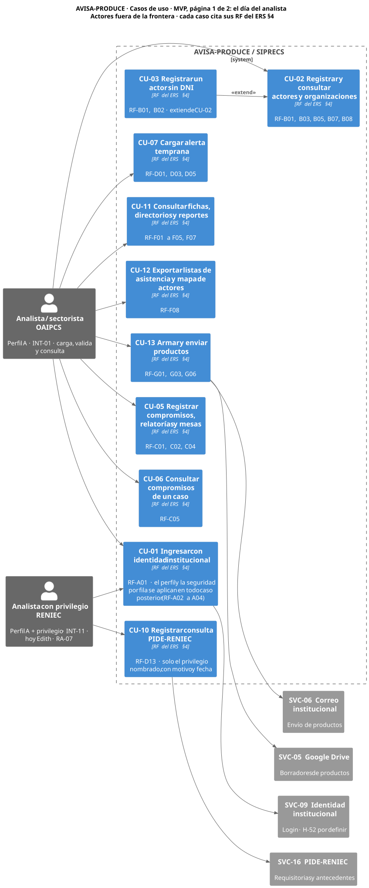

| Caso                                                  | Quién lo usa                                                  | Requisitos                           | Horizonte                   |
| ----------------------------------------------------- | ------------------------------------------------------------- | ------------------------------------ | --------------------------- |
| CU-01 Ingresar con identidad institucional            | Analista, analista con privilegio RENIEC                      | RF-A01 (y el perfil de RF-A02 a A04) | MVP                         |
| CU-02 Registrar y consultar actores y organizaciones  | Analista                                                      | RF-B01, B03, B05, B07, B08           | MVP                         |
| CU-03 Registrar un actor sin DNI _(extiende CU-02)_   | Analista                                                      | RF-B01, B02                          | MVP                         |
| CU-05 Registrar compromisos, relatorías y mesas       | Analista                                                      | RF-C01, C02, C04                     | MVP                         |
| CU-06 Consultar compromisos de un caso                | Analista                                                      | RF-C05                               | MVP                         |
| CU-07 Cargar alerta temprana                          | Analista                                                      | RF-D01, D03, D05                     | MVP                         |
| CU-08 Validar alerta temprana _(validación previa)_   | Sectorista                                                    | RF-D04, D09                          | MVP                         |
| CU-10 Registrar consulta PIDE-RENIEC                  | Solo el analista con privilegio                               | RF-D13                               | MVP (si se activa)          |
| CU-12 Exportar listas de asistencia y mapa de actores | Analista                                                      | RF-F04, F08                          | MVP                         |
| CU-13 Armar y enviar productos                        | Analista                                                      | RF-G01, G03, G06                     | MVP                         |
| CU-20 Procesar documentos y proponer candidatos       | Analista (lo dispara la carga o la recolección)               | RF-E01, E05, E06, E11                | MVP (tramo final)           |
| CU-21 Recolectar fuentes de la lista blanca           | Tareas programadas / analista                                 | RF-E02, E03                          | MVP (alcance acotado, H-32) |
| CU-22 Revisar candidatos y coincidencias dudosas      | Analista                                                      | RF-D02, D03, E04                     | MVP                         |
| CU-35 Sincronizar bajo demanda con Gemini             | Sectorista, Dirección                                         | RF-E13, E14; RN-18, RN-19            | MVP                         |
| CU-36 Sincronizar mensajes de WhatsApp con Gemini     | Tareas programadas (CT-04) o la recepción de un mensaje nuevo | RF-E12; SVC-07                       | MVP                         |

> **Lo que añaden CU-35 y CU-36.** **CU-35** es la sincronización manual bajo demanda de una pieza (un caso, un actor o una zona), con su límite de frecuencia (RN-18) y el sello de fecha y hora de la última actualización (RF-E14). **CU-36** es la entrada de **mensajes de WhatsApp**: <u>WhatsApp/Meta (SVC-07)</u> los entrega, **Tareas programadas (CT-04)** dispara la corrida cada 24 h (RF-E12) y <u>Gemini/Google (SVC-02)</u> los procesa. Los mensajes entran como **candidatos con origen «WhatsApp» y pendientes de revisión**: recorren el mismo circuito que los candidatos del pipeline (CU-22) y nada llega a la Alta Dirección sin pasar por CU-08. Por eso la entrada de información de campo **deja de ser manual** (antes, RN-16).
>
> **Actores externos de esta lámina.** Además de las personas, la página 1 muestra tres actores que no son personas: **Tareas programadas (CT-04)**, que dispara CU-21 y CU-36; **WhatsApp/Meta (SVC-07)**, que entrega los mensajes de CU-36 y recibe los envíos de CU-09; y **Gemini/Google (SVC-02)**, que procesa tanto los documentos del pipeline (CU-20) como los mensajes de WhatsApp. Se dibujan fuera de la caja porque intercambian mensajes con el sistema.

### Página 2 — lo que se valida, se envía y se administra

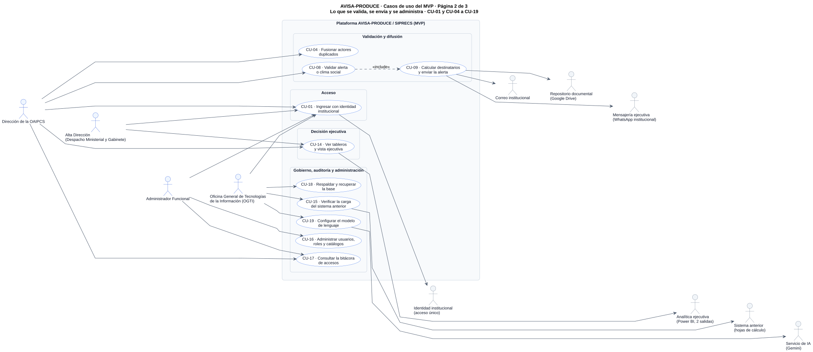

| Caso                                                                   | Quién lo usa                                                                    | Requisitos                 | Horizonte              |
| ---------------------------------------------------------------------- | ------------------------------------------------------------------------------- | -------------------------- | ---------------------- |
| CU-01 Ingresar con identidad institucional                             | Dirección, Alta Dirección, administrador y OGTI (mismo caso que en la página 1) | RF-A01                     | MVP                    |
| CU-04 Fusionar actores duplicados                                      | Dirección                                                                       | RF-B04                     | MVP                    |
| CU-08 Validar alerta o clima social _(aprobación final)_               | Dirección                                                                       | RF-D04, D09                | MVP                    |
| CU-09 Calcular destinatarios y enviar la alerta _(incluido por CU-08)_ | Se dispara al validar                                                           | RF-D06, D07, D08, D10, D12 | MVP (WhatsApp acotado) |
| CU-14 Ver tableros y vista ejecutiva                                   | Alta Dirección, Dirección                                                       | RF-H02, H05                | MVP                    |
| CU-15 Verificar la carga del sistema anterior                          | OGTI                                                                            | RF-M01, M02, M03           | MVP                    |
| CU-16 Administrar usuarios, roles y catálogos                          | Administrador                                                                   | RF-X02                     | MVP                    |
| CU-17 Consultar la bitácora de accesos                                 | Dirección, administrador                                                        | RF-X01                     | MVP                    |
| CU-18 Respaldar y recuperar la base                                    | OGTI                                                                            | RF-X04                     | MVP                    |
| CU-19 Configurar el modelo de lenguaje                                 | OGTI                                                                            | RF-E08, E09, E10           | MVP                    |

### Página 3 — 2027: tramo 1 (evolución) y tramo 2 (MADRE, proyecto completo v10)

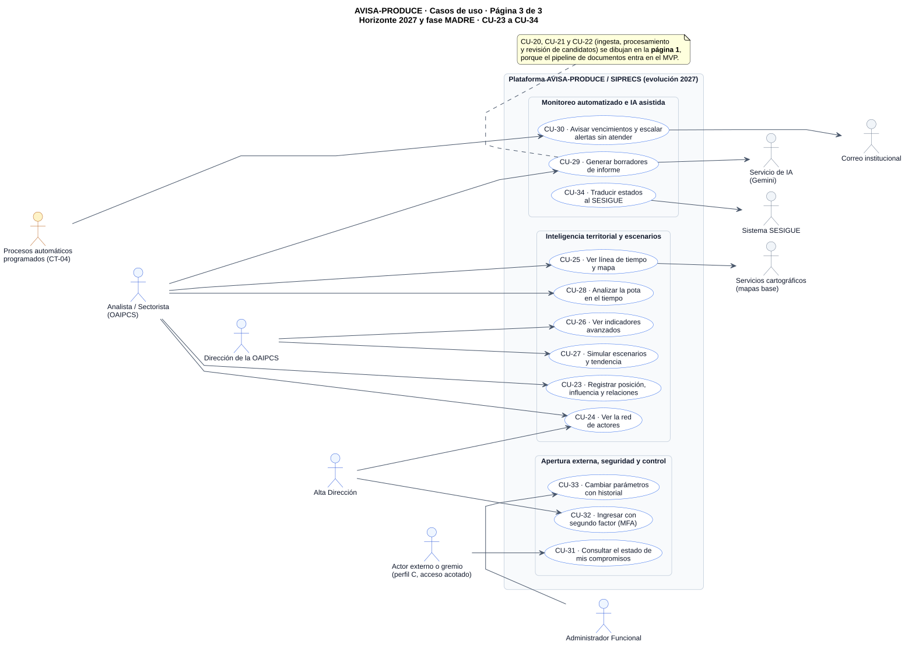

Los dos tramos comparten horizonte —**2027**— y lámina, pero se leen en **dos paquetes** porque se construyen en orden: el **tramo 1** se apoya en el módulo de diciembre y llega en la anualidad siguiente; el **tramo 2** —el que la v10 llama **MADRE**— depende de servicios, convenios o calibraciones que todavía no existen, de modo que entra después, cuando esas condiciones estén dadas. El reparto coincide con 21.2 y 21.3, y cada paquete lleva su tramo en el encabezado para que no haya que deducirlo.

**2027, tramo 1 — evolución sobre lo ya entregado**

| Caso                                                    | Quién lo usa                                    | Requisitos             | Horizonte |
| ------------------------------------------------------- | ----------------------------------------------- | ---------------------- | --------- |
| CU-11 Consultar fichas, directorios y reportes          | Analista                                        | RF-F01 a F03, F05, F07 | 2027      |
| CU-23 Registrar posición, influencia y relaciones       | Analista                                        | RF-B06                 | 2027      |
| CU-24 Ver la red de actores                             | Analista, Alta Dirección                        | RF-H01                 | 2027      |
| CU-26 Ver indicadores avanzados                         | Dirección                                       | RF-J02, J03            | 2027      |
| CU-29 Generar borradores de informe                     | Analista                                        | RF-G02, G04            | 2027      |
| CU-30 Avisar vencimientos y escalar alertas sin atender | Tareas programadas                              | RF-C03, D11            | 2027      |
| CU-32 Ingresar con segundo factor                       | Alta Dirección y Dirección (`direccion_oaipcs`) | RF-A07                 | 2027      |
| CU-33 Cambiar parámetros con historial                  | Administrador                                   | RF-X03                 | 2027      |

> **CU-11 bajó a este horizonte (R10).** Consultar fichas, directorios y reportes deja de ser MVP: lo que CU-12 necesita para exportar —contactos (RF-F04) y la propia exportación (RF-F08)— sí se queda en diciembre, y las fichas, directorios y reportes completos se construyen en 2027 sobre la misma pantalla (PAN-11).
>
> **Segundo factor (CU-32): recomendado antes de 2027 para dos roles.** Desde que la Alta Dirección lee datos personales en la aplicación —no solo agregados en el Estratégico— el segundo factor pasa a ser **recomendado para los roles `alta_direccion` y `direccion_oaipcs`** en cuanto <u>SVC-09</u> lo ofrezca. Su horizonte formal sigue en **2027** y el vacío **H-23** (qué ofrece SVC-09) sigue abierto: no conviene adelantarlo como obligación hasta saber qué permite el servicio de identidad.

**2027, tramo 2 — MADRE (proyecto completo v10)**

| Caso                                          | Quién lo usa                      | Requisitos  | Horizonte |
| --------------------------------------------- | --------------------------------- | ----------- | --------- |
| CU-25 Ver línea de tiempo y mapa              | Analista                          | RF-H03, H04 | 2027      |
| _Índice de riesgo compuesto (parte de CU-26)_ | Dirección                         | RF-J01      | 2027      |
| CU-27 Simular escenarios y tendencia          | Dirección                         | RF-J04, J05 | 2027      |
| CU-28 Analizar la pota en el tiempo           | Analista                          | RF-N01, N02 | 2027      |
| CU-31 Consultar el estado de mis compromisos  | Actor externo o gremio (perfil C) | RF-A05      | 2027      |
| CU-34 Traducir estados al SESIGUE             | SESIGUE (actor secundario)        | RF-C06      | 2027      |

> **Por qué el índice de riesgo cae en el tramo 2 y los demás indicadores en el tramo 1.** Los dos son el mismo horizonte, 2027; lo que los separa es la dependencia. RF-J02 y RF-J03 se calculan con datos que el módulo ya registra; RF-J01 (índice de riesgo compuesto) necesita la red de actores completa y la calibración contra el informe del caso SANIPES Sechura **[H-34]**, que todavía no existe, y por eso no puede entrar antes del tramo 2. Es el mismo criterio que separa la red de actores (tramo 1, CU-24) del mapa con línea de tiempo (tramo 2, CU-25): el primero es una vista sobre datos que ya se capturan; el segundo exige acervo histórico y servicio cartográfico (SVC-11).

### Controles que viajan con cada caso

La frase de arriba —«los controles no se dibujan como casos, van anotados en el caso que los sufre»— se cumple en esta tabla, que es la que hay que leer junto al diagrama. Son los RF que no tienen óvalo propio porque se aplican a toda operación del caso:

| Caso  | Controles que arrastra | Qué obliga                                                                                                                                                             |
| ----- | ---------------------- | ---------------------------------------------------------------------------------------------------------------------------------------------------------------------- |
| CU-01 | RF-A01, A02, A03, A04  | Un solo rol por sesión, tomado de `core.roles`; la base aplica RLS y la aplicación se conecta con un login **sin** `BYPASSRLS`                                         |
| CU-07 | RF-D01, D03, D05       | La alerta nace como borrador en bandeja de revisión; no sale sin pasar por CU-08                                                                                       |
| CU-08 | RF-D04, D09, D12       | Validación previa del Sectorista y aprobación definitiva de la Dirección antes de **cualquier** envío; ninguna alerta sin aprobación humana llega a los perfiles B y C |
| CU-09 | RF-D06, D07, D08, D10  | Destinatarios según prioridad (RN-02); borrador en Google Drive; cada envío queda registrado con canal, destinatario y resultado                                       |
| CU-10 | RF-A06, D13, X01       | Solo el privilegio RENIEC; resultado cifrado, con motivo y fecha, y cada lectura auditada                                                                              |
| CU-12 | RF-F08, X01            | Toda salida del perímetro deja hash en `audit.exportacion`                                                                                                             |
| CU-14 | RF-H02, H05, RD-08     | Ningún dato personal pasa por el Dashboard Estratégico (Publish to Web no tiene control de acceso por fila)                                                            |
| CU-19 | RF-E08, E09, E10       | Cada corrida registrada; proveedor intercambiable; ningún dato personal ni documento interno al modelo externo                                                         |
| CU-20 | RF-E05, E08, E10       | Una cita solo se acepta si aparece literalmente en la fuente; corrida registrada                                                                                       |
| CU-22 | RF-E04, E05            | Similitud intermedia (0,85–0,95) abre tarea humana; nada se fusiona automáticamente                                                                                    |
| CU-35 | RF-E13, E14, RN-18     | Tope de sincronizaciones manuales por usuario y sello de la última actualización en cada dato; el dato traído nace «pendiente de revisión» (RN-19)                     |
| CU-36 | RF-E10, E12, RN-19     | El mensaje de WhatsApp entra como candidato «pendiente de revisión»; nada llega a la Alta Dirección sin pasar por CU-08 y ningún dato personal va al modelo externo    |

### Página 4 — del actor y el objetivo al caso y a la pieza

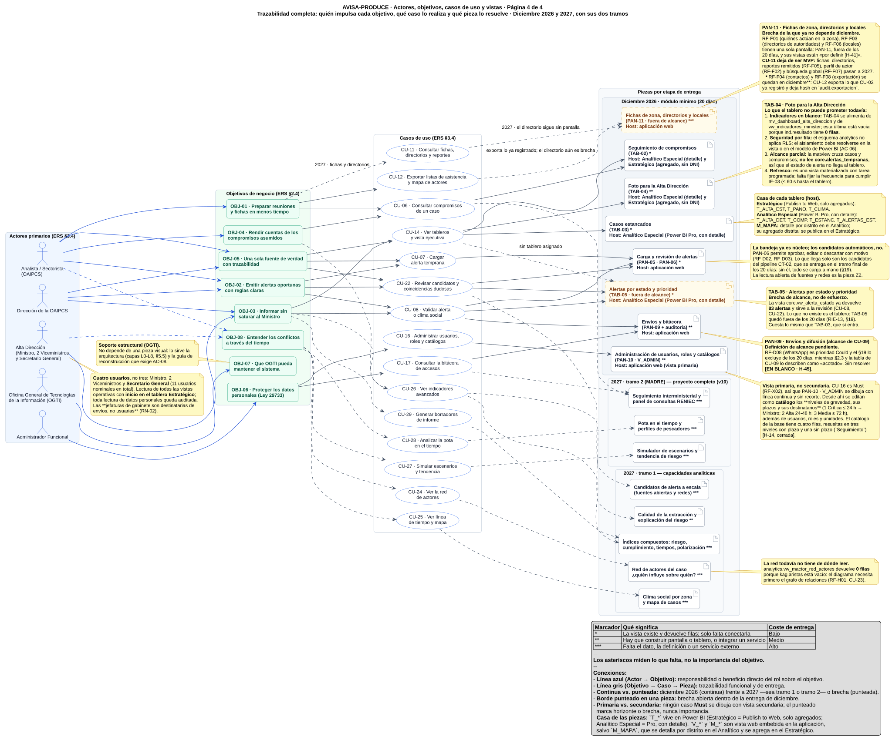

Esta lámina no es un diagrama de casos de uso: es el **puente** entre las pantallas y tableros de la sección 7, los casos de esta sección y los objetivos de 2.4. Se lee de izquierda a derecha —quién impulsa el objetivo, qué caso lo realiza y qué pieza lo resuelve— y resume visualmente la matriz de la sección 17.

- **Los asteriscos miden el esfuerzo que falta, no la importancia del objetivo.** `*` la vista existe y solo hay que conectarla; `**` hay que construir pantalla, tablero o integración; `***` falta el dato, la definición o el servicio externo.
- **La línea azul responde a «quién responde por este objetivo»:** es la responsabilidad directa de cada rol, depurada de la transitividad actor → caso → objetivo que ya muestran las páginas 1 a 3, de modo que un objetivo no se le atribuye a un rol solo porque consuma su caso.
- **La línea punteada no es una promesa:** marca capacidad que entra en 2027 —en cualquiera de sus dos tramos—, o una relación bloqueada por una brecha de diciembre.
- **El borde punteado** señala las dos piezas que quedan fuera de los 20 días: TAB-05 y PAN-11 (sección 19).

**Lo que la lámina deja a la vista y no se lee en las tablas:**

1. **El circuito de la alerta se recorre entero en diciembre** (PAN-05 → PAN-06 → PAN-09), pero su tablero no: TAB-05 salió del alcance aunque `core.vw_alerta_estado` ya devuelve 83 filas, al mismo coste que TAB-03.
2. **Las fichas, directorios y reportes completos ya no son de diciembre:** RF-F01, F02, F03, F05, F06 y F07 pasan a **2027** y su pantalla es PAN-11, fuera de los 20 días (4.6); sus vistas siguen «por definir [H-41]». Lo que se entrega en diciembre es el mínimo con el que CU-12 funciona: **contactos** (RF-F04) y **exportación de listas de asistencia y mapa de actores** (RF-F08).
3. **TAB-04 nace con una fuente vacía:** `analytics.vw_indicadores_minister` no devuelve filas porque `ind.resultado` está en 0, y el esquema `analytics` no aplica RLS (AC-06).
4. **La red de actores de 2027 no tiene de dónde leer:** `analytics.vw_mactor_red_actores` devuelve 0 filas porque `kag.aristas` está vacío.
5. **OBJ-07 no se sirve con una vista**, sino con la arquitectura (capas L0–L8, 5.5) y la guía de reconstrucción que exige AC-08.

### Página 5 — qué pieza resuelve cada caso

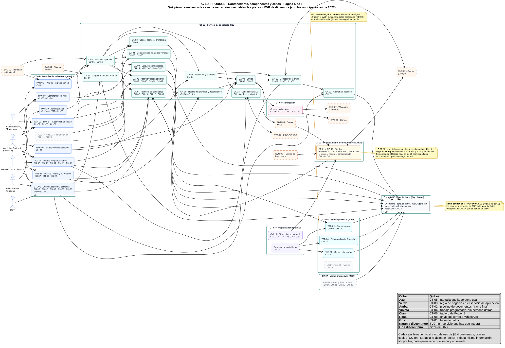

Esta lámina cierra el puente que faltaba entre esta sección y la 14. El diagrama de casos dice qué puede hacer cada actor; el C2 dice de qué piezas se compone el sistema y el C3 qué hay dentro de las tres piezas grandes. Ninguno de los tres decía **qué componente resuelve cada caso**. Aquí las cajas son piezas de 14.3 y cada una lleva dentro el código `CU-nn` de los casos que realiza.

**Por qué no se dibujan los casos como óvalos.** Un diagrama actor → caso → componente con los 36 casos como nodos da una lámina de más de 12 000 px de alto si se apilan en una columna, y una maraña de líneas si se reparten en filas; con etiquetas en cada flecha, los rótulos se apilan en una sola columna y el diagrama deja de leerse. La forma que sí se lee es esta: **una caja por componente, con los casos escritos dentro**. Es la misma decisión que toma 14.3 cuando dibuja `CA-nn` y `CP-nn`: primero la pieza, después lo que hace.

**Reparto por contenedor** (la tabla dice lo mismo que la lámina, para quien tiene que leerla y no mirarla):

| Contenedor                                 | Componentes y pantallas                 | Casos que realiza                                                                            |
| ------------------------------------------ | --------------------------------------- | -------------------------------------------------------------------------------------------- |
| CT-05 · Pantallas de trabajo (Angular)     | PAN-01 a PAN-10 y consola ETL-01        | CU-01 a CU-08, CU-10, CU-12 a CU-20, CU-22, CU-35 (2027: CU-11, CU-23, CU-33)                |
| CT-03 · Servicio de aplicación (.NET)      | CA-01 a CA-13                           | CU-01 a CU-10, CU-12 a CU-17, CU-19, CU-20, CU-22, CU-35, CU-36 (2027: CU-26, CU-29 a CU-34) |
| CT-02 · Procesamiento de documentos (.NET) | CP-01 a CP-09                           | CU-20, CU-21                                                                                 |
| CT-04 · Programador de tareas              | ciclo de 24 h y refresco de tableros    | CU-14, CU-21, CU-36 (2027: CU-30)                                                            |
| CT-06 · Paneles (Power BI, dos canales)    | TAB-02, TAB-03, TAB-04                  | CU-06, CU-14 (2027: CU-25, CU-26)                                                            |
| CT-08 · Notificador                        | correo institucional y WhatsApp acotado | CU-09, CU-13 (2027: CU-30)                                                                   |
| CT-01 · Base de datos (SQL Server)         | las 266 tablas                          | CU-18 y nada más: todo lo demás **persiste** aquí, pero solo escribe CT-03                   |
| CT-07 · Vistas interactivas                | red de actores y línea de tiempo        | CU-24, CU-25, CU-28 (todo 2027)                                                              |

**Lo que la lámina deja a la vista y no se lee en las tablas de casos:**

1. **CU-21 es el único caso de diciembre que no pasa por el servicio de aplicación:** lo dispara CT-04 y lo ejecuta CT-02. Es la razón por la que el pipeline puede entregarse en el tramo final sin romper nada — y la razón por la que, si no llega, la recolección queda manual y no se pierde ningún otro caso.
2. **Ningún caso de diciembre depende de CT-07.** El contenedor de 2027 es el único que podría desaparecer del diagrama sin dejar huecos.
3. **CT-02 no ve datos personales.** No recibe documentos con DNI ni escribe en las tablas de negocio: entrega **candidatos** a CA-05, que es quien decide, y esa es la frontera que hace verificable el control de RF-E10.
4. **Solo CT-03 escribe en CT-01.** Los paneles y las vistas de 2027 solo leen. La excepción es CU-18, que es trabajo de base de datos y no de aplicación.
5. **La consola ETL-01 concentra cinco casos de tres roles distintos** (CU-15, CU-18 y CU-19 de OGTI; CU-20 y CU-35 del analista; CU-17 de la Dirección). Por eso es una vista con tres pestañas y no tres pantallas: la pieza es una, los permisos son tres.

### Cómo se mantiene este diagrama

La fuente es `docs/casos_uso/AVISA_CASOS_USO.puml`, en **PlantUML con UML 2 puro**: no usa la librería C4 —los diagramas C4 del sistema están en la sección 14 y son mermaid—. El archivo tiene **cinco bloques**, y el nombre de cada bloque es exactamente el del SVG que se publica, de modo que regenerar no deja huérfanos: `AVISA_CU_MVP_DIA`, `AVISA_CU_MVP_SALIDA`, `AVISA_CU_2027`, `AVISA_CU_MAPA_VISTAS` y `AVISA_CU_CONTENEDORES`. La **página 3 lleva dos paquetes**, los dos del mismo horizonte 2027 —tramo 1 y tramo 2—, porque dentro de 2027 las piezas se construyen en orden de dependencia, no todas a la vez. La **página 5 no dibuja casos de uso**: dibuja piezas de 14.3 con el código de los casos dentro, y por eso se mantiene a mano —si cambia un componente, cambia su caja; si cambia un caso, cambian las dos cosas—.

**Qué relaciona el diagrama.** Además de las flechas actor → caso, las láminas dibujan:

- en la **página 1**, la **generalización de actores**: el analista con privilegio RENIEC hereda del analista, de modo que puede hacer todo lo suyo y además el CU-10;
- también en la **página 1**, el **encadenamiento real de la ingesta**: la recolección dispara el procesamiento (`«dispara»`) y el procesamiento propone candidatos a la revisión (`«propone candidatos»`). El paso siguiente —lo aprobado entra al circuito de validación y envío— es CU-08 en la página 2;
- los `<<extend>>` e `<<include>>` que las tablas ya declaran (CU-03 extiende CU-02; CU-10 incluye CU-01; CU-09 es incluido por CU-08). **CU-12 ya no extiende CU-11**: con la consulta de fichas y directorios en 2027, la exportación de diciembre se apoya solo en los contactos (RF-F04, RF-F08);
- las **integraciones externas** de cada caso, de modo que un caso sin sistema externo se ve de inmediato como un caso cuyo resultado vive solo en la base.

Se regeneran con un comando. Graphviz es lo recomendado; sin él, `smetana` evita el fallo pero desordena el trazado.

```sh
# con Graphviz instalado (recomendado)
java -jar plantuml.jar -tsvg -charset UTF-8 -o ../img docs/casos_uso/AVISA_CASOS_USO.puml

# sin Graphviz (no falla, pero el trazado queda peor)
java -jar plantuml.jar -tsvg -charset UTF-8 -Playout=smetana -o ../img docs/casos_uso/AVISA_CASOS_USO.puml
```

**Regla de mantenimiento.** Si se añade o se cambia un requisito funcional, el diagrama se actualiza en el mismo cambio. Cada caso lleva escrito su **código CU y sus RF** en la tabla de su página, así que la comprobación es mecánica: **un caso sin RF es un error**, y un RF que no aparezca en ningún caso debe justificarse como control o como requisito de soporte que no se dibuja. Los códigos CU-nn aparecen también dentro de cada óvalo, de forma que el diagrama y la tabla se pueden cotejar a la vista.

---

# 4. REQUISITOS FUNCIONALES

**Cómo leer las tablas.** _Prioridad:_ **Must** (sin esto no hay MVP), **Should** (importante, entra si el tiempo alcanza), **Could** (deseable), **Won't** (fuera de esta versión). _Horizonte:_ **MVP** (módulo de diciembre, 20 días) o **2027**. La prioridad se lee dentro de cada horizonte; algunos requisitos MVP podrían pasar a 2027 según H-44 y H-45. Los requisitos con horizonte 2027 se reparten en **dos tramos** según su dependencia: el tramo 1 se construye sobre el módulo de diciembre; el tramo 2 espera servicios, convenios o calibraciones que aún no existen (3.4 y 21.3). _Verificación:_ P = prueba, I = inspección, D = demostración con usuarios. Un servicio externo <u>subrayado</u> indica que el requisito depende de una integración.

## 4.1 Acceso y seguridad (RF-A)

| ID     | Requisito                                                                                                                                                                                                                                                                                           | Origen | Prior. | Hor. | Ver. |
| ------ | --------------------------------------------------------------------------------------------------------------------------------------------------------------------------------------------------------------------------------------------------------------------------------------------------- | ------ | ------ | ---- | ---- |
| RF-A01 | El sistema deberá identificar a cada usuario mediante el <u>servicio de identidad institucional (SVC-09)</u> **[EN BLANCO · H-20]**                                                                                                                                                                 | R2     | Must   | MVP  | P    |
| RF-A02 | El sistema deberá dar a cada usuario un rol de acceso (perfiles A analista, B alta dirección, C externo) y mostrar solo lo que ese rol permite ver; el nivel y las capacidades salen de `core.roles` —no los declara la aplicación ni el proveedor de identidad— y la sesión aplica **un solo rol** | R2     | Must   | MVP  | P    |
| RF-A03 | La base de datos deberá aplicar la seguridad por fila de modo que ninguna consulta devuelva filas fuera del alcance del perfil, aunque el código de la aplicación falle; la aplicación se conectará con un rol de login **sin `BYPASSRLS`**                                                         | R2, R3 | Must   | MVP  | P    |
| RF-A04 | El sistema no deberá mostrar al Perfil B alertas sin aprobar ni datos personales en el Dashboard Estratégico; en la aplicación sí puede leer datos personales, con cada lectura auditada (RD-08)                                                                                                    | R2     | Must   | MVP  | P    |
| RF-A05 | El sistema deberá permitir que un actor externo (Perfil C) vea únicamente el estado de **sus** compromisos y las alertas sectoriales aprobadas                                                                                                                                                      | R2     | Could  | 2027 | P    |
| RF-A06 | El sistema deberá guardar los datos personales **cifrados** y registrar cada lectura                                                                                                                                                                                                                | R2, R3 | Must   | MVP  | P    |
| RF-A07 | El sistema deberá exigir un segundo factor de autenticación al Perfil B **[EN BLANCO · H-23: depende de lo que ofrezca SVC-09]**                                                                                                                                                                    | R2     | Should | 2027 | P    |

## 4.2 Actores y organizaciones (RF-B)

| ID     | Requisito                                                                                                                                                                                     | Origen     | Prior. | Hor. | Ver. |
| ------ | --------------------------------------------------------------------------------------------------------------------------------------------------------------------------------------------- | ---------- | ------ | ---- | ---- |
| RF-B01 | El sistema deberá permitir registrar un actor **sin DNI**, con alias y vinculado a una organización o a un caso                                                                               | R2, R3     | Must   | MVP  | P    |
| RF-B02 | El sistema deberá permitir **promover** un actor sin identificar a identificado sin perder su historial                                                                                       | R2         | Must   | MVP  | P    |
| RF-B03 | El sistema deberá detectar duplicados mediante una huella irreversible del documento de identidad, sin mostrar el número                                                                      | R2, R3     | Must   | MVP  | P    |
| RF-B04 | El sistema deberá permitir **fusionar** actores duplicados dejando registro de quién lo hizo y por qué                                                                                        | R2         | Should | MVP  | P    |
| RF-B05 | El sistema deberá registrar organizaciones (tipo, vigencia, miembros) y la **OSPA** a la que pertenece cada actor                                                                             | N-09       | Must   | MVP  | P    |
| RF-B06 | El sistema deberá registrar, por cada actor de un caso, su posición (apoyo, oposición, neutral, no dialogante), su influencia y sus relaciones con otros actores (densa, tensa, de conflicto) | R2         | Must   | 2027 | P    |
| RF-B07 | El sistema deberá registrar contactos (teléfono, correo, cargo) de los actores, protegidos según el perfil                                                                                    | N-09       | Must   | MVP  | P    |
| RF-B08 | El sistema deberá registrar el cargo y el ámbito territorial de cada autoridad                                                                                                                | N-05, N-06 | Must   | MVP  | P    |

## 4.3 Compromisos, relatorías y mesas (RF-C)

| ID     | Requisito                                                                                                                         | Origen     | Prior. | Hor. | Ver. |
| ------ | --------------------------------------------------------------------------------------------------------------------------------- | ---------- | ------ | ---- | ---- |
| RF-C01 | El sistema deberá registrar compromisos con hitos, estados, responsables y fecha límite                                           | N-03, R2   | Must   | MVP  | P    |
| RF-C02 | El sistema deberá registrar relatorías y ayudas memoria y vincular a cada una los compromisos que contiene                        | N-03, N-12 | Must   | MVP  | P    |
| RF-C03 | El sistema deberá avisar de los compromisos que vencen (revisión diaria) **[EN BLANCO · H-31: con cuántos días de anticipación]** | R2         | Should | 2027 | P    |
| RF-C04 | El sistema deberá registrar mesas de diálogo con sus miembros, instrumento y vigencia                                             | R3         | Should | MVP  | P    |
| RF-C05 | El sistema deberá mostrar, por caso, los compromisos con su estado actual                                                         | N-03       | Must   | MVP  | D    |
| RF-C06 | El sistema deberá traducir el estado local de cada compromiso al que espera <u>SESIGUE (SVC-12)</u>                               | R2, R3     | Won't  | 2027 | P    |

## 4.4 Alertas tempranas (RF-D)

| ID     | Requisito                                                                                                                                                                                         | Origen | Prior. | Hor.               | Ver. |
| ------ | ------------------------------------------------------------------------------------------------------------------------------------------------------------------------------------------------- | ------ | ------ | ------------------ | ---- |
| RF-D01 | El sistema deberá permitir **cargar alertas tempranas** mediante un formulario                                                                                                                    | N-10   | Must   | MVP                | D    |
| RF-D02 | El sistema deberá recibir **candidatos de alerta** del procesamiento de documentos sin duplicarlos si llegan dos veces                                                                            | R2     | Must   | MVP                | P    |
| RF-D03 | El sistema deberá ofrecer una **bandeja de revisión** donde el analista apruebe, edite o descarte cada candidato, con motivo                                                                      | R2     | Must   | MVP                | D    |
| RF-D04 | El sistema deberá permitir **validar** alertas tempranas y el clima social antes de que salgan a la Alta Dirección                                                                                | N-08   | Must   | MVP                | D    |
| RF-D05 | El sistema deberá **clasificar** acciones y eventos (por ejemplo, bloqueo de carreteras) según un catálogo y asignarles prioridad **[EN BLANCO · H-24: catálogo y criterios]**                    | N-14   | Must   | MVP                | P    |
| RF-D06 | El sistema deberá determinar los **destinatarios** de cada alerta según su prioridad (RN-02)                                                                                                      | N-11   | Must   | MVP                | P    |
| RF-D07 | El sistema deberá enviar la alerta por <u>correo institucional (SVC-06)</u> con un enlace y dejar el **borrador en** <u>Google Drive (SVC-05)</u>                                                 | N-13   | Must   | MVP                | P    |
| RF-D08 | El sistema deberá enviar alertas tempranas por <u>WhatsApp (SVC-07)</u> **[EN BLANCO · H-06: costo y proveedor]**                                                                                 | N-13   | Could  | MVP                | P    |
| RF-D09 | El sistema deberá exigir la **aprobación definitiva de la Dirección de la OAIPCS** antes de enviar **cualquier** alerta a la Alta Dirección, tras la validación previa del Sectorista (RN-04)     | R2     | Must   | MVP                | P    |
| RF-D10 | El sistema deberá registrar cada envío: canal, destinatario, documento adjunto y resultado de la entrega                                                                                          | R3     | Must   | MVP                | P    |
| RF-D11 | El sistema deberá medir el plazo de atención de cada alerta según su prioridad y escalar las que no se atiendan **[H-14, cerrada: plazos en 11.1 y RN-13; el escalamiento automático es 2027]**   | R2     | Should | 2027               | P    |
| RF-D12 | El sistema no deberá mostrar a los Perfiles B y C ninguna alerta que no tenga aprobación humana registrada                                                                                        | R2     | Must   | MVP                | P    |
| RF-D13 | El sistema deberá permitir que **solo el analista con privilegio RENIEC** registre el resultado de una consulta a <u>PIDE-RENIEC (SVC-16)</u> sobre un actor, con el motivo del pedido y la fecha | R7     | Must   | MVP (si se activa) | P    |

## 4.5 Procesamiento de documentos (RF-E)

> **El pipeline de procesamiento de documentos entra en el tramo final de los 20 días** (CT-02, en .NET, construido por OAIPCS/Diego). Los requisitos **RF-E01 a RF-E06** y **RF-E11** describen ese pipeline; **RF-E07, RF-E08, RF-E09 y RF-E10** son los controles que lo hacen seguro y acotado; **RF-E12 a RF-E14** son la sincronización de Gemini (13.1). El núcleo del módulo **no depende** del pipeline: si no llega a tiempo, todo opera con carga manual. Lo que sigue en 2027 es la **extracción multi-fuente a escala** y la **lectura abierta de fuentes públicas y redes sociales** (SVC-03). La **entrada de mensajes de campo deja de ser manual**: <u>WhatsApp/Meta (SVC-07)</u> entrega los mensajes, **Tareas programadas (CT-04)** dispara la sincronización y <u>Gemini (SVC-02)</u> los convierte en candidatos, por el mismo circuito de revisión de CU-22 (CU-36).

| ID     | Requisito                                                                                                                                                                                                                         | Origen   | Prior. | Hor.                  | Ver. |
| ------ | --------------------------------------------------------------------------------------------------------------------------------------------------------------------------------------------------------------------------------- | -------- | ------ | --------------------- | ---- |
| RF-E01 | El sistema deberá procesar relatorías, reportes y transcripciones cargados por el analista y **proponer** actores, eventos y compromisos                                                                                          | N-12, R2 | Must   | MVP                   | P    |
| RF-E02 | El sistema deberá recolectar noticias y reportes de una **lista blanca** de <u>fuentes públicas (SVC-01)</u> **[EN BLANCO · H-32: la lista de fuentes]**                                                                          | R2       | Should | MVP (alcance acotado) | P    |
| RF-E03 | El sistema deberá detectar noticias repetidas y conservar una sola, con las fuentes que la replican                                                                                                                               | R2       | Must   | MVP                   | P    |
| RF-E04 | El sistema deberá comparar los actores encontrados contra el catálogo y abrir una **tarea de revisión humana** cuando la similitud sea intermedia (referencia del MVP: entre 0,85 y 0,95), sin fusionar automáticamente           | R2       | Must   | MVP                   | P    |
| RF-E05 | El sistema deberá aceptar una cita textual solo si aparece **literalmente** en la fuente                                                                                                                                          | R2       | Must   | MVP                   | P    |
| RF-E06 | El sistema deberá proponer un puntaje de riesgo con la explicación de sus factores                                                                                                                                                | R2       | Should | MVP                   | P    |
| RF-E07 | El sistema deberá reintentar los envíos fallidos y guardar los que no se logren en una cola, con aviso técnico                                                                                                                    | R2       | Should | MVP                   | P    |
| RF-E08 | El sistema deberá registrar cada corrida: fuentes consultadas, elementos descartados con su motivo, costo y duración                                                                                                              | R2, R3   | Must   | MVP                   | I    |
| RF-E09 | El sistema deberá conectarse al <u>modelo de lenguaje de Google (SVC-02)</u> mediante una conexión **intercambiable**, de modo que pueda cambiarse de proveedor sin reescribir el sistema                                         | R1       | Must   | MVP                   | I    |
| RF-E10 | El sistema no deberá enviar datos personales ni documentos internos al modelo externo **[EN BLANCO · H-04: depende del dictamen legal]**                                                                                          | R2       | Must   | MVP                   | P    |
| RF-E11 | El sistema deberá poder medir la calidad de la extracción contra un **conjunto de referencia** anotado a mano (aciertos, omisiones y errores)                                                                                     | R1       | Must   | MVP                   | P    |
| RF-E12 | El sistema deberá sincronizar automáticamente, cada **24 horas**, el lote de datos acotado de Gemini (~75 piezas/día, 13.1) sin intervención de un usuario                                                                        | R10      | Must   | MVP                   | P    |
| RF-E13 | El sistema deberá permitir que un usuario autorizado dispare una **sincronización manual** de una pieza específica (un caso, un actor o una zona) preguntando por su «información más reciente», sin esperar al ciclo de 24 horas | R10      | Should | MVP                   | D    |
| RF-E14 | El sistema deberá mostrar, junto a cualquier dato que provenga de una sincronización, la **fecha y hora de la última actualización** (automática o manual)                                                                        | R10      | Must   | MVP                   | P    |

> **Cada requisito de sincronización tiene su caso de uso (3.4, página 1).** **CU-36** cubre **RF-E12**: la corrida automática cada 24 h sobre los mensajes de WhatsApp que entrega <u>SVC-07</u>, disparada por **Tareas programadas (CT-04)**, con los mensajes entrando como candidatos pendientes de revisión. **CU-35** cubre **RF-E13** y **RF-E14**: la sincronización manual de una pieza y el sello de fecha y hora de la última actualización, con el límite de frecuencia de **RN-18** y la revisión humana obligatoria de **RN-19**. El vacío **H-76** (cuántas veces por hora) sigue abierto.

## 4.6 Fichas y consultas (RF-F)

| ID     | Requisito                                                                                                                                  | Origen     | Prior. | Hor. | Ver. |
| ------ | ------------------------------------------------------------------------------------------------------------------------------------------ | ---------- | ------ | ---- | ---- |
| RF-F01 | El sistema deberá mostrar, para una zona, **quiénes actúan** (actores, organizaciones y autoridades)                                       | N-01, N-15 | Must   | 2027 | D    |
| RF-F02 | El sistema deberá mostrar el **perfil de un actor**: quién es, organizaciones, casos, posición y reuniones                                 | N-01       | Must   | 2027 | D    |
| RF-F03 | El sistema deberá ofrecer **directorios** de alcaldes, prefectos, subprefectos, comisarios, capitanes de puerto y sargentos por territorio | N-05, N-06 | Must   | 2027 | D    |
| RF-F04 | El sistema deberá buscar **contactos** (incluidos directores) y mostrar a qué OSPA pertenecen                                              | N-09       | Must   | MVP  | D    |
| RF-F05 | El sistema deberá listar los **reportes remitidos** por zona, del más reciente al más antiguo                                              | N-02       | Must   | 2027 | D    |
| RF-F06 | El sistema deberá mostrar los **locales** apropiados para reuniones por zona                                                               | N-04       | Should | 2027 | D    |
| RF-F07 | El sistema deberá ofrecer una búsqueda global por nombre, organización, zona o caso                                                        | R4         | Should | 2027 | D    |
| RF-F08 | El sistema deberá exportar listas de asistencia y el mapa de actores                                                                       | N-09       | Should | MVP  | D    |

> **El reparto de RF-F (R10).** En diciembre se entrega el **mínimo con el que CU-12 funciona**: buscar **contactos** (RF-F04) y **exportar** listas de asistencia y mapa de actores (RF-F08). Todo lo demás —fichas por zona, perfil de actor, directorios, reportes remitidos, locales y búsqueda global (RF-F01, F02, F03, F05, F06 y F07)— pasa a **2027** y se sirve en **PAN-11**, la pantalla que queda fuera de los 20 días. La prioridad **Must** se conserva dentro del nuevo horizonte: no se degrada lo pedido, solo se reparte en dos tramos. La tensión que antes tenía esta página (requisitos Must del MVP cuya única pantalla no entraba en diciembre) queda así resuelta.

## 4.7 Productos e informes (RF-G)

| ID     | Requisito                                                                                                                                                                                              | Origen     | Prior. | Hor. | Ver. |
| ------ | ------------------------------------------------------------------------------------------------------------------------------------------------------------------------------------------------------ | ---------- | ------ | ---- | ---- |
| RF-G01 | El sistema deberá ofrecer una **plantilla con selección múltiple** de los productos que se informan **[EN BLANCO · H-26: lista de productos]**                                                         | N-08, N-11 | Must   | MVP  | D    |
| RF-G02 | El sistema deberá generar borradores de informes con la IA, marcados «borrador por validar» hasta que una persona los valide                                                                           | R2         | Should | 2027 | D    |
| RF-G03 | El sistema deberá enviar los productos seleccionados a los destinatarios que corresponda según su prioridad                                                                                            | N-11       | Must   | MVP  | D    |
| RF-G04 | El sistema deberá generar un **resumen de una página** con estructura fija (situación, qué cambió, riesgo y tendencia, decisión requerida, próximos hitos) **[EN BLANCO · H-33: extensión y formato]** | R2         | Should | 2027 | D    |
| RF-G05 | El sistema deberá producir las secciones del análisis de casos **[EN BLANCO · H-27: formato oficial; el sistema anterior usa el «formato Anexo 8»]**                                                   | N-07       | Could  | 2027 | D    |
| RF-G06 | El sistema deberá guardar cada producto con su fuente, versión y responsable de validación                                                                                                             | R2         | Must   | MVP  | I    |

## 4.8 Tablero y diagramas interactivos (RF-H)

| ID     | Requisito                                                                                                                                                                                    | Origen | Prior. | Hor. | Ver. |
| ------ | -------------------------------------------------------------------------------------------------------------------------------------------------------------------------------------------- | ------ | ------ | ---- | ---- |
| RF-H01 | El sistema deberá mostrar un **diagrama interactivo de la red de actores** de un caso o zona: nodos = actores, vínculos = relaciones; con filtros, selección de un actor y acceso a su ficha | R1, R2 | Must   | 2027 | D    |
| RF-H02 | El sistema deberá ofrecer un **tablero en** <u>Power BI (SVC-10)</u> con entre 4 y 6 indicadores del caso ancla **[EN BLANCO · H-28: cuáles indicadores]**                                   | R1     | Must   | MVP  | D    |
| RF-H03 | El sistema deberá mostrar una **línea de tiempo** de hechos y de normas por tema o conflicto                                                                                                 | N-16   | Could  | 2027 | D    |
| RF-H04 | El sistema deberá mostrar un **mapa** con capas de casos, hechos, actores georreferenciados y territorio, usando un <u>servicio de mapas (SVC-11)</u>                                        | R2     | Could  | 2027 | D    |
| RF-H05 | El sistema deberá ofrecer una vista ejecutiva para la Alta Dirección con indicadores explicados y sin datos personales                                                                       | R2     | Should | MVP  | D    |
| RF-H06 | El sistema deberá explicar cada semáforo con los factores que lo producen                                                                                                                    | R2     | Should | 2027 | D    |

## 4.9 Indicadores avanzados y simulador (RF-J)

> Fórmulas de referencia en R2 §4.1. **Son propuestas «PROVISIONALES»**: el propio MVP-45 indica que deben contrastarse con el informe del caso SANIPES Sechura **[EN BLANCO · H-34]**.

| ID     | Requisito                                                                                                                                    | Origen | Prior. | Hor. | Ver. |
| ------ | -------------------------------------------------------------------------------------------------------------------------------------------- | ------ | ------ | ---- | ---- |
| RF-J01 | El sistema deberá calcular el Índice de Riesgo de Escalamiento (IRE) por caso con fórmula documentada y reproducible                         | R2     | Could  | 2027 | P    |
| RF-J02 | El sistema deberá calcular el Índice de Cumplimiento de Compromisos, el Tiempo de Atención de Alertas y el Índice de Polarización de Actores | R2     | Should | 2027 | P    |
| RF-J03 | El sistema deberá calcular el Índice de Condiciones de Diálogo con evidencia obligatoria por condición                                       | R2     | Could  | 2027 | P    |
| RF-J04 | El sistema deberá ofrecer un simulador de escenarios («¿qué pasa si…?») rotulado «ESCENARIO — no vigente»                                    | R2     | Won't  | 2027 | P    |
| RF-J05 | El sistema deberá mostrar la tendencia de riesgo a 30 días rotulada «TENDENCIA / PROXY — no es una predicción»                               | R2     | Won't  | 2027 | P    |

## 4.10 Migración y calidad de datos (RF-M)

| ID     | Requisito                                                                                                                                                                           | Origen | Prior. | Hor. | Ver. |
| ------ | ----------------------------------------------------------------------------------------------------------------------------------------------------------------------------------- | ------ | ------ | ---- | ---- |
| RF-M01 | El sistema deberá demostrar que la carga del <u>sistema anterior (SVC-04)</u> cuadra: filas de origen = cargadas + fusionadas + descartadas + pendientes, **en el entorno de OGTI** | R2, R4 | Must   | MVP  | P    |
| RF-M02 | El sistema deberá entregar un reporte de calidad: completitud, duplicados y registros pendientes de validación                                                                      | R2     | Should | MVP  | I    |
| RF-M03 | El sistema deberá cargar los cambios del sistema anterior hasta el día de cambio **[EN BLANCO · H-29: fecha de cambio y frecuencia]**                                               | R2     | Should | MVP  | P    |

## 4.11 Análisis temático (fase siguiente) (RF-N)

| ID     | Requisito                                                                                                                                                                                                                                                                  | Origen | Prior. | Hor. | Ver. |
| ------ | -------------------------------------------------------------------------------------------------------------------------------------------------------------------------------------------------------------------------------------------------------------------------- | ------ | ------ | ---- | ---- |
| RF-N01 | El sistema deberá permitir analizar la **pota** a través del tiempo: controversias o conflictos nacionales, capa normativa, acciones de las OSPA que llegan a la DGPA y conflictos específicos relacionados **[EN BLANCO · H-35: definición de «controversia» y fuentes]** | N-16   | Could  | 2027 | D    |
| RF-N02 | El sistema deberá describir la **diversidad de perfiles de pescadores**, sus capitales y sus alineamientos cambiantes **[EN BLANCO · H-36: qué son los «capitales» y cómo se miden]**                                                                                      | N-17   | Could  | 2027 | D    |

## 4.12 Auditoría y administración (RF-X)

| ID     | Requisito                                                                                                                     | Origen | Prior. | Hor. | Ver. |
| ------ | ----------------------------------------------------------------------------------------------------------------------------- | ------ | ------ | ---- | ---- |
| RF-X01 | El sistema deberá guardar un registro de accesos y operaciones sobre datos personales que **no se pueda modificar ni borrar** | R2, R3 | Must   | MVP  | P    |
| RF-X02 | El sistema deberá permitir administrar catálogos, usuarios y roles                                                            | R3     | Must   | MVP  | D    |
| RF-X03 | El sistema deberá permitir cambiar parámetros (pesos, umbrales, plazos) con historial de versiones                            | R2     | Should | 2027 | I    |
| RF-X04 | El sistema deberá contar con copias de seguridad y recuperación **[EN BLANCO · H-30: frecuencia y plazo de recuperación]**    | —      | Must   | MVP  | I    |

---

# 5. CIRCUITO FUNCIONAL Y PARIDAD CON EL AVISA ACTUAL

> **Se lleva a la reunión.** Esta sección responde a la expectativa de OGTI de recibir **lo que AVISA ya hace hoy**: muestra que el módulo de diciembre cubre ese uso, aunque por debajo cambie de hojas de Excel a una base de datos relacional.

> **Aclaración sobre la IA del sistema anterior (verificada el 2026-11-20).** El AVISA actual **sí tenía** un módulo de consultas con IA (un conector a Gemini en `Code.gs`, con las funciones `_llamarGemini`, `analizarConsultaGeneral`, `buscarConIA` y `analizarCasoConIA`, y una pantalla «Consultas con IA» en el frontend). **Nunca operó: era una maqueta** — no hubo clave válida ni uso en producción. Por eso la paridad prometida en esta sección **no incluye** ese módulo, y la IA del sistema nuevo se planifica desde cero: el **pipeline de procesamiento de documentos (CT-02, en .NET) se entrega en el tramo final de los 20 días** (RF-E01 a RF-E11) y la sincronización acotada de Gemini entra desde el primer día (RF-E12 a RF-E14, 14.3.2). Lo que queda en 2027 es la extracción multi-fuente a escala.

## 5.1 Circuito funcional del módulo de diciembre

> Propuesta construida a partir de los módulos del AVISA actual (R4, §12.1). Debe confirmarse con el **uso real** que hoy se le da **[EN BLANCO · H-47]**.

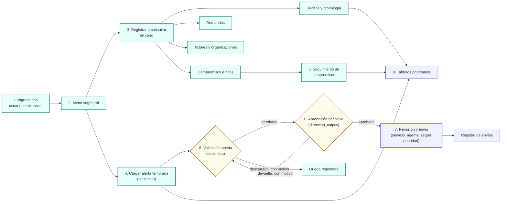

Los nombres entre paréntesis son los **códigos de `core.roles`**, los mismos que guarda `core.flujo_definicion.rol_responsable` para los cinco pasos del flujo `alerta`. La **remisión (paso 7)** la ejecuta `servicio_agente` porque no es un acto de criterio sino el envío, y su rastro queda en `core.envios_comunicacion`. La **prioridad** decide el **destinatario y el plazo**, no quién autoriza.

## 5.2 Qué hace hoy el AVISA y qué pasa en diciembre

Los 28 módulos del sistema actual (431 funciones con lógica real) y la propuesta para el módulo de diciembre.

| Módulo del AVISA actual                      | Funciones | Propuesta para diciembre                                                                          | Estado                 |
| -------------------------------------------- | --------: | ------------------------------------------------------------------------------------------------- | ---------------------- |
| Casos                                        |        37 | **Entra**                                                                                         | Por confirmar con Luis |
| Alertas tempranas                            |        26 | **Entra** (carga manual y validación)                                                             | Por confirmar          |
| Demandas                                     |        21 | **Entra**                                                                                         | Por confirmar          |
| Hechos ocurridos                             |        12 | **Entra**                                                                                         | Por confirmar          |
| Registro de envíos                           |         6 | **Entra**                                                                                         | Por confirmar          |
| Navegación, permisos y pantallas de relación |        43 | **Entra** como login institucional y roles (sección 6)                                            | Por confirmar          |
| Análisis de casos (formato Anexo 8)          |        33 | **Por confirmar** **[EN BLANCO · H-27]**                                                          | —                      |
| Sectoristas, puntos focales y autoridades    |        29 | **Entra** (usuarios y contactos); el directorio completo de autoridades, en 2027 (4.6)            | Por confirmar          |
| Catálogos y datos de referencia              |        27 | **Entra** (datos maestros, sección 8)                                                             | Por confirmar          |
| Documentos y reportes                        |        20 | **Entra** el registro y la consulta; la generación automática de PDF queda **[EN BLANCO · H-59]** | —                      |
| Actores sociales                             |        16 | **Entra**                                                                                         | Por confirmar          |
| Acciones e hitos                             |        14 | **Entra** (compromisos)                                                                           | Por confirmar          |
| Proceso por pasos                            |        14 | **Por confirmar**                                                                                 | —                      |
| Capacitaciones                               |        14 | **Por confirmar**                                                                                 | —                      |
| Búsqueda, exportación y utilidades           |        13 | **Entra** simplificado (búsqueda y exportación básica)                                            | Por confirmar          |
| Clima social                                 |        12 | **Por confirmar** (Edith lo menciona)                                                             | —                      |
| Reporte rápido                               |        11 | **Por confirmar**                                                                                 | —                      |
| Actores del Estado                           |        10 | **Entra** como tipo de actor (`Actor público`, Guía §7.4.1)                                       | Por confirmar          |
| Inicio de sesión                             |         9 | **Entra** como **login institucional**                                                            | Por confirmar          |
| WhatsApp y correo                            |         7 | Correo **por confirmar**; WhatsApp **entra en diciembre**, acotado **[EN BLANCO · H-06]**         | —                      |
| Análisis regional                            |         7 | **Tablero** (por confirmar)                                                                       | —                      |
| Tablero de mando (21 indicadores)            |         6 | **Tableros prioritarios**, no los 21 (sección 7)                                                  | —                      |
| Organizaciones sociales                      |         5 | **Entra**                                                                                         | Por confirmar          |
| Distritos y geografía                        |         4 | **Entra**                                                                                         | Por confirmar          |
| Locales y sedes                              |         3 | **Entra**                                                                                         | Por confirmar          |
| Mesas de diálogo                             |       n/d | **Entra**                                                                                         | Por confirmar          |
| Arranque y servido de la interfaz            |         9 | **No se traslada** (código generado)                                                              | Definido en R4         |
| RADAR y red de actores                       |        23 | **No entra** (diferido)                                                                           | Definido en R4         |

**Cómo se lee.** «Entra» significa que el módulo de diciembre debe permitir hacer lo mismo que hoy. «Por confirmar» significa que OAIPCS debe decir si ese uso es real y si es indispensable en diciembre. La fila **Mesas de diálogo** no lleva número porque el inventario del código no le dedica una sección: sus 11 funciones existen, pero no están contabilizadas (R4, §12.1).

## 5.3 Qué cambia por debajo (en palabras simples)

| Hoy (hojas de Excel con Apps Script)                                    | En el módulo de diciembre                                                                                       | Qué gana el usuario                                                                             |
| ----------------------------------------------------------------------- | --------------------------------------------------------------------------------------------------------------- | ----------------------------------------------------------------------------------------------- |
| Los permisos se aplican en la pantalla, con una clave en una hoja       | **Login institucional, roles y seguridad por fila en la base de datos** (control de acceso real, no decorativo) | Cada uno ve solo lo que le corresponde; se cumple el estándar de Nivel Alto de la Ley N.° 29733 |
| Nada queda registrado al consultar o cambiar un dato personal           | **Toda lectura y cambio queda en un registro de auditoría inmutable**                                           | Trazabilidad única de cada alerta y de cada dato personal consultado                            |
| El tablero no tiene de dónde salir (la tabla de indicadores está vacía) | Los tableros leen **datos ya relacionados**, con origen verificable                                             | Tableros confiables para la Alta Dirección                                                      |
| El DNI hace de identificador de la persona                              | Cada persona tiene un identificador interno; el DNI es un dato más, cifrado                                     | Se pueden registrar actores sin DNI                                                             |
| Un mismo conflicto se escribe hasta cuatro veces con distinto detalle   | Un caso se escribe **una vez** y se relaciona con sus hechos, demandas, actores y compromisos                   | Menos digitación y menos contradicciones (efecto secundario, no el objetivo principal)          |
| El PDF archivado en Drive es el dato                                    | El dato queda en la base y el PDF es un archivo aparte                                                          | Se puede consultar y filtrar                                                                    |

> **Decidido:** el módulo de diciembre se levanta sobre el **modelo relacional (v10)**. Lo que OGTI esperaba (la aplicación actual tal cual) se atiende mostrando la **paridad** de arriba y presentando primero la necesidad (ver 5.4).

## 5.4 Cómo se presenta: primero la necesidad, después el modelo

El módulo de diciembre se levanta sobre el **modelo relacional (v10)**, pero OGTI debe entender **primero la necesidad de OAIPCS**; el modelo es la respuesta a esa necesidad, no el punto de partida.

| Orden | Qué se muestra                                                                     | Para qué                                               |
| ----- | ---------------------------------------------------------------------------------- | ------------------------------------------------------ |
| 1     | **La necesidad**: circuito funcional (5.1), reglas y roles (sección 6)             | Que OGTI vea qué se necesita hacer y quién lo hace     |
| 2     | **La paridad** con el AVISA actual (5.2)                                           | Que vea que no se pierde nada de lo que hoy se usa     |
| 3     | **Pantallas y tableros prioritarios** (sección 7)                                  | Que vea cómo se usa                                    |
| 4     | **El modelo relacional** como respuesta: los documentos del modelo que recibe OGTI | Que entienda por qué los datos se guardan de esa forma |
| 5     | **El acuerdo de alcance** (sección 19)                                             | Cerrar qué se construye                                |

### Documentos del modelo que pasan a OGTI

| Documento                                                       | Qué contiene                                   | Estado                                                                                                         |
| --------------------------------------------------------------- | ---------------------------------------------- | -------------------------------------------------------------------------------------------------------------- |
| Diccionario de datos (R3)                                       | Cada tabla y columna que existe hoy en la base | Existe                                                                                                         |
| Comparativo sistema anterior – v10 (R4)                         | Qué se conserva, qué cambia y qué desaparece   | Existe                                                                                                         |
| Guía del modelo v10 (`AVISA_PRODUCE_v10.md`)                    | Diseño completo del modelo relacional deseado  | Existe (citado en R2)                                                                                          |
| Priorización de tablas (R5 y `PRIORIZACION_MVP_v10.md`)         | Qué tablas se construyen primero               | Existe                                                                                                         |
| Scripts de la base: esquema, catálogos, vistas, datos de prueba | Para reconstruir la base                       | **[EN BLANCO · H-61: lista exacta]**; deben entregarse en su versión **SQL Server** (H-01), no solo PostgreSQL |

### Qué puede optimizar OGTI y qué debe conservar (propuesta)

El modelo queda **sujeto a optimizaciones** de OGTI. Para que optimizar no cambie el negocio, se propone separar:

| OGTI puede ajustar                                                                 | OGTI debe conservar                                                                                                   |
| ---------------------------------------------------------------------------------- | --------------------------------------------------------------------------------------------------------------------- |
| Tipos de datos, índices, particiones y vistas materializadas                       | Los conceptos de negocio: caso, alerta, demanda, hecho, actor, organización y compromiso, cada uno como cosa distinta |
| Orden de construcción de las tablas                                                | Los códigos legibles (`CS-PA-INF-2026-01`, `AT-2026-01`)                                                              |
| Nombres internos que no se muestran al usuario                                     | Las reglas de negocio de la sección 11                                                                                |
| Mecanismos de seguridad por fila (si cambia el motor)                              | La separación y el cifrado de datos personales, y el registro de lecturas                                             |
| Tablas del horizonte 2027 que dependen del tramo 2 (se pueden dejar sin construir) | La trazabilidad de cada dato a su origen                                                                              |

> Lo que se puede y no se puede cambiar: **[EN BLANCO · H-62]**, a validar con OGTI.

## 5.5 Capas del sistema y qué se programa primero

Una **capa** es un conjunto de funciones que depende de las anteriores. Programar por capas permite entregar algo que funcione al terminar cada una.

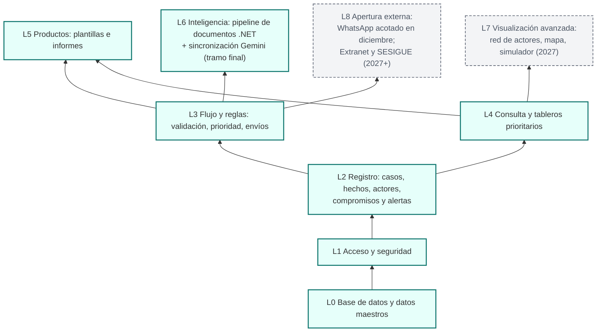

| Capa                                  | Qué contiene                                                                                                          | Depende de | Horizonte                               | Servicios externos                                 | Orden propuesto |
| ------------------------------------- | --------------------------------------------------------------------------------------------------------------------- | ---------- | --------------------------------------- | -------------------------------------------------- | --------------- |
| **L0** Base de datos y datos maestros | Esquema de las 46 tablas del MVP (45 migran; solo `kag.aristas` se difiere), catálogos, geografía, precarga y vistas  | —          | MVP                                     | Sistema anterior (SVC-04)                          | **1**           |
| **L1** Acceso y seguridad             | Login institucional, roles, seguridad por fila, registro de accesos                                                   | L0         | MVP                                     | Identidad (SVC-09)                                 | **2**           |
| **L2** Registro                       | Formularios de casos, hechos, demandas, actores, organizaciones, compromisos y alertas                                | L0, L1     | MVP                                     | Ninguno                                            | **3**           |
| **L3** Flujo y reglas                 | Validación de alertas, regla de prioridad y destinatarios, registro de envíos                                         | L2         | MVP                                     | Correo (SVC-06), por confirmar                     | **4**           |
| **L4** Consulta y tableros            | Ficha de caso, contactos y exportación; búsqueda; tableros prioritarios (ficha de zona y directorios completos: 2027) | L0, L1, L2 | MVP                                     | Power BI (SVC-10)                                  | **5**           |
| **L5** Productos                      | Plantilla de selección múltiple, borradores e informes                                                                | L3, L4     | MVP parcial; redacción con IA en 2027   | Drive (SVC-05), por confirmar                      | **6**           |
| **L6** Inteligencia                   | Procesamiento de documentos, extracción, conjunto de referencia                                                       | L2, L3     | MVP (tramo final; no bloquea el núcleo) | Gemini (SVC-02, acotado en dic.), fuentes (SVC-01) | —               |
| **L7** Visualización avanzada         | Red interactiva de actores, mapa, línea de tiempo, simulador                                                          | L4         | 2027 (tramo 1 y tramo 2)                | Mapas (SVC-11)                                     | —               |
| **L8** Apertura externa               | WhatsApp, Extranet, SESIGUE, otros ministerios                                                                        | L3         | 2027 (WhatsApp acotado en dic.)         | SVC-07, SVC-12, SVC-14                             | —               |

**Criterios usados para ordenar:** (1) _dependencia_: nada funciona sin L0 y L1; (2) _valor inmediato_: lo que ya se usa hoy en AVISA va antes; (3) _riesgo_: lo que depende de decisiones aún abiertas va después; (4) _costo externo_: lo que no cuesta nada o ya existe va antes.

**Primer corte vertical (lo que se debe poder demostrar primero):** _caso → hecho y actor → alerta cargada → aprobada → envío registrado → aparece en un tablero_. Recorre L0 a L4 con el mínimo de pantallas.

**Punto de control al terminar cada capa:**

| Capa | Qué se demuestra                                                          |
| ---- | ------------------------------------------------------------------------- |
| L0   | La precarga cuadra con el origen (AC-05)                                  |
| L1   | Cada rol ve solo lo suyo y la auditoría no se borra (AC-01, AC-02, AC-07) |
| L2   | Se registran los datos del circuito sin errores (AC-04)                   |
| L3   | La alerta recorre el flujo completo (AC-03)                               |
| L4   | Los tableros coinciden con los registros (AC-06)                          |

> Orden definitivo y qué parte de L5 entra en diciembre: **[EN BLANCO · H-63]**, a acordar con OGTI.

---

# 6. ROLES Y PERMISOS

> **Se lleva a la reunión.** Es una de las cuatro cosas que pidió Luis: _reglas y roles_. Es una **propuesta** para validar.
>
> **Actualizado (R10):** OAIPCS confirma que, de las 32 cuentas migradas del sistema anterior (12.1), los **usuarios nominales que operan el módulo en diciembre son 11**: 7 en OAIPCS y 4 en Alta Dirección (ministro, 2 viceministros y secretario general). El resto de las cuentas migradas queda como **dato histórico** precargado, no como acceso activo del día 1 — ver la homologación en 6.1.
>
> **Estado verificado en la base (2026-11-20).** `core.roles` tiene **10 roles** y **5 están en uso**: sobre 31 personas hay **36 asignaciones** de rol —`consulta_lectura` (17), `sectorista` (15), `alta_direccion` (2), `administrador` (1) y `direccion_oaipcs` (1)—. `direccion_oaipcs`, el rol que ejecuta la aprobación definitiva del flujo de alerta, está asignado desde el parche 21 (2026-11-20) a la Directora, Edith Bautista León (`SEC-11`). El parche 20 creó el rol y no lo asignó porque son dos actos distintos: crear el rol es modelar el paso, y decidir quién lo ocupa es una decisión administrativa que se tomó después. Edith Bautista León tiene **un solo rol, `direccion_oaipcs`** —edita, no elimina—, porque es Directora de la OAIPCS y la persona designada en `core.banco_datos_tratamiento.oficial_datos_usuario_id` (D.4); no acumula `sectorista`, `alta_direccion` ni `administrador`.

## 6.1 Roles propuestos y homologación con lo que ya existe

### Los 11 usuarios nominales de diciembre

| Grupo                  | Usuarios                                                 | Rol propuesto                  | Qué dashboard usa                                                         |
| ---------------------- | -------------------------------------------------------- | ------------------------------ | ------------------------------------------------------------------------- |
| **Equipo OAIPCS (7)**  | Directora OAIPCS (1, hoy Edith)                          | Analista con privilegio RENIEC | **Dashboard Analítico Especial**                                          |
|                        | Sectoristas OAIPCS (5)                                   | Analista / sectorista          | **Dashboard Analítico Especial**                                          |
|                        | Administrador (1) — **[EN BLANCO · H-16: sin designar]** | Administrador                  | Ambos                                                                     |
| **Alta Dirección (4)** | Ministro (1) y Viceministros (2)                         | Alta Dirección                 | **Dashboard Estratégico** como inicio y **Analítico Especial** en lectura |
|                        | Secretario General (1)                                   | Alta Dirección                 | **Dashboard Estratégico** como inicio y **Analítico Especial** en lectura |

> **Puestos y personas no coinciden todavía.** Los 11 son **puestos**: 7 de OAIPCS (Directora, 5 sectoristas y administrador) y 4 de Alta Dirección (ministro, 2 viceministros y secretario general). Como el puesto de administrador sigue sin designarse (**H-16**), en la foto del 2026-11-20 esos 11 puestos los cubren **10 personas**.
>
> **La Alta Dirección ya no es un rol de solo lectura agregada.** Con el Secretario General dentro, los 4 leen **todas las vistas operativas y analíticas**, con el **Dashboard Estratégico como pantalla de inicio**, y **cada lectura de datos personales queda auditada** (6.2, 6.3 y RD-08).

### Homologación de roles (para no confundir tres ejes distintos)

El sistema anterior y el modelo v10 usan **tres catálogos separados** que no deben mezclarse:

| Catálogo                     | Qué clasifica                                                    | Filas | Ejemplos                                                                          |
| ---------------------------- | ---------------------------------------------------------------- | ----- | --------------------------------------------------------------------------------- |
| `core.cat_roles_actor`       | El rol de un **actor del conflicto** (no un usuario del sistema) | 4     | Principal, Secundario, Tercero imparcial, No determinado                          |
| `core.cat_roles_funcionales` | El rol de un actor **en el análisis**                            | 4     | Decisor Principal, Proveedor de evidencia, Implementador, Articulador territorial |
| `core.roles`                 | El rol de **acceso al sistema** — este es el que importa aquí    | 10    | ver tabla siguiente                                                               |

> **Etiquetas del catálogo de roles de actor (renombre aplicado, migración 14).** `core.cat_roles_actor` tiene **4 filas** —«Principal», «Secundario», «Tercero imparcial» y «No determinado»—, que son las que fija la Guía §7.4.2. «Proveedor MYPE», «Exportador CITES» e «Inspector CITE» son cargos, no funciones del actor, y salieron del catálogo.

De los **10 roles de acceso** (`core.roles`), **5 están en uso** en los datos migrados —36 asignaciones sobre 31 personas—:

| Rol de acceso (`core.roles`)                                                                |                                             Nivel máx. |             Asignaciones (36 en total) | Quién es                                      | ¿Usuario nominal de diciembre?                                                                    |
| ------------------------------------------------------------------------------------------- | -----------------------------------------------------: | -------------------------------------: | --------------------------------------------- | ------------------------------------------------------------------------------------------------- |
| `sectorista`                                                                                |                                                      3 |                                     15 | Field/Analyst/Director (punto focal en campo) | **Sí** — 6 de los 15 (5 sectoristas y Edith, que además tiene `administrador` y `alta_direccion`) |
| `consulta_lectura`                                                                          |                                                      2 | 17 (15 puntos focales + 2 sectoristas) | Lectura institucional                         | No en el día 1 — queda como dato precargado                                                       |
| `alta_direccion`                                                                            | 3 — lee hasta Confidencial, datos personales incluidos |            2 (Edith y AUT-002 «Admin») | Executive                                     | **Sí** — homologado a los 4 de Alta Dirección + Edith                                             |
| `administrador`                                                                             |                                                      3 |                              1 (Edith) | Dueña funcional del dato, incluye al ODP      | **Sí** — lo cubre Edith (D.4); H-16 abierto para un administrador operativo                       |
| `direccion_oaipcs`                                                                          |                                                      3 |                                      1 | La Directora (Edith, `SEC-11`)                | **Sí** — asignada por el parche 21 el 2026-11-20                                                  |
| `auditor`, `servicio_agente`, `externo_publico`, `analista_cualitativo`, `curador_politica` |                                                  1 a 3 |                                      0 | Sin cuentas hoy                               | No — quedan para 2027                                                                             |

> **Nota (2026-11-22).** Las cifras y los nombres de esta tabla son la foto del 2026-11-20 (parche 21). Hoy la Directora tiene **un solo rol, `direccion_oaipcs`** —edita, no elimina—, de modo que el puesto de `administrador` sigue sin designarse (**H-16**); los conteos se vuelven a medir cuando se asigne.

Los **5 roles de la interfaz del sistema anterior** (`Admin`, `Sectorista`, `Directora`, `PuntoFocal`, `Autoridad`) ya están contenidos en lo anterior: Sectorista → `sectorista`, PuntoFocal → `consulta_lectura`, Autoridad y Admin → `alta_direccion`, y Directora es la cuenta de Edith (`direccion_oaipcs`). Ninguno de esos cinco cubría la **aprobación definitiva**: la interfaz anterior no tenía un rol que aprobara, y por eso el parche 20 creó `direccion_oaipcs` como rol propio del paso 3.

### Lo que cada rol puede hacer, según la base

Una persona puede tener varios roles, pero **la sesión aplica uno solo**: la aplicación fija `app.rol_codigo` y la base deriva de ahí qué filas ve y qué puede hacer. No hay suma de permisos entre roles; por eso, cuando una persona acumula varios, la sesión opera con uno solo (criterio abierto en **H-79**).

| Rol                    | Ve hasta                           | Crear | Editar | Borrar |
| ---------------------- | ---------------------------------- | ----- | ------ | ------ |
| `sectorista`           | Confidencial (datos personales)    | Sí    | Sí     | Sí     |
| `administrador`        | Confidencial (datos personales)    | Sí    | Sí     | Sí     |
| `alta_direccion`       | Confidencial (datos personales)    | No    | No     | No     |
| `direccion_oaipcs`     | Confidencial (datos personales)    | Sí    | Sí     | **No** |
| `auditor`              | Confidencial                       | Sí    | Sí     | **No** |
| `analista_cualitativo` | Confidencial                       | Sí    | Sí     | **No** |
| `curador_politica`     | Reservado                          | Sí    | Sí     | **No** |
| `servicio_agente`      | Confidencial (servicio automático) | Sí    | Sí     | **No** |
| `consulta_lectura`     | Reservado                          | No    | No     | No     |
| `externo_publico`      | Público                            | No    | No     | No     |

> **Quién puede ver datos personales.** Solo los roles que llegan a **Confidencial**: `sectorista`, `administrador`, `alta_direccion`, `auditor`, `analista_cualitativo`, el servicio automático y `direccion_oaipcs` (la Directora). Las **17 cuentas `consulta_lectura`** —especialistas de otras direcciones— y el acceso externo quedan fuera. Cada lectura queda en `audit.datos_personales_acceso`. Si se quiere afinar más que "Confidencial sí o no", es **[EN BLANCO · H-39]**.

> **Calidad de los datos migrados (32 cuentas):** 28 activas, 4 inactivas; 21 sin DNI; 27 sin correo y 2 más con el dominio invertido (`produce.gbo.pe` en vez de `gob.pe`) y dirección de relleno (`oaipcs_temp*`), de modo que solo **3 cuentas** tienen un correo utilizable, y una de ellas es un Gmail personal. 0 contraseñas utilizables (las claves del sistema anterior venían en texto plano y no se migraron — **primer acceso obliga a restablecer contraseña**, decisión D11). El territorio solo está resuelto para 5 de los 15 sectoristas. Consecuencia práctica: **el correo migrado no sirve como dato de contacto ni como identidad**; el alta debe pasar por el login institucional (6.5).

### Gobiernos Regionales/Locales y Ciudadanía: usuarios de la misión, no del sistema (por ahora)

La misión de OAIPCS es servir en última instancia a los **Gobiernos Regionales/Locales y a la Ciudadanía**. Pero **en este MVP no son usuarios del sistema**: lo serán cuando se abra el Perfil C (Extranet, 2027, H-54). Mientras tanto, lo único que podrían ver de forma indirecta son los **indicadores abiertos** del Dashboard Estratégico, si OGTI decide publicarlos (13.2).

## 6.2 Los dos tableros: la diferencia es el costo y la autenticación

Los dos tableros ya no se distinguen por el público —los 11 usuarios nominales pueden leer ambos— sino por dos condiciones técnicas que no se pueden mezclar:

- **El costo:** el Analítico Especial exige una **licencia Power BI Pro por lector**; el Estratégico se publica con **Publish to Web**, que no consume licencia por lector.
- **La autenticación:** el Analítico Especial exige **login institucional** y aplica seguridad por fila; el Estratégico es **anónimo** para cualquiera que tenga el enlace y, por eso, no admite ni una fila identificable.

|                                           | **Dashboard Analítico Especial**                                                                                                                                                                 | **Dashboard Estratégico**                                                                                                                 |
| ----------------------------------------- | ------------------------------------------------------------------------------------------------------------------------------------------------------------------------------------------------ | ----------------------------------------------------------------------------------------------------------------------------------------- |
| **Para quién**                            | Equipo OAIPCS (7) y Alta Dirección (4), que lo usa en lectura                                                                                                                                    | Alta Dirección (4), como pantalla de inicio; y cualquier persona con el enlace                                                            |
| **Herramienta**                           | Power BI **Pro** con seguridad por fila: **11 licencias** (7 ya pagadas por OAIPCS + 4 para la Alta Dirección)                                                                                   | Power BI **Publish to Web** (vista pública, sin login)                                                                                    |
| **Costo adicional**                       | Las 7 licencias del equipo ya están pagadas (US$ 0); las **4 de la Alta Dirección quedan a confirmar con OGTI** — este documento no tiene precio unitario de licencia Pro **[EN BLANCO · H-78]** | US$ 0 de licencia, pero exige un **Gateway de datos on-premises** en OGTI (13.3.3)                                                        |
| **Autenticación**                         | Login institucional (SVC-09) y seguridad por fila: cada uno ve lo que su rol permite                                                                                                             | **Ninguna**: quien tenga el enlace entra, y no hay seguridad por fila posible                                                             |
| **Nivel de detalle**                      | Filas individuales: casos, actores, alertas, y la ficha de un actor                                                                                                                              | Solo **indicadores agregados** por región o periodo                                                                                       |
| **Búsqueda por DNI u otro dato personal** | **Sí permite** (una licencia Pro con seguridad por fila, y cada lectura queda auditada)                                                                                                          | **No permite, nunca** — el modo Publish to Web no tiene control de acceso por fila, así que **no puede** llevar ningún dato identificable |
| **Tableros que sirve (7.2)**              | TAB-02, TAB-03, TAB-04 (con detalle) y TAB-05; de ellos, TAB-03 y TAB-05 quedan fuera de los 20 días                                                                                             | TAB-01 y las **versiones agregadas** de TAB-02 y TAB-04; los futuros tableros de clima social, siempre sin DNI                            |

> **Regla de diseño (RD-08):** ningún dato personal, ni una fila con nombre, DNI, teléfono o correo, pasa nunca por el Dashboard Estratégico. Esto no es una preferencia: Publish to Web expone los datos a quien tenga el enlace, sin autenticación, así que es una condición de seguridad, no de UX.
>
> **Dónde sí se pueden ver datos personales.** RD-08 habla del **canal público**, no de la aplicación ni del tablero autenticado. En la aplicación —y en el **Dashboard Analítico Especial**, que exige login— un usuario con rol `alta_direccion` (nivel Confidencial) puede abrir la ficha de un actor y ver sus datos personales; cada lectura queda registrada en `audit.datos_personales_acceso` (RA-02, RA-04). Lo que no existe es una vía por la que esos datos salgan al Dashboard Estratégico.
>
> **Decisión (R10): la Alta Dirección usa los dos tableros.** Antes el reparto era «el equipo, el Analítico; la autoridad, el Estratégico». Ahora la Alta Dirección **lee todas las vistas operativas y analíticas**, con el Estratégico como **pantalla de inicio**, y cada lectura de datos personales queda auditada. La consecuencia es de costo, no de público: las licencias Pro pasan de **7 a 11** (7 del equipo + 4 de la Alta Dirección) y **OGTI debe confirmar** esas 4 adicionales **[EN BLANCO · H-78]**.

## 6.3 Matriz de permisos propuesta

**L** = leer · **E** = crear y editar · **A** = aprobar · **—** = sin acceso · **[?]** = por definir

| Información                                         | Analista                  | Directora (+ RENIEC)         | Alta Dirección                                                                 | Administrador           |
| --------------------------------------------------- | ------------------------- | ---------------------------- | ------------------------------------------------------------------------------ | ----------------------- |
| Casos                                               | L, E                      | L, E, A                      | L (operativo y agregado)                                                       | L                       |
| Hechos y cronología                                 | L, E                      | L, E                         | L                                                                              | L                       |
| Alertas tempranas                                   | L, E                      | L, E, A                      | L solo si están **aprobadas**                                                  | L                       |
| Demandas                                            | L, E                      | L, E                         | L                                                                              | L                       |
| Actores y organizaciones (datos generales)          | L, E                      | L, E                         | L                                                                              | L                       |
| Datos personales de actores (DNI, teléfono, correo) | L, E (nivel Confidencial) | L, E                         | L (auditado, **solo** en la aplicación y en el Analítico; — en el Estratégico) | L, E (corrige el banco) |
| Compromisos e hitos                                 | L, E                      | L, E, A                      | L                                                                              | L                       |
| Documentos y reportes                               | L, E                      | L, E, A                      | L solo los validados                                                           | L                       |
| Envíos y comunicaciones (correo, WhatsApp)          | L, E                      | L, E, A                      | L                                                                              | L                       |
| Catálogos y datos maestros                          | L                         | L                            | —                                                                              | **E**                   |
| Datos de requisitorias y antecedentes (RENIEC)      | **—**                     | **E** (solo Directora/Edith) | **—**                                                                          | **—**                   |
| Usuarios y roles                                    | —                         | —                            | —                                                                              | **E**                   |
| Dashboard Analítico Especial                        | L                         | L                            | **L**                                                                          | L                       |
| Dashboard Estratégico                               | —                         | L                            | L                                                                              | L                       |

> **Cómo se lee la fila de datos personales.** La celda de la Alta Dirección no dice «—» en seco porque la aplicación y el tablero autenticado no son el canal público: allí puede leer datos personales, y **todas** esas lecturas quedan en `audit.datos_personales_acceso`. Lo que sigue prohibido —y por eso la celda lleva su «— en el Estratégico»— es que cualquier dato personal pase por Publish to Web. Es la misma distinción de RA-02 y de la nota de 6.2, no una excepción a RD-08.

> **Qué cambió (R10).** La Alta Dirección deja de tener «—» en el **Dashboard Analítico Especial** y pasa a **L**: lee todas las vistas operativas y analíticas, con el Estratégico como pantalla de inicio. Sigue sin crear, editar, borrar ni aprobar nada, y sigue sin ver alertas sin aprobar (RF-D12, RA-02).

## 6.4 Reglas de acceso

| ID        | Regla                                                                                                                                                                                                                                                                                                                 | Origen |
| --------- | --------------------------------------------------------------------------------------------------------------------------------------------------------------------------------------------------------------------------------------------------------------------------------------------------------------------- | ------ |
| RA-01     | Se ingresa solo con **usuario institucional** (login institucional); no hay claves guardadas en hojas                                                                                                                                                                                                                 | R6, R4 |
| RA-02     | La Alta Dirección **nunca** ve alertas sin aprobar, y **nunca** ve datos personales en el Dashboard Estratégico (**canal público**, Publish to Web). En la aplicación y en el Dashboard Analítico Especial —que exigen login institucional— **sí** puede leer datos personales, y cada lectura queda auditada (RD-08) | R2     |
| RA-03     | Cada analista ve los casos que tiene asignados o los de su unidad **[EN BLANCO · H-48: cómo se asignan]**                                                                                                                                                                                                             | R2     |
| RA-04     | Toda lectura de datos personales queda registrada y no se puede borrar                                                                                                                                                                                                                                                | R2, R3 |
| RA-05     | Quién puede ver teléfonos y correos de actores: hoy lo resuelve el nivel de clasificación — los roles que llegan a Confidencial (tabla de 6.1). Si se quiere restringir más, por campo o por caso: **[EN BLANCO · H-39]**                                                                                             | R2     |
| RA-06     | Los permisos los hace cumplir la **base de datos**, no solo la pantalla                                                                                                                                                                                                                                               | R2, R3 |
| RA-07     | Solo la **Directora con privilegio RENIEC** (hoy, Edith) puede iniciar una consulta a <u>PIDE-RENIEC (SVC-16)</u>; nadie más, ni siquiera el resto de la Dirección, puede pedirla directamente                                                                                                                        | R7     |
| RA-08     | El resultado de una consulta a RENIEC se guarda **cifrado**, vinculado al actor consultado y a la persona que lo consultó, y **no se muestra en tableros ni en exportaciones masivas**                                                                                                                                | R7     |
| **RD-08** | **Ningún dato personal pasa por el Dashboard Estratégico** (Publish to Web no tiene control de acceso por fila)                                                                                                                                                                                                       | R10    |

## 6.5 Login institucional

El sistema deberá permitir ingresar con el usuario institucional, y el rol de cada persona deberá obtenerse de su pertenencia a un grupo **[EN BLANCO · H-52: servicio de identidad que usa OGTI, grupos disponibles y plazo para habilitarlo]**.

---

# 7. PANTALLAS Y TABLEROS PRIORITARIOS

> **Se lleva a la reunión.** Es la base para que el prototipo se diseñe en Figma. Aquí se dice **qué** pantalla y **para qué**; no cómo se ve ni con qué tecnología se construye.

## 7.1 Pantallas

> **Alcance recortado y cerrado (RIE-13):** para que los 4 desarrolladores lleguen a los objetivos en 20 días, el **núcleo** de diciembre es _login institucional + flujo central (casos, actores, alertas, validación y envío por correo)_ **más las pantallas que cubren requisitos Must**, entre ellas la administración (PAN-10), sin la cual no se mantienen los catálogos de prioridad, plazos y destinatarios. Lo demás es **secundario**: se anota en paralelo (18.1) y entra solo si el tiempo alcanza.

| ID     | Pantalla                                  | Para qué                                                                      | Roles                                         | Circuito (5.1) | Alcance                                                  |
| ------ | ----------------------------------------- | ----------------------------------------------------------------------------- | --------------------------------------------- | -------------- | -------------------------------------------------------- |
| PAN-01 | Ingreso                                   | Entrar con usuario institucional                                              | Todos                                         | 1              | **Núcleo**                                               |
| PAN-02 | Inicio                                    | Menú y accesos según el rol                                                   | Todos                                         | 2              | **Núcleo**                                               |
| PAN-03 | Lista y búsqueda de casos                 | Encontrar un caso por código, zona o estado                                   | Analista, Dirección                           | 3              | **Núcleo**                                               |
| PAN-04 | Ficha de caso                             | Ver y editar hechos, demandas, actores, compromisos y documentos de un caso   | Analista, Dirección                           | 3              | **Núcleo**                                               |
| PAN-05 | Registro de alerta temprana               | Cargar una alerta                                                             | Analista                                      | 4              | **Núcleo**                                               |
| PAN-06 | Revisión de alertas                       | Aprobar, editar o descartar con motivo                                        | Analista, Dirección                           | 5              | **Núcleo**                                               |
| PAN-07 | Actores y organizaciones                  | Lista, ficha y contactos (según permiso)                                      | Analista, Dirección, Alta Dirección (lectura) | 3              | **Núcleo**                                               |
| PAN-08 | Compromisos e hitos                       | Seguimiento por caso y vencimientos (registro **manual**, ver HU-08)          | Analista, Dirección                           | 7              | **Núcleo**                                               |
| PAN-09 | Envíos y comunicaciones                   | Preparar y registrar envíos según su prioridad, **por correo**                | Analista, Dirección                           | 6              | **Núcleo**                                               |
| PAN-10 | Administración                            | Usuarios, roles y catálogos (prioridad, plazos y destinatarios)               | Administrador                                 | —              | **Núcleo** (CU-16 es Must; ver abajo)                    |
| PAN-11 | Ficha de zona y directorio de autoridades | Quiénes actúan y a quién llamar en una zona (pedido de Edith, Iván y Esteban) | Analista                                      | 3              | **Fuera de los 20 días** — 2027 (RF-F01, F03 y F06; 4.6) |

> **10 pantallas núcleo**, no 11. Solo **PAN-11** queda fuera de la cuenta de los 20 días: PAN-10 entra porque **CU-16 es Must** y su vista es la única que edita los catálogos de prioridad, plazos y destinatarios, sin los cuales no se puede mantener RN-13 ni RF-D06. Las pantallas que **Luis** considera prioritarias dentro de este núcleo: **[EN BLANCO · H-49]**.
>
> **Alta Dirección en las pantallas de operación.** El rol `alta_direccion` puede **abrir** PAN-03, PAN-04 y PAN-07 en **solo lectura**: su nivel de clasificación es Confidencial y cada lectura de datos personales queda auditada (6.1 y 6.3). Lo que nunca ocurre es que esos datos lleguen al **Dashboard Estratégico**, que solo lleva agregados (RD-08). Es la corrección que alinea 7.1 con la matriz de 6.3.
>
> **Administración: pantalla núcleo (decisión R10).** PAN-10 es **primaria**, no una pantalla de conveniencia: **CU-16 es Must** y su vista es la que edita también los **catálogos de prioridad, plazos y destinatarios**, que son parámetros vivos de las reglas RN-13 y RF-D06. La salida que planteaba la versión anterior —dejar la administración en un script de OGTI sobre `core.usuarios` y `core.roles`— **ya no es la decisión**. **CU-17 (bitácora)** conserva además su vista propia (**AUD-01**), también Must.

**Vistas de soporte, auditoría y OGTI.** No son pantallas de operación diaria, pero **no comparten el recorte de PAN-11**: leen tablas que ya se llenan solas, así que su coste es una lista de solo lectura.

| ID     | Vista                                          | Para qué                                                                                                                                                                              | Roles                           | Caso                        | Alcance                                                              |
| ------ | ---------------------------------------------- | ------------------------------------------------------------------------------------------------------------------------------------------------------------------------------------- | ------------------------------- | --------------------------- | -------------------------------------------------------------------- |
| AUD-01 | Bitácora de accesos y auditoría                | Ver quién consultó o editó datos personales y qué consultas RENIEC se hicieron                                                                                                        | Dirección, Administrador, Legal | CU-17                       | **Núcleo** (Must, RF-X01)                                            |
| ETL-01 | Consola de ingesta, migración y soporte (OGTI) | Tres pestañas: (1) **ingesta en vivo** —relatorías, lista blanca, WhatsApp/Gemini, revisión de citas y demostración en vivo—; (2) **migración y calidad**; (3) **respaldos y modelo** | Analista, OGTI                  | CU-15, CU-18 a CU-21, CU-36 | **Núcleo** (Must); la pestaña 1 llega con el tramo final             |
| DOC-01 | Bandeja de candidatos y lista blanca           | Revisar los candidatos que propone el pipeline o que entran por WhatsApp, y mantener las fuentes autorizadas                                                                          | Analista, OGTI                  | CU-21, CU-22                | **Núcleo** la bandeja (Must, CU-22); la lista blanca llega con CT-02 |

> **Qué cuenta como «pantalla» y qué no.** El recorte de RIE-13 cuenta **pantallas de operación** (PAN). Las **tres** vistas de arriba son de **soporte**: AUD-01 y ETL-01 son Must y entran; de DOC-01 entra la **bandeja de candidatos** —la que recibe los mensajes de WhatsApp desde diciembre— y la **lista blanca** junto con los candidatos del pipeline llegan con CT-02.
>
> **Por qué ya no hay una vista «de análisis cualitativo».** La antigua QDA-01 se **fusionó en ETL-01**: su demostración en vivo de codificación asistida de relatorías es hoy la **pestaña 1** de la consola de ingesta, junto con la lista blanca y la sincronización de WhatsApp/Gemini. Así no queda una segunda pantalla con ese nombre: el **análisis cualitativo** de la v10 es otra pieza, del tramo 2 de 2027, y `qda` sigue siendo un esquema de la base, no una pantalla.

## 7.2 Tableros

Hoy la tabla de indicadores está **vacía**, pero ya existen **vistas** que calculan datos a partir de los registros. Los candidatos salen de ahí.

> **Alcance recortado y cerrado (RIE-13):** **2 a 3 tableros**, todos sobre **vistas que ya existen** — no se construye ninguna vista nueva en diciembre.

| ID     | Tablero (candidato)            | Pregunta que responde                                       | Quién lo usa                        | Origen existente                      | Alcance                                                                                         | Dashboard                                                                         |
| ------ | ------------------------------ | ----------------------------------------------------------- | ----------------------------------- | ------------------------------------- | ----------------------------------------------------------------------------------------------- | --------------------------------------------------------------------------------- |
| TAB-02 | Seguimiento de compromisos     | ¿Qué compromisos están vigentes, cumplidos o vencidos?      | Analista, Dirección, Alta Dirección | `vw_anexo_14_seguimiento_compromisos` | **Núcleo**                                                                                      | Ambos (detalle en Analítico Especial; versión agregada sin DNI en el Estratégico) |
| TAB-04 | Foto para la Alta Dirección    | Casos activos, riesgo alto, compromisos vencidos por región | Alta Dirección                      | `mv_dashboard_alta_direccion`         | **Núcleo**                                                                                      | Ambos (detalle en Analítico Especial; versión agregada sin DNI en Estratégico)    |
| TAB-03 | Casos estancados               | ¿Qué casos llevan tiempo sin avance?                        | Analista, Dirección                 | `vw_casos_estancados`                 | **Secundaria**: entra solo si el tiempo alcanza (el 3.º)                                        | Analítico Especial                                                                |
| TAB-01 | Panorama regional              | ¿Cómo está cada región?                                     | Analista, Dirección                 | `vw_anexo_02_panorama_regional`       | Fuera de los 20 días                                                                            | **Estratégico** (agregados por región)                                            |
| TAB-05 | Alertas por estado y prioridad | ¿Cuántas alertas hay y cuántas esperan revisión?            | Analista, Dirección                 | `core.vw_alerta_estado` (83 filas)    | **Fuera de los 20 días**: la vista ya existe, pero el recorte de RIE-13 deja fuera este tablero | Analítico Especial                                                                |

> Herramienta: **Power BI**. El Analítico Especial corre con las **7 licencias Pro ya pagadas** por OAIPCS y las **4 adicionales de la Alta Dirección, a confirmar con OGTI [H-78]**; el Estratégico va por Publish to Web en OGTI, sin costo de licencia (ver 6.2).
>
> **Qué tablero va en qué casa.** Los tableros con **detalle**, con **alertas sin aprobar** o con **cualquier dato personal** no pueden publicarse en el Estratégico: Publish to Web no tiene autenticación ni seguridad por fila (RD-08). Los **mapas** van en Power BI: con detalle por distrito en el Analítico Especial y agregados por distrito en el Estratégico.

## 7.3 Cómo se pasa al prototipo

El prototipo en Figma lo **diseña OAIPCS (Diego)** a partir de esta sección y de la sección 5, siguiendo la metodología de 7.4. OAIPCS aporta: circuito funcional, pantallas y tableros prioritarios, datos mínimos, reglas y roles.

## 7.4 Metodología de diseño de pantallas y tableros

Esta metodología sirve para **decidir qué pantallas y tableros son prioritarios** (H-49) y para estimar la **duración de la fase de diseño** (H-53). Parte de cuatro preguntas que toda pantalla debe responder:

| Lente            | Pregunta                                                                   | Qué evita                                    |
| ---------------- | -------------------------------------------------------------------------- | -------------------------------------------- |
| **Público**      | ¿Quién la mira, para decidir qué y cada cuánto?                            | Pantallas «para todos» que no sirven a nadie |
| **Protagonista** | ¿De quién o de qué trata? (un caso, una región, un compromiso, una alerta) | Tableros con diez asuntos mezclados          |
| **Narrativa**    | ¿Qué historia cuenta, en qué orden, hasta qué decisión?                    | Cifras sueltas sin conclusión                |
| **Estilo**       | ¿Cómo se ve y se dice para que se entienda y se parezca a todo lo demás?   | Pantallas distintas que obligan a reaprender |

### Los diez pasos

| N.° | Paso                                             | Qué se hace                                                                                                                                                    | Producto                               | Se terminó cuando…                                                      | Días de referencia* |
| --- | ------------------------------------------------ | -------------------------------------------------------------------------------------------------------------------------------------------------------------- | -------------------------------------- | ----------------------------------------------------------------------- | ------------------: |
| 1   | **Definir el público**                           | Por cada rol (sección 6), describir qué decisión toma, cada cuánto, con qué dispositivo y cuánto tiempo tiene                                                  | Ficha de público (7.5-A)               | Cada pantalla tiene un público principal único                          |                 0,5 |
| 2   | **Elegir el protagonista y la pregunta central** | Por cada pantalla o tablero, fijar **un** protagonista y **una** pregunta que responde                                                                         | Ficha de protagonista (7.5-B)          | La pregunta cabe en una frase y no lleva «y»                            |                 0,5 |
| 3   | **Escribir la narrativa**                        | Ordenar el recorrido en cinco tiempos: **situación → qué cambió → riesgo → decisión requerida → próximos pasos**                                               | Guion narrativo (7.5-C)                | Cada título es una conclusión, no un rótulo                             |                   1 |
| 4   | **Verificar los datos**                          | Para cada elemento, indicar la vista y la columna de donde sale; descartar lo que no tiene dato                                                                | Tabla de origen de datos               | Ningún elemento del guion queda sin dato                                |                   1 |
| 5   | **Elegir la forma de mostrar**                   | Según la pregunta: _comparar_ (barras), _evolución_ (línea), _composición_ (apilado), _relación_ (red; 2027), _lugar_ (mapa; 2027), _lista de trabajo_ (tabla) | Tabla de formas                        | Cada forma responde a la pregunta, no al gusto                          |                 0,5 |
| 6   | **Fijar el estilo común**                        | Definir una sola hoja de estilo para todo el sistema (7.6)                                                                                                     | Hoja de estilo (7.5-D)                 | Todas las pantallas se arman con los mismos componentes                 |                   1 |
| 7   | **Bocetar en baja fidelidad**                    | Dibujar estructura y jerarquía, sin color ni detalle                                                                                                           | Bocetos en Figma                       | Se entiende qué es lo principal en 5 segundos                           |                   1 |
| 8   | **Probar con un usuario**                        | Mostrar 5 segundos y preguntar qué entendió; pedir una tarea                                                                                                   | Registro de prueba                     | El usuario identifica el protagonista y la conclusión                   |                 0,5 |
| 9   | **Diseñar en fidelidad media**                   | Pantallas con datos de ejemplo realistas (sin datos personales reales) y todos los estados (normal, cargando, vacío, error, sin permiso)                       | Prototipo navegable                    | Cubre el circuito completo de la sección 5.1                            |                   2 |
| 10  | **Anotar y validar**                             | Anotar el origen de cada dato, las reglas y los permisos; validar con cada rol y con OGTI                                                                      | Prototipo anotado y acta de validación | Cada pantalla tiene sus fichas completas y un usuario por rol la validó |                 1,5 |
|     | **Total de referencia**                          |                                                                                                                                                                |                                        |                                                                         |           **≈ 9,5** |

\* _Propuesta de referencia. La fecha real y la distribución dentro de los 20 días: **[EN BLANCO · H-53]**._

### Cómo decidir qué pantallas y tableros son prioritarios (H-49)

Se puntúa cada candidato de 1 a 3 en cada criterio y se ordenan de mayor a menor:

| Criterio                     | 3 puntos                                        | 1 punto                    |
| ---------------------------- | ----------------------------------------------- | -------------------------- |
| **Uso actual**               | Ya se hace hoy en AVISA (sección 5.2)           | No existe hoy              |
| **Decisión que habilita**    | Una persona toma una decisión concreta con ella | Solo informa               |
| **Datos disponibles**        | La vista ya existe y tiene filas                | No hay dato                |
| **Dependencias externas**    | Ninguna                                         | Requiere un servicio nuevo |
| **Esfuerzo de construcción** | Bajo                                            | Alto                       |

> Los candidatos que salgan arriba y que Luis confirme son las pantallas y tableros prioritarios: **[EN BLANCO · H-49]**.

### Ficha rápida de los tableros candidatos

| Tablero                               | Público              | Protagonista                           | Pregunta central                                  | Narrativa (verbo) | Estilo           |
| ------------------------------------- | -------------------- | -------------------------------------- | ------------------------------------------------- | ----------------- | ---------------- |
| TAB-04 Foto para la Alta Dirección    | Alta Dirección       | La región (y sus casos de riesgo alto) | ¿Qué requiere mi decisión y cuándo?               | **Decidir**       | Ejecutivo        |
| TAB-02 Seguimiento de compromisos     | Analista y Dirección | El compromiso y su responsable         | ¿Qué vence y qué se incumplió?                    | **Exigir**        | Operativo        |
| TAB-03 Casos estancados               | Dirección            | El caso sin avance                     | ¿Qué caso lleva tiempo sin moverse y quién actúa? | **Reactivar**     | Lista priorizada |
| TAB-01 Panorama regional              | Alta Dirección       | La región                              | ¿Cómo se comparan las regiones?                   | **Comparar**      | Operativo        |
| TAB-05 Alertas por estado y prioridad | Analista y Dirección | La alerta pendiente                    | ¿Cuántas esperan revisión y desde cuándo?         | **Atender**       | Operativo        |

## 7.5 Plantillas

### A. Ficha de público

| Campo                   | Contenido                                     |
| ----------------------- | --------------------------------------------- |
| Rol                     | [Analista / Dirección / Alta Dirección]       |
| Decisión que toma       |                                               |
| Frecuencia con que mira | [diaria / semanal / ante una alerta]          |
| Tiempo disponible       | [2 minutos / 15 minutos / trabajo prolongado] |
| Dispositivo             | [escritorio / celular]                        |
| Lenguaje                | [técnico / político-estratégico]              |
| Qué no debe ver         | [datos personales / alertas sin aprobar]      |

### B. Ficha de protagonista y pregunta central

| Campo                                | Contenido               |
| ------------------------------------ | ----------------------- |
| Pantalla o tablero                   | [ID]                    |
| Protagonista                         | [un solo sujeto]        |
| Pregunta central                     | [una frase sin «y»]     |
| Cifra o dato principal               | [lo primero que se lee] |
| Conclusión que debe sacar el público |                         |
| Acción posible desde aquí            |                         |

### C. Guion narrativo (cinco tiempos)

| Tiempo                | Pregunta                           | Elemento en la pantalla | Origen del dato (vista.columna) |
| --------------------- | ---------------------------------- | ----------------------- | ------------------------------- |
| 1. Situación          | ¿Dónde estamos?                    |                         |                                 |
| 2. Qué cambió         | ¿Qué es nuevo desde la última vez? |                         |                                 |
| 3. Riesgo             | ¿Qué podría empeorar?              |                         |                                 |
| 4. Decisión requerida | ¿Qué se necesita y de quién?       |                         |                                 |
| 5. Próximos pasos     | ¿Qué sigue y cuándo?               |                         |                                 |

### D. Hoja de estilo (se llena una sola vez)

| Elemento                | Definición                                                                     |
| ----------------------- | ------------------------------------------------------------------------------ |
| Colores institucionales | **[EN BLANCO · H-60]**                                                         |
| Colores de semáforo     | Ligados a los catálogos de nivel de conflicto y de riesgo (7.6)                |
| Tipografía              | [una familia; tres tamaños: título, cuerpo, nota]                              |
| Componentes             | Tarjeta de indicador · tabla · ficha · filtro · mensaje de estado · formulario |
| Iconografía             | [conjunto único]                                                               |
| Tono de los textos      | [claro, sin siglas sin explicar]                                               |

## 7.6 Sistema de diseño unificado

**Una sola identidad para todo**: las pantallas de trabajo, las fichas y los tableros comparten componentes, vocabulario y reglas. Quien aprende una pantalla entiende las demás.

### Principios

| ID  | Principio                                                                                               |
| --- | ------------------------------------------------------------------------------------------------------- |
| P-1 | **Un protagonista y una pregunta por pantalla**                                                         |
| P-2 | **Cada título es una conclusión** («Tres compromisos vencen esta semana»), no un rótulo («Compromisos») |
| P-3 | **Cada número responde «¿y qué hago con esto?»**                                                        |
| P-4 | **Todo semáforo se explica**: se puede ver por qué está en ese color                                    |
| P-5 | **Nada sin dato**: si la vista está vacía, la pantalla lo dice                                          |
| P-6 | **Lo mismo se ve igual**: un caso, una alerta o un compromiso tienen siempre la misma tarjeta           |
| P-7 | **Se entiende sin explicación técnica**                                                                 |

### Dos modos, un solo sistema

| Dimensión        | Modo trabajo (analista y Dirección)   | Modo ejecutivo (Alta Dirección)                                        |
| ---------------- | ------------------------------------- | ---------------------------------------------------------------------- |
| Pregunta         | ¿Qué está pasando y cómo lo sustento? | ¿Qué requiere mi decisión y cuándo?                                    |
| Densidad         | Alta, hasta cuatro paneles            | Baja: **≤ 7 elementos** y **≤ 3 clics** a cualquier dato               |
| Lenguaje         | Técnico del dominio                   | Político-estratégico (riesgo, decisión, plazo, responsable)            |
| Alertas          | Todas, con su estado de revisión      | Solo las aprobadas                                                     |
| Datos personales | Según permiso                         | Nunca en el Estratégico; en la aplicación, solo lectura auditada (6.2) |

### Vocabulario único

Los nombres que ve el usuario salen de los **catálogos de la base** (niveles de conflicto, de riesgo, estados de caso y de compromiso, prioridades de alerta). Una misma palabra significa lo mismo en todas las pantallas **[EN BLANCO · H-43: catálogo de estados de caso por validar]**.

### Reglas de coherencia

| ID    | Regla                                                                                                   |
| ----- | ------------------------------------------------------------------------------------------------------- |
| RD-01 | Los colores de semáforo se asignan **una vez por catálogo** y se usan en todo el sistema                |
| RD-02 | Nunca se usa solo el color: siempre va acompañado de texto o ícono (accesibilidad)                      |
| RD-03 | Toda pantalla tiene sus cinco estados: normal, cargando, sin datos, error y sin permiso                 |
| RD-04 | Las fichas (caso, actor, compromiso) tienen la misma estructura en todo el sistema                      |
| RD-05 | Los filtros están siempre en el mismo lugar y se comportan igual                                        |
| RD-06 | El Power BI, las pantallas de captura y el diagrama de 2027 usan la misma hoja de estilo                |
| RD-07 | Las pantallas de trabajo y los tableros se revisan con la lista de verificación 7.7 antes de congelarse |

## 7.7 Lista de verificación de coherencia

| Pregunta                                                        | Sí/No |
| --------------------------------------------------------------- | ----- |
| ¿La pantalla tiene un solo protagonista y una pregunta central? |       |
| ¿El título es una conclusión?                                   |       |
| ¿El público principal es único y está identificado?             |       |
| ¿Cada elemento tiene su vista y su columna de origen?           |       |
| ¿Respeta el límite de elementos y de clics de su modo?          |       |
| ¿Usa los componentes y los colores de la hoja de estilo?        |       |
| ¿Muestra los cinco estados?                                     |       |
| ¿No muestra datos personales a quien no corresponde?            |       |
| ¿Un usuario de ese rol entendió la conclusión en 5 segundos?    |       |

---

# 8. DATOS MAESTROS MÍNIMOS A PRECARGAR

> **Se lleva a la reunión.** «Datos maestros precargados» es parte del módulo de diciembre. Las cifras son las de la base actual (R3).

## 8.1 Qué se precarga

| Nivel                           | Conjunto            | Contenido                                                                                                                                             |                        Filas hoy | Propuesta                                         |
| ------------------------------- | ------------------- | ----------------------------------------------------------------------------------------------------------------------------------------------------- | -------------------------------: | ------------------------------------------------- |
| **1. Base común**               | Geografía           | Regiones, provincias y distritos (código oficial de ubicación)                                                                                        |                    698 distritos | **Precargar**                                     |
|                                 | Catálogos           | Estados de caso, de compromiso y de hito; niveles de conflicto y de riesgo; prioridades de alerta; tipos de actor y de hecho; clasificación (unos 38) |             ≈ 3 a 9 por catálogo | **Precargar** (validar estados de caso, **H-43**) |
|                                 | Roles y usuarios    | 10 roles y 32 usuarios (28 activos)                                                                                                                   |                          10 / 32 | **Precargar**                                     |
|                                 | Organizaciones      | Organizaciones sociales y pesqueras                                                                                                                   |                              224 | **Precargar**                                     |
| **2. Registros del uso actual** | Actores             | Personas y organizaciones vinculadas a casos                                                                                                          | 1 160 (847 con datos personales) | **[EN BLANCO · H-51]**                            |
|                                 | Casos y cronología  | Casos con sus hechos                                                                                                                                  |                          35 / 80 | **[EN BLANCO · H-51]**                            |
|                                 | Alertas tempranas   | Histórico                                                                                                                                             |                               83 | **[EN BLANCO · H-51]**                            |
|                                 | Demandas            | Histórico                                                                                                                                             |                              325 | **[EN BLANCO · H-51]**                            |
|                                 | Compromisos e hitos | Histórico                                                                                                                                             |                           8 / 12 | **[EN BLANCO · H-51]**                            |
|                                 | Documentos          | Registro de documentos (los PDF quedan en Drive)                                                                                                      |                              153 | **[EN BLANCO · H-51]**                            |
|                                 | Locales y mesas     | Sedes y mesas de diálogo con sus miembros                                                                                                             |                     27 / 21 y 62 | **[EN BLANCO · H-51]**                            |

## 8.2 Reglas de la precarga

| ID    | Regla                                                                                                                  |
| ----- | ---------------------------------------------------------------------------------------------------------------------- |
| RP-01 | La precarga se hace desde la **copia ya cargada** del sistema anterior, no desde cero                                  |
| RP-02 | La precarga se **reconcilia**: origen = cargados + fusionados + descartados + pendientes (RF-M01)                      |
| RP-03 | Los datos de **prueba y del prototipo** no llevan teléfonos ni DNI reales                                              |
| RP-04 | Los datos personales precargados se guardan **cifrados** y su lectura se registra                                      |
| RP-05 | Qué datos personales se precargan y cuáles se dejan fuera: **[EN BLANCO · H-51]**, con el dictamen de Legal **[H-04]** |
| RP-06 | Quién ejecuta la precarga y quién la valida: **[EN BLANCO · H-51]**                                                    |

---

# 9. REQUISITOS NO FUNCIONALES

Los volúmenes actuales son pequeños (13 355 filas en el modelo y 32 usuarios), de modo que la exigencia de capacidad es moderada. Las medidas en blanco deben acordarse con OGTI.

| ID     | Característica (ISO/IEC 25010) | Requisito                                                                                                            | Medida                                                                         | Estado                                                                                                   |
| ------ | ------------------------------ | -------------------------------------------------------------------------------------------------------------------- | ------------------------------------------------------------------------------ | -------------------------------------------------------------------------------------------------------- |
| RNF-01 | Seguridad — acceso             | El sistema deberá exigir login institucional y aplicar los permisos por rol de la sección 6                          | 100 % de los accesos con identidad                                             | Definido                                                                                                 |
| RNF-02 | Seguridad — aislamiento        | Ninguna consulta de un rol deberá devolver filas fuera de su alcance                                                 | Pruebas de aislamiento sin fallas                                              | Definido                                                                                                 |
| RNF-03 | Seguridad — datos personales   | Los datos personales deberán guardarse cifrados y cada lectura quedar registrada                                     | 100 % de lecturas registradas                                                  | Definido                                                                                                 |
| RNF-04 | Mantenibilidad                 | El sistema deberá poder mantenerse con las competencias de OGTI (.NET) y estar documentado                           | Documentación y guía de reconstrucción entregadas                              | **Resuelto (H-03):** CT-02 se construye en **.NET** (OAIPCS/Diego); el resto del módulo lo mantiene OGTI |
| RNF-05 | Portabilidad                   | El modelo de datos deberá migrarse de PostgreSQL a **SQL Server** sin perder reglas de negocio ni seguridad por fila | Reconciliación exitosa (RF-M01) sobre SQL Server                               | **Resuelto (H-01):** destino fijado; migración en curso                                                  |
| RNF-06 | Eficiencia                     | Las consultas de lectura deberán responder en un tiempo acordado                                                     | **[EN BLANCO · H-58]** (referencia del MVP-45: percentil 95 menor a 1 segundo) | Por acordar                                                                                              |
| RNF-07 | Fiabilidad                     | Ningún dato registrado deberá perderse ante una falla; deberán existir copias de seguridad                           | **[EN BLANCO · H-30]**                                                         | Por acordar                                                                                              |
| RNF-08 | Disponibilidad                 | El sistema deberá estar disponible en horario laboral                                                                | **[EN BLANCO · H-56]**: horario y ventanas de mantenimiento                    | Por acordar                                                                                              |
| RNF-09 | Usabilidad                     | Un usuario del sistema actual deberá poder realizar las tareas del circuito (5.1) con una capacitación breve         | **[EN BLANCO · H-37]**: tiempo y capacitación                                  | Por acordar                                                                                              |
| RNF-10 | Compatibilidad                 | La interfaz deberá funcionar en los navegadores institucionales                                                      | **[EN BLANCO · H-22]**: cuáles                                                 | Por acordar                                                                                              |
| RNF-11 | Trazabilidad                   | Todo dato deberá poder rastrearse a su origen (carga, usuario, fecha)                                                | 100 % de registros con origen                                                  | Definido                                                                                                 |
| RNF-12 | Capacidad                      | El sistema deberá soportar el volumen actual con holgura                                                             | Volumen actual y crecimiento esperado **[EN BLANCO · H-58]**                   | Por acordar                                                                                              |
| RNF-13 | Control de costos (MVP)        | El sistema deberá registrar el consumo de cada servicio externo y permitir un tope de gasto con aviso                | Consumo y costo por servicio y por mes                                         | **[EN BLANCO · H-65]**                                                                                   |

---

# 10. HISTORIAS DE USUARIO CON CRITERIOS DE ACEPTACIÓN

Formato: _Como [quién] quiero [qué] para [para qué]_. Criterios en formato Dado / Cuando / Entonces. Los valores en blanco dependen de decisiones pendientes.

### HU-01 — Ficha de actor y territorio _(2027)_

**Como** analista **quiero** ver, para una zona, quiénes actúan y los reportes y compromisos recientes **para** preparar una reunión sin buscar en varios archivos. _(N-01, N-02, N-15 · RF-F01, RF-F02, RF-F05)_

> **Horizonte (R10).** La ficha completa es de **2027**, porque RF-F01, F02 y F05 pasaron a ese horizonte (4.6). Lo que se entrega en diciembre es la parte que sostiene el trabajo diario: **contactos** (RF-F04, HU-02) y la **exportación de listas de asistencia y mapa de actores** (RF-F08, CU-12).

- **Dado** una zona con actores y reportes cargados, **cuando** abro la ficha de la zona, **entonces** veo actores, organizaciones, autoridades, últimos reportes remitidos y compromisos vigentes.
- **Dado** una zona sin reportes recientes, **cuando** abro la ficha, **entonces** veo un mensaje que lo indica y no una pantalla vacía.
- **Dado** que mi rol no llega al nivel Confidencial (6.1), **cuando** abro la ficha, **entonces** esos campos aparecen ocultos.
- La ficha debe cargar en **[EN BLANCO · H-37: tiempo objetivo]**.

### HU-02 — Contactos y organización de pertenencia

**Como** analista **quiero** buscar el teléfono de una persona y saber a qué OSPA pertenece **para** llenar listas de asistencia y el mapa de actores. _(N-09 · RF-F04, RF-F08)_

- **Dado** un actor con teléfono registrado, **cuando** lo busco por nombre, **entonces** veo su contacto, cargo y organización.
- **Dado** un actor sin teléfono, **cuando** lo busco, **entonces** el sistema dice «sin contacto registrado».
- **Dado** una selección de actores, **cuando** pido la lista de asistencia, **entonces** obtengo un archivo con nombre, cargo, organización y contacto autorizado.

### HU-03 — Cargar una alerta temprana

**Como** analista **quiero** cargar una alerta con un formulario **para** que quede registrada y lista para revisión. _(N-10 · RF-D01)_

- **Dado** un formulario completo, **cuando** lo guardo, **entonces** la alerta queda en estado «pendiente de revisión» y no es visible para la Alta Dirección.
- **Dado** un formulario con campos obligatorios vacíos, **cuando** intento guardar, **entonces** el sistema indica cuáles faltan.

### HU-04 — Validar una alerta antes de que salga

**Como** analista **quiero** aprobar, editar o descartar una alerta con su motivo **para** que solo salgan alertas revisadas. _(N-08 · RF-D03, RF-D04, RF-D12)_

- **Dado** una alerta pendiente, **cuando** la apruebo, **entonces** queda registrado quién y cuándo, y recién entonces puede enviarse.
- **Dado** una alerta descartada, **cuando** la descarto, **entonces** debo indicar el motivo y queda registrada.
- **Dado** un usuario del Perfil B, **cuando** consulta alertas, **entonces** solo ve las aprobadas.

### HU-05 — Enviar una alerta según su prioridad

**Como** analista **quiero** que el sistema proponga los destinatarios según su prioridad **para** informar al ministro solo cuando corresponde. _(N-11 · RF-D06, RF-D07, RF-D09, RN-02)_

- **Dado** una alerta aprobada y clasificada con prioridad **`Crítica inmediata`**, **cuando** preparo el envío, **entonces** el destinatario propuesto es el **ministro** y el sistema pide la confirmación definida en RN-04.
- **Dado** una alerta aprobada con prioridad **`Urgente`**, **cuando** preparo el envío, **entonces** el destinatario propuesto es el **ministro**, con los viceministros y la secretaría general en copia.
- **Dado** una alerta aprobada con prioridad **`Temprana`**, **cuando** preparo el envío, **entonces** los destinatarios propuestos son viceministros, secretaría general y jefaturas de gabinete.
- **Dado** un envío realizado, **cuando** reviso el registro, **entonces** veo canal, destinatarios, documento y resultado.
- El **peso** de cada factor para obtener el nivel está en la **rúbrica propuesta** de 11.1 (**[EN BLANCO · H-09]**, por validar con la OAIPCS); los factores, las cuatro prioridades y sus plazos son los de 11.1.

### HU-06 — Plantilla de productos

**Como** analista **quiero** elegir, en una plantilla de selección múltiple, qué productos informo **para** no armar cada envío a mano. _(N-11 · RF-G01, RF-G03)_

- **Dado** una lista de productos disponibles, **cuando** marco varios, **entonces** el envío incluye todos los marcados.
- **Dado** que no marqué ninguno, **cuando** intento enviar, **entonces** el sistema me avisa.
- La lista de productos es **[EN BLANCO · H-26]**.

### HU-07 — Reportes remitidos por zona _(2027)_

**Como** analista **quiero** ver qué se ha remitido últimamente en una zona (por ejemplo, Áncash) **para** no repetir ni contradecir lo ya informado. _(N-02 · RF-F05)_

- **Dado** una zona, **cuando** consulto los reportes, **entonces** veo fecha, tipo, destinatarios y enlace al documento, del más reciente al más antiguo.

### HU-08 — Compromisos y relatorías

**Como** analista **quiero** registrar la relatoría de una reunión y sus compromisos **para** dar seguimiento a lo acordado. _(N-03, N-12 · RF-C01, RF-C02)_

> **Corrección:** el registro manual **siempre está disponible** — el analista digita el compromiso al revisar la relatoría. La propuesta automática (RF-E01) llega con el **pipeline CT-02 en el tramo final de los 20 días**; si el pipeline no está, este caso funciona igual a mano.

- **Dado** una relatoría cargada como documento, **cuando** el analista digita un compromiso a partir de ella, **entonces** queda vinculado a esa relatoría y en estado «Registrado».
- **Dado** un compromiso registrado, **cuando** reviso el caso, **entonces** veo su estado, hitos y fecha límite.

### HU-08b — Preguntar por lo último antes de esperar el ciclo diario

**Como** Directora o sectorista **quiero** preguntar por la información más reciente de un caso o actor **para** no esperar hasta el próximo ciclo de 24 horas cuando la situación es urgente. _(RF-E13, RF-E14, RN-18 · CU-35)_

- **Dado** un caso con datos sincronizados hace más de una hora, **cuando** pregunto «¿qué hay de nuevo en [caso]?» (por WhatsApp o en la pantalla), **entonces** el sistema dispara una sincronización de esa pieza y me muestra el resultado con su fecha y hora.
- **Dado** que ya usé la sincronización manual el número máximo de veces permitido en la hora, **cuando** vuelvo a preguntar, **entonces** el sistema me muestra el último dato disponible y me indica cuándo se sincronizó.
- **Dado** un dato recién sincronizado, **cuando** lo veo, **entonces** aparece marcado como «pendiente de revisión» hasta que un analista lo confirme.

### HU-09 — Registrar un actor sin DNI

**Como** analista **quiero** registrar a una persona sin conocer su DNI **para** no frenar el análisis. _(RF-B01, RF-B02)_

- **Dado** un actor sin DNI vinculado a una organización o caso, **cuando** lo guardo, **entonces** no hay error de validación.
- **Dado** que luego obtengo su DNI, **cuando** lo promuevo a identificado, **entonces** conserva su historial.

### HU-10 — Ver la red de actores _(2027)_

**Como** analista **quiero** ver un diagrama interactivo de quién se relaciona con quién **para** entender posiciones y alineamientos. _(N-01, N-17 · RF-H01, RF-B06)_

- **Dado** un caso con actores y relaciones, **cuando** abro el diagrama, **entonces** veo nodos y vínculos con su tipo (densa, tensa, de conflicto).
- **Dado** que selecciono un actor, **cuando** hago clic, **entonces** se resaltan sus relaciones y puedo abrir su ficha.
- **Dado** un caso con más actores de los que caben en pantalla (límite **[EN BLANCO · H-38]**), **cuando** abro el diagrama, **entonces** el sistema permite filtrar antes de dibujarlo.

### HU-11 — Procesar una relatoría con el pipeline _(tramo final del MVP)_

**Como** analista **quiero** que el sistema lea una relatoría y proponga actores, hechos y compromisos **para** ahorrar digitación. _(N-12 · RF-E01, RF-E04, RF-E05)_

- **Dado** una relatoría cargada, **cuando** se procesa, **entonces** cada dato propuesto indica el fragmento del texto del que salió.
- **Dado** una cita propuesta que no aparece literalmente en el texto, **cuando** se verifica, **entonces** se descarta y queda registrada.
- **Dado** un actor con nombre parecido a uno existente, **cuando** la similitud es intermedia, **entonces** se abre una tarea de revisión humana en lugar de fusionarlos.

### HU-12 — Resumen para la Alta Dirección _(tablero en MVP; resumen redactado con IA en 2027)_

**Como** miembro de la Alta Dirección **quiero** un resumen corto y explicado **para** decidir rápido. _(RF-G04, RF-H05)_

- **Dado** un caso con alertas aprobadas, **cuando** abro el resumen, **entonces** veo situación, cambios recientes, riesgo, decisión requerida y plazo, sin datos personales ni texto de las fuentes.
- **Dado** un indicador en semáforo, **cuando** pregunto por qué, **entonces** veo los factores que lo producen.

### HU-13 — Analizar la pota a través del tiempo _(fase siguiente)_

**Como** analista **quiero** ver controversias, normas y acciones de las OSPA sobre la pota en el tiempo **para** entender cómo evolucionó el conflicto. _(N-16 · RF-N01, RF-H03)_

- **[EN BLANCO · H-35]** Los criterios de aceptación no pueden escribirse hasta definir qué es una «controversia» y qué fuentes se usarán.

---

# 11. REGLAS DE NEGOCIO

| ID    | Regla                                                                                                                                                                                                                                                                                                    | Origen | Parametrizable |
| ----- | -------------------------------------------------------------------------------------------------------------------------------------------------------------------------------------------------------------------------------------------------------------------------------------------------------- | ------ | -------------- |
| RN-01 | Cada evento o acción se clasifica según un catálogo (por ejemplo, bloqueo de carreteras) y esa clasificación determina su prioridad. Catálogo y criterios: **[EN BLANCO · H-24]**                                                                                                                        | N-14   | Sí             |
| RN-02 | Si una alerta es **grave**, se envía directamente al **ministro**; si no, a **viceministros, secretaría general y jefaturas de gabinete**, para no saturar al ministro. Qué es «grave»: ver la tabla de 11.1.                                                                                            | N-11   | Sí             |
| RN-03 | Una alerta no es visible para los Perfiles B y C hasta que un analista la aprueba                                                                                                                                                                                                                        | R2     | No             |
| RN-04 | Ninguna alerta sale sin **dos niveles**: (a) **validación previa del Sectorista** y (b) **aprobación definitiva de la Dirección de la OAIPCS** (`direccion_oaipcs`). Aplica a toda alerta, grave o no; la crisis conserva además la prioridad «Crítica inmediata» y el plazo de ≤ 24 h. _(Cierra H-25.)_ | R2     | Sí             |
| RN-05 | La inteligencia artificial **propone**; una persona **decide**. Nada generado por IA llega a la Alta Dirección o a un actor externo sin revisión humana                                                                                                                                                  | R2     | No             |
| RN-06 | Una cita solo se acepta si aparece **literalmente** en la fuente                                                                                                                                                                                                                                         | R2     | No             |
| RN-07 | Un actor sin identificar **no se reidentifica** automáticamente cruzándolo con registros personales                                                                                                                                                                                                      | R2     | No             |
| RN-08 | Actores con similitud intermedia se resuelven por **tarea humana**, nunca por fusión automática (referencia del MVP: 0,85 a 0,95)                                                                                                                                                                        | R2     | Sí             |
| RN-09 | El DNI se guarda **cifrado** y con una huella para detectar duplicados; toda lectura queda registrada                                                                                                                                                                                                    | R2, R3 | No             |
| RN-10 | Las redes sociales solo se consultan por API oficial o proveedor licenciado, con **lista blanca** de cuentas públicas aprobada por la OAIPCS y Legal                                                                                                                                                     | R2     | Sí             |
| RN-11 | Los índices (riesgo, polarización, diálogo) son **índices de gestión, no probabilidades** y se rotulan «PROVISIONAL» o «PROXY» hasta calibrarse                                                                                                                                                          | R2     | No             |
| RN-12 | Un compromiso es **exigible** cuando su fecha límite es menor o igual a hoy; el cumplimiento se mide sobre los exigibles                                                                                                                                                                                 | R2     | No             |
| RN-13 | Cada prioridad de alerta tiene un plazo máximo de atención (**`sla_horas` 24, 48 y 72; `Seguimiento` sin plazo**; tabla de 11.1); el escalamiento automático al vencer el plazo queda para 2027 **[H-14, cerrada]**                                                                                      | R2     | Sí             |
| RN-14 | Los códigos de casos y alertas son legibles (por ejemplo, `CS-PA-INF-2026-01`, `AT-2026-01`) para que se puedan seguir buscando igual; el código heredado del sistema anterior se conserva en `codigo_legado`                                                                                            | R4     | No             |
| RN-15 | Los teléfonos y correos de los actores siguen el nivel de clasificación: solo los roles que llegan a **Confidencial** los ven (6.1 y RA-05). Afinar más, por campo o por caso: **[EN BLANCO · H-39]**                                                                                                    | R2     | Sí             |
| RN-16 | La información de campo recibida por mensajería **no se registra a mano**: <u>WhatsApp (SVC-07)</u> la entrega y el sistema la vuelve **candidatos** automáticos (CU-36) que esperan **revisión humana** (CU-22); sin G21 no se publica (RN-04)                                                          | R10    | No             |
| RN-17 | La consulta a PIDE-RENIEC se hace **una persona a la vez** y **solo** cuando hay un motivo de caso que la justifique; nunca de forma masiva ni automática                                                                                                                                                | R7     | No             |
| RN-18 | La sincronización manual bajo demanda tiene un **límite de frecuencia por usuario** (p. ej. máximo N veces por hora), para controlar el costo de Gemini (ver RM-04 y 13.3); al superarlo, el sistema usa el último dato sincronizado y lo marca con su fecha                                             | R10    | Sí             |
| RN-19 | Una sincronización manual **nunca** reemplaza la revisión humana: el dato traído se muestra como «recién sincronizado, pendiente de revisión» hasta que un analista lo confirme, igual que cualquier otro dato que pasa por Gemini (RA-04, RM-15)                                                        | R10    | No             |

## 11.1 Cómo se asigna la prioridad de una alerta y quién la recibe

La prioridad no se decide por intuición: se compone con **cinco factores**, que se evalúan sobre lo que el analista ya registró.

| #   | Factor                        | Qué mira                                                                                |
| --- | ----------------------------- | --------------------------------------------------------------------------------------- |
| 1   | **Medidas de presión**        | Bloqueos, paros, tomas, anuncios de movilización y su alcance                           |
| 2   | **Canales de diálogo**        | Si la mesa de diálogo está abierta, suspendida o rota                                   |
| 3   | **Impacto en gobernabilidad** | Autoridades involucradas, competencia del sector, riesgo de escalar a otros sectores    |
| 4   | **Radicalización**            | Presencia de grupos que empujan a la confrontación y ausencia de interlocutores válidos |
| 5   | **Cobertura mediática**       | Volumen y tono de la cobertura en medios y redes                                        |

Los factores agrupan la alerta en una de las **cuatro prioridades** de `core.cat_prioridades_alerta`; la prioridad fija el plazo máximo de atención (`sla_horas`) y, con la bandera `es_grave`, los destinatarios:

| Prioridad (`codigo`)    | Plazo (`sla_horas`) | ¿Grave? (`es_grave`) | Destinatario                                              |
| ----------------------- | ------------------- | -------------------- | --------------------------------------------------------- |
| **`Crítica inmediata`** | 24 horas            | Sí                   | **Ministro**                                              |
| **`Urgente`**           | 48 horas            | Sí                   | Ministro, y viceministros y secretaría general en copia   |
| **`Temprana`**          | 72 horas            | No                   | Viceministros, secretaría general y jefaturas de gabinete |
| **`Seguimiento`**       | sin plazo           | No                   | — (no es envío; se observa)                               |

Para RN-02, **se consideran graves las prioridades `Crítica inmediata` y `Urgente`** (las dos llevan `es_grave` y al ministro como destinatario); `Temprana` no es grave y va a viceministros, secretaría general y jefaturas de gabinete, y `Seguimiento` se observa sin envío ni plazo. La **aprobación de la Dirección (RN-04) se exige en las cuatro prioridades**, no solo en la crisis: la prioridad decide **a quién** se avisa, no **quién** autoriza.

**Cómo se relaciona la prioridad con el catálogo de la base (H-14, cerrada).** `core.cat_prioridades_alerta` guarda **cuatro** filas, y son el eje único de prioridad de la alerta: el plazo vive en `sla_horas` y la bandera `es_grave` se deriva de cada fila; no hay un eje de gravedad separado. La correspondencia es directa:

| Fila del catálogo (`codigo`) | Plazo (`sla_horas`) | ¿Grave? (`es_grave`) | Etiqueta canónica   |
| ---------------------------- | ------------------- | -------------------- | ------------------- |
| `Crítica inmediata`          | 24                  | Sí                   | `Crítica inmediata` |
| `Urgente`                    | 48                  | Sí                   | `Urgente`           |
| `Temprana`                   | 72                  | No                   | `Temprana`          |
| `Seguimiento`                | sin plazo           | No                   | `Seguimiento`       |

El parche 23 fijó esa correspondencia en la propia base —columna `es_grave`, verdadera en las dos primeras filas y **fijada por `codigo` y no por `id`**— y añadió el `CHECK` `cat_prioridades_alerta_grave_con_plazo`, que impide marcar como grave una fila sin plazo. Por eso el plazo de `Temprana` es **≤ 72 horas** y no «≤ 5 días»: es el único valor que una fila del catálogo puede sostener. `core.cat_niveles_alerta` (DIM_Nivel_Alertas, cuatro filas: 24 h, 24-48 h, 48-72 h y monitoreo) queda como vocabulario heredado del sistema anterior y **no es el que el disparador de SLA lee**; el que manda es `core.cat_prioridades_alerta`.

> **Lo que sigue abierto (H-09): el peso de cada factor.** La rúbrica siguiente es una **propuesta** de trabajo, no una decisión de la OAIPCS. Fija pesos, umbrales y la regla de excepción para que el puntaje sea reproducible; falta que la Dirección la valide.

**Rúbrica propuesta de puntaje (H-09, por validar).** Cada factor se califica de **1 a 3** (bajo, moderado, alto) sobre lo que el analista ya registró, y se ponderan así:

| #   | Factor                    | Peso | Qué valor alto significa                                                 |
| --- | ------------------------- | ---- | ------------------------------------------------------------------------ |
| 1   | Medidas de presión        | 30 % | Bloqueo, paro o toma en curso, o movilización anunciada con fecha        |
| 2   | Canales de diálogo        | 25 % | Mesa rota o inexistente, sin interlocutor válido                         |
| 3   | Impacto en gobernabilidad | 20 % | Autoridad regional o nacional involucrada, o riesgo de escalar de sector |
| 4   | Radicalización            | 15 % | Grupos de confrontación activos dentro del conflicto                     |
| 5   | Cobertura mediática       | 10 % | Cobertura sostenida y de tono negativo en medios o redes                 |

El puntaje es la suma de cada calificación por su peso y queda entre 1,00 y 3,00. Los umbrales propuestos son: **≥ 2,50 → `Crítica inmediata`**; **1,80 a 2,49 → `Urgente`**; **< 1,80 → `Temprana`**. Sobre esa base rigen dos reglas de excepción: **dos o más factores en nivel alto llevan la alerta, como mínimo, a `Urgente`**, y **dos o más factores en nivel alto entre presión, diálogo y gobernabilidad la llevan a `Crítica inmediata`** —que es la respuesta a la pregunta de si dos factores altos fuerzan la crisis: sí, pero solo los tres que describen el conflicto y no la resonancia—. Una alerta sin puntaje no se publica: se queda en `interna` por el gate G21.

Los pesos, los umbrales y las dos reglas de excepción se calibran con las **83 alertas migradas** como conjunto de contraste antes de fijarlos en el acuerdo de alcance; si la calibración los mueve, se actualiza esta tabla y no el catálogo.

---

# 12. REQUISITOS DE DATOS

## 12.1 Modelo de datos

El modelo de datos **ya existe y está probado** en PostgreSQL, y está descrito, tabla por tabla y columna por columna, en `DICCIONARIO_DATOS.md` (R3). Este ERS no lo repite: lo toma como parte de la entrega.

> **Resuelto (H-01): el destino de producción es SQL Server**, no PostgreSQL. OAIPCS entrega los scripts DDL/DML **ya traducidos** (existentes en el MVP-45, por confirmar su vigencia frente al modelo v10 **[EN BLANCO · H-69]**), y OGTI debe verificar cuatro puntos de incompatibilidad:

| #   | Incompatibilidad         | PostgreSQL                                                                                        | SQL Server                                                                                       | Responsable de verificar                    |
| --- | ------------------------ | ------------------------------------------------------------------------------------------------- | ------------------------------------------------------------------------------------------------ | ------------------------------------------- |
| 1   | Tipos de datos           | `UUID`                                                                                            | `UNIQUEIDENTIFIER`                                                                               | OGTI                                        |
|     |                          | `JSONB`                                                                                           | `NVARCHAR(MAX)` con restricción `ISJSON`                                                         | OGTI                                        |
|     |                          | `ARRAY` (`text[]`, `uuid[]`, `varchar[]`)                                                         | `NVARCHAR(MAX)` con el array en JSON, validado con `ISJSON`                                      | OGTI                                        |
|     |                          | `TIMESTAMPTZ`                                                                                     | `datetimeoffset(7)`, o `datetime2` con la hora siempre en UTC                                    | OGTI                                        |
| 2   | Seguridad por fila (RLS) | Políticas de PostgreSQL (556 políticas en 91 tablas)                                              | Predicados y `SECURITY POLICY` de SQL Server                                                     | OGTI, con apoyo de OAIPCS                   |
| 3   | Reconciliación (RF-M01)  | Cuadratura ya hecha sobre PostgreSQL (35 casos, 83 alertas, 1 160 actores)                        | **Debe repetirse** sobre SQL Server para garantizar que no se pierdan registros en la conversión | OAIPCS y OGTI, antes del 23-dic-2026 (H-29) |
| 4   | Palabras reservadas      | `plan` (existe la tabla `analisis.plan`); también son reservadas `user`, `order`, `group` y `key` | Entre corchetes (`[plan]`) o renombradas: SQL Server las rechaza sin escapar                     | OGTI                                        |

| Dato                                     | Valor                                                                                                                                                     |
| ---------------------------------------- | --------------------------------------------------------------------------------------------------------------------------------------------------------- |
| Tablas lógicas del modelo completo (v10) | 266, en 26 esquemas con tablas más el de vistas. Las particiones (24) no se cuentan como tablas: si se suman, la base física muestra 290 objetos de tabla |
| Tablas del MVP (medido en la base viva)  | **46** (34 con datos y 12 vacías); **45 migran** a SQL Server (solo `kag.aristas` queda para 2027)                                                        |
| Objetos derivados                        | 37 (31 vistas y 6 materializadas), con **313 columnas**: 300 previas + 10 de `vw_permiso_aprobacion` + `visibilidad` + `validada_por` y `destinatarios`   |
| Columnas lógicas                         | **2 161** (2 527 si se suman las particiones)                                                                                                             |
| Filas hoy                                | 13 355 en el modelo v10 y 4 729 en el archivo del sistema anterior                                                                                        |
| Llaves foráneas                          | **616**; las repetidas se descartan al generar el DDL para SQL Server (ver `docs/sql_server/INFORME_FKS.md`)                                              |
| Restricciones y objetos de código        | **360** `CHECK`, **69** disparadores y **767** índices, medidos en el modelo v10                                                                          |
| Seguridad por fila                       | 91 tablas con 556 políticas                                                                                                                               |

> **El flujo de la alerta, en el modelo.** `core.flujo_definicion` describe **cinco pasos** para el tipo de flujo `alerta`: **1** Elaboración (`sectorista`, Registrado) → **2** Validación previa (`sectorista`, Validado) → **3** Aprobación definitiva (`direccion_oaipcs`, Aprobado) → **4** Remisión (`servicio_agente`, Remitido) → **5** Archivo (`sectorista`, Archivado). En `core.proceso_instancia` las **83** alertas tienen su instancia de **paso 5**, **43** conservan la del paso 1, **13** llegaron al paso 2 y **1** al paso 3; el **paso 4 (Remisión) no tiene ninguna fila**, porque el sistema anterior nunca registró la remisión. **No son huecos de la migración: son pasos que no existían.** El **parche 22** corrigió además `core.alertas_tempranas.paso_actual`, que decía **1** en las 83 y ahora dice **5** —derivado de `max(orden)` de su proceso, no escrito a mano—: estaban archivadas y la alerta no lo reflejaba. El flujo `reporte` conserva a su vez **9 instancias en los pasos 4 a 6** con `flujo_definicion_id` en `NULL`: son pasos del sistema anterior **sin equivalente** en el modelo de tres pasos, y se documentan así a propósito, sin ampliar el catálogo.

> **Cómo se escribe `rol_responsable`.** La columna ya no admite texto libre. Un código de `core.roles.codigo` significa «solo ese rol»; varios separados por coma, **sin espacios**, significan «cualquiera de ellos» —alternativa, no secuencia—: `sectorista,direccion_oaipcs` es el sectorista **o** la Dirección, indistintamente. Un `CHECK` de formato y un disparador (`core.flujo_definicion_valida_rol`) que comprueba cada código contra `core.roles` impiden que vuelva el vocabulario del legado. `core.flujo_definicion` sigue con **12 filas**, que se reparten en **4 valores distintos**: `sectorista`, `sectorista,direccion_oaipcs`, `direccion_oaipcs` y `servicio_agente`.

> **La visibilidad y la aprobación de la alerta (G21) en el modelo.** `core.alertas_tempranas` tiene **37 columnas**: a las **36** del parche 22 —`aprobada_por`, clave ajena a `core.usuarios` con `ON DELETE RESTRICT`, para que no se pueda borrar a quien firmó mientras su firma conste en una alerta, y `aprobada_en`, con un `CHECK` que no admite fecha de aprobación sin aprobador y un índice parcial para las alertas ya aprobadas, más **`visibilidad`**, `varchar(12) NOT NULL DEFAULT 'interna'`, con un `CHECK` que solo admite **`interna`, `ejecutiva` o `sectorial`** y un índice parcial para las que dejan de ser internas— se suma **`validada_por`**, la firma de la validación previa, clave ajena a `core.usuarios` con un `CHECK` que la ata a `fecha_validacion` y le impide coincidir con `aprobada_por`. Las **83 alertas migradas** quedan en `'interna'`, con `aprobada_por` y `validada_por` en `NULL` y `fecha_validacion` también en `NULL`, a propósito: **el sistema anterior nunca registró quién validaba ni quién aprobaba**, así que el dato que hay es «no consta», y no es un hueco de la migración. `core.vw_alerta_estado` proyecta esas columnas al final y pasa de 19 a **22 columnas** —suma `validada_por` y `destinatarios`, el número de destinatarios nombrados—, con las mismas 83 filas.
>
> El **gate G21 es ejecutable desde el parche 22** y **exige los cuatro ojos desde el parche 23**: el disparador `alertas_g21_visibilidad` (`BEFORE INSERT OR UPDATE`) rechaza con el _reason code_ **`G21_SIN_APROBACION`** cualquier `visibilidad` distinta de `interna` mientras falte la **validación previa del Sectorista** (`es_validado_humano`, `fecha_validacion`, `validada_por` y el proceso en el paso 2 o posterior) o la **aprobación definitiva de la Dirección** (`aprobada_por` y `aprobada_en`). A esas dos condiciones el parche 23 añade dos más: que **quien valida y quien aprueba sean personas distintas** —a nivel de persona, no de sesión, que es lo que da sentido al nombre «cuatro ojos»— y que una alerta con visibilidad `sectorial` tenga **al menos un destinatario nombrado** en `core.alerta_destinatario`, la tabla que sostiene ese valor del `CHECK` (antes se aproximaba con `core.alertas_actores`, que relaciona la alerta con los actores del conflicto y no con quien recibe el aviso). La **suplencia** también tiene consumidor: la función `core.puede_aprobar(uuid, text)` consulta `core.permiso_aprobacion` y la vista `core.vw_permiso_aprobacion` (10 columnas, 0 filas) la expone a la administración; la tabla sigue **sin filas a propósito**, porque designar suplente es acto administrativo de la OAIPCS y basta un `INSERT` el día que se decida.

## 12.2 Datos principales y su volumen actual

| Concepto                               | Tabla                                   |   Filas hoy | Horizonte                                                                                                                                                  |
| -------------------------------------- | --------------------------------------- | ----------: | ---------------------------------------------------------------------------------------------------------------------------------------------------------- |
| Casos                                  | `core.casos`                            |          35 | MVP                                                                                                                                                        |
| Cronología de hechos                   | `core.caso_cronologia`                  |          80 | MVP                                                                                                                                                        |
| Alertas tempranas                      | `core.alertas_tempranas`                |          83 | MVP                                                                                                                                                        |
| Demandas                               | `core.demandas`                         |         325 | Heredado (T2)                                                                                                                                              |
| Actores                                | `core.actores`                          |       1 160 | MVP                                                                                                                                                        |
| Datos personales de actores            | `core.actor_datos_personales`           |         847 | MVP                                                                                                                                                        |
| Organizaciones                         | `core.organizaciones`                   |         224 | MVP                                                                                                                                                        |
| Pertenencia a organizaciones           | `core.actor_membresia`                  |         292 | MVP                                                                                                                                                        |
| Documentos                             | `core.documentos`                       |         153 | Heredado (T2)                                                                                                                                              |
| Compromisos / hitos                    | `core.compromisos` / `hitos_compromiso` |      8 / 12 | MVP                                                                                                                                                        |
| Mesas de diálogo / miembros            | `core.mesas_dialogo` / `mesa_miembros`  |     21 / 62 | Heredado (T2)                                                                                                                                              |
| Locales                                | `core.locales`                          |          27 | Heredado (T2)                                                                                                                                              |
| Envíos de comunicación                 | `core.envios_comunicacion`              |          17 | Heredado (T2)                                                                                                                                              |
| Usuarios y roles                       | `core.usuarios` / `usuario_roles`       |     32 / 36 | MVP                                                                                                                                                        |
| Distritos                              | `core.distritos`                        |         698 | MVP                                                                                                                                                        |
| Grafo de conocimiento                  | `kag.nodos` / `kag.aristas`             | 1 520 / 450 | **Solo `aristas` queda fuera** (2027, con CT-07; ver 14.3.3); el corpus (`documento_fuente`, `documento_fragmento`, `entity_merge_log`) entra en diciembre |
| Registro de accesos a datos personales | `audit.datos_personales_acceso`         |       3 088 | MVP                                                                                                                                                        |

> Observaciones: los **compromisos (8)** y las **reuniones** (`core.reuniones_dialogo`, 0 filas; 21 mesas con 62 miembros) son muy pocos para calcular indicadores confiables; y la tabla de indicadores está **vacía** (`ind.resultado`, 0 filas), por lo que el tablero hoy «no tiene de dónde salir».

> **Qué significa «Heredado (T2)».** Son tablas que **ya tienen datos y se conservan en el modelo**, pero que **no están entre las 45 que se migran en diciembre** (14.3.3): el contrato del MVP-45 no las pide. Importa porque algunos requisitos de diciembre sí parecen apoyarse en ellas: los reportes ya remitidos (RF-F05) leen documentos y envíos, y la matriz de trazabilidad (17) manda RF-D06 a `core.envios_comunicacion`. **Decisión que hay que tomar antes de cerrar la migración [EN BLANCO · H-75]:** incluirlas en el alcance de diciembre (suben las tablas y las filas a migrar) o resolver esos requisitos con vistas que no las necesiten.

**Cuánto de ese volumen ya está medido y cuánto sigue en H-67.** La base viva ya da los acumulados: 1 160 actores, 35 casos, 83 alertas tempranas, 153 documentos, 17 envíos de comunicación y 8 compromisos; 32 usuarios migrados (28 activos), 36 asignaciones de rol y 10 roles de acceso definidos, de los que 5 están en uso; 3 088 accesos a datos personales en la auditoría, y un grafo de conocimiento con 1 520 nodos y 450 aristas. Eso dice **cuánto hay**, no **a qué ritmo se usa**: las series por mes y el número de destinatarios por alerta no se pueden reconstruir con esos totales, así que esa parte del volumen de uso sigue abierta en **H-67**, que responde OAIPCS.

## 12.3 Vistas que alimentan tableros e informes

Ya existen en el esquema `analytics`. Las más relevantes para el MVP:

| Vista                                 | Qué responde                                                      | Uso en el MVP                              |
| ------------------------------------- | ----------------------------------------------------------------- | ------------------------------------------ |
| `vw_anexo_02_panorama_regional`       | Panorama por región                                               | Tablero                                    |
| `vw_anexo_14_seguimiento_compromisos` | Seguimiento de compromisos                                        | RF-C05                                     |
| `vw_anexo_15_matriz_conflictividad`   | Matriz de conflictividad                                          | 2027, tramo 2 (análisis de casos)          |
| `vw_anexo_16_registro_reuniones`      | Registro de reuniones                                             | Ficha de zona                              |
| `vw_anexo_17_registro_reportes`       | Registro de reportes                                              | RF-F05                                     |
| `vw_casos_estancados`                 | Casos sin avance                                                  | Tablero                                    |
| `vw_mactor_red_actores`               | Red de actores (quién influye sobre quién)                        | RF-H01                                     |
| `vw_indicadores_minister`             | Indicadores para el ministro                                      | RF-H05                                     |
| `mv_dashboard_alta_direccion`         | Foto por región: casos activos, riesgo alto, compromisos vencidos | RF-H05                                     |
| `vw_carga_campo`                      | Carga de trabajo de campo                                         | **[EN BLANCO · H-40: ¿se usa en el MVP?]** |

La vista para la **ficha de actor y territorio** ya existe (`core.vw_actor_territorio`, 1 160 filas), aunque vive en `core` y no en `analytics`; las vistas para las **listas de contactos** siguen **[EN BLANCO · H-41: no figuran en el inventario actual; hay que definirlas]**.

## 12.4 Datos personales

- Niveles de identificación de actores del 1 al 5 (catálogo `ref.nivel_identificacion`): los niveles 4 (seudónimo) y 5 (colectivo anónimo) **nunca** se georreferencian ni se cruzan con registros personales.
- Los datos personales viven en tablas separadas, cifrados, con registro de cada lectura.
- **Quién puede leerlos:** los roles que llegan a nivel Confidencial (tabla de 6.1); ninguno de ellos los ve en el Dashboard Estratégico (RD-08). La regla completa está en 6.3 y 6.4.
- **La Alta Dirección también lee, y esa lectura queda auditada.** Sus **4** usuarios entran a las pantallas de operación y al Dashboard Analítico Especial (Power BI Pro, canal autenticado), y **cada lectura de datos personales que hacen queda registrada en `audit.datos_personales_acceso`**, igual que la de cualquier otro rol. RD-08 no prohíbe que lean: prohíbe que un dato personal pase por el canal público (Publish to Web).
- Dictamen de Legal y OGTI sobre datos personales y sobre envío de texto público a un modelo externo: **[EN BLANCO · H-04]**.
- **Tablas del parche 17 (soporte de RF-D13, RA-07 y RA-08):** `core.consulta_reniec` guarda el resultado de PIDE-RENIEC cifrado y con HMAC, no tiene columnas que etiqueten a la persona y solo admite `SELECT` e `INSERT` (es inmutable); `core.cat_privilegio` y `core.privilegio_usuario` registran la concesión nominal del privilegio, con motivo y caducidad, porque RA-07 pide una persona concreta y no un rol. Estas tres tablas no aparecen en tableros ni en exportaciones.

## 12.5 Calidad, retención y datos de prueba

| Aspecto                 | Requisito                                                                                                                                                                                                                                                  |
| ----------------------- | ---------------------------------------------------------------------------------------------------------------------------------------------------------------------------------------------------------------------------------------------------------- |
| Calidad                 | Reporte de completitud, duplicados y pendientes (RF-M02)                                                                                                                                                                                                   |
| Reconciliación          | Origen = cargados + fusionados + descartados + pendientes (RF-M01)                                                                                                                                                                                         |
| Retención de datos      | **[EN BLANCO · H-42: cuánto tiempo se conserva cada tipo de dato]**                                                                                                                                                                                        |
| Datos de prueba         | Datos de ejemplo **anonimizados**; sin teléfonos ni DNI reales en el paquete que recibe OGTI                                                                                                                                                               |
| Validación de catálogos | El catálogo de estados de caso figura como «a validar con OAIPCS» en el MVP-45 **[EN BLANCO · H-43]**. La base viva ya usa los cuatro valores de 12.6 —`Activo · En seguimiento · Resuelto · Archivado`—; H-43 queda abierto para que la OAIPCS los valide |

## 12.6 Decisiones de vocabulario y mecanismos ya aplicados

> **Vocabulario congelado.** Los valores de los ejes son los de `GLOSARIO_ALINEACION_GUIA.md` y no se vuelven a tocar sin una migración. Las migraciones 14 a 19 los dejaron así en la base viva.

- **Códigos de caso (migración 16, Anexo 15).** `CS-<PA|MI>-<INF|OAT|NOR|DBE|GOB|ITE>-<AAAA>-<NN>`, p. ej. `CS-PA-INF-2026-01`. Los 35 casos están recodificados y el código anterior (`CS-PRODUCE-…`) queda en `codigo_legado`. La Guía fija solo `INF`; `OAT`, `NOR`, `DBE`, `GOB` e `ITE` son acuerdo de la migración 16. Si falta subsector o temática, la sigla es `GEN` (migración 19).
- **Compromisos e hitos (migración 16).** El compromiso es `<codigo_caso>_COMP001` y el hito `<codigo_compromiso>_H001` (Anexos 12 y 14).
- **Prioridad de alerta (D8, resuelta).** El eje son las cuatro filas de `core.cat_prioridades_alerta` (11.1). No queda un eje de «gravedad» separado: `Crítica inmediata`, `Urgente` y `Temprana` son prioridades con plazo en `sla_horas`, `Seguimiento` se observa sin plazo, y `es_grave` es una bandera derivada que decide los destinatarios. **El riesgo es atributo del caso, no de la alerta:** la alerta describe el escenario de riesgo y sus factores (`descripcion_riesgo`, `riesgos_json`) y conserva su propio nivel de alerta; no lleva `nivel_riesgo_id`, y el caso permite recalcular el suyo (`core.casos.nivel_riesgo_id`).
- **Anulación lógica (migraciones 12 y 13, ambas aplicadas).** Las entidades se anulan, no se borran: se guardan `anulado_en`, `anulado_por` y el motivo, y las políticas de fila esconden lo anulado. Un caso con alertas se puede anular: sus alertas se anulan **en cascada** y dejan de verse, y existe restauración (`core.anular_caso`, `core.restaurar_caso`, que restaura también lo anulado en cascada). La migración 13 dejó las cuatro funciones en `SECURITY DEFINER` y creó `core.exigir_anulacion`, que comprueba el permiso antes de tocar nada: el gap E1 queda cerrado. **Endpoints pendientes:** los `DELETE` de la API siguen siendo físicos y no hay rutas `anular`/`restaurar` (gap E2) — _decidido, pendiente de implementación_.
- **Alertas históricas.** Las 83 alertas con `estado_legado = 'Archivado'` se documentan como **Atendidas** (decisión tomada; la migración de datos está pendiente).
- **Exportación (8.4).** PDF, Excel y JSON —copia de una entidad y de la base completa— es el mecanismo que la Guía pide. Hoy el módulo solo tiene una exportación CSV de demostración: **decidido, pendiente de implementación** (gap E5: faltan las exportaciones PDF, Excel y JSON del respaldo por entidad y de la base completa).
- **Paginación en servidor** en todas las vistas de lista. **API lista** (sobres con `items`, `total`, `page` y `pageSize`); la UI Angular la usa en las pantallas portadas, y las demás deben usarla al portarse, sin traer la colección completa.
- **Datos personales de un actor sin ficha.** El `GET` de los datos personales de un actor devuelve **200** con `null` en los campos que no existen, **nunca 404** (comportamiento requerido).
- **Alta mínima de un caso.** Basta un atributo (el título): la temática es opcional.
- **Vencimiento de un compromiso o de un hito.** Si no se ingresa a mano, se deriva del próximo hito; si no hay próximo hito, la interfaz lo pide con un popup.
- **Datos personales bajo demanda (RD-08).** DNI, teléfonos y correo son visibles para `sectorista`, `direccion_oaipcs` y `alta_direccion`; el descifrado ocurre **sólo bajo demanda**, al abrir la ficha y con motivo, y queda en `audit.datos_personales_acceso` (`core.actor_datos_personales_descifrar` exige clasificación ≥ 3).
- **Demandas sin caso.** Se ven como **vista dentro de Casos**, no como ruta de primer nivel: _decidido, pendiente de implementación_ (la pantalla existe y aún no está cableada).
- **Panel lateral de edición.** El mismo panel de otras vistas se usa también en la **línea de tiempo** y en las **alertas**, sin saltar a otra pantalla: _decidido, en curso_.
- **`/api/dashboard` no existe.** Los agregados se calculan con los **totales de los listados paginados**; no hay una ruta de tablero (hecho).
- **API en español.** Rutas y claves en español: _decidido, pendiente de implementación_; hoy las rutas siguen en inglés (`/api/v1/cases`, `/api/v1/alerts`, …) y la UI traduce.
- **Cuentas de demostración (migración 17).** Cinco cuentas con clave `demo`: `41907320` (dirección de la OAIPCS), `22222222` (Alta Dirección de demostración), `11111111` (administrador, con los 10 roles), `10654038` y `46078289` (sectoristas). `administrador` tiene todos los privilegios; `sectorista` edita y elimina; `direccion_oaipcs` edita y no elimina; `alta_direccion` lee pero no edita ni elimina.

---

# 13. INTERFACES EXTERNAS (FICHA POR SERVICIO)

> **Material interno.** No se lleva a la reunión. **Actualizado:** OAIPCS redefinió el alcance de servicios activos. A diferencia de la versión anterior (que dejaba Gemini, WhatsApp y PIDE-RENIEC para 2027), estos tres **sí entran en diciembre**, con un uso acotado y con mitigaciones obligatorias contra sus costos ocultos (13.3). **SVC-01 entra también en diciembre con alcance acotado** —solo la lista blanca de fuentes que se acuerde (H-32)— porque el pipeline CT-02 lo consume. Lo que permanece en 2027 es la **lectura abierta** de fuentes públicas y redes sociales (modo multi-fuente de SVC-01, SVC-03), los mapas (SVC-11), SESIGUE y otros ministerios (SVC-12, SVC-14), y el acceso externo (Extranet, Perfil C).

## 13.1 Servicios activos para diciembre («Ahora»)

| ID             | <u>Servicio</u>                                             | Qué se intercambia                                                                                                                                                          | Quién lo provee            | Cómo se accede                                                      | Costo                                                                                                 | Decisión pendiente                                                                                                 |
| -------------- | ----------------------------------------------------------- | --------------------------------------------------------------------------------------------------------------------------------------------------------------------------- | -------------------------- | ------------------------------------------------------------------- | ----------------------------------------------------------------------------------------------------- | ------------------------------------------------------------------------------------------------------------------ |
| <u>SVC-04</u>  | Sistema anterior (Google Sheets + Apps Script)              | Copia de los registros para la precarga y, si hace falta, los cambios hasta el cambio de sistema                                                                            | OAIPCS                     | Copia ya cargada en la base (`legacy`)                              | Sin costo                                                                                             | Fecha de cambio y frecuencia — **resuelto parcialmente: reconciliación antes del 23-dic-2026 (H-29)**              |
| <u>SVC-09</u>  | Identidad institucional                                     | Identidad y grupo de cada usuario. Debe cubrir a los **11 usuarios nominales de diciembre** (6.1).                                                                          | OGTI                       | **[EN BLANCO · H-52]**                                              | Sin costo previsto                                                                                    | Servicio, grupos y plazo **[H-52]**                                                                                |
| <u>SVC-10a</u> | **Power BI Pro — Dashboard Analítico Especial**             | Lectura de vistas con detalle, incluida búsqueda por DNI                                                                                                                    | OAIPCS (licencias propias) | 11 licencias Pro: 7 ya pagadas y 4 por confirmar                    | **US$ 0** por las 7 pagadas; las 4 nuevas, a confirmar (13.3.4)                                       | Confirmar las 4 licencias de la Alta Dirección **[H-78]**; las 7 del equipo, H-64 resuelto                         |
| <u>SVC-10b</u> | **Power BI Publish to Web — Dashboard Estratégico**         | Vista pública de solo indicadores **agregados**, sin DNI ni datos personales                                                                                                | OGTI / OAIPCS              | Publicación web (modo Importación obligatorio)                      | **US$ 0 extra**, pero exige un **Gateway de datos on-premises** en un servidor Windows de OGTI (13.3) | Quién instala y mantiene el Gateway **[EN BLANCO · H-71]**                                                         |
| <u>SVC-05</u>  | Google Drive                                                | PDF y borradores                                                                                                                                                            | OAIPCS / Google            | Cuenta institucional ya existente                                   | Sin costo adicional                                                                                   | Estructura de carpetas **[EN BLANCO · H-72]**                                                                      |
| <u>SVC-06</u>  | Correo institucional                                        | Envíos con enlace                                                                                                                                                           | OGTI                       | Cuenta institucional ya existente                                   | Sin costo adicional                                                                                   | Remitente autorizado **[EN BLANCO · H-59]**                                                                        |
| <u>SVC-02</u>  | **Gemini (modelo de lenguaje de Google)**                   | Sincronización diaria de un lote de datos (**~75 piezas/día**), apoyo a mandatos y a la migración. Dos modos: automático cada 24 h (RF-E12) y manual bajo demanda (RF-E13). | Google Cloud               | API con facturación activa                                          | Por uso, **≈ US$ 15 a 22/mes en operación normal** antes de costos ocultos (13.3)                     | Qué son exactamente las «75 piezas» diarias y su fuente **[EN BLANCO · H-73]**; dictamen legal **[H-04]**          |
| <u>SVC-07</u>  | **WhatsApp Cloud API**                                      | Mandatos (~5/mes), alertas y la recepción de mensajes de campo (CU-36), conectado **directo** a la Graph API de Meta (sin BSP)                                              | Meta, vía OGTI             | Webhook propio en .NET (CT-03)                                      | Por mensaje de utilidad + línea dedicada (13.3)                                                       | Dos modos de sincronización (RN-18); plantillas y línea **[H-74]**                                                 |
| <u>SVC-16</u>  | **PIDE-RENIEC**                                             | Consulta de requisitorias y antecedentes de una persona identificada                                                                                                        | RENIEC, vía PIDE           | Convenio institucional; acceso **nominal, un solo usuario (Edith)** | Sin costo por consulta (convenio de Estado)                                                           | Convenio vigente y quién lo gestiona — **usuario resuelto: Edith**; el convenio sigue **[EN BLANCO · H-68]**       |
| <u>SVC-01</u>  | **Medios digitales y portales oficiales (alcance acotado)** | Noticias y reportes **solo de la lista blanca** que consuma el pipeline CT-02; sin barrido abierto ni redes sociales                                                        | OAIPCS / OGTI              | RSS y páginas públicas de la lista                                  | Sin costo conocido                                                                                    | **La lista blanca de fuentes [EN BLANCO · H-32]**; sin ella, el pipeline opera solo con documentos cargados a mano |

## 13.2 Servicios de 2027 en adelante

| ID            | <u>Servicio</u>                                                                                                                                               | Para qué                                                  | Costo           | Decisión pendiente                              |
| ------------- | ------------------------------------------------------------------------------------------------------------------------------------------------------------- | --------------------------------------------------------- | --------------- | ----------------------------------------------- |
| <u>SVC-03</u> | Redes sociales (API oficial o proveedor)                                                                                                                      | Acciones de las OSPA                                      | **[EN BLANCO]** | Proveedor **[H-10]**                            |
| <u>SVC-08</u> | SMS                                                                                                                                                           | Avisos de crisis                                          | **[EN BLANCO]** | **[H-07]**                                      |
| <u>SVC-11</u> | Mapas base                                                                                                                                                    | Mapas                                                     | **[EN BLANCO]** | Los mosaicos públicos no sirven para producción |
| <u>SVC-12</u> | SESIGUE                                                                                                                                                       | Estados de compromisos                                    | —               | Solo contrato de interfaz                       |
| <u>SVC-13</u> | IMARPE, OEFA, SUNAT, VUCE                                                                                                                                     | Contexto del entorno                                      | —               | Fase siguiente                                  |
| <u>SVC-14</u> | MEF, MINAM, MINCETUR, MININTER, RREE                                                                                                                          | Compromisos interministeriales                            | —               | Fase siguiente                                  |
| <u>SVC-15</u> | Transcripción de audio a texto                                                                                                                                | Relatorías                                                | **[EN BLANCO]** | **[H-21]**                                      |
| Extranet      | Acceso de **Gobiernos Regionales/Locales y Ciudadanía** (Perfil C) — los usuarios finales de la misión de OAIPCS, pero no del sistema en esta etapa (ver 3.1) | Consulta de indicadores abiertos y de compromisos propios | **[EN BLANCO]** | **[H-54]**: pasa a 2027                         |

## 13.3 Presupuesto de servicios externos y costos ocultos

> El consumo directo de tokens y mensajes es bajo: **≈ US$ 15 a 22/mes en operación normal**. El riesgo real son los **costos ocultos** —técnicos, administrativos y tributarios— que pueden **duplicar o triplicar** ese presupuesto si no se bloquean desde la arquitectura. Fuente: análisis de costos ocultos aportado por OAIPCS (R10).

### 13.3.1 Costos ocultos de Gemini (SVC-02) y cómo se evitan

| #   | Costo oculto                                           | Cómo ocurre                                                                                                                                                    | Impacto                                                                        | Mitigación (regla)                                                                                                                           |
| --- | ------------------------------------------------------ | -------------------------------------------------------------------------------------------------------------------------------------------------------------- | ------------------------------------------------------------------------------ | -------------------------------------------------------------------------------------------------------------------------------------------- |
| 1   | **Tokens de razonamiento interno** («thinking tokens») | El modelo piensa antes de responder y Google cobra esos tokens a precio de salida (5× el de entrada)                                                           | Puede multiplicar el costo por 2× o 3× en cada extracción                      | **RM-11:** fijar `thinking_budget = 0` (o mínimo) y usar `responseSchema` (salida estructurada) en toda extracción                           |
| 2   | **PDFs e imágenes sin extraer**                        | Enviar un PDF entero a Gemini lo procesa como imagen por página (hasta 1 120 tokens/página)                                                                    | Un informe de 20 páginas pasa de ~4 000 a ~22 400 tokens (5,6× más caro)       | **RM-12:** extraer primero el texto plano en .NET (p. ej. PdfPig o iText) y enviar imágenes solo si son escaneos o fotos de campo            |
| 3   | **Grounding con Google Search activado**               | Si se habilita la búsqueda web en las llamadas, Google cobra US$ 14 por cada 1 000 búsquedas, además de tokens ocultos de instrucciones                        | Cargo adicional fuera del cálculo de tokens                                    | **RM-13:** mantener `google_search_retrieval` **desactivado** en los flujos de ingesta y mandatos internos                                   |
| 4   | **Reintentos por JSON malformado**                     | Sin validación estricta, un dato que falla al parsear se reintenta 3 veces en tiempo real → se paga 3× por lo mismo                                            | Desperdicio silencioso de cuota                                                | **RM-14:** usar salida estructurada nativa + cola de fallidos (Dead Letter Queue) con máximo 1 reintento                                     |
| 5   | **Nivel gratuito y retención de datos**                | El nivel gratuito da a Google derechos de revisión/entrenamiento sobre los datos; desde oct-2026 los proyectos de pago nuevos activan `store=true` por defecto | **Incumplimiento de la Ley N.° 29733** si viajan nombres o contextos sensibles | **RM-15:** usar siempre un proyecto con **facturación activa**, fijar `store=false`, y **anonimizar DNI/teléfonos antes de llamar a la API** |

### 13.3.2 Costos ocultos de WhatsApp Cloud API (SVC-07) y cómo se evitan

| #   | Costo oculto                               | Detalle                                                                                                                                                        | Estimado                                                 | Mitigación (regla)                                                                                                                      |
| --- | ------------------------------------------ | -------------------------------------------------------------------------------------------------------------------------------------------------------------- | -------------------------------------------------------- | --------------------------------------------------------------------------------------------------------------------------------------- |
| 1   | **Línea telefónica dedicada**              | Meta exige un número exclusivo, fuera de la app móvil; si es prepago sin recargas, la operadora lo recicla y se pierde la cuenta                               | S/ 30 a S/ 50/mes (≈ US$ 8–13)                           | **RM-16:** línea fija virtual o **postpago institucional**, gestionada por OGTI                                                         |
| 2   | **Reclasificación de plantillas por Meta** | Desde oct-2026, Meta cobra toda plantilla entregada; si el texto es genérico, una plantilla de «Utilidad» (≈ US$ 0,03 en Perú) se reclasifica como «Marketing» | La tarifa sube a más del doble (≈ US$ 0,07+ por mensaje) | **RM-17:** redactar plantillas **estrictamente transaccionales**, con variables obligatorias (`{{1}}` código de alerta, `{{2}}` región) |
| 3   | **Intermediarios (BSP) innecesarios**      | Contratar Twilio, Wati o Respond.io suma una cuota fija más 15 % a 20 % de recargo por mensaje                                                                 | US$ 20 a 55/mes adicionales                              | **RM-18:** OGTI conecta el webhook en .NET **directo contra la Graph API** de Meta (sin intermediario)                                  |
| 4   | **Exposición segura del webhook**          | Meta necesita enviar POST a un servidor público con SSL válido y reglas de firewall/WAF                                                                        | Horas de ingeniería de OGTI                              | **RM-19:** incluir el endpoint del webhook en el paquete de despliegue de CT-03 desde el inicio                                         |

### 13.3.3 Costos administrativos y tributarios (Google Workspace, Power BI, SUNAT)

| Concepto                              | Detalle                                                                                                                                                                                            | Mitigación (regla)                                                                                                      |
| ------------------------------------- | -------------------------------------------------------------------------------------------------------------------------------------------------------------------------------------------------- | ----------------------------------------------------------------------------------------------------------------------- |
| **IGV y retención a no domiciliados** | Pagar Gemini o Meta directo desde una entidad pública peruana aplica 18 % de IGV por servicios digitales del exterior, y eventual retención de renta si no hay distribuidor local autorizado       | **RM-20:** prever un margen de **+18 % a +30 %** sobre el consumo neto de API en el presupuesto                         |
| **Gateway de datos de Power BI**      | SQL Server está en OGTI y el Dashboard Estratégico usa Publish to Web (exige modo Importación); OGTI debe instalar y mantener un **On-Premises Data Gateway** para hasta 8 actualizaciones diarias | **RM-21:** incluir el Gateway en el plan de despliegue de OGTI (18.2); sin él, el Dashboard Estratégico no se actualiza |
| **Power BI Pro de la Alta Dirección** | Las 7 Pro del equipo están pagadas; las **4** de la Alta Dirección **no están confirmadas**, y este documento no tiene precio unitario                                                             | **H-78:** que OGTI confirme cuántas son y a qué costo antes de firmar el acuerdo (19)                                   |

### 13.3.4 Resumen de presupuesto

| Concepto                                                | Diciembre 2026                                                                           |
| ------------------------------------------------------- | ---------------------------------------------------------------------------------------- |
| Consumo directo (Gemini + WhatsApp) en operación normal | **≈ US$ 15 a 22/mes**                                                                    |
| Con las 5+4 mitigaciones de costos ocultos aplicadas    | Se mantiene cerca del rango anterior                                                     |
| Sin mitigaciones                                        | Puede **duplicarse o triplicarse** (RM-11 a RM-19)                                       |
| Margen tributario (RM-20)                               | **+18 % a 30 %** sobre el consumo neto                                                   |
| Línea WhatsApp dedicada                                 | US$ 8 a 13/mes                                                                           |
| PIDE-RENIEC                                             | US$ 0 por consulta (convenio de Estado)                                                  |
| Power BI Pro (7 licencias del equipo) y Publish to Web  | **US$ 0 adicional** (ya pagadas / gratis), salvo el Gateway (esfuerzo de OGTI, no cuota) |
| 4 licencias Pro de la Alta Dirección                    | **A confirmar con OGTI [H-78]**: no hay precio unitario en este documento                |
| **Tope de gasto de OAIPCS**                             | **[EN BLANCO · H-65]**                                                                   |

> **Fuentes de referencia:** páginas de precios de Gemini (Google Cloud / Google AI for Developers); documentación de precios de WhatsApp Business Platform de Meta; análisis de costos ocultos de OAIPCS (R10). Las tarifas cambian con frecuencia — verificar antes de presupuestar en firme (H-66).

## 13.4 Qué exige cada actor externo al sistema

> **Alcance de esta tabla:** solo los servicios que se activan en diciembre (13.1). Los servicios de 2027 (13.2) no se detallan aquí: su ficha se completará cuando se aproxime su fecha de activación.

| Actor externo                                            | Qué exige al sistema (requisito exacto)                                                                                                | Qué hay que tramitar o contratar              | Costo                      | Mínimo propuesto para diciembre                                                                                        |
| -------------------------------------------------------- | -------------------------------------------------------------------------------------------------------------------------------------- | --------------------------------------------- | -------------------------- | ---------------------------------------------------------------------------------------------------------------------- |
| <u>SVC-09</u> Identidad institucional                    | Aceptar el inicio de sesión que ofrezca OGTI; leer el grupo del usuario para asignar su rol                                            | Alta de la aplicación y de los grupos por rol | Sin costo                  | Solo los 11 usuarios núcleo (6.1)                                                                                      |
| <u>SVC-10a</u> Power BI Pro                              | 11 licencias (7 pagadas y 4 por confirmar); acceso de solo lectura a las vistas                                                        | 7 ya pagadas; las 4 nuevas **[H-78]**         | US$ 0; 4 a confirmar       | Analítico Especial para el equipo OAIPCS (7) y la Alta Dirección (4)                                                   |
| <u>SVC-10b</u> Power BI Publish to Web                   | Datos **agregados únicamente**, sin DNI ni contacto; modo Importación; Gateway en OGTI                                                 | Gateway on-premises (RM-21)                   | US$ 0 + esfuerzo de OGTI   | Dashboard Estratégico para Alta Dirección (4)                                                                          |
| <u>SVC-04</u> Sistema anterior                           | Lectura de la hoja o de su exportación                                                                                                 | Autorización de acceso de OAIPCS              | Sin costo                  | Una carga congelada; reconciliación antes del 23-dic (H-29)                                                            |
| <u>SVC-06</u> Correo                                     | Remitente autorizado; plantillas; enlace, no adjunto                                                                                   | Autorización del remitente                    | Sin costo                  | Envío de alertas e informes                                                                                            |
| <u>SVC-05</u> Google Drive                               | Permiso de acceso a carpetas; estructura de carpetas                                                                                   | Cuenta de servicio o permisos                 | Sin costo                  | Borradores de documentos, enlazados desde el correo                                                                    |
| <u>SVC-02</u> Gemini                                     | Cuenta con facturación activa; `store=false`; sin datos personales en el texto; RM-11 a RM-15                                          | Dictamen legal (H-04); cuenta y tope de gasto | Por uso (13.3)             | Sync diaria acotada (~75 piezas), con disparo manual bajo demanda (RF-E13, RN-18); sin grounding web                   |
| <u>SVC-07</u> WhatsApp                                   | Cuenta de empresa verificada; número dedicado; plantillas transaccionales; webhook directo a Meta; RM-16 a RM-19                       | Verificación, número, plantillas, webhook     | Por mensaje + línea (13.3) | Mandatos (~5/mes), alertas y mensajes de campo entrantes (CU-36), sin BSP                                              |
| <u>SVC-16</u> PIDE-RENIEC                                | Convenio vigente; **usuario nominal único (Edith)**; motivo obligatorio por consulta; auditoría inmutable; resultado nunca en tableros | Gestión del convenio                          | Sin costo por consulta     | Solo Edith; ver RA-07, RA-08                                                                                           |
| **Gobiernos Regionales/Locales y Ciudadanía** (Perfil C) | Portal accesible desde internet; identidad externa; separación de datos; soporte                                                       | Hosting expuesto, seguridad reforzada (H-54)  | Alto                       | **No se abre en diciembre** — es el público final de la misión de OAIPCS, pero no un usuario del sistema en esta etapa |
| **Legal / protección de datos**                          | Dictamen sobre datos personales y uso de IA externa; inscripción del banco de datos personales (Anexo D)                               | Dictamen e inscripción (H-04)                 | Esfuerzo                   | Antes de activar Gemini y PIDE-RENIEC                                                                                  |

## 13.5 Reglas para minimizar costos y dependencias

| ID                | Regla                                                                                                                                                                                                                                        |
| ----------------- | -------------------------------------------------------------------------------------------------------------------------------------------------------------------------------------------------------------------------------------------- |
| RM-01             | Todo servicio de 13.1 que se activa en diciembre —en particular los tres con costo o riesgo (SVC-02, SVC-07, SVC-16)— lo es con **alcance acotado** (13.1) y mitigaciones obligatorias (13.3), no en abierto                                 |
| RM-02             | **Ninguna integración nueva** sin una persona o área que se haga cargo de su pago                                                                                                                                                            |
| RM-03             | Toda integración va detrás de un **adaptador** que permita cambiar de proveedor sin reescribir el sistema                                                                                                                                    |
| RM-04             | Se prefiere el **pago por uso con tope de gasto** y alerta de consumo a las cuotas fijas                                                                                                                                                     |
| RM-05             | Si la respuesta no es urgente, se usa el procesamiento **por lotes** (más barato) en lugar de tiempo real                                                                                                                                    |
| RM-06 a RM-10     | _(reglas generales previas: enlaces no adjuntos, no abrir Extranet sin sostenibilidad definida, ningún dato personal sin dictamen, evaluar cada servicio por decisión habilitada y costo por uso, registrar el consumo de cada integración)_ |
| **RM-11 a RM-15** | **Mitigación de costos ocultos de Gemini** (13.3.1): `thinking_budget` mínimo, extraer texto antes de enviar PDFs, sin grounding web, máximo 1 reintento con cola de fallidos, `store=false` y anonimización                                 |
| **RM-16 a RM-19** | **Mitigación de costos ocultos de WhatsApp** (13.3.2): línea postpago institucional, plantillas transaccionales, webhook directo sin BSP, endpoint seguro desde el inicio                                                                    |
| **RM-20, RM-21**  | **Mitigación de costos administrativos** (13.3.3): margen tributario de 18-30 %, Gateway de Power BI incluido en el despliegue                                                                                                               |

# 14. ARQUITECTURA DEL SISTEMA (MODELO C4)

El modelo C4 describe el sistema en tres niveles de acercamiento: **C1** (qué es y con quién se relaciona), **C2** (de qué grandes piezas se compone) y **C3** (qué hay dentro de las piezas más importantes). Todo lo que hay que **conectar con servicios externos** se marca con un recuadro de borde discontinuo y un código **SVC-nn**.

> **Cómo leer los diagramas.** Borde discontinuo naranja = servicio que hay que integrar. Borde sólido = pieza que se construye. Gris = **2027** o fase siguiente (no entra en el módulo de diciembre).

> **Importante.** Este capítulo es **material interno** y no se lleva a la reunión. Con el plan de diciembre se integran <u>SVC-04</u> (sistema anterior), <u>SVC-09</u> (login institucional) y <u>SVC-10</u> (Power BI, ya decidido en 6.2: <u>SVC-10a</u> Pro y <u>SVC-10b</u> Publish to Web; cuáles tableros se arman sigue **[H-50 parcialmente resuelto: 2 a 3 tableros sobre vistas existentes]**); <u>SVC-02</u> (Gemini), <u>SVC-07</u> (WhatsApp) y <u>SVC-16</u> (PIDE-RENIEC) se activan con el alcance acotado de 13.1, y <u>SVC-05</u> y <u>SVC-06</u> quedan por confirmar. Lo demás pasa a 2027.

## 14.1 Nivel 1 — Contexto del sistema

> **Actualizado por OAIPCS (R10).** Refleja el alcance real: **7 usuarios de la OAIPCS + 4 de la Alta Dirección (11 nominales, ver 6.1)**; dos tableros según costo (6.2), con el Estratégico como pantalla de inicio de la Alta Dirección y el Analítico de detalle a su alcance cuando haya licencia Pro; Gemini, WhatsApp y PIDE-RENIEC activos ahora, acotados; Gobiernos Regionales/Locales y Ciudadanía son los usuarios finales de la **misión** de OAIPCS, pero no del sistema en esta etapa (Perfil C, 2027).

```mermaid
flowchart TB
  classDef persona fill:#eef2ff,stroke:#4f46e5,stroke-width:1.5px;
  classDef sistema fill:#e6fffa,stroke:#0f766e,stroke-width:2.5px;
  classDef activo fill:#fff7ed,stroke:#c2410c,stroke-width:2px,stroke-dasharray:5 3;
  classDef futuro fill:#f3f4f6,stroke:#6b7280,stroke-width:1.5px,stroke-dasharray:5 3,color:#4b5563;

  %% USUARIOS ACTUALES (11 NOMINALES)
  subgraph OAIPCS_USERS["Equipo OAIPCS (7 usuarios · Dashboard Analítico Especial)"]
    DIR["Directora OAIPCS (1)<br/>Valida crisis y mandatos<br/>privilegio RENIEC (RA-07)"]:::persona
    SEC["Sectoristas OAIPCS (5)<br/>Registra, valida, consulta personas"]:::persona
    ADM["Administrador (1)<br/>Usuarios, catálogos y auditoría"]:::persona
  end

  subgraph ALTA_USERS["Alta Dirección (4 usuarios · Estratégico como pantalla de inicio)"]
    AUT["Ministro (1), Viceministros (2) y<br/>Secretario General (1)<br/>Alertas aprobadas, tablero estratégico<br/>y consulta de perfil público de actores"]:::persona
  end

  OGTI["OGTI PRODUCE<br/>Construye, aloja y mantiene (.NET / Angular / SQL Server)"]:::persona
  EXT["Público externo OAIPCS (Futuro · Perfil C)<br/>Gobiernos Regionales/Locales, Ciudadanía y Gremios"]:::futuro

  %% SISTEMA CENTRAL
  SIS["SISTEMA AVISA-PRODUCE<br/>Ingesta diaria (75 pzas), gestión de casos y actores,<br/>consultas por rol, alertas y 2 tableros diferenciados"]:::sistema

  %% CONTENEDOR 1: SERVICIOS QUE YA PAGAMOS
  subgraph PAGADOS["Servicios que ya pagamos (Suite PRODUCE + 11 Power BI Pro: 7 pagadas y 4 por confirmar)"]
    S04["SVC-04 Google Sheets<br/>(Migración corte dic: 86 hojas / 4,729 filas)"]:::activo
    S05["SVC-05 Google Drive<br/>(Borradores y documentos)"]:::activo
    S06["SVC-06 Gmail Institucional<br/>(Envío de alertas e informes)"]:::activo
    S09["SVC-09 Identidad Institucional<br/>(Login y roles)"]:::activo
    S10["SVC-10 Power BI<br/>dos canales: Pro (Analítico Especial)<br/>y Publish to Web (Estratégico)"]:::activo
  end

  %% CONTENEDOR 2: SERVICIOS DE PAGA
  subgraph PAGA["Servicios de paga por consumo (API Pay-as-you-go)"]
    S02["SVC-02 Google Gemini API<br/>(Sync diario 75 pzas + mandatos + migración dic · Ahora)"]:::activo
    S07["SVC-07 WhatsApp Cloud API<br/>(Mandatos 5x/mes y alertas · Ahora)"]:::activo
    S03["SVC-03 Redes Sociales<br/>(API oficial / escucha · Futuro)"]:::futuro
    S11["SVC-11 Mapas Base<br/>(Mosaicos producción · Futuro)"]:::futuro
  end

  %% CONTENEDOR 3: SERVICIOS DEL ESTADO
  subgraph ESTADO["Servicios del Estado (Interoperabilidad y Portales)"]
    S16["SVC-16 PIDE-RENIEC<br/>(Consulta nominal solo la Directora)"]:::activo
    S01["SVC-01 Portales Oficiales / gob.pe<br/>(Lista blanca acotada · Ahora)"]:::activo
    S12["SVC-12 SESIGUE<br/>(Seguimiento compromisos · Futuro)"]:::futuro
    S13["SVC-13 Entidades Sectoriales<br/>IMARPE, OEFA, SUNAT, VUCE (Futuro)"]:::futuro
    S14["SVC-14 Otros Ministerios<br/>MEF, MINAM, MININTER (Futuro)"]:::futuro
  end

  %% FLUJO DE USUARIOS
  DIR -->|"confirma crisis, consulta personas"| SIS
  SEC -->|"opera casos, alertas, consulta personas"| SIS
  ADM -->|"administra y audita"| SIS
  AUT <-->|"consulta perfil público y alertas"| SIS
  OGTI -->|"despliega y mantiene"| SIS
  EXT -.->|"consulta compromisos (Futuro)"| SIS

  %% FLUJO SERVICIOS YA PAGADOS
  S04 -->|"carga histórica y corte dic"| SIS
  SIS <-->|"archivos y enlaces"| S05
  SIS -->|"notificaciones"| S06
  S09 -->|"autenticación y grupos"| SIS
  SIS -->|"vistas detalladas y agregadas"| S10
  S10 -->|"Dashboard Analítico Especial (Pro, con DNI)"| OAIPCS_USERS
  S10 -->|"Dashboard Estratégico (Publish to Web, sin DNI)<br/>y Analítico con Pro (4 licencias, H-78)"| ALTA_USERS
  S10 -.->|"indicadores abiertos (Futuro)"| EXT

  %% FLUJO SERVICIOS DE PAGA
  SIS <-->|"75 pzas/día + texto/imagen + migración"| S02
  DIR <-->|"mandatos y consultas WA"| S07
  AUT <-->|"alertas y consultas WA"| S07
  S07 <-->|"webhook de comandos y envíos"| SIS
  S03 -.->|"acciones de OSPA"| SIS
  S11 -.->|"capas cartográficas"| SIS

  %% FLUJO SERVICIOS DEL ESTADO
  S16 -->|"antecedentes (solo la Directora autorizada)"| SIS
  S01 -->|"noticias y normas (lista blanca)"| SIS
  SIS <-.->|"estados de compromisos"| S12
  S13 -.->|"datos técnicos pesqueros"| SIS
  SIS <-.->|"coordinación interministerial"| S14
```

## 14.2 Nivel 2 — Contenedores (las grandes piezas)

Un **contenedor** es una pieza que se ejecuta y se puede desplegar por separado (no es necesariamente un contenedor de Docker).

> **Actualizado (R10):** SVC-02 (Gemini), SVC-07 (WhatsApp) y SVC-16 (PIDE-RENIEC) pasan a activos, con alcance acotado (13.1). El uso de Gemini **no es** el pipeline completo de procesamiento de documentos: es un apoyo puntual a la migración y a los mandatos por WhatsApp — su alcance exacto queda **[EN BLANCO · H-73]**. **CT-02 se entrega en el tramo final de los 20 días**: el pipeline en .NET que construye OAIPCS (Diego) y que cubre RF-E01 a RF-E06 y RF-E11, alimentado por la lista blanca de SVC-01. SVC-10 tiene **dos canales de publicación** del mismo servicio, no dos servicios: Power BI Pro para el Dashboard Analítico y Publish to Web para el Estratégico (6.2).
>
> **SVC-10 ya no se dibuja como nodo externo (R11).** Antes el diagrama tenía a la vez `CT-06 Paneles de indicadores (Power BI)` _dentro_ del sistema y `SVC-10a` / `SVC-10b Power BI` _fuera_, con flechas que iban de la base a SVC-10 y de SVC-10 a CT-06 — es decir, salía del sistema y volvía a entrar. **CT-06 _es_ Power BI**: un contenedor de tipo SaaS que OAIPCS configura y publica. Sus dos canales (Pro con seguridad por fila, y Publish to Web sin ella) son **modos de publicación del mismo contenedor**, no dos sistemas aparte. SVC-10 sigue en el catálogo de 13.1 y 14.5 como servicio de terceros, pero en el C2 aparece una sola vez, como CT-06.

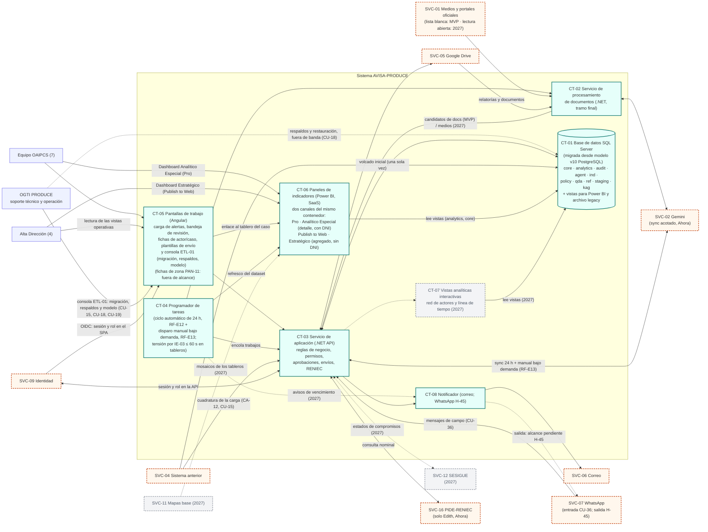

**Cómo se leen las flechas de este diagrama.** En C4 la flecha significa **«usa»**, no «le devuelve datos»: `A --> B` es «A llama a B». Por eso todas las escrituras a la base salen de CT-03, y los paneles **leen** la base en vez de recibir datos de ella. Las reglas que el diagrama hace cumplir:

1. **Solo CT-03 escribe en CT-01**, y eso es lo que hace auditable todo lo demás: ninguna pantalla, ningún panel y ningún trabajo programado tocan la base por su cuenta. Hay dos excepciones, y las dos son trabajo de base, no de aplicación: el **volcado inicial** desde el sistema anterior (SVC-04), que corre una sola vez, y los **respaldos y la restauración** (CU-18), que OGTI ejecuta fuera de banda. La **cuadratura** de esa carga sí pasa por la aplicación, en CA-12 (CU-15).
2. **Todo lo que el sistema lee de Gemini pasa por CT-02** (documentos) **o por CT-03** (mandatos de WhatsApp y enriquecimiento). No hay un tercer camino: es lo que permite aplicar el control de RF-E10 desde un solo punto.
3. **Los dos dashboards son el mismo contenedor con dos canales.** La diferencia —y la razón por la que no son dos nodos— es de publicación: Pro tiene seguridad por fila y puede llevar detalle; Publish to Web no la tiene y **nunca** lleva datos personales (RD-08).
4. **CT-07 (2027) es el único consumidor que aún no existe.** Se dibuja con línea discontinua porque depende de CT-03 para los datos; ninguna otra pieza debe depender de él en diciembre. El mapa no vive aquí: por distrito se sirve en el canal Analítico de CT-06 (§21.3).
5. **SVC-07 (WhatsApp) entra y sale, y solo la salida está en duda.** Es un servicio **activo** y se dibuja como integración, no como pendiente: **entra** con los mensajes de campo (CU-36, RF-E12, RN-16) y **sale** con los envíos. Lo que sigue abierto en H-45 es únicamente el **canal de salida** —si los envíos van por WhatsApp o solo por correo—; por eso la arista de salida va discontinua y la de entrada no.
6. **Las personas entran por CT-05**, con una sola excepción: la lectura de tableros, que va por CT-06. Nadie llega a CT-01 ni a CT-03 directamente. OGTI no es la excepción que parece: entra por la **consola ETL-01** de CT-05 y solo baja a la base para los respaldos (CU-18).

**Estado de cada contenedor**

| ID    | Contenedor                              | Qué hace                                                                                                                                                                                                            | Tecnología                                          | Estado                                      |
| ----- | --------------------------------------- | ------------------------------------------------------------------------------------------------------------------------------------------------------------------------------------------------------------------- | --------------------------------------------------- | ------------------------------------------- |
| CT-01 | Base de datos                           | Guarda todo; aplica seguridad por fila, cifrado de datos personales y auditoría                                                                                                                                     | **SQL Server** (migrada desde PostgreSQL v10, H-01) | **Resuelto**; migración en curso            |
| CT-02 | Servicio de procesamiento de documentos | Lee los documentos cargados y la lista blanca de fuentes, extrae actores, eventos y citas, propone puntaje de riesgo                                                                                                | **.NET** (OAIPCS/Diego)                             | **MVP (tramo final; no bloquea el núcleo)** |
| CT-03 | Servicio de aplicación (API)            | Reglas de negocio, permisos por perfil, aprobación de alertas, informes, envíos, **consulta nominal a RENIEC**                                                                                                      | **.NET** (confirmado por OGTI)                      | **Resuelto**                                |
| CT-04 | Programador de tareas                   | Lanza la recolección de la lista blanca, el ciclo de 24 h (RF-E12) y el disparo manual bajo demanda (RF-E13); además, recálculos, vencimientos y refresco de tableros; el refresco ≤ 60 s (IE-03) sigue sin ajustar | **[EN BLANCO · H-17]**                              | Por construir                               |
| CT-05 | Pantallas de trabajo                    | Cargar alertas, revisar y aprobar, ver fichas de actor y caso y armar plantillas de envío (las fichas de zona, PAN-11, quedan fuera de diciembre)                                                                   | **Angular** (confirmado por OGTI)                   | **Resuelto**                                |
| CT-06 | Paneles de indicadores                  | Un solo contenedor con dos canales de publicación: Analítico Especial (Pro, seguridad por fila, detalle y búsqueda por DNI) y Estratégico (Publish to Web, solo agregados, sin datos personales por RD-08)          | **Power BI** (SaaS; Pro + Publish to Web)           | Por construir                               |
| CT-07 | Vistas analíticas interactivas          | Red de actores y línea de tiempo (fase siguiente); el mapa por distrito se sirve desde CT-06                                                                                                                        | **[EN BLANCO · H-05]**                              | **2027**                                    |
| CT-08 | Notificador                             | Envía correos y deja registro de cada envío; el canal de WhatsApp sigue pendiente de definición (H-45)                                                                                                              | **[EN BLANCO · H-19]**                              | Por construir                               |

El C2 llega hasta aquí: dice **qué contenedor hay y cómo se hablan**, pero no dice qué caso de uso resuelve cada pieza. Eso está en la **página 5** del diagrama de casos de uso (§3.4), que baja un nivel —de contenedor a componente, con los códigos `CU-nn` dentro de cada caja— y trae la tabla «Reparto por contenedor» para quien tiene que leerla y no mirarla. Cuando las dos láminas discrepan, manda esta: el C2 nombra piezas, §3.4 nombra trabajo.

## 14.3 Nivel 3 — Componentes (qué hay dentro de las piezas clave)

### 14.3.1 Dentro del Servicio de procesamiento de documentos (CT-02) — tramo final del MVP

> Este servicio **se entrega en el tramo final de los 20 días**, en **.NET**, construido por OAIPCS (Diego). El núcleo del módulo **no depende** de él: si no llega a tiempo, todo opera con carga manual y esta sección queda como referencia de lo que se activa después.

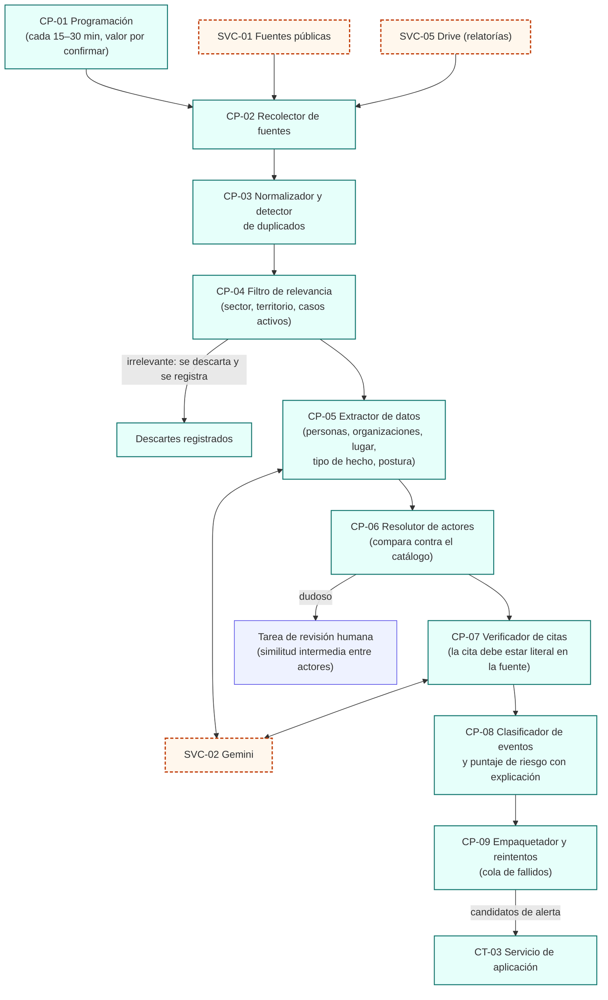

**Lo que este servicio no hace:** no aprueba ni publica nada, no fusiona actores por su cuenta, no recibe datos personales y no escribe directamente en las tablas de negocio (solo entrega **candidatos** al servicio de aplicación).

### 14.3.2 Dentro del Servicio de aplicación (CT-03)

> **Actualizado (R10):** **CA-10** (conector de Gemini) se construye **acotado** a la sincronización de la migración y al apoyo de mandatos por WhatsApp — no al procesamiento abierto de documentos, que es de **CT-02** (tramo final). **CA-05** (bandeja de revisión) recibe candidatos de CT-02 en cuanto el pipeline esté activo, y hasta entonces funciona solo con alertas cargadas a mano. Se agrega **CA-13**, exclusivo para el analista con privilegio RENIEC.

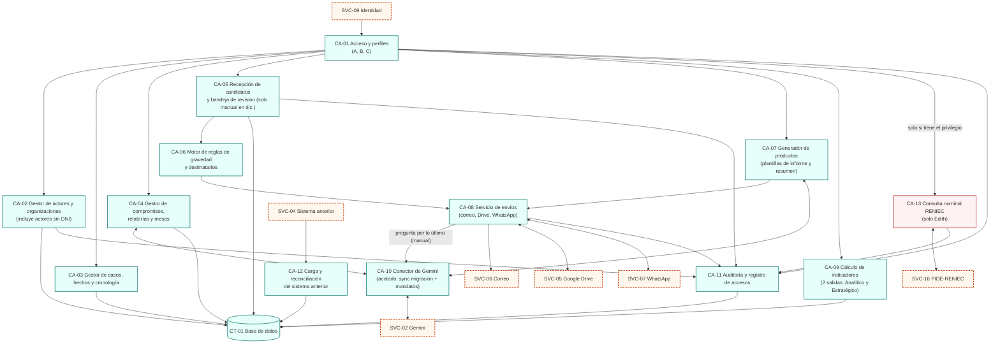

### 14.3.3 Dentro de la base de datos (CT-01): qué trae el MVP

Del inventario R5, **46 tablas** son del MVP: son las capas **T0 y T1** de `mvp_prioridad_tablas.csv` (34 ya tienen datos y 12 están todavía vacías). Las otras **219** no se usan aún. De esas 46, **45 se migran a SQL Server** en el módulo de diciembre: **solo `kag.aristas`** se difiere a 2027, porque el grafo de la red de actores (RF-H01, CT-07) es de 2027 y nada en diciembre lo consume (ver el recuadro siguiente). Las **otras tres tablas de `kag`** —`documento_fuente`, `documento_fragmento` y `entity_merge_log`— **sí entran**: son el corpus segmentado y el registro de fusiones sobre los que se apoya la base legal, y el procesamiento de documentos (RF-E) ya es de diciembre. A esas 45 se suman las **tablas padre** que sus claves ajenas necesitan para tener destino —`core.regiones`, `core.cat_unidades_organicas` y compañía—, y el conjunto que llega al _staging_ de la migración son **78 tablas** (medido sobre el catálogo, no estimado): 58 de `core`, 7 de `policy`, 4 de `kag`, 3 de `ind`, 2 de `qda`, 1 de `ref`, 1 de `agent`, 1 de `audit` y 1 de `staging`. Ese es el número que aplica `migration/mssql/00_alcance_mvp.sql`, no las 45.

> **Corrección (R10):** el esquema `kag` **no se difiere en bloque**. Lo que queda para 2027 es **solo el grafo** —`kag.aristas` y la visualización de la red de actores (RF-H01, CT-07)—: está creado y ya tiene 450 aristas de prueba, pero nada en diciembre lo consume, así que mantenerlo ahora no tiene destino. El **corpus, en cambio, entra**: `kag.documento_fuente` (10 filas), `kag.documento_fragmento` (vacía) y `kag.entity_merge_log` (vacía). El motivo es que `ref.base_legal_evidencia` —la tabla que liga cada base legal con el fragmento de documento que la sustenta, creada por el parche 14— apunta a `kag.documento_fragmento`: sin el corpus, esa clave ajena no tiene destino. Lo que **sí** entra desde siempre en `core` es la **tabla de actores** (`core.actores`) con sus relaciones básicas (RF-B06): eso basta para las fichas y para los 4 perfiles de la matriz de permisos (6.3). `kag.nodos` (1 520 nodos de prueba) se retoma en 2027 junto con CT-07.
>
> **Decisión pendiente [H-82]:** `ref.base_legal_evidencia` está hoy en la capa **T4** (vacía y sin vecinas con datos) y **no** aparece en la clausura de 78 tablas porque es hija, no padre. Si no se promueve, el enlace base legal ↔ corpus existe en PostgreSQL pero **no viaja a SQL Server**, y con él se pierde la trazabilidad que pide el artículo 14 de la Ley 29733.

**Qué hay dentro de la base, en un vistazo.** Las 46 tablas no son 46 piezas sueltas: son **nueve bloques funcionales dentro de `core`** (35 tablas) y **un esquema pequeño por cada uno de los otros ocho asuntos** (11 tablas). El primer diagrama muestra esa organización; el segundo abre `core` con los nombres reales de las tablas y las relaciones que ya existen en la base, medidas sobre el catálogo (no dibujadas a mano).

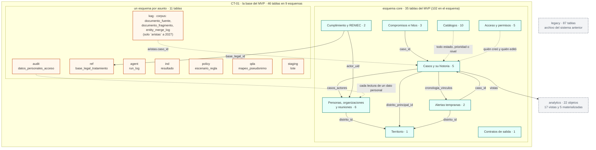

**Cómo se lee.** La caja grande es la base del MVP. Los nueve recuadros de `core` son bloques funcionales, no esquemas: agrupan las tablas que siempre se usan juntas. Los ocho recuadros de abajo son esquemas con una o cuatro tablas, cada uno con un solo asunto. `analytics` y `legacy` quedan **fuera** del recuento: el primero son las 22 vistas y tablas materializadas que alimentan los dos Power BI (el modelo tiene 37 objetos derivados en total); el segundo es la copia del sistema anterior, que se conserva como archivo y no se migra.

**El interior de core, con las tablas y sus relaciones.** Esta es la lámina de detalle. El relleno indica que la tabla ya tiene filas; el punteado, que está creada y todavía vacía. Las flechas son claves foráneas que existen hoy en la base, y llevan el nombre de la columna que las produce.

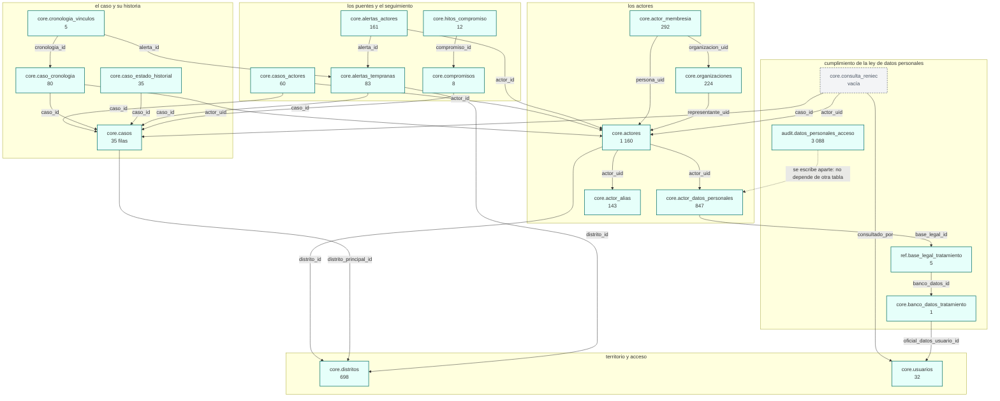

**Las tres cosas que este diagrama demuestra.** Primero, que el **caso es el centro**: la alerta, la cronología, el compromiso y el actor se cuelgan de él, y no al revés. Segundo, que el **actor es quien guarda el dato sensible**: el nombre y el DNI viven en `actor_datos_personales`, aparte de `actores`, que es la ficha que se consulta a diario; por eso la ley de datos personales se puede cumplir sin cifrar toda la base. Tercero, que **la ley tiene sus propias tablas**: la base legal en `ref.base_legal_tratamiento`, el banco de datos declarado en `core.banco_datos_tratamiento`, la consulta a RENIEC en `core.consulta_reniec` y el registro de cada lectura en `audit.datos_personales_acceso`, que se escribe aparte y **no depende de otra tabla** —esa es la garantía de que un borrado no se lleve la prueba de quién leyó qué.

| Esquema     | Qué guarda                                                                                                                                  | Tablas del MVP | Observación                                                                                     |
| ----------- | ------------------------------------------------------------------------------------------------------------------------------------------- | -------------: | ----------------------------------------------------------------------------------------------- |
| `core`      | Casos, hechos, actores (incluida la relación entre ellos), organizaciones, compromisos, alertas, documentos, usuarios, catálogos, geografía |             35 | Núcleo del MVP                                                                                  |
| `audit`     | Registro inmutable de acceso a datos personales y a RENIEC                                                                                  |              1 | Obligatorio                                                                                     |
| `agent`     | Registro de ejecuciones del conector de Gemini (CA-10 acotado)                                                                              |              1 | Trazabilidad del uso de IA                                                                      |
| `ind`       | Indicadores y resultados (alimenta los dos Power BI)                                                                                        |              1 | Hoy sin filas                                                                                   |
| `policy`    | Reglas de control (gravedad, enrutamiento)                                                                                                  |              1 |                                                                                                 |
| `staging`   | Aterrizaje temporal de cargas (migración y sync de Gemini)                                                                                  |              1 |                                                                                                 |
| `qda`       | Equivalencia de seudónimos (análisis cualitativo)                                                                                           |              1 | Por confirmar si entra (RF-N, 2027)                                                             |
| `ref`       | Base legal de cada tratamiento (soporte del Anexo D)                                                                                        |              1 | Soporte del Anexo D                                                                             |
| `kag`       | Grafo de conocimiento (nodos, aristas, fuentes)                                                                                             |              4 | 30 tablas creadas; 2 con datos; el corpus entra en diciembre y solo `aristas` se difiere a 2027 |
| `legacy`    | Copia exacta del sistema anterior (87 tablas)                                                                                               |              — | Se conserva como archivo                                                                        |
| `analytics` | Vistas para tableros e informes (filtradas: solo las de 7.2, Analítico y Estratégico)                                                       |              — | Alimenta los dos Power BI                                                                       |

> **Resuelto (H-01):** el motor de producción es **SQL Server**, no PostgreSQL. Las diferencias de tipos (`UUID`→`UNIQUEIDENTIFIER`, `JSONB`→`NVARCHAR(MAX)` + `ISJSON`) y de seguridad por fila se verifican según la tabla de 12.1.

## 14.4 Flujo de una alerta (de la fuente al destinatario)

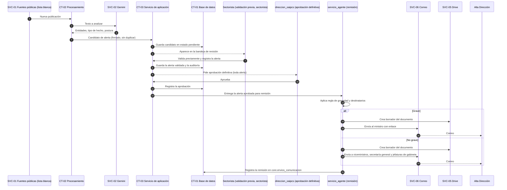

> **Quién registra cada paso.** El paso 1 (Elaboración) nace solo: `core.tg_alerta_nace()` inserta la fila en `core.proceso_instancia` al crearse la alerta. Los pasos 2 a 5 —validación previa, aprobación definitiva, remisión y archivo— los registra la aplicación. La remisión la ejecuta el servicio (`servicio_agente`), no el ministerio, y queda en `core.envios_comunicacion`. La **aprobación definitiva** deja además su firma en dos columnas propias de la alerta —`aprobada_por` y `aprobada_en`—, separada del resto del recorrido, mientras que el paso en sí se registra, como los demás, en `core.proceso_instancia`.

> **Con el pipeline (CT-02) activo**, el flujo es el de arriba. **Si CT-02 no llega**, los pasos 1 a 5 (fuente → procesamiento → candidato) se reemplazan por la **carga manual de la alerta** (RF-D01); aprobación, regla de gravedad y envío se mantienen igual **[EN BLANCO · H-45]**.

> Las alertas tempranas por **WhatsApp** que pidió Iván entran en diciembre como un paso más de envío, con plantillas transaccionales y línea postpago institucional (RM-16 a RM-19, 13.3); el costo por mensaje y la línea siguen por confirmar **[EN BLANCO · H-06]**.

## 14.5 Catálogo de servicios por integrar

Aquí están reunidos todos los servicios que el sistema necesita conectar. La ficha detallada de cada uno está en la sección 13.

| ID            | <u>Servicio</u>                                                                     | Para qué                                                                                              | Sentido      | Horizonte                   | Estado                                                          |
| ------------- | ----------------------------------------------------------------------------------- | ----------------------------------------------------------------------------------------------------- | ------------ | --------------------------- | --------------------------------------------------------------- |
| <u>SVC-01</u> | Medios digitales, portales oficiales y gob.pe (RSS y páginas públicas)              | Recibir noticias y reportes para generar candidatos de alerta                                         | Entra        | MVP (alcance acotado)       | Por definir lista blanca de fuentes **[H-32]**                  |
| <u>SVC-02</u> | **Modelo de lenguaje de Google (Gemini)**                                           | Extraer datos de textos y redactar borradores                                                         | Entra y sale | diciembre (acotado)         | Preferencia de OGTI; dictamen legal pendiente **[H-04]**        |
| <u>SVC-03</u> | Redes sociales (API oficial o proveedor licenciado de escucha social)               | Recibir las acciones de las OSPA que hoy llegan por redes                                             | Entra        | 2027                        | Sin proveedor ni costo                                          |
| <u>SVC-04</u> | Sistema anterior (Google Sheets + Apps Script)                                      | Fuente de la carga histórica y de los cambios hasta el cambio de sistema                              | Entra        | MVP                         | Carga histórica hecha; falta reconciliar                        |
| <u>SVC-05</u> | **Google Drive**                                                                    | Guardar borradores, relatorías y PDF                                                                  | Entra y sale | MVP (por confirmar)         | Por definir estructura de carpetas                              |
| <u>SVC-06</u> | **Correo institucional**                                                            | Enviar alertas, informes y resúmenes con enlace                                                       | Sale         | MVP (por confirmar)         | Por confirmar pasarela                                          |
| <u>SVC-07</u> | **WhatsApp**                                                                        | Enviar alertas tempranas                                                                              | Sale         | diciembre (acotado)         | Costo acotado con RM-16 a RM-19 (13.3)                          |
| <u>SVC-08</u> | SMS                                                                                 | Avisar crisis confirmadas                                                                             | Sale         | 2027                        | No incluido en el MVP **[H-07]**                                |
| <u>SVC-09</u> | Identidad institucional (inicio de sesión con grupos por perfil)                    | Saber quién es el usuario y qué perfil tiene                                                          | Entra        | MVP                         | **[EN BLANCO · H-20]** qué servicio usa OGTI                    |
| <u>SVC-10</u> | **Power BI** (dos salidas: <u>SVC-10a</u> Pro y <u>SVC-10b</u> Publish to Web, 6.2) | Tableros, tablas y mapas                                                                              | Sale         | MVP                         | Licencia confirmada                                             |
| <u>SVC-11</u> | Servicio de mapas base (mosaicos)                                                   | Mostrar mapas en diagramas y tableros                                                                 | Entra        | 2027                        | Los públicos no sirven para producción                          |
| <u>SVC-12</u> | SESIGUE                                                                             | Enviar estados de compromisos                                                                         | Sale         | 2027                        | Solo contrato de interfaz                                       |
| <u>SVC-13</u> | Fuentes oficiales previstas en la v10: IMARPE, OEFA, SUNAT, VUCE                    | Contexto del entorno y de la actividad pesquera                                                       | Entra        | 2027                        | Catálogo ya existe en la base                                   |
| <u>SVC-14</u> | Sistemas de otros ministerios: MEF, MINAM, MINCETUR, MININTER, RREE                 | Seguimiento interministerial de compromisos                                                           | Sale         | 2027                        | Vista ya prevista en la base                                    |
| <u>SVC-15</u> | Transcripción de audio a texto                                                      | Obtener las transcripciones de reuniones que pidió Iván                                               | Entra        | 2027 **[EN BLANCO · H-21]** | No se sabe si hoy se transcribe a mano o hace falta un servicio |
| <u>SVC-16</u> | **PIDE-RENIEC**                                                                     | Consultar requisitorias y antecedentes de un actor, **solo** para el analista con privilegio nombrado | Entra        | MVP (si se activa)          | Convenio con RENIEC; acceso nominal, nunca por rol genérico     |

## 14.6 Despliegue y ambientes

**[EN BLANCO · H-22]** Falta: dónde se aloja cada pieza (servidores de OGTI o nube), cuántos ambientes (desarrollo, pruebas, producción), cómo se accede (red privada), certificados y copias de seguridad. Responde: OGTI.

---

# 15. ESTADOS DE ERROR Y CASOS LÍMITE

| ID     | Situación                                                    | Comportamiento requerido                                                                                 |
| ------ | ------------------------------------------------------------ | -------------------------------------------------------------------------------------------------------- |
| ERR-01 | El usuario ingresa bien pero no tiene rol asignado           | Se informa que no tiene acceso y se avisa al administrador                                               |
| ERR-02 | Falla el servicio de login institucional                     | Se muestra un mensaje claro; no se permite ingreso alternativo con claves locales **[EN BLANCO · H-52]** |
| ERR-03 | Un usuario intenta ver algo fuera de su rol                  | No se muestra; queda registrado el intento                                                               |
| ERR-04 | Un caso no tiene actores o compromisos                       | La ficha lo indica en lugar de mostrarse vacía                                                           |
| ERR-05 | Un actor no tiene DNI                                        | Se permite el registro (RF-B01)                                                                          |
| ERR-06 | Se detecta un posible actor duplicado                        | Se avisa y se ofrece revisar; no se fusiona solo                                                         |
| ERR-07 | Una alerta pendiente no se atiende                           | Aparece en la lista de pendientes; el escalamiento automático queda para 2027 **[H-14, cerrada]**        |
| ERR-08 | Falla un envío (correo)                                      | Queda registrado con su motivo y se puede reintentar                                                     |
| ERR-09 | Un tablero no tiene datos                                    | Se indica «sin datos» con el motivo, no una pantalla en blanco                                           |
| ERR-10 | La precarga encuentra registros inconsistentes               | Se separan, se reportan y no se cargan hasta validarlos                                                  |
| ERR-11 | Un documento registrado no tiene archivo                     | Se muestra el aviso y se permite adjuntarlo después                                                      |
| ERR-12 | Dar visibilidad a una alerta sin las dos firmas              | Rechazo con `G21_SIN_APROBACION`; la alerta sigue en `interna`                                           |
| ERR-13 | Se piden los datos personales de un actor que no tiene ficha | Se responde **200** con `null` en los campos inexistentes, nunca 404                                     |

> **Qué ve el usuario ante `G21_SIN_APROBACION`.** El mensaje dice cuál de las dos firmas falta —la validación previa del Sectorista, la aprobación definitiva de la Dirección o las dos— y la alerta **no cambia de visibilidad**: sigue en `interna`. Se completa en PAN-06 el paso que falta y se vuelve a intentar. El intento rechazado tampoco deja rastro de auditoría, porque el gate corre antes que el disparador de auditoría (12.1).

---

# 16. VERIFICACIÓN Y CRITERIOS DE ACEPTACIÓN

Criterios de aceptación **propuestos** para el módulo de diciembre. Las pruebas T91 a T105 del MVP-45 se reutilizan **solo en lo que corresponda al alcance de diciembre**.

| ID    | Criterio                                                                                                                                                    | Cómo se verifica                                                                                                                                                                                                                                                                                                                    | Requisitos             |
| ----- | ----------------------------------------------------------------------------------------------------------------------------------------------------------- | ----------------------------------------------------------------------------------------------------------------------------------------------------------------------------------------------------------------------------------------------------------------------------------------------------------------------------------- | ---------------------- |
| AC-01 | Un usuario ingresa con su usuario institucional y ve el menú de su rol                                                                                      | Prueba con usuarios de cada rol                                                                                                                                                                                                                                                                                                     | RF-A01, RF-A02         |
| AC-02 | Ninguna consulta de un rol devuelve filas de otro alcance; la Alta Dirección no ve datos personales en el Dashboard Estratégico ni alertas sin aprobar      | Batería de pruebas de aislamiento por rol; el aislamiento de los tableros se verifica en AC-06                                                                                                                                                                                                                                      | RF-A03, RF-A04, RF-D12 |
| AC-03 | Se completa el circuito de punta a punta con datos de prueba: crear caso → registrar hecho, actor y compromiso → cargar alerta → aprobar → enviar           | Demostración con usuarios de OAIPCS                                                                                                                                                                                                                                                                                                 | RF-D01, RF-D03, RF-D07 |
| AC-04 | Se registra un actor sin DNI y luego se promueve sin perder historial                                                                                       | Prueba                                                                                                                                                                                                                                                                                                                              | RF-B01, RF-B02         |
| AC-05 | Los datos maestros precargados cuadran con el origen (cargados + fusionados + descartados + pendientes)                                                     | Reporte de reconciliación                                                                                                                                                                                                                                                                                                           | RF-M01                 |
| AC-06 | Los tableros prioritarios muestran cifras que coinciden con los registros y ninguna vista de `analytics` devuelve datos personales al Dashboard Estratégico | Contraste con las tablas + revisión de cada vista de `analytics` (ese esquema **no tiene RLS**: el aislamiento por rol o territorio debe estar en la definición de la vista o en el modelo de Power BI, no en políticas de fila) y de la lista de columnas que se publican por Publish to Web, que no debe incluir ninguna personal | RF-H02, RF-A04, RD-08  |
| AC-07 | Toda lectura de datos personales queda registrada y no se puede borrar                                                                                      | Lecturas de `core.actor_datos_personales` (847 filas) verificadas en `audit.datos_personales_acceso` (3 088 filas), más un intento de borrado que debe fallar                                                                                                                                                                       | RF-X01                 |
| AC-08 | OGTI reconstruye el módulo en un entorno limpio con la guía entregada                                                                                       | Prueba por OGTI                                                                                                                                                                                                                                                                                                                     | RNF-04                 |
| AC-09 | Cada servicio integrado funciona y falla de forma controlada                                                                                                | Prueba por servicio                                                                                                                                                                                                                                                                                                                 | Sección 13.1           |
| AC-10 | El gate G21 rechaza cualquier visibilidad distinta de `interna` mientras falte alguna de las dos firmas, y la acepta cuando están las dos                   | Prueba directa sobre la base: un `UPDATE` con `visibilidad = 'ejecutiva'` y sin aprobaciones devuelve la excepción `G21_SIN_APROBACION`; con la validación previa y la aprobación registradas, el mismo `UPDATE` pasa y la fila cambia                                                                                              | RF-D03, RF-D04, RN-04  |
| AC-11 | Las 83 alertas migradas quedan en `visibilidad = 'interna'` y con `paso_actual = 5`, y `core.vw_alerta_estado` las devuelve en 20 columnas                  | Consulta de contraste: 83 filas, ninguna fuera de `interna`, ninguna con `paso_actual` distinto de 5, y 20 columnas en la vista                                                                                                                                                                                                     | RF-M01, RF-D12         |
| AC-12 | La sincronización manual trae el dato con su fecha y hora, lo deja «pendiente de revisión» y respeta el límite de frecuencia                                | Prueba con un caso: dos sincronizaciones correctas muestran el sello de la última; al superar el tope de RN-18 el sistema no llama a Gemini y sigue mostrando el último dato con su fecha                                                                                                                                           | RF-E13, RF-E14, RN-18  |
| AC-13 | Un mensaje de WhatsApp entra como candidato con origen «WhatsApp» y pendiente de revisión; nada llega a la Alta Dirección sin aprobación                    | Envío de un mensaje de prueba al número dedicado: aparece en la bandeja (DOC-01) como candidato, no como alerta, y no se publica hasta pasar por validación y aprobación                                                                                                                                                            | RF-E12, RF-D02, RN-16  |

**Regla de cierre:** el módulo se acepta cuando pasan todos los AC _Must_ y los defectos abiertos son de gravedad **[EN BLANCO · H-55: definir con OGTI y firmar en el acuerdo de alcance]**.

---

# 17. MATRIZ DE TRAZABILIDAD

| Necesidad                                 | Historia     | Requisito              | Pantalla         | Origen de datos                                                    | Criterio        |
| ----------------------------------------- | ------------ | ---------------------- | ---------------- | ------------------------------------------------------------------ | --------------- |
| N-01, N-15 Quiénes actúan en una zona     | HU-01        | RF-F01, RF-F02         | PAN-11           | Vistas por definir **[H-41]**                                      | AC-03           |
| N-02 Reportes remitidos                   | HU-07        | RF-F05                 | PAN-04, PAN-11   | `analytics.vw_anexo_17_registro_reportes`                          | AC-03           |
| N-03 Compromisos de ayudas memoria        | HU-08        | RF-C01, RF-C02, RF-C05 | PAN-08           | `analytics.vw_anexo_14_seguimiento_compromisos`                    | AC-03, AC-06    |
| N-05, N-06 Directorios de autoridades     | HU-01        | RF-F03                 | PAN-11           | Vistas por definir **[H-41]**                                      | AC-03           |
| N-08 Validar alertas                      | HU-04        | RF-D03, RF-D04, RF-D12 | PAN-06           | `core.alertas_tempranas`                                           | AC-02, AC-03    |
| N-09 Teléfonos y OSPA                     | HU-02        | RF-B05, RF-B07, RF-F04 | PAN-07           | Vistas por definir **[H-41]**                                      | AC-02           |
| Exportar listas y mapa (CU-12)            | HU-02        | RF-F04, RF-F08         | PAN-07           | `core.actores`; hash en `audit.exportacion`                        | AC-09           |
| N-10 Cargar alertas                       | HU-03        | RF-D01                 | PAN-05           | `core.alertas_tempranas`                                           | AC-03           |
| N-11 Envío según prioridad                | HU-05, HU-06 | RF-D06, RF-G01, RF-G03 | PAN-09           | `core.envios_comunicacion`                                         | AC-03           |
| N-14 Riesgos por clasificación de eventos | HU-05        | RF-D05, RN-01          | PAN-05, PAN-06   | Catálogo por definir **[H-24]**                                    | **[EN BLANCO]** |
| Login institucional                       | —            | RF-A01, RF-A02         | PAN-01           | Identidad **[H-52]**                                               | AC-01           |
| Datos maestros                            | —            | RF-M01                 | —                | `legacy` → `core`                                                  | AC-05           |
| Tableros                                  | —            | RF-H02                 | TAB-01 a TAB-05  | Vistas `analytics`                                                 | AC-06           |
| N-04 Locales para reuniones               | —            | RF-F06                 | PAN-11           | `core.locales`                                                     | **[EN BLANCO]** |
| N-07 Análisis de casos                    | —            | RF-G05                 | PAN-04           | `analytics.vw_anexo_15_matriz_conflictividad`                      | **[EN BLANCO]** |
| N-12 Relatorías y transcripciones         | HU-08, HU-11 | RF-C02, RF-E01         | PAN-04, PAN-08   | `core.documentos`, `core.compromisos`                              | AC-03           |
| N-13 Envíos por correo y WhatsApp         | HU-05        | RF-D07, RF-D08         | PAN-09           | `core.envios_comunicacion`                                         | AC-03, AC-09    |
| N-16 Análisis de la pota                  | HU-13        | RF-H03, RF-N01         | —                | Vistas por definir **[H-35]**                                      | **[EN BLANCO]** |
| N-17 Perfiles de pescadores               | —            | RF-N02                 | —                | Vistas por definir **[H-36]**                                      | **[EN BLANCO]** |
| Sincronización bajo demanda (CU-35)       | HU-08b       | RF-E13, RF-E14, RN-18  | PAN-04 / ETL-01  | SVC-02 Gemini **[H-73]**                                           | AC-12           |
| Mensajes de WhatsApp (CU-36)              | HU-03        | RF-E12, RF-D02         | DOC-01 (bandeja) | SVC-07 WhatsApp                                                    | AC-13           |
| Actores sin DNI                           | HU-09        | RF-B01, RF-B02         | PAN-07           | `core.actores`, `core.actor_datos_personales`                      | AC-04           |
| Red de actores (N-01, N-17)               | HU-10        | RF-H01                 | —                | `analytics.vw_mactor_red_actores`                                  | **[EN BLANCO]** |
| Relatoría con IA                          | HU-11        | RF-E01, RF-E04, RF-E05 | —                | `core.documentos`                                                  | **[EN BLANCO]** |
| Resumen para la Alta Dirección            | HU-12        | RF-G04, RF-H05         | TAB-04           | `mv_dashboard_alta_direccion`, `analytics.vw_indicadores_minister` | AC-02, AC-06    |
| Auditoría de datos personales             | —            | RF-X01                 | AUD-01           | `audit.datos_personales_acceso`                                    | AC-07           |
| Entrega y reconstrucción del módulo       | —            | RNF-04                 | —                | Guía de reconstrucción y scripts **[H-61]**                        | AC-08           |

> **Filas que apuntan a PAN-11** (N-01/N-15, N-02 y N-05/N-06): PAN-11 quedó **fuera de los 20 días** (7.1 y 19), así que esas filas trazan requisitos que ya no son de diciembre a una pantalla que diciembre no entrega. Desde **R10, CU-11 —consultar fichas, directorios y reportes— es de 2027** y su pantalla es PAN-11; lo que sí es de diciembre es **CU-12**, la exportación, que se apoya en **RF-F04** (contactos, PAN-07) y **RF-F08**, y deja su hash en `audit.exportacion`.

> **Cobertura pendiente (actualizada al 2026-11-20):** ya tienen fila N-04, N-07, N-12, N-13, N-16, N-17 y HU-08b a HU-13, y AC-04 (HU-09), AC-07 (RF-X01), AC-08 (RNF-04) y AC-09 (N-13 y HU-08b) son criterio de alguna fila. Queda abierto: **RF-D05 sigue [EN BLANCO]** porque ningún AC de la sección 16 verifica la clasificación de eventos, que depende del catálogo H-24; **N-04, N-07, N-16/HU-13, N-17, HU-10 y HU-11 no tienen AC** porque la sección 16 solo cubre diciembre y esas filas son de 2027 (en HU-13 no habrá criterio hasta que H-35 defina «controversia» y fuentes); y **N-04 vuelve a apuntar a PAN-11**, que sigue fuera de los 20 días, igual que N-01/N-15, N-02 y N-05/N-06. Desde la novena pasada, **AC-10** y **AC-11** cubren el gate G21 y la foto de las 83 alertas, **AC-12** la sincronización manual y **AC-13** la entrada de mensajes de WhatsApp; la sincronización manual ya tiene pantalla —PAN-04 y la pestaña 1 de ETL-01—, con lo que **H-77 queda cerrado**.

---

# 18. PLAN DE 20 DÍAS, DEPENDENCIAS, DECISIONES PENDIENTES Y RIESGOS

## 18.1 El proceso acordado

> **Resuelto, pero invalida el plan secuencial (H-53):** OGTI fija el inicio de los **20 días técnicos** el **martes 24 de noviembre de 2026**. El documento preveía diseñar el prototipo (≈ 9,5 días, 7.4) **antes** de firmar el acuerdo y arrancar la parte técnica (18.1 original); con esta fecha **no hay margen previo**. El reparto que corresponde ahora:

| Cuándo                           | Qué se hace                                                                                                                                                                     |
| -------------------------------- | ------------------------------------------------------------------------------------------------------------------------------------------------------------------------------- |
| **Hoy (20-nov) al lunes 23-nov** | OAIPCS entrega: (a) los **wireframes del flujo principal** (circuito de 5.1, sin pulir las pantallas secundarias) y (b) los **scripts SQL Server** del modelo relacional (H-01) |
| **Martes 24-nov (día 1)**        | Los 4 desarrolladores arrancan **L0** (base de datos) y **L1** (login institucional) con lo entregado                                                                           |
| **Miércoles/jueves (días 2–3)**  | Mientras L0 y L1 avanzan, OAIPCS termina de **anotar las pantallas secundarias** (fichas 7.5) en paralelo, sin bloquear a OGTI                                                  |
| **Resto de los 20 días**         | Firma del acuerdo de alcance (sección 19) en paralelo a las primeras capas, no antes; se firma sobre lo ya construido en L0-L1 si hace falta ajustar                            |

> Esto reduce de **9,5 a ≈ 3 días hábiles** el tiempo de diseño previo. La metodología completa de 7.4 (los diez pasos) sigue siendo la referencia, pero se **comprime**: los pasos 1 a 6 (público, protagonista, narrativa, datos, forma, estilo) se hacen antes del martes; los pasos 7 a 10 (boceto, prueba, fidelidad media, anotación) se hacen **en paralelo** a L0 y L1, no antes.

> **Resuelto (H-02):** OGTI confirma **≈ 4 desarrolladores**. Propuesta de reparto por frente, siguiendo las capas de 5.5:

| Frente                                        | Capas                | Desarrollador(es) sugeridos                    |
| --------------------------------------------- | -------------------- | ---------------------------------------------- |
| Base de datos y migración a SQL Server        | L0                   | 1                                              |
| API .NET, seguridad e identidad               | L1, L3               | 1 a 2                                          |
| Frontend Angular y Power BI                   | L2, L4, L5 (parcial) | 1 a 2                                          |
| **Procesamiento de documentos (CT-02, .NET)** | **L6**               | **No es de OGTI: lo construye OAIPCS (Diego)** |

> **El frente L6 no compite con los tres frentes de OGTI.** El pipeline CT-02 lo construye OAIPCS (Diego) en paralelo y se entrega en el **tramo final de los 20 días**; su ausencia **no bloquea** la aceptación del núcleo (ver 1.2, 5.5 y 19). Lo que OGTI sí debe prever es **dónde corre y con qué credenciales** (H-81) y que CT-03 acepte los candidatos por una interfaz acordada (H-80).

> Dedicación exclusiva: **[EN BLANCO · H-70]**.

| Paso | Qué ocurre                                          | Entregable                        | Quién          | Cuándo                                             |
| ---- | --------------------------------------------------- | --------------------------------- | -------------- | -------------------------------------------------- |
| 1    | Wireframes del flujo principal y scripts SQL Server | Prototipo mínimo (no el completo) | OAIPCS (Diego) | Entre hoy y el lunes 23-nov                        |
| 2    | **Documento de análisis** con reglas y roles        | Este documento (secciones 4 a 8)  | OAIPCS         | Avance a Dilayda **antes del martes**              |
| 3    | **Parte técnica inicia** (L0 y L1)                  | Base de datos y login en marcha   | OGTI           | **Resuelto: martes 24-nov-2026**                   |
| 4    | **Acuerdo firmado** sobre el alcance definitivo     | Sección 19 firmada                | OAIPCS y OGTI  | En paralelo a L0-L1, primera semana                |
| 5    | **Resto de la parte técnica**                       | Módulo de diciembre en producción | OGTI           | 20 días desde el 24-nov → **cierre ≈ 13-dic-2026** |

> **Calendario:** 20 días corridos desde el **martes 24 de noviembre de 2026** hasta aproximadamente el **13 de diciembre de 2026**. La migración de datos (RF-M01) debe estar lista **al menos para el 23 de diciembre** (H-29), lo que deja un margen corto entre el cierre técnico y la reconciliación final — ver riesgo RIE-13 en 18.4.

## 18.2 Dependencias de OGTI

| ID  | Dependencia                                                                                                                                           | Fecha límite                                                                                                                               | Si no llega                                                  |
| --- | ----------------------------------------------------------------------------------------------------------------------------------------------------- | ------------------------------------------------------------------------------------------------------------------------------------------ | ------------------------------------------------------------ |
| D-1 | Entorno de base de datos (versión, extensiones y permisos)                                                                                            | **[EN BLANCO]**                                                                                                                            | Ver H-01                                                     |
| D-2 | Servicio de identidad institucional y grupos por rol                                                                                                  | **[EN BLANCO]**                                                                                                                            | Ver H-52                                                     |
| D-3 | Entorno de aplicación (servidor, certificados, acceso por red privada)                                                                                | **[EN BLANCO]**                                                                                                                            | Ver H-22                                                     |
| D-4 | Desarrolladores asignados y su dedicación                                                                                                             | **Resuelto (H-02): ≈ 4 desarrolladores** (propuesta de reparto en 18.1); falta confirmar si es dedicación exclusiva **[EN BLANCO · H-70]** | Se repite el cuello de botella de un solo recurso por frente |
| D-5 | Revisión del prototipo por OGTI                                                                                                                       | **[EN BLANCO]**                                                                                                                            | Se cierra el acuerdo sin la revisión técnica                 |
| D-6 | Diseñar el prototipo en Figma **pensando en componentes estándar de Angular**: tablas paginadas, formularios reactivos, modales y etiquetas de estado | Antes de iniciar L2                                                                                                                        | Recodificación de componentes por OGTI                       |
| D-6 | Validación del catálogo de estados de caso por OAIPCS                                                                                                 | **[EN BLANCO]**                                                                                                                            | Se usa el catálogo del MVP-45 y se registra como supuesto    |
| D-7 | **Lista blanca de fuentes públicas (H-32)**: sin ella, CT-02 opera solo con documentos cargados a mano                                                | Antes de activar la recolección (tramo final)                                                                                              | Se arranca con carga manual de documentos                    |
| D-8 | **Entrega del pipeline CT-02 (.NET) por OAIPCS (Diego)**: repositorio, dependencias y credenciales de Gemini (H-80, H-81)                             | Tramo final de los 20 días                                                                                                                 | El módulo se acepta igual; el pipeline pasa a adenda         |
| D-9 | **Formato de intercambio de candidatos** entre CT-02 y CT-03 (RF-D02)                                                                                 | Antes de conectar el pipeline                                                                                                              | CT-02 entrega archivos que se cargan a mano                  |

## 18.3 Decisiones pendientes

**Para cerrar en la reunión del martes** (de ellas depende el resto): **H-45** (qué necesidades caben en diciembre), **H-47** (uso real del AVISA actual), **H-49** y **H-50** (pantallas y tableros prioritarios; el recorte de RIE-13 ya deja 2 o 3 tableros sobre vistas existentes), **H-51** (datos maestros), **H-52** (login institucional), ~~H-53~~ (calendario, **resuelto: inicia 24-nov-2026**), **H-57** (quién aprueba), **H-63** (orden de las capas), ~~**H-64**~~ (licencias de Power BI, **resuelto en 13.3.4**: las 7 Pro ya pagadas cubren a los 7 usuarios del Analítico Especial y el Estratégico va por Publish to Web, sin costo) y **H-65** (quién paga los servicios) y **H-68** (convenio con RENIEC y quién asigna el privilegio). Ya resueltos: **H-44** (modelo relacional) y **H-46** (OAIPCS diseña el prototipo).

**Para después:** el resto, registrado en el Anexo C — entre ellas **H-16** (administrador operativo: sigue sin designarse; la Directora solo tiene `direccion_oaipcs`, 6.1) y **H-09** (peso de los factores de prioridad, cuya rúbrica propuesta está en 11.1). **H-14** (plazos por prioridad) queda **cerrada** en la décima pasada: los plazos son **`sla_horas` 24, 48 y 72**, homologados con las **4 filas** de `core.cat_prioridades_alerta` —tres prioridades con plazo y `Seguimiento`, que se observa sin plazo y no es gravedad—. **H-79** (cómo se elige el rol de la sesión) sigue abierta: no es lo mismo que la regla de **cuatro ojos**, que el parche 23 ya impone y que se registra como **[H-84]** para no confundir las dos.

## 18.4 Riesgos

| ID         | Riesgo                                                                                                                                                                                                                                                                                | Prob.     | Impacto   | Mitigación                                                                                                                                                                                                                                                                                                                                                                                                                                                                                                                                                | Señal temprana                                                                        |
| ---------- | ------------------------------------------------------------------------------------------------------------------------------------------------------------------------------------------------------------------------------------------------------------------------------------- | --------- | --------- | --------------------------------------------------------------------------------------------------------------------------------------------------------------------------------------------------------------------------------------------------------------------------------------------------------------------------------------------------------------------------------------------------------------------------------------------------------------------------------------------------------------------------------------------------------- | ------------------------------------------------------------------------------------- |
| RIE-01     | Expectativas desalineadas: se espera recibir la aplicación actual tal cual                                                                                                                                                                                                            | Alta      | Alto      | Mostrar primero la **paridad** (sección 5) y dejar el rediseño como mejora interna                                                                                                                                                                                                                                                                                                                                                                                                                                                                        | Preguntas por pantallas que ya existen                                                |
| RIE-02     | La conversación vuelve al nivel técnico (LLM, WhatsApp, servidores)                                                                                                                                                                                                                   | Media     | Alto      | Llevar solo lo que se pidió; el resto, material interno                                                                                                                                                                                                                                                                                                                                                                                                                                                                                                   | Se abre un tema de la sección 13                                                      |
| RIE-03     | Postura no unificada de OAIPCS                                                                                                                                                                                                                                                        | Media     | Alto      | Acordar una sola voz y enviar avance previo                                                                                                                                                                                                                                                                                                                                                                                                                                                                                                               | Mensajes distintos antes del martes                                                   |
| RIE-04     | 20 días no alcanzan                                                                                                                                                                                                                                                                   | Alta      | Alto      | Alcance mínimo y reclasificación a 2027 **[H-45]**                                                                                                                                                                                                                                                                                                                                                                                                                                                                                                        | Pantallas sin priorizar                                                               |
| RIE-05     | Los desarrolladores solo tienen presupuesto hasta diciembre                                                                                                                                                                                                                           | Media     | Alto      | Documentar y entregar de modo que el módulo sea mantenible                                                                                                                                                                                                                                                                                                                                                                                                                                                                                                | Sin asignación confirmada **[H-02]**                                                  |
| RIE-06     | La traducción PostgreSQL → SQL Server pierde reglas de seguridad por fila o datos en la conversión                                                                                                                                                                                    | Media     | Alto      | Los tres puntos de incompatibilidad de 12.1; reconciliación obligatoria antes del 23-dic (H-29)                                                                                                                                                                                                                                                                                                                                                                                                                                                           | Diferencias en el conteo de filas tras la carga                                       |
| RIE-07     | Exposición de datos personales en la precarga o el prototipo                                                                                                                                                                                                                          | Baja      | Alto      | Datos de prueba sin teléfonos ni DNI reales; cifrado y registro de lecturas                                                                                                                                                                                                                                                                                                                                                                                                                                                                               | Datos reales en archivos del prototipo                                                |
| RIE-08     | Pocos datos para calcular indicadores (8 compromisos, 0 resultados)                                                                                                                                                                                                                   | Alta      | Medio     | Tableros sobre las vistas existentes; indicadores como índices de gestión                                                                                                                                                                                                                                                                                                                                                                                                                                                                                 | Tablero «sin datos»                                                                   |
| RIE-09     | El alcance se amplía después de la firma                                                                                                                                                                                                                                              | Media     | Alto      | Control de cambios del acuerdo                                                                                                                                                                                                                                                                                                                                                                                                                                                                                                                            | Peticiones fuera del acuerdo                                                          |
| RIE-10     | Costos de servicios externos asumidos por OAIPCS sin presupuesto definido                                                                                                                                                                                                             | Media     | Alto      | Reglas RM-01 a RM-10; solo servicios existentes en diciembre; tope de gasto                                                                                                                                                                                                                                                                                                                                                                                                                                                                               | Pedido de contratar un servicio sin responsable de pago                               |
| RIE-11     | Las licencias de Power BI no cubren a quienes ven los tableros                                                                                                                                                                                                                        | Media     | Medio     | **[H-64 resuelto]**: las 7 Pro ya pagadas cubren a los 7 usuarios del Analítico Especial y el Estratégico va por Publish to Web sin costo (13.1, 13.3.4). La capacidad de la **Alta Dirección** es otro asunto: son 4 Pro más, **RIE-16** y **H-78**                                                                                                                                                                                                                                                                                                      | Lectores sin acceso                                                                   |
| RIE-12     | El privilegio de RENIEC se usa fuera de un caso, o se comparte entre varias personas                                                                                                                                                                                                  | Baja      | Alto      | Usuario nominal único, motivo obligatorio, auditoría inmutable (RA-07, RA-08)                                                                                                                                                                                                                                                                                                                                                                                                                                                                             | Consultas sin caso asociado                                                           |
| **RIE-13** | **Sobrecarga de alcance: el documento deja abiertas 10 pantallas núcleo (7.1), 5 tableros (7.2), seguridad por fila en 91 tablas (12.1) y conexiones externas condicionadas (PIDE-RENIEC, Drive). Mantener eso a la vez pone en riesgo que los 4 desarrolladores lleguen en 20 días** | **Alta**  | **Alto**  | **Recortar antes del martes** a lo estrictamente necesario: login institucional + flujo central (casos, actores, alertas, validación y envío por correo) + 2 o 3 tableros sobre vistas ya existentes (ver 7.1, 7.2 y 19). **PIDE-RENIEC queda condicionada al convenio (H-68), no fuera de los 20 días**: si el convenio se firma, la base ya soporta el resultado en `core.consulta_reniec`; de las conexiones condicionadas, **Drive (SVC-05) es la única que sale de los 20 días**. Las pantallas secundarias se anotan en paralelo sin bloquear L0-L1 | Más de 6 pantallas o más de 3 tableros aún «por confirmar» al cierre del lunes 23-nov |
| RIE-14     | El cierre técnico (≈ 13-dic) deja poco margen hasta el plazo legal de migración (23-dic, H-29) para resolver hallazgos de la reconciliación                                                                                                                                           | Media     | Medio     | Correr la reconciliación (RF-M01) sobre SQL Server **durante** los 20 días, no después                                                                                                                                                                                                                                                                                                                                                                                                                                                                    | Reconciliación programada solo para después del 13-dic                                |
| **RIE-15** | **El pipeline CT-02 (.NET) no llega en el tramo final: depende de una persona (Diego), de la lista blanca (H-32) y de las credenciales de Gemini**                                                                                                                                    | **Media** | **Medio** | **El núcleo del módulo no depende del pipeline**: se acepta con carga manual y CT-02 pasa a adenda. El contrato de intercambio (D-9) se fija temprano para que conectarlo después no cueste retrabajo en CT-03                                                                                                                                                                                                                                                                                                                                            | Candidatos que no aparecen en la bandeja al cierre del día 15                         |
| **RIE-16** | **Las 4 licencias Power BI Pro de la Alta Dirección no están confirmadas** y el documento no tiene precio unitario: si no llegan, esas 4 personas no entran al Analítico Especial ni a las pantallas de operación                                                                     | **Media** | **Medio** | Confirmarlas con OGTI antes de firmar el acuerdo (**H-78**, 13.3.4). Mientras no estén, la Alta Dirección conserva el **Estratégico** (Publish to Web, sin costo) como pantalla de inicio y el Analítico queda para las 7 del equipo                                                                                                                                                                                                                                                                                                                      | Alguien de la Alta Dirección sin acceso al tablero acordado                           |
| **RIE-17** | **El gate G21 exige dos firmas que el sistema anterior nunca registró**: las 83 alertas migradas no tienen aprobador, así que cualquier intento de darles visibilidad se rechaza, y existe la tentación de reconstruir firmas que no existieron                                       | **Media** | **Medio** | Dejarlas en `interna` y en el paso 5 (Archivo), documentando «no consta» (12.1). Si alguna debe publicarse, se hace con un acto humano de hoy —validación y aprobación nuevas— y queda su rastro. No se siembran aprobaciones                                                                                                                                                                                                                                                                                                                             | Pedidos de «completar» aprobaciones de alertas viejas                                 |

---

# 19. ACUERDO DE ALCANCE (BORRADOR PARA FIRMA)

> **Borrador.** Se firma **en paralelo a las primeras capas (L0-L1)**, no antes: el 24-nov-2026 arranca la parte técnica y no hay margen previo (H-53, 18.1). El documento de análisis es el avance previo y el prototipo se termina mientras L0-L1 avanzan.

| Campo                                                         | Contenido                                                                                                                                                                                                                                                                                                                                                                                                                                                                                                                                                                                                                                          |
| ------------------------------------------------------------- | -------------------------------------------------------------------------------------------------------------------------------------------------------------------------------------------------------------------------------------------------------------------------------------------------------------------------------------------------------------------------------------------------------------------------------------------------------------------------------------------------------------------------------------------------------------------------------------------------------------------------------------------------- |
| **Partes**                                                    | OAIPCS y OGTI — PRODUCE                                                                                                                                                                                                                                                                                                                                                                                                                                                                                                                                                                                                        |
| **Objeto**                                                    | Módulo mínimo en producción en diciembre de 2026: **login institucional + flujo central** (casos, actores, alertas, validación y envío por correo) + **2 o 3 tableros en Power BI sobre vistas ya existentes**                                                                                                                                                                                                                                                                                                                                                                                                                                     |
| **Plazo**                                                     | 20 días: **24-nov-2026 a ≈ 13-dic-2026**                                                                                                                                                                                                                                                                                                                                                                                                                                                                                                                                                                                                           |
| **Dentro del alcance (núcleo, recortado y cerrado — RIE-13)** | Circuito funcional (sección 5) · login institucional, roles y permisos (sección 6) · **10 pantallas núcleo**, PAN-01 a PAN-10, y las vistas Must **AUD-01** (bitácora), **ETL-01** (ingesta, migración y soporte OGTI) y **DOC-01** (bandeja de candidatos) (7.1) · **sincronización con Gemini** (CU-35 automática y manual cada 24 h, CU-36 mensajes de WhatsApp) (13.1) · tableros TAB-02 y TAB-04 (y TAB-03 si el tiempo alcanza) (7.2) · datos maestros precargados (sección 8)                                                                                                                                                               |
| **Fuera del alcance de los 20 días**                          | **Google Drive (SVC-05)** · la pantalla **PAN-11**, con las fichas, directorios y reportes completos (**CU-11**) · tableros TAB-01 y TAB-05 · **lectura abierta** de fuentes públicas y redes sociales · diagrama interactivo de la red de actores · el **envío abierto** de WhatsApp más allá del alcance acotado —la **recepción** de mensajes de campo sí entra, por CU-36— · simulador · portal para actores externos · integración con SESIGUE · análisis de la pota y de los perfiles de pescadores · PIDE-RENIEC (SVC-16) queda **condicionada al convenio (H-68)**: si se firma, se usa y el resultado se guarda en `core.consulta_reniec` |
| **Dependencia externa del tramo final**                       | El **pipeline de procesamiento de documentos (CT-02)**, en **.NET**, construido por **OAIPCS (Diego)**, se entrega en el tramo final de los 20 días y cubre RF-E01 a RF-E06 y RF-E11. **No es condición de aceptación del núcleo**: si no llega, el módulo se acepta igual con carga manual y el pipeline pasa a adenda                                                                                                                                                                                                                                                                                                                            |
| **Plataforma y base de datos**                                | **Resuelto:** Angular (frontend) + .NET (API) + **SQL Server** (destino de producción), migrado desde el modelo relacional v10 · orden de capas **[EN BLANCO · H-63]**                                                                                                                                                                                                                                                                                                                                                                                                                                                                             |
| **Entregables**                                               | Módulo en producción · guía de reconstrucción · documentación de reglas y roles · reporte de reconciliación de la precarga (antes del 23-dic-2026, H-29)                                                                                                                                                                                                                                                                                                                                                                                                                                                                                           |
| **Criterios de aceptación**                                   | Sección 16 · gravedad de defectos aceptable para el cierre: **[EN BLANCO · H-55]**                                                                                                                                                                                                                                                                                                                                                                                                                                                                                                                                                                 |
| **Responsabilidades de OAIPCS**                               | Diseñar el prototipo · entregar los documentos del modelo relacional, ya traducidos a SQL Server (5.4) · priorizar pantallas y tableros dentro del núcleo · validar catálogos · validar la precarga · designar punto focal                                                                                                                                                                                                                                                                                                                                                                                                                         |
| **Responsabilidades de OGTI**                                 | Plataforma (Angular, .NET, SQL Server) · login institucional · 4 desarrolladores · puesta en producción · revisar y optimizar el modelo relacional · cubrir los servicios existentes (identidad, Power BI, correo)                                                                                                                                                                                                                                                                                                                                                                                                                                 |
| **Cambios al alcance**                                        | Solo por acuerdo escrito de ambas partes; **Drive (SVC-05)** solo se incorpora en una adenda posterior, no dentro de los 20 días; **PIDE-RENIEC (SVC-16)** depende del convenio (H-68)                                                                                                                                                                                                                                                                                                                                                                                                                                                             |
| **Restricciones y supuestos**                                 | RES-01 a RES-12 y SUP-01 y SUP-02 (sección 2.6)                                                                                                                                                                                                                                                                                                                                                                                                                                                                                                                                                                                                    |

| Firma  | Nombre                                                               | Cargo | Fecha |
| ------ | -------------------------------------------------------------------- | ----- | ----- |
| OAIPCS | **[EN BLANCO · H-57: quién de OAIPCS firma — Luis, Dilayda u otro]** |       |       |
| OGTI   | **[EN BLANCO · H-57]**                                               |       |       |

---

# 20. VISIÓN POSTERIOR

> **Se lleva a la reunión en una sola línea; se conversa en 2027.**

_Más adelante, el sistema podrá incorporar la lectura abierta de fuentes públicas y redes sociales a escala, la red interactiva de actores y el análisis de conflictos a través del tiempo._

---

---

# 21. CATÁLOGO DE VISTAS Y TABLEROS DEL SISTEMA FUTURO

> Lista de referencia construida a partir de las vistas ya existentes en la base (R3, esquemas `analytics` y `core`), las necesidades de Edith, Iván y Esteban (sección 3.3), los indicadores del MVP-45 (R2) y la metodología de diseño (7.4). Ordenada por **cuándo entra**: módulo de diciembre y 2027, con sus dos tramos. Dentro de cada horizonte, por importancia (1 = más importante).

## 21.1 Diciembre 2026 (módulo mínimo)

Los cinco primeros ya están detallados en 7.2; aquí con su protagonista y su casa. Las filas **6 a 8** no son tableros: son funciones de pantalla que también entran en diciembre.

| #   | Vista o tablero                              | Protagonista           | Pregunta que responde                                    | Público                             | Vista existente                                 | Dashboard               |
| --- | -------------------------------------------- | ---------------------- | -------------------------------------------------------- | ----------------------------------- | ----------------------------------------------- | ----------------------- |
| 1   | **Seguimiento de compromisos**               | El compromiso          | ¿Qué está vigente, cumplido o vencido?                   | Analista, Dirección, Alta Dirección | `vw_anexo_14_seguimiento_compromisos`           | Ambos (TAB-02)          |
| 2   | **Alertas por estado y prioridad**           | La alerta              | ¿Cuántas esperan revisión y desde cuándo?                | Analista, Dirección                 | `core.vw_alerta_estado` (83 filas, 20 columnas) | Analítico (TAB-05)      |
| 3   | **Foto para la Alta Dirección**              | La región              | ¿Qué requiere decisión y cuándo?                         | Alta Dirección                      | `mv_dashboard_alta_direccion`                   | Ambos (TAB-04)          |
| 4   | **Casos estancados**                         | El caso sin avance     | ¿Qué caso lleva tiempo sin moverse?                      | Dirección                           | `vw_casos_estancados`                           | Analítico (TAB-03)      |
| 5   | **Panorama regional**                        | La región              | ¿Cómo se comparan las regiones?                          | Analista                            | `vw_anexo_02_panorama_regional`                 | Estratégico (TAB-01)    |
| 6   | **Bandeja de candidatos de alerta**          | El candidato propuesto | ¿Qué propuso el sistema y qué decido?                    | Analista                            | — (bandeja **DOC-01**)                          | — (pantalla DOC-01)     |
| 7   | **Sincronización bajo demanda de una pieza** | La pieza consultada    | ¿Qué dice hoy la información más reciente de esta pieza? | Analista, Dirección                 | `agent.llm_call`, `agent.run_log`               | — (PAN-04 y directorio) |
| 8   | **Mensajes de WhatsApp como candidatos**     | El mensaje recibido    | ¿Qué llegó por WhatsApp y espera revisión?               | Analista                            | Mensajes de **SVC-07** (origen «WhatsApp»)      | — (bandeja DOC-01)      |

> **A qué casa va cada tablero y qué entra en diciembre (6.2, 7.2, 19).** La columna «Dashboard» repite lo que fija 7.2, que es la fuente: **#1 (TAB-02)** y **#3 (TAB-04)** van en **los dos** —detalle en el Analítico Especial y versión agregada, sin datos personales, en el Estratégico—; **#4 (TAB-03)** y **#2 (TAB-05)** van solo al **Analítico Especial** —las alertas, porque muestran cuántas esperan revisión—; **#5 (TAB-01)** va solo al **Estratégico**, con agregados por región. El criterio no es el público sino la regla: **RD-08** prohíbe que un dato personal o una alerta sin aprobar pasen por Publish to Web. La nota anterior decía que 6.2 no asignaba TAB-01 ni TAB-05 a ningún tablero y que la asignación de 7.2 quedaba «por verificar»; ya no: 7.2 asigna TAB-01 al Estratégico y TAB-05 al Analítico Especial, y esa es la asignación que vale. Del catálogo entran TAB-02 y TAB-04 (y TAB-03 si el tiempo alcanza); **#2** y **#5** quedan **fuera de los 20 días**. Las filas **6 a 8** no son tableros: son funciones de pantalla de la aplicación —la bandeja de candidatos (**DOC-01**) es núcleo Must, y la sincronización manual vive en **PAN-04**, en el directorio y en la pestaña 1 de **ETL-01**—, donde el detalle y los datos personales sí pueden verse porque el canal está autenticado y cada lectura queda auditada (12.4).

## 21.2 2027, tramo 1 (lectura abierta de fuentes, redes e IA a escala)

| #   | Vista o tablero                                      | Protagonista                | Pregunta que responde                            | Público                   | Por qué entra aquí                                                                                        |
| --- | ---------------------------------------------------- | --------------------------- | ------------------------------------------------ | ------------------------- | --------------------------------------------------------------------------------------------------------- |
| 9   | **Red de actores de un caso** (diagrama interactivo) | El actor y sus relaciones   | ¿Quién influye sobre quién y cómo se alinea?     | Analista                  | Pedido directo de los tres usuarios (N-01, N-17); depende de RF-H01 y de MACTOR (`vw_mactor_red_actores`) |
| 10  | **Clima social por zona**                            | La zona                     | ¿Cómo está el ambiente social hoy?               | Dirección, Alta Dirección | Pedido explícito de Edith (N-08); requiere agregación automática                                          |
| 11  | **Mapa de casos y actores**                          | El territorio               | ¿Dónde están ocurriendo los casos?               | Analista, Dirección       | RF-H04; requiere servicio de mapas (SVC-11)                                                               |
| 12  | **Consultar fichas, directorios y reportes** (CU-11) | La zona y la persona        | ¿Quiénes actúan en una zona y a quién llamo?     | Analista                  | Dejó de ser MVP en R10 (4.6); su pantalla es PAN-11 y sirve RF-F01, F02, F03, F05, F06 y F07              |
| 13  | **Calidad de la extracción** (panel técnico)         | La corrida de procesamiento | ¿Qué tan bien está funcionando la IA?            | Administrador             | RF-E11; necesario para confiar en los candidatos                                                          |
| 14  | **Explicación de riesgo** (detalle del semáforo)     | El caso                     | ¿Por qué este caso está en este nivel?           | Dirección                 | RF-H06; requiere el puntaje de riesgo con factores (RF-E06)                                               |
| 15  | **Resumen ejecutivo de una página**                  | El caso o la zona           | ¿Qué cambió y qué decisión se requiere?          | Alta Dirección            | RF-G04; es el resumen redactado con apoyo de IA                                                           |
| 16  | **Tiempo de atención de alertas**                    | La alerta                   | ¿Se está cumpliendo el plazo según su prioridad? | Dirección                 | RF-J02, RN-13                                                                                             |
| 17  | **Cumplimiento de compromisos** (índice)             | El conjunto de compromisos  | ¿Qué proporción de lo exigible se cumplió?       | Dirección                 | RF-J02, RN-12                                                                                             |
| 18  | **Polarización de actores** (índice)                 | El caso                     | ¿Qué tan enfrentados están los actores?          | Analista                  | RF-J02; depende de la red de actores (#9)                                                                 |

> **Lo que cambió de horizonte (R10 y novena pasada).** La **bandeja de candidatos de alerta** salió de esta lista: su bandeja es núcleo de diciembre (**DOC-01**, #6 en 21.1). Entró en cambio el **#12**, la consulta de **fichas, directorios y reportes (CU-11)**, que dejó de ser MVP en R10 y se construye sobre **PAN-11**; lo que sí es de diciembre es su exportación —contactos, listas de asistencia y mapa de actores— con **CU-12** (RF-F04, RF-F08).

## 21.3 2027, tramo 2 — MADRE (proyecto completo v10)

> **Este tramo no es un horizonte distinto.** Es la segunda parte de 2027 —a la que los documentos llaman **MADRE**—, la que espera servicios externos, convenios o calibraciones que todavía no existen: el orden entre 21.2 y 21.3 es de **dependencia**, no de fecha. Las vistas que comparten esa condición con el tramo —por ejemplo el **#11**, el mapa, que depende de <u>SVC-11</u>— se construyen en la práctica junto con estas.

| #   | Vista o tablero                                             | Protagonista                                  | Pregunta que responde                                                       | Público                            | Por qué entra aquí                                                       |
| --- | ----------------------------------------------------------- | --------------------------------------------- | --------------------------------------------------------------------------- | ---------------------------------- | ------------------------------------------------------------------------ |
| 19  | **Análisis de la pota a través del tiempo**                 | La controversia                               | ¿Cómo evolucionó este conflicto, con qué normas y qué acciones de las OSPA? | Esteban y analistas especializados | Pedido directo (N-16); requiere redes sociales (SVC-03) y capa normativa |
| 20  | **Perfiles y alineamientos de pescadores**                  | El pescador o la OSPA                         | ¿Qué diversidad de posiciones hay y cómo cambian?                           | Esteban                            | Pedido directo (N-17); requiere los «capitales» definidos (H-36)         |
| 21  | **Matriz de conflictividad**                                | El conjunto de casos                          | ¿Qué patrones se repiten entre casos?                                       | Dirección                          | `vw_anexo_15_matriz_conflictividad`, ya existe                           |
| 22  | **Análisis de casos (formato Anexo 8)**                     | El caso                                       | ¿Cuál es el análisis oficial completo de este caso?                         | Dirección, Alta Dirección          | Pedido de Edith (N-07); formato institucional (H-27)                     |
| 23  | **Simulador de escenarios** («¿qué pasa si…?»)              | El escenario hipotético                       | ¿Qué podría pasar si cambia una condición?                                  | Dirección                          | RF-J04; explícitamente rotulado como no vigente                          |
| 24  | **Tendencia de riesgo a 30 días**                           | El caso                                       | ¿Hacia dónde va el riesgo?                                                  | Dirección                          | RF-J05; rotulado como proxy, no predicción                               |
| 25  | **Condiciones de diálogo** (índice)                         | El caso                                       | ¿Existen las condiciones para dialogar?                                     | Dirección                          | RF-J03; exige evidencia por condición                                    |
| 26  | **Seguimiento interministerial**                            | El compromiso que involucra a otro ministerio | ¿En qué estado está ante MEF, MINAM, MININTER, etc.?                        | Dirección                          | <u>SVC-14</u>; requiere convenios                                        |
| 27  | **Panel de un actor externo** (Extranet)                    | El gremio o la organización                   | ¿Cómo está el compromiso que me corresponde?                                | Actor externo (Perfil C)           | RF-A05; solo si se abre la Extranet (H-54)                               |
| 28  | **Consultas a RENIEC** (panel de auditoría, nunca de datos) | El uso del privilegio                         | ¿Quién consultó, cuándo y con qué motivo?                                   | Administrador / Legal              | RA-08; **nunca** muestra el resultado de la consulta, solo su registro   |

## 21.4 Cómo se usa esta lista

- **Para diciembre:** los 5 primeros son el catálogo de la sección 7.2, del que entran TAB-02 y TAB-04 (y TAB-03 si el tiempo alcanza); confirma Luis (H-49, H-50). Las filas 6 a 8 entran con las pantallas de 7.1 —**DOC-01**, **PAN-04**, el directorio y la pestaña 1 de **ETL-01**—, no con los tableros.
- **Para 2027:** los números 9 a 18 son los primeros candidatos al abrir la **lectura abierta de fuentes y la extracción multi-fuente**; con dos letras pequeñas: el **#12** es la consulta de fichas, directorios y reportes que bajó de diciembre (**CU-11**) y el **#13** (calidad de la extracción) se adelanta si el pipeline CT-02 del tramo final llega a producción. La bandeja de candidatos ya no está en esta lista: pasó a diciembre como **#6** (**DOC-01**). El n.º 9 (red de actores) es el que más piden los tres usuarios.
- **Para el tramo 2 de 2027:** los números 19 a 28 dependen de servicios externos o de convenios que aún no existen; se retoman cuando esas condiciones estén dadas.
- **Regla transversal:** ningún tablero del **Dashboard Estratégico** muestra datos personales (RD-08, 6.2) y ningún tablero, de ningún tipo, muestra resultados de RENIEC. Los datos personales solo se ven en el **Analítico Especial** (Power BI Pro, con búsqueda por DNI y seguridad por fila) o en fichas con permiso específico (sección 6); la **Alta Dirección** los lee ahí, en canal autenticado y con cada lectura auditada (12.4); los resultados de RENIEC, solo en el panel de auditoría (n.º 28).

# 22. ANEXOS

## Anexo A — Glosario

| Término             | Definición                                                                                                                                                                                                                              |
| ------------------- | --------------------------------------------------------------------------------------------------------------------------------------------------------------------------------------------------------------------------------------- |
| ALERTA TEMPRANA     | Aviso de que algo puede escalar; siempre se revisa por una persona antes de salir                                                                                                                                                       |
| ACUERDO DE ALCANCE  | Documento firmado por OAIPCS y OGTI que fija qué se construye                                                                                                                                                                           |
| AES-256             | Cifrado de 256 bits que se aplica a los datos personales, al DNI y al resultado de PIDE-RENIEC (D.1)                                                                                                                                    |
| ANPDP               | Autoridad Nacional de Protección de Datos Personales: ante ella se inscriben los bancos y se notifican los incidentes (D.2, D.3)                                                                                                        |
| C4                  | Modelo que describe la arquitectura en tres niveles de acercamiento (C1, C2 y C3); se usa en las secciones 4 y 14                                                                                                                       |
| CNSD-PCM            | Centro Nacional de Seguridad Digital de la Presidencia del Consejo de Ministros; recibe las notificaciones de incidentes (D.2)                                                                                                          |
| DATOS MAESTROS      | Datos base que el sistema necesita para funcionar: geografía, catálogos, usuarios, roles, organizaciones                                                                                                                                |
| DGPA                | Dirección General de Pesca Artesanal (PRODUCE)                                                                                                                                                                                          |
| KAG                 | Esquema `kag` de la base: grafo de conocimiento del sistema (1 520 nodos y 450 aristas). En diciembre entran su corpus segmentado (`documento_fuente`, `documento_fragmento`, `entity_merge_log`); el grafo (`aristas`) queda para 2027 |
| LOGIN INSTITUCIONAL | Ingreso con el usuario y la clave de la institución                                                                                                                                                                                     |
| MACTOR              | Método para medir quién influye sobre quién entre los actores de un caso                                                                                                                                                                |
| MADRE               | Nombre del documento de arquitectura v10 y, por extensión, del **tramo 2 de 2027** —el que espera servicios, convenios o calibraciones—. No es un horizonte propio: 2027 es el único horizonte después de diciembre                     |
| MINJUSDH            | Ministerio de Justicia y Derechos Humanos; aloja el Registro Nacional de Protección de Datos Personales (D.3)                                                                                                                           |
| MVP                 | En este documento, el módulo de diciembre de 2026; no confundir con el documento «MVP-45»                                                                                                                                               |
| NIVEL ALTO          | Nivel de seguridad que la Ley N.° 29733 exige para datos sensibles: obliga a cifrar, controlar el acceso, aplicar RLS y auditar (D.1)                                                                                                   |
| OAIPCS              | Oficina de Articulación Intergubernamental y Prevención de Conflictos Sociales, de la Secretaría General del PRODUCE                                                                                                |
| ODP                 | Oficial de Datos Personales: designado por R.S. N.° 00021-2022-PRODUCE en la OGTI; no es el responsable funcional del banco `BD-GSCS` (D.4)                                                                                             |
| OGTI                | Oficina General de Tecnologías de la Información, del PRODUCE                                                                                                                                                       |
| OSPA                | Organización pesquera artesanal                                                                                                                                                                                                         |
| PARIDAD             | Que el sistema nuevo permita hacer lo mismo que el actual                                                                                                                                                                               |
| PIDE                | Plataforma de Interoperabilidad del Estado Peruano, por la que las entidades públicas intercambian datos                                                                                                                                |
| PII                 | Datos personales identificables: los de `core.actor_datos_personales` (847 filas, nivel 3); nunca se muestran en tableros                                                                                                               |
| RLS                 | Seguridad por fila (_Row Level Security_): la base decide qué filas ve cada usuario según su rol y ámbito; 91 tablas con 556 políticas (D.1)                                                                                            |
| SESIGUE             | Sistema externo de seguimiento de compromisos                                                                                                                                                                                           |
| TLS                 | Protocolo de cifrado de las conexiones en tránsito; el ERS exige TLS 1.3 (D.1)                                                                                                                                                          |

## Anexo B — Qué cambia respecto de la versión 0.1

### B.1 Requisitos que pasan al horizonte 2027 (y los que se adelantaron al MVP)

| Requisito                                      | Qué es                                                                                                                                                | Motivo                                                                                                                                                           |
| ---------------------------------------------- | ----------------------------------------------------------------------------------------------------------------------------------------------------- | ---------------------------------------------------------------------------------------------------------------------------------------------------------------- |
| RF-E01 a RF-E06, RF-E11                        | Extracción, clasificación y medición de calidad del procesamiento de documentos                                                                       | **Cambió en la 0.6:** el pipeline CT-02 (.NET, OAIPCS/Diego) entra en el tramo final de los 20 días; lo que queda en 2027 es la extracción multi-fuente a escala |
| ~~RF-D02~~                                     | ~~Recepción de candidatos de alerta automáticos~~ **Cambió en la 0.6:** pasa a MVP (tramo final) con CT-02                                            | —                                                                                                                                                                |
| ~~RF-D08~~                                     | ~~Alertas por WhatsApp~~ **Cambió en la 0.6:** entra en diciembre con alcance acotado (13.1); solo el costo y el proveedor siguen abiertos (**H-06**) | —                                                                                                                                                                |
| RF-D11                                         | Plazos y escalamiento automático de alertas                                                                                                           | Depende de candidatos automáticos                                                                                                                                |
| RF-F01, RF-F02, RF-F03, RF-F05, RF-F06, RF-F07 | Fichas de zona, perfil de actor, directorios, reportes remitidos, locales y búsqueda global                                                           | **Cambió en la 0.6 (R10):** pasan a **2027** con **CU-11** y su pantalla PAN-11 (4.6); **RF-F04** y **RF-F08** se quedan en MVP porque **CU-12** los necesita    |
| RF-G02, RF-G04                                 | Borradores y resúmenes redactados con IA                                                                                                              | Depende de IA                                                                                                                                                    |
| RF-H01                                         | Diagrama interactivo de la red de actores                                                                                                             | No es parte del uso actual de AVISA                                                                                                                              |
| RF-B06                                         | Posición, influencia y relaciones entre actores                                                                                                       | Insumo del diagrama                                                                                                                                              |
| RF-H06                                         | Explicación de los factores de cada semáforo                                                                                                          | Depende de indicadores avanzados                                                                                                                                 |
| RF-J02                                         | Índices de cumplimiento, atención y polarización                                                                                                      | Pocos datos y depende de lo anterior                                                                                                                             |
| RF-A07, RF-C03, RF-X03                         | Segundo factor, avisos de vencimiento y parámetros con historial                                                                                      | Fuera de los 20 días                                                                                                                                             |

### B.2 Secciones nuevas o reescritas

| Sección                     | Qué cambia                                                                                                            |
| --------------------------- | --------------------------------------------------------------------------------------------------------------------- |
| 0.2, 0.3 (C-13 a C-17), 0.4 | Nueva regla de prelación, nuevas contradicciones y guía de qué se lleva                                               |
| 1.2                         | Tres horizontes (ENTREGA, MVP de diciembre y 2027, este último con dos tramos)                                        |
| 2.6                         | Nuevas restricciones RES-09 a RES-12                                                                                  |
| 3.1                         | Nuevo interesado INT-09                                                                                               |
| 4                           | Marcada como material interno; diagramas actualizados (C1, C2 y C3)                                                   |
| **9**                       | **Nueva:** circuito funcional y paridad con el AVISA actual                                                           |
| **10**                      | **Nueva:** roles y permisos                                                                                           |
| **11**                      | **Nueva:** pantallas y tableros prioritarios                                                                          |
| **12**                      | **Nueva:** datos maestros mínimos                                                                                     |
| 13 a 17                     | Completadas (no funcionales, interfaces, errores, verificación y trazabilidad)                                        |
| **18**                      | **Nueva:** plan de 20 días, dependencias, decisiones y riesgos                                                        |
| **19**                      | **Nueva:** borrador del acuerdo de alcance                                                                            |
| **20**                      | **Nueva:** visión posterior en una línea                                                                              |
| **5.4, 5.5** (v0.3)         | Primero la necesidad y después el modelo; capas y orden de construcción                                               |
| **7.4 a 7.7** (v0.3)        | Metodología de diseño (público, protagonista, narrativa, estilo), plantillas, sistema unificado y lista de coherencia |
| **13.3 a 13.5** (v0.3)      | Presupuesto de servicios externos, requisitos exactos de cada actor externo y reglas de minimización                  |

**Versión 0.6 (2026-11-20).** Se reescribe la sección 6 completa (10 usuarios nominales —hoy **11**, ver la novena pasada—, homologación de los 9 roles de `core.roles`, los dos tableros separados por costo y la regla RD-08). Se añaden RF-E12 a RF-E14, RN-18, RN-19, HU-08b y la tabla de gravedad 11.1. Se aclara que la IA del sistema anterior era una maqueta que nunca operó. Se registran los vacíos H-76 y H-77.

**Revisión de la sección 6 contra la base (2026-11-20).** Se contrastó el texto con `core.roles`, `core.usuario_roles`, `core.privilegio_usuario` y `core.banco_datos_tratamiento`. Se corrigieron cuatro cosas: el rol `administrador` ya no tiene cero cuentas (lo tiene Edith, designada en el banco de datos); `alta_direccion` sube a nivel **Confidencial** y queda como **solo lectura** (no crea, edita ni borra); los roles en uso son **4**, no 3; y la capacidad de ver datos personales se documenta por nivel de clasificación, que es como la aplica la base. RD-08, RA-02 y AC-02 se reescribieron para separar **tablero público** de **aplicación**. Se registran los vacíos H-78 —hoy **H-83**— (acto de designación del responsable del banco) y H-79 (cómo se elige el rol de la sesión cuando alguien tiene varios).

**Revisión del cuerpo y de los anexos (2026-11-20).** Las secciones 0 a 21 se revisaron con agentes el 2026-11-20. La sección 6 se reescribió para homologar los **9 roles de acceso** que `core.roles` tenía entonces con los **5 roles de la interfaz anterior** (`Admin`, `Sectorista`, `Directora`, `PuntoFocal`, `Autoridad`), las **32 cuentas migradas** (28 activas) y los **10 usuarios nominales de diciembre** —hoy **11**—. Se corrigió `alta_direccion`: nivel 3 de clasificación y **solo lectura** (no crea, edita ni borra).

**Séptima pasada del 2026-11-20.** Se incorpora el **parche 20**, ya aplicado a la base viva: el flujo de alerta de `core.flujo_definicion` pasa de cuatro a **cinco pasos** (Elaboración → Validación previa → Aprobación definitiva → Remisión → Archivo) y aparece el **RLS forzado** del catálogo (lectura para todos, para no romper `core.tg_alerta_nace()`, y escritura solo `administrador`). Se crea el rol `direccion_oaipcs` —nivel 3, crea y edita, no borra— que **todavía no tiene cuentas asignadas**, ni siquiera la Directora: asignarlo es una decisión administrativa. Se renumeran las **83** instancias de Archivo del paso 4 al 5 y las **72** del paso 1 quedan intactas; `core.proceso_instancia` sigue con **218** filas y **no se insertó ninguna**, porque el sistema anterior nunca registró validación, aprobación ni remisión: **no son huecos de la migración, son pasos que no existían**. Se actualizan 6.1, 8.1, 12.1, 12.2, RN-04 y 14.4 para reflejar los **10 roles** y los cinco pasos.

**Octava pasada del 2026-11-20.** Se incorpora el **parche 21**, también aplicado a la base viva: la Dirección deja de ser un rol vacío y `direccion_oaipcs` queda asignado a la Directora (`SEC-11`), con **1 cuenta** y **36 asignaciones** de rol sobre 31 personas, de modo que los roles en uso pasan a **5**. `core.flujo_definicion.rol_responsable` deja de ser texto libre: los flujos `caso` y `reporte` se normalizan a códigos de `core.roles` —la coma separa alternativas, no secuencia— y quedan blindados con un `CHECK` de formato y el disparador `core.flujo_definicion_valida_rol`; las **12** filas del catálogo se reparten en **4 valores distintos**. G21 avanza media pieza: `core.alertas_tempranas` pasa de 33 a **35 columnas** con `aprobada_por` —clave ajena a `core.usuarios`— y `aprobada_en`, y las **83** alertas quedan en `NULL` porque el sistema anterior nunca registró quién aprobaba. `core.flujo_estado` y `core.permiso_aprobacion` reciben RLS forzada con lectura abierta —obligatoria, porque `core.tg_alerta_nace()` lee el catálogo de estados al crear cada alerta— y escritura solo `administrador`. `core.vw_alerta_estado` pasa a **19 columnas** con las mismas 83 filas, y las cifras del modelo quedan en **2 147 columnas lógicas**, **13 355 filas**, **90 tablas con RLS y 552 políticas** (**51 y 327** dentro de `core`).

**Novena pasada del 2026-11-20.** Se incorpora el **parche 22**, aplicado a la base viva cinco veces sin error (idempotente). El gate **G21 ya es ejecutable**: `core.alertas_tempranas` pasa de 35 a **36 columnas** con `visibilidad` —`varchar(12) NOT NULL DEFAULT 'interna'`, con un `CHECK` que admite `interna`, `ejecutiva` y `sectorial`, e índice parcial—, y el disparador `alertas_g21_visibilidad` (`BEFORE INSERT OR UPDATE`) rechaza toda visibilidad distinta de `interna` mientras falte la validación previa del Sectorista (`es_validado_humano`, `fecha_validacion` y el paso 2 o posterior) o la aprobación definitiva de la Dirección (`aprobada_por` y `aprobada_en`): `RAISE EXCEPTION`, `ERRCODE 'P0001'` y mensaje que empieza por `G21_SIN_APROBACION:`. Las **83** alertas quedan en `'interna'`. `core.permiso_aprobacion` deja de ser una tabla sin lector: la función `core.puede_aprobar(uuid, text)` la consulta y `core.vw_permiso_aprobacion` (**10 columnas**, **0 filas**) la expone; sigue **sin filas a propósito**, porque designar suplente es acto administrativo de la OAIPCS. `core.vw_alerta_estado` pasa de 19 a **20 columnas** —proyecta `visibilidad`— con las mismas **83** filas. Se corrige `paso_actual` de las 83 alertas de 1 a **5** (estaban archivadas; se deriva del proceso, no se escribe a mano) y los **9** pasos 4 a 6 del flujo `reporte` quedan **documentados**, con `flujo_definicion_id = NULL`, como pasos del sistema anterior sin equivalente en el modelo de tres pasos: no se inventa un flujo de seis pasos. Las cifras del modelo quedan en **2 148 columnas lógicas (2 514 con particiones)**, **13 355 filas**, **289 tablas físicas y 265 lógicas**, **611 claves ajenas (527 únicas para SQL Server)**, **354 `CHECK`**, **68 disparadores**, **762 índices**, **37 objetos derivados con 311 columnas**, **90 tablas con RLS y 552 políticas** (**51 y 327** en `core`) y **3 321 filas** en el CSV del diccionario. En el cuerpo, la portada y el acuerdo de alcance (19) pasan a **11 usuarios nominales** —7 de la OAIPCS y 4 de la Alta Dirección— y a **11 licencias Pro** (7 pagadas y 4 a confirmar, **H-78**); **PAN-10** entra al núcleo como pantalla primaria (**10 pantallas núcleo**, solo PAN-11 fuera) y **CU-11** baja a 2027; la vista **QDA-01** se fusiona en **ETL-01**, que queda con tres pestañas, y **DOC-01** se queda con la bandeja y la lista blanca; **RN-16** deja de decir que la información de campo se registra a mano. Para que los dos vacíos no choquen, el acto de designación del ODP pasa de H-78 a **H-83**, y **H-77** se cierra: la sincronización manual ya vive en la pantalla, no solo en WhatsApp. Quedan abiertos **H-14** (los 4 niveles de `core.cat_niveles_alerta` frente a los 3 del ERS), **H-23** (qué ofrece el servicio de identidad, segundo factor incluido) y **H-79** (cómo se elige el rol de la sesión cuando alguien tiene varios).

**Décima pasada del 2026-11-20.** Se incorpora el **parche 23**, aplicado a la base viva, que cierra los pendientes del parche 22 y resuelve **H-14**. `core.cat_prioridades_alerta` gana **`es_grave`** —verdadero en `Crítica inmediata` y `Urgente`, fijado por `codigo` y no por `id`—, con lo que RN-02 («graves son los niveles 1 y 2») deja de estar escrita solo en el documento y pasa a estar en el dato; el `CHECK` `cat_prioridades_alerta_grave_con_plazo` impide marcar como grave una fila sin plazo. `core.alertas_tempranas` gana **`validada_por`** —clave ajena a `core.usuarios`, con un `CHECK` que la ata a `fecha_validacion` y le impide coincidir con `aprobada_por`—, el autor de la validación previa que faltaba: `es_validado_humano` era un booleano sin firma y no permitía comprobar el «cuatro ojos». El gate **G21** pasa a exigir que **quien valida y quien aprueba sean personas distintas** (`G21_SIN_APROBACION`) y que toda alerta con visibilidad `sectorial` tenga **al menos un destinatario nombrado**; nace `core.alerta_destinatario` —la tabla que faltaba para sostener ese valor del `CHECK` y que el contrato del MVP-45 ya pedía con ese nombre—, mientras `core.alertas_actores` sigue siendo la tabla de actores del conflicto. Se corrige el contrato G21 de `config.guardrail_contract`, que se probaba con `visibilidad = 'perfil_b'`, valor que el `CHECK` no admite desde el parche 22: un contrato con un valor imposible no puede pasar nunca. `core.vw_alerta_estado` pasa de 20 a **22 columnas** al exponer `validada_por` y `destinatarios`. **Ninguna de las 83 alertas migradas se rellena:** siguen con `es_validado_humano = true`, `fecha_validacion` y `validada_por` en `NULL`, `aprobada_por` en `NULL` y visibilidad `interna`, porque el sistema anterior marcó la bandera pero nunca guardó fecha, validador ni aprobador; `core.alerta_destinatario` nace vacía, porque nombrar destinatarios es configuración viva de la OAIPCS. Con ello **H-14 se cierra** —la gravedad son **tres niveles** con plazo (≤ 24 h, 24-48 h y ≤ 72 h) y `Seguimiento` no es un grado de gravedad— y el vacío del «cuatro ojos» se registra como **[H-84]**, para no confundirlo con **H-79** (cómo se elige el rol de la sesión). La misma pasada rehízo el `.puml` de **913 a 1 248 líneas**: **CU-11 baja a 2027**, **CU-12 vuelve** (exportar listas de asistencia y mapa de actores), **CU-35** y **CU-36** entran como MVP, **PAN-10** queda como pantalla **primaria**, aparecen los **tres niveles de gravedad** con sus destinatarios, cada tablero recibe su **`Host:`** y la **Alta Dirección** pasa a **4 usuarios** (Ministro, dos Viceministros y Secretario General). Las cifras del modelo quedan en **266 tablas lógicas y 290 físicas**, **2 161 columnas (2 527 con particiones)**, **616 claves ajenas**, **360 `CHECK`**, **69 disparadores**, **767 índices** y **91 tablas con 556 políticas** de RLS.

**Undécima pasada del 2026-11-20 (solo documentación: no aplica ningún parche).** Se cierran dos huecos de coherencia que venían de las pasadas anteriores. **Primero, el C2 (§14.2) queda relacionado.** Antes dibujaba contenedores pero no decía cómo llegaban las personas a ellos ni quién operaba la consola técnica: entra **OGTI** como actor —estaba en el C1 y en §7.1, pero no en el C2, pese a operar CU-15, CU-18 y CU-19— con su entrada por la consola **ETL-01** de CT-05 y una arista discontinua a CT-01 para los respaldos (CU-18). Se añaden las aristas que faltaban: **Alta Dirección lee las vistas operativas** (no solo el Estratégico), **SVC-04** hace además la **cuadratura** de la carga por CA-12 (CU-15) —el volcado inicial sigue siendo un script de una sola vez—, **SVC-05** entrega las relatorías a CT-02 y **SVC-11** sirve los mosaicos de los tableros. Se corrige una contradicción: **SVC-07 ya no se dibuja como pendiente**, porque CU-36 es MVP y WhatsApp entrega los mensajes de campo; lo que sigue abierto en H-45 es solo el **canal de salida**, y por eso la arista de salida va discontinua y la de entrada no. **CT-07** deja de anunciar el mapa: por distrito se sirve desde el canal Analítico de CT-06 (§21.3). La regla 1 se reescribe (dos excepciones, las dos de base: volcado inicial y respaldos) y se añade la regla 6 —las personas entran por CT-05, salvo la lectura de tableros—; al final de la tabla de contenedores se remite a la **página 5** de §3.4, que es la que reparte caso por componente. **Segundo, se unifica el horizonte.** **2027 y MADRE son el mismo horizonte**, no dos: «MADRE» sobrevive como nombre del documento de arquitectura v10 y, desde la duodécima pasada, también como nombre del **tramo 2** de 2027, sin partir el horizonte. Dentro de 2027 hay **dos tramos ordenados por dependencia** —el tramo 2 es el que exige servicios o calibraciones que aún no existen—, y ese es ahora el criterio que separa, por ejemplo, la red de actores (tramo 1) del mapa con línea de tiempo (tramo 2, por SVC-11 y acervo histórico), y los indicadores RF-J02/J03 del índice de riesgo compuesto RF-J01 (calibración contra el caso SANIPES Sechura, **H-34**). El cambio alcanza §3.4, §21.2/21.3, Anexo B.1, la columna `Hor.` de las tablas de requisitos, el `.puml` (páginas 3 y 4), el §17.15 de la v10 y el índice documental. **La gravedad no se toca:** manda la v10 —4 filas de catálogo, 3 niveles con plazo (≤ 24 h, 24–48 h y ≤ 72 h) y `Seguimiento`, que no es gravedad—.

**Duodécima pasada del 2026-11-20 (solo documentación: no aplica ningún parche).** Corrige cuatro cosas que quedaron pendientes de las pasadas décima y undécima. **Primero, MADRE vuelve a nombrar el tramo 2.** La undécima pasada la había dejado como nombre del documento v10 y nada más; ahora el ERS y la lámina dicen las dos cosas a la vez —**2027 sigue siendo el único horizonte** y **MADRE** es el nombre del **tramo 2**, además del nombre del documento—, sin partir el horizonte ni renumerar nada. Se toca §1.2, §3.4 (encabezado, texto y rótulo de la tabla), §21.3, el glosario del Anexo A y el `.puml` (páginas 3 y 4). **Segundo, se repone el registro de la décima pasada**, que faltaba en el Anexo B.2 aunque el resto del documento ya la citaba (**H-14**, **H-84**, §11.1 y §12.1): el parche 23, `es_grave`, `validada_por`, `core.alerta_destinatario` y la corrección del contrato G21. **Tercero, las cifras del §12.1 se vuelven a medir** sobre la base viva con el parche 23 aplicado: 266 tablas lógicas y 290 físicas, 2 161 columnas (2 527 con particiones), 616 claves ajenas, 360 `CHECK`, 69 disparadores, 767 índices y 91 tablas con 556 políticas de RLS; el párrafo de la alerta pasa a **37 columnas** en `core.alertas_tempranas` y **22** en `core.vw_alerta_estado`, y el gate G21 se describe con los cuatro ojos y los destinatarios nombrados. Los registros de la octava y la novena pasada **no se tocan**: dicen lo que había entonces. **Cuarto, el Anexo D se completa** con lo que faltaba: el acceso de la Alta Dirección a datos personales dentro de la aplicación y su consecuencia en licencias (**H-78**), el segundo factor como **recomendado** mientras **H-23** siga abierto, el envío de texto a un modelo externo con **RM-11 a RM-15** —que incluye los mensajes de WhatsApp de **CU-36** y la sincronización manual de **CU-35**— y la regla de **cuatro ojos** registrada como **[H-84]**. **La gravedad no se toca:** sigue mandando la v10 —4 filas de catálogo, 3 niveles con plazo (≤ 24 h, 24-48 h y ≤ 72 h) y `Seguimiento`, que no es gravedad—.

**Decimotercera pasada del 2026-11-21 (solo documentación: no aplica ningún parche nuevo, corrige uno ya aplicado).** Se cierra un defecto del **parche 23**: `core.alerta_destinatario` había quedado con `ENABLE ROW LEVEL SECURITY` y **sin `FORCE`**. Como la aplicación se conecta como `avisa`, que es la propietaria de las tablas, el propietario se salta las políticas cuando no están forzadas, de modo que las cuatro políticas de la tabla nueva eran decorativas. No era una convención discutible: **51 de las 52 tablas con RLS de `core` estaban forzadas**, incluidas las dos que creó el parche 21 (`core.flujo_estado` y `core.permiso_aprobacion`), y `core.alerta_destinatario` era la única excepción, por omisión. Se añadió `ALTER TABLE core.alerta_destinatario FORCE ROW LEVEL SECURITY;` al SQL del parche y se **reejecutó entero** —idempotente: `already exists, skipping` en todas las piezas de esquema, sin mover una fila—, con lo que el recuento de tablas con RLS y sin forzar en `core` es hoy **0**. La misma pasada escribe el informe **`docs/04_migracion/parches/P23_DESTINATARIOS_Y_CUATRO_OJOS.md`** —el parche 23 era el único de los cuatro últimos sin informe— y anota en los informes **P20, P21 y P22** qué pendientes de cada uno cerraron los parches 22 y 23. Regenera además **`docs/AVISA_V10_ESQUEMA_UNIFICADO.sql`** con el bloque **B.18** completo (21 458 líneas, 1 271 KB), que hasta ahora seguía en el estado del parche 22. **Ninguna cifra del modelo cambia de valor:** siguen 266 tablas lógicas y 290 físicas, 2 161 columnas (2 527 con particiones), 616 claves ajenas, 360 `CHECK`, 69 disparadores, 767 índices y 91 tablas con 556 políticas de RLS; lo que cambia es el estado de forzado de una sola tabla.

**Decimocuarta pasada del 2026-11-21 (solo documentación: no aplica ningún parche nuevo; cierra el registro de informes).** Se vuelve a correr la cadena de artefactos contra la base viva y reproduce las cifras del modelo —**266** tablas lógicas y **290** físicas, **2 161** columnas (**2 527** con particiones), **616** claves ajenas, **360** `CHECK`, **69** disparadores, **767** índices, **37** objetos derivados y **91** tablas con **556** políticas de RLS—; `PARCHE_12_COMENTARIOS_COLUMNAS.sql` y `AVISA_V10_ESQUEMA_UNIFICADO.sql` salen idénticos byte a byte, y se regenera `sql_server/AVISA_V10_ESQUEMA_SIN_FK.sql`, que seguía en el estado anterior a los parches 20 a 23. Se escriben los seis informes que faltaban —`P6_CIERRE_CUMPLIMIENTO.md`, `P7_GUARDRAILS_G19_G25.md`, `P8_ICD_TOPE_Q40.md`, `P12_COMENTARIOS_COLUMNAS.md`, `P13_CLASIFICACION.md` y `P19_COMENTARIOS_FALTANTES.md`—, de modo que los 18 parches aplicados tienen informe. Esos informes dejan anotados dos riesgos de reejecución: el contrato de G21 del parche 7 no coincide ya con el que fijó el 23, y el bloque de cierre del parche 19 no tolera las siete columnas sin comentario de `core.alerta_destinatario`. **Ninguna cifra del modelo cambia de valor.**

**Decimoquinta pasada del 2026-11-21 (aplica el parche 24 y cierra el último hueco de diccionario).** El parche 23 había creado `core.alerta_destinatario` con once columnas y descrito solo cuatro; las siete restantes (`id`, `alerta_id`, `motivo`, `created_at`, `updated_at`, `created_by` y `updated_by`) eran las únicas columnas del modelo sin comentario y la causa de que el parche 19 hubiera dejado de reejecutarse: su bloque de cierre abortaba con «quedan 7 columnas del modelo sin comentario» y revertía sus propios `COMMENT ON`. El **parche 24** (`docs/PARCHE_24_COMENTARIOS_DESTINATARIO.sql`, montado como `114` y bloque **B.19** del unificado) escribe esos siete comentarios y lleva el modelo a **2 161 de 2 161** columnas descritas; se comprobó primero el fallo —el 19 abortando con siete— y después la reparación —el 19 cerrando con cero, y el 24 ejecutándose dos veces seguidas sin error—. Su guardia comprueba solo sus propias columnas y emite el recuento global como aviso, en lugar de replicar el candado global que volvió frágil al 19. Se escribe el informe `04_migracion/parches/P24_COMENTARIOS_DESTINATARIO.md`, con lo que los parches 6 a 24 quedan los diecinueve documentados, y se regeneran el unificado (**27 bloques y 26 fuentes**), el diccionario, las estadísticas y la copia sin claves ajenas para SQL Server. **Ninguna cifra estructural del modelo cambia de valor.**

**Decimosexta pasada del 2026-11-21 (solo documentación: no aplica ningún parche nuevo; corrige uno ya aplicado).** Se cierra el primero de los dos riesgos de reejecución que la decimocuarta pasada dejó anotados. El **parche 7** sembraba el contrato de G19–G25 con `ON CONFLICT (guardrail) DO UPDATE`, que reescribía los cuatro `jsonb` y la `severidad` desde `EXCLUDED`: una corrida suelta de `97_patch_07.sql` después de `113_patch_23.sql` devolvía la fila **G21** a `visibilidad = 'perfil_b'` —un valor que el `CHECK` no admite desde el parche 22— y le quitaba `validada_por`, de modo que el cierre del 23 abortaba con `PARCHE_23_VERIFICA`. El `INSERT` pasa a **`DO NOTHING`**: solo crea las siete claves que falten y no reescribe ninguna fila existente. La reejecución se midió sobre la base viva, con los parches 21, 22 y 23 aplicados: devuelve **`INSERT 0 0`** y deja la tabla en **25 filas y 25 guardrails distintos**, **22 `block`** y **3 `warn`**, con G21 en `ejecutiva` y `validada_por` presente. Es una **excepción documentada** a la regla de no editar parches cerrados, con el motivo escrito en el §8 del informe `P7_GUARDRAILS_G19_G25.md`; el riesgo que queda es el otro: el bloque de cierre del parche 19 sigue sin tolerar columnas sin comentario, aunque hoy no haya ninguna. **Ninguna cifra del modelo cambia de valor:** siguen 266 tablas lógicas y 290 físicas, 2 161 columnas (2 527 con particiones), 616 claves ajenas, 360 `CHECK`, 69 disparadores, 767 índices y 91 tablas con 556 políticas de RLS. El unificado pasa a **21 609 líneas y 1 309 699 bytes**.

## Anexo C — Registro de secciones en blanco

**Martes** = conviene cerrarlo en la reunión.

| ID       | Qué falta                                                                                                                                                                                                                                                                                                                                                                                                                                                                                                                                                                                             | Quién responde        | Martes     |
| -------- | ----------------------------------------------------------------------------------------------------------------------------------------------------------------------------------------------------------------------------------------------------------------------------------------------------------------------------------------------------------------------------------------------------------------------------------------------------------------------------------------------------------------------------------------------------------------------------------------------------- | --------------------- | ---------- |
| ~~H-01~~ | ~~¿OGTI puede alojar y mantener PostgreSQL?~~ **Resuelto:** no; el destino es **SQL Server**. Ver 12.1                                                                                                                                                                                                                                                                                                                                                                                                                                                                                                | —                     |            |
| ~~H-02~~ | ~~Cuántos desarrolladores~~ **Resuelto: ≈ 4**, dedicación exclusiva por confirmar                                                                                                                                                                                                                                                                                                                                                                                                                                                                                                                     | —                     | **[H-70]** |
| ~~H-03~~ | ~~Dónde y cómo se ejecuta el procesamiento~~ **Resuelto:** CT-02 se construye en **.NET**; lo entrega **OAIPCS (Diego)** en el tramo final de los 20 días. Ver 5.5 (L6) y 14.3.1                                                                                                                                                                                                                                                                                                                                                                                                                      | —                     |            |
| H-04     | Dictamen legal sobre datos personales y uso de IA externa                                                                                                                                                                                                                                                                                                                                                                                                                                                                                                                                             | Legal / OGTI          |            |
| H-05     | Tecnología de los diagramas interactivos (2027)                                                                                                                                                                                                                                                                                                                                                                                                                                                                                                                                                       | OGTI                  |            |
| H-06     | Costo y proveedor de WhatsApp                                                                                                                                                                                                                                                                                                                                                                                                                                                                                                                                                                         | OGTI                  |            |
| H-07     | Si se necesita SMS                                                                                                                                                                                                                                                                                                                                                                                                                                                                                                                                                                                    | OAIPCS                |            |
| H-08     | Confirmar la reclasificación del alcance con la Dirección                                                                                                                                                                                                                                                                                                                                                                                                                                                                                                                                             | OAIPCS                | Sí         |
| H-09     | Qué hace que una alerta sea «grave»: los cinco factores, las cuatro prioridades y sus plazos están fijados en 11.1; falta que la OAIPCS **valide la rúbrica de puntaje** propuesta allí (pesos, umbrales y la regla de los dos factores altos)                                                                                                                                                                                                                                                                                                                                                        | OAIPCS                |            |
| H-10     | Proveedor de redes sociales                                                                                                                                                                                                                                                                                                                                                                                                                                                                                                                                                                           | OAIPCS / OGTI         |            |
| H-11     | Validar la inferencia de negocio (sección 2)                                                                                                                                                                                                                                                                                                                                                                                                                                                                                                                                                          | OAIPCS                |            |
| H-12     | Línea base y meta del tiempo para armar una ficha                                                                                                                                                                                                                                                                                                                                                                                                                                                                                                                                                     | OAIPCS                |            |
| H-13     | Tiempos objetivo de ingesta y de tablero: la ingesta del pipeline CT-02 es **MVP** (IE-02, ≤ 30 min) y el tablero ≤ 60 s (IE-03); queda por fijar aparte el tiempo de la **lectura abierta de fuentes** (2027)                                                                                                                                                                                                                                                                                                                                                                                        | OGTI                  |            |
| ~~H-14~~ | ~~Plazos de atención por prioridad de alerta~~ **Resuelto (10.ª pasada, parche 23):** los plazos son **`sla_horas` 24, 48 y 72**, homologados con las **4 filas** de `core.cat_prioridades_alerta` —`Crítica inmediata` (24 h, grave), `Urgente` (48 h, grave), `Temprana` (72 h, no grave) y `Seguimiento` (sin plazo, no es gravedad)—. `core.cat_niveles_alerta` queda como vocabulario heredado y no es el que lee el disparador de SLA. Ver 11.1                                                                                                                                                 | —                     |            |
| H-15     | Cargo exacto de Edith, Iván y Esteban                                                                                                                                                                                                                                                                                                                                                                                                                                                                                                                                                                 | OAIPCS                |            |
| H-16     | Quién será el administrador del sistema                                                                                                                                                                                                                                                                                                                                                                                                                                                                                                                                                               | OAIPCS / OGTI         |            |
| H-17     | Programador de tareas                                                                                                                                                                                                                                                                                                                                                                                                                                                                                                                                                                                 | OGTI                  |            |
| ~~H-18~~ | ~~Herramienta para las pantallas de captura y revisión~~ **Resuelto: Angular (frontend) + .NET (API)**                                                                                                                                                                                                                                                                                                                                                                                                                                                                                                | —                     |            |
| H-19     | Tecnología del notificador                                                                                                                                                                                                                                                                                                                                                                                                                                                                                                                                                                            | OGTI                  |            |
| H-20     | Servicio de identidad institucional                                                                                                                                                                                                                                                                                                                                                                                                                                                                                                                                                                   | OGTI                  | Sí         |
| H-21     | Si hace falta un servicio de transcripción de audio                                                                                                                                                                                                                                                                                                                                                                                                                                                                                                                                                   | OAIPCS                |            |
| H-22     | Dónde se aloja cada pieza, ambientes, acceso y navegadores                                                                                                                                                                                                                                                                                                                                                                                                                                                                                                                                            | OGTI                  |            |
| H-23     | Segundo factor de autenticación y, en general, qué ofrece el servicio de identidad (**SVC-09**): qué atributos entrega (grupo, cargo y ámbito), si el segundo factor lo pone la institución y cómo se combina con los 11 usuarios nominales (H-52)                                                                                                                                                                                                                                                                                                                                                    | OGTI                  |            |
| H-24     | Catálogo y criterios de clasificación de eventos                                                                                                                                                                                                                                                                                                                                                                                                                                                                                                                                                      | OAIPCS                |            |
| ~~H-25~~ | ~~¿Toda alerta grave necesita confirmación de la Dirección?~~ **Resuelto:** no solo las graves. **Toda** alerta exige validación previa del Sectorista y aprobación definitiva de la Dirección antes de salir (RN-04, 11.1).                                                                                                                                                                                                                                                                                                                                                                          | —                     |            |
| H-26     | Lista de productos de la plantilla de selección múltiple                                                                                                                                                                                                                                                                                                                                                                                                                                                                                                                                              | OAIPCS                |            |
| H-27     | Formato oficial del análisis de casos (Anexo 8)                                                                                                                                                                                                                                                                                                                                                                                                                                                                                                                                                       | OAIPCS                |            |
| H-28     | Indicadores del tablero                                                                                                                                                                                                                                                                                                                                                                                                                                                                                                                                                                               | OAIPCS                |            |
| H-29     | Fecha de cambio y frecuencia de carga del sistema anterior                                                                                                                                                                                                                                                                                                                                                                                                                                                                                                                                            | OAIPCS                |            |
| H-30     | Copias de seguridad: frecuencia y plazo de recuperación                                                                                                                                                                                                                                                                                                                                                                                                                                                                                                                                               | OGTI                  |            |
| H-31     | Anticipación de los avisos de vencimiento                                                                                                                                                                                                                                                                                                                                                                                                                                                                                                                                                             | OAIPCS                |            |
| H-32     | Lista blanca de fuentes públicas                                                                                                                                                                                                                                                                                                                                                                                                                                                                                                                                                                      | OAIPCS / Legal        |            |
| H-33     | Extensión y formato del resumen de una página                                                                                                                                                                                                                                                                                                                                                                                                                                                                                                                                                         | OAIPCS                |            |
| H-34     | Contraste de las fórmulas con el informe del caso SANIPES Sechura                                                                                                                                                                                                                                                                                                                                                                                                                                                                                                                                     | OAIPCS                |            |
| H-35     | Definición de «controversia» y fuentes para la pota                                                                                                                                                                                                                                                                                                                                                                                                                                                                                                                                                   | OAIPCS                |            |
| H-36     | Qué son los «capitales» de los pescadores y cómo se miden                                                                                                                                                                                                                                                                                                                                                                                                                                                                                                                                             | OAIPCS                |            |
| H-37     | Tiempos objetivo de ficha y capacitación necesaria                                                                                                                                                                                                                                                                                                                                                                                                                                                                                                                                                    | OAIPCS                |            |
| H-38     | Límite de actores que el diagrama puede dibujar                                                                                                                                                                                                                                                                                                                                                                                                                                                                                                                                                       | OGTI                  |            |
| H-39     | Roles que pueden ver teléfonos y correos                                                                                                                                                                                                                                                                                                                                                                                                                                                                                                                                                              | OAIPCS / Legal        |            |
| H-40     | Si la vista de carga de campo se usa                                                                                                                                                                                                                                                                                                                                                                                                                                                                                                                                                                  | OAIPCS                |            |
| H-41     | Vistas para la ficha de actor y territorio y para contactos                                                                                                                                                                                                                                                                                                                                                                                                                                                                                                                                           | Este equipo           | Sí         |
| H-42     | Retención de cada tipo de dato                                                                                                                                                                                                                                                                                                                                                                                                                                                                                                                                                                        | OAIPCS / Legal        |            |
| H-43     | Validación del catálogo de estados de caso                                                                                                                                                                                                                                                                                                                                                                                                                                                                                                                                                            | OAIPCS                |            |
| ~~H-44~~ | ~~¿Modelo relacional o aplicación actual?~~ **Resuelto:** modelo relacional (v10), sujeto a optimizaciones                                                                                                                                                                                                                                                                                                                                                                                                                                                                                            | —                     |            |
| **H-45** | **Qué necesidades de Edith, Iván y Esteban caben en diciembre**                                                                                                                                                                                                                                                                                                                                                                                                                                                                                                                                       | OAIPCS                | **Sí**     |
| ~~H-46~~ | ~~Quién diseña el prototipo~~ **Resuelto:** lo diseña OAIPCS (Diego)                                                                                                                                                                                                                                                                                                                                                                                                                                                                                                                                  | —                     |            |
| **H-47** | **Uso real del AVISA actual (qué módulos se usan)**                                                                                                                                                                                                                                                                                                                                                                                                                                                                                                                                                   | OAIPCS                | **Sí**     |
| H-48     | Roles actuales (9) y su correspondencia; cómo se asignan los casos                                                                                                                                                                                                                                                                                                                                                                                                                                                                                                                                    | OAIPCS                |            |
| **H-49** | **Pantallas prioritarias confirmadas** (método de priorización en 7.4)                                                                                                                                                                                                                                                                                                                                                                                                                                                                                                                                | OAIPCS / Luis         | **Sí**     |
| **H-50** | **Tableros prioritarios: cuáles, cuántos y con qué herramienta** — **parcialmente resuelto (7.2, RIE-13):** 2 o 3 tableros sobre vistas existentes, con Power BI (Pro en OAIPCS y Publish to Web en OGTI); las licencias de lectura son H-64, ya resueltas. Falta que OAIPCS confirme cuáles                                                                                                                                                                                                                                                                                                          | OAIPCS / OGTI         | **Sí**     |
| **H-51** | **Datos maestros: cuáles, quién los carga y cómo se tratan los datos personales**                                                                                                                                                                                                                                                                                                                                                                                                                                                                                                                     | OAIPCS / OGTI         | **Sí**     |
| **H-52** | **Login institucional: servicio, grupos y plazo**                                                                                                                                                                                                                                                                                                                                                                                                                                                                                                                                                     | OGTI                  | **Sí**     |
| ~~H-53~~ | ~~Calendario~~ **Resuelto: los 20 días inician el martes 24-nov-2026** y cierran ≈ el 13-dic-2026                                                                                                                                                                                                                                                                                                                                                                                                                                                                                                     | —                     |            |
| H-54     | Extranet para actores externos (2027)                                                                                                                                                                                                                                                                                                                                                                                                                                                                                                                                                                 | OGTI                  |            |
| H-55     | Qué gravedad de defectos se acepta para cerrar el módulo                                                                                                                                                                                                                                                                                                                                                                                                                                                                                                                                              | OAIPCS / OGTI         |            |
| H-56     | Horario de disponibilidad y ventanas de mantenimiento                                                                                                                                                                                                                                                                                                                                                                                                                                                                                                                                                 | OGTI                  |            |
| **H-57** | **Rol de Luis y de Dilayda en la aprobación**                                                                                                                                                                                                                                                                                                                                                                                                                                                                                                                                                         | OAIPCS                | **Sí**     |
| H-58     | Tiempos de respuesta y capacidad esperados                                                                                                                                                                                                                                                                                                                                                                                                                                                                                                                                                            | OGTI                  |            |
| H-59     | Si Drive, correo y generación de PDF entran en diciembre                                                                                                                                                                                                                                                                                                                                                                                                                                                                                                                                              | OAIPCS / OGTI         | Sí         |
| H-60     | Identidad visual institucional (colores, tipografía, manual de marca)                                                                                                                                                                                                                                                                                                                                                                                                                                                                                                                                 | OAIPCS / OGTI         |            |
| H-61     | Lista exacta de documentos y scripts del modelo relacional que se entregan a OGTI                                                                                                                                                                                                                                                                                                                                                                                                                                                                                                                     | Este equipo           | Sí         |
| H-62     | Qué puede optimizar OGTI del modelo y qué debe conservar                                                                                                                                                                                                                                                                                                                                                                                                                                                                                                                                              | OGTI / OAIPCS         | Sí         |
| H-63     | Orden definitivo de las capas y qué parte de L5 entra en diciembre                                                                                                                                                                                                                                                                                                                                                                                                                                                                                                                                    | OGTI / OAIPCS         | Sí         |
| ~~H-64~~ | ~~Licencias de Power BI: cuántas y si cubren a los lectores de la Alta Dirección~~ **Resuelto (13.1, 13.3.4):** las 7 licencias Pro ya pagadas por OAIPCS cubren a los 7 usuarios del Analítico Especial y el Estratégico va por Publish to Web, sin costo. Las **4** de la Alta Dirección no las cubren: son otro vacío, **H-78**                                                                                                                                                                                                                                                                    | —                     |            |
| H-65     | Quién paga cada servicio y tope de gasto de OAIPCS                                                                                                                                                                                                                                                                                                                                                                                                                                                                                                                                                    | OAIPCS                | Sí         |
| H-66     | Verificar tarifas vigentes (Gemini, WhatsApp en Perú, SMS) con los proveedores                                                                                                                                                                                                                                                                                                                                                                                                                                                                                                                        | Este equipo           |            |
| H-67     | Volumen real de uso: usuarios, alertas y documentos por mes, destinatarios por alerta                                                                                                                                                                                                                                                                                                                                                                                                                                                                                                                 | OAIPCS                |            |
| H-68     | Convenio con RENIEC: si ya existe, quién lo gestiona y quién asigna el privilegio nominal                                                                                                                                                                                                                                                                                                                                                                                                                                                                                                             | OAIPCS / OGTI / Legal | Sí         |
| H-69     | Vigencia de los scripts DDL/DML del MVP-45 traducidos a SQL Server frente al modelo v10                                                                                                                                                                                                                                                                                                                                                                                                                                                                                                               | Por definir           |            |
| H-70     | Si la dedicación de los ≈ 4 desarrolladores es exclusiva                                                                                                                                                                                                                                                                                                                                                                                                                                                                                                                                              | OAIPCS / OGTI         | **Sí**     |
| H-71     | Quién instala y mantiene el Gateway on-premises del Power BI Publish to Web                                                                                                                                                                                                                                                                                                                                                                                                                                                                                                                           | OGTI                  |            |
| H-72     | Estructura de carpetas de Google Drive                                                                                                                                                                                                                                                                                                                                                                                                                                                                                                                                                                | OAIPCS / OGTI         |            |
| H-73     | Qué son las «75 piezas» diarias de la sincronización con Gemini, su fuente y el alcance exacto                                                                                                                                                                                                                                                                                                                                                                                                                                                                                                        | Por definir           |            |
| H-74     | Verificación de la cuenta de empresa de WhatsApp, plantillas y línea telefónica dedicada                                                                                                                                                                                                                                                                                                                                                                                                                                                                                                              | OGTI                  |            |
| H-75     | Si las seis tablas heredadas con datos (`core.demandas`, `core.documentos`, `core.mesas_dialogo`, `core.mesa_miembros`, `core.locales`, `core.envios_comunicacion`) entran en la migración de diciembre o quedan para después                                                                                                                                                                                                                                                                                                                                                                         | OAIPCS                |            |
| H-76     | Cuál es el límite de frecuencia (N veces por hora) de la sincronización manual con Gemini, y si el límite es por usuario o por pieza consultada                                                                                                                                                                                                                                                                                                                                                                                                                                                       | OAIPCS / OGTI         |            |
| ~~H-77~~ | ~~Si la pregunta por «lo último» puede hacerse también desde la pantalla, además de por WhatsApp~~ **Resuelto (novena pasada, R12):** sí; la sincronización manual vive en la pantalla —PAN-04, el directorio y la pestaña 1 de ETL-01— y no solo en WhatsApp (CU-35, RF-E13). Lo que sigue abierto es el límite de frecuencia (**H-76**)                                                                                                                                                                                                                                                             | —                     |            |
| **H-78** | **Las 4 licencias Power BI Pro de la Alta Dirección: cuántas y a qué costo.** Este documento no tiene precio unitario; se asumen **4** (ministro, 2 viceministros y secretario general) y OGTI debe confirmarlas antes de firmar el acuerdo (13.3.4, 19). Mientras no estén, la Alta Dirección conserva el Estratégico como pantalla de inicio                                                                                                                                                                                                                                                        | OGTI / OAIPCS         | **Sí**     |
| H-79     | Cómo se elige el rol de la sesión cuando la persona tiene más de un rol: la sesión aplica **un solo** rol vía `app.rol_codigo` (lo leen `core.rol_actual` y `core.puede_auditar`), y hoy Edith tiene **uno solo** (`direccion_oaipcs`), mientras la cuenta de verificación `11111111` acumula los diez; falta decidir el criterio y si la persona puede cambiarlo                                                                                                                                                                                                                                     | OAIPCS / OGTI         |            |
| H-80     | **Alcance y fecha de entrega del pipeline CT-02 (.NET) de OAIPCS (Diego)**: qué tipos de documento procesa primero, cómo entrega los candidatos a CT-03 y si cabe en el tramo final de los 20 días                                                                                                                                                                                                                                                                                                                                                                                                    | OAIPCS (Diego)        | **Sí**     |
| H-81     | **Cómo se libera CT-02 al entorno de OGTI**: repositorio, dependencias, credenciales de Gemini y ventana de despliegue                                                                                                                                                                                                                                                                                                                                                                                                                                                                                | OAIPCS / OGTI         |            |
| H-82     | Si `ref.base_legal_evidencia` —el enlace entre cada base legal y el fragmento del corpus que la sustenta— entra en la migración de diciembre o se queda en PostgreSQL: hoy está en la capa T4 y no aparece en la clausura de 78 tablas                                                                                                                                                                                                                                                                                                                                                                | OAIPCS / OGTI         |            |
| H-83     | Acto administrativo de designación del ODP para el banco `BD-GSCS`: quién lo firma, con qué documento (resolución o delegación del ODP institucional de la OGTI a favor de Edith) y su número. Hoy la base solo tiene el registro del banco con estado «pendiente». Antes se numeraba H-78; se renumeró para no confundirlo con el vacío de las licencias                                                                                                                                                                                                                                             | OAIPCS / OGTI         |            |
| ~~H-84~~ | ~~Que quien valida una alerta no sea quien la aprueba (**cuatro ojos**, a nivel de persona y no de sesión)~~ **Resuelto (parche 23):** `core.alertas_tempranas.validada_por` guarda la firma de la validación previa y el gate G21 (`core.tg_alerta_g21_visibilidad`) rechaza con `G21_SIN_APROBACION` que `validada_por` y `aprobada_por` sean la **misma persona**; un `CHECK` (`alertas_cuatro_ojos`) lo impide también por debajo del gate. Los parches 20 a 23 citaban este vacío como «H-79»: H-79 en este anexo es **otra cosa** (cómo se elige el rol de la sesión), por eso se renumera aquí | —                     |            |

---

## Anexo D — Marco normativo y protección de datos personales

Este anexo reúne las normas que obligan al sistema y dice, para cada una, qué parte del ERS la cumple. No sustituye al dictamen legal, que sigue pendiente (**H-04**), ni al convenio con RENIEC (**H-68**).

### D.1 Ley N.° 29733, de Protección de Datos Personales, y su Reglamento

El sistema trata datos de dirigentes y actores en conflicto, y en varios casos revela su afiliación gremial; por eso le corresponde el **Nivel Alto de seguridad** que exige la norma para datos sensibles.

| Exigencia del Nivel Alto    | Cómo la cumple AVISA                                                                                                                                                                                                                                                                                                       |
| --------------------------- | -------------------------------------------------------------------------------------------------------------------------------------------------------------------------------------------------------------------------------------------------------------------------------------------------------------------------- |
| Cifrado en tránsito         | TLS 1.3 en todas las conexiones: aplicación, base de datos y servicios externos                                                                                                                                                                                                                                            |
| Cifrado en reposo           | AES-256 sobre los datos personales, el DNI y el resultado de PIDE-RENIEC                                                                                                                                                                                                                                                   |
| Control de acceso por rol   | Los roles de 6.1 y la matriz de 6.3; ningún permiso se aplica solo en pantalla (RNF-01, RA-01)                                                                                                                                                                                                                             |
| Control por fila            | Seguridad por fila (RLS) en **91 tablas** con **556 políticas**: cada consulta devuelve solo las filas del ámbito del usuario (RNF-02)                                                                                                                                                                                     |
| Auditoría inalterable       | `audit.datos_personales_acceso` registra cada lectura (hoy, 3 088 filas) y no admite borrado ni edición (RA-04, RNF-03)                                                                                                                                                                                                    |
| Acceso de la Alta Dirección | El rol `alta_direccion` es de nivel **Confidencial** y **solo lectura**: puede leer cualquier vista de la aplicación —no solo el Estratégico— y **cada lectura** de datos personales queda auditada. Lo que nunca ocurre es que esos datos lleguen al **Dashboard Estratégico**, que se publica solo con agregados (RD-08) |

La consulta a PIDE-RENIEC es el caso más sensible: se hace **una persona a la vez**, con motivo de caso (**RN-17**), solo por el analista con privilegio nominal (**RA-07**) y deja rastro obligatorio (**RA-08**). El resultado se guarda cifrado y firmado en `core.consulta_reniec`, tabla que no tiene columnas que etiqueten a la persona y que solo admite `SELECT` e `INSERT`: no se puede alterar ni borrar.

**La Alta Dirección lee datos personales dentro de la aplicación, no en el tablero público.** Los 4 usuarios de Alta Dirección —Ministro, dos Viceministros y Secretario General— tienen acceso de **lectura** a las vistas operativas, con `alta_direccion` en nivel **Confidencial** y sin permiso de crear, editar ni borrar. Eso no contradice la regla RD-08: lo que RD-08 prohíbe es que los datos personales lleguen al **Dashboard Estratégico** publicado, y ese tablero se alimenta únicamente de cifras agregadas. La lectura dentro de la aplicación, en cambio, queda registrada fila por fila en `audit.datos_personales_acceso`. La consecuencia práctica es de licencias, no de permisos: los usuarios de Power BI Pro pasan de 7 a **11** —7 de la OAIPCS y 4 de la Alta Dirección—, y esas 4 son las que OGTI debe confirmar antes de firmar el acuerdo (**H-78**).

**Segundo factor (CU-32, RF-A07).** El segundo factor sigue en **2027 (tramo 1)** en el catálogo de casos, pero desde que la Alta Dirección lee datos personales dentro de la aplicación pasa a ser **recomendado** para los roles `alta_direccion` y `direccion_oaipcs` en cuanto <u>SVC-09</u> lo ofrezca. No se adelanta como obligación porque el vacío **H-23** —qué ofrece el servicio de identidad— sigue abierto: hasta saberlo, la exigencia se sostiene con lo que ya existe, que es un solo rol por sesión (`app.rol_codigo`), RLS en la base y auditoría de cada lectura.

### D.2 Decreto de Urgencia N.° 007-2020 y D.S. N.° 029-2021-PCM (Marco de Confianza Digital)

Obligan a gestionar la seguridad digital como un proceso y a **notificar los incidentes en un plazo de 48 horas** a la Autoridad Nacional de Protección de Datos Personales (ANPDP) y al Centro Nacional de Seguridad Digital de la PCM (CNSD-PCM).

En el sistema, `agent.run_log` y `agent.llm_call` registran cada ejecución del conector de IA, y `audit.datos_personales_acceso` registra cada lectura de datos personales: con ambos se reconstruye qué pasó y cuándo. La notificación en sí es una obligación organizativa y la asume la **OGTI**, con el Oficial de Datos Personales.

### D.3 Inscripción del banco de datos personales

El artículo 34 de la Ley N.° 29733 exige inscribir el banco de datos personales en el **Registro Nacional de Protección de Datos Personales del MINJUSDH**. La inscripción es de **aprobación automática y sin costo**.

La base ya tiene dónde sostenerla: `core.banco_datos_tratamiento` registra el banco y su finalidad, `ref.base_legal_tratamiento` la base legal de cada tratamiento y `core.cat_nivel_identificacion` el nivel de identificación aplicable. El trámite de inscripción queda pendiente de la institución (**H-04**).

### D.4 Oficial de Datos Personales

La **Resolución Secretarial N.° 00021-2022-PRODUCE** designa al Oficial de Datos Personales del ministerio, a cargo de la **OGTI**. Es quien atiende los derechos de los titulares, autoriza los tratamientos y canaliza las notificaciones de incidentes.

**Quién responde por el banco, en la práctica.** La base registra un banco de datos: `core.banco_datos_tratamiento` (código `BD-GSCS`, «Banco de Datos de Gestión Social y Conflictividad Sectorial», estado **pendiente** de inscripción). La persona designada en su columna `oficial_datos_usuario_id` es **Edith Bautista León**, Directora de la OAIPCS. En `core.roles` tiene **un solo rol, `direccion_oaipcs`** —edita, no elimina, y firma la aprobación definitiva de las alertas—. La designación en el banco no le asigna roles de acceso: `sectorista`, `alta_direccion` y `administrador` no están entre sus asignaciones.

Son dos papeles distintos que conviene no confundir:

| Papel                                 | Quién                                                        | Qué hace                                                                                      |
| ------------------------------------- | ------------------------------------------------------------ | --------------------------------------------------------------------------------------------- |
| **ODP institucional**                 | Director General de la **OGTI**, por R.S. 00021-2022-PRODUCE | Responde ante la ANPDP: derechos de los titulares, autoriza tratamientos, notifica incidentes |
| **Responsable funcional del BD-GSCS** | **Edith** (OAIPCS), `oficial_datos_usuario_id`               | Mantiene el banco, autoriza accesos, atiende la operación diaria                              |

> **Lo que falta confirmar (H-83):** si existe un acto formal de designación o una delegación del ODP institucional a favor de Edith para este banco, y su número de resolución. Sin ese acto, la base dice quién opera el banco, pero el nexo formal ante la ANPDP sigue siendo la OGTI.

### D.5 D.S. N.° 115-2025-PCM (Reglamento de la Ley de IA)

El reglamento prohíbe el **perfilamiento delictivo** y el **social scoring** sobre personas, exige respetar la **presunción de inocencia** y mantener **supervisión humana en el bucle**.

| Prohibición o exigencia            | Cómo se cumple                                                                                                                                                                                                                                                                      |
| ---------------------------------- | ----------------------------------------------------------------------------------------------------------------------------------------------------------------------------------------------------------------------------------------------------------------------------------- |
| Perfilamiento delictivo            | El sistema no calcula riesgo por persona ni cruza antecedentes para puntuar a nadie; la consulta a RENIEC es informativa y va ligada a un caso (RA-07, RN-17)                                                                                                                       |
| Social scoring                     | Los índices de riesgo, polarización y diálogo son **de gestión, no probabilidades**, y se rotulan como provisionales (**RN-11**)                                                                                                                                                    |
| Presunción de inocencia            | Ningún dato de requisitoria califica a una persona; se muestra con su fuente y su fecha                                                                                                                                                                                             |
| Supervisión humana                 | La IA propone y una persona decide: nada generado por IA llega a la Alta Dirección ni a un tercero sin revisión (**RN-05**)                                                                                                                                                         |
| No reidentificación                | Un actor sin identificar no se cruza con registros personales (**RN-07**; niveles 4 y 5 de 12.4)                                                                                                                                                                                    |
| Envío de texto a un modelo externo | Se envía **sin datos personales** y **sin grounding web**; el proveedor no almacena (`store=false`); el presupuesto de razonamiento se fija al mínimo; como máximo **un reintento**; y lo que la IA devuelve es una **propuesta**, nunca una decisión (RM-11 a RM-15, RN-05, RN-19) |

**Gemini no recibe datos personales y no decide.** El envío de texto al modelo externo se rige por **RM-11 a RM-15**: el texto se anonimiza antes de salir, se desactiva el almacenamiento en el proveedor (`store=false`), se desactiva el _grounding_ web —para que el modelo no incorpore fuentes que no estén autorizadas—, el presupuesto de razonamiento (`thinking_budget`) se fija al mínimo y se admite **un solo reintento**. El resultado nunca se publica solo: la IA **propone** y una persona **decide** (**RN-05**, **RN-19**), y lo recién sincronizado entra marcado como «pendiente de revisión». Gemini procesa además los **mensajes de WhatsApp** que llegan por el canal **SVC-07** —que es MVP (**CU-36**)— y atiende la **sincronización manual bajo demanda** (**CU-35**, **RN-18**), cuyo límite de frecuencia por usuario sigue abierto (**H-76**).

**Regla de cuatro ojos.** Que quien valida una alerta no sea quien la aprueba es una regla **de personas, no de sesiones**, y ya no depende de la disciplina del operador: `core.alertas_tempranas.validada_por` guarda la firma de la validación previa, el gate G21 rechaza con `G21_SIN_APROBACION` que `validada_por` y `aprobada_por` correspondan a la misma persona, y un `CHECK` (`alertas_cuatro_ojos`) lo impide también por debajo del gate. Queda registrada como **[H-84]** y no debe confundirse con **H-79**, que es otra cosa: cómo se elige el rol de la sesión cuando la persona tiene varios.

### D.6 Resumen de cumplimiento

| Norma                                          | Obligación                                                          | Dónde se cumple en el sistema                                                                         |
| ---------------------------------------------- | ------------------------------------------------------------------- | ----------------------------------------------------------------------------------------------------- |
| Ley N.° 29733 y su Reglamento                  | Seguridad de Nivel Alto                                             | TLS 1.3, AES-256, roles de 6.3, RLS en 91 tablas y `audit.datos_personales_acceso`                    |
| Ley N.° 29733, artículo 34                     | Inscribir el banco de datos personales                              | `core.banco_datos_tratamiento`, `ref.base_legal_tratamiento` y `core.cat_nivel_identificacion`        |
| D.U. N.° 007-2020 y D.S. N.° 029-2021-PCM      | Notificar incidentes en 48 horas                                    | `agent.run_log`, `agent.llm_call` y `audit.datos_personales_acceso`; gestión de la OGTI               |
| R.S. N.° 00021-2022-PRODUCE                    | Oficial de Datos Personales                                         | Función de la OGTI; no es un usuario del sistema                                                      |
| D.S. N.° 115-2025-PCM                          | Prohibir perfilamiento y social scoring; supervisión humana         | RN-05, RN-07 y RN-11; `core.privilegio_usuario` y `core.consulta_reniec` para RA-07 y RA-08           |
| D.S. N.° 115-2025-PCM (envío a modelo externo) | No enviar datos personales a un modelo externo y no dejarlo decidir | RM-11 a RM-15 (`store=false`, sin grounding, un reintento), RN-05 y RN-19; `agent.llm_call`           |
| Ley N.° 29733 (acceso de la Alta Dirección)    | Cada lectura de datos personales queda auditada                     | `audit.datos_personales_acceso`; `alta_direccion` en nivel Confidencial y solo lectura                |
| Ley N.° 29733 y RF-A07 (segundo factor)        | Autenticación reforzada para los perfiles que leen datos personales | CU-32, **recomendado** para `alta_direccion` y `direccion_oaipcs` cuando SVC-09 lo ofrezca (**H-23**) |

### D.7 Lo que queda pendiente

- **H-04:** dictamen de Legal sobre datos personales y sobre el envío de texto a un modelo externo.
- **H-68:** convenio con RENIEC y designación del privilegio nominal.
- **H-83:** acto administrativo de designación del responsable del banco `BD-GSCS` (D.4).
- **H-23:** qué ofrece el servicio de identidad, segundo factor incluido (D.1).
- **H-76:** límite de frecuencia de la sincronización manual con Gemini, por usuario o por pieza (D.5).
- **H-78:** no es un vacío de cumplimiento sino de licencias: cuántas Power BI Pro y a qué costo para los 4 usuarios de Alta Dirección (13.3.4 y 19).
- La inscripción del banco y la notificación de incidentes son trámites de la institución; el sistema solo aporta el registro que los hace verificables.
- **H-84** queda cerrado por el parche 23: la regla de cuatro ojos ya está impuesta por el gate G21 y por un `CHECK`, no solo escrita en el documento.
