# SISTEMA DE INTELIGENCIA SECTORIAL PRODUCE — OAIPCS

<!-- v10:P00a begin -->

## Arquitectura v10 (v9 + puente a la ejecución MVP-45) y Plan de Expansión 2027–2031

<!-- v10:P00a end -->

### Documento Técnico Integral — v8.3 + el pivote de dominio genérico (v8.4) + la reconciliación C4–C6,

### probado de punta a punta contra PostgreSQL 16 real (254 tablas, 21 vistas, 25 schemas, 0 errores)

### Bitácora de Evolución y Justificación de Decisiones

<!-- v10:P00b begin -->

### v10 — ediciones quirúrgicas sobre v9: ningún párrafo de v9 se reescribe; lo nuevo lleva el sufijo `.v10` y la marca _(v10)_. Mapa en §0.7.

<!-- v10:P00b end -->

---

## ÍNDICE

_(El índice original de v8.3 sigue abajo sin tocar. Lo nuevo en v9 son las subsecciones `.bis`/`.ter`/`.quater` intercaladas en su lugar natural, más dos anexos al final — ver §0.5 "Cómo leer v9" para el mapa completo de qué se añadió, qué se reemplazó y dónde.)_

**PARTE I — ARQUITECTURA BASE**

- 1. Contexto institucional y normativo
  - 1.1 El marco normativo propio
  - 1.1.bis Lo que NO se confirmó públicamente sobre SESIGUE
  - 1.2 El ecosistema PCM y el Protocolo SGSD/SSGC
  - 1.3 Base legal aplicable
  - 1.4 Marco de inteligencia artificial y gobierno de datos
  - 1.5 Contexto de gobierno y agenda sectorial vigente
- 2. Visión general de la arquitectura (siete capas)
  - 2.bis Capa 1b — Contexto de política (`policy`)
- 3. Modelo de datos del núcleo (v8.3: diagramas de clases D1–D12, trazabilidad OGTI, escalabilidad, modularidad)
  - 3.12.bis Diagramas D9 a D12
  - 3.16 Integridad impuesta por la base y pruebas (75 pruebas)
  - 3.20 Modularidad y apagado independiente
- 4. Canal de ingesta: del WhatsApp al núcleo operativo
  - 4.3 Ruta B: ingesta asistida
- 5. Capa KAG: conocimiento bitemporal con trazabilidad
  - 5.5 Capa cualitativa REFI-QDA
  - 5.6 Capa léxica y de contenido
  - 5.7 Triangulación y marco situacional
  - 5.8 Comunidades del grafo
- 6. RAG-MACTOR: recuperación por perfil de actor
  - 6.4 Recuperación: corpus lógico, RRF de tres señales y re-ranking
- 7. RAG-Territorio: recuperación por territorio
  - 7.5 Recolección automatizada, hipótesis y vacíos de información
- 8. Capas de contexto sistémico
  - 8.4 De la regla al indicador
- 9. Patrón multi-agéntico (tres agentes y servicios deterministas)
  - 9.5 Análisis dirigido: plan, pauta e ingesta manual
- 10. Salida dual: oficina vs. ministerio
  - 10.4 Observabilidad dual y tablero decisional
- 11. Requisitos diferenciados por rol institucional
  - 11.1 Field
  - 11.2 Analyst
  - 11.3 Director
  - 11.4 Executive
  - 11.5 External
  - 11.6 Síntesis
  - 11.7 Análisis crítico en inglés (roles → requisitos políticos/técnicos)
  - 11.8 Personas y roles RBAC de OGTI
- 12. Catálogo de diagramas base

**PARTE II — EXPANSIÓN ARQUITECTÓNICA**

- 13. Módulos de expansión rediseñados (M1 a M10)
- 14. Nuevos schemas de datos
- 15. Integración SESIGUE revisada
  - 15.1 Subtask SESIGUE Tech Probe con instrucciones día por día
  - 15.2 Adapter sobre `core.integraciones`
  - 15.3 Riesgos
  - 15.4 Dimensionamiento ontológico: granularidad macro del destino, granularidad micro local
  - 15.5 Patrón de integración técnica: adaptador, PIDE/MIDE y protocolo por fuente
  - 15.6 Gobernanza y HITL: matriz de fuentes de verdad y gate de aprobación
  - 15.7 Matriz de enfoque y roadmap en tres fases
  - 15.bis Protocolos de integración (8 agencias) y parámetros de retrieval
- 16. Guardrails expandidos (G1 a G15)
- 17. Roadmap 2027–2031
  - 17.1 a 17.10 Fases
  - 17.11 Tabla consolidada de 5 años
  - 17.12 Advertencia de costos por componente
  - 17.13 Plan por niveles según la capacidad real
- 18. Preguntas abiertas, riesgos consolidados y decisiones

**PARTE III — ANEXOS TÉCNICOS**

- 19. Glosario completo
- 20. DDL consolidado v8.3 (validado)
- 21. DDL de los nuevos schemas
- 22. Vistas analíticas, triggers y pruebas
- 23. Catálogo completo de diagramas
- 24. Casos de uso de referencia con las reglas del gobierno vigente
  - 24.ter Casos de uso UC-10 a UC-14 (v10): vocero sin DNI, de la noticia al Ministro, gremio en Perfil C, What-if, migración desde AVISA
- Anexo D — Puente v9 ↔ MVP-45 (v10): mapa de referencias, correspondencia de nombres y trazabilidad de brechas

---

# PARTE I — ARQUITECTURA BASE

### 0.5 Cómo leer v9

Este documento es v8.3 con nueve bloques de modificación aplicados encima —más un décimo, B10, de la edición del 30 de octubre—, más la capa de dominio genérico (v8.4) y su reconciliación con las tablas reales de C4–C6. Cada subsección nueva lleva el sufijo `.bis`/`.ter`/`.quater` de la sección que extiende, y cada una abre con una línea que dice si **reemplaza**, **añade** o **extiende** contenido de v8.3 — para que quien ya conoce v8.3 pueda saltar directo a lo que cambió.

Los diez bloques, en el orden en que se diseñaron y se aplican aquí (B1–B9 son de v9; B10 es la edición del 30 de octubre):

| Bloque | Contenido                                                                                                                                    | Secciones que toca                                 |
| ------ | -------------------------------------------------------------------------------------------------------------------------------------------- | -------------------------------------------------- |
| B1     | Base legal C4–C6, model cards, hechos verificados, sub-capas de dominio                                                                      | §1.3.bis, §1.4.bis, §1.5.bis, §2.bis-2             |
| B2     | Modelo de datos: DM-1..4 (C1–C3), DM-5..13 (C4–C6) y el patrón de artefacto genérico para C7+                                                | §3.bis, §3.ter, §3.quater                          |
| B3     | Ingesta v2, KAG, retrieval MYPE/Hidrológica/Cuenca/CITES, variables de contexto, contrato de seed, reglas de negocio (patrón de 4 partes)    | §4.bis, §5.bis, §6.5–6.6, §7.6–7.7, §8.4.bis–8.8   |
| B4     | Guardrails G16–G18 y umbrales de drift                                                                                                       | §16.1.bis–ter, §16.4.bis                           |
| B5     | Máquina de estados de A2, rúbrica del Critic, plantillas de prompt, tests sintéticos, especialización de A1 por dominio, el esquema `chat.*` | §9.6.bis–9.13                                      |
| B6     | IdP, mecanismo de RLS por sujeto, workflow de permisos, roles MYPE/CITES, matriz RBAC                                                        | §11.8.bis–11.12.bis                                |
| B7     | Protocolos de integración (8 agencias), parámetros de retrieval (HNSW/RRF/reranker)                                                          | §15.bis                                            |
| B8     | M11–M13, roadmap con fases C4–C6, preguntas abiertas Q25–Q33, decisiones D17–D21, glosario                                                   | §13.bis, §17.14, §18.bis, §19 (añadidos)           |
| B9     | Casos de uso UC-6–UC-9, diagramas D13–D16, contratos de test, matriz de trazabilidad                                                         | §22.3.bis, §23 (añadidos), §24 (añadidos), Anexo B |
| B10    | Integración externa genérica: outbox transaccional, gate HITL, agregación N:1 y mapeo de estados                                             | §15.4–15.7 (nuevas), §13.4 (corregida), §20.27.bis |

El DDL ya no vive dentro de este documento como bloques `sql` incrustados (en v8.3 eran ~2,500 líneas; en v9 son más de 3,800). Vive en un archivo aparte, **`PRODUCE_OAIPCS_AVISA_v9_ddl.sql`**, ensamblado y **probado de punta a punta contra un PostgreSQL 16.15 + PostGIS 3.4 + pgvector real** el 28 de octubre de 2026: 254 tablas, 21 vistas, 25 schemas, 0 errores. La sección §20 de este documento queda como el **mapa de lectura** de ese archivo (qué parte hace qué), no como el código en sí; el Anexo C lista las nueve correcciones que probarlo en Postgres real sacó a la luz — ninguna es cosmética, y conviene leerlas antes de ejecutar el script en un entorno propio.

**Nota sobre la edición del 29 de octubre (reducción de 8 a 2 excepciones, §0.6):** esta edición en particular se validó de forma **aislada** — las secciones tocadas (gobernanza de `core.cat_niveles_conflicto`, el registro de tipos, `mype.*`/`pesca.*`/`territorio.*`) se ejecutaron con éxito contra el mismo núcleo ya probado (v8.2 + v8.4), no contra una re-ejecución completa de las 3,800 líneas del archivo, porque este entorno de validación no tiene disponible la extensión PostGIS que otras partes sin tocar del archivo (polígonos de parques industriales, cuadrículas sísmicas) sí requieren. Las 12 pruebas de comportamiento de esta edición —incluidas las dos que encontraron los bugs h e i del Anexo C— están en `test_v9_seccion_0_6.py`, junto al DDL. El recuento de tablas/vistas de este párrafo (254/21) es el de la validación de punta a punta del 28 de octubre, **anterior** a esta edición; tras ella, el neto es de **-5 tablas físicas, +2 tablas, +3 vistas, +1 vista materializada** (detalle completo en la tabla de §0.6) — queda pendiente una re-ejecución completa de las 3,800 líneas en un entorno con PostGIS para dar un recuento final verificado, igual que se hizo el 28 de octubre.

**Nota sobre la edición del 30 de octubre (integración externa genérica y gate HITL, §15.4–15.7):** misma disciplina de validación aislada — el bloque §4.5.bis del DDL (`core.cat_estados_integracion`, `core.outbox_integracion`, la vista `core.vw_agregacion_compromiso_externo`, la columna `core.integraciones.protocolo_sincronizacion` y `core.cat_mapeo_estado_externo`) se prueba contra el núcleo ya cargado, no contra una re-ejecución de las 3,800 líneas. El neto de esta edición es **+3 tablas y +1 vista**: la edición del 29 de octubre había dejado 251 tablas y 25 vistas (254 − 5 + 2; 21 + 3 + 1), y esta las lleva a **254 tablas y 26 vistas**. Ese número es **aritmética sobre los deltas documentados, no un recuento verificado**: al igual que el del 29 de octubre, queda pendiente confirmarlo con una corrida completa en un entorno con PostGIS.

### 0.6 Reconciliación de arquitectura: domain.artefacto vs. tablas reales para C4–C6

v8.4 propuso un pivote radical: en vez de una tabla fija por cada hecho de dominio nuevo (un lote NEC, un permiso CITES, una muestra de agua), **un solo artefacto genérico** (`domain.artefacto`) con un `payload` JSONB validado por el tipo, de modo que absorber un caso C7 no pidiera `CREATE TABLE`. Ese diseño se probó en Postgres y funciona (es la base de `domain.*`/`model.*`/`config.*` en el DDL unificado).

Al aterrizarlo contra los ocho hechos concretos de C4–C6 — `nec_lote`, `nec_concentracion`, `inspeccion_cite`, `cites_permiso`, `cites_cuota`, `cites_qr`, `hidrico_estacion`, `hidrico_muestra` — apareció una tensión real, no un error: estos ocho se consultan con mucha frecuencia (dashboards, Minister View, los guardrails G16–G18 en cada ejecución), necesitan índices compuestos y columnas generadas (como `dias_mora`), y su forma es estable (no van a cambiar de esquema cada semana, a diferencia de un hipotético C47 todavía desconocido). Forzarlos por `payload->>'campo'` habría cambiado "rápido de construir" por "lento de consultar" en las piezas que más se consultan.

**Edición quirúrgica posterior (29 de octubre de 2026): de ocho excepciones a dos, con las otras seis
resueltas sin tabla propia.** Al aplicar el criterio del párrafo anterior ("¿se consulta con frecuencia
de dashboard y tiene forma estable?") a cada uno de los ocho hechos, uno por uno, solo **dos** lo pasan:

| #   | Hecho               | ¿Pasa el criterio?                                                                          | Dónde queda                                                                                                                                                                                                                                                                                                                                                   |
| --- | ------------------- | ------------------------------------------------------------------------------------------- | ------------------------------------------------------------------------------------------------------------------------------------------------------------------------------------------------------------------------------------------------------------------------------------------------------------------------------------------------------------- |
| 1   | `nec_lote`          | Sí — el más consultado (G16, dashboards)                                                    | **Tabla real** `mype.ejecucion_nec` (excepción justificada)                                                                                                                                                                                                                                                                                                   |
| 2   | `cites_permiso`     | Sí — G18 lo evalúa en cada salida                                                           | **Tabla real** `pesca.licencia_cites_denp` (excepción justificada)                                                                                                                                                                                                                                                                                            |
| 3   | `nec_concentracion` | No — **no es un hecho, es un AGREGADO** calculado de `nec_lote` (HHI, Gini)                 | **Vista materializada** `mype.mv_concentracion_lotes`, mismo patrón que `analytics.mv_dashboard_alta_direccion`                                                                                                                                                                                                                                               |
| 4   | `inspeccion_cite`   | No — volumen bajo, sin guardrail en caliente                                                | **`domain.artefacto`**, con vista de compatibilidad `mype.inspeccion_cite`                                                                                                                                                                                                                                                                                    |
| 5   | `cites_cuota`       | No — una fila por especie-año, decenas, no miles                                            | **`domain.artefacto`**, con vista de compatibilidad `pesca.cuota_cites_especie`                                                                                                                                                                                                                                                                               |
| 6   | `cites_qr`          | No es del mismo tipo de pregunta — es un **evento** (lectura de QR), no un hecho con estado | **Tabla física append-only** (`pesca.trazabilidad_qr`), pero fuera del registro de `domain.tipo_artefacto`: su patrón correcto es el de `avisa.raw_ingest`, no el de una excepción de dominio ni el de un artefacto                                                                                                                                           |
| 7   | `hidrico_estacion`  | No es una pregunta de volumen — **ya estaba resuelto**: una estación es un LUGAR            | `territorio.estacion_hidrica_detalle`, detalle 1:1 de `territorio.lugares` (mismo patrón que `terminal_detalle`/`planta_detalle`), usando el tipo `estacion_hidrica` que `territorio.cat_tipos_lugar` ya tenía seedeado                                                                                                                                       |
| 8   | `hidrico_muestra`   | No es una pregunta de volumen — **ya estaba resuelto**: una muestra es una observación      | Filas de `ctx.observaciones` sobre las variables `OXIGENO_DISUELTO`/`PH_AGUA`/`METALES_PESADOS` (ya seedeadas) + `TEMPERATURA_AGUA` (nueva, id 38); `territorio.vw_monitoreo_hidrico_excede_eca` reconstruye la bandera de excedencia leyendo los umbrales de `config.parametro` ('G17.od_min', 'G17.metales_max_ppm') en vez de una columna `GENERATED` fija |

Los hallazgos 7 y 8 no son una reinterpretación del criterio: son casos donde v9 **duplicó infraestructura que el núcleo ya tenía** (el supertipo `territorio.lugares` + detalle, y el formato largo de `ctx.observaciones`) en vez de usarla. No contarlos como "excepciones de volumen" es más preciso que forzarlos en esa categoría.

- El **patrón de negocio sigue siendo uno solo**: toda tabla, sea del núcleo, de `domain.artefacto` o de las dos excepciones que quedan, documenta sus reglas en las mismas cuatro partes (valores válidos, transiciones, invariantes, políticas — §8.7.bis).
- **`domain.artefacto` sigue siendo el camino por defecto para C7 en adelante — y ahora con un destino explícito para datos que llegan de un sector todavía sin tipo propio.** Un dato de un sector nuevo conectado por API (vía `core.integraciones`) no exige diseñar su tipo de artefacto el primer día: aterriza como `'evento_contextual_externo'` (`domain.tipo_artefacto`, dominio `'contexto_externo'`), ligado al caso, con `fuente_integracion_codigo`/`tipo_evento`/`fecha_evento` como mínimo. Si con el tiempo ese tipo de evento gana volumen propio y forma estable, se promueve a un tipo de artefacto específico (o, si cruza el umbral de la tabla 0.6, a una excepción física) — pero el primer día no exige ni tabla ni tipo nuevo, solo una fila más del tipo genérico.
- `chat.*` (el historial de conversaciones con IA) tampoco se fuerza dentro de `domain.artefacto`: sigue siendo su propio esquema de 14 tablas con semántica de Git (commits, ramas, merges, blame), descrito en §9.13.
- **Nuevo en esta edición: la gobernanza de `core.cat_niveles_conflicto`.** Los cuatro niveles (Diferencia/Controversia/Conflicto social/Crisis social) vienen de la Guía (RM N.° 00207-2026-PRODUCE) — no son un catálogo técnico libre, y ningún `INSERT` directo los cambia: el trigger `core.bloquear_escritura_directa()` lo rechaza. Un cambio solo entra por `core.aplicar_cambio_normativo(cambio_id, aprobado_por)`, que exige una fila previa en `core.cambio_normativo` con quién lo solicitó, la norma que lo respalda, y (al aplicarse) quién con autoridad de admin lo aprobó. Si la decisión se revierte, `core.revertir_cambio_normativo()` deshace exactamente ese cambio — probado insertando un quinto nivel hipotético, aplicándolo, y revirtiéndolo, quedando el catálogo bit a bit igual que antes. Esto no es una ocurrencia aparte de `domain.artefacto`: es el mismo principio que separa "territorio técnico" de "territorio normativo" aplicado a un catálogo que, a diferencia de los tipos de artefacto, el sistema no tiene autoridad de modificar por sí solo.
- **Segundo caso real del mismo patrón: el gate HITL de `core.outbox_integracion` (edición del 30 de octubre, §15.6).** Ningún mensaje sale hacia un sistema externo sin que una persona con autoridad lo haya aprobado, y la base lo impone — no la aplicación: el trigger `core.chk_outbox_aprobacion()` rechaza los estados `aprobado_para_envio`, `enviado` y `confirmado` si `aprobado_por` es nulo, exactamente como `core.bloquear_escritura_directa()` rechaza un `INSERT` directo en `core.cat_niveles_conflicto`. La gramática es la misma de `core.cambio_normativo` (registrar → aprobar con nombre y respaldo → recién entonces aplicar); lo que cambia es el objeto sobre el que se ejerce, no el mecanismo. Que este sea el segundo uso —y no un diseño paralelo— es justamente el argumento de esta sección: **una arquitectura generaliza sus patrones de gobernanza, no los reinventa por cada integración.**

Esta sección existe porque la tensión es real y queda documentada aquí en vez de resolverse en silencio: **v9 no es "domain.artefacto todo"; es domain.artefacto por defecto, con dos excepciones nombradas cuando el volumen de consulta lo justifica de verdad — no ocho.**

<!-- v10:P01 begin -->

### 0.7 Cómo leer v10 — _añade (v10)_

**En una línea.** v10 es v9 intacto más seis bloques (B11–B16) insertados donde les corresponde. Su propósito es cerrar la distancia entre la arquitectura de cinco años y un MVP de 45 días que debe correr en la infraestructura de OGTI (SQL Server, un solo profesional, plazos del TDR).

**Qué se agregó a cada tema.** Cada bloque nuevo trae tres cosas que v9 no tenía de forma sistemática:

1. un **Ejemplo** (un caso concreto, con cifras rotuladas «ILUSTRATIVO — no son datos del sistema», igual que en §24);
2. un **Caso de uso** (UC-10 a UC-14 en §24.ter) que recorre el flujo de punta a punta;
3. una **Prueba** (T91–T105 en §22.3.ter) que dice cómo se comprueba que funciona.

| Bloque | Qué resuelve (en una frase)                                                                  | Dónde está                                                                                        | Lo cita el MVP-45 en      |
| ------ | -------------------------------------------------------------------------------------------- | ------------------------------------------------------------------------------------------------- | ------------------------- |
| B11    | Registrar actores sin DNI y ascenderlos sin perder historial                                 | §3.1 (principio 11), **§3.6.v10**, §9.2 (Resolver), §16.1.quater (G19), UC-10, UC-14, T91–T96     | MVP §2.3, §1.6 (1.2, 1.7) |
| B12    | Desplegar el mismo modelo en SQL Server y aislar los perfiles A, B y C                       | §3.17.2 (S12–S14), **§3.17.2.v10**, **§11.8.v10**, UC-12, T97–T99                                 | MVP §2.1, §3.3            |
| B13    | Fórmulas de los cinco KPIs, con ejemplo numérico, y la proyección socioeconómica             | **§8.4.ter**                                                                                      | MVP §4.1                  |
| B14    | Simulador What-if inicial (matriz E1–E4) dentro de M5a                                       | **§13.5.v10**, UC-13, T103                                                                        | MVP §4.4                  |
| B15    | Qué significa «tiempo real», alertas con aprobación humana, citas literales y redes sociales | §3.1 (principio 12), §7.5.v10, §9.2.v10, **§10.2.v10**, §16.1.quater (G20–G22), UC-11, T100, T104 | MVP §0.5, §3.4, §5.1–5.3  |
| B16    | Puente: correspondencia de nombres, decisiones, preguntas abiertas, glosario                 | §0.7.1, §18.ter, glosario v10 (antes de §20), **Anexo D**                                         | todo el MVP               |

**Convención de referencias.** Desde el MVP-45 se cita así: `[v10 §3.6.v10]`. Desde v10 hacia el MVP: `[MVP §2.3]`. Si una regla aparece en ambos, **manda v10** y el MVP la resume.

**Reglas de lenguaje que siguen los bloques nuevos.** Una idea por oración; cada término técnico nuevo está en el glosario v10; cada regla trae un «por qué importa» y un ejemplo; las cifras ilustrativas se rotulan.

### 0.7.1 Lo que el MVP-45 adelanta respecto de v9 — _añade (v10)_

v9 sitúa algunas piezas en el año 2 (Nivel 2). El TDR exige versiones iniciales dentro de 45 días. Para no contradecir a v9, cada adelanto tiene una condición.

| Pieza              | Dónde la pone v9                             | Qué hace el MVP-45                                                                                              | Condición para no contradecir a v9                                                                 |
| ------------------ | -------------------------------------------- | --------------------------------------------------------------------------------------------------------------- | -------------------------------------------------------------------------------------------------- |
| Simulador What-if  | M5a, año 2, Nivel 2 (§13.5)                  | **M5a-lite**: motor de reglas determinista con matriz E1–E4 (§13.5.v10)                                         | Se mantiene el rótulo «ESCENARIO — no vigente» y la prueba T42; no alimenta `forecast.predictions` |
| Minister View      | «Minister View completa» en Nivel 2 (§17.13) | Los **5 KPIs definidos** en §8.4.ter; en diciembre entran solo los que tengan datos (ver computabilidad)        | Solo entran indicadores validados por una persona y con incertidumbre no «alta» (G14)              |
| KAG bitemporal     | Capa 3 (§5)                                  | **Diferida.** El MVP guarda `valid_from`/`valid_to` en relaciones y membresías; no guarda tiempo de transacción | Se pierde solo la pregunta «¿qué sabía el sistema el día X?»; no se pierde ningún dato             |
| RAG-MACTOR         | §6                                           | Casos análogos + citas literales verificadas                                                                    | Las ramas completas se activan al reactivar KAG                                                    |
| Tres agentes A1–A3 | §9.2                                         | El pipeline de documentos **CT-02** (.NET, OAIPCS) hace el trabajo de A1 (§9.2.v10)                             | A2 queda apagado, como permite §3.20                                                               |
| Portal Perfil C    | Rol `externo_publico` (§11.5, §11.8)         | Piloto o ambiente de pruebas (MVP §0.3)                                                                         | Perfil C **no** es el portal público de M9: es una vista autenticada por sujeto (§11.8.v10)        |

**Perfil de despliegue.** v9 está escrito para PostgreSQL. La ejecución con OGTI usa SQL Server. El modelo lógico, los nombres de tabla y las reglas de negocio no cambian; solo cambian los tipos y el mecanismo de seguridad por fila. Equivalencias en §3.17.2.v10.
<!-- v10:P01 end -->

## 1. Contexto institucional y normativo

La Oficina de Articulación Intergubernamental y Prevención de Conflictos
Sociales (OAIPCS) del PRODUCE gestiona hoy su
información de conflictividad social sobre el prototipo AVISA (Google
Workspace + Power BI). Funciona con 35 casos, 83 alertas, 931 actores y
219 organizaciones, pero presenta limitaciones estructurales que esta
arquitectura resuelve.

### 1.1 El marco normativo propio

La Guía de Prevención y Gestión de Conflictos Sociales del Sector
Producción (Resolución Ministerial N.° 00207-2026-PRODUCE) define cuatro
componentes del ciclo de intervención: prevención (estratégica y
operativa), intervención y tratamiento, monitoreo de compromisos y
gestión del conocimiento. Cada componente produce productos documentales
(matrices, alertas, reportes, planes, actas, relatorías) que el sistema
implementa como estructuras de datos consultables, relacionadas y
auditables.

Los 17 anexos de la Guía se mapean al modelo de datos (ver Sección 3.11).
Ningún requisito documental queda fuera del sistema.

### 1.1.bis Lo que NO se confirmó públicamente sobre SESIGUE

La investigación pública realizada para este documento fue honesta y
limitada. Es importante documentar lo que NO se confirmó, no solo lo que
sí se confirmó, porque:

1. Es una salvaguarda de auditoría. Si el sistema integra con SESIGUE y
   algo falla, este documento debe poder decir "ya habíamos advertido
   que no confirmamos su stack".

2. Es una guía para la subtask de reconocimiento. La Sección 15.1
   instruye al Data Scientist sobre qué buscar específicamente.

**Lo que NO se confirmó:**

- No existe documentación técnica pública (stack, endpoints, lenguaje de
  programación, base de datos, especificación OpenAPI/Swagger) indexada
  bajo el nombre literal **"SESIGUE"**.

- No se encontró un dominio público confirmado del tipo
  `sesigue.pcm.gob.pe` en los resultados de búsqueda disponibles. Esto es
  consistente con que se trate de un **sistema interno**, de uso exclusivo
  de funcionarios de la Subsecretaría de Seguimiento y Gestión de
  Compromisos (SSGC), no expuesto como portal ciudadano indexable.

- No hay repositorios públicos (GitHub/GitLab de PCM) ni especificaciones
  de interoperabilidad (PIDE) referenciadas abiertamente para este sistema
  en particular.

**Conclusión:** la hipótesis inicial ("probablemente Java/Spring Boot +
Angular o PHP/Laravel + PostgreSQL/MySQL, con autenticación PIDE") **sigue
siendo una hipótesis no confirmada**. No debe tratarse como dato de diseño
firme. El sistema mantiene la recomendación original: **no construir
ninguna integración activa hasta no ejecutar la subtask de reconocimiento
con acceso autorizado** (Sección 15.1).

### 1.2 El ecosistema PCM y el Protocolo SGSD/SSGC

La PCM, a través de la Secretaría de Gestión Social y Diálogo (SGSD) y
la Subsecretaría de Seguimiento y Gestión de Compromisos (SSGC), opera
un sistema institucional de seguimiento de compromisos. El nombre
operativo "SESIGUE" se usa en este documento como referencia, sin que se
haya confirmado públicamente su identidad técnica definitiva.

Lo confirmado es el **Protocolo de Seguimiento y Gestión de Compromisos
de la SGSD/SSGC** (versión vigente a diciembre de 2024), que define:

#### 1.2.a Taxonomía oficial de estado de un compromiso

```

Abierto
├── Por iniciar (sin avance de cumplimiento)
└── En proceso (con avance registrado)
Cerrado
├── Cumplido (requiere evidencia: acta de recepción, oficio con cargo,
│ informe técnico)
├── Redefinido (reemplazo único, mismo responsable, monto similar,
│ sustentado en acta u oficio)
└── Desestimado (atención sectorial, desinterés de la parte solicitante,
inviabilidad técnica o financiera, o cierre automático
por caso inactivo)

```

Esta taxonomía reemplaza al ENUM genérico `estado` de versiones
anteriores. Se implementa como **catálogo cerrado** —`core.cat_estados_compromiso`,
referenciado por `core.compromisos.estado_id`— y no como columna de texto libre
ni como `ENUM`: los cinco códigos (`Por iniciar`, `En proceso`, `Cumplido`,
`Redefinido`, `Desestimado`) viven en filas, con su `categoria` (Abierto/Cerrado)
y su `es_terminal`.

#### 1.2.b Taxonomía oficial de naturaleza del compromiso y fases PIP

```

Proyecto de Inversión Pública (PIP / IORR)
— registrado en INVIERTE.PE, incluye Obras por Impuestos
— se subdivide en 6 fases → 12 etapas → ~27 hitos estandarizados
Actividad
— intervención con temporalidad definida (campañas de salud,
monitoreos ambientales, asistencias técnicas, convenios de
cooperación, etc.)

```

**Las 6 fases del ciclo de inversión (INVIERTE.PE):**

1. **Programación:** identificación de la brecha y priorización del PIP
   en el PMI (Programa Multianual de Inversiones).
2. **Pre-inversión:** formulación del estudio de pre-inversión (perfil,
   prefactibilidad o factibilidad) y aprobación de la viabilidad.
3. **Inversión:** ejecución física y financiera del PIP, con expediente
   técnico aprobado y contratista seleccionado.
4. **Ejecución:** seguimiento de avance físico y financiero hasta el
   cierre de la inversión.
5. **Funcionamiento:** operación y mantenimiento del activo generado.
6. **Desactivado:** cierre definitivo, cuando el activo ya no cumple la
   función para la que fue creado.

**Las 12 etapas estandarizadas (por fase):**

- En Programación: (1) identificación, (2) registro en PMI.
- En Pre-inversión: (3) elaboración del estudio, (4) aprobación de
  viabilidad, (5) registro en Banco de Inversiones.
- En Inversión: (6) elaboración del expediente técnico, (7) aprobación
  del expediente, (8) proceso de selección del contratista, (9) firma
  del contrato.
- En Ejecución: (10) ejecución física y financiera, (11) cierre de
  inversión.
- En Funcionamiento: (12) operación y mantenimiento.

**Los ~27 hitos estandarizados:** cada etapa se descompone en hitos
progresivos y medibles. El sistema los registra como sub-hitos en
`core.hitos_compromiso`; la etapa a la que pertenecen no se guarda en el
hito: se deriva del compromiso (`core.compromiso_pip.etapa_id`).

**Implementación en el schema:**

- `core.compromisos.tipo_compromiso`: `VARCHAR(10)` con `CHECK (tipo_compromiso IN ('Actividad','PIP'))` — **no** un `ENUM`: el vocabulario vive en el `CHECK` y ampliarlo no exige `ALTER TYPE` (§20.1).
- **No existen `core.compromisos.fase_pip` ni `etapa_pip`.** La fase y la etapa se derivan en 3FN: `core.compromiso_pip.etapa_id` → `core.cat_pip_etapas` → `core.cat_pip_fases`. Duplicar la fase en `core.compromisos` sería guardar una columna derivable, el mismo criterio con el que el esquema evita almacenar el avance % o el devengado acumulado.
- El detalle PIP (código SNIP, unidad formuladora, montos) vive en `core.compromiso_pip`, tabla 1:1 con `core.compromisos`.

#### 1.2.c Criterios SMART obligatorios

Todo compromiso debe formularse cumpliendo cinco criterios:

- **Específico:** la acción está claramente definida, sin ambigüedad.
- **Medible:** existe un indicador verificable de cumplimiento.
- **Alcanzable:** la entidad responsable tiene capacidad técnica y
  presupuestal.
- **Relevante:** el compromiso atiende la demanda que lo originó.
- **Acotado en el tiempo:** tiene fecha de vencimiento explícita.

El Guardrail Agent (Sección 13.6) verifica este checklist antes de
aceptar cualquier compromiso que el sistema proponga redactar.

#### 1.2.d Campos oficiales de registro de compromisos

Campos obligatorios por el Protocolo SGSD/SSGC (Anexo 6), todos
incorporados a `core.compromisos`:

- Código SNIP (para PIP, registrado en INVIERTE.PE).
- Código unificado (para PIP, registro MEF).
- Denominación del proyecto MEF.
- Unidad formuladora (para PIP).
- Unidad ejecutora MEF (para PIP, distinta de `unidad_responsable_id`).
- Monto total del PIP en soles.
- PIM (Presupuesto Institucional Modificado) en soles.
- Devengado en soles.
- Devengado acumulado en soles.
- Avance financiero en porcentaje.
- Nivel de gobierno responsable: Nacional / Regional / Local / Empresa /
  Sociedad Civil.
- Colaboradores: entidades que participan sin ser responsables (array de
  texto).
- Indicador temático de género: booleano (¿atiende brechas de mujeres?).
- Fecha de registro de cierre.

#### 1.2.e Rutinas de seguimiento normadas

El Protocolo define tres tipos de espacio de diálogo:

- **Asistencia técnica:** reuniones de acompañamiento técnico a las
  entidades responsables del compromiso.
- **Reuniones preparatorias:** encuentros previos a las reuniones
  plenarias para definir agenda y posiciones.
- **Reuniones ordinarias/plenarias:** espacios formales de diálogo con
  todos los actores.

Estas rutinas se incorporan como `tipo_reunion` controlado en
`core.reuniones_dialogo`, en lugar de texto libre.

#### 1.2.f Productos recurrentes oficiales

La OAIPCS debe poder generar o alimentar los siguientes productos
oficiales:

- Plan Operativo Institucional.
- Reporte Mensual SGSD.
- Reporte Willaqniki.
- Informe Bimestral al Despacho Viceministerial de Gobernanza
  Territorial.
- Plan de Acción Anual para Contraloría.
- Respuestas a solicitudes de transparencia (Ley N.° 27806).
- Informes de colaboración interinstitucional (Ley N.° 27444).

Estos se mapean a `analytics.vw_anexo_17_registro_reportes` (tipo controlado).

#### 1.2.g Base legal aplicable al Protocolo SGSD/SSGC

El Protocolo se sustenta en el siguiente marco normativo, que el módulo
de clasificación y privacidad debe respetar:

- Ley N.° 29158 (Ley Orgánica del Poder Ejecutivo).
- Ley N.° 27783 art. 18.1 (Bases de la Descentralización).
- Resolución Ministerial N.° 224-2023-PCM (Reglamento de Organización y
  Funciones de la PCM).
- Decreto Supremo N.° 103-2022-PCM (Política Nacional de Modernización
  de la Gestión Pública).
- Decreto Supremo N.° 103-2023-PCM (Plan Estratégico de Desarrollo
  Nacional al 2050).
- Ley N.° 27806 (Transparencia y Acceso a la Información Pública) y su
  reglamento Decreto Supremo N.° 007-2024-JUS.
- Ley N.° 27444 (Procedimiento Administrativo General).
- Ley N.° 29733 (Protección de Datos Personales) para datos de actores.

**Implicancia de diseño:** al alinear `core.compromisos` y
`core.hitos_compromiso` con esta taxonomía oficial, el sistema queda
interoperable por diseño con cualquier sistema futuro que implemente el
mismo protocolo, incluso antes de confirmar el stack técnico de SESIGUE.

### 1.3 Base legal aplicable al sistema completo

Además del marco del Protocolo SGSD/SSGC, el sistema completo se rige
por:

- Ley N.° 29158 (Ley Orgánica del Poder Ejecutivo).
- Ley N.° 27783, artículo 18.1 (Bases de la Descentralización).
- Resolución Ministerial N.° 224-2023-PCM (ROF de la PCM).
- Decreto Supremo N.° 103-2022-PCM (Política Nacional de Modernización).
- Decreto Supremo N.° 103-2023-PCM (PEDN al 2050).
- Ley N.° 27806 (Transparencia) y su reglamento D.S. N.° 007-2024-JUS.
- Ley N.° 27444 (Procedimiento Administrativo General).
- Ley N.° 29733 (Protección de Datos Personales).
- Ley N.° 29785 (Consulta Previa) y Convenio 169 OIT.
- Resolución Ministerial N.° 00207-2026-PRODUCE (Guía de PRODUCE).

### 1.3.bis Base legal sectorial expandida (C4, C5, C6) — _añade_

**C4 — Compras a MYPErú:**

- Ley N.° 31814 (promoción de la IA — ya citada en §1.3).
- TUO de la Ley N.° 30225 (Contrataciones del Estado) y su Reglamento.
- Ley N.° 29073 (Ley de la MYPE) y su Reglamento.
- **D.Leg. N.° 1414**, reglamentado por el **D.S. N.° 004-2019-PRODUCE**; el Programa Nacional "Compras a MYPErú" en sí lo crea el **D.S. N.° 013-2021-PRODUCE**. _(Corrección de v9: tanto v8.3 como el primer borrador del bloque C4–C6 citaban "D.Leg. 1192", que se verificó incorrecto por búsqueda web durante la redacción de este documento — ver Anexo C.)_
- Ley N.° 27444 (Procedimiento Administrativo General — ya citada) y Ley N.° 27806 (Transparencia — ya citada).

**C5 — Truchas Pariahuanca (acuicultura continental):**

- D.S. N.° 003-2024-PRODUCE (Reglamento de Ordenamiento de la Acuicultura).
- Ley N.° 27460 (Ley de Promoción y Desarrollo de la Acuicultura) y su Reglamento.
- **D.S. N.° 004-2017-MINAM** (Estándares de Calidad Ambiental para Agua — ECA; verificado: fija, entre otros, el umbral de oxígeno disuelto).
- Ley N.° 29338 (Ley de Recursos Hídricos) y su Reglamento.
- D.S. N.° 004-2024-SA (Reglamento Sanitario para la Acuicultura).

**C6 — Tiburón y permisos CITES:**

- Convención CITES (1973) y sus Apéndices I, II y III. El tiburón martillo común (_Sphyrna lewini_) se propuso para el Apéndice II en la CoP16 (2013) y **entró en vigencia el 14 de septiembre de 2014** _(corrección de v9: el borrador anterior decía "desde 2013" — esa es la fecha de la propuesta, no la de entrada en vigor)_.
- D.S. N.° 002-2025-PRODUCE (Reglamento de la Ley General de Pesca, modificado — ya citado en UC-2).
- Resolución Ministerial que aprueba el Plan de Acción Nacional para la Conservación de Tiburones, Rayas y Quimeras (PAN Tiburones).
- Reglamento de la VUCE (D.S. N.° 009-2024-MINCETUR). Dictámenes de Extracción No Perjudicial (DENP) del IMARPE.

**Implicancia de diseño:** estas normas alimentan `policy.regla` con clase `N`, `tipo_regla_id = 5` (restricción — ver Anexo C, corrección e, sobre por qué no es `tipo_regla_id = 1`) y `fuente_documento_id` obligatorio. Las de C5 y C6 son sensibles a cambio (ECA, cuotas CITES) y usan `disparador_vencimiento_evento` cuando la norma no fija una fecha fija.

### 1.4 Marco de inteligencia artificial y gobierno de datos

El Decreto Supremo N.° 115-2025-PCM (9 de septiembre de 2025) reglamenta la Ley N.° 31814, que promueve el uso de la inteligencia artificial. Establece un enfoque por riesgo, obligaciones para las entidades públicas, comités de gobierno y transformación digital, y oficiales de seguridad digital, de datos personales y de gobierno de datos. El tratamiento de datos personales se rige por la Ley N.° 29733 y el Decreto Supremo N.° 016-2024-JUS. **Los artículos aplicables deben verificarse con OGTI y con Asesoría Jurídica antes de la puesta en producción.**

El sistema perfila actores y territorios y sugiere niveles de riesgo de conflicto; por ello es probable que caiga en una categoría de riesgo alta. La propuesta ya satisface tres expectativas típicas de ese marco y deja explícita la brecha restante:

| Expectativa                         | Cómo la cubre la arquitectura                                                                           | Sección     |
| ----------------------------------- | ------------------------------------------------------------------------------------------------------- | ----------- |
| Supervisión humana                  | Modo Pauta: el sistema entrega criterios, la persona decide y ambas cosas se registran                  | 9.5         |
| Transparencia                       | Pie obligatorio de la Minister View con los códigos de regla aplicados                                  | 2.bis, 10.4 |
| Trazabilidad                        | `agent.run_log` con cadena de hash, `agent.llm_call` y `core.output_contracts` con snapshot de política | 10.4, 20.27 |
| Evaluación de impacto escrita       | **Pendiente**: documento a elaborar con OGTI y el Comité de Gobierno y Transformación Digital           | 18.1 (Q20)  |
| Rótulo de contenido generado por IA | **Pendiente**: se agrega a los generadores de Word y PDF (RF-07)                                        | 10          |

**Enrutamiento de modelos de lenguaje.** La regla R-LLM (3.17, S6) se aplica en dos etapas al Generador de Pautas (A2): la etapa 1 (estructura metodológica genérica: pregunta, plantilla, contexto Público) puede usar un modelo en la nube; la etapa 2 (refinamiento con contenido: fragmentos, actores) va al destino que fija el nivel del contenido. La pauta queda marcada con el nivel de su etapa más alta. Los modelos de contexto extendido y los modelos frontera se reservan para datos Públicos o anonimizados verificados (sin datos personales y con k-anonimato): síntesis global de prensa y literatura; nunca expedientes Reservados. La salida de datos personales al extranjero tiene tratamiento propio en la Ley N.° 29733 y se anonimiza antes. El registro `agent.modelo_registro` guarda, por modelo, su versión, el hash de pesos, la fecha de alta y los destinos permitidos por nivel; la versión de pesos del modelo local queda en cada `agent.llm_call`, que es lo que pide un requerimiento de Contraloría.

**Ajuste fino (fine-tuning) de modelos pequeños: diferido al Nivel 3.** Criterios de entrada: (a) al menos 500 segmentos codificados y validados por personas (la capa `qda` los produce); (b) finalidad y base legal confirmadas por el Oficial de Datos Personales; (c) conjunto de evaluación retenido; (d) línea base de few-shot medida e insuficiente; (e) GPU disponible. Con 35 casos, el riesgo de sobreajuste y memorización supera al beneficio.

### 1.4.bis Model cards obligatorias — _añade_

Todo modelo registrado en `model.model_card` (ver §3.quater) debe tener, antes de poder pasar a `estado = 'activo'`: `proposito`, `tipo_modelo`, `libreria_id`, y — si gobierna un agente — `aplicacion_id`; además `reviewer` y `proximo_review`. El DS N.° 115-2025-PCM exige evaluación de impacto y supervisión humana sobre modelos de IA; sin estos campos, la Minister View no puede rotular el grado de evidencia de una predicción, y el Model Reviewer trimestral no tiene contra qué revisar. Las 12 model cards iniciales (8 de pronóstico/alerta + 4 que gobiernan a A1/A2/A3/Critic) están en `model.model_card` (§3.quater) y sembradas en el DDL unificado.

### 1.5 Contexto de gobierno y agenda sectorial vigente

Esta sección fija los hechos de contexto que alimentan las reglas de política (2.bis) y los casos de uso de referencia (Sección 24). Se contrastaron con fuentes públicas el 25 de octubre de 2026. Lo que no se pudo verificar se declara como tal. Todo lo que se infiera sobre lo que «haría» una autoridad o hacia dónde «giraría» una fuerza política es **hipótesis analítica**, no regla (ver 2.bis, cuarentena de hipótesis).

| Hecho                                                                                                                                                                                                                                                                                                                                                                                                                                                           | Fuente                         | Se usa en             |
| --------------------------------------------------------------------------------------------------------------------------------------------------------------------------------------------------------------------------------------------------------------------------------------------------------------------------------------------------------------------------------------------------------------------------------------------------------------- | ------------------------------ | --------------------- |
| Juan Carlos Requejo Alemán fue nombrado Ministro de la Producción el 28 de julio de 2026 (RS N.° 233-2026-PCM). Fue viceministro de MYPE e Industria hasta esa fecha y superintendente de Sunafil entre 2019 y 2022.                                                                                                                                                                                                                                            | El Peruano                     | 2.bis, UC-1 a UC-4    |
| La Guía de PRODUCE (RM N.° 00207-2026-PRODUCE) es de julio de 2026 y se elaboró bajo el titular anterior; Requejo figura en sus créditos como viceministro de MYPE e Industria.                                                                                                                                                                                                                                                                                 | Carátula de la Guía            | Continuidad normativa |
| DS N.° 012-2026-PRODUCE: emergencia de Pesca y Acuicultura por 120 días calendario por El Niño 2026–2027 (publicado hacia el 23 de agosto de 2026). El Plan de Emergencia fija ocho líneas, 19 medidas y 46 actividades, con Ventanilla Prioritaria FEN y facilidades de pago de multas. El seguimiento está a cargo de la Dirección de Seguimiento y Evaluación de la DGPARPA. ENFEN prevé un Niño Costero de fuerte a extraordinario hasta comienzos de 2027. | El Peruano, Gestión, EFE       | UC-1                  |
| RM N.° 242-2026-PCM (17 de julio de 2026): los ministerios deben conformar espacios de diálogo; gobiernos regionales y locales, los suyos; la SGSD-PCM da difusión, asistencia técnica y seguimiento.                                                                                                                                                                                                                                                           | El Peruano                     | UC-3                  |
| Pedido de facultades legislativas del Ejecutivo (28 de agosto de 2026, 120 días; incluye MYPE, desarrollo productivo, simplificación administrativa, seguridad y respuesta a El Niño). Al 29 de septiembre seguía en debate en Diputados. **No se verificó el resultado.**                                                                                                                                                                                      | El Peruano, Correo, Expreso    | UC-4                  |
| La Ley N.° 31749 está reglamentada (DS N.° 013-2024-PRODUCE). El DS N.° 002-2025-PRODUCE modificó el Reglamento de la Ley General de Pesca: reservó las primeras cinco millas a la pesca artesanal y de menor escala y prohibió el cerco mecanizado en las tres primeras. Hay proyectos en el Congreso para modificarlo.                                                                                                                                        | Congreso, Actualidad Ambiental | UC-2                  |
| El ministro expuso ante la Comisión de Desarrollo Productivo del Senado (8 de septiembre de 2026): 19 medidas de ordenamiento pesquero y alerta por un Niño severo.                                                                                                                                                                                                                                                                                             | Congreso                       | UC-1                  |

**Coherencia entre la propuesta y la agenda.** Es **alta en lo verificable**: destrabe y simplificación administrativa, emergencia por El Niño, diálogo y fiscalización con trazabilidad se corresponden con funciones del sistema (reglas de clase P y N, pautas de clima social, Anexos 14 a 17, trazabilidad de `agent.llm_call`). Es **condicionada en lo inferido**: los giros políticos y los intereses de grandes compradores se tratan como escenarios (13.5) y no como reglas. La capa de política es agnóstica al gobierno: cambia el gobierno, cambian las filas de `policy.regla`, no el código.

### 1.5.bis Hechos verificados C4–C6 — _añade_

| Hecho                                                                                                                                                              | Verificación                                                                                                                           |
| ------------------------------------------------------------------------------------------------------------------------------------------------------------------ | -------------------------------------------------------------------------------------------------------------------------------------- |
| Compras a MYPErú: el D.S. N.° 004-2019-PRODUCE reglamenta el D.Leg. 1414; el programa se crea con el D.S. N.° 013-2021-PRODUCE.                                    | Verificado por búsqueda web (El Peruano, Andina, PRODUCE) durante la redacción de v9                                                   |
| C5 — Pariahuanca: la cuenca del río Perené alberga piscigranjas de trucha. La ECA de agua (D.S. N.° 004-2017-MINAM) fija umbrales de OD, pH y metales.             | ECA verificada; **no se verificó** un evento de mortandad específico en 2026 — la ficha AVISA original lo reporta sin fuente adicional |
| C6 — CITES: _Sphyrna lewini_ en Apéndice II desde el 14 de septiembre de 2014 (propuesto en CoP16, 2013). El Perú emite DENP vía IMARPE y permisos CITES vía VUCE. | Fecha de entrada en vigor verificada por búsqueda web; **cuotas 2026 sin verificar**                                                   |
| El PAN Tiburones y el catálogo 2026 de asistencia técnica a NEC (Tu Empresa / PNDP)                                                                                | **Sin verificar** — queda como Q25–Q33 (§18.bis)                                                                                       |

## 2. Visión general de la arquitectura

El sistema se organiza en siete capas funcionales sobre el sistema legado. Cada capa tiene una
responsabilidad única y se apoya en la inferior sin reescribirla.

### Capa 0 — AVISA (sistema legado)

Prototipo actual: Google Sheets + Apps Script + Google Drive + Power BI.
Opera con cuenta compartida, sin SSO, sin RBAC, sin auditoría individual.
Se mantiene hasta el cutover final.

### Capa 1 — Núcleo operativo y de ingesta

Contiene las tablas normalizadas del dominio (casos, actores, demandas,
alertas, compromisos, documentos, planes de acción, reportes, contexto
sistémico) y la tabla de ingesta cruda (`avisa.raw_ingest`). Es la única
fuente de verdad para datos estructurados y respeta integridad
referencial, restricciones de negocio y reglas de auditoría. La ingesta
tiene dos rutas: la ruta WhatsApp (Sección 4.1) y la ruta B de ingesta
asistida, con puntos de ingesta manual y _staging_ (Sección 4.3).

### Capa 1b — Contexto de política (`policy`)

Ver 2.bis. Reglas normativas, prioridades de gobierno y lentes analíticos
como **datos versionados**, más los indicadores y plantillas (`ind`) que
traducen una regla en una medición con alternativas explícitas.

### Capa 2 — Contexto sistémico y territorial

Datos que rodean a cada caso: oceanográficos (temperatura del mar, ENOS,
biomasa), económicos (precios, tipo de cambio, exportaciones),
socioeconómicos (pobreza, informalidad, crédito) y geopolíticos (flota
extranjera, tratados, certificaciones). También el schema `territorio`
(terminales, desembarcaderos, plantas, indicadores). Consulta bajo
principio de inclusión estratificada. Los trabajos de recolección
programados (Sección 7.5) alimentan esta capa con evidencia archivada.

### Capa 3 — Conocimiento bitemporal (KAG)

Memoria institucional. Perfil bitemporal de cada actor, grafo bitemporal
de relaciones, historial de nombres, historial de fusiones y escisiones,
y cadena de procedencia documental. Incorpora la capa cualitativa
REFI-QDA (5.5), la capa léxica (5.6), la triangulación y el marco
situacional (5.7) y las comunidades del grafo (5.8).

### Capa 4 — Recuperación aumentada (RAG)

Transforma pregunta en contexto estructurado. Tres módulos especializados
(RAG-MACTOR, RAG-Territorio, RAG-Main) más un hub que fusiona con
Reciprocal Rank Fusion de tres señales (vectorial, texto completo y
código cualitativo), con corpus lógico y re-ranking en el Nivel 2 (6.4).

### Capa 5 — Agentes

Tres agentes que usan un modelo de lenguaje: el Extractor-Estructurador
(A1), el Generador de Pautas (A2) y el Sintetizador (A3). Los demás
componentes son servicios deterministas (motor de guardrails, auditoría,
resolución de entidades por reglas, enrutamiento por plantilla) o procesos
programados (pruebas sintéticas, evaluación fuera de línea). Ver Sección 9.

### Capa 6 — Presentación dual

Dos contratos de salida: `office_response_v1` (JSON técnico para
analista) y Minister View (PDF/Word ejecutivo con narrativa de 200
palabras, tres viñetas y tres citas, y el pie del lente de política).

## 2.bis Capa 1b — Contexto de política (`policy`)

**Propósito.** Hacer explícitas, versionadas y auditables las reglas que orientan qué se muestra primero, con qué encuadre y con qué indicadores, **sin que esas reglas puedan alterar la evidencia**. La capa es agnóstica al gobierno de turno: sus reglas son filas, no código.

**Tres clases de regla, con dueños distintos.**

| Clase                     | Qué es                                                                                                      | Quién la define                                                                |
| ------------------------- | ----------------------------------------------------------------------------------------------------------- | ------------------------------------------------------------------------------ |
| `N` Normativa permanente  | Leyes, Convenio 169, Ley N.° 29733, la Guía. Ya vive en guardrails y catálogos; `policy` solo la referencia | Registro normativo (fuente obligatoria)                                        |
| `P` Prioridad de gobierno | Agenda del ministro y del gobierno                                                                          | La propone la Dirección de la OAIPCS y la aprueba Alta Dirección (cuatro ojos) |
| `L` Lente analítico       | Ponderaciones y filtros de un informe; efímero                                                              | La Dirección                                                                   |

**Modelo.** `policy.gobierno` y `policy.titular` registran quién gobierna y desde cuándo. `policy.cat_tipos_regla` (prioridad temática, prioridad territorial, vocabulario preferido, indicador requerido, restricción) fija las claves mínimas de los parámetros y su JSON Schema. `policy.regla` guarda código, clase, tipo, título, texto en redacción humana, parámetros validados, **alcance** (`ordenamiento`, `seleccion_indicadores`, `encuadre`, `prompt_contexto`), estado (`borrador`, `en_tramite`, `vigente`, `suspendida`, `vencida`, `derogada`), fuente documental (obligatoria para N y P), tipo de fuente (`norma`, `discurso`, `plan_gobierno`, `instruccion_escrita`, `hipotesis_analitica`), vigencia bitemporal, disparador de vencimiento (fecha o evento), proponente, dos aprobadores y nivel de clasificación (por defecto 2). `policy.snapshot` y `policy.snapshot_regla` fijan qué reglas estaban activas al emitir una salida; `core.output_contracts.policy_snapshot_id` las enlaza. La función `policy.contexto_activo(rol, valido_en, conocido_en)` devuelve el contexto en JSONB para el Sintetizador; es `SECURITY INVOKER`, de modo que la RLS del usuario se aplica. DDL en 20.20.

**Reglas de diseño que la base impone.**

1. **Cuarentena de hipótesis.** Una regla con `tipo_fuente = hipotesis_analitica` nunca puede estar `vigente`. Sirve para escenarios (13.5) y jamás se inyecta como contexto.
2. **Cuatro ojos.** Una regla de clase P no puede estar `vigente` sin dos aprobadores distintos.
3. **Una regla vigente no se edita: se sustituye** con una fila nueva (`supersedes_id`). Así una consulta con `conocido_en` pasado reproduce el lente de entonces.
4. **Vencimiento automático.** La función `policy.vencer_reglas()` (programable con `pg_cron`) sustituye la fila vigente por una fila `vencida` y avisa en `core.notificaciones`.
5. **Invariante «el lente no toca la evidencia».** Las clases P y L solo pueden afectar los cuatro alcances listados. No pueden modificar `nivel_conflicto` ni `nivel_riesgo` (se calculan con los criterios de la Guía), ni la existencia o visibilidad de una alerta en la Office View, ni nada en `kag.*`. La base lo refuerza: ninguna tabla de `policy` tiene clave foránea hacia casos, alertas ni el grafo (prueba T38).
6. **Pie obligatorio en la Minister View:** «Lente de política aplicado: [códigos]. Elementos fuera del lente: N (ver Office View)». La Office View muestra todo, siempre.

**Efectos en el resto de la arquitectura.**

- _Prompts:_ el bloque `policy_context` (JSON, tope sugerido de 1 500 tokens) compite por contexto con un modelo local de 7–8B; se ordena por prioridad y se trunca de forma determinista.
- _Caché:_ `core.query_cache` incluye el hash de la política en su clave, que pasa de (hash, nivel) a (hash, nivel, policy\_hash); si no, serviría respuestas con un lente caduco.
- _Trazabilidad:_ `ctx.snapshot` y `output_contracts` guardan la política aplicada (escenario Contraloría, UC-5).
- _Seguridad:_ `policy.regla` es nivel 2; el rol `externo_publico` no la ve y una Minister View de nivel Público cita solo códigos públicos.
- _Roles:_ rol nuevo `curador_politica` (propone); aprueba `alta_direccion`; el rol `administrador` no edita reglas P (separación de funciones). Ver 11.8.
- _Guardrail:_ **G13 (Lente)** verifica el invariante y la presencia del pie (16.1).

### 2.bis-2 Capas de dominio sectorial (C4, C5, C6) — _añade_

La Capa 2 (contexto sistémico, §2.bis) se subdivide en tres sub-capas con distinta cadencia, fuente y dueño:

| Sub-capa                    | Dominio                                                       | Cadencia          | Fuente primaria            | Dueño   |
| --------------------------- | ------------------------------------------------------------- | ----------------- | -------------------------- | ------- |
| 2b. Financiero-MYPE         | Comprobantes SUNAT, mora, interés SBS, concentración de lotes | Semanal           | SUNAT, SBS, CITEred        | DGPIP   |
| 2c. Hídrico-sanitario       | OD, pH, metales, caudal, PCR acuícola                         | Semanal a mensual | ANA, SANIPES, OEFA         | DGPARPA |
| 2d. Comercio exterior CITES | Exportaciones, cuotas DENP, permisos VUCE                     | Mensual           | SUNAT, VUCE, IMARPE, CITES | DGPARPA |

Cada sub-capa tiene su propio `ctx.cat_dominios` y TTL de frescura (§8.6). Un caso C5 consulta 2a+2c; un caso C6 consulta 2a+2d; un caso C4 consulta 2b.

## 3. Modelo de datos del núcleo (v8.3)

> **Nota de diseño.** Los diagramas de
> clases de 3.5 a 3.12.bis **no están dibujados a mano**: se generaron desde el catálogo de la base de
> datos que ejecuta el DDL de la Sección 20, de modo que atributos, tipos, claves y cardinalidades
> coinciden con el esquema real. Si el DDL cambia, los diagramas se regeneran (script en 3.16).

### 3.1 Principios de modelado

1. **Una sola fuente de verdad por hecho.** Cada hecho (una relación entre actores, la posición de un actor, el nombre vigente de una organización) tiene un único lugar de escritura; lo demás son vistas o cachés con trigger.
2. **Tercera forma normal por defecto; desnormalizar solo con trigger y prueba.** Las únicas cachés aceptadas son `core.actores.nombre_actual` y `core.hitos_compromiso.estado_id`, ambas mantenidas por trigger y cubiertas por pruebas.
3. **Nada derivado se almacena.** Avance financiero, "vencida", número de actores, "tiene ayuda memoria", días de estancamiento: son vistas.
4. **Catálogos (tablas) para dominios que evolucionan; `CHECK` para dominios estables.** Cambiar un catálogo es un `INSERT`; cambiar un `CHECK` es una migración.
5. **Dos ejes de tiempo en el conocimiento (KAG):** tiempo válido (`valid_from`/`valid_to`: cuándo fue cierto en el mundo) y tiempo de transacción (`recorded_at`/`superseded_at`: cuándo lo supo el sistema). Una corrección no borra: sustituye (`supersedes_id`).
6. **Usuarios del sistema ≠ actores del conflicto.** `core.usuarios` (funcionarios) está separado de `core.actores` (personas y organizaciones del conflicto).
7. **PII aislada y con su propia clasificación** (`core.actor_datos_personales`, nivel 3 por defecto, con base legal y consentimiento).
8. **Una política documental:** todo anexo documental es un `core.documentos` tipado; solo se crea un subtipo con columnas cuando hay consultas relacionales reales (`planes_accion`).
9. **Geografía con clave natural UBIGEO** y relaciones N:M donde la Guía lo exige (un caso o compromiso puede abarcar varios distritos).
10. **La seguridad vive en la base:** RLS por nivel de clasificación, historial inmutable de agentes, validaciones de negocio en triggers (p. ej. "Cumplido" exige evidencia).
11. **(v10) Ningún actor queda fuera por no tener documento.** La identidad se registra por niveles (§3.6.v10). El DNI es un dato opcional y aislado; no es la llave del actor. _Por qué importa:_ si el DNI es obligatorio, la matriz de actores se sesga hacia quienes ya están formalizados y deja fuera a voceros, colectivos y dirigentes que desconfían de la institución.
12. **(v10) Toda promesa de latencia lleva un número y dice qué tramo mide.** «Tiempo real» sin número no es verificable. v10 fija tres tramos medibles en §10.2.v10.
13. **(v10) Un modelo lógico, dos motores.** El modelo de v9 es la referencia. Cuando OGTI exige SQL Server se aplica el perfil de §3.17.2.v10 sin cambiar nombres de tabla ni reglas de negocio.

### 3.2 Bloque estándar de auditoría (reemplaza al "base_entity abstracto")

Las tablas de negocio con captura multi-fuente incluyen estas 8 columnas (se muestran como `AUD estándar`
en los diagramas). No se usa herencia de PostgreSQL (no hereda PK, FK ni índices); el trigger
`core.set_audit` completa `updated_at`, `updated_by` y `created_by` desde `app.user_id`.

| Columna                    | Tipo                                | Propósito                                               |
| -------------------------- | ----------------------------------- | ------------------------------------------------------- |
| `created_at`, `updated_at` | timestamptz                         | Auditoría temporal                                      |
| `created_by`, `updated_by` | uuid → `core.usuarios`              | Auditoría de usuario (RF-04, RS-05)                     |
| `origen_dato`              | varchar CHECK                       | MANUAL / KAG / WORKFLOW / AVISA_HISTORICO / WHATSAPP    |
| `confidence`               | numeric(3,2)                        | Confianza de extracción (0–1)                           |
| `es_validado_humano`       | boolean                             | Distingue dato bruto de dato aprobado                   |
| `nivel_clasificacion`      | smallint → `core.cat_clasificacion` | Base de la RLS (1 Público, 2 Reservado, 3 Confidencial) |

Verificación automática (debe devolver 0 filas):

```sql
SELECT t.table_name FROM information_schema.tables t
 WHERE t.table_schema = 'core' AND t.table_name IN
   ('actores','casos','alertas_tempranas','reuniones_dialogo','documentos','caso_cronologia','demandas','compromisos')
   AND (SELECT count(*) FROM information_schema.columns c WHERE c.table_schema = t.table_schema AND c.table_name = t.table_name
        AND c.column_name IN ('created_at','updated_at','created_by','updated_by','origen_dato','confidence','es_validado_humano','nivel_clasificacion')) <> 8;
```

### 3.3 Inventario del modelo

| Objeto                             | Cantidad                                                                      |
| ---------------------------------- | ----------------------------------------------------------------------------- |
| Tablas (sin particiones)           | 185 (de ellas, 31 catálogos)                                                  |
| Claves foráneas                    | 352                                                                           |
| Restricciones `CHECK`              | 203                                                                           |
| Índices                            | 514                                                                           |
| Vistas analíticas / materializadas | 15 / 5                                                                        |
| Funciones de trigger / funciones   | 18 / 27                                                                       |
| Políticas RLS (tablas protegidas)  | 128 (32)                                                                      |
| Schemas                            | 18 (los 12 de 20.0 más `policy`, `ind`, `analisis`, `staging`, `qda` y `lex`) |

Las cifras se midieron sobre la base cargada con el DDL de las Secciones 14 y 20 (núcleo, módulos y capas de política, indicadores, análisis dirigido, cualitativa, léxica, triangulación, recolección y observabilidad). Frente al núcleo y los módulos originales (115 tablas, 198 claves foráneas, 114 `CHECK`, 302 índices), las capas incorporadas suman **70 tablas**, 154 claves foráneas y 212 índices; las seis tablas nuevas de catálogo (`kag.cat_tipos_nodo`, `kag.cat_clases_arista`, `kag.cat_corpus`, `policy.cat_tipos_regla`, `analisis.cat_herramientas`, `agent.cat_detalle_schema`) elevan los catálogos de 25 a 31.

**Recuento vigente (v9) — no verificado en corrida completa.** La tabla de arriba es el inventario medido de v8.3 (185 tablas, 18 schemas). Sobre él, las ediciones posteriores documentadas en §0.5 y §0.6 aplican deltas que esta tabla **no** refleja: la del 29 de octubre elimina cinco tablas físicas y suma dos tablas, tres vistas y una vista materializada (detalle en la tabla de §0.6), y la del 30 de octubre suma tres tablas (`core.cat_estados_integracion`, `core.outbox_integracion`, `core.cat_mapeo_estado_externo`) y una vista (`core.vw_agregacion_compromiso_externo`, §15.4). El total que se cita en §0.5 (**254 tablas y 26 vistas**) sale de aplicar esos deltas al recuento del 28 de octubre, no de volver a medir; para eso hace falta una corrida completa en un entorno con PostGIS.

### 3.4 Cómo leer los diagramas

- `PK` clave primaria; `FK` clave foránea; `NULL` admite nulos; `+AUD estándar (8 columnas)` = bloque de 3.2.
- Las clases con `+… (ver su diagrama propio)` son **referencias**: muestran solo la clave primaria para dibujar la relación.
- Los catálogos (`cat_*`) referenciados se incluyen automáticamente en el diagrama que los usa.
- Se omiten las FK de auditoría (`created_by`, `updated_by`) y de `nivel_clasificacion` para no saturar; existen en el DDL.
- Cardinalidad: `"1" <-- "0..*"` (padre uno, hijos muchos); `"0..1"` en el padre si la FK admite nulos; `"0..1"` en el hijo si la FK es también su PK (subtipo 1:1).

### 3.5 Diagrama D1 — Geografía y territorio

Puntos de diseño: UBIGEO como clave natural; `territorio.lugares` es un **supertipo** (terminal, desembarcadero,
planta, caleta) con tablas de detalle 1:1 en lugar de cinco tablas casi idénticas; las certificaciones,
anomalías AIS y patrones de seguridad (antes en los schemas `supply_chain` y `security`) viven aquí.

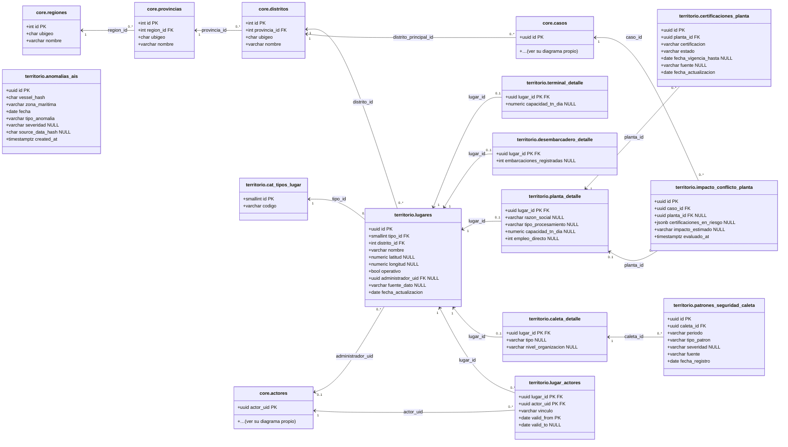

### 3.6 Diagrama D2 — Casos y actores

Puntos de diseño: `casos` guarda el estado **actual** (nivel de conflicto, riesgo, estado) y
`caso_estado_historial` guarda la **historia** (mantenida por trigger); un caso abarca N distritos y N
lugares; la persona se separa de la organización (`organizaciones`, `actor_membresia`) y la PII va en
`actor_datos_personales`. El nombre del actor se mantiene desde `kag.actor_name_history`.

```mermaid
classDiagram
    direction LR
    class `core.casos` {
        +uuid id PK
        +smallint entidad_id FK
        +varchar codigo_caso
        +varchar nombre_caso
        +int distrito_principal_id FK
        +smallint alcance_id FK NULL
        +int subsector_id FK
        +int tematica_id FK
        +int unidad_responsable_id FK
        +uuid punto_focal_usuario_id FK NULL
        +smallint nivel_conflicto_id FK
        +smallint nivel_riesgo_id FK
        +smallint prioridad_id FK NULL
        +smallint estado_id FK
        +text descripcion_riesgo NULL
        +numeric latitud NULL
        +numeric longitud NULL
        +date fecha_inicio NULL
        +date fecha_cierre NULL
        +timestamptz fecha_ultima_actualizacion
        +varchar fuente_original NULL
        +bool es_seed_historico
        +AUD estándar (8 columnas)
    }
    class `core.caso_distritos` {
        +uuid caso_id PK FK
        +int distrito_id PK FK
    }
    class `core.caso_lugares` {
        +uuid caso_id PK FK
        +uuid lugar_id PK FK
    }
    class `core.caso_estado_historial` {
        +uuid id PK
        +uuid caso_id FK
        +smallint nivel_conflicto_id FK
        +smallint nivel_riesgo_id FK
        +smallint estado_id FK
        +timestamptz desde
        +timestamptz hasta NULL
        +text motivo NULL
        +uuid usuario_id FK NULL
    }
    class `core.caso_factores` {
        +uuid caso_id PK FK
        +smallint factor_id PK FK
        +date desde PK
        +date hasta NULL
    }
    class `core.casos_actores` {
        +uuid caso_id PK FK
        +uuid actor_id PK FK
        +smallint nivel_influencia
        +varchar posicion
    }
    class `core.actores` {
        +uuid actor_uid PK
        +varchar nombre_actual
        +date fecha_ultimo_cambio_nombre NULL
        +varchar naturaleza
        +int tipo_actor_id FK
        +int rol_actor_id FK
        +AUD estándar (8 columnas)
    }
    class `core.actor_datos_personales` {
        +uuid actor_uid PK FK
        +varchar telefono_contacto NULL
        +varchar genero NULL
        +varchar autoidentificacion_etnica NULL
        +varchar base_legal NULL
        +date fecha_consentimiento NULL
        +smallint nivel_clasificacion
        +timestamptz updated_at
    }
    class `core.organizaciones` {
        +uuid actor_uid PK FK
        +char ruc NULL
        +varchar razon_social NULL
        +uuid representante_uid FK NULL
        +int numero_integrantes NULL
        +varchar expediente_ospa NULL
        +varchar estado_ospa NULL
        +date vigencia_desde NULL
        +date vigencia_hasta NULL
        +varchar fuente_sync NULL
        +timestamptz ultima_sync NULL
    }
    class `core.actor_membresia` {
        +uuid id PK
        +uuid persona_uid FK
        +uuid organizacion_uid FK
        +varchar cargo NULL
        +date valid_from
        +date valid_to NULL
    }
    class `core.cat_alcances_geograficos` {
        +smallint id PK
        +varchar codigo
    }
    class `core.cat_estados_caso` {
        +smallint id PK
        +varchar codigo
        +bool es_activo
    }
    class `core.cat_factores_contexto` {
        +smallint id PK
        +varchar codigo
        +varchar nombre
    }
    class `core.cat_niveles_conflicto` {
        +smallint id PK
        +varchar codigo
        +varchar nombre
        +smallint orden
    }
    class `core.cat_niveles_riesgo` {
        +smallint id PK
        +varchar codigo
        +smallint orden
    }
    class `core.cat_prioridades_atencion` {
        +smallint id PK
        +varchar codigo
        +smallint orden
    }
    class `core.cat_roles_actor` {
        +int id PK
        +varchar nombre
    }
    class `core.cat_subsectores` {
        +int id PK
        +varchar nombre
    }
    class `core.cat_tematicas` {
        +int id PK
        +varchar nombre
    }
    class `core.cat_tipos_actor` {
        +int id PK
        +varchar nombre
    }
    class `core.cat_unidades_organicas` {
        +int id PK
        +smallint entidad_id FK
        +varchar siglas
        +varchar nombre_completo
    }
    class `core.distritos` {
        +int id PK
        +… (ver su diagrama propio)
    }
    class `territorio.lugares` {
        +uuid id PK
        +… (ver su diagrama propio)
    }
    class `core.usuarios` {
        +uuid id PK
        +… (ver su diagrama propio)
    }
    `core.cat_unidades_organicas` "0..1" <-- "0..*" `core.usuarios` : unidad_id
    `core.cat_tipos_actor` "1" <-- "0..*" `core.actores` : tipo_actor_id
    `core.cat_roles_actor` "1" <-- "0..*" `core.actores` : rol_actor_id
    `core.cat_tematicas` "1" <-- "0..*" `core.casos` : tematica_id
    `core.actores` "1" <-- "0..1" `core.actor_datos_personales` : actor_uid
    `core.actores` "1" <-- "0..1" `core.organizaciones` : actor_uid
    `core.actores` "0..1" <-- "0..*" `core.organizaciones` : representante_uid
    `core.actores` "1" <-- "0..*" `core.actor_membresia` : persona_uid
    `core.actores` "1" <-- "0..*" `core.actor_membresia` : organizacion_uid
    `core.cat_unidades_organicas` "1" <-- "0..*" `core.casos` : unidad_responsable_id
    `core.distritos` "1" <-- "0..*" `territorio.lugares` : distrito_id
    `core.actores` "0..1" <-- "0..*" `territorio.lugares` : administrador_uid
    `core.usuarios` "0..1" <-- "0..*" `core.casos` : punto_focal_usuario_id
    `core.cat_niveles_conflicto` "1" <-- "0..*" `core.casos` : nivel_conflicto_id
    `core.cat_niveles_riesgo` "1" <-- "0..*" `core.casos` : nivel_riesgo_id
    `core.cat_prioridades_atencion` "0..1" <-- "0..*" `core.casos` : prioridad_id
    `core.cat_estados_caso` "1" <-- "0..*" `core.casos` : estado_id
    `core.distritos` "1" <-- "0..*" `core.casos` : distrito_principal_id
    `core.cat_alcances_geograficos` "0..1" <-- "0..*" `core.casos` : alcance_id
    `core.cat_subsectores` "1" <-- "0..*" `core.casos` : subsector_id
    `core.casos` "1" <-- "0..*" `core.caso_distritos` : caso_id
    `core.distritos` "1" <-- "0..*" `core.caso_distritos` : distrito_id
    `core.casos` "1" <-- "0..*" `core.caso_lugares` : caso_id
    `territorio.lugares` "1" <-- "0..*" `core.caso_lugares` : lugar_id
    `core.casos` "1" <-- "0..*" `core.caso_estado_historial` : caso_id
    `core.cat_niveles_conflicto` "1" <-- "0..*" `core.caso_estado_historial` : nivel_conflicto_id
    `core.cat_niveles_riesgo` "1" <-- "0..*" `core.caso_estado_historial` : nivel_riesgo_id
    `core.cat_estados_caso` "1" <-- "0..*" `core.caso_estado_historial` : estado_id
    `core.usuarios` "0..1" <-- "0..*" `core.caso_estado_historial` : usuario_id
    `core.casos` "1" <-- "0..*" `core.caso_factores` : caso_id
    `core.cat_factores_contexto` "1" <-- "0..*" `core.caso_factores` : factor_id
    `core.casos` "1" <-- "0..*" `core.casos_actores` : caso_id
    `core.actores` "1" <-- "0..*" `core.casos_actores` : actor_id
```

<!-- v10:P03 begin -->

### 3.6.v10 Identificación gradual del actor (resuelve el bloqueo por DNI) — _extiende 3.6 (D2)_ — V10-01

**El problema, con un ejemplo.** Un sistema que exige DNI para crear un actor deja afuera a quienes más pesan en un conflicto: el vocero que habla en la radio local pero no firma actas, el colectivo que bloquea un muelle, el dirigente que desconfía de dar su documento a una oficina del Estado.

> **Ejemplo (ILUSTRATIVO).** El 12 de noviembre un medio regional cita al «dirigente de los pescadores de la caleta X». Con DNI obligatorio, el analista tiene dos malas opciones: no registrarlo (la matriz queda sesgada) o inventar un número (un dato falso con apariencia de verdad). v10 elimina el dilema.

**Qué dice v9 hoy.** D2 no tiene campo de documento: `core.actor_datos_personales` guarda teléfono, género y autoidentificación, y `core.actores.naturaleza` solo distingue persona de organización. No hay forma de representar un alias sin identidad, un colectivo anónimo ni un ascenso de nivel. El bloqueo existe en el aplicativo vigente y reaparecería al migrar desde AVISA (supuesto de §3.17.1: 931 actores) si no se diseña aquí.

**Diseño: cinco niveles de identificación.** El actor existe desde el primer día; lo que cambia es cuánto se sabe de él.

| Nivel | Código                  | Qué se sabe                                        | ¿Tiene DNI?         | Ejemplo (ILUSTRATIVO)                                                            |
| ----- | ----------------------- | -------------------------------------------------- | ------------------- | -------------------------------------------------------------------------------- |
| 1     | `IDENTIFICADO_DNI`      | Persona plenamente identificada                    | Sí                  | Dirigente con documento verificado                                               |
| 2     | `IDENTIFICADO_OTRO_DOC` | Documento alterno (CE, pasaporte) o RUC            | No (otro documento) | Representante legal de una empresa extranjera                                    |
| 3     | `IDENTIFICADO_SIN_DOC`  | Nombre confirmado por 2 o más fuentes              | No                  | Vocero citado en un acta y en la prensa                                          |
| 4     | `SEUDONIMO`             | Alias o cargo; identidad no registrada a propósito | No                  | «Dirigente de pescadores de la caleta X (no identificado)», código `ANI-SEC-014` |
| 5     | `COLECTIVO_ANONIMO`     | Grupo sin individuos registrables                  | No                  | «Manifestantes del bloqueo del 12/11»                                            |

**Cambios al diagrama D2.** Solo se agregan miembros; no se quita ninguno.

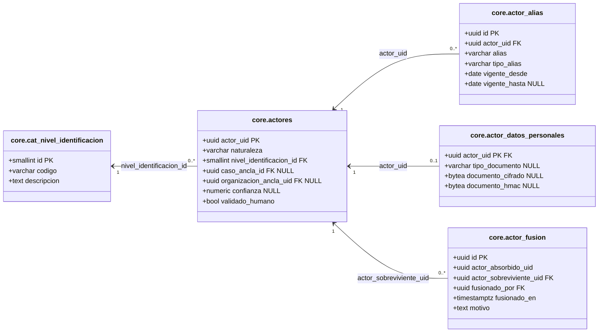

**Reglas de integridad (con su «por qué»).**

| #   | Regla                                                                                                                                                                                                                                                                                          | Por qué importa                                                              |
| --- | ---------------------------------------------------------------------------------------------------------------------------------------------------------------------------------------------------------------------------------------------------------------------------------------------- | ---------------------------------------------------------------------------- |
| R1  | El DNI es opcional y vive fuera del actor, en `core.actor_datos_personales`, cifrado. Junto al cifrado se guarda un **HMAC** del número (una huella irreversible) para detectar duplicados sin exponerlo                                                                                       | Se detecta que «dos fichas son la misma persona» sin que nadie vea el número |
| R2  | **Anclaje obligatorio:** un actor de nivel 4 o 5 debe estar vinculado a un caso o a una organización                                                                                                                                                                                           | Nunca queda «flotando»; siempre aparece en la matriz de su caso              |
| R3  | Los alias (apodos, cargos, códigos `ANI-*`) se guardan en `core.actor_alias` con vigencia                                                                                                                                                                                                      | Fuentes distintas llaman al mismo actor de maneras distintas                 |
| R4  | **Promoción sin pérdida:** al identificar a la persona cambia el nivel y se crea la fila de datos personales; el `actor_uid` **no cambia**                                                                                                                                                     | Se conservan posiciones, relaciones, citas e historial                       |
| R5  | **Fusión con rastro:** si dos fichas son la misma persona, se fusionan y queda una fila en `core.actor_fusion`                                                                                                                                                                                 | Se puede reconstruir qué se unió, quién lo hizo y por qué                    |
| R6  | **Sin reidentificación automática:** la IA no intenta identificar actores de nivel 4 o 5 ni cruzarlos con registros personales; solo los asocia a un alias u organización ya existentes (G19, §16.1.quater)                                                                                    | Evita que el sistema haga vigilancia por cuenta propia                       |
| R7  | **Exposición mínima:** los perfiles B y C nunca ven datos personales; los niveles 4 y 5 se muestran agregados («Colectivo no identificado — caleta X») y sin ubicación fina. Rige además el guardrail de Privacidad Comunitaria (§16.1: caletas con menos de 20 actores se agregan a distrito) | Protege a quien no quiso ser identificado                                    |

> **Ejemplo completo (ILUSTRATIVO): una persona, cuatro momentos, un solo `actor_uid`.**
>
> | Fecha | Qué ocurre                                                                                                                                                               | Nivel | Qué se conserva                                                                                                               |
> | ----- | ------------------------------------------------------------------------------------------------------------------------------------------------------------------------ | ----- | ----------------------------------------------------------------------------------------------------------------------------- |
> | 12/11 | La prensa cita al «dirigente de pescadores de la caleta X». El pipeline crea el actor con alias `Dirigente de pescadores — caleta X` y lo ancla al caso `CS-EJEMPLO-001` | 4     | Una cita literal, una posición («oposición»), una relación «tensa» con la empresa                                             |
> | 14/11 | Un acta de reunión y una segunda nota de prensa lo nombran como «A. Q.». El analista confirma con dos fuentes                                                            | 3     | El alias anterior sigue vigente; se agrega el nombre                                                                          |
> | 20/11 | A. Q. entrega su DNI voluntariamente en una reunión. El analista lo registra                                                                                             | 1     | Se crea `actor_datos_personales` (documento cifrado + HMAC). **Mismo `actor_uid`**: las 3 relaciones y las 5 citas siguen ahí |
> | 25/11 | Se descubre que «A. Quispe, vocero» (otra ficha) es la misma persona                                                                                                     | 1     | Se fusiona: queda una fila en `core.actor_fusion`; el HMAC idéntico fue lo que hizo saltar la alerta de duplicado             |

**DDL (PostgreSQL, perfil de referencia).** El equivalente para SQL Server está en MVP §2.3 y sus diferencias de tipos en §3.17.2.v10.

```sql
CREATE TABLE core.cat_nivel_identificacion (
    id          smallint PRIMARY KEY,
    codigo      varchar(30) NOT NULL UNIQUE,
    descripcion text NOT NULL
);
INSERT INTO core.cat_nivel_identificacion VALUES
 (1,'IDENTIFICADO_DNI','Persona identificada con DNI'),
 (2,'IDENTIFICADO_OTRO_DOC','Identificada con otro documento o RUC'),
 (3,'IDENTIFICADO_SIN_DOC','Nombre confirmado, sin documento'),
 (4,'SEUDONIMO','Alias o cargo; identidad no registrada'),
 (5,'COLECTIVO_ANONIMO','Grupo sin individuos registrables');

-- Los actores heredados de AVISA que no traigan documento entran en nivel 3 (default).
ALTER TABLE core.actores
  ADD COLUMN nivel_identificacion_id smallint NOT NULL DEFAULT 3
        REFERENCES core.cat_nivel_identificacion(id),
  ADD COLUMN caso_ancla_id           uuid NULL REFERENCES core.casos(id),
  ADD COLUMN organizacion_ancla_uid  uuid NULL REFERENCES core.organizaciones(actor_uid),
  ADD COLUMN confianza               numeric(3,2) NULL CHECK (confianza BETWEEN 0 AND 1),
  ADD COLUMN validado_humano         boolean NOT NULL DEFAULT false,
  ADD CONSTRAINT ck_actor_anclaje CHECK (
        nivel_identificacion_id <= 3
        OR caso_ancla_id IS NOT NULL
        OR organizacion_ancla_uid IS NOT NULL);
-- naturaleza admite además el valor 'colectivo' (nivel 5).

ALTER TABLE core.actor_datos_personales
  ADD COLUMN tipo_documento   varchar(10) NULL,   -- DNI, CE, PAS, RUC
  ADD COLUMN documento_cifrado bytea NULL,        -- cifrado con clave que custodia OGTI
  ADD COLUMN documento_hmac    bytea NULL;        -- HMAC-SHA256 calculado en la API
CREATE UNIQUE INDEX ux_actor_pii_documento
    ON core.actor_datos_personales(documento_hmac) WHERE documento_hmac IS NOT NULL;
-- Unicidad solo cuando hay documento: ya no se bloquea a quien no lo tiene.

CREATE TABLE core.actor_alias (
    id            uuid PRIMARY KEY DEFAULT gen_random_uuid(),
    actor_uid     uuid NOT NULL REFERENCES core.actores(actor_uid),
    alias         varchar(150) NOT NULL,
    tipo_alias    varchar(20) NOT NULL CHECK (tipo_alias IN ('apodo','cargo','codigo_ani','otro')),
    vigente_desde date NOT NULL DEFAULT current_date,
    vigente_hasta date NULL
);
CREATE TABLE core.actor_fusion (
    id                      uuid PRIMARY KEY DEFAULT gen_random_uuid(),
    actor_absorbido_uid     uuid NOT NULL,
    actor_sobreviviente_uid uuid NOT NULL REFERENCES core.actores(actor_uid),
    fusionado_por           uuid NOT NULL REFERENCES core.usuarios(id),
    fusionado_en            timestamptz NOT NULL DEFAULT now(),
    motivo                  text NOT NULL
);
```

> **Nota de custodia.** La clave que descifra el documento y la clave del HMAC las custodia OGTI (bóveda de secretos). El proveedor no las recibe.

**Clasificación.** La fila de `core.actores` hereda la clasificación del caso. `core.actor_alias` y `core.actor_datos_personales` van en nivel 3 (Confidencial).
<!-- v10:P03 end -->

### 3.7 Diagrama D3 — Alertas, reuniones, documentos, cronología y demandas

Puntos de diseño: `derivaciones_alerta.fecha_limite` se calcula con el SLA de la prioridad (24/48/72 h, Anexo 3);
todo anexo documental es un `documentos` tipado; `planes_accion` es subtipo 1:1 con las acciones inmediatas
normalizadas en `plan_acciones`; "Alertas vinculadas" del Anexo 15 se resuelve con `cronologia_vinculos` (alerta
o documento: AT, RR o PAR).

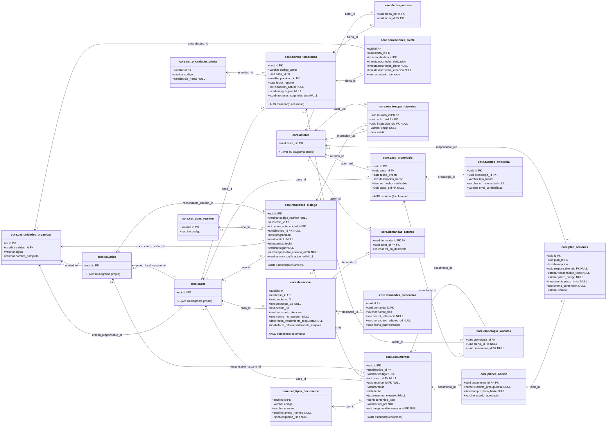

### 3.8 Diagrama D4 — Compromisos

Puntos de diseño: `compromisos` es el supertipo común; `compromiso_pip` (1:1) concentra lo propio de los PIP y la
**fase se deriva de la etapa** (3FN); el estado usa el catálogo de dos niveles del Protocolo (Abierto/Cerrado);
la redefinición única se impone con `UNIQUE(redefinido_de_id)`; "Cumplido" exige evidencia (trigger).

```mermaid
classDiagram
    direction LR
    class `core.compromisos` {
        +uuid id PK
        +varchar codigo_compromiso
        +uuid caso_id FK
        +uuid reunion_id FK NULL
        +uuid documento_origen_id FK NULL
        +int unidad_responsable_id FK
        +smallint alcance_id FK NULL
        +int tematica_id FK NULL
        +date fecha_inicio
        +text accion_compromiso
        +varchar tipo_compromiso
        +varchar nivel_gobierno NULL
        +smallint estado_id FK
        +uuid redefinido_de_id FK NULL
        +varchar evidencia_cumplimiento_uri NULL
        +bool atiende_brecha_genero
        +jsonb criterios_smart NULL
        +AUD estándar (8 columnas)
    }
    class `core.compromiso_distritos` {
        +uuid compromiso_id PK FK
        +int distrito_id PK FK
    }
    class `core.compromiso_pip` {
        +uuid compromiso_id PK FK
        +varchar codigo_snip NULL
        +varchar codigo_unificado NULL
        +text denominacion NULL
        +varchar unidad_formuladora NULL
        +varchar unidad_ejecutora NULL
        +smallint etapa_id FK NULL
        +numeric monto_total NULL
        +numeric pim NULL
        +numeric devengado NULL
        +numeric devengado_acumulado NULL
    }
    class `core.compromiso_colaboradores` {
        +uuid compromiso_id PK FK
        +uuid actor_uid PK FK
    }
    class `core.hitos_compromiso` {
        +uuid id PK
        +uuid compromiso_id FK
        +varchar codigo_hito
        +text descripcion_hito
        +date fecha_vencimiento NULL
        +smallint estado_id FK
    }
    class `core.hitos_compromiso_estado_historico` {
        +uuid id PK
        +uuid hito_id FK
        +date fecha_corte
        +smallint estado_id FK
        +text observacion NULL
        +uuid registrado_por FK NULL
        +timestamptz registrado_en
    }
    class `core.cat_alcances_geograficos` {
        +smallint id PK
        +varchar codigo
    }
    class `core.cat_estados_compromiso` {
        +smallint id PK
        +varchar codigo
        +varchar categoria
        +bool es_terminal
    }
    class `core.cat_estados_hito` {
        +smallint id PK
        +varchar codigo
        +bool es_terminal
    }
    class `core.cat_pip_etapas` {
        +smallint id PK
        +smallint fase_id FK
        +smallint numero
        +varchar nombre
    }
    class `core.cat_tematicas` {
        +int id PK
        +varchar nombre
    }
    class `core.cat_unidades_organicas` {
        +int id PK
        +smallint entidad_id FK
        +varchar siglas
        +varchar nombre_completo
    }
    class `core.casos` {
        +uuid id PK
        +… (ver su diagrama propio)
    }
    class `core.reuniones_dialogo` {
        +uuid id PK
        +… (ver su diagrama propio)
    }
    class `core.documentos` {
        +uuid id PK
        +… (ver su diagrama propio)
    }
    class `core.actores` {
        +uuid actor_uid PK
        +… (ver su diagrama propio)
    }
    class `core.distritos` {
        +int id PK
        +… (ver su diagrama propio)
    }
    class `core.usuarios` {
        +uuid id PK
        +… (ver su diagrama propio)
    }
    `core.cat_unidades_organicas` "0..1" <-- "0..*" `core.usuarios` : unidad_id
    `core.cat_tematicas` "1" <-- "0..*" `core.casos` : tematica_id
    `core.cat_unidades_organicas` "1" <-- "0..*" `core.casos` : unidad_responsable_id
    `core.usuarios` "0..1" <-- "0..*" `core.casos` : punto_focal_usuario_id
    `core.distritos` "1" <-- "0..*" `core.casos` : distrito_principal_id
    `core.cat_alcances_geograficos` "0..1" <-- "0..*" `core.casos` : alcance_id
    `core.casos` "1" <-- "0..*" `core.reuniones_dialogo` : caso_id
    `core.cat_unidades_organicas` "1" <-- "0..*" `core.reuniones_dialogo` : convocante_unidad_id
    `core.usuarios` "0..1" <-- "0..*" `core.reuniones_dialogo` : responsable_usuario_id
    `core.casos` "0..1" <-- "0..*" `core.documentos` : caso_id
    `core.reuniones_dialogo` "0..1" <-- "0..*" `core.documentos` : reunion_id
    `core.usuarios` "0..1" <-- "0..*" `core.documentos` : responsable_usuario_id
    `core.cat_tematicas` "0..1" <-- "0..*" `core.compromisos` : tematica_id
    `core.cat_estados_compromiso` "1" <-- "0..*" `core.compromisos` : estado_id
    `core.compromisos` "0..1" <-- "0..*" `core.compromisos` : redefinido_de_id
    `core.casos` "1" <-- "0..*" `core.compromisos` : caso_id
    `core.reuniones_dialogo` "0..1" <-- "0..*" `core.compromisos` : reunion_id
    `core.documentos` "0..1" <-- "0..*" `core.compromisos` : documento_origen_id
    `core.cat_unidades_organicas` "1" <-- "0..*" `core.compromisos` : unidad_responsable_id
    `core.cat_alcances_geograficos` "0..1" <-- "0..*" `core.compromisos` : alcance_id
    `core.compromisos` "1" <-- "0..*" `core.compromiso_distritos` : compromiso_id
    `core.distritos` "1" <-- "0..*" `core.compromiso_distritos` : distrito_id
    `core.compromisos` "1" <-- "0..1" `core.compromiso_pip` : compromiso_id
    `core.cat_pip_etapas` "0..1" <-- "0..*" `core.compromiso_pip` : etapa_id
    `core.compromisos` "1" <-- "0..*" `core.compromiso_colaboradores` : compromiso_id
    `core.actores` "1" <-- "0..*" `core.compromiso_colaboradores` : actor_uid
    `core.compromisos` "1" <-- "0..*" `core.hitos_compromiso` : compromiso_id
    `core.cat_estados_hito` "1" <-- "0..*" `core.hitos_compromiso` : estado_id
    `core.hitos_compromiso` "1" <-- "0..*" `core.hitos_compromiso_estado_historico` : hito_id
    `core.cat_estados_hito` "1" <-- "0..*" `core.hitos_compromiso_estado_historico` : estado_id
    `core.usuarios` "0..1" <-- "0..*" `core.hitos_compromiso_estado_historico` : registrado_por
```

### 3.9 Diagrama D5 — KAG: grafo bitemporal, perfil, embeddings

Puntos de diseño: `nodos` da integridad referencial a los extremos de arista (actor, caso, objetivo, demanda,
solución, lugar); relación, influencia, posición y participación son **tipos de arista**
(`cat_tipos_arista.clase`), no tablas; la evidencia es tipada (`arista_evidencia`, `atributo_evidencia`) y apunta
a fragmentos; `embedding` registra modelo y versión.

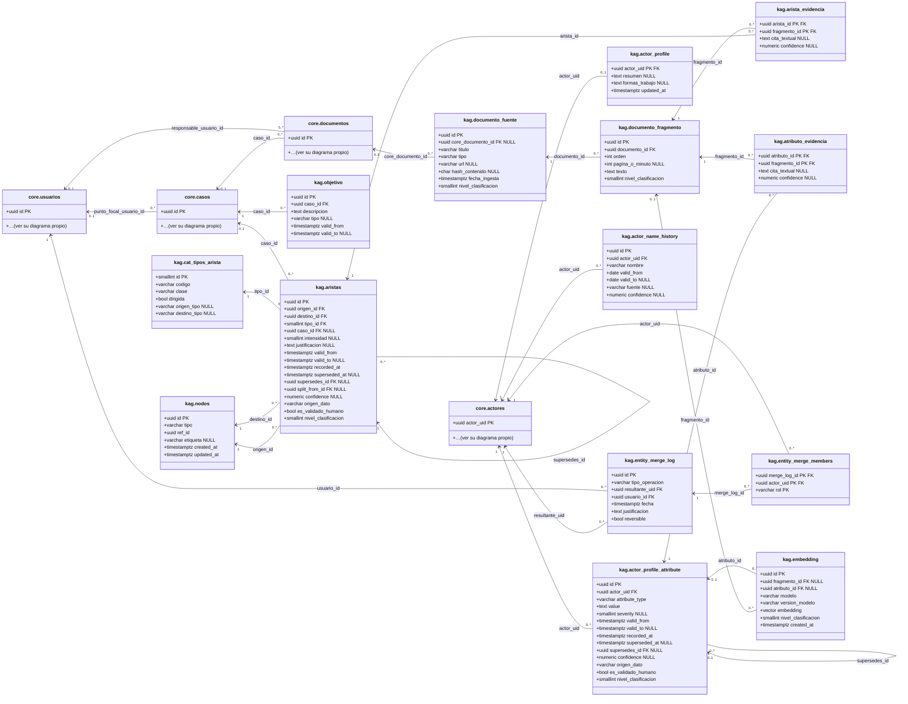

### 3.10 Diagrama D6 — Contexto sistémico (formato largo)

Puntos de diseño: una variable nueva es un `INSERT` en `cat_variables`; el TTL de frescura y las fuentes permitidas
son datos (los guardrails de Frescura y de Fuente se evalúan con ellos); `observaciones` admite como máximo una
ubicación (región, provincia, distrito, lugar o zona marítima) y se particiona por año; `snapshot` congela el
contexto usado en una recomendación.

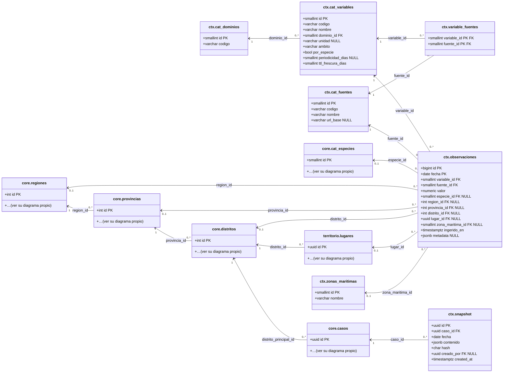

### 3.11 Diagrama D7 — Ingesta, agentes, salida y seguridad

Puntos de diseño: `raw_ingest` y `run_log` particionadas por mes; `run_log` es _append-only_ con cadena de hash;
`query_cache` incluye el nivel de acceso en su clave; `core.integraciones` es la única frontera con sistemas externos
(sin acceso directo a sus bases, RS-07).

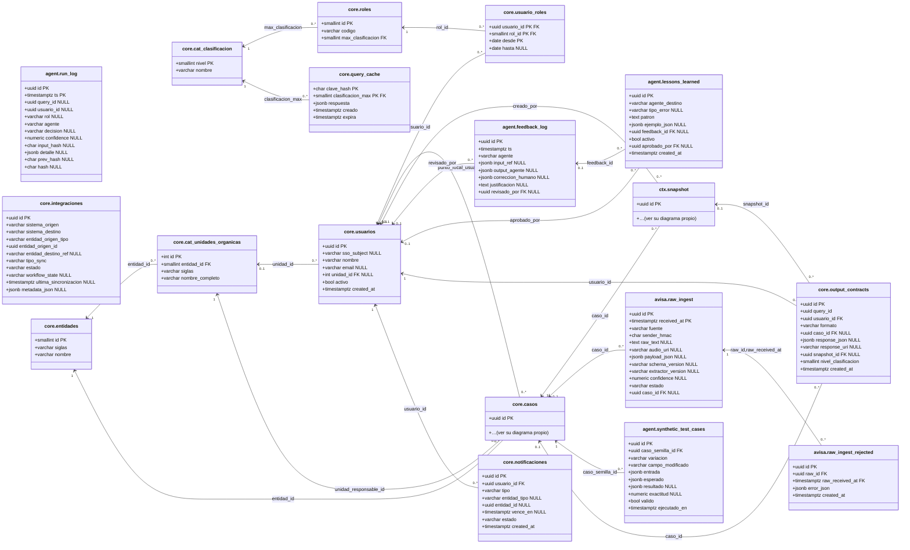

### 3.12 Diagrama D8 — Módulos de expansión (forecast, economic, community, consultation, impact)

Estos schemas (Sección 14) se validaron junto con el núcleo: cargan sin errores sobre el núcleo. Aquí se muestran para
verificar sus relaciones con `core.casos`, `core.actores` y `territorio.caleta_detalle`.

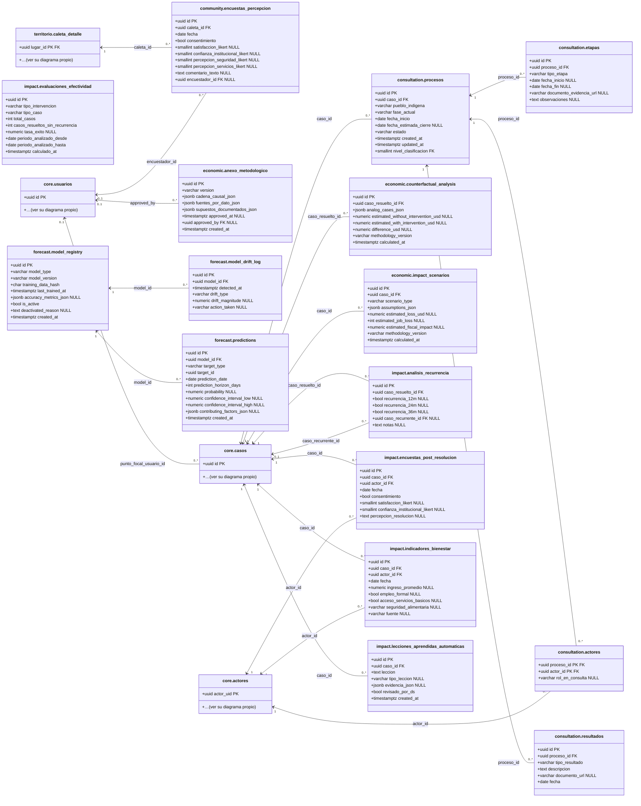

### 3.12.bis Diagramas D9 a D12 — política, indicadores, análisis dirigido, capa léxica, recolección y observabilidad

Igual que D1 a D8, los cuatro diagramas siguientes **se generaron desde el catálogo de la base cargada** (`gen_diagrams_v83.py`): atributos, tipos, claves y cardinalidades coinciden con el DDL de 20.20 a 20.28. Si el DDL cambia, se regeneran.

#### D9 — Contexto de política e indicadores (`policy`, `ind`)

```mermaid
classDiagram
    direction LR
    class `core.capacidad_campo` {
        +uuid usuario_id PK FK
        +date mes PK
        +numeric horas_disponibles
    }
    class `ind.brecha` {
        +uuid id PK
        +uuid indicador_id FK
        +text descripcion
        +text propuesta_recoleccion NULL
        +bool requiere_campo
        +numeric horas_estimadas
        +date mes_previsto NULL
        +varchar estado
        +uuid decidido_por FK NULL
        +varchar decision_escrita_uri NULL
        +timestamptz created_at
    }
    class `ind.indicador` {
        +uuid id PK
        +varchar codigo
        +varchar nombre
        +text definicion NULL
        +varchar componente_guia
        +smallint anexo_origen NULL
        +varchar naturaleza NULL
        +varchar direccion NULL
    }
    class `ind.plantilla` {
        +uuid id PK
        +varchar codigo
        +varchar nombre
        +smallint tipo_documento_id FK NULL
        +text descripcion NULL
    }
    class `ind.plantilla_slot` {
        +uuid id PK
        +uuid plantilla_id FK
        +smallint orden
        +varchar codigo
        +uuid indicador_id FK
    }
    class `ind.proxy_justificacion` {
        +uuid variante_id PK FK
        +text constructo_objetivo
        +uuid fuente_validez_id FK
        +text supuestos
        +text limites
        +varchar incertidumbre
    }
    class `ind.resultado` {
        +uuid id PK
        +uuid variante_id FK
        +int distrito_id FK NULL
        +varchar periodo
        +numeric valor NULL
        +varchar incertidumbre NULL
        +uuid run_id NULL
        +timestamptz calculado_en
    }
    class `ind.seleccion` {
        +uuid id PK
        +uuid slot_id FK
        +uuid caso_id FK NULL
        +int distrito_id FK NULL
        +varchar periodo
        +uuid variante_id FK
        +jsonb alternativas_mostradas
        +uuid seleccionada_por FK
        +text motivo NULL
        +timestamptz valid_from
        +timestamptz valid_to NULL
        +timestamptz recorded_at
        +timestamptz superseded_at NULL
        +uuid supersedes_id FK NULL
    }
    class `ind.variante` {
        +uuid id PK
        +uuid indicador_id FK
        +varchar clase
        +jsonb especificacion
        +smallint variable_id FK NULL
        +smallint nivel_evidencia
        +bool requiere_campo
        +numeric horas_estimadas NULL
        +varchar estado
        +bool es_validado_humano
        +timestamptz created_at
        +uuid created_by FK NULL
    }
    class `policy.cat_tipos_regla` {
        +smallint id PK
        +varchar codigo
        +varchar nombre
        +text[] claves_requeridas
        +jsonb esquema_json NULL
    }
    class `policy.escenario` {
        +uuid id PK
        +varchar nombre
        +text descripcion NULL
        +uuid creado_por FK NULL
        +timestamptz creado_en
    }
    class `policy.escenario_regla` {
        +uuid escenario_id PK FK
        +uuid regla_id PK FK
    }
    class `policy.gobierno` {
        +smallint id PK
        +varchar nombre
        +date inicio
        +date fin NULL
    }
    class `policy.regla` {
        +uuid id PK
        +varchar codigo
        +char clase
        +smallint tipo_regla_id FK
        +varchar titulo
        +text texto
        +jsonb parametros
        +varchar alcance
        +varchar estado
        +smallint gobierno_id FK NULL
        +smallint titular_id FK NULL
        +uuid fuente_documento_id FK NULL
        +varchar tipo_fuente
        +timestamptz valid_from
        +timestamptz valid_to NULL
        +timestamptz recorded_at
        +timestamptz superseded_at NULL
        +uuid supersedes_id FK NULL
        +date disparador_vencimiento_fecha NULL
        +text disparador_vencimiento_evento NULL
        +uuid propuesto_por FK NULL
        +uuid aprobado_por FK NULL
        +uuid aprobado_por_2 FK NULL
        +smallint nivel_clasificacion FK
    }
    class `policy.snapshot` {
        +uuid id PK
        +timestamptz creado_en
        +uuid creado_por FK NULL
        +varchar rol
        +timestamptz valido_en
        +timestamptz conocido_en
        +char policy_hash
    }
    class `policy.snapshot_regla` {
        +uuid snapshot_id PK FK
        +uuid regla_id PK FK
    }
    class `policy.titular` {
        +smallint id PK
        +smallint gobierno_id FK
        +varchar cargo
        +varchar persona
        +date desde
        +date hasta NULL
    }
    class `core.casos` {
        +uuid id PK
        +… (ver su diagrama propio)
    }
    class `core.cat_clasificacion` {
        +smallint nivel PK
        +… (ver su diagrama propio)
    }
    class `core.cat_tipos_documento` {
        +smallint id PK
        +… (ver su diagrama propio)
    }
    class `core.distritos` {
        +int id PK
        +… (ver su diagrama propio)
    }
    class `core.usuarios` {
        +uuid id PK
        +… (ver su diagrama propio)
    }
    class `ctx.cat_variables` {
        +smallint id PK
        +… (ver su diagrama propio)
    }
    class `kag.documento_fuente` {
        +uuid id PK
        +… (ver su diagrama propio)
    }
    `policy.gobierno` "1" <-- "0..*" `policy.titular` : gobierno_id
    `policy.cat_tipos_regla` "1" <-- "0..*" `policy.regla` : tipo_regla_id
    `policy.gobierno` "0..1" <-- "0..*" `policy.regla` : gobierno_id
    `policy.titular` "0..1" <-- "0..*" `policy.regla` : titular_id
    `kag.documento_fuente` "0..1" <-- "0..*" `policy.regla` : fuente_documento_id
    `policy.regla` "0..1" <-- "0..*" `policy.regla` : supersedes_id
    `core.usuarios` "0..1" <-- "0..*" `policy.regla` : propuesto_por
    `core.usuarios` "0..1" <-- "0..*" `policy.regla` : aprobado_por
    `core.usuarios` "0..1" <-- "0..*" `policy.regla` : aprobado_por_2
    `core.cat_clasificacion` "1" <-- "0..*" `policy.regla` : nivel_clasificacion
    `core.usuarios` "0..1" <-- "0..*" `policy.snapshot` : creado_por
    `policy.snapshot` "1" <-- "0..*" `policy.snapshot_regla` : snapshot_id
    `policy.regla` "1" <-- "0..*" `policy.snapshot_regla` : regla_id
    `core.usuarios` "0..1" <-- "0..*" `policy.escenario` : creado_por
    `policy.escenario` "1" <-- "0..*" `policy.escenario_regla` : escenario_id
    `policy.regla` "1" <-- "0..*" `policy.escenario_regla` : regla_id
    `ind.indicador` "1" <-- "0..*" `ind.variante` : indicador_id
    `ctx.cat_variables` "0..1" <-- "0..*" `ind.variante` : variable_id
    `core.usuarios` "0..1" <-- "0..*" `ind.variante` : created_by
    `ind.variante` "1" <-- "0..*" `ind.proxy_justificacion` : variante_id
    `kag.documento_fuente` "1" <-- "0..*" `ind.proxy_justificacion` : fuente_validez_id
    `core.cat_tipos_documento` "0..1" <-- "0..*" `ind.plantilla` : tipo_documento_id
    `ind.plantilla` "1" <-- "0..*" `ind.plantilla_slot` : plantilla_id
    `ind.indicador` "1" <-- "0..*" `ind.plantilla_slot` : indicador_id
    `ind.plantilla_slot` "1" <-- "0..*" `ind.seleccion` : slot_id
    `core.casos` "0..1" <-- "0..*" `ind.seleccion` : caso_id
    `core.distritos` "0..1" <-- "0..*" `ind.seleccion` : distrito_id
    `ind.variante` "1" <-- "0..*" `ind.seleccion` : variante_id
    `core.usuarios` "1" <-- "0..*" `ind.seleccion` : seleccionada_por
    `ind.seleccion` "0..1" <-- "0..*" `ind.seleccion` : supersedes_id
    `ind.variante` "1" <-- "0..*" `ind.resultado` : variante_id
    `core.distritos` "0..1" <-- "0..*" `ind.resultado` : distrito_id
    `ind.indicador` "1" <-- "0..*" `ind.brecha` : indicador_id
    `core.usuarios` "0..1" <-- "0..*" `ind.brecha` : decidido_por
    `core.usuarios` "1" <-- "0..*" `core.capacidad_campo` : usuario_id
```

#### D10 — Análisis dirigido, ingesta asistida y capa cualitativa (`analisis`, `staging`, `qda`)

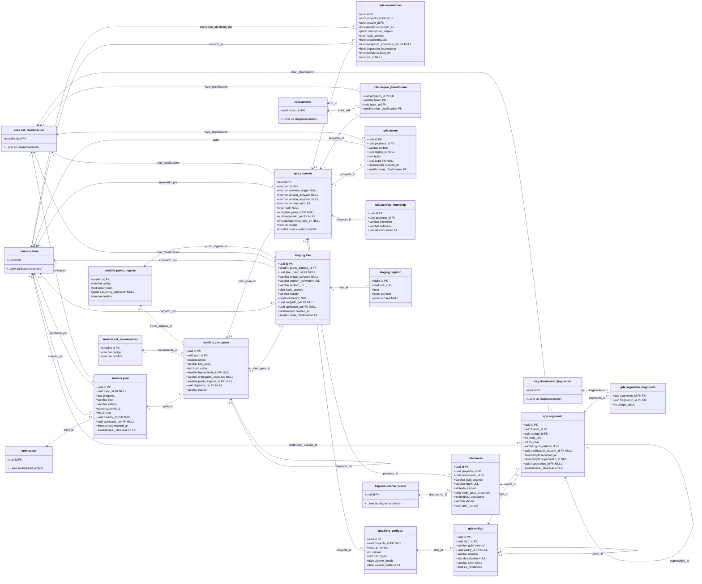

#### D11 — Capa léxica y triangulación (`lex`, `kag.contraste`)

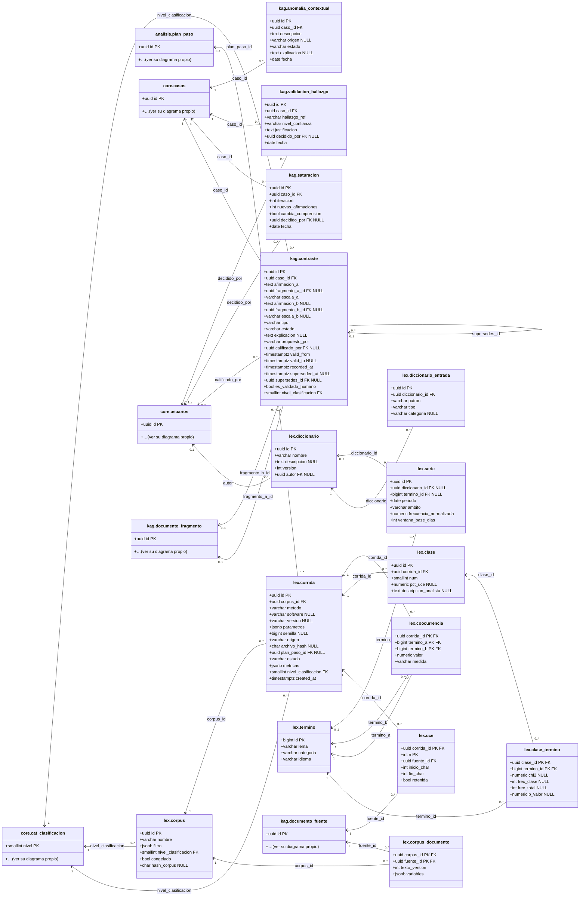

#### D12 — Recolección, hipótesis, comunidades y observabilidad (`ctx`, `kag`, `agent`)

```mermaid
classDiagram
    direction LR
    class `agent.cat_detalle_schema` {
        +smallint version PK
        +varchar agente NULL
        +jsonb esquema_json
        +date vigente_desde
    }
    class `agent.llm_call` {
        +uuid id PK
        +uuid run_id NULL
        +timestamptz ts PK
        +varchar modelo
        +varchar version_modelo
        +varchar destino
        +numeric temperatura NULL
        +char prompt_hash
        +varchar version_plantilla_prompt NULL
        +uuid policy_snapshot_id FK NULL
        +int tokens_in NULL
        +int tokens_out NULL
        +int latencia_ms NULL
        +jsonb veredicto_guardrails NULL
        +smallint nivel_clasificacion FK
    }
    class `agent.llm_call_fragmento` {
        +uuid call_id PK FK
        +timestamptz call_ts PK FK
        +uuid fragmento_id PK FK
        +int rank_rrf NULL
        +numeric score_rrf NULL
        +numeric score_rerank NULL
    }
    class `agent.modelo_registro` {
        +uuid id PK
        +varchar modelo
        +varchar version
        +char hash_pesos NULL
        +date alta
        +jsonb destinos_permitidos
        +varchar estado
    }
    class `agent.sesion` {
        +uuid id PK
        +uuid usuario_id FK
        +uuid plan_id FK NULL
        +varchar estado
        +timestamptz created_at
        +smallint nivel_clasificacion FK
    }
    class `agent.sesion_paso` {
        +uuid sesion_id PK FK
        +int n PK
        +varchar tipo
        +jsonb contenido
        +timestamptz ts
    }
    class `core.permiso_aprobacion` {
        +uuid id PK
        +uuid usuario_id FK
        +varchar objeto
        +date vigente_desde
        +date vigente_hasta NULL
        +uuid otorgado_por FK NULL
    }
    class `ctx.captura` {
        +uuid id PK
        +uuid trabajo_id FK
        +varchar url
        +timestamptz obtenido_en
        +char hash
        +varchar uri_archivo
        +varchar tipo_contenido NULL
        +smallint corpus_id FK NULL
        +smallint nivel_clasificacion FK
    }
    class `ctx.herramienta` {
        +smallint id PK
        +varchar codigo
        +varchar tipo
        +text[] dominios_permitidos
        +int limite_tasa_hora
        +bool requiere_aprobacion
    }
    class `ctx.trabajo_recoleccion` {
        +uuid id PK
        +smallint variable_id FK NULL
        +uuid indicador_id FK NULL
        +smallint herramienta_id FK
        +varchar estado
        +timestamptz ultima_ejecucion NULL
        +text error NULL
    }
    class `kag.cat_corpus` {
        +smallint id PK
        +varchar codigo
        +varchar nombre
    }
    class `kag.comunidad` {
        +uuid id PK
        +uuid corrida_id FK
        +int num
        +smallint nivel_jerarquico
        +uuid padre_id FK NULL
        +smallint nivel_clasificacion FK
    }
    class `kag.comunidad_corrida` {
        +uuid id PK
        +timestamptz valido_en
        +timestamptz conocido_en
        +smallint nivel_max
        +varchar algoritmo
        +numeric resolucion
        +bigint semilla
        +int n_aristas
        +smallint nivel_clasificacion FK
        +timestamptz created_at
    }
    class `kag.comunidad_miembro` {
        +uuid comunidad_id PK FK
        +uuid nodo_id PK FK
        +smallint nivel_clasificacion FK
    }
    class `kag.comunidad_resumen` {
        +uuid comunidad_id PK FK
        +text texto
        +varchar modelo
        +varchar version_modelo
        +bool es_validado_humano
        +smallint nivel_clasificacion FK
    }
    class `kag.hipotesis` {
        +uuid id PK
        +text enunciado
        +uuid caso_id FK NULL
        +varchar origen
        +varchar estado
        +varchar nivel_confianza NULL
        +timestamptz created_at
        +uuid created_by FK NULL
        +smallint nivel_clasificacion FK
    }
    class `kag.hipotesis_en_salida` {
        +uuid output_id PK FK
        +uuid hipotesis_id PK FK
        +varchar rotulo
    }
    class `kag.hipotesis_evidencia` {
        +uuid hipotesis_id PK FK
        +uuid fragmento_id PK FK
        +varchar sentido
    }
    class `kag.metrica_nodo` {
        +uuid nodo_id PK FK
        +date periodo PK
        +varchar metrica PK
        +numeric valor
        +bool es_critico
    }
    class `kag.vacio_informacion` {
        +uuid id PK
        +text descripcion
        +uuid indicador_id FK NULL
        +uuid brecha_id FK NULL
        +text razon NULL
        +text propuesta NULL
        +varchar estado
    }
    class `agent.llm_call_202611` {
        +… (ver su diagrama propio)
    }
    class `agent.llm_call_202612` {
        +… (ver su diagrama propio)
    }
    class `agent.llm_call_202701` {
        +… (ver su diagrama propio)
    }
    class `agent.llm_call_202702` {
        +… (ver su diagrama propio)
    }
    class `agent.llm_call_202703` {
        +… (ver su diagrama propio)
    }
    class `agent.llm_call_default` {
        +… (ver su diagrama propio)
    }
    class `analisis.plan` {
        +uuid id PK
        +… (ver su diagrama propio)
    }
    class `core.casos` {
        +uuid id PK
        +… (ver su diagrama propio)
    }
    class `core.cat_clasificacion` {
        +smallint nivel PK
        +… (ver su diagrama propio)
    }
    class `core.output_contracts` {
        +uuid id PK
        +… (ver su diagrama propio)
    }
    class `core.usuarios` {
        +uuid id PK
        +… (ver su diagrama propio)
    }
    class `ctx.cat_variables` {
        +smallint id PK
        +… (ver su diagrama propio)
    }
    class `ind.brecha` {
        +uuid id PK
        +… (ver su diagrama propio)
    }
    class `ind.indicador` {
        +uuid id PK
        +… (ver su diagrama propio)
    }
    class `kag.documento_fragmento` {
        +uuid id PK
        +… (ver su diagrama propio)
    }
    class `kag.nodos` {
        +uuid id PK
        +… (ver su diagrama propio)
    }
    class `policy.snapshot` {
        +uuid id PK
        +… (ver su diagrama propio)
    }
    `kag.nodos` "1" <-- "0..*" `kag.metrica_nodo` : nodo_id
    `core.cat_clasificacion` "1" <-- "0..*" `kag.comunidad_corrida` : nivel_clasificacion
    `kag.comunidad_corrida` "1" <-- "0..*" `kag.comunidad` : corrida_id
    `kag.comunidad` "0..1" <-- "0..*" `kag.comunidad` : padre_id
    `core.cat_clasificacion` "1" <-- "0..*" `kag.comunidad` : nivel_clasificacion
    `kag.comunidad` "1" <-- "0..*" `kag.comunidad_miembro` : comunidad_id
    `kag.nodos` "1" <-- "0..*" `kag.comunidad_miembro` : nodo_id
    `core.cat_clasificacion` "1" <-- "0..*" `kag.comunidad_miembro` : nivel_clasificacion
    `ctx.cat_variables` "0..1" <-- "0..*" `ctx.trabajo_recoleccion` : variable_id
    `ind.indicador` "0..1" <-- "0..*" `ctx.trabajo_recoleccion` : indicador_id
    `ctx.herramienta` "1" <-- "0..*" `ctx.trabajo_recoleccion` : herramienta_id
    `ctx.trabajo_recoleccion` "1" <-- "0..*" `ctx.captura` : trabajo_id
    `kag.cat_corpus` "0..1" <-- "0..*" `ctx.captura` : corpus_id
    `core.cat_clasificacion` "1" <-- "0..*" `ctx.captura` : nivel_clasificacion
    `kag.comunidad` "1" <-- "0..*" `kag.comunidad_resumen` : comunidad_id
    `core.cat_clasificacion` "1" <-- "0..*" `kag.comunidad_resumen` : nivel_clasificacion
    `core.casos` "0..1" <-- "0..*" `kag.hipotesis` : caso_id
    `core.usuarios` "0..1" <-- "0..*" `kag.hipotesis` : created_by
    `core.cat_clasificacion` "1" <-- "0..*" `kag.hipotesis` : nivel_clasificacion
    `kag.hipotesis` "1" <-- "0..*" `kag.hipotesis_evidencia` : hipotesis_id
    `kag.documento_fragmento` "1" <-- "0..*" `kag.hipotesis_evidencia` : fragmento_id
    `ind.indicador` "0..1" <-- "0..*" `kag.vacio_informacion` : indicador_id
    `ind.brecha` "0..1" <-- "0..*" `kag.vacio_informacion` : brecha_id
    `core.output_contracts` "1" <-- "0..*" `kag.hipotesis_en_salida` : output_id
    `kag.hipotesis` "1" <-- "0..*" `kag.hipotesis_en_salida` : hipotesis_id
    `core.usuarios` "1" <-- "0..*" `core.permiso_aprobacion` : usuario_id
    `core.usuarios` "0..1" <-- "0..*" `core.permiso_aprobacion` : otorgado_por
    `policy.snapshot` "0..1" <-- "0..*" `agent.llm_call` : policy_snapshot_id
    `core.cat_clasificacion` "1" <-- "0..*" `agent.llm_call` : nivel_clasificacion
    `kag.documento_fragmento` "1" <-- "0..*" `agent.llm_call_fragmento` : fragmento_id
    `agent.llm_call` "1" <-- "0..*" `agent.llm_call_fragmento` : call_id,call_ts
    `agent.llm_call_202611` "1" <-- "0..*" `agent.llm_call_fragmento` : call_id,call_ts
    `agent.llm_call_202612` "1" <-- "0..*" `agent.llm_call_fragmento` : call_id,call_ts
    `agent.llm_call_202701` "1" <-- "0..*" `agent.llm_call_fragmento` : call_id,call_ts
    `agent.llm_call_202702` "1" <-- "0..*" `agent.llm_call_fragmento` : call_id,call_ts
    `agent.llm_call_202703` "1" <-- "0..*" `agent.llm_call_fragmento` : call_id,call_ts
    `agent.llm_call_default` "1" <-- "0..*" `agent.llm_call_fragmento` : call_id,call_ts
    `core.usuarios` "1" <-- "0..*" `agent.sesion` : usuario_id
    `analisis.plan` "0..1" <-- "0..*" `agent.sesion` : plan_id
    `core.cat_clasificacion` "1" <-- "0..*" `agent.sesion` : nivel_clasificacion
    `agent.sesion` "1" <-- "0..*" `agent.sesion_paso` : sesion_id
```

### 3.13 Mapeo de los 17 anexos de la Guía (verificado)

"Verificado" significa que el número de columnas de la vista coincide con el anexo de la Guía (se comprobó con
una consulta al catálogo). La **validez semántica** con datos reales de AVISA queda pendiente de la migración (F1).

| Anexo                         | Estructura v8.3                                                                | Estado                                                                                        |
| ----------------------------- | ------------------------------------------------------------------------------ | --------------------------------------------------------------------------------------------- |
| 1 Sistematización de demandas | `demandas`, `demandas_actores`, `demandas_evidencias`                          | Estructura completa; **vista del anexo no implementada**                                      |
| 2 Reporte regional            | `analytics.vw_anexo_02_panorama_regional`                                      | Parcial: solo el sector Producción (el panorama multisectorial exige datos de otros sectores) |
| 3 Alerta temprana             | `alertas_tempranas`, `alertas_actores`, `derivaciones_alerta` (SLA 24/48/72 h) | Completo                                                                                      |
| 4–5 Clima social              | `documentos` (tipos 2 y 3)                                                     | Estructura completa; JSON Schema por definir                                                  |
| 6 PAR                         | `documentos` (tipo 4) + `planes_accion` + `plan_acciones`                      | Completo                                                                                      |
| 7 PAE                         | `documentos` (tipo 5) + `planes_accion`                                        | Completo (10 secciones en `contenido_json`)                                                   |
| 8 Análisis de caso            | `documentos` (tipo 6)                                                          | Estructura completa; JSON Schema por definir                                                  |
| 9 Argumentario                | `documentos` (tipo 7)                                                          | Estructura completa; JSON Schema por definir                                                  |
| 10 Acta de acuerdo            | `documentos` (tipo 8) + `compromisos` + `reunion_participantes`                | Completo                                                                                      |
| 11 Reporte de actividad       | `documentos` (tipo 9)                                                          | Completo                                                                                      |
| 12 Ayuda memoria              | `documentos` (tipo 10) + `reunion_participantes`                               | Completo                                                                                      |
| 13 Relatoría                  | `documentos` (tipo 11); demandas no atendidas = `demandas` filtradas           | Completo                                                                                      |
| 14 Seguimiento de compromisos | `analytics.vw_anexo_14_seguimiento_compromisos` (14 columnas + semáforo)       | **Verificado**                                                                                |
| 15 Matriz de conflictividad   | `analytics.vw_anexo_15_matriz_conflictividad` (15 columnas)                    | **Verificado**                                                                                |
| 16 Registro de reuniones      | `analytics.vw_anexo_16_registro_reuniones` (12 columnas)                       | **Verificado**                                                                                |
| 17 Registro de reportes       | `analytics.vw_anexo_17_registro_reportes` (11 columnas)                        | **Verificado**                                                                                |

### 3.14 Trazabilidad contra los requisitos de OGTI (31 requisitos del informe)

Resultado: **6 cubiertos en el modelo, 17 parciales, 8 sin diseño.** "Cubierto" se refiere al diseño de datos; ninguna
implementación operativa existe aún. Los ocho sin diseño dependen mayormente de decisiones de OGTI.

| Req.   | Resumen                                                                                                                | Estado         | Elemento del modelo / brecha                                                                                                                                                   |
| ------ | ---------------------------------------------------------------------------------------------------------------------- | -------------- | ------------------------------------------------------------------------------------------------------------------------------------------------------------------------------ |
| RF-01  | SSO institucional                                                                                                      | Parcial        | `usuarios.sso_subject`; integración con el IdP pendiente (OGTI)                                                                                                                |
| RF-02  | Publicación en el portal de aplicaciones de SITRADOC                                                                   | **Sin diseño** | Depende de criterios de OGTI                                                                                                                                                   |
| RF-03  | Perfiles: sectorista, administrador, consulta/lectura, Alta Dirección                                                  | Cubierto       | `core.roles` (los 4 + 5 técnicos y funcionales, más `direccion_oaipcs` desde el parche 20)                                                                                     |
| RF-04  | Registro de auditoría de accesos y operaciones                                                                         | Parcial        | Escritura auditada (`set_audit`, `run_log`); lecturas descifradas en `audit.datos_personales_acceso` (§13.6.ter.v10); **faltan las lecturas directas** (pgaudit, no instalado) |
| RF-05  | Preservar funcionalidades de AVISA (casos, alertas, actores, demandas, compromisos, hitos, mesas, diálogo, documentos) | Parcial        | Cubiertas salvo "mesas de trabajo", sin entidad propia (hoy son `reuniones_dialogo`)                                                                                           |
| RF-06  | Migrar histórico de Google Sheets                                                                                      | Parcial        | `fuente_original`, `es_seed_historico`; falta especificar el ETL y su reconciliación                                                                                           |
| RF-07  | Reportes y tableros Word/PDF                                                                                           | Parcial        | `documentos`, `output_contracts`, vistas; falta el generador (con rótulo de contenido generado por IA, 1.4)                                                                    |
| RF-08  | Integración con OSPA                                                                                                   | Cubierto       | `core.organizaciones` (todos los campos listados); la integración requiere autorización de la fuente                                                                           |
| RF-09  | Sincronización periódica con la fuente oficial                                                                         | Parcial        | `fuente_sync`, `ultima_sync`, `core.integraciones`; falta el job                                                                                                               |
| RF-10  | Bases de gremios y organizaciones empresariales                                                                        | Parcial        | Modelo genérico; fuente por identificar                                                                                                                                        |
| RF-11  | Alertas por vencimiento de vigencia                                                                                    | Cubierto       | `analytics.vw_organizaciones_vigencia`, `core.notificaciones`                                                                                                                  |
| RF-12  | Vigencia visible en la ficha del actor                                                                                 | Cubierto       | Vista anterior                                                                                                                                                                 |
| RS-01  | Autenticación institucional, sin cuentas compartidas                                                                   | Parcial        | `usuarios`; implementación en F1 (D7)                                                                                                                                          |
| RS-02  | RBAC                                                                                                                   | Parcial        | Roles + RLS por nivel; matriz permiso × objeto definida para las capas incorporadas (11.8); falta la del núcleo                                                                |
| RS-03  | Protección en tránsito y reposo                                                                                        | Parcial        | Reposo ejecutado: AES-256 + HMAC en `core.actor_datos_personales` (§13.6.ter.v10); tránsito pendiente (`ssl = off`, `pg_hba` local en `trust`); TDE es requisito de OGTI       |
| RS-04  | Ley 29733                                                                                                              | Parcial        | PII cifrada y acceso auditado (§13.6.ter.v10); faltan catálogo de bases legales, consentimiento, registro del banco (DC-03/04/05) y procedimiento de incidentes                |
| RS-05  | Auditoría de operaciones con usuario y hora                                                                            | Parcial        | Igual que RF-04: falta historial de cambios y de borrados                                                                                                                      |
| RS-06  | Respaldo y recuperación                                                                                                | **Sin diseño** | Propuesta de RPO/RTO en 3.17, sujeta a OGTI                                                                                                                                    |
| RS-07  | Integraciones solo por servicios aprobados                                                                             | Cubierto       | `core.integraciones`; `postgres_fdw` eliminado                                                                                                                                 |
| RS-08  | Gestión formal de usuarios                                                                                             | Parcial        | `usuario_roles(desde, hasta)`; falta el procedimiento                                                                                                                          |
| RS-09  | Clasificación de la información                                                                                        | Parcial        | Tres niveles **propuestos**; deben alinearse con la política institucional                                                                                                     |
| RNF-01 | Disponibilidad ≥ 99 %                                                                                                  | **Sin diseño** | Una instancia; la alta disponibilidad depende de OGTI                                                                                                                          |
| RNF-02 | Tiempos de respuesta adecuados                                                                                         | Parcial        | Índices e índices parciales; sin objetivos medidos                                                                                                                             |
| RNF-03 | Móviles y tablets                                                                                                      | **Sin diseño** | UI no especificada                                                                                                                                                             |
| RNF-04 | Escalabilidad                                                                                                          | Cubierto       | Sección 3.17 (volumetría y umbrales)                                                                                                                                           |
| RNF-05 | Interoperabilidad (API REST)                                                                                           | **Sin diseño** | Sin endpoints definidos                                                                                                                                                        |
| RNF-06 | Documentación técnica y funcional                                                                                      | Parcial        | Este documento, DDL y pruebas; faltan manuales                                                                                                                                 |
| RNF-07 | Capacitación previa                                                                                                    | Parcial        | Mencionada en el plan; sin contenido                                                                                                                                           |
| RNF-08 | Soporte e incidencias                                                                                                  | **Sin diseño** | Proceso institucional de OGTI                                                                                                                                                  |
| RNF-09 | Usabilidad conforme a estándares institucionales                                                                       | **Sin diseño** | UI no especificada                                                                                                                                                             |
| RNF-10 | Infraestructura institucional, sin cuentas personales                                                                  | **Sin diseño** | Corrige a v8.1 (Mac Mini con datos reales): ver C7                                                                                                                             |

### 3.15 Máquina de estados del caso (corregida)

Los niveles son los 4 de la Guía (hechos observables); el riesgo es un eje independiente; clima o exportación
**no** son estados sino factores (`core.caso_factores`). Las **transiciones** son una propuesta a validar con la
OAIPCS (D5); el estado de gestión (`cat_estados_caso`) también (D4).

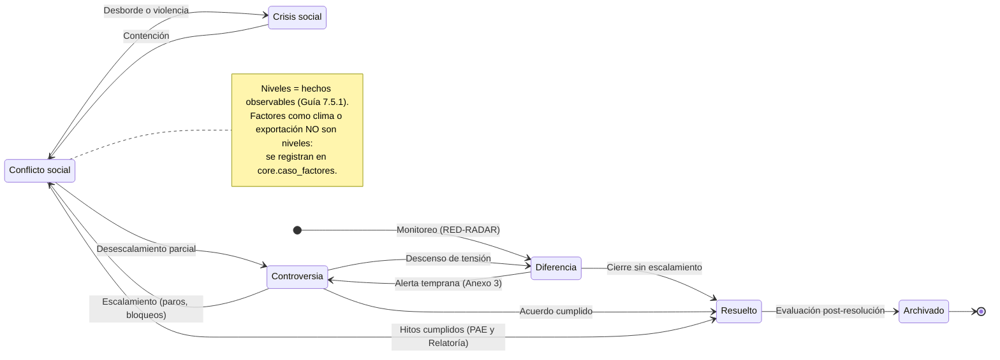

### 3.16 Integridad impuesta por la base y pruebas

El DDL completo (Sección 20, partes 20.0 a 20.28, y Sección 14) se ejecutó en PostgreSQL 16 con pgvector 0.6: **0 errores**. La suite de regresión del esquema (RNF-06) tiene **75 pruebas catalogadas**: 37 del núcleo y 38 de las capas de política, indicadores, análisis dirigido, cualitativa, léxica, recolección y observabilidad. Las 37 del núcleo se ejecutaron originalmente con el DDL del núcleo y pasaron todas; como las capas incorporadas modifican cuatro objetos del núcleo (catálogos del grafo, clave de la caché, roles y columnas de anclaje de texto), **se reejecutan en CI antes del cierre de cada nivel**. De las 38 restantes, **25 se ejecutaron contra el DDL completo (45 aserciones, todas aprobadas)** con el script `test_ddl_v8_3.sql`; las otras 13 requieren la aplicación, datos reales o software externo y se entregan como criterio de aceptación.

**Pruebas del núcleo (T1–T37).**

| Grupo                            | Qué se probó                                                                                                                                                  |
| -------------------------------- | ------------------------------------------------------------------------------------------------------------------------------------------------------------- |
| Actores y nombres (3)            | Alta crea nombre inicial y nodo; renombrar cierra el nombre previo y sincroniza la caché; `created_by` automático                                             |
| Casos (2)                        | Cambio de nivel/riesgo genera historial con una sola fila vigente; nivel inexistente rechazado                                                                |
| Alertas (1)                      | SLA de 24 h calculado al derivar                                                                                                                              |
| Compromisos (5)                  | Código sin sufijo `_COMP###` rechazado; "Cumplido" sin evidencia rechazado; segunda redefinición rechazada; estado histórico sincroniza el hito               |
| Historial de agentes (3)         | Cadena de hash; `UPDATE` y `DELETE` rechazados                                                                                                                |
| Grafo (5)                        | Subgrafo a 2 saltos; consulta en tiempo válido pasado; antes de todo = 0; conocimiento anterior a la transacción = 0; vista MACTOR                            |
| Contexto (5)                     | Observación vigente y no vigente por TTL; duplicado rechazado; dos ubicaciones rechazado; `vw_riesgo_sistemico`                                               |
| Partición, vectores, vistas (10) | Inserción en la partición mensual correcta; búsqueda vectorial HNSW; dashboard sin producto cartesiano y `REFRESH CONCURRENTLY`; 7 vistas analíticas ejecutan |
| Seguridad RLS (4)                | Nivel 0 no ve nada; nivel 1 ve solo público; **nivel 2 no ve confidencial**; nivel 3 ve todo                                                                  |

**Pruebas de las capas incorporadas (T38–T75).**

| ID  | Qué se prueba                                                                                                                                                                                | Estado                                                                     |
| --- | -------------------------------------------------------------------------------------------------------------------------------------------------------------------------------------------- | -------------------------------------------------------------------------- |
| T38 | Invarianza: el mismo insumo con lentes distintos produce idénticos niveles de riesgo y alertas (en la base: ninguna tabla de `policy` referencia riesgo, alertas ni grafo)                   | Ejecutada (base); la comparación de salidas completa es de aplicación      |
| T39 | Reproducibilidad: una consulta con `conocido_en` pasado reproduce el lente de entonces                                                                                                       | Ejecutada                                                                  |
| T40 | Caducidad automática de una regla con fecha de vencimiento y aviso en `core.notificaciones`                                                                                                  | Ejecutada                                                                  |
| T41 | Una regla `hipotesis_analitica` no puede pasar a `vigente`; una regla P vigente exige dos aprobadores distintos                                                                              | Ejecutada                                                                  |
| T42 | Una salida de escenario nunca se guarda con `es_validado_humano = true` sin aprobación explícita                                                                                             | Especificada                                                               |
| T43 | Una plantilla se resuelve con las cuatro clases de variante (estándar, factible, proxy, brecha)                                                                                              | Ejecutada                                                                  |
| T44 | Un proxy sin justificación es rechazado al cerrar la transacción                                                                                                                             | Ejecutada                                                                  |
| T45 | La Minister View rechaza un proxy no validado o de incertidumbre alta                                                                                                                        | Ejecutada                                                                  |
| T46 | La vista de carga de campo reproduce las horas de brechas aprobadas y rechaza una brecha que excede la capacidad                                                                             | Ejecutada                                                                  |
| T47 | El Nivel 1 corre de punta a punta con A1, A2, A3 y servicios                                                                                                                                 | Especificada                                                               |
| T48 | Cada guardrail G1–G15 tiene un caso que lo dispara y la salida es rechazada                                                                                                                  | Especificada                                                               |
| T49 | Un lote con esquema inválido queda `con_errores` y no escribe en `qda`, `lex` ni `kag`                                                                                                       | Ejecutada                                                                  |
| T50 | Un plan modificado por el usuario se ejecuta sin cambios de código; un plan sin aprobar no se ejecuta                                                                                        | Ejecutada                                                                  |
| T51 | Exportar e importar sin cambios deja 0 segmentos desplazados (en la base: límites de texto y herencia de clasificación)                                                                      | Ejecutada (base); el viaje de ida y vuelta requiere el software real (Q19) |
| T52 | Un documento re-fragmentado conserva sus segmentos ligados a su `texto_version`                                                                                                              | Ejecutada                                                                  |
| T53 | El exportador nunca emite datos sin pseudonimizar a quien no tenga permiso de aprobación vigente                                                                                             | Ejecutada                                                                  |
| T54 | Importar dos veces la misma corrida léxica es idempotente (por hash)                                                                                                                         | Ejecutada                                                                  |
| T55 | No se muestra una clase léxica sin métricas de estabilidad                                                                                                                                   | Ejecutada                                                                  |
| T56 | Un caso con contradicción sin explicar queda con consistencia y robustez «no»                                                                                                                | Ejecutada                                                                  |
| T57 | Una afirmación sin fragmento deja la trazabilidad en «no»                                                                                                                                    | Ejecutada                                                                  |
| T58 | Ablación de recuperación: con y sin señal de código y con y sin re-ranking sobre consultas reservadas de prueba; cada componente se conserva solo si mejora recall@10 sin degradar precisión | Especificada                                                               |
| T59 | Un rol de nivel 1 no puede leer el resumen de una corrida de comunidades de nivel 3                                                                                                          | Ejecutada                                                                  |
| T60 | Misma semilla y mismo snapshot producen las mismas comunidades                                                                                                                               | Especificada                                                               |
| T61 | Una captura no puede modificarse ni borrarse                                                                                                                                                 | Ejecutada                                                                  |
| T62 | Una hipótesis sin evidencia enlazada no puede entrar a una salida; si se cita, lleva el rótulo «HIPÓTESIS»                                                                                   | Ejecutada                                                                  |
| T63 | Un trabajo no puede capturar un dominio fuera de la lista blanca de su herramienta                                                                                                           | Ejecutada                                                                  |
| T64 | Dado un `output_contract`, se reconstruyen modelo y versión, snapshot de política, fragmentos recuperados con su rango y veredictos                                                          | Especificada                                                               |
| T65 | La vista del tablero decisional no contiene filas sin validar                                                                                                                                | Ejecutada                                                                  |
| T66 | `run_log.detalle` cumple su JSON Schema versionado                                                                                                                                           | Especificada                                                               |
| T67 | Una consulta Confidencial nunca produce `llm_call.destino = nube`                                                                                                                            | Ejecutada                                                                  |
| T68 | La etapa 1 de A2 con insumos solo Públicos puede ir a la nube; si un insumo es Reservado, va local                                                                                           | Ejecutada (base: contenido Público en nube admitido)                       |
| T69 | La matriz de roles se prueba por rol con casos positivos y negativos, incluida la fuga por exportación                                                                                       | Ejecutada (base: roles y permisos); la matriz completa es de aplicación    |
| T70 | Una regla `en_tramite` (p. ej. la prioridad de destrabe en espera de facultades) no se inyecta como contexto (UC-4)                                                                          | Especificada                                                               |
| T71 | La vista de casos en controversia o conflicto sin reunión de diálogo en los últimos 30 días devuelve los esperados (UC-3)                                                                    | Especificada                                                               |
| T72 | Un informe a la SGSD sale solo por `core.integraciones` como exportación aprobada, sin acceso directo a la base (UC-3)                                                                       | Especificada                                                               |
| T73 | Una afirmación que cita una norma inexistente en el registro (p. ej. «falta el reglamento de la Ley N.° 31749») se rechaza por G15 (UC-2)                                                    | Especificada                                                               |
| T74 | Requerimiento de Contraloría: reconstrucción completa de una alerta de prioridad `Crítica inmediata` sin acceso a datos por encima del nivel del auditor (UC-5)                              | Especificada                                                               |
| T75 | Al pasar la fecha de vencimiento, `N-FEN-01` y las reglas que dependen de ella pasan a `vencida` y desaparecen del pie sin intervención (UC-1)                                               | Especificada (el mecanismo se ejecutó en T40)                              |

Regeneración de diagramas: `gen_diagrams.py` (D1–D8) y `gen_diagrams_v83.py` (D9–D12) consultan `pg_attribute`, `pg_constraint` y `pg_index` sobre la base cargada y emiten los bloques Mermaid.

### 3.17 Escalabilidad: volumetría, decisiones y umbrales de revisión

#### 3.17.1 Volumetría estimada (supuestos explícitos; a validar en F1)

| Entidad                                                          | Supuesto                                                                              | Volumen/año             | Tamaño/año                                                              |
| ---------------------------------------------------------------- | ------------------------------------------------------------------------------------- | ----------------------- | ----------------------------------------------------------------------- |
| Casos                                                            | 100 nuevos (hoy 35)                                                                   | 100                     | < 1 MB                                                                  |
| Actores                                                          | 2 000 acumulados (hoy 931)                                                            | 2 000                   | < 1 MB                                                                  |
| Documentos                                                       | 30 por caso                                                                           | 3 000                   | ~30 MB (texto; PDF y audio en almacenamiento de objetos, no en la base) |
| Fragmentos y embeddings                                          | 20 por documento; vector de 1 024 dimensiones (≈ 4,2 KB por fila)                     | 60 000                  | ~250 MB + índice HNSW (1–2×) ≈ 0,5–0,75 GB                              |
| Aristas del grafo                                                | 50 por caso (hasta 500)                                                               | 5 000–50 000            | < 50 MB                                                                 |
| `raw_ingest`                                                     | 2 agentes × 30 mensajes/día (supuesto heredado de v5.0, no verificado en las fuentes) | ~22 000                 | ~45 MB                                                                  |
| `ctx.observaciones`                                              | 40 variables × 200 ubicaciones × 52 semanas (cota superior)                           | ≤ 416 000               | ≤ 45 MB                                                                 |
| `run_log` y `agent.llm_call`                                     | 50 consultas/día × 3 llamadas de modelo (supuesto)                                    | ~55 000 filas por tabla | ~60 MB entre ambas (estimación)                                         |
| Segmentos cualitativos, corridas léxicas y metadatos de capturas | A medir en el Nivel 1b                                                                | —                       | < 100 MB (supuesto)                                                     |
| **Total**                                                        |                                                                                       |                         | **≈ 1 GB/año (< 2 GB con margen)**                                      |

Conclusión: la estimación de 20 GB/año de v8.1 sobreestima; salvo que se guarden binarios en la base. Un servidor
de 16 GB de RAM mantiene el índice vectorial y los datos calientes en memoria durante años.

#### 3.17.2 Decisiones de escala

| ID  | Decisión                                                                                                                                                                                                                                              | Justificación                                                                                                                                                  |
| --- | ----------------------------------------------------------------------------------------------------------------------------------------------------------------------------------------------------------------------------------------------------- | -------------------------------------------------------------------------------------------------------------------------------------------------------------- |
| S1  | **Una instancia primaria + réplica de lectura para Power BI**                                                                                                                                                                                         | Aísla las consultas de BI de las escrituras sin complejidad adicional                                                                                          |
| S2  | **Recorrido de grafo en SQL** (`kag.subgrafo`, CTE recursiva acotada a ≤ 3 saltos) con las mismas políticas RLS del usuario; **NetworkX/NumPy solo en lote** para matrices MACTOR (MDI/MIDI) cuyo resultado se persiste                               | Elimina el cuello del GIL, los datos desactualizados y la evasión de RLS (C10)                                                                                 |
| S3  | **Búsqueda vectorial HNSW** con la clasificación en la misma fila; subir `hnsw.ef_search` y, si la versión de pgvector lo permite, usar escaneo iterativo para no perder recall por el filtro de seguridad                                            | Evita respuestas incompletas para roles con acceso restringido. La recuperación suma una tercera señal (código cualitativo) y, en el Nivel 2, re-ranking (6.4) |
| S4  | **Particionado:** `raw_ingest` y `run_log` por mes; `observaciones` por año; función `core.crear_particion` programable con `pg_cron`                                                                                                                 | Mantener y archivar sin bloquear; retención fijada por OGTI (D9)                                                                                               |
| S5  | **Caché de respuestas por (hash de consulta, nivel de acceso, hash de política)**; no usar caché semántica para contenido Reservado o Confidencial                                                                                                    | Evita fuga entre roles (E6)                                                                                                                                    |
| S6  | **Regla R-LLM:** Confidencial → solo LLM local; Reservado → local por defecto, nube solo con anonimización y contrato; Público → nube permitida. La complejidad decide el modelo _dentro_ del destino permitido                                       | Ley 29733 y datos de comunidades (E7). Para el Generador de Pautas se aplica en dos etapas (1.4)                                                               |
| S7  | **Cadena de hash serializada con bloqueo asesor** en `run_log`                                                                                                                                                                                        | Garantiza integridad con cientos de inserciones/s; si fuera cuello, encadenar por día                                                                          |
| S8  | **`entidad_id` en `casos` y unidades orgánicas** desde ya; RLS por entidad al incorporar un segundo ministerio                                                                                                                                        | Evita bifurcar la base (E8)                                                                                                                                    |
| S9  | **Observabilidad:** `pg_stat_statements`, `auto_explain` > 500 ms, alertas de lag de réplica                                                                                                                                                          | Base de RNF-01/02                                                                                                                                              |
| S10 | **Respaldo propuesto:** copia lógica diaria + archivado continuo (PITR); RPO ≤ 15 min, RTO ≤ 4 h; SLO 99 % en horario laboral                                                                                                                         | Valores **propuestos**, sujetos a la política de OGTI (RS-06, RNF-01)                                                                                          |
| S11 | **Migraciones versionadas** (Flyway/Alembic) y las 75 pruebas como CI del esquema                                                                                                                                                                     | RNF-06                                                                                                                                                         |
| S12 | **(v10) Perfil de despliegue dual.** PostgreSQL 16 es el perfil de referencia; **SQL Server ≥ 2019** es el perfil que exige OGTI para el MVP-45. Mismos nombres de tabla y mismas reglas de negocio; cambian tipos y seguridad por fila (§3.17.2.v10) | Evita mantener dos modelos. Restricción de plataforma de OGTI (D-1 del MVP §0.4)                                                                               |
| S13 | **(v10) Un solo predicado de seguridad por tabla**, escrito como función en línea, con contexto de sesión de solo lectura que la API fija **en cada apertura de conexión**                                                                            | Con _pooling_ de conexiones, un contexto fijado solo al inicio se filtra al siguiente usuario                                                                  |
| S14 | **(v10) Embeddings y búsqueda vectorial fuera de la base en el MVP** (servicio Python). Si OGTI confirma una versión de SQL Server con tipo vectorial nativo, se evalúa en F2 (**a verificar con OGTI**, Q34)                                         | No se promete en 45 días una capacidad que depende de la versión instalada                                                                                     |

<!-- v10:P06b begin -->

#### 3.17.2.v10 Perfil de despliegue SQL Server: equivalencias y seguridad por fila — _añade a 3.17.2 (v10)_ — V10-02

**Para quién es.** Para quien implementa el MVP-45 sobre SQL Server. Cada fila dice qué se usa en lugar de lo que v9 escribe para PostgreSQL.

| Tema                  | v9 (PostgreSQL)                              | Perfil SQL Server                                                                                                                   | Atención                                                                                                   |
| --------------------- | -------------------------------------------- | ----------------------------------------------------------------------------------------------------------------------------------- | ---------------------------------------------------------------------------------------------------------- |
| Identificador         | `uuid`, `gen_random_uuid()`                  | `UNIQUEIDENTIFIER`, `NEWSEQUENTIALID()` (solo como valor por defecto)                                                               | `NEWSEQUENTIALID()` no se puede llamar en una consulta; usar `NEWID()` si hace falta generar uno en código |
| JSON                  | `jsonb`                                      | `NVARCHAR(MAX)` con `CHECK (ISJSON(col)=1)`; consulta con `JSON_VALUE` / `OPENJSON`                                                 | Sin índice GIN: indexar columnas calculadas de las claves que se consultan                                 |
| Fecha y hora          | `timestamptz`                                | `DATETIME2` en UTC (o `DATETIMEOFFSET`)                                                                                             | Fijar UTC como convención y convertir en la API                                                            |
| Geografía             | PostGIS `geography`                          | Tipo `geography` nativo (`STDistance`, `STIntersects`)                                                                              | Los nombres de función cambian; SRID 4326                                                                  |
| Búsqueda vectorial    | pgvector + HNSW                              | Fuera de la base (servicio Python)                                                                                                  | Ver S14 y Q34                                                                                              |
| Similitud de texto    | `pg_trgm` (Resolver)                         | Se calcula en el servicio Python (trigramas o `rapidfuzz`) y se envía el resultado                                                  | Evita depender de extensiones                                                                              |
| Índice único parcial  | `CREATE UNIQUE INDEX … WHERE`                | Índice **filtrado** (`CREATE UNIQUE INDEX … WHERE … IS NOT NULL`)                                                                   | Equivalente directo; lo usa `documento_hmac`                                                               |
| Columnas generadas    | `GENERATED ALWAYS AS`                        | Columnas **calculadas** (`AS (…) PERSISTED`)                                                                                        | Ej.: `dias_mora`                                                                                           |
| Vigencias sin solape  | `EXCLUDE USING gist` (prueba T83)            | **No existe equivalente directo**: usar _trigger_ que rechace solapes, o índice único sobre (clave, `valid_to`) con fecha centinela | Reescribir T83 para este perfil                                                                            |
| Vistas materializadas | `MATERIALIZED VIEW`                          | **Vista indexada** (con restricciones) o tabla recalculada por un trabajo programado                                                | Para `mv_dashboard_alta_direccion` conviene la tabla + trabajo                                             |
| Tareas programadas    | `pg_cron`                                    | Hangfire o Quartz en la API (o SQL Agent)                                                                                           | Ya previstos en MVP §3.6                                                                                   |
| Arreglos (`text[]`)   | tipos arreglo                                | Tabla puente o JSON                                                                                                                 | Evitar arreglos en el modelo del MVP                                                                       |
| Particionado          | declarativo                                  | Función y esquema de partición                                                                                                      | No es necesario en el volumen del MVP (§3.17.1: ≈ 1 GB/año)                                                |
| Texto completo        | `tsvector`                                   | _Full-Text Search_ (requiere el componente instalado)                                                                               | Confirmar con OGTI                                                                                         |
| Seguridad por fila    | `CREATE POLICY` + `current_setting('app.*')` | `CREATE SECURITY POLICY` + función en línea + `SESSION_CONTEXT`                                                                     | Siguiente apartado                                                                                         |
| Recorrido de grafo    | CTE recursiva (`kag.subgrafo`)               | CTE recursiva (con `OPTION (MAXRECURSION n)`)                                                                                       | Solo si se reactiva KAG                                                                                    |

> **Ejemplo de traducción (una tabla).** `core.actor_alias` en v9 (§3.6.v10) usa `uuid` y `current_date`. En SQL Server queda: `id UNIQUEIDENTIFIER NOT NULL DEFAULT NEWSEQUENTIALID() PRIMARY KEY`, `vigente_desde DATE NOT NULL DEFAULT CAST(SYSUTCDATETIME() AS DATE)`. El resto —columnas, nombres, `CHECK` de `tipo_alias`— es idéntico.

**Seguridad por fila en SQL Server.** La API .NET abre la conexión y fija el contexto **a partir de los claims del token** (nunca desde datos que envíe el cliente). La traducción del mecanismo vigente (`app.rol_codigo`, `app.actor_uid`, §11.10.bis) es esta:

| v9 (PostgreSQL)                     | Perfil SQL Server                                                                                                                                                 |
| ----------------------------------- | ----------------------------------------------------------------------------------------------------------------------------------------------------------------- |
| `SET app.rol_codigo = 'sectorista'` | `sp_set_session_context N'rol_codigo', N'sectorista', @read_only = 1`; el nivel y las capacidades **los resuelve la base** desde la tabla de roles, no el cliente |
| `app.actor_uid` (sujeto externo)    | `sp_set_session_context N'actor_uid', @aid, @read_only = 1`                                                                                                       |
| `app.staff_bypass_subject_rls`      | `sp_set_session_context N'staff', 1, @read_only = 1`                                                                                                              |
| Política `RESTRICTIVE` por tabla    | Un **único** predicado de filtro y bloqueo por tabla, con todas las condiciones dentro de la misma función                                                        |

```sql
-- La API fija el contexto al abrir CADA conexión (interceptor de EF Core):
--   EXEC sp_set_session_context N'rol_codigo',        N'A', @read_only = 1;  -- rol de core.roles, nunca un nivel numérico
--   EXEC sp_set_session_context N'actor_uid',         @aid, @read_only = 1;  -- solo perfil C
CREATE FUNCTION seg.fn_acceso_caso(@clasificacion TINYINT)
RETURNS TABLE WITH SCHEMABINDING
AS RETURN
SELECT 1 AS permitido
WHERE @clasificacion <= TRY_CAST(SESSION_CONTEXT(N'clasificacion_max') AS TINYINT)
  AND CAST(SESSION_CONTEXT(N'perfil') AS NCHAR(1)) IN (N'A', N'B');   -- el perfil C no ve casos
GO
CREATE SECURITY POLICY seg.pol_caso
    ADD FILTER PREDICATE seg.fn_acceso_caso(nivel_clasificacion) ON core.casos,
    ADD BLOCK  PREDICATE seg.fn_acceso_caso(nivel_clasificacion) ON core.casos AFTER INSERT,
    ADD BLOCK  PREDICATE seg.fn_acceso_caso(nivel_clasificacion) ON core.casos AFTER UPDATE
WITH (STATE = ON);
```

**Cuatro advertencias para OGTI.**

1. La seguridad por fila **no protege** frente a quien tenga permiso para alterar la política o sea administrador de la base: se audita el DDL de seguridad.
2. Con _pooling_, el contexto se fija en **cada apertura** de conexión. Si no, un usuario hereda el contexto del anterior (prueba T98).
3. Los predicados con subconsultas cuestan rendimiento: se indexan las columnas que consultan y se mide en la prueba de carga.
4. Para el Perfil C, el filtro se escribe sobre la tabla puente `core.compromiso_colaboradores` (≈ `compromiso_actor` del MVP), con índice por (`actor_uid`, `compromiso_id`).

<!-- v10:P06b end -->

#### 3.17.3 Umbrales para reconsiderar la arquitectura

| Métrica                        | Umbral                          | Acción                                                                    |
| ------------------------------ | ------------------------------- | ------------------------------------------------------------------------- |
| Aristas vigentes               | > 2 M o necesidad de > 4 saltos | Evaluar Apache AGE o un grafo dedicado                                    |
| Vectores                       | > 5 M                           | Particionar por clasificación/entidad; evaluar almacén vectorial dedicado |
| Consultas BI concurrentes      | > 10 usuarios simultáneos       | Segunda réplica o _data mart_                                             |
| Latencia p95 de `kag.subgrafo` | > 1 s                           | Materializar adyacencias por caso                                         |
| `run_log`                      | > 50 M filas                    | Archivar particiones antiguas a almacenamiento de objetos                 |
| Entidades usuarias             | > 1                             | Activar RLS por `entidad_id`                                              |
| Casos validados                | ≥ 150 o 5 000 aristas validadas | Activar las comunidades del grafo (5.8)                                   |
| Contexto de política inyectado | > 1 500 tokens                  | Truncado determinista por prioridad (2.bis)                               |

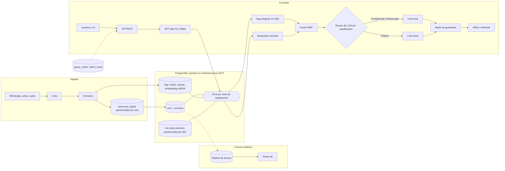

### 3.18 Costo de cambio: qué exige cada evolución

| Evento                                                   | v8.1                                         | Arquitectura definitiva                                                              |
| -------------------------------------------------------- | -------------------------------------------- | ------------------------------------------------------------------------------------ |
| Nueva variable de contexto                               | `ALTER TABLE` + migración + cambio de vistas | `INSERT` en `ctx.cat_variables` y su fuente permitida                                |
| Nuevo tipo de relación entre actores                     | Nueva tabla o columna                        | `INSERT` en `kag.cat_tipos_arista`                                                   |
| Nuevo tipo de documento (anexo)                          | Nueva tabla                                  | `INSERT` en `core.cat_tipos_documento` + JSON Schema                                 |
| Nueva especie                                            | Nueva columna (`biomasa_pota_tn`)            | `INSERT` en `core.cat_especies`                                                      |
| Nuevo rol o nivel de clasificación                       | Cambiar `ENUM`/`CHECK`                       | `INSERT` en el catálogo                                                              |
| Caso o compromiso en varios distritos                    | No representable                             | Filas en `caso_distritos` / `compromiso_distritos`                                   |
| Cambiar de modelo de embeddings                          | Reconstrucción sin trazabilidad              | Nuevas filas con `modelo` y `version_modelo`                                         |
| Segundo ministerio usuario                               | Bifurcar la base                             | `INSERT` en `core.entidades` + RLS por entidad                                       |
| Nueva regla de política o nuevo lente                    | No existía                                   | `INSERT` en `policy.regla` (con fuente y aprobación)                                 |
| Nuevo indicador o nueva alternativa de medición          | Columna nueva en una vista fija              | `INSERT` en `ind.indicador` e `ind.variante`                                         |
| Nuevo tipo de nodo o clase de arista                     | Migración de un `CHECK`                      | `INSERT` en `kag.cat_tipos_nodo` o `kag.cat_clases_arista`                           |
| Nuevo corpus, herramienta de análisis o punto de ingesta | Código nuevo                                 | `INSERT` en `kag.cat_corpus`, `analisis.cat_herramientas` o `analisis.punto_ingesta` |

### 3.19 Límites de este modelo (lo que sigue pendiente)

- **No** especifica UI, API REST (RNF-05), generador de Word/PDF (RF-07) ni jobs de sincronización.
- **No** carga los catálogos de etapas PIP del Protocolo ni los JSON Schema por tipo de documento.
- **No** valida PostGIS (coordenadas como `numeric` con rango; migrar a `geography` si se requieren consultas espaciales), `btree_gist` (una restricción de exclusión por solapamiento de vigencia sería deseable: hoy un índice único parcial evita duplicados exactos pero no solapes parciales), `pg_cron` ni `pg_trgm`.
- **No** incluye rendimiento medido con carga real.
- Los valores de `cat_estados_caso`, las transiciones de 3.15 y los umbrales de 3.17.3 son **propuestas**.
- **No** valida el viaje de ida y vuelta REFI-QDA con software real (Q19), el re-ranking en español con consultas reales, ni el rendimiento de las vistas de observabilidad con carga real.
- Los esfuerzos de 17.13 y los umbrales de 5.6 y 5.8 son estimaciones de planificación, no mediciones.

### 3.20 Modularidad y apagado independiente

**Valoración: media-alta.** Todos los módulos incorporados dependen solo de `core` y de `kag.documento_fuente` / `kag.documento_fragmento` (y entre sí solo a través de `analisis` y `staging`). Cada uno se puede **apagar** —es decir, dejar sin uso, manteniendo creados sus schemas— sin romper el resto: ninguna otra funcionalidad exige filas en ellos.

| Módulo                           | Depende de                                                                           | Qué ocurre al apagarlo                                                                                                                     |
| -------------------------------- | ------------------------------------------------------------------------------------ | ------------------------------------------------------------------------------------------------------------------------------------------ |
| `policy` (2.bis)                 | `core.usuarios`, `core.output_contracts`, `core.query_cache`, `kag.documento_fuente` | El contexto activo queda vacío; la caché usa un hash de política neutro; las salidas se emiten sin lente y con el pie «sin lente aplicado» |
| `ind` (8.4)                      | `core.cat_tipos_documento`, `ctx.cat_variables`, `kag.documento_fuente`              | Las plantillas vuelven a ser las vistas fijas de los Anexos 14–17; la Minister View sale sin selección de indicadores                      |
| `analisis`, `staging` (4.3, 9.5) | `core`                                                                               | Sigue operando la ruta WhatsApp; no hay reingesta asistida                                                                                 |
| `qda` (5.5)                      | `kag.documento_fuente`, `kag.documento_fragmento`, `analisis`                        | Sin reingesta cualitativa; la recuperación pierde la tercera señal (6.4)                                                                   |
| `lex` (5.6)                      | `kag.documento_fuente`, `analisis`                                                   | Sin series léxicas; los indicadores proxy basados en ellas quedan sin dato                                                                 |
| Triangulación (5.7)              | `core.casos`, `kag.documento_fragmento`                                              | El marco situacional se rotula «provisional»                                                                                               |
| Recolección (7.5)                | `ctx.cat_variables`, `kag.cat_corpus`, `ind`                                         | M1 pierde la entrada de medios; el sistema sigue con captura manual                                                                        |
| Comunidades (5.8)                | `kag.nodos`, `kag.aristas`                                                           | Solo se pierde el resumen por comunidad; trabajo por lotes                                                                                 |
| Observabilidad (10.4)            | `agent.run_log`, `policy.snapshot`                                                   | **No se apaga**: es requisito de auditoría                                                                                                 |

---

## 3.bis Modelo de datos — DM-1..4: lo que faltaba para C1–C3 (`ind`, `territorio`) — _añade_

El diagnóstico de brechas de v8.3 (comparado contra el inventario de 54 indicadores, no los 40 originales) identificó que 8 de los 54 no podían alojarse sin: un grafo de dependencia entre indicadores, cobertura/denominador en `ind.resultado`, una escala ordinal, y cuatro tablas espaciales. Eso es DM-1..4:

- **`ind.relacion_dependencia`** — qué indicador depende de qué variable o de qué otro indicador, con tipo de dependencia (`componente`, `insumo`, `control`, `validacion`, `agregacion`) y peso. Sin esto, si TEA queda obsoleta, IECP la sigue usando en silencio. La vista `analytics.vw_indicadores_obsoletos` (prevista en §20.21; aún no creada en el DDL) propaga obsolescencia de forma recursiva.
- **`ind.resultado`** gana `valor_categoria` (verde/ámbar/rojo/sin_dato), `denominador`, `cobertura_pct`, `requiere_censo`, `censo_referencia`, y pasa a ser bitemporal (`valid_from/superseded_at`) — antes solo `ind.seleccion` lo era.
- **PostGIS** habilitado (ya requerido también por `chat.*` y por las tablas espaciales de C4–C6).
- **`territorio.parque_industrial`, `territorio.cuadricula_sismica`, `territorio.zona_pesca`, `territorio.expansion_informal`** — las cuatro entidades espaciales que TIPI, ISER, BZ, VCPUE, IVSEC, VEAI e IATT necesitan para existir como algo más que una línea en `ind.brecha`.

## 3.ter Modelo de datos para C4, C5, C6 (DM-5..13) — _añade_ — ver §0.6 sobre la decisión arquitectónica

Ocho tablas reales (excepción justificada al pivote `domain.artefacto`, §0.6 y §3.quater), dos schemas nuevos (`mype`, `pesca`) y una extensión de `territorio`:

| Tabla                          | Sujeto                               | Qué registra                                                                                                              |
| ------------------------------ | ------------------------------------ | ------------------------------------------------------------------------------------------------------------------------- |
| `mype.ejecucion_nec`           | MYPE (`mype_actor_uid`)              | Lote adjudicado por un NEC: monto, fechas de ciclo de vida, `estado_pago`, `dias_mora` (columna generada — ver Anexo C.d) |
| `mype.concentracion_lotes`     | ninguno (agregado por NEC y periodo) | Gini, HHI, top-5 MYPE de un NEC en un periodo                                                                             |
| `mype.inspeccion_cite`         | documento fuente                     | Resultado de inspección de un CITE sobre un lote                                                                          |
| `pesca.licencia_cites_denp`    | exportador (`exportador_actor_uid`)  | Solicitud VUCE, dictamen DENP del IMARPE, volumen autorizado, estado del permiso                                          |
| `pesca.cuota_cites_especie`    | especie                              | Cuota anual CITES por especie, consumo acumulado                                                                          |
| `pesca.trazabilidad_qr`        | lugar de desembarque                 | Escaneo QR que vincula un lote a su licencia y a una etapa de la cadena                                                   |
| `territorio.estacion_hidrica`  | lugar                                | Estación de monitoreo ANA: código, cuenca, subcuenca                                                                      |
| `territorio.monitoreo_hidrico` | lugar (estación)                     | Muestra: OD, pH, metales, temperatura; `excede_eca` es columna generada con el umbral de la ECA                           |

Cada una tiene RLS por clasificación **y** por sujeto (`mype_actor_uid` o `exportador_actor_uid`) donde corresponde, para que una MYPE vea solo sus lotes y un exportador solo sus permisos (mecanismo detallado en §11.10.bis). Las reglas de negocio (transiciones de estado, invariantes) se documentan con el mismo patrón de 4 partes que el resto del sistema — §8.7.bis.

## 3.quater El patrón de artefacto genérico — `domain.*`, `model.*`, `config.*` (para C7 en adelante) — _añade_

**El problema que resuelve:** si cada caso nuevo (C7, C8, …, C100) pidiera su propio juego de tablas como hicieron C4–C6, el sistema tendría cientos de tablas de dominio, cada una con su propio trigger de validación, su propia política RLS, y su propio conjunto de reglas escritas en código. v9 resuelve esto para todo caso _futuro_ con un artefacto único más tres registros (de tipos, de reglas, de configuración):

- **`domain.artefacto`** — una tabla; cada fila es la versión de un hecho de dominio: sujeto(s) tipado(s) (FK reales a `core.actores`, `territorio.lugares`, `core.cat_especies`, `kag.documento_fuente` — nunca texto libre), un `payload JSONB` validado contra el `esquema_json` de su tipo, un estado de catálogo, bitemporalidad completa (`valid_from/valid_to` + `recorded_at/superseded_at` + `supersedes_id`, con un `EXCLUDE USING gist` que impide dos versiones vigentes solapadas de la misma identidad), auditoría, RLS por clasificación y por sujeto, y un enlace opcional a `chat.commit_id` (la conversación que lo originó).
- **`domain.tipo_artefacto`** — el registro de tipos: código, dominio, JSON Schema del payload, versión, si requiere caso, qué tipo de sujeto exige, si tiene RLS por actor.
- **`domain.regla_negocio`** — el registro de reglas por tipo: transición, invariante, validación, cálculo o alerta, con una condición restringida a una lista blanca de funciones SQL o a JSON-Logic (nunca SQL libre — ver §8.7.bis sobre la seguridad del motor).
- **`model.model_card`**, **`config.parametro`**, **`config.libreria`**, **`config.aplicacion`** — generalizan `forecast.model_registry` (que se conserva como vista de compatibilidad, cero `ALTER` sobre la interfaz estable) a cualquier modelo, umbral, librería o aplicación del sistema, como filas, no como código.

**La prueba de robustez:** un caso C101 hipotético se añade con `INSERT` en `domain.tipo_artefacto` + `domain.regla_negocio` + `config.parametro` (+ `model.model_card`/`config.aplicacion` si usa un modelo) — sin `CREATE TABLE`, sin `ALTER TABLE`, sin migración. Si ese caso resulta tener el volumen de consulta de un dashboard de producción con forma estable, se promueve a tabla real documentada como excepción (§0.6), igual que se hizo con los ocho de C4–C6.

**Qué no cambia:** las 7 interfaces estables de v8.3 (`ind.indicador`+`ind.variante`, `ctx.cat_variables`+`ctx.observaciones`, `core.integraciones`, `kag.cat_tipos_nodo`+`kag.cat_tipos_arista`, `territorio.cat_tipos_lugar`+`core.cat_tipos_actor`+`core.cat_roles_actor`, `policy.regla`, `forecast.model_registry`) siguen intocables; `model.model_card` extiende la última sin romperla.

### 3.quater.v10 Mecanismos de la capa de aplicación exigidos por la Guía — _añade a 3.quater (v10)_

**Qué es y qué no es.** Estos mecanismos se resuelven en la capa de **aplicación** (API y UI) y el DDL no los modela; se anotan aquí para que la arquitectura no los dé por ausentes. Ninguno cambia el modelo de datos.

- **Exportación (§8.4).** Toda vista y todo contrato de salida se exporta en **PDF, Excel y JSON**, incluido el **respaldo de entidad** y el **respaldo de la base completa**. Es una **decisión tomada y no implementada** (gap E5): hoy no existe ninguna de esas exportaciones.
- **Paginación en servidor** en todas las listas: ninguna lista devuelve el conjunto completo en una sola respuesta. La **API ya pagina** (sobres con `items`, `total`, `page`, `pageSize`, `pagina` y `tamanoPagina`); la UI Angular la usa en las pantallas portadas y el resto sigue en migración.
- **PII de un actor sin ficha.** Si el actor existe pero no tiene datos personales registrados, la respuesta es `200` con `null`, **nunca** `404`: el `404` afirmaría que el actor no existe.
- **Alta mínima de caso.** Basta **un** atributo —el título— para registrar un caso y clasificarlo después; por eso el código de caso admite la sigla provisional `GEN` (§20.6).
- **`fecha_vencimiento`.** Se registra a mano o se deriva del **próximo hito**; si el compromiso no tiene hitos, la UI la pide en un popup y no la calcula.
- **Anulación no destructiva.** Ninguna entidad se borra: el ciclo de vida es lógico (§20.6). La **base está lista** (migraciones 12 y 13); **pendiente en la API**: los `DELETE` siguen siendo físicos y no existen endpoints `anular`/`restaurar` (gap E2).
- **API en español.** Rutas y claves de la API en español: **decidido, pendiente** —las rutas siguen en inglés (`/api/v1/cases`, `/api/v1/alerts`, …) y la UI traduce—.
- **`/api/dashboard` eliminado.** Los agregados se calculan con los totales de los listados paginados; la ruta no existe.
- **Demandas sin caso.** Se ven como vista dentro de Casos, no como ruta de primer nivel: **decidido**, la pantalla existe y aún no está cableada.
- **Panel lateral de edición.** El mismo panel de otras vistas se usa también en la línea de tiempo y en las alertas, sin saltar de pantalla: **decidido, en curso**.

## 4. Canal de ingesta: del WhatsApp al núcleo operativo

Dos agentes de la OAIPCS registran información en campo por WhatsApp
(texto, audio, fotos, PDFs). El sistema se encuentra con ese flujo, no
al revés.

### 4.1 El pipeline de nueve pasos

1. **Recepción.** El agente envía mensaje al número de WhatsApp Business.
2. **Webhook.** WhatsApp Business API entrega al webhook del sistema.
3. **Cola.** Encola en Redis/RabbitMQ para procesamiento asíncrono.
4. **Transcripción.** Si es audio, speech-to-text (Whisper local o cloud).
5. **Extracción.** LLM transforma texto en JSON según `avisa.raw_ingest.v1`.
6. **Validación.** `jsonschema` en Python valida contra el schema. Si
   falla, va a `avisa.raw_ingest_rejected`.
7. **Evaluación de confianza.** Si `confidence >= 0.7`, inserta en
   `avisa.raw_ingest` con estado `procesado`. Si no, estado `pendiente`
   y cola HITL (Data Scientist).
8. **Parser.** Crea o actualiza `core.casos`, `core.demandas`,
   `core.caso_cronologia`, `core.alertas_tempranas`.
9. **Indexación.** Calcula embeddings para pgvector e inserta aristas
   bitemporales cuando corresponde.

**La mensajería de campo entra sola.** El paso 8 no depende de que una
persona registre el mensaje: WhatsApp/Meta (SVC-07) entrega los mensajes,
la corrida programada (CT-04) los trae cada 24 h —o la llegada de un
mensaje nuevo— y **Gemini (SVC-02)** los procesa (CU-36, RF-E12). El
mensaje entra como **candidato con origen «WhatsApp» y pendiente de
revisión** y recorre el mismo circuito que los candidatos del pipeline;
la revisión humana no se salta. La **sincronización manual** (CU-35,
RF-E13/E14) es un disparo **bajo demanda** sobre una pieza —un caso, un
actor o una zona—, con el sello de fecha y hora de la última
actualización y un **límite de frecuencia por usuario** (RN-18; cuántas
veces por hora sigue abierto en H-76). El dato traído nace «pendiente de
revisión» (RN-19).

### 4.2 El schema `avisa.raw_ingest.v1`

```json
{
  "$schema": "https://json-schema.org/draft/2020-12/schema",
  "title": "AvisaRawIngest",
  "type": "object",
  "required": ["source", "timestamp", "content"],
  "properties": {
    "source": { "enum": ["whatsapp", "acta_pdf", "audio", "email"] },
    "timestamp": { "type": "string", "format": "date-time" },
    "sender_phone_hash": { "type": "string" },
    "content": {
      "type": "object",
      "required": ["situacion_actual"],
      "properties": {
        "situacion_actual": { "type": "string", "maxLength": 1500 },
        "hechos": {
          "type": "array",
          "items": {
            "type": "object",
            "required": ["fecha", "descripcion"],
            "properties": {
              "fecha": { "type": "string", "format": "date" },
              "descripcion": { "type": "string" },
              "es_verificable": { "type": "boolean" }
            }
          }
        },
        "demandas_3p": {
          "type": "array",
          "items": {
            "type": "object",
            "required": ["problema", "propuesta", "pedido"],
            "properties": {
              "problema": { "type": "string" },
              "propuesta": { "type": "string" },
              "pedido": { "type": "string" },
              "actor_nombre": { "type": "string" }
            }
          }
        },
        "actores": {
          "type": "array",
          "items": {
            "type": "object",
            "required": ["nombre"],
            "properties": {
              "nombre": { "type": "string" },
              "tipo": { "enum": ["social", "publico", "privado"] },
              "rol": { "enum": ["principal", "secundario", "tercero"] },
              "posicion": { "enum": ["apoyo", "oposicion", "neutral"] }
            }
          }
        },
        "narrativas": {
          "type": "array",
          "items": { "type": "string" }
        }
      }
    },
    "confidence": { "type": "number", "minimum": 0, "maximum": 1 },
    "extractor_version": { "type": "string" }
  }
}
```

### 4.3 Ruta B: ingesta asistida (puntos de ingesta manual y _staging_)

La ruta WhatsApp (4.1) cubre el registro de campo. La **ruta B** cubre los productos que una persona elabora fuera del sistema con su propio software (codificación cualitativa, análisis léxico, hojas de cálculo) y que deben volver a entrar con validación.

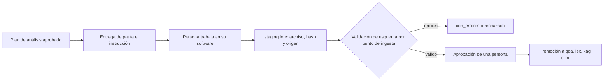

**Reglas de la ruta B.**

- Todo archivo entra a `staging.lote` con su hash, software y versión de origen; el cargador y el aprobador son personas distintas del sistema (`cargado_por`, `aprobado_por`).
- `staging.promover(lote, aprobador)` solo promueve lotes en estado `validado`. Corre con el rol de quien aprueba (`SECURITY INVOKER`), de modo que la RLS sigue vigente. Un lote con esquema inválido queda `con_errores` y **no escribe** en `qda`, `lex` ni `kag` (prueba T49).
- `staging` hereda `nivel_clasificacion`; los archivos van a almacenamiento de objetos con la misma clasificación.
- La retención del _staging_ tras la promoción se fija junto con la política de retención de datos (D9).

**Siete puntos de ingesta iniciales** (`analisis.punto_ingesta`): (1) plan de análisis; (2) proyecto cualitativo `.qdpx` y libro de códigos `.qdc`; (3) resultados léxicos en CSV; (4) validación de aristas del grafo; (5) selección de indicadores (8.4); (6) tabla externa CSV o XLSX con esquema; (7) salida final aprobada.

### 4.bis Rutas de ingesta especializadas y `avisa.raw_ingest.v2` — _añade_

El pipeline de nueve pasos (§4.1) y `avisa.raw_ingest.v1` (§4.2) cubren WhatsApp, acta, audio y correo. No cubren comprobantes SUNAT, permisos VUCE, series hidrológicas ni diagnósticos PCR. v9 añade cinco rutas y un schema v2:

- **Ruta C — SUNAT/VUCE (C4, C6).** API; escribe directo en `mype.ejecucion_nec` y `pesca.licencia_cites_denp`, sin pasar por WhatsApp.
- **Ruta D — SANIPES acuícola (C5).** Feed CSV/JSON de diagnósticos PCR.
- **Ruta E — ANA SiAGUA (C5).** API de series de calidad de agua → `territorio.monitoreo_hidrico`.
- **Ruta F — CITEred/PNDP (C4).** Actas de inspección por oficio → `mype.inspeccion_cite`.
- **Ruta G — VUCE/CITES (C6).** Permisos emitidos/rechazados por API; trazabilidad QR por escaneo.

`avisa.raw_ingest.v2` añade `tipo_registro` (`evento`/`serie`/`permiso`/`comprobante`/`inspeccion`/`diagnostico`) con un `$defs` por tipo en el JSON Schema (detalle completo en el DDL unificado, sección de validación de `avisa.raw_ingest`). Forzar estos datos en v1 habría significado meter JSONB opaco en `raw_text`, perdiendo la validación estructural que v1 ya tiene para WhatsApp.

## 5. Capa KAG: conocimiento bitemporal con trazabilidad

> **Nota de diseño.** El grafo es único: `kag.nodos` + `kag.aristas` + `kag.cat_tipos_arista` (relación, influencia,
> posición, participación, causal). Las tablas `relacion_actor`, `influencia_actor` y `posicion_actor_objetivo` pasan a
> ser **tipos de arista**. La bitemporalidad es real: tiempo válido (`valid_from`/`valid_to`) y de transacción
> (`recorded_at`/`superseded_at`). La memoria inicial es la profundidad histórica de las cronologías de los 35 casos
> (por medir en F1), no "seis años" (hallazgo C5). Diagrama: 3.9; consulta: `kag.subgrafo()`.

### 5.1 Qué resuelve

Tres problemas que ni un RDBMS puro ni un RAG sobre documentos sueltos
resuelven:

- **Consultas temporales.** "¿Cuál era la posición del Gremio de Paita
  en 2023?"
- **Trazabilidad documental.** "¿En qué documento se basa esta
  afirmación?"
- **Resolución de identidades.** "¿Estos dos nombres son el mismo actor?"

### 5.2 Bitemporalidad

Toda fila de `kag.actor_profile`, `kag.actor_profile_attribute`,
`kag.aristas`, `kag.aristas (clase relación)` e `kag.aristas (clase influencia)`
tiene `valid_from` y `valid_to`. Cuando un atributo cambia, la fila se
cierra con `valid_to = fecha_cambio` y se abre nueva con
`valid_from = fecha_cambio`. Nunca se borra la anterior.

Consulta típica:

```sql
SELECT nombre FROM kag.actor_name_history
WHERE actor_uid = :uid
  AND valid_from <= '2023-03-15'
  AND (valid_to IS NULL OR valid_to >= '2023-03-15');
```

### 5.3 Cambios de nombre (tensión vs. crisis)

**Tensión (cambio gradual).** Si la similitud entre el nuevo nombre y el
actual es > 0.85, se crea fila en `actor_name_history` con
`valid_from = fecha_documento` y se cierra la anterior. `actor_uid` no
cambia.

**Crisis (escisión).** Se crea nuevo `actor_uid` para la facción y se
registra en `entity_merge_log` con `tipo_operacion = 'split'`. Aristas
del actor original siguen al `actor_uid` original; nuevas aristas usan
el nuevo. Relación de parentesco en `split_from_edge_id`.

En ambos casos, auditable y reversible.

### 5.4 Los 35 casos de AVISA como semilla histórica

No son datos a migrar y olvidar: son el corpus inicial de
`kag.actor_profile` y `kag.aristas`. Proceso:

1. Parsear cada caso AVISA a JSON.
2. Extraer actores, demandas, compromisos, hechos, narrativas.
3. Poblar `kag.actor_profile` con 931 actores, `valid_from` = fecha
   del primer caso.
4. Poblar `kag.aristas` con las relaciones observadas.
5. Marcar con `confidence = 1.0` y
   `origen_dato = 'AVISA_HISTORICO'`.

El sistema arranca con la profundidad histórica de las cronologías de los 35 casos (por medir en F1).

### 5.5 Capa cualitativa REFI-QDA (`qda`)

**Propósito.** Permitir que el equipo codifique el material cualitativo (actas, relatorías, transcripciones) en el software que ya domina y reingresar ese trabajo al sistema, de modo que los códigos sean recuperables, auditables y enlazables con el grafo. El estándar de intercambio es REFI-QDA: el proyecto es un archivo **`.qdpx`** (ZIP con `project.qde` en XML y una carpeta `Sources`) y el libro de códigos es un **`.qdc`**. Cada programa exporta e importa un subconjunto del estándar; qué elementos conserva cada software y versión debe confirmarse con el software real de la oficina (Q19).

**Modelo** (DDL en 20.23).

- `qda.proyecto`: software y versión de origen, versión del estándar, archivo y hash, estado (`staging`, `validado`, `rechazado`, `anulado`), nivel de clasificación.
- `qda.libro_codigos` y `qda.codigo`: libro versionado (origen `sistema`, `analista` o `importado`) y árbol de códigos con su GUID externo.
- `qda.fuente`: cada texto exportado, con `texto_version`, `hash_texto_exportado`, longitud en caracteres e idioma; `solo_manual` marca los textos en lenguas originarias, que solo admiten codificación manual.
- `qda.segmento`: segmento codificado por desplazamientos en caracteres (`fin_char > inicio_char`), con codificador, vigencia bitemporal y clasificación.
- `qda.segmento_fragmento`: cruce entre segmentos y fragmentos; **no coinciden**, se relacionan por solape.
- `qda.memo`, `qda.mapeo_pseudonimo` (nivel 3, legible solo por la función de importación), `qda.perdida_roundtrip` (lo que no sobrevive al viaje de ida y vuelta) y `qda.exportacion` (registro de cada salida del perímetro).

**Extensión de `qda.exportacion` (DC-12).** Cada salida del perímetro registra `motivo`, `autorizado_por` y `destinatario_externo`, además de `usuario_id` y `excepcion_aprobada_por`. El `.qdpx` sale siempre con actores pseudonimizados vía `qda.mapeo_pseudonimo`; el registro de exportación es lo que permite responder «quién sacó qué y con qué autorización» dentro del plazo de 48 horas de notificación de incidentes. El plazo es una obligación legal vigente; el procedimiento operativo de notificación no está implementado (Anexo E).

**Flujo.** _Exportar:_ se elige un corpus, `qda.exportar()` genera el `.qdpx` con actores **pseudonimizados** y registra quién, qué y el hash. La persona codifica en su software. _Importar:_ `.qdpx` o `.qdc` → `staging.lote` → validación de GUID y de desplazamientos contra `hash_texto_exportado` → promoción (4.3).

**Efectos en el resto de la arquitectura.**

1. `kag.documento_fragmento` suma `inicio_char`, `fin_char` y `texto_version`. Re-fragmentar sin conservar la versión corrompería los desplazamientos de todos los segmentos.
2. `kag.documento_fuente.hash_contenido` se calcula sobre el **texto exportable normalizado** (NFC, saltos de línea fijos) y lleva `texto_version`.
3. Los tipos de nodo y las clases de arista pasan de `CHECK` a catálogos (`kag.cat_tipos_nodo`, `kag.cat_clases_arista`), conforme al principio 3.1(4). Nuevos tipos de nodo: `concepto`, `hipotesis`, `comunidad` y `documento`; nueva clase de arista `discurso` con los tipos `EVOCA` (actor → concepto), `CODIFICADO_COMO` (documento → concepto) y `CO_OCURRE_CON` (concepto ↔ concepto).
4. **RLS:** el segmento hereda la clasificación máxima de su fuente; el memo, la del texto más sensible que cita.
5. **Salida de datos del perímetro.** Exportar texto Confidencial al equipo de un analista lo saca de la infraestructura de OGTI (RNF-10, RS-03). Reglas: solo dispositivos institucionales, pseudonimización obligatoria, registro de cada exportación (RS-05) y archivo con caducidad. Exportar sin pseudonimizar exige un permiso de aprobación vigente de la Dirección (`core.permiso_aprobacion`).
6. **Embeddings:** `kag.embedding` sigue apuntando a fragmentos; la señal «codificado por humano» se resuelve por `qda.segmento_fragmento`. Cambiar de modelo de embeddings no afecta los segmentos.
7. **Soporte parcial del estándar:** memos, variables, conjuntos y enlaces varían entre programas. Plan B: libro de códigos y segmentos en CSV con esquema propio. El viaje de ida y vuelta se prueba con el software real **antes de congelar el esquema**.
8. **Idioma:** los textos en lenguas originarias (Consulta Previa, M8) solo admiten codificación manual.

### 5.6 Capa léxica y de contenido (`lex`)

**Propósito.** Medir regularidades en el lenguaje de los actores (frecuencias, co-ocurrencias, clases de discurso, diccionarios temáticos) y sus desplazamientos en el tiempo, sin copiar texto.

**Modelo** (DDL en 20.24).

- `lex.corpus` (filtro, clasificación máxima, congelado y hash) y `lex.corpus_documento` (texto y versión, variables: caso, región, fecha, tipo de actor).
- `lex.corrida`: método (`frecuencias`, `coocurrencia`, `chd_reinert`, `diccionario`, `especificidades`), software y versión, parámetros, semilla, origen (`interno` o `importado`), hash del archivo, estado y **métricas** (porcentaje de unidades de contexto clasificadas, número de clases, estabilidad).
- `lex.uce`: unidad de contexto elemental por desplazamientos, sin copiar texto.
- `lex.termino`, `lex.clase`, `lex.clase_termino` (chi², frecuencias, p) y `lex.coocurrencia` (dispersa).
- `lex.diccionario`, `lex.diccionario_entrada` (lema o expresión regular) y `lex.serie` (frecuencia normalizada por período y ámbito, frente a una línea base de ventana configurable).

**Alcance por nivel.** Nivel 1b: **importar** resultados CSV y diccionarios. Nivel 2: cálculo propio. Motor candidato: IRaMuTeQ, paquetes de R o un flujo propio de la oficina; la decisión depende de la licencia y la propiedad institucional (D12).

**Efectos en el resto de la arquitectura.**

- Los términos por clase pueden contener nombres propios: filtro de datos personales antes de importar; la corrida hereda la clasificación del corpus.
- Con 35 casos y mensajes cortos de WhatsApp, la clasificación descendente es inestable. Se fija un tamaño mínimo de corpus (a definir con un estadístico; Q22), un mensaje equivale a una unidad de contexto y es obligatorio reportar estabilidad (re-ejecución con otra partición) antes de mostrar clases: la vista `lex.vw_clases_publicables` no devuelve una clase sin métricas de estabilidad (prueba T55).
- Lematización en español; las lenguas originarias quedan fuera de alcance.
- Las series léxicas llegan a los informes como variantes de `ind` (clase factible o proxy), no como columnas nuevas.
- Importar dos veces la misma corrida es idempotente por hash (prueba T54).

### 5.7 Triangulación y marco situacional

**Por qué.** La Guía (7.7) define tres operaciones de triangulación —contraste, saturación y validación— y cinco criterios de robustez del marco situacional: consistencia, correspondencia con evidencia verificable, coherencia contextual, saturación suficiente y trazabilidad. Esta capa los modela. Es también el mecanismo correcto para hacer explícita la divergencia entre el campo cualitativo y los indicadores oficiales **sin que un modelo de lenguaje la resuelva**.

**Modelo** (DDL en 20.25).

- `kag.contraste`: dos afirmaciones con sus fragmentos y la escala de cada fuente (`campo`, `dato_oficial`, `medios`, `redes`, `actor`); tipo (`coincidencia`, `contradiccion`, `vacio`, `diferencia`); estado (`abierta`, `explicada`, `sin_explicacion`); explicación; quién lo propuso (A2 o una persona) y quién lo calificó; vigencia bitemporal.
- `kag.saturacion` (iteraciones: afirmaciones nuevas y si cambió la comprensión) y `kag.validacion_hallazgo` (nivel de confianza baja, media o alta con justificación).
- `kag.anomalia_contextual`: anomalías marcadas respecto del contexto sistémico, con su explicación.
- Vista `analytics.vw_marco_situacional_robustez`, con cinco booleanos calculados por caso: _consistencia_ = ningún contraste `sin_explicacion`; _correspondencia_ = al menos una evidencia de dato oficial; _coherencia contextual_ = ninguna anomalía marcada sin explicar; _saturación_ = la última iteración no cambió la comprensión; _trazabilidad_ = ninguna afirmación vigente sin fragmento.

A2 **propone** contrastes; la persona los califica. El semáforo de robustez se incorpora a los Anexos 8 (análisis de caso) y 2 (reporte regional); la Minister View cita «marco robusto» o «provisional». El guardrail de Causalidad rechaza afirmaciones causales sobre un caso con contraste `sin_explicacion`. Pruebas T56 y T57.

### 5.8 Comunidades del grafo (Leiden)

Trabajo **por lotes**, nunca en consulta. `kag.comunidad_corrida` fija (valido\_en, conocido\_en, algoritmo, resolución, semilla, número de aristas); `kag.comunidad`, `kag.comunidad_miembro` y `kag.comunidad_resumen` guardan la jerarquía, sus miembros y el resumen redactado por modelo (con modelo y versión, y validación humana).

- **Fuga por resumen.** Un lote con rol de servicio ve todo, y el resumen de una comunidad mezclaría aristas de niveles distintos. Se calcula **una corrida por nivel de clasificación** (subgrafo de nivel menor o igual a L) y el resumen hereda L. Prueba T59.
- **Reproducibilidad.** Una corrida es una foto: (valido\_en, conocido\_en, semilla). Prueba T60.
- **Costo y utilidad.** Con 35 casos hay pocas comunidades con sentido y resumir cada una con un modelo cuesta. Se programa en el **Nivel 2, con entrada de 150 casos o 5 000 aristas validadas** (valores a ajustar).
- La etiqueta de una comunidad es una hipótesis: aplica el guardrail de Causalidad.

### 5.bis Capa KAG: nuevos tipos de nodo y arista (C4–C6) — _añade_

`kag.cat_tipos_nodo` gana 5 tipos (`nec`, `lote`, `estacion_hidrica`, `cuenca`, `permiso_cites`) y `kag.cat_tipos_arista` gana 6 (`ABASTECE_A`, `ADJUDICADO_A`, `INSPECCIONADO_POR`, `MONITOREA`, `AFECTA_CUENCA`, `AUTORIZA_EXPORTACION`) — ambos vía `INSERT`, consistente con la interfaz estable (§3.quater). Sin esto, el grafo no puede representar cómo un lote CITES se vincula a su licencia, ni cómo un caso afecta a una cuenca.

## 6. RAG-MACTOR: recuperación por perfil de actor

### 6.1 Qué resuelve

Un analista pregunta "¿qué sabemos del Gremio de Pescadores de Paita?".
Un RAG tradicional devuelve fragmentos dispersos. RAG-MACTOR devuelve el
perfil bitemporal consolidado del actor con ventanas de vigencia y
fuentes documentales.

### 6.2 Clases de apoyo

`ActorProfile`, `ActorProfileAttribute`, `ActorNameHistory`, `Objetivo`,
`PosicionActorObjetivo`, `InfluenciaActor`, `RelacionActor`,
`DocumentoFuente`, `EvidenciaProvenance`.

### 6.3 Cuatro ramas de recuperación

**Rama Perfil.** `kag.subgrafo()` (SQL) recorre el subgrafo de 2 saltos; pgvector busca
documentos fuente; `actor_name_history` resuelve nombre vigente en la
ventana consultada.

**Rama Relación.** `kag.aristas (clase influencia)` y `kag.aristas (clase relación)`
filtrados por ventana temporal, más convergencias y divergencias.

**Rama Estrategia.** Estrategias históricas en
`kag.actor_profile_attribute`, casos previos del actor, demandas
recurrentes.

**Rama Bitemporal.** Aristas vigentes y expiradas en las dos ventanas
comparadas.

### 6.4 Recuperación: corpus lógico, fusión de tres señales y re-ranking

1. **Corpus lógico.** `kag.cat_corpus` (`campo`, `normativa`, `literatura`, `metodologia`, `medios`, `dato_oficial`) y `kag.documento_fuente.corpus_id` reemplazan a un «RAG tripartito» con almacenes separados: son **filtros sobre un solo almacén con RLS única**. RAG-Main recibe `corpus` como parámetro. Si OGTI exige separar la bibliografía internacional, se aloja en otro schema con las mismas políticas.
2. **RRF de tres señales:** vectorial (HNSW), texto completo (`tsvector`) y **código cualitativo**. La tercera es un recuperador más (fragmentos que solapan segmentos con los códigos pedidos), no un peso. Se mantiene el factor 60; el aporte de cada señal se mide por ablación (prueba T58).
3. **Re-ranking en el Nivel 2:** modelo multilingüe local, aplicado **después** del filtro RLS y del RRF, sobre K entre 30 y 50. Debe ser una variante validada para español (los modelos orientados a inglés y chino no sirven); se valida con 50 consultas reales antes de adoptarlo.
4. **Hardware.** El servidor mínimo de 18.2 (16 GB, 4 vCPU) no tiene GPU. Un reranker pequeño corre en CPU con más latencia, a medir contra el objetivo de 8 s del camino complejo. Junto con el modelo local de 7B, la decisión de hardware es D15 (Q7). La caché semántica sigue sin aplicar a Reservado y Confidencial (S5).

### 6.5 Rama MYPE (C4) — _añade a §6.3_

Para un actor MYPE: lotes adjudicados con mora (`mype.ejecucion_nec`), concentración del NEC al que pertenece, inspecciones CITE, casos AVISA en los que participa, normativa aplicable (`policy.regla` clase N, código `N-MYPE-*`). Caso de uso: "¿cuál es el historial de pagos de la MYPE X en los NEC de 2024–2026?"

### 6.6 Rama Hidrológica (C5) — _añade a §6.3_

Para un actor o lugar en una cuenca: estaciones de monitoreo, series de calidad de agua, eventos de mortandad (casos AVISA con temática acuicultura), diagnósticos PCR, normativa ECA aplicable. Caso de uso: "¿qué pasó con la calidad de agua en la cuenca del Perené antes de la mortandad de truchas?"

## 7. RAG-Territorio: recuperación por territorio

> **Nota de diseño.** `territorio` queda como supertipo `lugares` (terminal, desembarcadero, planta, caleta) con tablas de
> detalle; los indicadores sociogeográficos son observaciones de `ctx.observaciones` con ámbito región, provincia, distrito o
> lugar (decisión original: datos sociogeográficos ligados solo a terminal pesquera, distrito, provincia y región). Diagrama: 3.5 y 3.10.

### 7.1 Qué resuelve

"¿Qué tan vulnerable es Paita para el próximo Fenómeno de El Niño?" Un
RAG sobre casos devuelve conflictos puntuales. RAG-Territorio devuelve
la foto completa: infraestructura pesquera, indicadores sociogeográficos
e historia de conflictos.

### 7.2 Clases de apoyo

`TerminalPesquera`, `DesembarcaderoArtesanal`, `PlantaProcesadora`,
`IndicadorSociogeografico`, `HistoriaConflictoTerritorial`, y desde la
expansión `Caleta`.

### 7.3 Cuatro ramas

**Infraestructura.** Terminales, DPA y plantas con capacidad, estado y
certificaciones.

**Socioeconómica.** Indicadores sociogeográficos más recientes cruzados
con contexto socioeconómico y oceanográfico.

**Histórica.** Conflictos previos con tipo, resolución y lecciones.

**Comparativa.** Indicadores de varios distritos normalizados para
ranking de vulnerabilidad.

### 7.4 Fuentes de datos abiertos

| Fuente            | Datos                      | Formato     | Frecuencia   |
| ----------------- | -------------------------- | ----------- | ------------ |
| INEI              | Pobreza, PEA, informalidad | CSV/API     | Anual        |
| MIDIS             | Indicadores sociales       | API REST    | Trimestral   |
| PRODUCE Open Data | Terminales, DPA, licencias | CSV/GeoJSON | Mensual      |
| GEO Perú          | Límites, infraestructura   | WFS/GeoJSON | Bajo demanda |
| MINCETUR          | Flujo turístico            | CSV         | Trimestral   |
| SUNAT             | Exportaciones              | API/CSV     | Mensual      |
| IMARPE/ENFEN      | Biomasa, TSM, ENOS         | CSV/API     | Semanal      |
| SANIPES           | Certificaciones            | PDF/API     | Mensual      |

Carga automática vía `pg_cron` semanal con validación de schema y
marcado de frescura. La captura de páginas y la recolección programada de
fuentes públicas se describen en 7.5.

### 7.5 Recolección automatizada, hipótesis y vacíos de información

**La recolección son trabajos programados, no un agente autónomo (Nivel 1).** `ctx.cat_variables.periodicidad_dias` ya define la cadencia. Se añaden:

- `ctx.herramienta` (código, tipo: `api`, `descarga`, `web`, `rss`, `busqueda_cientifica`; **lista blanca de dominios**; límite de tasa; requiere aprobación);
- `ctx.trabajo_recoleccion` (variable o indicador, herramienta, estado, última ejecución, error);
- `ctx.captura` (URL, momento, hash, archivo, tipo de contenido, corpus, clasificación 1). **Cada página capturada se archiva como evidencia inmutable** (T61) y un trabajo no puede capturar un dominio fuera de su lista blanca (T63).

**Redes y noticias.** Solo fuentes públicas e institucionales (páginas y cuentas oficiales, medios). **Nunca** grupos privados ni mensajería. Sin perfilado de personas (guardrail de Presunción de Inocencia; un dato público sigue siendo dato personal bajo la Ley N.° 29733). El tráfico sale por el proxy que apruebe OGTI (RS-07). Se respetan `robots.txt` y los términos de uso; si una fuente los prohíbe, se registra como brecha. A1 clasifica el material capturado (tema, actor, tono) con confianza; la baja confianza va a la cola HITL.

**Hipótesis y vacíos como objetos de primera clase.** `kag.hipotesis` (enunciado; origen: A2, persona o modelo; estado: `propuesta`, `en_contraste`, `sostenida`, `refutada`, `archivada`; nivel de confianza) con `kag.hipotesis_evidencia` (a favor o en contra), y `kag.vacio_informacion` (descripción, indicador, razón, propuesta, estado) enlazado con `ind.brecha` (8.4). **Una hipótesis nunca aparece en la Minister View como hecho**: si se cita (`kag.hipotesis_en_salida`), lleva el rótulo «HIPÓTESIS» y su estado, y una hipótesis sin evidencia enlazada no puede citarse (T62).

**Literatura científica territorial.** La herramienta `busqueda_cientifica` recupera metadatos y resúmenes; el texto completo se guarda solo si la licencia lo permite. Corpus `literatura`.

**Efectos.** La cola HITL crece (capacidad: 17.13). El volumen de `ctx.captura` va a almacenamiento de objetos, no a la base (3.17). `core.integraciones` registra cada fuente con su autenticación aprobada. M1 consume `ctx.captura` en vez de tener su propio _scraper_. La autonomía (que el agente decida qué buscar) queda para el Nivel 3, con presupuesto de búsquedas y aprobación.

<!-- v10:P10 begin -->

### 7.5.v10 Redes sociales en el MVP-45: solo por vías autorizadas — _añade a 7.5 (v10)_ — V10-07

**Qué resuelve.** El TDR (numeral 12) pide integrar «noticias, redes, relatorías». Recolectar redes sociales tiene riesgos legales (términos de uso de cada plataforma, Ley N.° 29733). Esta sección fija qué se hace y qué no.

| Fuente                                                               | Cómo entra                                                                     | Condición                                                                           | Quién la autoriza                     |
| -------------------------------------------------------------------- | ------------------------------------------------------------------------------ | ----------------------------------------------------------------------------------- | ------------------------------------- |
| Medios digitales                                                     | RSS, mapas de sitio, páginas públicas                                          | Respeto de `robots.txt` y términos de uso; solo el texto necesario                  | OAIPCS                                |
| Portales oficiales (gob.pe, notas de prensa, reportes de conflictos) | Páginas públicas o RSS                                                         | Alta confianza                                                                      | OAIPCS                                |
| **Redes sociales**                                                   | **Solo** API oficial de la plataforma o proveedor licenciado de escucha social | Solo cuentas y páginas **públicas** de organizaciones, autoridades y medios locales | OAIPCS y Legal (dictamen D-6 del MVP) |
| Relatorías, actas, ayudas memoria                                    | Carga manual del analista                                                      | Mismo flujo de entidades y citas                                                    | Analista                              |
| Mensajería de campo (WhatsApp)                                       | **Sigue manual** (§4.1: el sistema es invisible para el personal de campo)     | No se automatiza                                                                    | —                                     |

**Lo que no se hace:** no se entra a grupos privados; no se siguen perfiles de personas particulares; no se usa _scraping_ de plataformas que lo prohíban.

> **Ejemplo (ILUSTRATIVO) de lista blanca (`config.parametro`, clave `fuentes.lista_blanca`):** `{"tipo":"red_social","plataforma":"X","cuenta":"@gremio_ejemplo","via":"api_oficial","aprobada_por":"OAIPCS","fecha":"2026-11-20"}`. Una cuenta que no está en la lista **no se consulta**; ampliar la lista exige la misma aprobación (G22).

**Verificar antes de prometer.** La disponibilidad, el costo y las cuotas de las API de cada plataforma cambian con frecuencia. El MVP debe confirmarlos antes del Día 25 (Q39). Si una API no está disponible, esa fuente queda como interfaz simulada y se declara en el acta, **sin sustituirla por _scraping_**.
<!-- v10:P10 end -->

### 7.6 Rama Cuenca (C5) — _añade a §7.3_

Por cuenca hidrográfica: estaciones, series de calidad, piscigranjas, casos AVISA, normativa ECA.

### 7.7 Rama CITES (C6) — _añade a §7.3_

Por especie CITES: cuotas anuales, permisos emitidos/rechazados, trazabilidad QR, exportaciones SUNAT, casos AVISA vinculados.

### 7.4.bis Fuentes adicionales — _añade a §7.4_

| Fuente             | Datos                    | Formato | Frecuencia   |
| ------------------ | ------------------------ | ------- | ------------ |
| ANA SiAGUA         | OD, pH, metales, caudal  | API/CSV | Semanal      |
| SANIPES acuícola   | PCR, prevalencia         | CSV/API | Semanal      |
| VUCE               | Permisos CITES           | API     | Diaria       |
| CITES Secretariat  | Especies y apéndices     | API     | Bajo demanda |
| SUNAT comprobantes | Facturas, notas          | API     | Diaria       |
| CITEred            | Actas de inspección      | Oficio  | Semanal      |
| SBS                | Tasa de interés promedio | API     | Mensual      |
| OEFA PAM           | Pasivos ambientales      | Web     | Mensual      |

## 8. Capas de contexto sistémico

> **Nota de diseño.** Las cuatro tablas `contexto_*` se reemplazan por `ctx.observaciones` en formato largo con catálogos
> de variable, fuente y especie. El TTL de frescura y las fuentes permitidas son datos (`ctx.cat_variables`,
> `ctx.variable_fuentes`), por lo que los guardrails de Frescura y de Fuente se evalúan con ellos. Diagrama: 3.10.

### 8.1 Principio de inclusión estratificada

> Solo se incorporan datos del sistema circundante que tengan un
> mecanismo causal demostrado o plausible con la conflictividad
> pesquera exportadora.

Cinco capas:

- **Macro oceánica/climática (crítica).** ENOS, TSM, clorofila, biomasa.
- **Macro económica (crítica).** Precios, FX, fletes, demanda.
- **Meso socioeconómica (útil).** Pobreza, informalidad, crédito,
  migración.
- **Micro geopolítica (útil).** Flota extranjera, tratados,
  certificaciones.
- **Ruido potencial (solo con justificación).** Crimen común, turismo,
  combustibles globales.

### 8.2 Modelo de capas concéntricas

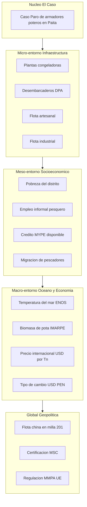

### 8.3 Vista materializada de Alta Dirección

La vista `analytics.mv_dashboard_alta_direccion` consolida por región:
total de casos, riesgo alto, crisis, compromisos vencidos, días
estancado, ENOS promedio 30 días, precio internacional promedio 30 días.
Se reconstruye a partir de las selecciones vigentes de indicadores (8.4) y no de columnas fijas.

> **Estado medido (2026-11-20), _añade (v10)_.** La reconstrucción desde las selecciones vigentes es el diseño; lo que corre hoy es otra cosa: `analytics.vw_selecciones_vigentes` e `ind.resultado` tienen 0 filas, y la vista materializada se calcula solo de `core.casos`, `core.hitos_compromiso` y `core.compromisos` — devuelve 9 regiones y 22 casos activos, sin ningún KPI. El tablero no se cae por la capa `ind` vacía porque hoy no la usa.

### 8.4 De la regla al indicador (`ind`)

**Propósito.** Traducir una prioridad o un requisito en una medición concreta, mostrando siempre qué alternativas existen y quién eligió cuál. DDL en 20.21.

**Modelo.**

- `ind.indicador` (código, nombre, definición, componente de la Guía: `prevencion_estrategica`, `prevencion_operativa`, `tratamiento`, `monitoreo`, `conocimiento`; anexo de origen 1–17; naturaleza; dirección).
- `ind.variante`: **clase** `estandar`, `factible`, `proxy` o `brecha`; especificación que apunta a una vista o a una variable de `ctx.cat_variables`; nivel de evidencia 1–5; si requiere campo; horas estimadas; estado.
- `ind.proxy_justificacion`: constructo objetivo, fuente de validez (`kag.documento_fuente`), supuestos, límites e incertidumbre (baja, media, alta). Un trigger exige su existencia para toda variante `proxy`.
- `ind.plantilla` y `ind.plantilla_slot`, ligadas a `core.cat_tipos_documento` (cada espacio apunta a un indicador).
- `ind.seleccion` (espacio, caso o distrito, período, variante elegida, alternativas mostradas, quién, motivo; vigencia bitemporal simple) e `ind.resultado` (variante, distrito, período, valor, incertidumbre, ejecución).

**Flujo.** Para cada espacio de una plantilla el sistema muestra cuatro alternativas: _estándar_ (lo que la OAIPCS ya reporta), _factible_ (calculable hoy con los datos), _proxy_ (sustituto justificado) y _brecha_ (qué habría que recolectar y a qué costo). La persona elige; la elección queda registrada y es la que usa el informe. **Semillas del Nivel 1:** tres plantillas (Anexo 2, Anexo 15 y Minister View) y, como indicadores estándar, los de la Tabla 3 de la Guía (nivel de riesgo).

**Guardrail G14 (Proxy).** Todo proxy se rotula «PROXY» con su incertidumbre y enlace a la justificación en ambas vistas. En la Minister View solo entra si `es_validado_humano` y su incertidumbre no es «alta» (vista `analytics.vw_indicadores_minister`).

**Efectos en el resto de la arquitectura.**

- La plantilla comparte JSON Schema con `core.cat_tipos_documento.esquema_json`.
- Una variante basada en `ctx.cat_variables` hereda su TTL de frescura: un indicador vencido se marca «desactualizado» en la vista.
- `analytics.mv_dashboard_alta_direccion` (8.3) se reconstruye a partir de las selecciones vigentes (`analytics.vw_selecciones_vigentes`) y no de columnas fijas. Power BI debe consumir esa vista y no tablas.
- El Model Reviewer trimestral (13.1) revisa también los proxies.

**Brechas y carga de campo.** `ind.brecha` registra qué habría que recolectar, con horas estimadas y mes previsto (estados `propuesta`, `aprobada`, `en_campo`, `cerrada`, `descartada`). `core.capacidad_campo` guarda las horas disponibles por persona y mes, y la vista `analytics.vw_carga_campo` contrasta las horas aprobadas con la capacidad declarada. **Una brecha pasa a `aprobada` solo si cabe en la capacidad del mes o existe una decisión escrita de la Dirección**; si no cabe, la salida es un proxy. La regla la hace cumplir un trigger (prueba T46). La encuesta en caletas (M3, 13.3) compite por las mismas horas, de modo que la priorización es única.

### 8.4.bis Propagación de obsolescencia entre indicadores — _extiende 8.4_

`ind.relacion_dependencia` (§3.bis) alimenta `analytics.vw_indicadores_obsoletos`, una vista recursiva (hasta 4 niveles) que marca un indicador como `variable_obsoleta = true` si cualquier variable de la que depende, directa o transitivamente, superó su `ttl_frescura_dias`. Antes de v9, si ICEN quedaba desactualizado, GDP, COIB, IECP e IVSEC lo usaban en silencio — ahora la Minister View puede rotular "cadena de insumos con datos vencidos" en vez de mostrar un número con falsa precisión.

<!-- v10:P08 begin -->

### 8.4.ter Semilla de indicadores del MVP-45: K1 a K5 y la proyección — _añade a 8.4 (v10)_ — V10-04

**Qué resuelve.** §8.4 explica cómo se elige un indicador entre cuatro alternativas, pero no trae fórmulas. Aquí están las definiciones de los seis indicadores del MVP-45 y sus fórmulas, con la clase que les corresponde en v9.

**Estas son definiciones de diseño, no indicadores cargados.** Al 20 de noviembre de 2026 la capa `ind` está vacía: K1–K5 y la proyección P1 son especificación, no resultados. Ninguna cifra de este apartado sale de la base; las únicas cifras medidas son las de la tabla siguiente.

**Estado medido de la capa `ind`** (contenedor `avisa-db`, usuario `avisa`, base `avisa`, 2026-11-20).

| Tabla o vista                           | Filas | Qué significa                                                                                                                                                           |
| --------------------------------------- | ----- | ----------------------------------------------------------------------------------------------------------------------------------------------------------------------- |
| `ind.indicador`                         | 0     | Ningún KPI está registrado como indicador.                                                                                                                              |
| `ind.variante`                          | 0     | No hay variante `estandar`, `factible`, `proxy` ni `brecha`.                                                                                                            |
| `ind.proxy_justificacion`               | 0     | Ninguna justificación de proxy. El trigger la exigirá al sembrar.                                                                                                       |
| `ind.plantilla`                         | 3     | Las tres plantillas de §8.4 sí existen: Anexo 2, Anexo 15 y Minister View.                                                                                              |
| `ind.plantilla_slot`                    | 0     | Las plantillas no tienen espacios: no apuntan a ningún indicador.                                                                                                       |
| `ind.seleccion`                         | 0     | Nadie ha elegido una variante todavía.                                                                                                                                  |
| `ind.resultado`                         | 0     | No hay valores calculados.                                                                                                                                              |
| `ind.brecha`                            | 0     | No hay brechas de recolección registradas.                                                                                                                              |
| `ind.relacion_dependencia`              | 0     | La propagación de obsolescencia (§8.4.bis) no tiene aristas que recorrer.                                                                                               |
| `analytics.vw_selecciones_vigentes`     | 0     | La vista de la que dependen la Minister View y el tablero no devuelve filas.                                                                                            |
| `analytics.vw_indicadores_minister`     | 0     | TAB-04 nace con esta fuente vacía.                                                                                                                                      |
| `config.parametro`                      | 17    | De los seis KPIs, el único parámetro cargado es `ICD.ajuste_tope_puntos`. No hay pesos del IRE ni umbrales de TAA.                                                      |
| `analytics.mv_dashboard_alta_direccion` | 9     | Sí devuelve filas (9 regiones, 22 casos activos), pero se calcula de `core.casos`, `core.hitos_compromiso` y `core.compromisos`, no de `ind`, y no contiene ningún KPI. |

De la tabla se sigue lo que este apartado ya no puede afirmar: la Minister View no «entra» en diciembre porque no tiene nada que mostrar (`analytics.vw_indicadores_minister` devuelve 0 filas), y las tres plantillas de §8.4 existen, pero sin espacios ni indicadores a los que apuntar.

**Aviso.** Son **índices de gestión, no probabilidades**. Los pesos y umbrales viven en `config.parametro` (con versión) y se calibran con las y los analistas contra casos históricos. Mientras no estén calibrados, el semáforo se rotula «PROVISIONAL».

| Código     | Nombre                                    | Clase v9   | Qué responde                                               | Incertidumbre           | ¿Entra a Minister View?                                       |
| ---------- | ----------------------------------------- | ---------- | ---------------------------------------------------------- | ----------------------- | ------------------------------------------------------------- |
| `K1_IRE`   | Índice de Riesgo de Escalamiento (0–100)  | `proxy`    | ¿Qué casos tienen más probabilidad de escalar?             | media                   | Sí, validado (G14)                                            |
| `K2_ICC`   | Índice de Cumplimiento de Compromisos     | `factible` | ¿El Estado cumple lo que prometió?                         | baja                    | Sí                                                            |
| `K3_TAA`   | Tiempo de Atención de Alertas             | `factible` | ¿Reaccionamos a tiempo?                                    | baja                    | Sí                                                            |
| `K4_IPA`   | Índice de Polarización de Actores (0–100) | `factible` | ¿Qué tan fracturada está la red?                           | media                   | Sí                                                            |
| `K5_ICD`   | Índice de Condiciones de Diálogo (0–100)  | `factible` | ¿Hay condiciones para dialogar? (OE2)                      | media                   | Sí. Su ajuste automático se muestra aparte y rotulado «PROXY» |
| `P1_IPS30` | Exposición socioeconómica a 30 días       | `proxy`    | ¿Cuánto empleo local está expuesto si el caso se paraliza? | **alta** hasta calibrar | **No** hasta calibrar (G14); sí en Office View                |

**La columna «¿Entra a Minister View?» describe la intención de diseño, no un estado.** Hoy el criterio G14 no se ejerce porque no hay ninguna fila que filtrar; se aplicará cuando existan `ind.variante` e `ind.resultado` (ver la tabla de computabilidad más abajo).

**Fórmulas (versión inicial) y un ejemplo numérico de cada una.** Las fórmulas son la definición vigente. Las cifras de los ejemplos son **ILUSTRATIVAS** y **verificables a mano** con la fórmula correspondiente: son ejemplos de diseño, no resultados de la base.

**K1 — IRE.** Suma ponderada de seis dimensiones, cada una normalizada de 0 a 1.

| Dimensión                             | Peso | Cómo se normaliza                                                                                     | Valor del ejemplo | Aporte              |
| ------------------------------------- | ---- | ----------------------------------------------------------------------------------------------------- | ----------------- | ------------------- |
| Nivel de conflicto                    | 0,20 | Diferencia 0 · Controversia 0,33 · Conflicto social 0,67 · Crisis 1 (de `core.cat_niveles_conflicto`) | 0,67              | 0,134               |
| Intensidad de hechos, últimos 14 días | 0,20 | Suma de pesos por tipo de hecho, con decaimiento exponencial; tope en 1                               | 0,60              | 0,120               |
| Polarización (K4 ÷ 100)               | 0,20 | Directo                                                                                               | 0,58              | 0,116               |
| Compromisos vencidos                  | 0,15 | Vencidos ÷ exigibles                                                                                  | 0,40              | 0,060               |
| Señales de IA **aprobadas**           | 0,15 | Alertas aprobadas en 14 días ÷ tope configurable                                                      | 0,50              | 0,075               |
| No dialogantes con influencia ≥ 60    | 0,10 | Nº de actores ÷ 2 (tope 1)                                                                            | 0,50              | 0,050               |
| **IRE**                               |      | **Σ aportes × 100**                                                                                   |                   | **55,5 → amarillo** |

Semáforo: < 30 verde · 30–59 amarillo · 60–79 naranja · ≥ 80 rojo.

**K2 — ICC.** Compromisos exigibles cumplidos en plazo ÷ compromisos exigibles (fecha límite ≤ hoy). _Ejemplo:_ 12 exigibles, 9 cumplidos en plazo → **75 % (amarillo)**. Se informan además los vencidos y los que vencen en 15 días. Semáforo: ≥ 85 % verde · 60–84 % amarillo · < 60 % rojo.

**K3 — TAA.** Mediana de horas entre el ingreso del candidato de alerta y la decisión del analista, y % de alertas críticas atendidas dentro de su SLA. _Ejemplo:_ cinco decisiones en 0,5 / 1 / 2 / 3 / 20 horas → **mediana 2 h**; 4 de 5 críticas dentro de SLA → 80 % (bajo el 95 % esperado).

**K4 — IPA.** `50 × (influencia de actores en oposición o no dialogantes ÷ influencia total) + 50 × (intensidad de relaciones tensas o de conflicto ÷ intensidad de todas las relaciones)`.

> **Decisión v10:** el texto del MVP decía «relaciones tensas o de conflicto ponderadas por intensidad ÷ relaciones totales», que admite dos lecturas. Se fija: **suma de intensidades de las tensas y de conflicto ÷ suma de intensidades de todas las relaciones.**

_Ejemplo:_ cuatro actores con influencia 80 (oposición), 60 (apoyo), 40 (neutral), 70 (no dialogante) → 150 ÷ 250 = 0,60 → 30 puntos. Cinco relaciones con intensidades densa 4, tensa 3, conflicto 5, tensa 2, densa 2 → (3+5+2) ÷ 16 = 0,625 → 31,25 puntos. **IPA = 61,25 → amarillo** (< 35 verde · 35–64 amarillo · ≥ 65 rojo).

**K5 — ICD.** Seis condiciones, cada una puntuada de 0 a 4 **con evidencia obligatoria**: interlocutores legítimos · agenda definida · confianza y cumplimiento previo · canal institucional abierto · ausencia de violencia reciente · mediación disponible. `ICD = (suma de puntajes ÷ 24) × 100`. _Ejemplo:_ 2+2+1+2+3+1 = 11 → **45,8 → incierto**. Umbrales: ≥ 60 favorable · 40–59 incierto · < 40 desfavorable.

> **Decisión v10:** el «ajuste automático por señales» del MVP queda **acotado a ±10 puntos** y se muestra como una línea aparte («ICD del analista» y «ajuste automático»), nunca mezclado. _Por qué:_ la evaluación humana con evidencia no debe quedar oculta bajo una corrección de la máquina. Q40 pide validar el tope: mientras no haya confirmación formal de la Dirección, se aplica el valor por defecto de 10 puntos, que vive en `config.parametro` (`ICD.ajuste_tope_puntos`) y lo acota `core.icd_aplicar_ajuste` (§18.ter, Q40).

**Proyecciones socioeconómicas (cómo se cumple el TDR sin un modelo econométrico).** El TDR pide «proyecciones socioeconómicas». El modelo completo (M2, §13.2) necesita su Anexo Metodológico y no cabe en 45 días. El MVP entrega dos cosas, siempre rotuladas **«TENDENCIA / PROXY — no es una predicción»**:

1. **Tendencia del IRE a 30 días**, por caso y agregada: suavizamiento exponencial simple (α inicial 0,3) con banda del 80 % calculada con los residuos de los últimos 30 días.
2. **`P1_IPS30` — exposición socioeconómica a 30 días.** `IPS30 = EJ × FP(escenario)`, donde **EJ** son los empleos directos e indirectos vinculados a la actividad (dato del caso; si falta, mediana de casos análogos del mismo subsector, marcado «estimado») y **FP** es la fracción expuesta según el cuadrante de §13.5.v10. Se informa como **rango**, no como cifra única.

| Cuadrante (§13.5.v10) | FP semilla (hipótesis de trabajo) |
| --------------------- | --------------------------------- |
| E1                    | 0 – 0,05                          |
| E2                    | 0,10 – 0,30                       |
| E3                    | 0,30 – 0,60                       |
| E4                    | 0,70 – 1,00                       |

_Ejemplo (ILUSTRATIVO):_ caso con 120 empleos vinculados en cuadrante E3 → **36 a 72 empleos expuestos**. Los valores de FP son **hipótesis a calibrar con al menos cinco casos AVISA**; hasta entonces la incertidumbre es «alta» y, por G14, `P1_IPS30` solo se ve en la Office View. Al calibrarse y pasar a «media», puede entrar a la Minister View. Esto **cumple la letra del TDR** (hay proyección en el tablero) **sin prometer más de lo que se sabe**.

**Tabla de computabilidad por KPI.** Qué necesita cada indicador, qué hay realmente, si se puede calcular en diciembre de 2026 y qué falta. La columna «Qué hay hoy» recoge lo medido el 2026-11-20.

| KPI        | Insumos que necesita                                                                                                                                                                       | Qué hay hoy (medido el 2026-11-20)                                                                                                                                                                                                                           | ¿Calculable en diciembre de 2026?                                                                                      | Qué falta sembrar o qué vista crear                                                                                                                                                                      | Dependencia                                                                                                |
| ---------- | ------------------------------------------------------------------------------------------------------------------------------------------------------------------------------------------ | ------------------------------------------------------------------------------------------------------------------------------------------------------------------------------------------------------------------------------------------------------------ | ---------------------------------------------------------------------------------------------------------------------- | -------------------------------------------------------------------------------------------------------------------------------------------------------------------------------------------------------- | ---------------------------------------------------------------------------------------------------------- |
| `K1_IRE`   | `core.casos.nivel_conflicto_id`; `core.caso_cronologia`; `core.casos_actores`; `core.compromisos` y `core.hitos_compromiso`; `core.alertas_tempranas` y `core.permiso_aprobacion`; y el K4 | 35 casos (34 con nivel de conflicto); 80 hechos (0 en los últimos 14 días, 5 casos); 60 vínculos actor-caso (60 «Neutral»); 12 hitos (1 con fecha, ya cumplido); 83 alertas (0 en 14 días); `core.permiso_aprobacion` 0                                      | **Parcial.** Solo 2 de las 6 dimensiones tienen insumo y 4 no tienen ninguno. Sin los pesos, no hay índice que mostrar | `ind.indicador` + `ind.variante` de clase `proxy` + `ind.proxy_justificacion` (el trigger la exige); los 6 pesos en `config.parametro`; vista `analytics.vw_k1_ire`                                      | Calibración H-34 (informe SANIPES Sechura) y red de actores completa: **tramo 2 de 2027** (RF-J01, §17.15) |
| `K2_ICC`   | `core.compromisos.estado_id`, el plazo del compromiso y `core.hitos_compromiso.fecha_vencimiento`                                                                                          | 8 compromisos, todos «En proceso», 0 «Cumplido». **No hay columna de plazo en `core.compromisos`** (solo `criterios_smart` JSONB, vacío en las 8 filas). 12 hitos, 1 con `fecha_vencimiento`, y ese figura «Cumplido»                                        | **Parcial.** La fórmula corre, pero devuelve 0 ÷ 0: no hay denominador. El índice sería estadísticamente vacío         | Definir el plazo (columna `fecha_limite` o regla «plazo = primer hito no terminal»); cargar compromisos con plazo y estado final; `ind.variante` de clase `factible`; vista `analytics.vw_k2_icc`        | Decisión de modelado: §1.2.c exige vencimiento y §20.10 no lo tiene. Además, la carga de compromisos       |
| `K3_TAA`   | `core.alertas_tempranas.fecha_reporte` y la marca de decisión; `core.proceso_instancia.finalizado_en`; `nivel_alerta_id` para el SLA                                                       | 83 alertas con `fecha_reporte` (83 de 83) y 4 niveles distintos. `fecha_validacion` 0 de 83 y `fecha_remision` 0 de 83. 218 instancias de proceso (155 de alertas) con `finalizado_en` 0 de 155 y `ocurrido_en` igual a la fecha de reporte (carga heredada) | **Parcial.** Es el único con volumen real de hechos; lo que falta es una sola pieza: la marca de decisión              | Registrar la decisión (columna `fecha_decision` o cierre del paso de flujo con `finalizado_en`); `ind.variante` de clase `factible`; el SLA por nivel en `config.parametro`; vista `analytics.vw_k3_taa` | Solo operación: que el flujo registre la fecha. No requiere calibración estadística                        |
| `K4_IPA`   | `core.casos_actores` (posicion, nivel_influencia); `kag.aristas` con tipos de tensión, posición e influencia, y su `intensidad`                                                            | 60 vínculos actor-caso, **todos «Neutral»**. 450 aristas con **`intensidad` 0 de 450** y solo tres tipos con filas (MIEMBRO_DE 292, EXIGE 98, PARTICIPA_EN 60). TENSION, EN_CONTRA_DE, A_FAVOR_DE e INFLUYE_SOBRE tienen 0 aristas                           | **No.** Sin relaciones tensas ni intensidad, el índice daría 0 por falta de dato, no por falta de polarización         | Registrar posición, influencia e intensidad (CU-23 y CU-24); después `ind.indicador` + `ind.variante` y vista `analytics.vw_k4_ipa`                                                                      | Grafo completo: 2027 (§17.15). La red completa es el prerrequisito de RF-J01, que se ordena en el tramo 2  |
| `K5_ICD`   | La evaluación humana de las 6 condiciones con evidencia (`kag.documento_fuente`) y `ICD.ajuste_tope_puntos`                                                                                | No hay tabla de evaluación del ICD en el núcleo; `core.reuniones_dialogo` 0; `analisis.evaluacion_riesgo` no existe en la base. El parámetro `ICD.ajuste_tope_puntos` = 10 sí existe y `core.icd_aplicar_ajuste` está probada (Q40)                          | **Parcial.** Es juicio humano y no necesita calibración estadística, pero hoy no hay dónde guardarlo                   | Decidir dónde se persiste (tabla de evaluación, o `ind.seleccion` + `ind.resultado` por caso y período); `ind.indicador` + `ind.variante`                                                                | Decisión de persistencia y carga manual del analista                                                       |
| `P1_IPS30` | Los empleos vinculados al caso (EJ), la fracción expuesta (FP) por cuadrante E1–E4 y el cuadrante de K4 y K5                                                                               | `core.casos` tiene 40 columnas y ninguna de empleo ni de actividad económica; FP son hipótesis de trabajo; el cuadrante depende de K4 y K5, que hoy no son calculables                                                                                       | **No.** Faltan los dos factores de la fórmula                                                                          | Columna o tabla de empleo por caso; calibrar FP con al menos 5 casos; `ind.variante` de clase `proxy` + justificación con incertidumbre «alta» (G14 la deja fuera de la Minister View)                   | Calibración (5 casos) y K4/K5 para el cuadrante                                                            |

**Lectura de la tabla.**

- `K1_IRE` es un **proxy parcial del índice de riesgo compuesto (RF-J01)**, que §17.15 sitúa en el **tramo 2 de 2027**: necesita la red de actores completa (CU-24) y la calibración contra el informe del caso SANIPES Sechura, todavía vacía (H-34). No puede presentarse como «el índice del MVP».
- `K2_ICC` se apoya en `core.compromisos`, que tiene 8 filas y ningún compromiso cerrado; además el modelo no guarda el plazo en la cabecera del compromiso. El índice es calculable, pero su valor sería 0 ÷ 0 y no dice nada del cumplimiento del Estado.
- `K3_TAA` es el único con hechos en volumen (83 alertas, 218 instancias de proceso). No se puede cerrar porque la decisión del analista no se registra con fecha, no porque falten datos de origen: es el candidato real, y le falta una sola pieza.
- `K4_IPA` depende del grafo: hay 450 aristas, pero ninguno de los tipos que el índice necesita y ninguna con `intensidad`. Eso lo deja en 2027 y, para el índice compuesto, en su tramo 2.
- `K5_ICD` no depende de calibración estadística —es juicio humano con evidencia— sino de una decisión: dónde se persiste.
- `P1_IPS30` no tiene el factor EJ en ninguna tabla del núcleo: la fórmula no puede evaluarse ni con datos parciales.

**Qué se puede prometer a la Alta Dirección en diciembre de 2026 y qué no.**

Sí:

- El tablero operativo con los datos que ya existen: 35 casos, 83 alertas, 8 compromisos con sus hitos, 1160 actores y el agregado regional de `analytics.mv_dashboard_alta_direccion` (9 regiones, 22 casos activos).
- La **serie de atención de alertas** (K3), si el flujo registra la fecha de decisión desde el primer día: en diciembre habrá una serie corta, y su valor será real aunque el período sea breve.
- El **ICD del analista** (K5) como captura estructurada con evidencia, si se decide antes dónde se guarda; no requiere calibración.
- La **definición y la fórmula** de los seis indicadores, con ejemplo verificable: eso es lo que entrega B13.

No:

- El **IRE** como «índice de riesgo» del sistema: es un proxy parcial y sin calibración (H-34).
- El **ICC** como cifra de cumplimiento del Estado: 8 compromisos, 0 cumplidos, sin plazo en la cabecera.
- Ni el **IPA** ni el **IPS30**: sin red de actores ni empleo local.
- La frase «cinco KPIs en la Minister View»: hoy esa vista devuelve 0 filas. Solo entrarán los que tengan semilla, resultado y validación humana.

**Qué hay que sembrar para que TAB-04 no nazca vacío.** Lista mínima, en orden. Todo cae en tablas que ya existen, salvo la marca de decisión de K3.

1. `ind.indicador`: seis filas (`K1_IRE`, `K2_ICC`, `K3_TAA`, `K4_IPA`, `K5_ICD`, `P1_IPS30`) con `componente_guia`, `anexo_origen` y `direccion`.
2. `ind.variante`: al menos una por indicador. `K1_IRE` y `P1_IPS30` en clase `proxy`, con su `ind.proxy_justificacion` (el trigger `trg_proxy_justificacion` la exige al cerrar la transacción); `K3_TAA` en clase `factible`.
3. `ind.plantilla_slot`: los espacios de las tres plantillas ya sembradas que apuntan a esos indicadores. Sin espacios no hay `ind.seleccion` posible.
4. `ind.seleccion` e `ind.resultado`: al menos una selección y un valor por período. Son las dos tablas que lee `analytics.vw_indicadores_minister`; mientras estén vacías, TAB-04 no tiene fuente.
5. `config.parametro`: los seis pesos del IRE, los umbrales de semáforo y el SLA por nivel de alerta. Hoy solo existe `ICD.ajuste_tope_puntos`.
6. Vistas por KPI: `analytics.vw_k3_taa` es la única que puede sostenerse en diciembre; las demás, cuando exista el insumo. Hoy no está creada ninguna — `analytics.vw_k1_ire` y sus hermanas no existen en la base.
7. Dato operativo que no es semilla, pero condiciona todo lo anterior: registrar la fecha de decisión de la alerta y las posiciones e influencias de los actores.

**Quién lo decide.** La semilla es decisión de la OAIPCS, dueña del dato y de la definición del indicador; la calibración (pesos del IRE, FP del IPS30) corresponde al Data Scientist con las y los analistas, contra casos históricos. D25 (§18.ter) es hoy una **propuesta**: ninguna de las dos partes la ha ejecutado, y publicar la cifra exige además que la Dirección acepte qué se publica y que OGTI lo despliegue.

**Cómo se verifica un KPI.** Hay dos verificaciones distintas y no deben confundirse.

- **Verificación de fórmula (diseño).** Se recalcula el ejemplo con la fórmula: da 55,5 para el IRE y 61,25 para el IPA. Es aritmética, se hace a mano y no toca la base.
- **Verificación de integración.** Recalcular desde tablas exige que `ind` tenga filas y que existan las vistas por KPI. Ninguna de las dos condiciones se cumple hoy: `ind.indicador`, `ind.variante` e `ind.resultado` tienen 0 filas, `kag.aristas.intensidad` está vacía y `analytics.vw_k1_ire` no existe. Por eso T101 y T102 quedan **bloqueadas** hasta la siembra (§22.3.ter).

<!-- v10:P08 end -->

### 8.5 Contrato de seed por tipo de indicador/artefacto — _añade_

El gap señalado por el segundo diagnóstico de v8.3 ("el documento especifica la tabla, no la regla") se cierra con un contrato explícito por cada `ind.variante` y cada `domain.tipo_artefacto`: qué campos debe poblar el seed, con qué validación, y con qué fuente. No es una tabla nueva — es una disciplina que se aplica al llenar `ind.variante.especificacion` y `domain.tipo_artefacto.esquema_json`: ambos deben declarar, como mínimo, valores válidos, fuente de cada valor, y una justificación de proxy cuando `clase != 'estandar'` (`ind.proxy_justificacion`, ya existente en v8.3).

### 8.6 Variables de contexto C4–C6 (13 nuevas) — _añade_

Dos dominios nuevos en `ctx.cat_dominios` (`mype_financiero`, `hidrico_sanitario` — más `comercio_cites`, ver §2.bis-2) y 13 variables: `MORA_PAGO_PROMEDIO`, `CONCENTRACION_LOTES_HHI`, `TASA_INTERES_SBS`, `INSPECCION_CITE_DIAS` (dominio MYPE-financiero); `OXIGENO_DISUELTO`, `PH_AGUA`, `METALES_PESADOS`, `CAUDAL_RIO`, `BIOMASA_TRUCHA_PERDIDA`, `PREVALENCIA_PATOGENO` (hídrico-sanitario); `EXPORTACION_TIBURON`, `CUOTA_CITES_CONSUMIDA`, `TRAZABILIDAD_QR_VALIDA` (comercio CITES) — detalle de periodicidad y TTL en el DDL unificado (sembradas junto con `ctx.cat_variables`).

### 8.7 El patrón de 4 partes para reglas de negocio — _añade_ — resuelve el meta-gap de v8.3

El hallazgo más importante del diagnóstico de brechas de v8.3 fue este: **el documento especifica la tabla, no la regla.** No son 70+ parches independientes; es un patrón aplicado repetidamente. Para **cada** tabla de negocio del sistema — del núcleo, de `domain.artefacto`, o de las ocho excepciones de C4–C6 — se documentan cuatro cosas:

1. **Valores válidos** — qué `estado`/`tipo`/`clasificacion` puede tomar; el catálogo o `CHECK`; el por qué.
2. **Transiciones permitidas** — de qué estado a cuál, con su disparador y su guarda.
3. **Invariantes** — qué debe cumplirse siempre (p. ej. "`pagado` exige `fecha_pago_efectivo` ≥ `fecha_conformidad`"; "un MYPE ve solo sus propios lotes"; "el lente de política no toca la evidencia").
4. **Políticas** — retención, versionado, aprobación, auditoría.

En `domain.regla_negocio` esto se expresa como filas (una por regla, con `tipo_regla` ∈ {transicion, invariante, validacion, calculo, alerta}); en las ocho tablas reales de C4–C6 se expresa como `CHECK`, triggers y columnas `GENERATED` — misma idea, distinto almacenamiento físico, documentada en un único lugar.

### 8.7.bis Reglas de negocio por tabla — _añade_

Las reglas de cada tabla se documentan en cuatro partes: **valores válidos**, **transiciones**, **invariantes** y **políticas**. Los dos ejemplos aplicados que siguen cubren un caso de negocio (`mype.ejecucion_nec`) y uno territorial (`territorio.monitoreo_hidrico`); el mismo formato se aplica a las tablas de cumplimiento de §2.3.bis y §2.3.ter del MVP.

### 8.7.bis.1 Ejemplo aplicado: `mype.ejecucion_nec` — _añade_

| Parte           | Contenido                                                                                                                                                                                                                                                                                       |
| --------------- | ----------------------------------------------------------------------------------------------------------------------------------------------------------------------------------------------------------------------------------------------------------------------------------------------- |
| Valores válidos | `estado_pago` ∈ {adjudicado, entregado, conforme, pagado}                                                                                                                                                                                                                                       |
| Transiciones    | `adjudicado → entregado → conforme → pagado`; no se salta `conforme`                                                                                                                                                                                                                            |
| Invariantes     | `pagado` exige `fecha_pago_efectivo` ≥ `fecha_conformidad`; `dias_mora` solo se calcula cuando hay fecha de pago (columna `GENERATED`, ver Anexo C.d — no puede usar `CURRENT_DATE`); la mora "a hoy" de un lote aún impago se consulta vía `mype.v_ejecucion_nec_mora_vigente`, no se almacena |
| Políticas       | Retención 10 años (norma tributaria, D18 — pendiente de verificación, §18.bis); RLS por `mype_actor_uid` (§11.10.bis)                                                                                                                                                                           |

### 8.7.bis.2 Ejemplo aplicado: `territorio.monitoreo_hidrico` — _añade_

| Parte           | Contenido                                                                                                                                                                                                                                                                                                                                                                  |
| --------------- | -------------------------------------------------------------------------------------------------------------------------------------------------------------------------------------------------------------------------------------------------------------------------------------------------------------------------------------------------------------------------- |
| Valores válidos | `fuente_entidad` ∈ {ANA, SANIPES, OEFA, campo}; OD y pH dentro de rango físico                                                                                                                                                                                                                                                                                             |
| Transiciones    | No aplica (es una medición puntual, no un ciclo de vida)                                                                                                                                                                                                                                                                                                                   |
| Invariantes     | `excede_eca` (columna `GENERATED`) = `OD < G17.od_min OR metales > G17.metales_max_ppm`, leídos de `config.parametro` en el momento del cálculo del guardrail (el umbral _dentro_ de la columna generada está fijo al valor con el que se creó la tabla — el guardrail G17, que sí lee `config.parametro` en vivo, es la fuente de verdad; la columna es un filtro rápido) |
| Políticas       | G17 prohíbe recomendar siembra de alevinos sin este chequeo (§16.1.ter)                                                                                                                                                                                                                                                                                                    |

### 8.8 Seed de `policy.regla` para C4–C6 (corregido) — _añade_ — ver Anexo C.e

El DDL unificado siembra 10 normas (`N-ROP-01`, `N-ROP-02`, `N-FEN-01`, `N-31749-01`, `N-MYPE-01`, `N-MYPE-02`, `N-ECA-01`, `N-ACUICULTURA-01`, `N-CITES-01`, `N-DENP-01`) con `tipo_regla_id = 5` (restricción) y un `kag.documento_fuente` propio por norma — no `tipo_regla_id = 1`, que en el `policy.cat_tipos_regla` real de v8.3 significa "prioridad temática", no "norma" (el primer borrador de este seed se escribió contra una tabla `policy.cat_tipos_regla` mínima distinta, usada solo para probar el pivote de dominio de forma aislada — ver Anexo C.e para el detalle completo de la corrección).

## 9. Patrón multi-agéntico

### 9.1 Por qué no Golden Dataset

Un Golden Dataset tradicional exige validar manualmente 50-100 Q&A, lo
que es inviable para la OAIPCS. El patrón multi-agéntico genera casos
sintéticos desde los 35 casos AVISA, valida con componentes
especializados y escala a HITL solo cuando hay discrepancia.

### 9.2 Tres agentes y servicios deterministas

**Criterio.** Es _agente_ lo que usa un modelo de lenguaje; es _servicio_ lo que es determinista. Esta distinción protege la capacidad humana del equipo: el Nivel 1 opera con tres agentes y los demás componentes son servicios o procesos programados que no necesitan modelo.

**A1 — Extractor-Estructurador.** Transcribe, extrae a JSON (NER y extracción de relaciones) validando contra `avisa.raw_ingest.v1`, detecta datos personales y escribe en _staging_ (4.3). También clasifica el material capturado en 7.5 (tema, actor, tono).

**A2 — Generador de Pautas.** Produce planes de análisis, libros de códigos sugeridos, diccionarios, alternativas de indicadores y contrastes propuestos (9.5). Tiene un **modo conversacional**: conserva el estado de la sesión en `agent.sesion` y `agent.sesion_paso`, pregunta por datos que faltan, reabre una pauta y explica divergencias. Cumple así el papel de orquestador de la conversación sin crear otro agente. Aplica la regla R-LLM en dos etapas (1.4).

**A3 — Sintetizador.** Redacta la Office View y la Minister View con citas y con el contexto de política (2.bis).

**Destino de los componentes del diseño original.**

| Componente          | Forma en la arquitectura                                                                                                         | Nivel                       |
| ------------------- | -------------------------------------------------------------------------------------------------------------------------------- | --------------------------- |
| Extractor           | **A1**                                                                                                                           | 1                           |
| Synthesizer         | **A3**                                                                                                                           | 1                           |
| Generador de pautas | **A2**                                                                                                                           | 1                           |
| Guardrail           | Motor determinista de reglas G1–G15 (funciones, sin modelo) invocado por A3; **rechaza**, no solo advierte                       | 1                           |
| Audit               | Servicio: trigger y cadena de hash de `agent.run_log`                                                                            | 1                           |
| Resolver            | Regla determinista (trigramas, umbrales 0,85 y 0,6) con cola HITL; versión con embeddings como agente                            | 2                           |
| Router              | Nivel 1: clasificador por reglas y plantilla elegida en la interfaz; versión con modelo en el Nivel 2                            | 2                           |
| Critic              | Evaluación fuera de línea con modelo distinto al de A3: 10 % de las salidas de la Office View y 100 % de las de la Minister View | 1 (muestreo) y 2 (en línea) |
| Learning            | Proceso curado por personas (`agent.lessons_learned`)                                                                            | 2                           |
| Synthetic Test      | Trabajo de integración continua semanal                                                                                          | 1                           |

<!-- v10:P04 begin -->

**Resolver (umbral).** > 0,85 fusiona, < 0,6 nuevo actor, entre 0,6 y 0,85 va a HITL. _(v10)_ **Excepción:** si cualquiera de los dos candidatos es de nivel de identificación 4 o 5 (§3.6.v10), **nunca se fusiona automáticamente**, aunque la similitud supere 0,85: va siempre a HITL. _Por qué:_ dos «dirigentes de pescadores no identificados» de caletas distintas pueden compartir el cargo sin ser la misma persona; fusionarlos en silencio crearía un actor que no existe.
<!-- v10:P04 end -->

**Critic.** Usa un modelo distinto al del Sintetizador para evitar colusión; detecta alucinaciones, contradicciones, falta de cita, causalidad no respaldada y fallos SMART.

**Synthetic Test.** Genera de cinco a diez variaciones sintéticas por cada caso AVISA cada semana (fechas, actor, demanda, territorio, rol) y registra métricas en `agent.synthetic_test_cases`.

<!-- v10:P05 begin -->

### 9.2.v10 Qué se enciende en el MVP-45 y cómo habla el pipeline con la API — _añade (v10)_ — V10-05

**Qué se enciende.** v9 dice que el Nivel 1 opera con tres agentes. El MVP-45 usa menos, y lo declara.

| Componente v9              | En el MVP-45                                                                     | Quién lo hace                                           | Control humano                                                                    |
| -------------------------- | -------------------------------------------------------------------------------- | ------------------------------------------------------- | --------------------------------------------------------------------------------- |
| A1 Extractor-Estructurador | **Encendido**, como pipeline de documentos (recolección, NLP y citas candidatas) | CT-02 (.NET, OAIPCS); habla con la API, no toca la base | El sectorista valida y la Dirección aprueba cada alerta (G21)                     |
| A2 Generador de Pautas     | **Apagado** (permitido por §3.20)                                                | —                                                       | —                                                                                 |
| A3 Sintetizador            | **Encendido** para el informe OE1–OE3 y el resumen de una página                 | API .NET con el modelo de lenguaje                      | Sale como «BORRADOR IA — requiere validación»; solo lo validado llega al Perfil B |
| Resolver                   | **Determinista** (trigramas, umbrales 0,85 y 0,6) con la excepción de nivel 4–5  | Servicio                                                | Cola de revisión del analista                                                     |
| Critic                     | Reemplazado por la **validación del analista** (100 % de lo que ve el Perfil B)  | Persona                                                 | —                                                                                 |
| Guardrails                 | G14, G15 y los nuevos G19–G22                                                    | Reglas deterministas                                    | Rechazan, no solo advierten                                                       |

**El pipeline del MVP es CT-02, no una pieza de 2027.** En la ejecución con OGTI, el trabajo de A1 lo hace **CT-02**: el servicio de procesamiento de documentos en **.NET** que construye OAIPCS (Diego), alimentado por la lista blanca de fuentes (SVC-01) y que cubre **RF-E01 a RF-E06 y RF-E11** en el **tramo final de los 20 días**. La descripción «pipeline Python» de la fila A1 corresponde a la arquitectura v9; si CT-02 no llega a tiempo, el módulo opera con carga manual sin tocar el núcleo (ERS v0.6 §14.3.1). Lo que queda para **2027** es solo la **lectura abierta** de fuentes públicas y redes sociales a escala _(Alineado con ERS v0.6 §5.1/§14.3.1)._

**Las dos sincronizaciones del MVP (CU-35 y CU-36).** **CU-36** (RF-E12) es automática: WhatsApp/Meta (SVC-07) entrega los mensajes, Tareas programadas (CT-04) dispara la corrida cada 24 h y **Gemini** (SVC-02) los convierte en **candidatos con origen «WhatsApp»**, pendientes de revisión, por el mismo circuito del pipeline. **CU-35** (RF-E13/E14) es manual y bajo demanda: un disparo sobre una pieza —un caso, un actor o una zona—, con el sello de fecha y hora de la última actualización y un **límite de frecuencia por usuario** para controlar el costo de Gemini (RN-18; el tope exacto sigue abierto en H-76). Ninguna de las dos salta la revisión humana (RN-19).

**Ejemplo del mensaje que envía el pipeline (ILUSTRATIVO).** Se envía por `POST /ingesta/alertas`, con firma HMAC en el encabezado y una clave de idempotencia (si el mismo mensaje llega dos veces, la API lo ignora la segunda vez).

```json
{
  "idempotency_key": "web-2026-11-12-0915-5f3a9c",
  "fuente": {
    "tipo": "noticia",
    "url": "https://ejemplo.pe/nota-123",
    "fecha_publicacion": "2026-11-12T09:02:00-05:00",
    "hash_texto": "9b1c…"
  },
  "caso_candidato": "CS-EJEMPLO-001",
  "tipo_hecho": "bloqueo_de_acceso",
  "ubigeo": "130000",
  "actores_mencionados": [
    {
      "texto": "dirigente de pescadores de la caleta X",
      "actor_uid": null,
      "nivel_sugerido": 4
    }
  ],
  "citas": [
    {
      "texto_literal": "Dejen trabajar a la gente",
      "offset_inicio": 412,
      "offset_fin": 437,
      "tema": "empleo",
      "sentimiento": "favorable"
    }
  ],
  "score_riesgo": 0.71,
  "explicacion": "Bloqueo reportado en caleta con compromisos vencidos y actor no dialogante.",
  "modelo": { "nombre": "clasificador-v1", "version": "2026.11.1" }
}
```

**Qué hace la API con ese mensaje:** valida la firma, comprueba que cada cita exista literalmente en el texto (G20), inserta un candidato en estado «pendiente» y no hace nada más. Hasta que una persona la apruebe, la alerta **no existe** para el Perfil B ni para el Perfil C (G21).
<!-- v10:P05 end -->

### 9.3 Diagrama del patrón

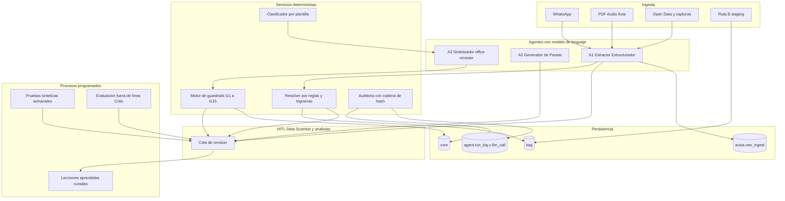

### 9.4 Carga del Data Scientist

La carga de HITL no se declara: se **mide desde el mes 1**. Se registran las horas de HITL por semana, el número de prompts versionados y la tasa de rechazo del motor de guardrails. La estimación inicial de planificación era de dos horas semanales en régimen estable y de seis a ocho en las fases críticas (KAG y agentes); el criterio de salida del Nivel 1a es un HITL medido de hasta 4 horas semanales (17.13). Los nuevos bucles humanos (selección de indicadores, curaduría de reglas, revisión de importaciones, triangulación, revisión de hipótesis) se presupuestan en 17.13.

### 9.5 Análisis dirigido: plan, pauta e ingesta manual

**Idea.** Para las tareas donde la persona tiene su propio método, el sistema no automatiza: **entrega una pauta e instrucciones**, y recibe de vuelta el producto validado. El flujo es un dato, no código.

- `analisis.plan` (pregunta, tipo: `cualitativo`, `lexico`, `mixto`, `cuantitativo`; estado: `borrador`, `aprobado`, `en_ejecucion`, `resultados_ingestados`, `cerrado`; pauta; versión; creado y aprobado por). Un plan no aprobado no se ejecuta.
- `analisis.plan_paso` (orden, tipo de paso, instrucción, herramienta externa, entregable esperado: `qdpx`, `qdc`, `csv`, `xlsx`, `pdf`, punto de ingesta, estado) y `analisis.cat_herramientas` (MAXQDA, ATLAS.ti, NVivo, IRaMuTeQ, R, Excel, otra). Cada persona puede crear o modificar su plan sin tocar el agente (prueba T50).
- `analisis.punto_ingesta` (código, descripción, esquema de validación, destino) y los siete puntos iniciales de 4.3.
- **Modo Pauta como predeterminado** para: proponer nivel de conflicto o de riesgo, emitir o cerrar una alerta y redactar un marco situacional. A2 entrega una pauta (criterios de la Guía, evidencia a revisar, preguntas abiertas); **decide la persona** (Anexos 3 y 8). Se registran la pauta y la decisión.
- **Cuellos de botella donde la persona querrá su propio flujo** y que por eso se entregan como instrucción y no como automatización: codificación temática, elección de unidades de contexto léxicas, definición de diccionarios, decisión ante contradicciones de la triangulación, elección de indicadores y validación de hipótesis. Se automatizarán (Nivel 3) cuando el flujo se estabilice.
- La pauta en dos etapas respeta la regla R-LLM (1.4). DDL en 20.22.

### 9.6.bis Máquina de estados de A2 (Generador de Pautas) — _añade_ — cierra AB-1

A2 pasaba de "agente conversacional" de nombre a serlo de hecho con una máquina de estados explícita, registrada en `config.a2_transiciones` (no en código): estado origen, estado destino, evento que dispara la transición, y una condición de guarda (SQL de lista blanca). Estados: `inicio → pregunta_dato_faltante → pauta_generada → pauta_decidida → {cerrada | reabierta}`. Ejemplo de transición consolidada en el DDL (dos condiciones de la misma transición `pauta_decidida → cerrada` se fusionaron en un único guard con `OR` — ver Anexo C.c): la pauta se cierra si el Data Scientist la rechaza o la modifica, **o** si la aprueba y ya existe un `producto_id` asociado. Sin esta tabla, A2 no puede explicar una divergencia ni reabrir una pauta — es un prompt _one-shot_ con nombre elegante.

### 9.7 Rúbrica del Critic — _añade_ — cierra AB-2

5 dimensiones (fidelidad a la fuente, ausencia de alucinación, calibración de incertidumbre, cumplimiento de guardrails, legibilidad), cada una puntuada 0–3, con muestreo `critic.office_sample_pct = 10%` sobre Office View y `100%` sobre Minister View (ambos en `config.parametro`, no hardcodeados). Sin rúbrica, "el Critic aprobó esta Minister View" es una corazonada, no un criterio — y una alucinación podría llegar al Viceministro con el sello de aprobada.

### 9.8 Plantillas de prompt (A1, A2, A3, Critic) — _añade_ — cierra AB-3

Registradas en `agent.plantilla_prompt`: system prompt, few-shot, output schema, por agente y por versión. Sin esto, el comportamiento de los tres agentes LLM es emergente, no diseñado, y no se puede auditar una salida contra el prompt que la produjo.

### 9.9 Contrato de test sintético por guardrail — _añade_ — cierra GR-5 y AB-6

Registrado en `config.guardrail_contract`: para cada uno de los 25 guardrails (§16) —18 de G1–G18 y 7 de G19–G25, sembradas el 18 de noviembre de 2026—, qué input lo dispara, qué output se espera, y qué input _no_ lo dispara (caso negativo). T48 (§3.16) decía "cada guardrail tiene un caso de prueba" sin especificarlo — este contrato es esa especificación, legible por una suite de pruebas automatizada.

### 9.10 Especialización de A1 por dominio — _añade_

A1 (Extractor-Estructurador) gana reglas de extracción nuevas: comprobante SUNAT → `avisa.raw_ingest.v2#comprobante`; acta de inspección CITE → `#inspeccion`; serie ANA SiAGUA → `#serie`; PCR SANIPES → `#diagnostico`; permiso VUCE → `#permiso`; trazabilidad QR → regla determinista (no LLM). A2 gana tres plantillas de pauta nuevas (`pauta_mype_nec`, `pauta_acuicultura_mortandad`, `pauta_cites_trazabilidad`) y A3 gana tres secciones de Minister View (`seccion_mype`, `seccion_acuicultura`, `seccion_cites`).

### 9.11 `config.schema_registry` — versionado de esquemas de extracción — _añade_

Resuelve IN-6 (evolución de schema v1→v2): registra, por `tipo_registro` de `avisa.raw_ingest`, qué versión de JSON Schema está vigente y desde cuándo, para que un cambio de esquema no rompa el histórico — A1 valida cada mensaje contra la versión vigente en el momento en que llegó, no contra la más reciente.

### 9.12 HITL: qué ve el Data Scientist — _extiende 9.4_

La cola HITL (§9.4) muestra, por cada caso que escaló: la pauta de A2 pendiente de decisión, el puntaje del Critic, y — si el caso toca C4–C6 — el guardrail (G16/G17/G18) que lo marcó, con su `reason_code`. El SLA de atención es un parámetro (`config.parametro`), no una constante de código.

### 9.13 El esquema `chat.*`: historial de conversaciones con IA tipo Git — _añade_

**Por qué "tipo Git" y no un log lineal.** Un chat con IA tiene tres propiedades que un log de turnos no captura: puede **ramificarse** (explorar dos hipótesis en paralelo y fusionarlas), la **configuración va en el commit** (el mismo texto puede producirse con distinta model card, parámetros o política — sin capturarlo, la reproducibilidad es imposible), y necesita **atribución** (qué turno de qué agente introdujo qué afirmación, requisito de Contraloría). v9 depreca `agent.sesion` y `agent.sesion_paso` (migración en 4 fases: dual-write → backfill → cutover → vistas de solo lectura) en favor de 14 tablas:

| Tabla                                                                                                                                          | Rol                                                                                                                                                                                                     |
| ---------------------------------------------------------------------------------------------------------------------------------------------- | ------------------------------------------------------------------------------------------------------------------------------------------------------------------------------------------------------- |
| `chat.repositorio`                                                                                                                             | Un repositorio por conversación (caso, actor, territorio o libre); RLS por clasificación y por sujeto                                                                                                   |
| `chat.commit`                                                                                                                                  | Snapshot atómico: hash SHA-256, hasta 2 padres (merge), **captura `modelo_card_id`, `parametros_snapshot`, `librerias_snapshot`, `aplicacion_id`, `politica_snapshot_id`** — la reproducibilidad exacta |
| `chat.turno`                                                                                                                                   | Unidad atómica (rol, contenido, modelo, agente, tokens); hash propio para diff y blame                                                                                                                  |
| `chat.blob`                                                                                                                                    | Contenido deduplicado por hash, con `ref_count` para recolección de basura                                                                                                                              |
| `chat.rama`                                                                                                                                    | Puntero a un commit (branch); RLS vía `EXISTS` contra su repositorio — no tiene columna de clasificación propia (es un puntero, no contenido — ver Anexo C.g)                                           |
| `chat.ref`, `chat.merge`, `chat.diff`, `chat.blame`, `chat.reflog` (append-only), `chat.stash`, `chat.remote`, `chat.cherry_pick`, `chat.hook` | El resto del vocabulario de Git, mapeado 1:1 (tabla de mapeo completa en el DDL unificado)                                                                                                              |

`chat.commit.modelo_card_id` apunta a `model.model_card` (§3.quater) — el mismo registro que gobierna los modelos de pronóstico, no uno aparte. `domain.artefacto.chat_commit_id` y `core.output_contracts.chat_commit_id` (columna nueva) cierran el circuito de trazabilidad: salida → commit → turnos → model card + parámetros + librerías + snapshot de política vigente en ese momento — exactamente lo que T74 (requerimiento de Contraloría) necesita reconstruir.

## 10. Salida dual

| Aspecto           | Office (analista)                | Minister (Viceministro)                                                 |
| ----------------- | -------------------------------- | ----------------------------------------------------------------------- |
| Estructura        | JSON Schema completo             | Narrativa ejecutiva + 3 viñetas + citas                                 |
| Longitud          | Ilimitada                        | Máx 1 página / 200 palabras                                             |
| Evidencia         | Todas las aristas + provenance   | Top-3 citas + link al detalle                                           |
| Lenguaje          | Técnico (3P, MACTOR, bitemporal) | Político-estratégico                                                    |
| Formato           | Markdown + tablas + JSON         | PDF/Word institucional                                                  |
| Confidencialidad  | Reservado                        | Público o Reservado                                                     |
| Uso               | Análisis profundo                | Lectura rápida pre-reunión                                              |
| Lente de política | Se muestra todo, siempre         | Solo ordenamiento y encuadre; pie obligatorio con los códigos aplicados |
| Rótulo de IA      | Contenido generado por IA        | Contenido generado por IA                                               |

### 10.1 Flujo completo de query

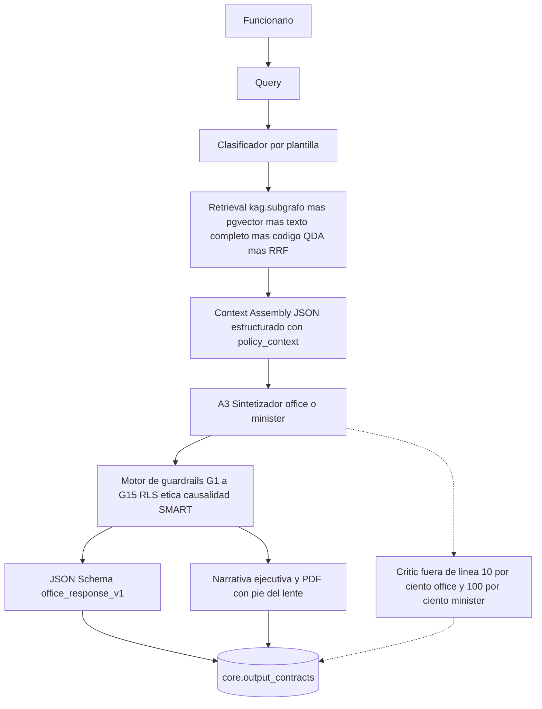

### 10.2 Fast path

El clasificador detecta `simple_factual`: retrieval directo + Sintetizador +
motor de guardrails. Latencia objetivo < 2s. El clasificador detecta `complejo_analitico`:
pipeline completo. Latencia objetivo < 8s.

<!-- v10:P11 begin -->

### 10.2.v10 Qué significa «tiempo real»: tres tramos medibles — _añade a 10.2 (v10)_ — V10-05

**El problema.** v9 promete salidas en menos de 2 y 8 segundos (arriba), pero eso mide **consultas**, no la **llegada de una noticia** al tablero. El TDR pide un tablero «en tiempo real». Sin un número y un tramo, la promesa no se puede comprobar ni defender ante una observación.

| Tramo                             | Qué mide                                                        | Objetivo       | Cómo se logra                                | Prueba |
| --------------------------------- | --------------------------------------------------------------- | -------------- | -------------------------------------------- | ------ |
| **T-ingesta**                     | Publicación en la fuente → candidato en la bandeja del analista | ≤ 30 min (p95) | Recolección cada 15 min + NLP                | T104   |
| **T-tablero**                     | Cambio aprobado en la base → cambio visible en el tablero       | ≤ 60 s         | La aplicación consulta cada 60 s (_polling_) | T104   |
| **T-crisis**                      | Confirmación de crisis → SMS o correo a la Alta Dirección       | ≤ 10 min       | Notificador con cola                         | T104   |
| Consulta factual / analítica (v9) | Pregunta del usuario → respuesta                                | < 2 s / < 8 s  | Fast path (arriba)                           | v9     |

**Decisión v10 (D26):** _polling_ de 60 segundos en lugar de WebSockets. _Por qué:_ funciona con el alojamiento habitual de OGTI sin configuración especial y cumple el objetivo; WebSockets queda como mejora opcional.

> **Ejemplo (ILUSTRATIVO): el recorrido de una alerta, con quién gasta el tiempo.**
>
> | Hora  | Qué ocurre                                                                 | Quién       |
> | ----- | -------------------------------------------------------------------------- | ----------- |
> | 09:02 | Un medio regional publica una nota sobre un bloqueo                        | Fuente      |
> | 09:15 | Ciclo de recolección: baja la nota y la deduplica                          | Máquina     |
> | 09:17 | NLP, resolución de actores, citas, puntaje de riesgo                       | Máquina     |
> | 09:18 | `POST /ingesta/alertas`; aparece en la bandeja                             | Máquina     |
> | 09:41 | El sectorista revisa la explicación y registra la **validación previa**    | **Persona** |
> | 09:43 | La Dirección de la OAIPCS da la **aprobación definitiva** (toda alerta)    | **Persona** |
> | 09:44 | La alerta aprobada aparece en los KPIs y el mapa del Perfil B (≤ 60 s)     | Máquina     |
> | 09:45 | Llega el SMS al despacho del Ministro, con enlace al resumen de una página | Máquina     |
>
> De publicación a bandeja pasaron **16 minutos**; de la bandeja a la aprobación definitiva, 25 minutos de **decisión humana en dos pasos** (validación y aprobación), que es el cuello de botella deseado.

**La visibilidad la impone la base, no la aplicación.** Hasta la aprobación de las 09:43 la alerta no está «oculta» por el _frontend_: el _trigger_ `alertas_g21_visibilidad` (parche 22) impide que `visibilidad` salga de `interna` mientras falte una de las dos firmas, y `core.vw_alerta_estado` expone esa columna para que el tablero filtre por ella.

**Fast path del Sintetizador (resumen de una página).** Para el resumen de una página el Sintetizador usa una plantilla cerrada (_Situación · Qué cambió en 7 días · Riesgo y tendencia · Decisión requerida y plazo · Próximos hitos_, máximo 350 palabras) y un paquete de datos cerrado: las cifras salen de las tablas, no del modelo de lenguaje. No pasa por el Critic en línea; pasa por la **validación del analista** antes de llegar al Perfil B (§9.2.v10).

**Texto sugerido para el informe o la propuesta.** _«En la gestión de conflictos sociales, “tiempo real” se entiende como: toda publicación relevante de las fuentes autorizadas llega a la bandeja del analista en un máximo de 30 minutos; el tablero refleja cualquier cambio aprobado en un máximo de 60 segundos; y las crisis confirmadas se notifican en un máximo de 10 minutos. La aprobación humana es un paso deliberado y no cuenta como retraso del sistema.»_
<!-- v10:P11 end -->

### 10.3 Cache semántico

Consultas repetidas servidas desde `core.query_cache`. SHA-256 del
query normalizado, el nivel de acceso y el hash de la política vigente
(clave: hash, nivel, policy\_hash). Invalidación por trigger cuando el caso, actor o
compromiso referenciado cambia.

### 10.4 Observabilidad dual y tablero decisional

**Un solo registro de agentes.** `agent.run_log` (append-only, con cadena de hash) es el registro; su campo `detalle` tiene un JSON Schema versionado (`agent.cat_detalle_schema`, `detalle_schema_version`) que valida la aplicación (T66). No existe un esquema `audit` separado.

- `agent.llm_call` (particionada por mes como `run_log`): modelo y versión, destino (`local` o `nube` según R-LLM), temperatura, hash del prompt, versión de la plantilla, snapshot de política, tokens, latencia, veredicto de guardrails y clasificación. Una restricción de base impide que contenido Confidencial tenga destino `nube` (T67).
- `agent.llm_call_fragmento`: los fragmentos exactos que sustentaron la respuesta, con su rango RRF y su puntaje de re-ranking.
- El texto completo del prompt va a almacenamiento de objetos con la misma clasificación; en la base queda su hash.
- **No se guarda cadena de pensamiento cruda**: puede contener datos personales o Confidenciales y no es una explicación fiel. Cada salida lleva una `justificacion_estructurada` de hasta 1 000 caracteres (criterios aplicados, evidencias citadas, límites). Es lo que se muestra a Contraloría.
- **Deriva como vistas, no como tablas:** `analytics.mv_drift_embeddings` (distancia entre centroides por mes y modelo) y `analytics.mv_drift_grafo` (cambio de centralidad de intermediación de los nodos críticos, calculada por lote en `kag.metrica_nodo`), ambas con índice único y refresco por lote.
- **Tablero decisional:** `analytics.mv_tablero_decisional`, vista materializada con índice único. Incluye solo filas con `es_validado_humano = true` **y** vigentes; son dos condiciones distintas: _tiempo válido_ (`valid_from`/`valid_to`) no es _validación humana_. Campos: riesgo por región, alertas activas y grado de evidencia (semáforo de robustez de 5.7, número de evidencias y proporción de aristas validadas). Dos accesos: `alta_direccion` (agregado) y `auditor` o `administrador` (trazas).

**Efectos.** El volumen de registros es manejable: unas 50 consultas por día por 3 llamadas dan unas 55 000 filas al año. La retención se fija en D9. `llm_call` hereda la clasificación del insumo más sensible y el rol `auditor` lee hasta el nivel 3. Power BI lee las vistas desde la réplica (S1). Pruebas T64 a T66.

### 10.4.bis Vistas por dominio en la salida dual — _añade_

| Dominio        | Office View                                                | Minister View                                                               |
| -------------- | ---------------------------------------------------------- | --------------------------------------------------------------------------- |
| C4 MYPE        | `vw_office_mype`: lotes, mora, concentración, inspecciones | `vw_minister_mype`: 3 viñetas (pagos, concentración, próximos vencimientos) |
| C5 Acuicultura | `vw_office_acuicultura`: series de agua, PCR, mortandad    | `vw_minister_acuicultura`: 3 viñetas (calidad, patógenos, alertas)          |
| C6 CITES       | `vw_office_cites`: permisos, cuotas, exportaciones         | `vw_minister_cites`: 3 viñetas (cuotas, rechazos, exportaciones)            |

## 11. Requisitos por rol institucional

Cinco roles operativos con requisitos incompatibles que la arquitectura
satisface simultáneamente sin bifurcar la base de datos.

### 11.1 Field

Requisito político: el sistema debe ser invisible. Requisito técnico:
ingesta optimizada para escritura (`avisa.raw_ingest`), normalización
diferida a agentes de fondo.

### 11.2 Analyst

Requisito político: visibilidad completa y poder de sobrescritura,
porque es el único responsable ante OGTI y Contraloría por la calidad de
los datos. Requisito técnico: Office View, provenance completa, HITL en
minutos.

### 11.3 Director

Requisito político: responsabilidad por el protocolo de escalamiento de
24 horas (Anexo 3) y por la producción oportuna de PAR/PAE. Requisito
técnico: vistas con detección proactiva de vencimientos de SLA, no solo
reportes reactivos.

### 11.4 Executive

Requisito político: no puede aparecer endorsando afirmación causal sin
respaldo. Una sola frase equivocada tiene consecuencias a nivel de
consejo de ministros. Requisito técnico: Minister View como contrato
separado (no truncado), pipeline Critic + Guardrail más estricto,
dashboard precalculado.

### 11.5 External

Requisito político: obligaciones de transparencia (Ley N.° 27806).
Requisito técnico: `nivel_clasificacion` con RLS a nivel de fila,
`core.integraciones` como frontera de adapter explícita.

### 11.6 Síntesis

La arquitectura no tiene "un usuario": tiene cinco estructuras de
responsabilidad superpuestas sobre el mismo dataset. El trío
`nivel_clasificacion + confidence + es_validado_humano` más el contrato
dual permite que un único dataset físico sirva a cinco requisitos
políticos incompatibles sin bifurcar la base de datos cinco veces.

### 11.7 Análisis crítico en inglés: roles → requisitos políticos y técnicos

> _The system identified five operational roles across PRODUCE's
> social-dialogue chain — Field, Analyst, Director, Executive, and
> External — and each one imposes a distinct set of political and
> technical requirements that the architecture above must simultaneously
> satisfy without collapsing into a single lowest-common-denominator
> interface._

- **Field (the WhatsApp agents).** Politically, they need the system to
  be invisible: any friction here reproduces the "registration fatigue"
  the original sequence diagram was explicitly designed to solve.
  Technically, this forces a **write-optimized, almost schema-free
  ingestion path** (`avisa.raw_ingest`) that defers all normalization to
  background agents — the opposite of what a DBA would naturally want.
  If the system imposed a structured form on the field, adoption would
  fail regardless of how elegant the core schema is.

- **Analyst (the Data Scientist / HITL).** Politically, this role needs
  **full visibility and override power** — they are the one accountable
  to OGTI and to Contraloría for data quality. Technically, this
  requires the **Office View** (Section 10), full provenance chains
  (`kag.arista_evidencia / kag.atributo_evidencia`), and an entity-resolution queue they can
  act on in minutes, not hours. This is also the only role for whom
  **bitemporal queries** (Section 5) are a daily tool rather than a
  background guarantee.

- **Director (OAIPCS leadership).** Politically, this role is
  accountable for the **24-hour escalation protocol** (Anexo 3) and for
  whether a PAR/PAE was produced on time. Technically, this means
  `core.derivaciones_alerta` and `core.planes_accion` need
  **deadline-aware views**, not just storage — the system must be able
  to answer "what is about to breach SLA" proactively, which is a
  different technical demand than "what happened."

- **Executive (Viceministro / Alta Dirección).** Politically, this role
  cannot be seen endorsing an unsupported causal claim — a single wrong
  sentence here has cabinet-level consequences. Technically, this is
  exactly why the **Minister View** exists as a _separate contract_, not
  a truncated version of the Office View: it needs the Critic +
  Guardrail pipeline to be stricter, not just shorter, and it needs
  `analytics.mv_dashboard_alta_direccion` to be pre-computed rather than
  queried live, because the political cost of a slow or inconsistent
  executive dashboard is reputational, not just technical.

- **External (SESIGUE / PCM, other ministries, Congress via transparency
  requests).** Politically, this role operates under **Ley de
  Transparencia obligations** the system did not create but must respect
  (Section 1-2). Technically, this forces the `nivel_clasificacion`
  field to be enforced at the row level (RLS) rather than at the
  application layer, and it is the reason `core.integraciones` exists as
  an explicit adapter boundary (Section 15) instead of a direct foreign
  key into an external system whose schema PRODUCE-OAIPCS does not
  control and — as the investigation in Section 1.1.bis shows — does not
  yet fully know.

**Synthesis.** The architecture does not have "a user"; it has five
accountability structures overlapping on the same data. The role of
`bloque estándar de auditoría (3.2)`'s `nivel_clasificacion` + `confidence` +
`es_validado_humano` triad, combined with the dual-output contract, is
precisely to let **one physical dataset serve five incompatible
political requirements** without forking the database five times.

### 11.8 Personas y roles RBAC de OGTI

Los cinco "roles" de esta sección son **personas** (perfiles de uso). OGTI pidió en RF-03 cuatro **roles de sistema**; la
tabla `core.roles` incluye esos cuatro más cinco técnicos y funcionales —**nueve roles heredados**— y el parche 20 añadió
`direccion_oaipcs`: **diez roles en total**. Un usuario recibe uno o más roles con vigencia
(`core.usuario_roles`) y cada rol fija el nivel máximo de clasificación que puede leer (RLS).

| Persona (11.1–11.5)                                   | Rol de sistema (`core.roles`)  | Nivel máx. de clasificación      |
| ----------------------------------------------------- | ------------------------------ | -------------------------------- |
| Field (punto focal en campo)                          | `sectorista`                   | 3 (Confidencial)                 |
| Analyst (DS / analista)                               | `sectorista` y `administrador` | 3                                |
| Analista cualitativo (codificación y análisis léxico) | `analista_cualitativo`         | 3                                |
| Curador de política                                   | `curador_politica`             | 2 (Reservado)                    |
| Director (OAIPCS)                                     | `direccion_oaipcs`             | 3                                |
| Executive (Alta Dirección)                            | `alta_direccion`               | 3, solo lectura                  |
| External (otras entidades, transparencia)             | `externo_publico`              | 1 (Público)                      |
| Lectura institucional                                 | `consulta_lectura`             | 2 (Reservado)                    |
| Agentes del sistema                                   | `servicio_agente`              | 3, con enrutamiento R-LLM (3.17) |
| Control y auditoría                                   | `auditor`                      | 3, crea y edita; no borra        |

**Capacidades de escritura.** Las decide la base con `core.roles.puede_crear`, `puede_editar` y `puede_eliminar` (parche 15; el nivel y las capacidades no viajan en el token, §11.9): `administrador` tiene todos los privilegios —crea, edita y elimina—; `sectorista` crea, edita y elimina; `direccion_oaipcs` crea y edita y no elimina; `servicio_agente`, `auditor`, `analista_cualitativo` y `curador_politica` crean y editan y no eliminan; `consulta_lectura`, `externo_publico` y `alta_direccion` no escriben. El detalle por columna está en la nota de §20.3.

**Las aprobaciones no se dan por rol sino por permiso.** En el modelo de roles de OGTI la Dirección de la OAIPCS comparte el rol `sectorista` con el personal de campo; desde el parche 20 tiene además un rol propio, `direccion_oaipcs`, que es el que firma el paso 3 del flujo de alerta. `core.permiso_aprobacion` (usuario, objeto, vigencia) sigue siendo el mecanismo de las aprobaciones que no son ese paso: por ejemplo, exportar sin pseudonimizar o una suplencia. Hoy la tabla tiene 0 filas, porque no hay suplente designado, pero ya tiene consumidor: `core.puede_aprobar(uuid, text)` la consulta y `core.vw_permiso_aprobacion` la expone a la administración (parche 22). Sin filas a propósito: nombrar un suplente es un acto administrativo de la OAIPCS.

**Matriz permiso × objeto para los objetos de las capas incorporadas** (RS-02).

| Objeto                                     | sectorista | analista\_cualitativo | curador\_politica | alta\_direccion | administrador | auditor       |
| ------------------------------------------ | ---------- | --------------------- | ----------------- | --------------- | ------------- | ------------- |
| `policy.regla` clase N                     | leer       | leer                  | leer              | leer            | editar        | leer          |
| `policy.regla` clase P                     | leer       | —                     | proponer          | aprobar         | —             | leer          |
| `policy.regla` clase L                     | leer       | leer                  | editar            | leer            | —             | leer          |
| `ind.seleccion`                            | editar     | editar                | —                 | leer            | leer          | leer          |
| `qda.exportar`                             | —          | exportar              | —                 | —               | —             | leer registro |
| `qda` y `lex` importar, `staging.promover` | —          | editar                | —                 | —               | editar        | leer          |
| `kag.hipotesis` y `kag.contraste`          | editar     | editar                | —                 | leer            | —             | leer          |
| `agent.llm_call`                           | —          | —                     | —                 | —               | leer          | leer          |

RS-08 (altas, bajas y cambios de permisos) cubre los roles nuevos. Cada exportación queda en `run_log` y en `qda.exportacion` con usuario, hash y caducidad del archivo. Toda excepción a la pseudonimización exige un permiso de aprobación vigente (D16). Prueba T69. Falta alinear los niveles con la política institucional (RS-09).

### 11.8.bis Roles MYPE y Exportador CITES — _añade_

**Rol MYPE (C4).** Requisito político: acceso a los lotes y pagos que le conciernen. Requisito técnico: RLS por `mype_actor_uid` — ve solo sus propios lotes en `mype.ejecucion_nec`.

**Rol Exportador CITES (C6).** Requisito político: acceso a sus permisos y cuotas. Requisito técnico: RLS por `exportador_actor_uid` en `pesca.licencia_cites_denp`.

<!-- v10:P07 begin -->

### 11.8.v10 Perfiles A, B y C del MVP-45 frente a las personas y roles de v9 — _añade (v10)_ — V10-03

**Por qué hace falta.** El TDR y el MVP hablan de Perfil A, B y C. v9 habla de personas (Field, Analyst, Director, Executive, External) y de roles de sistema. Esta tabla las une, para que nadie cree dos modelos de permisos.

| Perfil MVP                      | Persona v9 (§11.1–11.5) | Rol de sistema (`core.roles`) | Nivel máx. de clasificación | Qué lo limita                                                                                                                                                                                                                                                                                                                                                            |
| ------------------------------- | ----------------------- | ----------------------------- | --------------------------- | ------------------------------------------------------------------------------------------------------------------------------------------------------------------------------------------------------------------------------------------------------------------------------------------------------------------------------------------------------------------------ |
| **A — Office View**             | Analyst, Director       | `sectorista`                  | 3                           | Casos asignados; datos personales solo con permiso específico y auditoría                                                                                                                                                                                                                                                                                                |
| **B — Minister View**           | Executive               | `alta_direccion`              | **3**                       | Lee **todas** las vistas operativas y analíticas, con el **Dashboard Estratégico como pantalla de inicio**, y **no escribe**: no crea, no edita y no borra. Cada lectura de datos personales queda auditada; por el canal público (Publish to Web) nunca pasa ningún dato personal (RD-08). **D25 quedó sin efecto el 2026-11-20** (ver 11.1, tabla de personas y roles) |
| **C — Portal de Transparencia** | External                | `externo_publico`             | 1                           | **Seguridad por sujeto** (`actor_uid` de §11.10.bis): solo ve **sus** compromisos y las alertas sectoriales donde es destinatario                                                                                                                                                                                                                                        |

**Aclaración importante.** El Perfil C **no es** el portal público de transparencia del módulo M9 (§13, F6): M9 publica vistas agregadas con k-anonimato para cualquiera; el Perfil C es una vista **autenticada** para un actor externo concreto. Pueden coexistir.

> **Ejemplo (ILUSTRATIVO).** Un gremio de pescadores artesanales entra con su credencial. Ve tres compromisos del Estado hacia él (uno vencido, dos en plazo) y ninguna otra cosa: ni el resto de los casos, ni los otros actores, ni los análisis. Si cambia en la URL el identificador de un compromiso ajeno, recibe una respuesta vacía, no un error que confirme que existe.

**Qué pasa con las aprobaciones.** Se mantiene la regla de v9: las aprobaciones no se dan por rol sino por permiso (`core.permiso_aprobacion`). En el MVP, **toda** alerta —grave o no— recorre dos niveles antes de salir: la **validación previa del Sectorista** y la **aprobación definitiva de la Dirección de la OAIPCS**. La crisis (nivel 1) conserva además el plazo ≤ 24 h y el destinatario Ministro (H-25 cerrado, RN-04). La prioridad decide **a quién** se avisa y **en cuánto tiempo**, no **quién** autoriza _(Alineado con ERS v0.6 §11.1/§14.4.)_ El gate lo impone la base y no la aplicación: el _trigger_ `alertas_g21_visibilidad` (parche 22) rechaza con `G21_SIN_APROBACION` cualquier `visibilidad` distinta de `interna` mientras falte una de las dos firmas, de modo que la alerta solo existe para la OAIPCS hasta entonces.
<!-- v10:P07 end -->

### 11.8.v10.bis Usuarios nominales, destinatarios y los tres catálogos de rol — _añade a 11.8 (v10)_

**Cuántos usuarios hay en diciembre.** Son **11 puestos**: 7 de OAIPCS y 4 de Alta Dirección. Los 11 puestos son **11 personas**: el administrador es un **puesto nuevo** —el sistema anterior no traía una cuenta de administrador—; el rol `administrador` ya no lo lleva la Directora: la migración 17 lo pasó a una cuenta de administración propia (`11111111`, «Admin») y a la Directora le dejó sólo `direccion_oaipcs`, y la cuenta nominal del administrador se crea en diciembre. Las licencias Power BI Pro pasan de **7 a 11** (7 del equipo de la OAIPCS + 4 de la Alta Dirección); las 4 nuevas quedan **a confirmar con OGTI** (H-78).

| Grupo              | Puestos                                                                   | Total |
| ------------------ | ------------------------------------------------------------------------- | :---: |
| **OAIPCS**         | Directora (única con el privilegio RENIEC), 5 sectoristas y administrador |   7   |
| **Alta Dirección** | Ministro, 2 viceministros y Secretario General                            |   4   |

**Quiénes no son usuarios.** Las **jefaturas de gabinete** no tienen cuenta ni entran al sistema: son **destinatarios** de los envíos de alertas **no graves** (nivel 3, RN-02). La **Secretaría General ya no está en esta lista**: el **Secretario General** es usuario de Alta Dirección (el cuarto puesto), entra con el **Dashboard Estratégico como pantalla de inicio** y puede leer las vistas operativas, con **cada lectura de datos personales auditada**. Los **Gobiernos Regionales/Locales** y la **Ciudadanía** son usuarios finales de la **misión**, no del sistema en este MVP: acceden con el Perfil C en 2027 (H-54).

**Las 32 cuentas migradas.** 28 están activas y 4 inactivas; el resto queda como **dato histórico precargado**, no como acceso del día 1. Sobre esas cuentas están en uso **cinco** roles de acceso: `consulta_lectura` (17), `sectorista` (15), `alta_direccion` (2), `administrador` (1) y `direccion_oaipcs` (1, la Directora, desde el parche 21) —**36 asignaciones sobre 31 personas**, medido antes de la migración 17—: la cuenta restante es el cargador de migración (`LEGADO_AVISA_2026`, sin rol); después de la migración 17 la cuenta `11111111` («Admin») acumula todos los roles y la Directora sólo conserva `direccion_oaipcs`. `administrador` y `direccion_oaipcs` no vienen del sistema anterior: `administrador` no tenía cuenta migrada y desde la migración 17 lo lleva la cuenta `11111111`; `direccion_oaipcs` nació con 0 cuentas en el parche 20, el parche 21 se lo asignó a la Directora y la migración 17 le dejó ese como único rol (puede crear y editar, no eliminar). Los otros cinco roles de `core.roles` (`auditor`, `servicio_agente`, `externo_publico`, `analista_cualitativo`, `curador_politica`) no tienen ninguna cuenta dedicada: sólo los acumula la cuenta `11111111` desde la migración 17.

**Credenciales tras la migración 17.** Cinco cuentas entran con la clave `demo`: `41907320` (`direccion_oaipcs`), `22222222` (`alta_direccion`, sólo lectura), `11111111` (todos los roles), `10654038` (`sectorista`) y `46078289` (`consulta_lectura` + `sectorista`). `core.autenticar_usuario()` devuelve como `rol_codigo` el rol de mayor jerarquía de la cuenta —`administrador` > `direccion_oaipcs` > `alta_direccion` > `sectorista` > `consulta_lectura` > …—, de modo que una cuenta con todos los roles entra como administradora y no como directora. Los conteos exactos de cuentas y asignaciones después de la migración 17 no se han vuelto a medir.

**No confundir tres catálogos.**

| Catálogo                     | Qué clasifica                                                                                        | Filas |
| ---------------------------- | ---------------------------------------------------------------------------------------------------- | :---: |
| `core.roles`                 | El rol de **acceso al sistema**; decide qué filas ve la sesión (RLS)                                 |  10   |
| `core.cat_roles_actor`       | El rol de un **actor del conflicto** (Principal, Secundario, Tercero imparcial…)                     |   4   |
| `core.cat_roles_funcionales` | El rol de ese actor **en el análisis** (decisor, proveedor de evidencia, implementador, articulador) |   4   |

> Se parecen en el nombre y no se sustituyen: `core.roles` es seguridad de acceso; `core.cat_roles_actor` clasifica a quién protagoniza el conflicto; `core.cat_roles_funcionales` describe su papel en la lectura analítica. _(Alineado con ERS v0.6 §6.1.)_

### 11.9 IdP y `app.rol_codigo` — _añade_ — cierra SE-1, SE-2

El informe OGTI no confirma PIDE vs. SAML vs. OAuth2; v9 no decide por PRODUCE — documenta el contrato: el IdP que se elija debe entregar, en los claims del token, el **rol de sistema** de la persona (`core.roles.codigo`) y, cuando aplique, el `actor_uid` del sujeto externo. La API .NET abre la conexión y fija `app.rol_codigo`, `app.actor_uid` y `app.staff_bypass_subject_rls` (booleana, solo para roles no acotados a un actor — ver §11.10.bis).

**El nivel de clasificación y las capacidades no viajan en el token.** `core.clasificacion_max()`, `core.puede_crear()`, `core.puede_editar()` y `core.puede_eliminar()` los resuelve la base leyendo `core.roles` a partir de `app.rol_codigo` (parches 15 y 16). Antes el cliente declaraba `app.clasificacion_max` como número y eso permitía escalar privilegios: cualquier conexión podía fijar 3. Hoy ese parámetro **se ignora**; si llega, no cambia nada. Nada más del sistema necesita saber qué IdP hay detrás.

### 11.10.bis Mecanismo de RLS por sujeto — _añade_ — cierra SE-3

Todas las tablas con RLS por sujeto (las 8 de C4–C6, `chat.repositorio`) comparten el mismo patrón de dos políticas:

```sql
-- Staff interno: puede ver todo (variable de sesión, la fija el IdP por rol)
CREATE FUNCTION core.staff_bypass_subject_rls() RETURNS boolean LANGUAGE sql STABLE AS $$
  SELECT COALESCE(NULLIF(current_setting('app.staff_bypass_subject_rls', true), '')::boolean, FALSE)
$$;
-- Política restrictiva: el sujeto solo ve lo suyo, salvo que sea staff
CREATE POLICY p_sujeto ON <tabla> AS RESTRICTIVE FOR SELECT
  USING (<columna>_actor_uid IS NULL
         OR core.staff_bypass_subject_rls()
         OR <columna>_actor_uid = NULLIF(current_setting('app.actor_uid', true), '')::uuid);
```

Esto es lo que hace que un MYPE que hace `SELECT * FROM mype.ejecucion_nec` vea solo sus lotes, y que un analista de DGPIP (con `staff_bypass_subject_rls = true`) vea todos.

### 11.11 Workflow de `permiso_aprobacion` — _añade_ — cierra DP-1

Para C6: quién otorga un permiso CITES, por cuánto tiempo, y con qué auditoría — se modela como transiciones en `domain.regla_negocio` sobre el tipo `cites_permiso` (o, si se promueve a tabla real, como el patrón de 4 partes de §8.7.bis.1 aplicado a `pesca.licencia_cites_denp`).

### 11.12.bis Matriz RBAC expandida — _extiende 11.8_

| Objeto                         | sectorista   | mype           | exportador_cites | analista_cualitativo | alta_dirección |
| ------------------------------ | ------------ | -------------- | ---------------- | -------------------- | -------------- |
| `mype.ejecucion_nec`           | leer (todos) | leer (propios) | —                | leer                 | leer           |
| `pesca.licencia_cites_denp`    | leer         | —              | leer (propios)   | leer                 | leer           |
| `pesca.cuota_cites_especie`    | leer         | —              | leer             | leer                 | leer           |
| `territorio.monitoreo_hidrico` | leer         | —              | —                | leer                 | leer           |

## 12. Catálogo de diagramas base

> **Nota de diseño.** El catálogo de diagramas es el de la Sección 23. Los diagramas de clases están embebidos en
> 3.5–3.12.bis; la máquina de estados, en 3.15.

---

# PARTE II — EXPANSIÓN ARQUITECTÓNICA

## 13. Módulos de expansión rediseñados

Los diez módulos de la Parte 0 se reescriben según los veredictos. Cada
módulo indica su alcance adoptado, su justificación, sus componentes
técnicos y sus guardrails.

### 13.1 M1 — Inteligencia Predictiva

**Alcance adoptado.** Completo con guardrails.

**Componentes técnicos.**

- `forecast.model_registry`: catálogo de modelos con `model_id`,
  `model_type`, `training_data_hash`, `last_trained_at`,
  `accuracy_metrics_json`, `is_active`.
- `forecast.predictions`: cada predicción con `model_id`, `target_type`
  (caso, caleta, subsector), `target_id`, `prediction_date`,
  `prediction_horizon_days`, `probability`, `confidence_interval_low`,
  `confidence_interval_high`, `contributing_factors_json`.
- `forecast.model_drift_log`: registro de detección de drift para
  invalidar modelos.

**Modelos iniciales del año 1:**

- ENOS 3-6 meses (NOAA, ENFEN).
- Precio internacional pota/harina (ARIMA/Prophet).
- Probabilidad de escalamiento de conflicto (gradient boosting sobre
  los 35 casos + contexto).
- Detección de anomalías AIS de flota extranjera.
- Análisis de sentimiento en medios (captura programada de fuentes públicas, 7.5).

**Guardrails nuevos:**

- **Guardrail de Prevención.** Toda predicción se emite con intervalo
  de confianza y se acompaña de análisis cualitativo. Prohibido emitir
  predicciones como "acción recomendada" sin contexto.
- **Guardrail de Frescura de Modelo.** Modelos con más de 90 días sin
  reentrenamiento no alimentan decisiones críticas.

**Rol nuevo.** Model Reviewer: el Data Scientist coordina con dos
analistas de la OAIPCS una revisión cualitativa trimestral de los
modelos activos. Es un rol de revisión, no de construcción. Revisa también los proxies de `ind` (8.4).

### 13.2 M2 — Impacto Económico

**Alcance adoptado.** Completo con Anexo Metodológico obligatorio.

**Componentes técnicos.**

- `economic.impact_scenarios`: cada escenario con `caso_id`,
  `scenario_type` (base, optimista, pesimista), `assumptions_json`,
  `estimated_loss_usd`, `estimated_job_loss`, `estimated_fiscal_impact`,
  `methodology_version`.
- `economic.anexo_metodologico`: documento versionado con cadena causal
  documentada, fuentes de cada dato, supuestos explícitos, intervalos
  de confianza.
- `economic.counterfactual_analysis`: para casos resueltos, cálculo
  contrafactual usando casos comparables.

**Cadena causal documentada:**

```
Bloqueo de puerto (días) × Volumen diario promedio (Tn/día)
  × Precio internacional (USD/Tn) = Pérdida bruta (USD)
Empleo directo perdido × Salario promedio × Días de paralización
  = Pérdida salarial
Recaudación arancelaria perdida = Valor exportado perdido
  × Tasa arancelaria
```

Cada eslabón con fuente documental y rango de incertidumbre.

**Guardrail asociado.** Guardrail de Causalidad reforzado. Ninguna
cifra se emite sin cadena causal documentada.

### 13.3 M3 — Datos de Caleta

**Alcance adoptado.** Completo con PWA + WhatsApp bidireccional + schema
caleta.

**Componentes técnicos.**

- `territorio.lugares (tipo caleta) + caleta_detalle`: nueva tabla con `id`, `distrito_id`,
  `nombre`, `tipo` (pesquera, turística, mixta), `numero_actores`,
  `nivel_organizacion`, `latitud`, `longitud`, `fuente_dato`,
  `fecha_actualizacion`.
- `core.actores.caleta_id`: nueva FK opcional para actores residentes.
- `core.casos.caleta_id`: nueva FK opcional para casos localizados a
  nivel de caleta.
- PWA (Progressive Web App) para líderes comunitarios con formulario
  mínimo, offline-first, y sincronización vía `avisa.raw_ingest`.
- WhatsApp bidireccional con reconocimiento de líderes registrados.
- `community.encuestas_percepcion`: encuestas trimestrales con
  consentimiento explícito, agregación k-anónima.

**Guardrail asociado.** Guardrail de Privacidad Comunitaria. Datos de
caletas con menos de 20 actores registrados se agregan a nivel
distrital automáticamente.

**Brechas y carga de campo.** La encuesta en caletas compite por las mismas horas de los dos sociólogos de campo que cualquier otra recolección propuesta por el sistema (8.4). `core.capacidad_campo` declara las horas disponibles por mes y `analytics.vw_carga_campo` las contrasta con las horas de las brechas aprobadas; una brecha solo se aprueba si cabe o si la Dirección lo decide por escrito. El guardrail de Privacidad Comunitaria (menos de 20 actores se agregan a nivel distrito) puede invalidar una brecha de campo: la vista debe advertirlo. Q16 (consentimiento) es bloqueante para cualquier brecha con encuesta.

### 13.4 M4 — Inter-ministerial sobre SESIGUE

**Alcance adoptado.** Adapter robusto sobre SESIGUE, no sistema
paralelo.

**Componentes técnicos.**

- **No se crea schema `inter_ministerial`.** Se reutiliza
  `core.integraciones` con estructura ampliada:

```
core.integraciones (extendida)
  id                       UUID PRIMARY KEY
  sistema_origen           VARCHAR(100) NOT NULL
  sistema_destino          VARCHAR(100) NOT NULL
  entidad_origen_tipo      VARCHAR(50) NOT NULL
  entidad_origen_id        UUID NOT NULL
  entidad_destino_ref      VARCHAR(100)   -- id en el sistema externo (no es UUID por regla)
  tipo_sync                VARCHAR(5) NOT NULL CHECK (tipo_sync IN ('push','pull','dual'))
  estado                   VARCHAR(15) NOT NULL DEFAULT 'pendiente_auth'
                           CHECK (estado IN ('activa','pausada','error','pendiente_auth'))
  workflow_state           VARCHAR(50)    -- estado del trámite del lado externo (texto libre)
  ultima_sincronizacion    TIMESTAMPTZ
  metadata_json            JSONB
  tipo_fuente_id           SMALLINT REFERENCES core.cat_tipos_fuente_integracion(id)
  protocolo_sincronizacion VARCHAR(20) CHECK (protocolo_sincronizacion IN
                           ('api_rest_pide','batch_sftp','oficio_manual')) DEFAULT 'oficio_manual'
  UNIQUE (sistema_destino, entidad_origen_tipo, entidad_origen_id)
```

> **Corrección de esta edición (30 de octubre).** El boceto anterior de este bloque declaraba
> `tipo_sync` y `estado` como `ENUM`. No es lo que el DDL ejecutado tiene (y no debe serlo): son
> `VARCHAR` con `CHECK`, porque un tipo `ENUM` obliga a una migración con `ALTER TYPE` para
> añadir un valor, mientras que un `CHECK` se cambia en una migración ordinaria. Es el mismo
> criterio de "catálogos por lookup, no por `ENUM`" de §20.1. `tipo_fuente_id` la añade `DDL §4.5`
> (`core.cat_tipos_fuente_integracion`, §20.27.bis); `protocolo_sincronizacion` la añade la
> (`DDL §4.5.bis`, §15.5), y distingue API REST, lote por SFTP y oficio manual.

- **Workflow inter-ministerial sobre `core.integraciones`.** Los estados "Solicitado → En revisión MEF → Aprobado → Ejecutado" se registran en `core.integraciones.workflow_state`, no en tabla nueva. `workflow_state` es texto libre **a propósito**: describe el trámite del lado del sistema externo, que el sistema local no gobierna. No se confunde con `core.outbox_integracion.estado_id` (§15.6), que es el ciclo de vida del mensaje de transporte y sí es un catálogo cerrado — son dos granularidades distintas, y por eso ninguna de las dos reemplaza a la otra.

- **Vista materializada cross-ministerial:**

```sql
-- estado vía catálogo; join obligatorio por tipo de entidad (definición validada en la Sección 20, parte 19)
CREATE MATERIALIZED VIEW analytics.mv_compromisos_inter_ministeriales AS
SELECT c.codigo_caso, co.codigo_compromiso, ec.codigo AS estado_compromiso, i.sistema_destino, i.workflow_state, i.ultima_sincronizacion
  FROM core.compromisos co JOIN core.casos c ON co.caso_id = c.id JOIN core.cat_estados_compromiso ec ON ec.id = co.estado_id
  JOIN core.integraciones i ON i.entidad_origen_id = co.id AND i.entidad_origen_tipo = 'compromiso'
 WHERE i.sistema_destino IN ('MEF','MINAM','MINCETUR','MININTER','RREE');
```

**Agregación N:1 (añadida el 30 de octubre).** Esta vista materializada responde "¿cómo va el trámite inter-ministerial?" y se queda como está. La pregunta complementaria —"¿qué hitos locales componen un mismo compromiso externo?"— la responde `core.vw_agregacion_compromiso_externo` (§15.4), que agrupa `core.integraciones` por `(sistema_destino, entidad_destino_ref)`. **No hay tabla de concordancia:** varias filas locales comparten el mismo `entidad_destino_ref`, y eso _es_ la relación N:1. Es la misma decisión que en §0.6 se tomó para `pesca.cuota_cites_especie` y `mype.inspeccion_cite`: generalizar sobre lo que ya existe antes que nombrar una tabla por caso.

**Guardrail asociado.** Guardrail de Soberanía de Datos. PRODUCE no
escribe en bases de datos de otros ministerios. Sincronización solo vía
API explícitamente autorizada.

### 13.5 M5a / M5b — Simulación de Escenarios

**Alcance adoptado (M5a año 2).** What-if determinístico sobre KAG
existente, con escenarios base/optimista/pesimista del modelo
económico.

**Alcance diferido (M5b año 3).** Monte Carlo completo con
infraestructura de cómputo elástico.

**Componentes técnicos M5a.**

- Nueva rama de RAG-MACTOR: **Rama Análogo**. Para cada caso activo,
  encuentra los 5 casos históricos más similares usando embeddings
  ponderados. Devuelve qué pasó en cada uno, qué intervención se aplicó,
  qué resultado se obtuvo.
- `forecast.whatif_scenarios`: escenarios determinísticos con
  `caso_id`, `intervention_type`, `scenario_assumptions`,
  `projected_outcome`, `analog_cases_json`.

**Componentes técnicos M5b (año 3).**

- Infraestructura de cómputo elástico (contenedores con escalado bajo
  demanda).
- Modelo de simulación de agentes.
- Monte Carlo con 1.000 a 10.000 iteraciones por escenario.

**Escenarios de política (M5a).** M5a admite como parámetro un escenario de política (`policy.escenario` y `policy.escenario_regla`) y rotula toda salida «ESCENARIO — no vigente». Un escenario nunca alimenta `forecast.predictions` sin marca humana y no se guarda con `es_validado_humano = true` sin aprobación explícita (prueba T42). Corre solo en el Nivel 2 y no toca el Nivel 1. Escenarios iniciales de ejemplo, **ambos hipótesis de trabajo a verificar**:

- **E-A «control reforzado de flotas extranjeras».** Vigilaría la exposición de trazabilidad para las exportaciones de consumo humano directo.
- **E-B «flexibilización regulatoria artesanal».** Vigilaría la reacción comercial de los compradores de harina.

Un escenario se construye con reglas de tipo `hipotesis_analitica` (2.bis): nunca pueden estar vigentes ni inyectarse como contexto.

<!-- v10:P09 begin -->

### 13.5.v10 M5a-lite: matriz E1–E4 y palancas — _añade a 13.5 (v10)_ — V10-06

**Qué es.** La versión inicial del What-if que el MVP-45 entrega antes de que exista el M5a completo. Responde una pregunta práctica: **dada la situación de un caso, ¿la obra avanza o se paraliza, y qué palanca cambia el resultado?**

|                         | M5a (v9, año 2)                                                                              | M5a-lite (MVP-45)                                                                                                                                                                                          |
| ----------------------- | -------------------------------------------------------------------------------------------- | ---------------------------------------------------------------------------------------------------------------------------------------------------------------------------------------------------------- |
| Datos de entrada        | KAG + modelo económico                                                                       | Tablas del núcleo (K4, K5, compromisos, lista de control del predio)                                                                                                                                       |
| Método                  | What-if determinista con escenarios base, optimista y pesimista                              | Motor de reglas versionado (`analisis.simulacion` + `analisis.escenario_regla` en el MVP-45; `forecast.whatif_scenarios` + `policy.escenario_regla` en v9/v10 año 2) basado en juicio experto estructurado |
| Casos análogos          | Rama Análogo con 5 casos                                                                     | Los mismos 5, con similitud 60 % estructurada y 40 % semántica                                                                                                                                             |
| Reglas que se mantienen | «ESCENARIO — no vigente»; prueba T42; nunca alimenta `forecast.predictions` sin marca humana | Idénticas                                                                                                                                                                                                  |

**Los dos ejes.**

- **Viabilidad social (Sí/No).** Sí cuando el ICD (K5) ≥ umbral configurable (60 por defecto) **y** no hay actores no dialogantes con influencia ≥ 70. El analista puede sobrescribir, con justificación registrada.
- **Control del predio (Sí/No).** Lista de verificación fechada y con evidencia: titularidad o derecho de uso · posesión efectiva · acceso físico sin impedimento · ausencia de medidas judiciales o de hecho que lo bloqueen. Es «Sí» solo si se cumplen las cuatro.

**Matriz.** _Mapeo propuesto: debe contrastarse con el informe del caso SANIPES Sechura antes del Día 20 del plazo (Q35)._

|                           | **Control del predio: Sí**                                                                                                                 | **Control del predio: No**                                                                     |
| ------------------------- | ------------------------------------------------------------------------------------------------------------------------------------------ | ---------------------------------------------------------------------------------------------- |
| **Viabilidad social: Sí** | **E1 — Avanza.** Mantener monitoreo y cumplimiento de compromisos                                                                          | **E2 — Avanza condicionada.** No hay barrera social, pero depende del saneamiento físico-legal |
| **Viabilidad social: No** | **E3 — Avanza con alto riesgo de paralización.** Puede iniciar, pero el rechazo probablemente la detenga; prioridad: diálogo y compromisos | **E4 — Paralizada.** Falta lo social y lo físico; requiere intervención integral               |

> **No confundir siglas.** Aquí `E1–E4` son los **cuadrantes de un caso**. No son los escenarios de política `E-A` y `E-B` de §13.5 (arriba), ni las decisiones de escala `E6–E8` de §3.17.2. En tablas y código el MVP usa el prefijo `caso.` (p. ej. `caso.E3`) para evitar la colisión.

**Palancas.** Cada una cambia insumos y recalcula ICD, IPA e IRE.

| Palanca                                        | Efecto simulado                                                     | Insumo que cambia                          |
| ---------------------------------------------- | ------------------------------------------------------------------- | ------------------------------------------ |
| Cumplir el compromiso X                        | Sube «confianza y cumplimiento previo» en el ICD; baja los vencidos | Condición 3 del ICD; estado del compromiso |
| Mover al actor Y de oposición a neutral        | Cambia posición e influencias en la red; recalcula IPA y viabilidad | `core.casos_actores.posicion`              |
| Abrir una mesa de diálogo o designar mediación | Mejora canal institucional y mediación                              | Condiciones 4 y 6 del ICD                  |
| Resolver un impedimento del predio             | Cambia un ítem de la lista de control                               | Lista del predio                           |
| Incidente adverso (violencia, bloqueo)         | Empeora «ausencia de violencia reciente» y sube el IRE              | Condición 5 del ICD; hechos                |

**Qué devuelve.** Cuadrante resultante, banda de riesgo **Baja / Moderada / Alta** (no una probabilidad), indicadores **antes y después**, acciones del banco de intervención (OE3), **disparadores a vigilar** y supuestos usados. Cada simulación se guarda con insumos, resultado, usuario y versión de reglas (T103). El recorrido completo con números está en **UC-13** (§24.ter).

**Calibración.** Los efectos de cada palanca se calibran con al menos cinco casos históricos y con el caso SANIPES Sechura antes de la demostración integral (Día 36 del plazo, MVP §1.5).
<!-- v10:P09 end -->

### 13.6 M6 — Seguridad (Rediseñado)

**Alcance adoptado.** Solo monitoreo AIS de flota extranjera. Patrones
agregados de crimen. MININTER como fuente de solo lectura, no como
consumidor.

**Componentes técnicos.**

- `territorio.anomalias_ais`: análisis de AIS de flota extranjera
  (competencia de PRODUCE). `vessel_hash`, `zona_maritima`, `fecha`,
  `anomaly_type`, `severity`, `source_data_hash`.
- `territorio.patrones_seguridad_caleta`: patrones agregados de crimen reportados
  por MININTER, con `caleta_id`, `periodo`, `tipo_patron`
  (extorsión/narcotráfico/pesca ilegal), `severity`, `fuente`.
- **NO se crea** `security.actores_antecedentes`.

**Guardrail asociado.** Guardrail de Presunción de Inocencia. Ningún
actor marcado como criminal sin sentencia firme. Las vinculaciones se
registran como "bajo investigación" y nunca se usan para negar derechos
o servicios.

**Justificación del rediseño.** PRODUCE no tiene facultad de
inteligencia criminal. La inteligencia criminal es competencia de
MININTER. Duplicarla sería invasión de competencias y riesgo legal bajo
Ley N.° 29733. PRODUCE recibe información agregada de MININTER y usa
esa información para adecuar la respuesta institucional, no para
criminalizar.

### 13.6.bis.v10 Repositorio restringido de situación judicial — _añade a 13.6 (v10)_

El rediseño de M6 dejó, con razón, fuera de alcance `security.actores_antecedentes`. Queda un hueco operativo: cuando la PIDE entrega un cotejo de requisitorias, ¿dónde se guarda? Se resuelve con una sola tabla en `core` —`core.situacion_judicial_restricta`, definida en el bloque §2.3.bis del MVP— bajo cuatro reglas no negociables:

1. **Dos valores y nada más:** `bajo_investigacion` o `sentencia_firme`. No hay «criminal», «saboteador», «radical» ni puntajes de peligrosidad. Un `CHECK` de dos valores es el guardrail más barato que existe.
2. **Repositorio restringido.** Solo lectura mediante `core.permiso_aprobacion` con vigencia; sin vista en `bi`, sin acceso del portal y sin `SELECT` para los perfiles B y C.
3. **Escritura con evidencia.** `sentencia_firme` exige `documento_uri`; `bajo_investigacion` exige `fuente` y la fecha del hecho.
4. **Inoponibilidad.** Una fila de esta tabla no puede ser condición de ningún `core.compromisos`, ni de acceso a mesa de diálogo, ni de servicio del sector. Se verifica por prueba: ninguna consulta de negocio referencia la tabla (T110).

Cumple el D.S. N.° 115-2025-PCM (prohibición de _social scoring_) precisamente porque el modelo de IA **no** consume esta tabla: es registro documental humano, no una señal de entrada a ningún agente. Es la decisión **DC-07**.

### 13.6.ter.v10 Seguridad de Nivel Alto sobre datos personales: lo implementado — _añade a 13.6 (v10)_

**Estado.** La mitad «reposo» de DC-01 (`mvp.md` §3.3.bis) está implementada en la base y verificada el 18 de noviembre de 2026. Lo que sigue describe objetos que existen, con sus cifras medidas; lo que falta se enumera al final con el motivo, sin presentarlo como hecho.

**Cifrado y búsqueda.** `core.actor_datos_personales` guarda los identificadores solo como `bytea`: `dni_cifrado` (642 filas), `email_cifrado` (141) y `telefono_cifrado` (606), con `pgp_sym_encrypt` y `cipher-algo=aes256`. Los nombres reales son estos, no los `documento_cifrado`/`documento_hmac` que propone el DDL de §3.6.v10: conviene alinear el DDL con la base. Los 606 teléfonos no son 556: 50 filas solo tenían `telefono_raw`, y el formato no es homogéneo —556 normalizados a `+51…` y 50 con los nueve dígitos crudos—, así que el aplicativo debe normalizar al leer.

`dni_hmac` (642 filas, 587 valores distintos) es un HMAC-SHA256 del DNI: es lo que permite buscar por igualdad y detectar duplicados **sin descifrar**. El índice `ix_actor_datos_personales_dni_hmac` es no único a propósito, porque hay 45 DNI repetidos (55 filas sobrantes) y declararlos únicos habría decidido por OAIPCS una política de identidad que no está tomada.

Las columnas en claro (`dni`, `email`, `telefono_contacto`, `telefono_alt`, `telefono_raw`) están en `NULL` en las 847 filas y `core.ix_actor_dni` se eliminó. Las columnas siguen existiendo y son escribibles: nada impide que un `INSERT` futuro vuelva a guardar plano.

**Lectura controlada.** `core.v_actor_datos_personales_seguro` (`security_invoker = true`) expone `actor_uid`, `nivel_clasificacion` y los cuatro blobs, nunca el plano: es la superficie que pueden leer los perfiles que no descifran. `core.actor_datos_personales_descifrar(uid uuid, motivo text)` es `SECURITY DEFINER`, con `EXECUTE` revocado de `PUBLIC`, y es el único camino soportado para ver un dato en claro: exige `clasificacion_max() >= 3`, un `motivo` no vacío, deja el acceso registrado y devuelve DNI, correo y teléfono.

**Bitácora.** `audit.datos_personales_acceso` registra `ocurrido_en`, `usuario` (`session_user`), `operacion` (`select_descifrado`, `insert`, `update`, `delete`, `export`), `actor_uid`, `motivo`, `filas_afectadas` y un `contexto` con las columnas modificadas y el origen. Tres triggers rechazan `UPDATE`, `DELETE` y `TRUNCATE`; al cierre de este corte tiene 2 241 filas. El trigger de escritura se instaló antes del backfill: la propia migración quedó trazada, sin ventana ciega.

**La clave.** `APP_CRYPTO_KEY` vive en `.env` (fuera de git) y llega a la base por sesión mediante `set_config('app.crypto_key', …)`; ninguna rutina funciona sin ella. No hay `clave_version`: rotar exige una ventana de mantenimiento que descifre y recifre en una sola transacción. Custodiarla en el gestor de secretos institucional, con rotación e inyección por conexión, es trabajo de OGTI y sigue pendiente.

**Lo que el cifrado no tapa.**

- `base_legal` tiene un único valor, `LEGADO_AVISA_2026`, en las 847 filas: es una etiqueta de migración, no el catálogo del art. 14 (DC-03). `fecha_consentimiento` está vacía en las 847. Con ese insumo, G23 (§16.1.quinquies) rechazaría toda escritura si su trigger existiera; hoy no existe.
- El rol `avisa` es superusuario con `rolbypassrls`: las cuatro políticas de RLS de la tabla están, pero no lo limitan (DC-02). `app.clasificacion_max` y `app.crypto_key` son parámetros de sesión, no credenciales: cualquier conexión puede fijarlos. El nivel 3 evita descifrados accidentales, no a un atacante con acceso directo. **Matizado el 2026-11-20:** el parche 15 cerró la parte de escalado — el nivel ya no lo declara el cliente, sale de `core.roles` — y creó `avisa_api`, un rol de login sin `BYPASSRLS` ni superusuario, que es el que debe usar la aplicación. El riesgo residual es la superusuario `avisa`, reservada a operación y migración.
- Los intentos denegados no dejan fila: la excepción revierte la transacción y con ella el `INSERT` en la bitácora.
- La bitácora no identifica a la persona: sin `SET ROLE` por funcionario, `session_user` es siempre `avisa`.

**Pendiente, y por qué no está hecho.**

- **TLS en tránsito.** `SHOW ssl` devuelve `off` y `pg_hba.conf` autentica en `trust` el tráfico local. El puerto publicado viaja sin cifrar, así que el cifrado en reposo se anula en ese tramo. Activarlo exige certificado, `ssl = on`, `hostssl` y `sslmode=verify-full`, y en la práctica recrear el contenedor: es un cambio de imagen y de `compose.yaml`, no de base de datos.
- **`pgaudit`.** No aparece en `pg_available_extensions` (0 filas): el paquete `postgresql-16-pgaudit` no está en la imagen y `CREATE EXTENSION` fallaría. Requiere reconstruir la imagen y reiniciar con `shared_preload_libraries = 'pgaudit'`. Mientras no esté, la trazabilidad es **de fila y de aplicación** —triggers y descifrado a través de la función—, no de sentencia: no cubre lecturas directas a los blobs ni el SQL que ejecuta el motor.
- **Procedimiento de incidentes.** El plazo de 48 horas para notificar un incidente ante la ANPDP es una obligación legal vigente; el procedimiento operativo —responsable nombrado, runbook, registro de incidentes— no está implementado. Lo que existe es la evidencia de acceso y exportación que lo alimentaría (§5.5, DC-12).

### 13.7 M7 — Trazabilidad (Reducido)

**Alcance adoptado.** Compliance de certificaciones internacionales,
no trazabilidad completa de lotes.

**Componentes técnicos.**

- `territorio.certificaciones_planta`: para cada empresa/planta, estado de
  certificaciones (MSC, SANIPES, MMPA, INDNR). Actualización mensual vía
  API de SUNAT/SANIPES.
- `territorio.impacto_conflicto_planta`: para cada caso activo, impacto
  estimado sobre certificaciones. Alerta cuando un conflicto pone en
  riesgo el mantenimiento de una certificación.
- **NO se crea** `supply_chain.lotes` ni `supply_chain.contenedores`.
  Esa trazabilidad es de SUNAT/SANIPES y no se duplica.

**Guardrail asociado.** Guardrail de No Duplicación. PRODUCE no
reconstruye información que otro ministerio ya mantiene.

### 13.8 M8 — Género y Consulta Previa

**Alcance adoptado.** Obligación legal. Adopción prioritaria año 1.

**Componentes técnicos M8a (Género).**

- `core.actores.genero` (nullable, auto-declarado).
- `core.actores.autoidentificacion_etnica` (nullable, auto-declarado).
- `core.demandas.afecta_diferenciadamente_mujeres` (boolean).
- `ctx.observaciones (dominio socioeconómico)` extendido con
  `brecha_salarial_genero`, `participacion_laboral_femenina`.

**Componentes técnicos M8b (Consulta Previa).**

- `consultation.procesos`: proceso completo. `caso_id`,
  `pueblo_indigena`, `fase_actual`, `fecha_inicio`,
  `fecha_estimada_cierre`, `estado` (En curso / Cerrado-acuerdo /
  Cerrado-desacuerdo).
- `consultation.etapas`: cada etapa (publicidad, información, evaluación
  interna, diálogo, decisión) con `fecha_inicio`, `fecha_fin`,
  `documento_evidencia_url`, `observaciones`.
- `consultation.actores`: pueblos indígenas consultados (FK a
  `core.actores` con rol específico).
- `consultation.resultados`: acuerdos alcanzados, desacuerdos
  registrados.

**Integración.** MINCUL (base de datos de pueblos indígenas),
Viceministerio de Interculturalidad.

**Guardrail asociado.** Guardrail de Consentimiento Explícito. Campos
de género y autoidentificación étnica solo con consentimiento del actor.
Datos agregados con k-anonimato (mínimo 5 actores).

### 13.9 M9 — Transparencia Pública

**Alcance adoptado.** Obligación legal. Extensión del portal existente
de PRODUCE, no infraestructura nueva.

**Componentes técnicos.**

- Vistas públicas en `public` schema (nuevo). Solo datos agregados y
  anonimizados.
- `public.transparency_requests`: solicitudes de información vía Ley
  27806 con `request_id`, `solicitante_hash`, `fecha_ingreso`,
  `fecha_respuesta_comprometida` (7 días hábiles),
  `fecha_respuesta_real`, `estado`, `documento_url`.
- API pública de solo lectura con rate limiting, autenticación por API
  key, y solo datos Publico.
- Portal de solicitudes integrado con SITRADOC.

**Guardrail asociado.** Guardrail de Anonimización. Antes de publicar
cualquier vista pública, verificación automática de k-anonimato y
l-diversidad.

### 13.10 M10 — Medición de Impacto

**Alcance adoptado.** Completo. Corrección de defecto conceptual del
sistema base.

**Componentes técnicos.**

- `impact.encuestas_post_resolucion`: encuestas a actores seis y doce
  meses después de cerrar un caso. `caso_id`, `actor_id`, `fecha`,
  `satisfaccion_likert` (1-5), `confianza_institucional_likert` (1-5),
  `percepcion_resolucion` (texto), `consentimiento` (boolean).
- `impact.indicadores_bienestar`: `caso_id`, `actor_id`, `fecha`,
  `ingreso_promedio`, `empleo_formal`, `acceso_servicios`,
  `seguridad_alimentaria`. Fuente: INEI o encuestas propias.
- `impact.analisis_recurrencia`: para cada caso resuelto, ¿el mismo
  conflicto reapareció en 12, 24, 36 meses?
- `impact.evaluaciones_efectividad`: por tipo de intervención y tipo de
  caso, tasa de éxito documentada.
- `impact.lecciones_aprendidas_automaticas`: generadas por el Learning
  Agent a partir de los datos de impacto.

**Guardrail asociado.** Guardrail de Consentimiento. Toda encuesta
requiere consentimiento explícito. Respuestas individuales no visibles,
solo agregados.

### 13.bis M11, M12, M13 — _añade a §13_

| Módulo                                     | Alcance                                                    | Componentes                                                                                                    | Guardrail | Nivel                                 |
| ------------------------------------------ | ---------------------------------------------------------- | -------------------------------------------------------------------------------------------------------------- | --------- | ------------------------------------- |
| **M11 — Inteligencia de compras públicas** | NEC, lotes, mora, concentración                            | `mype.*`, SUNAT, CITEred, model card IAC-NEC, indicadores TLMA/IAC-NEC/ILCT/GINI-LOTE/DCC-MORA                 | G16       | 2 (requiere SUNAT y CITEred)          |
| **M12 — Vigilancia hídrico-sanitaria**     | Cuencas, calidad de agua, PCR acuícola, mortandad          | `territorio.estacion_hidrica`/`monitoreo_hidrico`, ANA SiAGUA, SANIPES, indicadores IABT/TRSS/BCA-ECA/IPE/TCSB | G17       | 2 (requiere ANA y SANIPES)            |
| **M13 — Gobernanza CITES**                 | Cuotas DENP, permisos VUCE, trazabilidad QR, exportaciones | `pesca.*`, VUCE, DGSFS-PA tiburón, CITES Secretariat, model card RCID, indicadores TM-CITES/TTDP/RCID/VEF-CF   | G18       | 3 (requiere VUCE y acuerdo con CITES) |

## 14. Nuevos schemas de datos

Cinco schemas nuevos, no siete. Los otros dos (`security`, `supply_chain`)
se reducen a tablas puntuales dentro de schemas existentes.

### 14.1 Schema `forecast`

```sql
CREATE SCHEMA forecast;

CREATE TABLE forecast.model_registry (
    id UUID PRIMARY KEY DEFAULT gen_random_uuid(),
    model_type VARCHAR(100) NOT NULL,
    model_version VARCHAR(20) NOT NULL,
    training_data_hash CHAR(64) NOT NULL,
    last_trained_at TIMESTAMPTZ NOT NULL,
    accuracy_metrics_json JSONB,
    is_active BOOLEAN NOT NULL DEFAULT TRUE,
    deactivated_reason TEXT,
    created_at TIMESTAMPTZ NOT NULL DEFAULT now()
);

CREATE TABLE forecast.predictions (
    id UUID PRIMARY KEY DEFAULT gen_random_uuid(),
    model_id UUID NOT NULL REFERENCES forecast.model_registry(id),
    target_type VARCHAR(50) NOT NULL CHECK (target_type IN
        ('caso','caleta','subsector','region')),
    target_id UUID NOT NULL,
    prediction_date DATE NOT NULL,
    prediction_horizon_days INT NOT NULL,
    probability NUMERIC(5,4) CHECK (probability BETWEEN 0 AND 1),
    confidence_interval_low NUMERIC(5,4),
    confidence_interval_high NUMERIC(5,4),
    contributing_factors_json JSONB,
    created_at TIMESTAMPTZ NOT NULL DEFAULT now()
);

CREATE TABLE forecast.model_drift_log (
    id UUID PRIMARY KEY DEFAULT gen_random_uuid(),
    model_id UUID NOT NULL REFERENCES forecast.model_registry(id),
    detected_at TIMESTAMPTZ NOT NULL DEFAULT now(),
    drift_type VARCHAR(50) NOT NULL,
    drift_magnitude NUMERIC(5,4),
    action_taken VARCHAR(100)
);
```

### 14.2 Schema `economic`

```sql
CREATE SCHEMA economic;

CREATE TABLE economic.impact_scenarios (
    id UUID PRIMARY KEY DEFAULT gen_random_uuid(),
    caso_id UUID NOT NULL REFERENCES core.casos(id),
    scenario_type VARCHAR(20) NOT NULL CHECK (scenario_type IN
        ('base','optimista','pesimista')),
    assumptions_json JSONB NOT NULL,
    estimated_loss_usd NUMERIC(15,2),
    estimated_job_loss INT,
    estimated_fiscal_impact NUMERIC(15,2),
    methodology_version VARCHAR(20) NOT NULL,
    calculated_at TIMESTAMPTZ NOT NULL DEFAULT now()
);

CREATE TABLE economic.anexo_metodologico (
    id UUID PRIMARY KEY DEFAULT gen_random_uuid(),
    version VARCHAR(20) NOT NULL UNIQUE,
    cadena_causal_json JSONB NOT NULL,
    fuentes_por_dato_json JSONB NOT NULL,
    supuestos_documentados_json JSONB NOT NULL,
    approved_at TIMESTAMPTZ,
    approved_by UUID REFERENCES core.usuarios(id),
    created_at TIMESTAMPTZ NOT NULL DEFAULT now()
);

CREATE TABLE economic.counterfactual_analysis (
    id UUID PRIMARY KEY DEFAULT gen_random_uuid(),
    caso_resuelto_id UUID NOT NULL REFERENCES core.casos(id),
    analog_cases_json JSONB NOT NULL,
    estimated_without_intervention_usd NUMERIC(15,2),
    estimated_with_intervention_usd NUMERIC(15,2),
    difference_usd NUMERIC(15,2),
    methodology_version VARCHAR(20) NOT NULL,
    calculated_at TIMESTAMPTZ NOT NULL DEFAULT now()
);
```

### 14.3 Schema `community`

```sql
CREATE SCHEMA community;

CREATE TABLE community.encuestas_percepcion (
    id UUID PRIMARY KEY DEFAULT gen_random_uuid(),
    caleta_id UUID NOT NULL REFERENCES territorio.caleta_detalle(lugar_id),
    fecha DATE NOT NULL,
    consentimiento BOOLEAN NOT NULL DEFAULT FALSE,
    satisfaccion_likert SMALLINT CHECK (satisfaccion_likert BETWEEN 1 AND 5),
    confianza_institucional_likert SMALLINT CHECK (confianza_institucional_likert BETWEEN 1 AND 5),
    percepcion_seguridad_likert SMALLINT CHECK (percepcion_seguridad_likert BETWEEN 1 AND 5),
    percepcion_servicios_likert SMALLINT CHECK (percepcion_servicios_likert BETWEEN 1 AND 5),
    comentario_texto TEXT,
    encuestador_id UUID REFERENCES core.usuarios(id)
);
```

### 14.4 Schema `consultation`

```sql
CREATE SCHEMA consultation;

CREATE TABLE consultation.procesos (
    id UUID PRIMARY KEY DEFAULT gen_random_uuid(),
    caso_id UUID NOT NULL REFERENCES core.casos(id),
    pueblo_indigena VARCHAR(255) NOT NULL,
    fase_actual VARCHAR(50) NOT NULL,
    fecha_inicio DATE NOT NULL,
    fecha_estimada_cierre DATE,
    estado VARCHAR(30) NOT NULL CHECK (estado IN
        ('En_curso','Cerrado_acuerdo','Cerrado_desacuerdo','Suspendido')),
    created_at TIMESTAMPTZ NOT NULL DEFAULT now(),
    updated_at TIMESTAMPTZ NOT NULL DEFAULT now(),
    nivel_clasificacion VARCHAR(20) NOT NULL DEFAULT 'Reservado'
);

CREATE TABLE consultation.etapas (
    id UUID PRIMARY KEY DEFAULT gen_random_uuid(),
    proceso_id UUID NOT NULL REFERENCES consultation.procesos(id),
    tipo_etapa VARCHAR(50) NOT NULL CHECK (tipo_etapa IN
        ('Publicidad','Informacion','Evaluacion_Interna','Dialogo','Decision')),
    fecha_inicio DATE,
    fecha_fin DATE,
    documento_evidencia_url VARCHAR(500),
    observaciones TEXT
);

CREATE TABLE consultation.actores (
    proceso_id UUID NOT NULL REFERENCES consultation.procesos(id),
    actor_id UUID NOT NULL REFERENCES core.actores(actor_uid),
    rol_en_consulta VARCHAR(50),
    PRIMARY KEY (proceso_id, actor_id)
);

CREATE TABLE consultation.resultados (
    id UUID PRIMARY KEY DEFAULT gen_random_uuid(),
    proceso_id UUID NOT NULL REFERENCES consultation.procesos(id),
    tipo_resultado VARCHAR(50) NOT NULL CHECK (tipo_resultado IN
        ('Acuerdo','Desacuerdo','Acuerdo_Parcial')),
    descripcion TEXT NOT NULL,
    documento_url VARCHAR(500),
    fecha DATE NOT NULL
);
```

### 14.5 Schema `impact`

```sql
CREATE SCHEMA impact;

CREATE TABLE impact.encuestas_post_resolucion (
    id UUID PRIMARY KEY DEFAULT gen_random_uuid(),
    caso_id UUID NOT NULL REFERENCES core.casos(id),
    actor_id UUID NOT NULL REFERENCES core.actores(actor_uid),
    fecha DATE NOT NULL,
    consentimiento BOOLEAN NOT NULL DEFAULT FALSE,
    satisfaccion_likert SMALLINT CHECK (satisfaccion_likert BETWEEN 1 AND 5),
    confianza_institucional_likert SMALLINT CHECK (confianza_institucional_likert BETWEEN 1 AND 5),
    percepcion_resolucion TEXT
);

CREATE TABLE impact.indicadores_bienestar (
    id UUID PRIMARY KEY DEFAULT gen_random_uuid(),
    caso_id UUID NOT NULL REFERENCES core.casos(id),
    actor_id UUID NOT NULL REFERENCES core.actores(actor_uid),
    fecha DATE NOT NULL,
    ingreso_promedio NUMERIC(10,2),
    empleo_formal BOOLEAN,
    acceso_servicios_basicos BOOLEAN,
    seguridad_alimentaria VARCHAR(20) CHECK (seguridad_alimentaria IN
        ('Alta','Media','Baja')),
    fuente VARCHAR(100)
);

CREATE TABLE impact.analisis_recurrencia (
    id UUID PRIMARY KEY DEFAULT gen_random_uuid(),
    caso_resuelto_id UUID NOT NULL REFERENCES core.casos(id),
    recurrencia_12m BOOLEAN,
    recurrencia_24m BOOLEAN,
    recurrencia_36m BOOLEAN,
    caso_recurrente_id UUID REFERENCES core.casos(id),
    notas TEXT
);

CREATE TABLE impact.evaluaciones_efectividad (
    id UUID PRIMARY KEY DEFAULT gen_random_uuid(),
    tipo_intervencion VARCHAR(100) NOT NULL,
    tipo_caso VARCHAR(100) NOT NULL,
    total_casos INT NOT NULL,
    casos_resueltos_sin_recurrencia INT NOT NULL,
    tasa_exito NUMERIC(5,4),
    periodo_analizado_desde DATE NOT NULL,
    periodo_analizado_hasta DATE NOT NULL,
    calculado_at TIMESTAMPTZ NOT NULL DEFAULT now()
);

CREATE TABLE impact.lecciones_aprendidas_automaticas (
    id UUID PRIMARY KEY DEFAULT gen_random_uuid(),
    caso_id UUID NOT NULL REFERENCES core.casos(id),
    leccion TEXT NOT NULL,
    tipo_leccion VARCHAR(50) CHECK (tipo_leccion IN
        ('Que_funciono','Que_fallo','Que_aprender')),
    evidencia_json JSONB,
    revisado_por_ds BOOLEAN NOT NULL DEFAULT FALSE,
    created_at TIMESTAMPTZ NOT NULL DEFAULT now()
);
```

### 14.6 Extensiones a tablas existentes

Las tres extensiones de v8.1 se resuelven así (los `ALTER TABLE` originales fallaban porque repetían columnas ya
definidas o apuntaban a tablas inexistentes):

| Extensión original                                    | Resolución                                                                                                               |
| ----------------------------------------------------- | ------------------------------------------------------------------------------------------------------------------------ |
| `core.actores`: género y autoidentificación étnica    | `core.actor_datos_personales` (PII aislada, clasificación 3, base legal y consentimiento)                                |
| `core.demandas.afecta_diferenciadamente_mujeres`      | Columna de la definición base de `core.demandas` (Sección 20, parte 9)                                                   |
| `territorio.caletas`                                  | `territorio.lugares` (tipo caleta) + `territorio.caleta_detalle`; `core.caso_lugares` reemplaza a `core.casos.caleta_id` |
| `core.contexto_socioeconomico.brecha_salarial_genero` | Variable `BRECHA_SALARIAL_GENERO` en `ctx.cat_variables` (un `INSERT`, sin DDL)                                          |

Los DDL de 14.1 a 14.5 se validaron con una única adaptación: `approved_by` y `encuestador_id` referencian
`core.usuarios` (eran actores sociales) y `caleta_id` referencia `territorio.caleta_detalle(lugar_id)`. Con ellas,
las 16 tablas cargan sin errores sobre el núcleo, y se les añadieron sus índices de clave foránea.

**Extensiones de las capas de política, análisis y observabilidad a objetos existentes** (DDL en 20.20 a 20.27):

| Objeto existente                    | Extensión                                                                                             |
| ----------------------------------- | ----------------------------------------------------------------------------------------------------- |
| `kag.documento_fragmento`           | `inicio_char`, `fin_char` y `texto_version` (anclas de texto para los segmentos cualitativos)         |
| `kag.documento_fuente`              | `texto_version` y `corpus_id` (corpus lógico); `hash_contenido` se calcula sobre el texto normalizado |
| `kag.nodos`, `kag.cat_tipos_arista` | Los `CHECK` pasan a catálogos (`kag.cat_tipos_nodo`, `kag.cat_clases_arista`) con los tipos nuevos    |
| `core.output_contracts`             | `policy_snapshot_id`                                                                                  |
| `core.query_cache`                  | `policy_hash` en la clave primaria                                                                    |
| `core.roles`                        | `analista_cualitativo` y `curador_politica`                                                           |
| `agent.run_log`                     | `detalle_schema_version`                                                                              |

## 15. Integración SESIGUE revisada

> **Nota de diseño.** (1) La identidad de SESIGUE no está verificada (hallazgo C1): la única referencia de las fuentes es una
> coordinación con la PCM, no concretada, para evaluar reutilizar su lenguaje de programación. (2) Se **elimina la opción
> `postgres_fdw`**: RS-07 (OGTI) exige integraciones por servicios aprobados, sin acceso directo a las bases de origen.
> (3) Las pruebas de endpoints de 15.1 solo proceden con autorización de OGTI/PCM. (4) M4 pasa al Nivel 3 (17.13).

El principio de independencia se mantiene: la OAIPCS no depende de
SESIGUE. La integración es opcional y se ejecuta en la fase final.

### 15.1 Subtask SESIGUE Tech Probe con instrucciones día por día

La subtask de dos semanas (10 días hábiles) se ejecuta en F1 por el
Data Scientist. Cada día tiene instrucciones específicas.

**Día 1 (lunes) — Solicitud formal de acceso.**

- Redactar oficio a OGTI solicitando acceso de lectura o documentación
  técnica del sistema PCM vigente.
- Redactar oficio a SSGC solicitando información sobre el sistema que
  implementa el Protocolo SGSD/SSGC.
- Identificar contacto técnico en OGTI y en SSGC.
- Preparar carpeta de trabajo para el informe.

**Día 2 (martes) — Reconocimiento pasivo con acceso autorizado.**

- Si se obtiene URL interna, ejecutar:

```bash
curl -I https://[url-interna]  # headers HTTP
curl -s https://[url-interna] -o page.html  # HTML
curl -s https://[url-interna]/robots.txt
curl -s https://[url-interna]/sitemap.xml
```

- Analizar headers `Server`, `X-Powered-By`, `Set-Cookie`, `X-AspNet-Version`.
- Descargar JS bundles principales y buscar strings:

```bash
grep -ri "angular\|react\|vue\|spring\|laravel\|django\|postgres\|mysql\|oracle" bundle.js
```

**Día 3 (miércoles) — Análisis de API.**

- Probar endpoints comunes:

```bash
curl -s https://[url-interna]/api/
curl -s https://[url-interna]/swagger-ui.html
curl -s https://[url-interna]/v2/api-docs
curl -s https://[url-interna]/openapi.json
curl -s https://[url-interna]/swagger/v1/swagger.json
```

- Si hay OpenAPI/Swagger, descargar la especificación completa.
- Si hay endpoints REST públicos, hacer GET de solo lectura y registrar
  estructura de respuesta (sin autenticación).

**Día 4 (jueves) — Pruebas de autenticación.**

- Probar el flujo de login con usuario de prueba (si se autoriza).
- Identificar mecanismo: PIDE, OAuth2, JWT, sesión por cookie.
- Documentar el formato de token/credencial.
- Verificar si hay endpoints públicos sin autenticación (ej. consulta de
  compromisos por DNI).

**Día 5 (viernes) — Documentación institucional.**

- Revisar Resolución Ministerial N.° 224-2023-PCM (ROF de la PCM).
- Revisar PEI 2025-2030 vigente.
- Revisar PESEM vigente.
- Revisar Portal de Transparencia de la PCM.
- Buscar repositorios públicos en GitHub/GitLab de PCM.

**Día 6 (lunes) — Hipótesis de stack.**

- Consolidar hallazgos de Días 2-5.
- Formular hipótesis de stack con nivel de confianza:

| Componente    | Hipótesis | Confianza       | Evidencia |
| ------------- | --------- | --------------- | --------- |
| Lenguaje      | ?         | Baja/Media/Alta | ...       |
| Framework     | ?         | ...             | ...       |
| Base de datos | ?         | ...             | ...       |
| Autenticación | ?         | ...             | ...       |
| API           | ?         | ...             | ...       |

**Día 7 (martes) — Análisis de campo.**

- Comparar los campos de `core.compromisos` extendidos (Sección 1.2.d)
  con los campos del Anexo 6 del Protocolo SGSD/SSGC.
- Identificar campos que coinciden 1:1 (esperado por el alineamiento).
- Identificar campos que no mapean (si los hubiera).
- Documentar tabla de mapeo campo a campo.

**Día 8 (miércoles) — Recomendación go/no-go.**

- Si hay API y campos mapeables: recomendación **go**.
- Si lo único que hay es acceso a una base PostgreSQL compartida: **no es una vía válida**.
  RS-07 (OGTI) prohíbe el acceso directo a bases de origen y `postgres_fdw` quedó eliminado de
  este diseño (nota de cabecera de §15); PIDE tampoco lo habilita. Se registra como "sin acceso
  técnico": **postergar** hasta que exista un servicio aprobado.
- Si no hay API pero hay exportación CSV: **go parcial**.
- Si no hay acceso técnico pero hay acuerdo político: **postergar**.
- Si no hay acceso técnico ni acuerdo político: **descartar** (sin
  bloquear el resto del proyecto).

**Día 9 (jueves) — Diseño del adapter (si go).**

- Registrar el compromiso externo en `core.integraciones` con `sistema_destino = 'SESIGUE'`,
  `entidad_origen_tipo = 'compromiso'` y `entidad_destino_ref = '<id del compromiso en SESIGUE>'`.
  Ese **es** el mapeo. No existen columnas `compromiso_avisa_id` ni `sesigue_compromiso_id`: el id
  local es `entidad_origen_id` (UUID) y el externo es `entidad_destino_ref` (VARCHAR, porque no es
  UUID por regla). Cada hito local es una fila; todas las de un mismo compromiso comparten
  `entidad_destino_ref`, y eso es la relación N:1 (§15.4).
- Anotar `tipo_fuente_id = 21` (`sesigue`, §20.27.bis) y el `protocolo_sincronizacion` que la sonda
  confirme: `api_rest_pide`, `batch_sftp` u `oficio_manual` (§15.5).
- Definir dirección del sync (`tipo_sync`: push, pull o dual).
- **Separar las tres taxonomías que el informe no debe mezclar:** la del compromiso local
  (`core.cat_estados_compromiso`: Por iniciar, En proceso, Cumplido, Redefinido, Desestimado), la
  del trámite del lado externo (`core.integraciones.workflow_state`, texto libre) y la del mensaje
  de transporte (`core.cat_estados_integracion`, 8 códigos). El puente entre la primera y la
  tercera es `core.cat_mapeo_estado_externo`, sembrado en esta edición como **hipótesis**
  (Q33/D21) hasta que la Mesa Técnica Institucional lo confirme (§15.7).
- Estimar esfuerzo de implementación (semanas).

**Día 10 (viernes) — Informe final.**

- Redactar `informe_sesigue_probe.md` completo.
- Incluir hallazgos, hipótesis, mapeo de campos, recomendación y diseño
  del adapter.
- Presentar al Director de OAIPCS y a OGTI.
- Archivar en `core.documentos` para trazabilidad.

### 15.2 Adapter sobre `core.integraciones`

La estructura ampliada de `core.integraciones` (Sección 13.4) soporta el
workflow inter-ministerial sin requerir schema nuevo.

**Push.** El escritor del hecho local —el servicio que marca el hito como `Cumplido` o, en Fase 2,
un trigger `AFTER UPDATE`— **no** hace POST a SESIGUE: inserta, en la misma transacción, una fila en
`core.outbox_integracion` con `estado_id = 1` (`pendiente_aprobacion`) y el `payload_local` del hito.
Un worker asíncrono, fuera de la base, toma las filas en `aprobado_para_envio`/`reintentando`, aplica
el Transformador de Esquema y recién entonces llama a la API; la respuesta y el `ticket_externo` se
escriben de vuelta en esa misma fila. Si la transacción local se revierte, el mensaje desaparece con
ella — eso es lo que el patrón promete y lo que un POST disparado desde el trigger no puede
garantizar.

**Por qué el DDL de esta edición no crea todavía ese trigger.** Porque encolar exige que ya exista la
fila de `core.integraciones` del hito (`integracion_id` es `NOT NULL`), y decidir _qué_ hitos se
propagan —todos, o sólo los de compromisos ya mapeados a un destino externo— es una decisión de la
Fase 2 (§15.7). Un trigger que encolara en cada cambio de estado fallaría en el primer hito sin
integración asociada. Lo que esta edición garantiza es el buzón y su gate; quién encola se conecta
después, sin tocar el esquema.

**Pull.** `pg_cron` cada seis horas **encola una lectura** (fila con `estado_id = 1` y el cursor de
`updated_at` conocido en `payload_local`); el mismo worker hace el GET y escribe el resultado. La
base no habla HTTP: sólo registra la intención y el resultado.

**Fallback.** Si la sonda no encuentra API, la vía es exportación CSV manual mensual —o
`batch_sftp` si SESIGUE lo habilita— hasta que PIDE lo resuelva. No hay vía de "base compartida":
RS-07 la prohíbe y PIDE no la contempla; la interoperabilidad del Estado se hace por servicios, no
por acceso a motores de base de datos ajenos.

**Fuentes de captura.** Cada fuente de la recolección programada (7.5) se
registra en `core.integraciones` con su autenticación aprobada; el tráfico
sale por el proxy que apruebe OGTI (RS-07).

### 15.3 Riesgos

El riesgo principal es que la subtask no confirme viabilidad y la
integración se bloquee. La mitigación es que el sistema sigue operativo
sin la integración: compromisos se registran y monitorean localmente, y
CSV permite reportar a PCM.

### 15.4 Dimensionamiento ontológico: granularidad macro del destino, granularidad micro local

SESIGUE y la OAIPCS no describen el mismo objeto, y ese es el problema de integración real — no el
transporte. El destino trabaja a **nivel macro**: Espacios de Diálogo, Actas y Compromisos de Alto
Nivel, con una taxonomía de cumplimiento pensada para el reporte político ante la SSGC. La OAIPCS
trabaja a **nivel micro**: componentes técnicos, hitos y entregables, con fechas, responsables y
evidencia verificable. Un compromiso externo es, casi siempre, la suma de varios hitos locales.

| Nivel | Sistema           | Unidad de registro                                   | Ejemplo                                                                            |
| ----- | ----------------- | ---------------------------------------------------- | ---------------------------------------------------------------------------------- |
| Macro | SESIGUE (destino) | Espacio de Diálogo → Acta → Compromiso de Alto Nivel | "Compromiso 7: culminar el expediente técnico del desembarcadero antes de 2027-06" |
| Micro | OAIPCS (local)    | Componente técnico → Hito → Entregable               | "Hito 3: TDR aprobado (2026-11-15)"                                                |

**Decisión de arquitectura.** La relación N:1 (muchos hitos locales → un compromiso externo) **se
resuelve con agregación sobre `core.integraciones`, no con una tabla de concordancia nueva.** Varias
filas —una por hito local— comparten el mismo `entidad_destino_ref` (el id del compromiso en
SESIGUE); agrupar por ese campo _es_ la relación. Es la misma corrección de criterio que la §0.6 ya
aplicó a `pesca.cuota_cites_especie` y `mype.inspeccion_cite`: **no complejizar el esquema,
generalizar antes que nombrar por caso.** Una tabla `core.relacion_sesigue` habría sido una tabla
física nombrada por un sistema externo, exactamente el anti-patrón que esa sección descarta.

La agregación es una vista, y su definición es la misma que el DDL ejecuta (`DDL §4.5.bis`):

```sql
CREATE VIEW core.vw_agregacion_compromiso_externo AS
SELECT sistema_destino, entidad_destino_ref,
       COUNT(*) AS hitos_locales_asociados,
       array_agg(DISTINCT entidad_origen_tipo ORDER BY entidad_origen_tipo) AS tipos_origen,
       MIN(ultima_sincronizacion) AS primera_sincronizacion,
       MAX(ultima_sincronizacion) AS ultima_sincronizacion,
       bool_and(estado = 'activa') AS todos_activos
  FROM core.integraciones
 WHERE entidad_destino_ref IS NOT NULL
 GROUP BY sistema_destino, entidad_destino_ref;
```

`primera_sincronizacion` es `MIN(ultima_sincronizacion)`, no una marca de alta: `core.integraciones`
no guarda `created_at` y esta edición **no le añade una columna más** para que el nombre quede
bonito. Lo que la columna dice es "la primera sincronización conocida de este compromiso", que es
lo que un enlace sectorial necesita ver, y no pretende decir otra cosa. `todos_activos` también es
deliberadamente literal: es `bool_and`, de modo que un compromiso con un solo hito pausado aparece
como no activo — la vista informa el estado de la _integración_ de cada hito, no el avance sustantivo
del compromiso, que se lee en `core.compromisos`.

**Relación con lo ya escrito en este documento.** Esta subsección **complementa** —no reemplaza— la
sonda técnica de §15.1 y el adapter de §15.2: les da el modelo de datos y el criterio de granularidad
que antes no estaban explícitos. Y conserva intacto el caveat de §1.1.bis: **nada aquí confirma que
SESIGUE exista con ese nombre, ese endpoint o ese stack.** Lo que sigue describe cómo debería
construirse el adaptador _si_ PIDE/MIDE y SESIGUE existen con esas características; la sonda de
§15.1 es justamente el paso que convierte esa hipótesis en hecho o en descarte.

### 15.5 Patrón de integración técnica: adaptador, PIDE/MIDE y protocolo por fuente

La topología es la de un adaptador, y el adaptador **es una instancia** de la capa genérica
`core.integraciones` + `core.outbox_integracion` — no un componente nuevo y aislado. El mismo dibujo,
cambiando el destino, sirve para VUCE, ANA, SANIPES y las demás fuentes registradas.

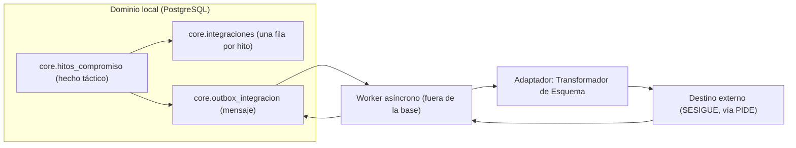

Las dos flechas que salen de `core.hitos_compromiso` van en la misma transacción: registrar el hecho
y encolar el mensaje son un solo acto. Quién encola es el servicio que escribe el hito (en Fase 2, un
trigger que sólo encole si ya existe la fila de `core.integraciones` — §15.2); el DDL de esta edición
no crea ese trigger a propósito. La flecha de retorno del destino al worker no es una conexión
de base a base: es la respuesta HTTP (o el acuse del oficio) que el worker convierte en
`ticket_externo` y estado `confirmado`.

| Pieza                    | Dónde vive                              | Qué es                                                                                      |
| ------------------------ | --------------------------------------- | ------------------------------------------------------------------------------------------- |
| Registro del hecho local | `core.hitos_compromiso`                 | el hecho táctico, con su fecha y evidencia                                                  |
| Frontera de integración  | `core.integraciones`                    | una fila por hito, con `entidad_destino_ref`, `tipo_fuente_id` y `protocolo_sincronizacion` |
| Buzón transaccional      | `core.outbox_integracion`               | el mensaje pendiente, con su estado, reintentos y aprobación                                |
| Agregación N:1           | `core.vw_agregacion_compromiso_externo` | vista, no tabla (§15.4)                                                                     |
| Traducción de estados    | `core.cat_mapeo_estado_externo`         | tabla de pares local→externo, editable sin migración                                        |
| Empuje real              | worker asíncrono                        | fuera de la base; aplica el transformador y llama al servicio                               |

**Regla dura: la base nunca escribe al sistema externo.** Ni el trigger que crea el hito, ni
`pg_cron`, ni una función `plpgsql` abren una conexión saliente. La base registra la _intención_ y el
_resultado_; el transporte es del worker. Esto no es preferencia de estilo: es lo que hace que un
`ROLLBACK` local deshaga el hecho y el mensaje juntos, y lo que impide que un trigger quede colgado
esperando a un servicio ajeno mientras mantiene un lock.

**PIDE y MIDE como marco institucional.** Toda integración con una entidad del Estado debería pasar
por la **PIDE** (Plataforma Nacional de Interoperabilidad del Estado, PCM) y enmarcarse en **MIDE**,
no por convenios bilaterales de API. Eso aplica a las ocho fuentes de §15.bis, no sólo a SESIGUE:
SUNAT, VUCE, ANA, SANIPES y CITES son, en teoría, casos de PIDE. Por eso el vocabulario del modelo es
`api_rest_pide` y no `api_rest`: el nombre registra la vía institucional esperada y no una conexión
directa que RS-07 prohíbe. _Nota de honestidad documental:_ la expansión de las siglas y la
obligatoriedad de PIDE para cada una de estas agencias **provienen del documento de origen de esta
edición y no se verificaron de forma independiente**; se registran como marco de referencia, igual
que el resto de la identidad de SESIGUE (§1.1.bis).

**Nivel de integración por fuente.** `core.integraciones.protocolo_sincronizacion` admite tres
valores, y el `DEFAULT` es `oficio_manual` — nunca API, porque la mayoría de estas fuentes no tiene
API confirmada:

| Fuente                           | `tipo_fuente_id` | `protocolo_sincronizacion`      | Vía declarada en §15.bis |
| -------------------------------- | ---------------- | ------------------------------- | ------------------------ |
| SUNAT (comprobantes)             | 12               | `api_rest_pide`                 | API                      |
| VUCE (permisos CITES)            | 13               | `api_rest_pide`                 | API                      |
| ANA SiAGUA (series hidrológicas) | 14               | `api_rest_pide`                 | API/CSV                  |
| CITES Secretariat                | 17               | `api_rest_pide`                 | API                      |
| SANIPES (PCR acuícola)           | 15               | `batch_sftp`                    | CSV/API                  |
| CITEred (actas)                  | 16               | `oficio_manual`                 | Oficio                   |
| DGSFS-PA tiburón                 | 18               | `oficio_manual`                 | Formato por confirmar    |
| OEFA PAM                         | 19               | `oficio_manual`                 | Web                      |
| SESIGUE                          | 21               | `oficio_manual` hasta la Fase 1 | No declarada             |

**Coherencia con §15.bis.** Donde §15.bis dice "API/CSV" (ANA) o "CSV/API" (SANIPES) hay dos vías
posibles en la misma celda; el `backfill` del DDL elige una por fila —API para ANA, lote para
SANIPES— y la otra queda disponible cambiando el valor, sin migración de esquema. Donde §15.bis dice
"Oficio" o "Web", el valor es `oficio_manual`. Es una lectura, no una contradicción: el campo
obliga a decidir la vía _primaria_, y §15.bis sigue describiendo el abanico.

### 15.6 Gobernanza y HITL: matriz de fuentes de verdad y gate de aprobación

**Matriz de fuentes de verdad.** El sistema local y el destino no compiten: responden preguntas
distintas y por eso se declara cuál manda en cada una.

| Dimensión              | Verdad de ejecución táctica                          | Verdad de reporte político                   |
| ---------------------- | ---------------------------------------------------- | -------------------------------------------- |
| Dónde vive             | OAIPCS (`core.hitos_compromiso`, `core.compromisos`) | SESIGUE (compromiso de alto nivel)           |
| Qué registra           | hito, entregable, componente técnico, evidencia      | compromiso, acta, espacio de diálogo         |
| Quién la escribe       | analistas y DS, vía la aplicación                    | el enlace sectorial, en el sistema de la PCM |
| Qué manda si discrepan | la local, para ejecutar y para auditar               | la externa, para reportar                    |

La consecuencia operativa es una regla, no una aspiración: **cuando la versión externa difiere de la
local, no se "corrige" la local para que cuadre.** La discrepancia se registra como una fila del
outbox con su error o su reintento, y si persiste se escala como pregunta abierta. Un sistema que
ajusta sus hechos para que el reporte quede limpio deja de ser una fuente de verdad.

**El gate es el patrón de `core.cambio_normativo`, no un mecanismo nuevo.** §0.6 estableció el idioma
—registrar la intención con quién la pide y con qué respaldo, aprobar con nombre y cargo, aplicar sólo
después, dejar rastro reversible— y esta edición lo reutiliza sobre otro objeto:

| Paso                          | `core.cambio_normativo` (§0.6)                          | `core.outbox_integracion` (§15.6)                     |
| ----------------------------- | ------------------------------------------------------- | ----------------------------------------------------- |
| 1. Registrar la intención     | fila con quién lo solicitó y la norma que lo respalda   | fila con `payload_local` y `estado_id = 1`            |
| 2. Aprobar con nombre y cargo | `core.aplicar_cambio_normativo(id, aprobado_por)`       | `UPDATE ... SET estado_id = 2, aprobado_por = <uuid>` |
| 3. Efecto                     | el catálogo cambia                                      | el worker empuja (estado 3, `enviado`)                |
| 4. Respaldo                   | `core.revertir_cambio_normativo()` deshace ese cambio   | `ticket_externo` + estado 4 (`confirmado`)            |
| 5. Qué pasa si se salta       | `core.bloquear_escritura_directa()` rechaza el `INSERT` | `core.chk_outbox_aprobacion()` rechaza el estado      |

La única asimetría es el paso 4, y es deliberada: un catálogo se revierte, un mensaje ya enviado no.
La corrección de un mensaje confirmado es **un mensaje compensatorio nuevo**, con su propia
aprobación y su propio ticket — borrar la fila destruiría la evidencia de que algo se envió.

**Catálogo de estados y quién exige aprobación.** `core.cat_estados_integracion` (8 filas) es un
catálogo cerrado, como `cat_estados_compromiso`/`cat_estados_hito`: los estados no son texto libre.

| id  | `codigo`                | `es_terminal` | ¿Exige `aprobado_por`? | Quién lo pone                       |
| --- | ----------------------- | ------------- | ---------------------- | ----------------------------------- |
| 1   | `pendiente_aprobacion`  | no            | no                     | el escritor del hecho local (§15.2) |
| 2   | `aprobado_para_envio`   | no            | **sí**                 | el enlace/coordinador sectorial     |
| 3   | `enviado`               | no            | **sí** (lo arrastra)   | el worker                           |
| 4   | `confirmado`            | sí            | **sí** (lo arrastra)   | el worker, con `ticket_externo`     |
| 5   | `rechazado_por_destino` | sí            | no                     | el worker                           |
| 6   | `rechazado_por_enlace`  | sí            | no                     | el enlace sectorial                 |
| 7   | `reintentando`          | no            | no                     | el worker                           |
| 8   | `fallo_definitivo`      | sí            | no                     | el worker                           |

**El gate lo impone la base, no la aplicación.** `core.chk_outbox_aprobacion()` es un trigger
`BEFORE INSERT OR UPDATE` que rechaza los estados 2, 3 y 4 cuando `aprobado_por` es nulo, y en ese
mismo bloque sella `aprobado_en` y el primer `proximo_intento_en`. Cubre los tres estados y no sólo
el 2 porque un `UPDATE` que salte de 1 a `enviado` burlaría un control que vigilara únicamente el
estado 2 — es el mismo razonamiento que llevó a bloquear la escritura directa del catálogo de
niveles de conflicto en vez de confiar en la capa de aplicación. Nótese que el sellado de fechas
ocurre **dentro** del bloque: una fila en `pendiente_aprobacion` no queda marcada como aprobada por
el simple hecho de insertarse.

**El mapeo de estados es una hipótesis, y está marcada como tal.** `core.cat_mapeo_estado_externo`
tiene tres filas sembradas (`En_Contratación`, `En_Elaboración_TDR`, `Vencido_Sin_Sustento`) que
**no** coinciden con los cinco códigos reales de `core.cat_estados_compromiso` ni están confirmadas
contra la taxonomía de la SSGC. Se siembran porque el encargo de esta edición las pide como ejemplo
del mecanismo, y porque tener la tabla vacía haría parecer que el mapeo está resuelto cuando no lo
está. Quedan trazadas en **Q33/D21** y su confirmación es la Fase 3 del roadmap (§15.7).

### 15.7 Matriz de enfoque y roadmap en tres fases

La decisión de fondo —generalizar el outbox y el gate, en vez de nombrarlos por SESIGUE— se sostiene
mejor cuando se compara con la alternativa:

| Criterio                        | Enfoque limitado                                                     | Enfoque ecosistémico constructivo                                                    |
| ------------------------------- | -------------------------------------------------------------------- | ------------------------------------------------------------------------------------ |
| Alcance                         | un adapter puntual para reportar los compromisos de PRODUCE          | una capa de integración reutilizable por las fuentes ya registradas                  |
| Nombres                         | objetos nombrados por sistema (`outbox_sesigue`, `relacion_sesigue`) | objetos genéricos (`outbox_integracion`, `vw_agregacion_compromiso_externo`)         |
| Costo de la segunda integración | se paga completo otra vez                                            | marginal: una fila en `cat_tipos_fuente_integracion` y un `protocolo_sincronizacion` |
| Gobernanza                      | se resuelve por integración, cada vez distinta                       | un solo gate HITL, el mismo de `core.cambio_normativo`                               |
| Taxonomía del destino           | `CASE` en el código del worker                                       | `core.cat_mapeo_estado_externo`, editable sin migración                              |
| Riesgo                          | el reporte político se desincroniza del hecho táctico sin rastro     | el desfase queda como fila del outbox, con su ticket                                 |
| Cuándo conviene                 | si SESIGUE fuese la única integración de la década                   | el escenario de este documento: 8+ fuentes externas                                  |

**Roadmap en tres fases — fusionado con la sonda de §15.1, no paralelo a ella.** La Fase 1 de este
roadmap **es** el resultado esperado de la subtask "SESIGUE Tech Probe" ya planificada; no es un paso
previo adicional. Un segundo roadmap para lo mismo habría duplicado el trabajo y las fechas.

| Fase                          | Qué es                                                                            | Dónde vive               | Entregable que cierra la fase                                                                      |
| ----------------------------- | --------------------------------------------------------------------------------- | ------------------------ | -------------------------------------------------------------------------------------------------- |
| 1. Mapeo de dominio           | la sonda técnica de dos semanas: quién es SESIGUE, qué campos mapean, qué vía hay | §15.1, días 1–10         | tabla campo a campo entre `core.compromisos` y el Anexo 6 del Protocolo SGSD/SSGC, más el go/no-go |
| 2. Desarrollo del adaptador   | outbox + worker + transformador sobre la capa genérica                            | §15.5 y §4.5.bis del DDL | un hito local que llega a `confirmado` con `ticket_externo`, y su `ROLLBACK` que no deja rastro    |
| 3. Mesa Técnica Institucional | confirmar con la SSGC la taxonomía y con la PCM la vía PIDE                       | §15.7, Q33/D21           | `core.cat_mapeo_estado_externo` confirmado (o reemplazado) y la identidad de SESIGUE verificada    |

Si la Fase 1 concluye "descartar", las Fases 2 y 3 no se ejecutan y las otras siete integraciones no
se ven afectadas: viven en la misma capa y no dependen de SESIGUE. Eso es exactamente lo que el
principio de independencia de la cabecera de §15 exige, y la razón por la que el outbox no lleva el
nombre de un solo sistema.

### 15.bis Protocolos de integración (8 agencias) y parámetros de retrieval — _añade_ — cierra IP-1..8, RE-1..6 (parcial)

**Protocolos por agencia** (auth, formato, frecuencia — detalle completo por agencia pendiente de confirmación operativa con cada entidad, registrado como fuente en `core.integraciones.tipo_fuente_id` vía el catálogo `core.cat_tipos_fuente_integracion`, §20.27.bis):

| Agencia           | Dato                      | Vía                   |
| ----------------- | ------------------------- | --------------------- |
| SUNAT             | Comprobantes electrónicos | API                   |
| VUCE              | Permisos CITES            | API                   |
| ANA SiAGUA        | Series hidrológicas       | API/CSV               |
| SANIPES           | PCR acuícola              | CSV/API               |
| CITEred           | Actas de inspección       | Oficio                |
| CITES Secretariat | Especies y apéndices      | API                   |
| DGSFS-PA tiburón  | Desembarques con QR       | Formato por confirmar |
| OEFA PAM          | Pasivos ambientales       | Web                   |

**Parámetros de retrieval**, ahora en `config.parametro` en vez de hardcodeados: `RETR.hnsw_m = 16`, `RETR.hnsw_ef_construction = 64`, `RETR.hnsw_ef_search = 40` (defaults de pgvector — pendiente de calibrar con el corpus real), `RETR.rrf_k = 60` (estándar para Reciprocal Rank Fusion — pendiente de validar con ablación), `RETR.rerank_top_k = 20`. Un guardrail o un fast path que necesite estos valores los lee del snapshot vigente, no de una constante.

## 16. Guardrails expandidos

Los guardrails base (privacidad, causalidad, frescura, fuente, taxonomía normativa, SMART, citas, alucinaciones) se
complementan con siete guardrails derivados de los módulos de expansión y tres derivados de las capas de política,
indicadores y normativa. Los quince (G1 a G15) los ejecuta el **motor determinista de reglas** (funciones sin modelo de
lenguaje) que invoca el Sintetizador; el motor **rechaza**, no solo advierte (prueba T48).

### 16.1 Guardrails nuevos

**Guardrail de Prevención (M1).** Toda predicción se emite con intervalo
de confianza y análisis cualitativo. Prohibido emitir como "acción
recomendada" sin contexto.

**Guardrail de Frescura de Modelo (M1).** Modelos con más de 90 días
sin reentrenamiento no alimentan decisiones críticas.

**Guardrail de Privacidad Comunitaria (M3).** Datos de caletas con
menos de 20 actores registrados se agregan a nivel distrital
automáticamente.

**Guardrail de Soberanía de Datos (M4).** PRODUCE no escribe en bases
de datos de otros ministerios. Sincronización solo vía API autorizada.

**Guardrail de Presunción de Inocencia (M6).** Ningún actor marcado
como criminal sin sentencia firme. Vinculaciones registradas como "bajo
investigación".

**Guardrail de Consentimiento Explícito (M8a).** Campos de género y
autoidentificación étnica solo con consentimiento. Datos agregados con
k-anonimato.

**Guardrail de Anonimización (M9).** Antes de publicar vistas públicas,
verificación automática de k-anonimato y l-diversidad.

**G13 — Lente.** Verifica que el lente de política (2.bis) no alteró niveles de riesgo, alertas ni datos, y que la Minister View lleva su pie con los códigos aplicados y los elementos fuera del lente.

**G14 — Proxy.** Todo proxy se rotula «PROXY» con su incertidumbre y enlace a la justificación en ambas vistas; en la Minister View solo entra si está validado por una persona y su incertidumbre no es «alta» (8.4).

**G15 — Norma citada.** Toda norma que cite una salida debe resolver contra el registro normativo (reglas `policy` de clase N y documentos del corpus `normativa`). Una afirmación como «falta el reglamento de la Ley N.° 31749» se rechaza porque el registro contiene el decreto (prueba T73).

### 16.2 Diagrama de guardrails en el flujo

```mermaid
flowchart TB
    Q[Query] --> R[Clasificador por plantilla]
    R --> RET[Retrieval]
    RET --> SY[A3 Sintetizador]
    SY --> GR[Motor de guardrails]
    GR --> G1{G1 Privacidad}
    G1 --> G2{G2 Causalidad}
    G2 --> G3{G3 Frescura}
    G3 --> G4{G4 Fuente}
    G4 --> G5{G5 Taxonomia Normativa}
    G5 --> G6{G6 Prevencion}
    G6 --> G7{G7 Frescura Modelo}
    G7 --> G8{G8 Privacidad Comunitaria}
    G8 --> G9{G9 Soberania Datos}
    G9 --> G10{G10 Presuncion Inocencia}
    G10 --> G11{G11 Consentimiento}
    G11 --> G12{G12 Anonimizacion}
    G12 --> G13{G13 Lente}
    G13 --> G14{G14 Proxy}
    G14 --> G15{G15 Norma citada}
    G15 --> OUT[Respuesta aprobada]
    G1 --> REJ[Rechazo]
    G2 --> REJ
    G3 --> REJ
    G4 --> REJ
    G5 --> REJ
    G6 --> REJ
    G7 --> REJ
    G8 --> REJ
    G9 --> REJ
    G10 --> REJ
    G11 --> REJ
    G12 --> REJ
    G13 --> REJ
    G14 --> REJ
    G15 --> REJ
```

### 16.1.bis Guardrails G16–G18 — _añade a §16.1_

**G16 — Concentración MYPE (C4).** Si `hhi > G16.hhi_max` (0.25) o `gini > G16.gini_max` (0.70), la salida se rotula "concentración alta" con enlace a la justificación; en la Minister View solo se muestra si `es_validado_humano = TRUE`.

**G17 — Umbral hídrico (C5).** Si `OD < G17.od_min` (4.0 mg/L) o `metales > G17.metales_max_ppm` (0.05), la salida se rotula "excede ECA"; prohibido recomendar siembra de alevinos sin este chequeo.

**G18 — Permiso CITES (C6).** Si el permiso no está `emitido` o la trazabilidad QR no está validada, la salida no puede afirmar que una exportación es legal — rótulo "permiso pendiente / trazabilidad no validada". Si la cuota consumida supera `G18.cuota_max_pct` (0.90), bloqueo.

### 16.1.ter Reason codes de G16–G18 — _añade_

`G16_CONCENTRACION`, `G17_ECA`, `G18_PERMISO` — siguen el mismo patrón de los 15 reason codes existentes de v8.3 (§16.1), y están en el contrato de test de §9.9.

<!-- v10:P12 begin -->

### 16.1.quater Guardrails G19–G22 — _añade a §16.1 (v10)_ — V10-08

**G19 — No reidentificación.** Ninguna salida, agente ni proceso puede asociar a un actor de nivel de identificación 4 o 5 con un documento, un nombre civil o un registro personal que no esté ya validado por una persona. _Ejemplo:_ el pipeline lee «el dirigente de la caleta X» y un perfil público con nombre y foto; **no** los vincula: propone un alias y envía el caso a HITL. Reason code: `G19_REIDENTIFICACION`.

**G20 — Cita literal.** Una cita solo se muestra si el servidor comprueba, de forma determinista, que el fragmento existe **literalmente** en el texto de la fuente (tras normalizar espacios y codificación) y que `offset_inicio`/`offset_fin` caen dentro del texto. Si no coincide, se descarta. _Ejemplo:_ la fuente dice «Dejen trabajar a la gente»; el modelo propone «Dejen trabajar a la gente de la caleta»; la cita se **descarta** porque la segunda versión no está en la fuente. Reason code: `G20_CITA_NO_LITERAL`.

**G21 — Aprobación humana antes de visibilidad.** Ninguna alerta es visible para los perfiles B o C si no tiene registradas las **dos aprobaciones humanas**: la **validación previa del Sectorista** y la **aprobación definitiva de la Dirección de la OAIPCS** (`aprobada_por`, `aprobada_en`). Vale para **toda** alerta, grave o no: la prioridad decide el destinatario y el plazo, no quién autoriza (H-25, RN-04). Es el mismo principio del gate HITL de `core.outbox_integracion` (§15.6) aplicado a alertas, y lo impone la base, no la aplicación: el _trigger_ **`alertas_g21_visibilidad`** (`BEFORE INSERT OR UPDATE`, creado por el parche 22 junto con la columna `visibilidad`) rechaza con `G21_SIN_APROBACION` cualquier `visibilidad` distinta de `interna` mientras falte alguna de las dos. La columna que el gate lee, `core.alertas_tempranas.visibilidad`, es `varchar(12)` `NOT NULL DEFAULT 'interna'`, con `CHECK` de tres valores —**interna** (solo la OAIPCS), **ejecutiva** (visible al Perfil B) y **sectorial** (solo destinatarios nombrados)—: toda alerta nace y se queda en `interna` hasta que existan ambas firmas. Reason code: `G21_SIN_APROBACION`.

**G22 — Fuente permitida.** Solo se recolecta de fuentes en la lista blanca (§7.5.v10). Una fuente fuera de la lista, o una red social sin API oficial o proveedor licenciado, se rechaza y se registra. Reason code: `G22_FUENTE_NO_PERMITIDA`.

Los cuatro códigos siguen el patrón de los 18 anteriores y sus filas están sembradas en `config.guardrail_contract` —G19–G22, todas `block`, con `input_dispara`, `input_no_dispara` y los dos `output_esperado_*`— desde el 18 de noviembre de 2026; forman parte del contrato de test de §9.9 y de §22.3.ter.
<!-- v10:P12 end -->

### 16.1.quinquies Guardrails G23–G25 — _añade a §16.1 (v10)_ — DC

**G23 — Nivel Alto antes que dato.** Ningún campo identificable (documento, nombre civil, teléfono) se escribe en `core.actor_datos_personales` ni en el padrón de asistencia si no existe un consentimiento vigente o una base legal registrada. Sin base legal ni consentimiento, la escritura se rechaza y el caso va a HITL. Reason code: `G23_SIN_BASE_LEGAL`.

**G24 — Identidad sintética por defecto.** Toda vista, API o reporte destinado a un perfil distinto del analista habilitado devuelve el identificador sintético del actor, nunca el nombre ni el documento. La comprobación es de base: la vista no proyecta la tabla de datos personales (la verificación aún no está automatizada, §16.1.quinquies). Reason code: `G24_REIDENTIFICACION_EN_SALIDA`.

**G25 — Sin etiqueta penal sin sentencia.** Ninguna salida puede clasificar a un actor con una categoría penal si no hay fila en `core.situacion_judicial_restricta` con `tipo = 'sentencia_firme'` y `documento_uri` poblado. `bajo_investigacion` **no** puede aparecer en el portal ni en el tablero de la Alta Dirección. Reason code: `G25_ETIQUETA_SIN_SENTENCIA`.

Los tres códigos están sembrados en `config.guardrail_contract` —G23–G25, todas `block`— y entran al contrato de test de §9.9 y a §22.3.ter, junto a G16–G22. El `CHECK` de la columna `guardrail` admite G1–G25 desde el parche 6 de cumplimiento, y desde el 18 de noviembre de 2026 la tabla tiene **25 filas**: las 18 de G1–G18 más las siete de G19–G25, con reparto 22 `block` y 3 `warn`. Cada fila trae `input_dispara`, `input_no_dispara`, `output_esperado_dispara` (con su `reason_code`), `output_esperado_no_dispara` y `severidad`.

Lo sembrado es el contrato, no la implementación. No existen todavía: la verificación determinista de offsets de G20, el rechazo de escritura de G23 sobre `core.actor_datos_personales`, la comprobación automática de que ninguna vista de perfil B o C proyecte nombre o documento para G24, y `core.situacion_judicial_restricta` para G25. Mientras esos objetos no existan, la fila del contrato dice qué debe rechazarse, no que ya se rechace.

### 16.4.bis Umbrales de drift (C4–C6) — _añade a §16.2_

`drift.mype_hhi_max = 0.05` (cambio mensual máximo tolerado en concentración), `drift.hidrico_od_max = 0.5` (mg/L), `drift.cites_cuota_max = 0.10` (cambio mensual en consumo de cuota) — en `config.parametro`, consistentes con `drift.embedding_coseno_max` y `drift.grafo_centralidad_max` ya existentes en v8.3.

## 17. Roadmap 2027–2031

> **Nota de diseño.** El título no coincide con el contenido (25 meses, no cinco años) y las tablas 17.11 y 17.12 son
> incoherentes entre sí. Ver 17.13 para la re-línea base. **Hay un solo horizonte después de diciembre, «2027»:** la
> anualidad que sigue al módulo. «MADRE» es el nombre de este documento completo —y también el del **tramo 2**,
> el que espera servicios, convenios o calibraciones—, no un horizonte; el reparto en dos
> tramos dentro de 2027 está en 17.15.

### 17.1 Fase 0 — Infraestructura (mes 1)

Servidor PostgreSQL 16 con pgvector, pg_trgm, pg_cron, pg_stat_statements.
Servidores de desarrollo y de producción institucionales provistos por OGTI (RNF-10).
Bucket S3 para archivado.

**KPI.** Uptime 30 días; backup funcionando.

### 17.2 Fase 1 — Núcleo, semilla y expansión legal (meses 2-4)

- Schema `core` completo con todas las tablas base.
- Migración de los 35 casos, 931 actores, 219 organizaciones, 83 alertas
  de AVISA.
- Alineamiento normativo con taxonomía SGSD/SSGC.
- **M8a — Género (obligación legal).** Campos nuevos en `core.actores`
  y `core.demandas`. Indicadores de género en contexto socioeconómico.
- **M8b — Consulta Previa.** Schema `consultation` creado y poblado con
  procesos históricos si existen.
- Subtask SESIGUE Tech Probe con informe final.

**KPI.** 100% datos migrados; 5-10 casos auditados manualmente; informe
SESIGUE con recomendación go/no-go; M8a y M8b operativos.

### 17.3 Fase 1b — Territorio y caletas (meses 4-5)

- Schema `territorio` completo.
- **M3 — Caletas.** Tabla `territorio.lugares (tipo caleta) + caleta_detalle` poblada con datos de
  caletas operativas.
- Carga de terminales, DPA, plantas, indicadores.
- Integración INEI, MIDIS, PRODUCE Open Data, SUNAT, IMARPE, ENFEN,
  SANIPES.

**KPI.** 100% infraestructura mapeada; caletas identificadas y
georreferenciadas.

### 17.4 Fase 2 — KAG bitemporal (meses 5-7)

- Schema `kag` completo.
- Carga inicial del grafo desde los 35 casos AVISA.
- Triggers de sincronización operativos.

**KPI.** 50 perfiles de actores extraídos; entity resolution funcional
con HITL.

### 17.5 Fase 3 — Agentes (meses 7-11)

- Tres agentes (A1, A2, A3) y servicios deterministas implementados.
- Tablas `agent.*` completas.
- Prompts versionados.
- Cola HITL con interfaz web.

**KPI.** HITL medido contra la línea base manual desde el mes 1; Synthetic Test
generando 5-10 casos semanales por caso AVISA.

### 17.6 Fase 4 — RAG (meses 11-13)

- RAG-MACTOR, RAG-Territorio, RAG-Main y Unified Retrieval Hub.
- RRF fusion.
- Re-ranking ligero opcional.
- Cache semántico.
- Fast path.

**KPI.** Latencia p95 < 5s en queries complejas; < 2s en simples; cache
hit rate > 30%.

### 17.7 Fase 5 — Salida dual y expansión predictiva (meses 13-16)

- Office View JSON Schema `office_response_v1`.
- Minister View PDF/Word.
- **M1 — Inteligencia Predictiva.** Schema `forecast`, modelos
  iniciales, Model Reviewer activo.
- **M2 — Impacto Económico.** Schema `economic`, Anexo Metodológico
  publicado.
- **M10 — Impacto Post-Resolución.** Schema `impact`, encuestas
  programadas.

**KPI.** Dos contratos validados con usuarios reales; ENOS 3-6 meses
operativo; modelo de impacto económico con Anexo Metodológico aprobado;
primera encuesta post-resolución ejecutada.

### 17.8 Fase 6 — Expansión inter-institucional (meses 16-19)

- **M4 — Inter-ministerial sobre SESIGUE.** Adapter `core.integraciones`
  extendido. Sincronización bidireccional.
- **M5a — What-if Determinístico.** Rama Análogo en RAG-MACTOR.
- **M6 — Seguridad (rediseñado).** `territorio.anomalias_ais` y
  `territorio.patrones_seguridad_caleta`. Integración MININTER read-only.
- **M7 — Trazabilidad (reducida).** `territorio.certificaciones_planta` y
  `territorio.impacto_conflicto_planta`.
- **M9 — Transparencia Pública.** Vistas públicas, API, portal de
  solicitudes.

**KPI.** Sincronización SESIGUE operativa; what-if determinístico
funcionando; AIS anomalías detectadas; compliance de certificaciones
monitoreado; portal de transparencia publicado.

### 17.9 Fase 7 — Monte Carlo y maduración (meses 19-24)

- **M5b — Simulación Monte Carlo.** Infraestructura de cómputo
  elástico. Modelo de simulación de agentes.

**KPI.** Monte Carlo operativo con 1.000+ iteraciones por escenario.

### 17.10 Fase 8 — OGTI y cutover (meses 24-25)

- SSO institucional.
- RBAC con cinco roles.
- Auditoría individual.
- Integración SITRADOC.
- Cutover AVISA → nuevo sistema.
- Decisión final SESIGUE (implementar o postergar).

**KPI.** SSO funcional; cinco roles activos; 100% operaciones
auditadas; AVISA legacy apagado.

### 17.11 Tabla consolidada de 5 años

| Fase      | Duración      | Alcance                   | Dueño             |
| --------- | ------------- | ------------------------- | ----------------- |
| F0        | 1 mes         | Infra                     | DS                |
| F1        | 3 meses       | Core + M8 + SESIGUE probe | DS                |
| F1b       | 1.5 meses     | Territorio + caletas (M3) | DS                |
| F2        | 2 meses       | KAG                       | DS                |
| F3        | 4 meses       | Agentes                   | DS                |
| F4        | 2 meses       | RAG                       | DS                |
| F5        | 3 meses       | Dual + M1 + M2 + M10      | DS                |
| F6        | 3 meses       | M4 + M5a + M6 + M7 + M9   | DS                |
| F7        | 5 meses       | M5b Monte Carlo           | DS                |
| F8        | 1 mes         | OGTI + cutover            | DS + OGTI         |
| **Total** | **~25 meses** | **10 módulos + base**     | **DS al 60% FTE** |

### 17.12 Advertencia de costos por componente

Esta sección es crítica para gestionar expectativas del Viceministro y
evitar sobrecarga del Data Scientist. **No implementar todo a la vez.**

| Componente                  | Duración estimada | Riesgo operativo                       | Recomendación |
| --------------------------- | ----------------- | -------------------------------------- | ------------- |
| Core + migración AVISA      | 1.5 meses         | Bajo                                   | F1            |
| Territorio + caletas        | 1.5 meses         | Medio                                  | F1b           |
| KAG bitemporal              | 2 meses           | Alto (HITL 6-8h/semana)                | F2            |
| Agentes (3) y servicios     | 4 meses           | Alto (HITL medido desde el mes 1)      | F3            |
| RAG (3 módulos)             | 2 meses           | Medio                                  | F4            |
| Salida dual                 | 2 meses           | Bajo                                   | F5            |
| M1 Predictiva               | 3 meses           | Alto (ML Engineer)                     | F5            |
| M2 Impacto Económico        | 2 meses           | Medio (Anexo Metodológico obligatorio) | F5            |
| M10 Impacto Post-Resolución | 1 mes             | Bajo                                   | F5            |
| M4 SESIGUE Adapter          | 3 meses           | Medio (requiere subtask técnica)       | F6            |
| M5a What-if                 | 1 mes             | Bajo                                   | F6            |
| M6 Seguridad                | 2 meses           | Medio (convenio MININTER)              | F6            |
| M7 Trazabilidad             | 2 meses           | Medio (integración SUNAT)              | F6            |
| M9 Transparencia            | 2 meses           | Medio (verificación anonimización)     | F6            |
| M5b Monte Carlo             | 5 meses           | Alto (infraestructura elástica)        | F7            |
| SSO + RBAC + auditoría      | 1 mes             | Bajo                                   | F8            |
| Cutover AVISA               | 0.5 mes           | Medio (rollback plan)                  | F8            |

**Advertencia explícita:** el proyecto completo son ~25 meses de trabajo
del DS al 60% FTE. Si el Viceministro pide comprimir a 12 meses,
fracasará por falta de capacidad operativa, no por falta de presupuesto.
La recomendación es no comprimir y comunicar el horizonte de 25 meses
desde el inicio.

**Advertencia secundaria:** las fases con HITL alto (F2 KAG, F3 Agentes)
consumen una carga de HITL que se mide desde el mes 1 (estimación inicial: 6-8h/semana del DS) durante su duración. Si el DS tiene otras
responsabilidades en la OAIPCS, esas fases deben negociarse con
antelación.

### 17.13 Plan por niveles según la capacidad real

**Por qué se reconstruye el plan.** La tabla 17.11 y la 17.12 no son consistentes entre sí, aunque ambas asumen un único ejecutor (el DS al 60 % FTE):

| Fase en 17.11                | Meses en 17.11 | Componentes que agrupa en 17.12 | Suma de 17.12 |
| ---------------------------- | -------------- | ------------------------------- | ------------- |
| F5 (Dual + M1 + M2 + M10)    | 3              | 2 + 3 + 2 + 1                   | **8**         |
| F6 (M4 + M5a + M6 + M7 + M9) | 3              | 3 + 1 + 2 + 2 + 2               | **10**        |
| Total del plan               | **25,5**       | Todos los componentes           | **35,5**      |

Es decir, 17.11 comprime en silencio 18 meses de trabajo de componentes en 6 meses calendario, mientras 17.12 advierte
que no se debe comprimir. Además: el HITL se declara de 2 h/semana (Sección 9) y de 6–8 h/semana (17.12); M1 exige un
ML engineer y M5b una infraestructura elástica que el plan no asigna; M4, M6 y M7 dependen de terceros (PCM,
MININTER, SUNAT) fuera del control del equipo; y "2027–2031" no corresponde a 25 meses.

**Propuesta (a confirmar, D8 y D14): niveles con criterios de entrada y de salida, y una capacidad explícita.**

**Capacidad y esfuerzo.** El Data Scientist al 60 % FTE ya agota los 12 meses del Nivel 1 con el núcleo. Las capas de política, indicadores, análisis dirigido, triangulación y observabilidad suman unas **24 personas-semana** (estimación de planificación, no medida):

| Componente                                                           | Central  | Rango     |
| -------------------------------------------------------------------- | -------- | --------- |
| Política mínima (clases N y P, snapshot, pie)                        | 3,5      | 3–4       |
| Indicadores y brechas (catálogo, 3 plantillas, carga de campo)       | 6        | 5–7       |
| A2, plan de análisis y _staging_                                     | 5,5      | 5–6       |
| Contrastes y vista de robustez                                       | 2,5      | 2–3       |
| `llm_call` y vistas de observabilidad                                | 2,5      | 2–3       |
| Pruebas y documentación (+20 %)                                      | 4        | 3–5       |
| **Total adiciones del Nivel 1a**                                     | **≈ 24** | **20–30** |
| Capa cualitativa y léxica (importación)                              | 12       | 10–15     |
| Recuperación (RRF y reranker), comunidades, recolección y escenarios | 20       | 15–25     |

24 personas-semana equivalen a unos 10 meses de un 60 % FTE (≈ 2,4 semanas por mes), sobre un Nivel 1 que ya se llena en 12. **No caben con una sola persona.**

**Opciones (D14).**

- **A (recomendada):** un segundo perfil técnico (ingeniería de datos o analista-desarrollador) al 50 % durante 9–12 meses; el Nivel 1 se mantiene en 12 meses.
- **B:** una sola persona. El Nivel 1a conserva política mínima, observabilidad, agentes y análisis dirigido, y la triangulación y los indicadores pasan al Nivel 2 (+6 meses). Con B la Minister View sale sin selección de indicadores y no hay reingesta cualitativa hasta el Nivel 2.

**Niveles.**

| Nivel                              | Meses                | Contenido                                                                                                                                                                                                                                                                                                                                                                                                                                                                                                                                                             | Criterio de entrada                                                                                                                 | Criterio de salida                                                                                                                                            |
| ---------------------------------- | -------------------- | --------------------------------------------------------------------------------------------------------------------------------------------------------------------------------------------------------------------------------------------------------------------------------------------------------------------------------------------------------------------------------------------------------------------------------------------------------------------------------------------------------------------------------------------------------------------- | ----------------------------------------------------------------------------------------------------------------------------------- | ------------------------------------------------------------------------------------------------------------------------------------------------------------- |
| **1a. Núcleo confiable**           | 1–12                 | Infraestructura **institucional** (OGTI); core con SSO y RBAC desde F1 (D7); migración y reconciliación de los 35 casos (RF-06); `territorio` + `ctx` con las variables críticas (ENOS, pobreza); KAG mínimo (nodos, aristas, perfiles, nombres) con HITL; **tres agentes (A1, A2, A3) y servicios deterministas** (motor de guardrails, auditoría); política mínima (2.bis); indicadores y brechas (8.4); análisis dirigido y _staging_ (9.5); triangulación (5.7); observabilidad (10.4); roles y permisos (11.8); RAG-MACTOR y RAG-Territorio básicos; Office View | Servidor y SSO confirmados por OGTI; 5–10 casos auditados (Q6); D10, D11 y D14 resueltas                                            | Anexos 14–17 reproducen las matrices actuales de AVISA; 10 mensajes reales validados contra el JSON Schema; HITL medido de hasta 4 h por semana; T1–T69 en CI |
| **1b. Capas cualitativa y léxica** | 10–16                | Importación y exportación `.qdpx` (5.5); importación léxica (5.6)                                                                                                                                                                                                                                                                                                                                                                                                                                                                                                     | Prueba de ida y vuelta con el software real (Q19); D12 y D16 resueltas                                                              | Un caso real codificado fuera, reingresado y recuperable                                                                                                      |
| **2. Inteligencia**                | 13–24                | Escenarios (M5a); recuperación con tercera señal y re-ranking (6.4); comunidades (5.8); recolección programada (7.5); Router, Resolver con cola HITL, Learning; Minister View completa; M2 (impacto económico), M10 (impacto post-resolución), M8 (género y consulta previa)                                                                                                                                                                                                                                                                                          | Nivel 1a cerrado; HITL real ≤ 4 h/semana; Anexo Metodológico de M2 aprobado; ≥ 150 casos o 5 000 aristas validadas para comunidades | Reducción de la cola HITL medida contra la línea base del Nivel 1 (no contra un supuesto)                                                                     |
| **3. Condicional**                 | según disponibilidad | Ajuste fino de modelos pequeños (1.4), autonomía del recolector, M1 (requiere ML engineer), M4 (requiere resultado de la sonda SESIGUE y acuerdo con la PCM), M6 (convenio MININTER), M7 (SUNAT), M9 (verificación de anonimización), M5b (infraestructura elástica)                                                                                                                                                                                                                                                                                                  | Perfil o convenio disponible; decisión de la Alta Dirección                                                                         | Por módulo                                                                                                                                                    |

**Bucles humanos que se suman al HITL** (se miden desde el mes 1): selección de indicadores (mensual, 1–2 h por plantilla con la Dirección); curaduría de reglas (por evento, unas 1 h al mes); revisión de importaciones `qda` (2–4 h por proyecto); triangulación (1–2 h por caso); revisión de hipótesis (1 h por semana). Las horas de los dos sociólogos de campo se presupuestan aparte en `core.capacidad_campo`.

**Secuencia.** (a) SSO/RBAC pasa de F8 a F1, porque `created_by`/`updated_by` y RLS dependen de la identidad de usuario; (b) la sonda de SESIGUE se limita a documentación y reuniones con la PCM/OGTI (no se prueban endpoints sin autorización); (c) el cutover de AVISA se condiciona a que las vistas de los Anexos 14–17 reproduzcan sus matrices actuales.

**Qué no cambia:** el orden de las capas (core → KAG → agentes → RAG → salida) y la lógica de dependencia entre ellas.

---

### 17.14 Fases C4–C6 y el pivote de dominio — _añade a §17_

| Fase                    | Meses             | Contenido                                                                                                  | Dependencias                                    |
| ----------------------- | ----------------- | ---------------------------------------------------------------------------------------------------------- | ----------------------------------------------- |
| F9 — MYPE               | 18–22             | `mype.*`, SUNAT compras, CITEred, IAC-NEC                                                                  | SUNAT API, CITEred oficio                       |
| F10 — Acuicultura       | 20–24             | `territorio.monitoreo_hidrico`, ANA SiAGUA, SANIPES                                                        | ANA API, SANIPES oficio                         |
| F11 — CITES             | 22–26             | `pesca.*`, VUCE, DGSFS-PA tiburón, RCID                                                                    | VUCE API, DGSFS-PA oficio, IMARPE               |
| F12 — Pivote de dominio | paralelo a F9–F11 | `domain.*`/`model.*`/`config.*`, migración de `forecast.model_registry`, dual-write de parámetros, cutover | Ninguna externa — es trabajo interno de esquema |

El roadmap de 25 meses de v8.3 pasa a **~30 meses** con C4–C6; estas fases requieren un tercer perfil técnico (especialista en datos financieros o hidrológicos) además del segundo perfil ya identificado en v8.3.

### 17.15 Un solo horizonte: 2027, con dos tramos — _añade a §17 (v10)_

**Un solo horizonte.** Después de diciembre hay un único horizonte, **2027**: la **evolución sobre lo ya entregado** en diciembre, que se construye sobre el módulo y llega en la anualidad siguiente. No hay un segundo horizonte tras él. Lo que antes se leía como dos horizontes son **dos tramos dentro de 2027**, y el orden entre ellos lo fija la **dependencia**, no la fecha: el tramo 2 arranca cuando el tramo 1 ya entregó el insumo del que depende. **MADRE** no designa un horizonte: es el nombre de este documento, el proyecto completo v10, con el roadmap de §17 y las fases C4–C6 de §17.14, sus servicios, convenios y calibraciones; y es también el nombre con el que los documentos llaman al **tramo 2** de 2027 —el que espera esos servicios, convenios o calibraciones—. Este documento es MADRE; el módulo de diciembre y su año siguiente son recortes suyos.

| Tramo (dentro de 2027) | Caso                                                    | Requisitos  |
| ---------------------- | ------------------------------------------------------- | ----------- |
| **Tramo 1**            | CU-23 Registrar posición, influencia y relaciones       | RF-B06      |
| **Tramo 1**            | CU-24 Ver la red de actores                             | RF-H01      |
| **Tramo 1**            | CU-26 Ver indicadores avanzados                         | RF-J02, J03 |
| **Tramo 1**            | CU-29 Generar borradores de informe                     | RF-G02, G04 |
| **Tramo 1**            | CU-30 Avisar vencimientos y escalar alertas sin atender | RF-C03, D11 |
| **Tramo 1**            | CU-32 Ingresar con segundo factor (MFA)                 | RF-A07      |
| **Tramo 1**            | CU-33 Cambiar parámetros con historial                  | RF-X03      |
| **Tramo 2**            | CU-25 Ver la línea de tiempo y el mapa                  | RF-H03, H04 |
| **Tramo 2**            | Índice de riesgo compuesto (parte de CU-26)             | RF-J01      |
| **Tramo 2**            | CU-27 Simular escenarios y tendencia (M5a/M5b)          | RF-J04, J05 |
| **Tramo 2**            | CU-28 Analizar la pota en el tiempo                     | RF-N01, N02 |
| **Tramo 2**            | CU-31 Consultar el estado de mis compromisos (Perfil C) | RF-A05      |
| **Tramo 2**            | CU-34 Traducir estados al SESIGUE (M4)                  | RF-C06      |

> **El índice de riesgo compuesto va en el tramo 2 por dependencia, no por horizonte.** RF-J01 (índice de riesgo compuesto) no entra en el tramo 1 aunque los demás indicadores sí: necesita la **red de actores completa** (CU-24), que entrega el tramo 1, y la **calibración contra el informe del caso SANIPES Sechura**, todavía vacía (H-34). RF-J02 y RF-J03 se calculan con datos que el módulo ya registra; por eso son del tramo 1. El mismo criterio ordena la red de actores (tramo 1) antes que el mapa con línea de tiempo (tramo 2): la primera es una vista sobre datos que ya se capturan; el segundo exige **acervo histórico** y el servicio de mapas (**SVC-11**), que todavía no existen.

**El pipeline de documentos no es de 2027.** **CT-02** —el servicio de procesamiento de documentos en **.NET** que construye OAIPCS (Diego)— entra en el **tramo final de los 20 días del MVP**, alimentado por la lista blanca de SVC-01 y cubriendo **RF-E01 a RF-E06 y RF-E11** (§9.2.v10). Lo que queda para 2027 es solo la **lectura abierta** de fuentes públicas y redes sociales a escala, no el procesamiento de documentos _(Alineado con ERS v0.6 §3.4/§21.2–21.3)._

## 18. Preguntas abiertas, riesgos consolidados y decisiones

### 18.1 Preguntas abiertas

**Q1. Motor de grafo.** ¿OGTI aprobará el recorrido en SQL (`kag.subgrafo`, con NetworkX o
igraph solo en lote) o exigirá Apache AGE?

**Q2. Validación del JSON Schema de ingesta.** ¿El schema
`avisa.raw_ingest.v1` cubre todos los campos de los Anexos 3, 4 y 5?
Validar contra 10 mensajes reales antes de congelar.

**Q3. Formato del Minister View.** ¿PDF firmado digitalmente o Word/PDF
simple?

**Q4. Obligatoriedad de SESIGUE.** ¿La integración es mandatoria por
norma o es opcional?

**Q5. Disponibilidad del DS para HITL.** ¿Son sostenibles las horas de HITL
medidas desde el mes 1? ¿Se confirma el segundo perfil técnico (D14)?

**Q6. Calidad de los 35 casos AVISA como semilla.** ¿Requieren limpieza
previa? Auditar 5-10 casos antes de F1.

**Q7. Capacidad del servidor institucional.** ¿El servidor de OGTI soporta
pgvector, el LLM local de 7B y, en el Nivel 2, el re-ranker (D15)?

**Q8. Identidad técnica de SESIGUE.** Confirmar con SSGC el nombre
operativo y canal de acceso.

**Q9. Alcance del schema `territorio`.** ¿Solo PRODUCE o también otros
sectores?

**Q10. Frecuencia de cambios de nombre de actor.** ¿Cuál es el umbral
óptimo de similitud (actualmente 0.85)?

**Q11. Volumen real de WhatsApp diario.** ¿Cuántos mensajes/día?

**Q12. Política de retención de expedientes.** ¿Existe? Determina TTL
de `output_contracts`.

**Q13. Validación del modelo predictivo.** ¿El Model Reviewer
trimestral del DS con dos analistas es suficiente, o requiere revisión
externa?

**Q14. Anexo Metodológico del modelo económico.** ¿MEF tiene requisitos
específicos para aceptar el modelo? ¿Se debe pre-validar con MEF antes
de F5?

**Q15. Caletas con menos de 20 actores.** ¿Cómo manejar privacidad en
caletas muy pequeñas? ¿Umbral de 20 es el correcto?

**Q16. Consentimiento para encuestas.** ¿Cómo obtener consentimiento
explícito en caletas con bajo nivel educativo?

**Q17. MININTER.** ¿Existe convenio inter-institucional para recibir
patrones agregados de crimen?

**Q18. Consulta Previa.** ¿Los procesos de consulta previa históricos
están documentados y son migrables a `consultation`?

**Q19. Viaje de ida y vuelta REFI-QDA.** ¿Qué software de análisis cualitativo usa la oficina (MAXQDA, ATLAS.ti, NVivo u otro) y qué elementos del estándar (`.qdpx`, `.qdc`, memos, variables, conjuntos) conserva cada versión? Probar con el software real **antes de congelar el esquema `qda`**.

**Q20. Marco de IA.** ¿En qué categoría de riesgo del DS N.° 115-2025-PCM cae el sistema y qué evaluación de impacto exigen OGTI y el Comité de Gobierno y Transformación Digital? Verificar los artículos aplicables con Asesoría Jurídica.

**Q21. Espacios de diálogo.** ¿Qué plazos y formato de informe fija la SGSD-PCM para la RM N.° 242-2026-PCM? Hasta confirmarlo, el informe sale como exportación manual desde la Office View.

**Q22. Corpus léxico.** ¿Cuál es el tamaño mínimo de corpus y el criterio de estabilidad para mostrar clases? Definirlo con un estadístico.

**Q23. Vigencias.** ¿Cuál es la fecha exacta de vigencia del DS N.° 012-2026-PRODUCE y se prevé prórroga? ¿Sigue vigente el plazo de instalación de SISESAT en la flota artesanal formalizada?

**Q24. Facultades legislativas.** ¿Cuál fue el resultado del pedido de facultades y qué decretos legislativos se publicaron? Determina si las reglas hoy en trámite pasan a vigentes o se archivan.

### 18.2 Riesgos consolidados

| Riesgo                                                             | Categoría        | Mitigación                                                               |
| ------------------------------------------------------------------ | ---------------- | ------------------------------------------------------------------------ |
| Apache AGE rechazada                                               | Técnico          | Recorrido en SQL (`kag.subgrafo`); NetworkX o igraph solo en lote        |
| Servidor insuficiente                                              | Técnico          | Mínimo 16GB/4vCPU/500GB SSD                                              |
| SESIGUE sin API                                                    | Técnico/político | Exportación por `core.integraciones` con servicio aprobado por OGTI      |
| 35 casos con errores de origen                                     | Datos            | DS audita 5-10 casos                                                     |
| Golden Dataset trivial                                             | Proceso          | DS revisa distribución semanal                                           |
| Colusión de agentes                                                | Proceso          | Critic usa modelo distinto                                               |
| Carga HITL subestimada                                             | Operativo        | HITL medido desde el mes 1; segundo perfil técnico (D14)                 |
| Latencia del pipeline                                              | Técnico          | Fast path + cache semántico                                              |
| Crecimiento de raw_ingest                                          | Storage          | Particionamiento + S3                                                    |
| Adopción WhatsApp Business                                         | Adopción         | Piloto + capacitación                                                    |
| Analistas perciben vigilancia                                      | Adopción         | Logs para casos, no personas                                             |
| Viceministro no confía Minister View                               | Adopción         | Citas clave + transparencia                                              |
| Contraloría cuestiona sin trazabilidad                             | Legal            | Provenance + audit log                                                   |
| Transparencia expone reservado                                     | Legal            | RLS a nivel fila                                                         |
| Predicciones usadas para criminalizar                              | Político         | Guardrail de Prevención                                                  |
| Modelos sin reentrenamiento                                        | Técnico          | Guardrail de Frescura de Modelo                                          |
| Datos de caleta identifican individuos                             | Legal            | Guardrail de Privacidad Comunitaria                                      |
| Invasión de competencias MININTER                                  | Legal            | Guardrail de Presunción de Inocencia                                     |
| Duplicación de función SESIGUE                                     | Institucional    | M4 rediseñado como adapter                                               |
| Simulación Monte Carlo subestimada                                 | Operativo        | M5b diferido año 3                                                       |
| Trazabilidad de cadena excede capacidad                            | Operativo        | M7 reducido a compliance                                                 |
| Portal de transparencia con error de anonimización                 | Legal            | Guardrail de Anonimización                                               |
| El lente de política degenera en un filtro de la evidencia         | Institucional    | Invariante, G13, pie obligatorio y Office View completa                  |
| Una regla inferida se usa como regla de gobierno                   | Institucional    | Cuarentena de hipótesis analíticas (no pueden estar vigentes)            |
| Un proxy se lee como dato                                          | Metodológico     | G14: rótulo, incertidumbre y validación humana                           |
| Una hipótesis se presenta como hecho                               | Metodológico     | Rótulo «HIPÓTESIS» y evidencia enlazada obligatoria                      |
| Salida de datos Confidenciales al exportar a software externo      | Legal            | Pseudonimización, registro, caducidad y permiso de la Dirección          |
| Capacidad insuficiente para las capas incorporadas                 | Operativo        | Segundo perfil técnico (D14, opción A)                                   |
| Captura de fuentes con restricciones de uso o con datos personales | Legal            | Lista blanca de dominios, `robots.txt`, sin perfilado ni grupos privados |
| Resúmenes de comunidades filtran niveles                           | Legal            | Una corrida por nivel de clasificación                                   |
| El contexto de política desborda el modelo local                   | Técnico          | Orden por prioridad y truncado determinista                              |
| Clasificación léxica inestable con pocos casos                     | Metodológico     | Tamaño mínimo de corpus y reporte de estabilidad obligatorio             |

### 18.3 Decisiones pendientes de confirmación (D10 a D16)

Se suman a las decisiones D1 a D9 de 0.6.6.

| #   | Decisión                                                                                                                                                     | Por qué requiere confirmación                                                  |
| --- | ------------------------------------------------------------------------------------------------------------------------------------------------------------ | ------------------------------------------------------------------------------ |
| D10 | Gobernanza de la capa de política: clases N, P y L; propone la Dirección, aprueba Alta Dirección con cuatro ojos; invariante «el lente no toca la evidencia» | Define quién puede orientar el contenido de la Minister View y con qué límites |
| D11 | Composición del Nivel 1: tres agentes (A1, A2, A3) y servicios deterministas; el resto, al Nivel 2                                                           | Reduce el alcance comprometido y fija la métrica de carga humana               |
| D12 | Motor léxico (IRaMuTeQ, paquetes de R o flujo propio)                                                                                                        | Depende de licencia y propiedad institucional                                  |
| D13 | Convertir en catálogos los `CHECK` de `kag.nodos.tipo` y `kag.cat_tipos_arista.clase`                                                                        | Migración de dos objetos ya definidos                                          |
| D14 | Capacidad: opción A (segundo perfil técnico al 50 % durante 9–12 meses) u opción B (una persona, +6 meses)                                                   | Decisión de gestión y presupuesto                                              |
| D15 | Hardware: capacidad del servidor de OGTI para el modelo local de 7B y el re-ranker en CPU o GPU                                                              | Depende de OGTI (Q7)                                                           |
| D16 | Excepciones a la pseudonimización en exportaciones: solo con permiso de aprobación vigente de la Dirección                                                   | Define el control de salida de datos del perímetro                             |

---

# PARTE III — ANEXOS TÉCNICOS

### 18.bis Preguntas abiertas Q25–Q33 y decisiones D17–D21 — _añade a §18_

**Q25.** SUNAT comprobantes: ¿la API permite consulta por RUC y rango de fechas sin convenio especial?
**Q26.** CITEred: ¿el envío semanal de actas está formalizado o requiere oficio mensual?
**Q27.** ANA SiAGUA: ¿la API cubre la cuenca del Perené o solo cuencas priorizadas?
**Q28.** SANIPES acuícola: ¿el feed de PCR cubre todas las piscigranjas o solo las habilitadas?
**Q29.** VUCE: ¿el módulo CITES está operativo en producción o solo en piloto?
**Q30.** CITES Secretariat: ¿tiene API estable o solo descarga?
**Q31.** DGSFS-PA tiburón: ¿el QR de trazabilidad está implementado o es un plan?
**Q32.** ¿Puede la OAIPCS contratar un tercer perfil técnico (especialista MYPE o hidrología)?
**Q33.** ¿La SSGC confirma la tabla de traducción de estados de `core.cat_mapeo_estado_externo`, o se construye sobre una hipótesis hasta la Mesa Técnica Institucional (Fase 3, §15.7)? Las tres filas sembradas (`En_Contratación`, `En_Elaboración_TDR`, `Vencido_Sin_Sustento`) son ilustrativas: **no** coinciden con los cinco códigos reales de `core.cat_estados_compromiso` ni están verificadas contra la taxonomía de la SSGC.

**D17.** Tercer perfil técnico para M11–M13.
**D18.** Política de retención de `mype.ejecucion_nec` y `pesca.licencia_cites_denp` — probablemente 10 años por normativa tributaria y aduanera, **sin verificar**.
**D19.** Confirmado en v9 (§11.10.bis): RLS por actor en `mype` y `pesca`, con bypass para staff interno vía `app.staff_bypass_subject_rls`.
**D20.** Ampliación de `core.cat_especies` con tiburones CITES — requiere coordinación con IMARPE.
**D21.** `core.cat_mapeo_estado_externo` se siembra con tres filas **ilustrativas** (`En_Contratación`, `En_Elaboración_TDR`, `Vencido_Sin_Sustento` → `En_Cumplimiento_En_Plazo`/`En_Cumplimiento_Vencido`) porque el encargo de la edición del 30 de octubre las pide como demostración del mecanismo. No son la taxonomía real: los estados locales de este sistema son los cinco de `core.cat_estados_compromiso` (Por iniciar, En proceso, Cumplido, Redefinido, Desestimado), y la taxonomía del destino no está confirmada. Hasta que la Mesa Técnica Institucional (Fase 3, §15.7) la confirme, el worker **no debe usarlas en producción** — la tabla queda como hipótesis trazada en Q33, no como configuración vigente.

<!-- v10:P15 begin -->

### 18.ter Preguntas Q34–Q40 y decisiones D22–D29 — _añade a §18.bis (v10)_

**Decisiones** (marcadas _propuesta_ hasta que la Dirección y OGTI las acepten).

| ID  | Decisión                                                                                                                                                                                                                                                                                               | Dónde se aplica     |
| --- | ------------------------------------------------------------------------------------------------------------------------------------------------------------------------------------------------------------------------------------------------------------------------------------------------------ | ------------------- |
| D22 | **El MVP usa los nombres de tabla de v9** (`core.actores`, `core.casos`, …). Los esquemas `seg`, `ia`, `audit` y `ref` del MVP se absorben en los de v9. _Por qué:_ evita una deuda de renombrado al migrar al modelo completo. _Costo:_ una pasada mecánica sobre el DDL del MVP (tabla en Anexo D.2) | Anexo D.2           |
| D23 | SQL Server ≥ 2019 es el perfil de despliegue del MVP; PostgreSQL sigue siendo la referencia                                                                                                                                                                                                            | §3.17.2.v10         |
| D24 | El simulador de 45 días es **M5a-lite**, una excepción de nivel declarada, con las reglas de v9 intactas                                                                                                                                                                                               | §0.7.1, §13.5.v10   |
| D25 | Los cinco KPIs se siembran en `ind` (IRE e IPS30 como `proxy`); ~~el Perfil B queda en clasificación ≤ 2~~ **segunda mitad sin efecto (2026-11-20):** el Perfil B (`alta_direccion`) queda en clasificación 3 y solo lectura. Los KPIs siguen vigentes. **Sin sembrar (2026-11-20): 0 filas en `ind`** | §8.4.ter, §11.8.v10 |
| D26 | «Tiempo real» = tres tramos medibles; _polling_ de 60 s                                                                                                                                                                                                                                                | §10.2.v10           |
| D27 | AVISA: copia congelada, carga por `staging`, delta semanal hasta el _cutover_                                                                                                                                                                                                                          | UC-14               |
| D28 | Redes sociales solo por API oficial o proveedor licenciado, con lista blanca                                                                                                                                                                                                                           | §7.5.v10, G22       |
| D29 | «Proyección socioeconómica» = tendencia del IRE + `P1_IPS30` (proxy, rango, rotulado)                                                                                                                                                                                                                  | §8.4.ter            |

**Preguntas abiertas.**

| ID  | Pregunta                                                                                                                                                                                                                                         | Quién responde   | Antes de                                |
| --- | ------------------------------------------------------------------------------------------------------------------------------------------------------------------------------------------------------------------------------------------------ | ---------------- | --------------------------------------- |
| Q34 | ¿Qué versión de SQL Server tiene OGTI y ofrece tipo vectorial, _Full-Text Search_ y SQL Agent?                                                                                                                                                   | OGTI             | Día 2                                   |
| Q35 | Contrastar la matriz E1–E4 y los pesos del IRE con el informe del caso SANIPES Sechura                                                                                                                                                           | OAIPCS           | Día 20                                  |
| Q36 | ¿En qué formato y dónde reside hoy la matriz de AVISA (hojas, columnas, quién la edita)?                                                                                                                                                         | OAIPCS           | Día 3                                   |
| Q37 | ¿Legal autoriza enviar texto público a un proveedor de LLM externo? (D-6 del MVP)                                                                                                                                                                | Legal / OGTI     | Día 12                                  |
| Q38 | ¿Cuántos casos históricos hay para calibrar pesos y los factores FP? (mínimo cinco)                                                                                                                                                              | OAIPCS           | Día 30                                  |
| Q39 | ¿Qué proveedor de escucha social o qué API se contrata, con qué costo y cuota?                                                                                                                                                                   | OAIPCS / OGTI    | Día 25                                  |
| Q40 | **Aplicada el 2026-11-18.** ¿Se acepta el tope de ±10 puntos para el ajuste automático del ICD? El tope corre como parámetro (`ICD.ajuste_tope_puntos = 10`) y `core.icd_aplicar_ajuste` lo aplica; falta la confirmación formal de la Dirección | Dirección OAIPCS | Aplicada; confirmación formal pendiente |

**Q40 — decisión aplicada.** El tope dejó de ser prosa. `config.parametro` tiene la fila vigente `ICD.ajuste_tope_puntos` (`valor` 10, `tipo` numero, `unidad` puntos, `valid_to` nulo) y `core.icd_aplicar_ajuste(p_base numeric, p_ajuste numeric)` devuelve `(icd_analista, ajuste_propuesto, ajuste_aplicado, ajuste_recortado, icd_final)`. La función **lee el tope de `config.parametro` en cada llamada**: no lo incrusta. Si la Dirección aprueba otro valor se sustituye la fila del parámetro con nueva vigencia y la función no se toca. `aprobado_por` y `aprobado_en` del parámetro siguen nulos: eso, y no el valor, es lo que mantiene abierta la confirmación formal.

Bordes verificados: `p_base` nulo lanza `22004` (no se inventa un ICD), la falta del parámetro `P0002`, un tope negativo `22023`, y un `p_ajuste` nulo cuenta como 0 sin recorte. La función no persiste nada: el ICD se calcula, no se almacena.

Casos ejecutados contra la base el 18 de noviembre de 2026:

| Caso                   | `icd_analista` | `ajuste_propuesto` | `ajuste_aplicado` | `ajuste_recortado` | `icd_final` |
| ---------------------- | -------------: | -----------------: | ----------------: | :----------------: | ----------: |
| +15 se recorta a +10   |             70 |                +15 |           **+10** |        true        |          80 |
| −3 queda tal cual      |             70 |                 −3 |                −3 |       false        |          67 |
| 95 + 10, tope superior |             95 |                +10 |               +10 |       false        |     **100** |
| 5 − 10, tope inferior  |              5 |                −10 |               −10 |       false        |       **0** |
| ajuste nulo cuenta 0   |             70 |               NULL |             **0** |       false        |          70 |

Con el ejemplo de K5 (ICD del analista 45,8) y un ajuste propuesto de +12, la llamada devuelve `45.8 | 12 | 10 | true | 55.8`: la interfaz muestra «ICD del analista 45,8», «ajuste automático +10 (PROXY, recortado de +12)» y «ICD final 55,8». Los dos números nunca se mezclan, que es lo que la decisión exige.

<!-- v10:P15 end -->

## 19. Glosario completo

**3P (Filtro 3P).** Problema, Propuesta, Pedido. Estructura obligatoria
de toda demanda registrada (Anexo 1 de la Guía PRODUCE).

**Anexo Metodológico.** Documento obligatorio para M2 que explica la
cadena causal del modelo de impacto económico, con fuentes de cada dato
y supuestos explícitos.

**AVISA.** Aplicativo de Vigilancia y Sistematización de Alertas.
Sistema legacy actual de la OAIPCS sobre Google Workspace.

**Caleta.** Asentamiento pesquero costero. Unidad territorial más
pequeña que el distrito. Introducida en M3.

**Compromiso.** Acuerdo formal registrado en documento de sustento
(acta firmada o encargo de Alta Dirección), con responsable y plazo.
Definición oficial SGSD/SSGC.

**Consulta Previa.** Proceso obligatorio bajo Convenio 169 OIT y Ley
N.° 29785, para pueblos indígenas. Introducido en M8b.

**Guardrail.** Regla dura que el Guardrail Agent aplica antes de
entregar respuesta.

**HITL (Human-in-the-Loop).** En este sistema, el Data Scientist o
sociólogo que revisa decisiones ambiguas.

**KAG (Knowledge-Augmented Generation).** Capa de grafo bitemporal con
provenance documental.

**MACTOR.** Método de análisis de actores (posiciones, objetivos,
relaciones de influencia/alianza/tensión).

**Model Reviewer.** Rol de revisión cualitativa de modelos predictivos
(Data Scientist + 2 analistas, trimestral). Introducido en M1.

**Monte Carlo.** Método de simulación estocástica. Diferido a M5b (año
3).

**OAIPCS.** Oficina de Articulación Intergubernamental y Prevención de
Conflictos Sociales.

**PAR / PAE.** Plan de Acción Rápida / Plan de Acción Estratégico.

**PIP.** Proyecto de Inversión Pública. Registrado en INVIERTE.PE. Con
6 fases, 12 etapas y ~27 hitos estandarizados.

**PWA (Progressive Web App).** Aplicación web con capacidades de app
nativa. Usada en M3.

**RAG (Retrieval-Augmented Generation).** Recuperación aumentada.

**RLS (Row Level Security).** Seguridad a nivel de fila en PostgreSQL.

**RRF (Reciprocal Rank Fusion).** Fusión de resultados de retrieval.

**SESIGUE.** Nombre de trabajo para el sistema de seguimiento de
compromisos de la PCM. Su identidad técnica exacta no fue confirmada
públicamente (Sección 1.1.bis). El sistema normativo real es la
Plataforma Digital de Gestión de Conflictos Sociales o la Base de Datos
de Compromisos de la SSGC de la PCM.

**SGSD / SSGC.** Secretaría de Gestión Social y Diálogo / Subsecretaría
de Seguimiento y Gestión de Compromisos (PCM).

**SITRADOC.** Sistema de trámite documentario.

**SMART.** Específico, Medible, Alcanzable, Relevante, Acotado en el
tiempo.

**A1, A2, A3.** Agentes con modelo de lenguaje del Nivel 1: Extractor-Estructurador, Generador de Pautas y Sintetizador (Sección 9.2).

**Brecha (indicadores).** Información que el sistema no tiene y que habría que recolectar; se registra con horas estimadas en `ind.brecha` (8.4).

**CHD / Reinert.** Clasificación jerárquica descendente de unidades de contexto, método léxico que agrupa segmentos de texto en clases de vocabulario (5.6).

**Contraste.** Par de afirmaciones con sus fuentes que coinciden, difieren, se contradicen o dejan un vacío; operación de triangulación de la Guía (5.7).

**Corpus lógico.** Partición de los documentos por tipo de fuente (`campo`, `normativa`, `literatura`, `metodologia`, `medios`, `dato_oficial`) sobre un solo almacén con RLS única (6.4).

**Cuatro ojos.** Regla de aprobación por dos personas distintas; exigida a las reglas de política de clase P para estar vigentes.

**Hipótesis analítica.** Enunciado inferido, no verificado, sobre lo que haría una autoridad o hacia dónde iría una política. Nunca puede estar vigente ni inyectarse como contexto; se rotula «HIPÓTESIS» si se cita.

**Leiden.** Algoritmo de detección de comunidades en grafos, ejecutado por lotes (5.8).

**Lente de política.** Conjunto de reglas P y L que ordenan, encuadran y seleccionan indicadores en la Minister View sin alterar la evidencia (2.bis).

**Marco situacional.** Marco de comprensión de un caso cuya robustez se evalúa con cinco criterios: consistencia, correspondencia, coherencia contextual, saturación y trazabilidad (5.7).

**Modo Pauta.** Modo de A2 en el que entrega criterios, evidencia y preguntas abiertas y la persona decide; predeterminado en decisiones sensibles (9.5).

**Proxy.** Indicador sustituto con justificación escrita e incertidumbre explícita (8.4).

**Punto de ingesta.** Punto del flujo donde una persona devuelve al sistema un producto elaborado fuera, con esquema de validación y destino (4.3).

**REFI-QDA (`.qdpx`, `.qdc`).** Estándar de intercambio de proyectos (`.qdpx`) y libros de códigos (`.qdc`) entre programas de análisis cualitativo (5.5).

**Re-ranking.** Reordenamiento de los K mejores resultados con un modelo multilingüe, aplicado después del filtro de seguridad y de la fusión RRF (6.4).

**RRF de tres señales.** Fusión de rangos de la búsqueda vectorial, el texto completo y el código cualitativo (6.4).

**Saturación.** Punto en que nuevas iteraciones de análisis ya no cambian la comprensión de un caso (5.7).

**Snapshot de política.** Foto de las reglas activas al emitir una salida, enlazada a `core.output_contracts` (2.bis).

**Staging.** Zona de recepción y validación de lotes antes de promoverlos a `qda`, `lex`, `kag` o `ind` (4.3).

**Texto versión (`texto_version`).** Versión del texto exportable de un documento; ancla los desplazamientos de los segmentos cualitativos (5.5).

**UCE.** Unidad de contexto elemental, segmento de texto que se clasifica en el análisis léxico (5.6).

**Vacío de información.** Pregunta sin dato disponible, enlazada a una brecha propuesta (7.5).

### 19.bis Glosario — 12 términos nuevos + 5 de la edición SESIGUE — _añade_

**NEC.** Núcleo Ejecutor de Compras; entidad que ejecuta compras a MYPErú.
**CITE.** Centro de Innovación Productiva y Transferencia Tecnológica; inspecciona calidad de manufactura MYPE.
**Lote MYPE.** Unidad de adjudicación de compras a MYPErú.
**ECA.** Estándar de Calidad Ambiental; umbral legal de OD, pH, metales en agua.
**SiAGUA.** Sistema de Información de Agua de la ANA.
**Piscigranja.** Establecimiento de acuicultura continental.
**DENP.** Dictamen de Extracción No Perjudicial; requisito CITES previo al permiso de exportación.
**VUCE.** Ventanilla Única de Comercio Exterior.
**CITES.** Convención sobre el Comercio Internacional de Especies Amenazadas de Fauna y Flora Silvestres.
**Cuota CITES.** Volumen máximo de exportación autorizado por especie y año.
**Trazabilidad QR.** Código que vincula un producto a su permiso CITES y a su lugar de desembarque.
**Model card.** Documento obligatorio (`model.model_card`) que describe propósito, datos, métricas y limitaciones de un modelo — ver §1.4.bis.
**PIDE.** Plataforma Nacional de Interoperabilidad del Estado (PCM); vía institucional por la que debería pasar toda integración con una entidad pública, en lugar de conexiones directas — ver §15.5.
**MIDE.** Marco institucional de interoperabilidad del Estado al que se alinea la integración, junto con PIDE; su alcance exacto sobre cada agencia no está verificado en este documento.
**Transactional Outbox.** Patrón por el cual el hecho local y el mensaje hacia el sistema externo se escriben en la misma transacción, y un worker fuera de la base hace el envío — ver §15.5.
**Circuit Breaker.** Corte temporal de los reintentos hacia un destino que falla de forma sostenida, para no degradar al emisor; en este diseño lo implementa el worker, no la base.
**Gate HITL.** Aprobación humana obligatoria antes de un efecto irreversible: aquí, nadie pasa un mensaje a `aprobado_para_envio` sin `aprobado_por`, y lo impone el trigger `core.chk_outbox_aprobacion()` — ver §15.6.

<!-- v10:P16 begin -->

### 19.v10 Términos nuevos — _añade al glosario (v10)_

Si un término ya existe arriba, prevalece la definición más antigua y esta la complementa.

**Actor seudónimo (nivel 4).** Actor registrado con un alias o cargo, sin identidad civil, a propósito.

**Anclaje.** Vínculo obligatorio de un actor de nivel 4 o 5 con un caso o una organización.

**Candidato de alerta.** Alerta propuesta por el pipeline que aún no aprobó una persona. No existe para los perfiles B y C.

**Cita literal.** Fragmento que el servidor comprobó que aparece palabra por palabra en la fuente (G20).

**Cuasi tiempo real.** Cumplimiento de tres tramos con número: 30 minutos, 60 segundos y 10 minutos (§10.2.v10).

**ICC, ICD, IPA, IRE, TAA, IPS30.** Los indicadores de §8.4.ter.

**HMAC.** Huella irreversible de un número (por ejemplo, un DNI) calculada con una clave secreta; permite saber que dos números son iguales sin mostrarlos.

**M5a-lite.** Versión inicial del What-if del MVP-45 (§13.5.v10).

**Nivel de identificación.** Qué tanto se sabe de un actor, de 1 (DNI) a 5 (colectivo anónimo) (§3.6.v10).

**Perfil A, B, C.** Los tres accesos del MVP: analista, alta dirección, actor externo (§11.8.v10).

**Promoción.** Subir el nivel de identificación de un actor sin cambiar su `actor_uid`.

**Seguridad por fila (RLS).** Regla de la base de datos que decide qué filas puede ver cada usuario.
<!-- v10:P16 end -->

## 20. DDL consolidado v8.3 (validado)

Este DDL **se ejecutó completo en PostgreSQL 16 con pgvector 0.6 (núcleo, módulos de la Sección 14 y capas de 20.20 a 20.28): 0 errores.** Las pruebas del núcleo (37, Sección 3.16) y las de las capas incorporadas (75 en total; 25 de las 38 nuevas ejecutadas contra este DDL) forman la suite de regresión. Sustituye a las secciones 20.1–20.3 de v8.1 y a los `ALTER TABLE` de 14.6. Requiere PostgreSQL ≥ 15 (por `NULLS NOT DISTINCT`) y la extensión
`vector`. Se entrega también como archivo `PRODUCE_OAIPCS_ddl_v8.3.sql` (incluye 14.1–14.5 adaptados y 20.20–20.28).

### 20.0 Cabecera, extensiones y schemas

```sql
-- =====================================================================
-- DDL v8.3 — Sistema de Inteligencia Sectorial PRODUCE-OAIPCS
-- Requiere: PostgreSQL >= 15 (NULLS NOT DISTINCT), extensión pgvector.
-- Opcionales (no validadas en sandbox): btree_gist, pg_trgm, pg_cron, postgis.
-- Cada tabla de negocio incluye el bloque estándar de auditoría (ver 3.2).
-- =====================================================================
CREATE EXTENSION IF NOT EXISTS vector;
CREATE SCHEMA IF NOT EXISTS core;
CREATE SCHEMA IF NOT EXISTS kag;
CREATE SCHEMA IF NOT EXISTS territorio;
CREATE SCHEMA IF NOT EXISTS ctx;
CREATE SCHEMA IF NOT EXISTS avisa;
CREATE SCHEMA IF NOT EXISTS agent;
CREATE SCHEMA IF NOT EXISTS analytics;
CREATE SCHEMA IF NOT EXISTS forecast;
CREATE SCHEMA IF NOT EXISTS economic;
CREATE SCHEMA IF NOT EXISTS community;
CREATE SCHEMA IF NOT EXISTS consultation;
CREATE SCHEMA IF NOT EXISTS impact;
```

### 20.1 Parte 1 — Catálogos de política (lookup, no ENUM: evolucionan sin migración)

```sql
CREATE TABLE core.cat_clasificacion (
    nivel SMALLINT PRIMARY KEY,
    nombre VARCHAR(20) NOT NULL UNIQUE
);
INSERT INTO core.cat_clasificacion VALUES (1,'Publico'),(2,'Reservado'),(3,'Confidencial');

CREATE TABLE core.entidades (            -- tenant: permite que otro ministerio adopte el sistema
    id SMALLINT PRIMARY KEY,
    siglas VARCHAR(20) NOT NULL UNIQUE,
    nombre VARCHAR(255) NOT NULL
);
INSERT INTO core.entidades VALUES (1,'PRODUCE','PRODUCE');

CREATE TABLE core.cat_niveles_conflicto (   -- Guía §7.5.1: 4 niveles (los HECHOS observables)
    id SMALLINT PRIMARY KEY, codigo VARCHAR(30) NOT NULL UNIQUE, nombre VARCHAR(50) NOT NULL, orden SMALLINT NOT NULL
);
INSERT INTO core.cat_niveles_conflicto VALUES
 (1,'Diferencia','Diferencia',1),(2,'Controversia','Controversia',2),
 (3,'Conflicto social','Conflicto social',3),(4,'Crisis social','Crisis social',4);

CREATE TABLE core.cat_niveles_riesgo (      -- Guía §7.5.2: probabilidad de escalamiento (eje distinto al nivel)
    id SMALLINT PRIMARY KEY, codigo VARCHAR(20) NOT NULL UNIQUE, orden SMALLINT NOT NULL
);
INSERT INTO core.cat_niveles_riesgo VALUES (1,'Bajo',1),(2,'Moderado',2),(3,'Alto',3);

CREATE TABLE core.cat_prioridades_atencion ( -- Anexo 15, col. 10
    id SMALLINT PRIMARY KEY, codigo VARCHAR(20) NOT NULL UNIQUE, orden SMALLINT NOT NULL
);
INSERT INTO core.cat_prioridades_atencion VALUES (1,'Urgente',1),(2,'Moderado',2),(3,'Bajo',3);

CREATE TABLE core.cat_prioridades_alerta (   -- Anexo 3: SLA por prioridad
    id SMALLINT PRIMARY KEY, codigo VARCHAR(30) NOT NULL UNIQUE, sla_horas SMALLINT
);
INSERT INTO core.cat_prioridades_alerta VALUES
 (1,'Crítica inmediata',24),(2,'Urgente',48),(3,'Temprana',72),(4,'Seguimiento',NULL);

CREATE TABLE core.cat_estados_caso (         -- A VALIDAR con OAIPCS (la Guía no lo enumera)
    id SMALLINT PRIMARY KEY, codigo VARCHAR(20) NOT NULL UNIQUE, es_activo BOOLEAN NOT NULL
);
INSERT INTO core.cat_estados_caso VALUES (1,'Activo',TRUE),(2,'En seguimiento',TRUE),(3,'Resuelto',FALSE),(4,'Archivado',FALSE);

CREATE TABLE core.cat_alcances_geograficos (  -- Anexo 14, col. 6
    id SMALLINT PRIMARY KEY, codigo VARCHAR(20) NOT NULL UNIQUE
);
INSERT INTO core.cat_alcances_geograficos VALUES (1,'Norte'),(2,'Centro'),(3,'Sur'),(4,'Oriente'),(5,'Nacional');

CREATE TABLE core.cat_estados_compromiso (   -- Protocolo SGSD/SSGC: 2 niveles en un catálogo
    id SMALLINT PRIMARY KEY, codigo VARCHAR(20) NOT NULL UNIQUE,
    categoria VARCHAR(10) NOT NULL CHECK (categoria IN ('Abierto','Cerrado')),
    es_terminal BOOLEAN NOT NULL
);
INSERT INTO core.cat_estados_compromiso VALUES
 (1,'Por iniciar','Abierto',FALSE),(2,'En proceso','Abierto',FALSE),
 (3,'Cumplido','Cerrado',TRUE),(4,'Redefinido','Cerrado',TRUE),(5,'Desestimado','Cerrado',TRUE);

CREATE TABLE core.cat_estados_hito (
    id SMALLINT PRIMARY KEY, codigo VARCHAR(20) NOT NULL UNIQUE, es_terminal BOOLEAN NOT NULL
);
INSERT INTO core.cat_estados_hito VALUES
 (1,'Registrado',FALSE),(2,'En ejecución',FALSE),(3,'Paralizado',FALSE),(4,'Cumplido',TRUE),(5,'Desestimado',TRUE);

CREATE TABLE core.cat_pip_fases (id SMALLINT PRIMARY KEY, nombre VARCHAR(30) NOT NULL UNIQUE, orden SMALLINT NOT NULL);
INSERT INTO core.cat_pip_fases VALUES (1,'Programacion',1),(2,'Pre_inversion',2),(3,'Inversion',3),
 (4,'Ejecucion',4),(5,'Funcionamiento',5),(6,'Desactivado',6);
CREATE TABLE core.cat_pip_etapas (           -- 12 etapas / ~32 hitos del Protocolo: cargar desde su Anexo
    id SMALLINT PRIMARY KEY, fase_id SMALLINT NOT NULL REFERENCES core.cat_pip_fases(id),
    numero SMALLINT NOT NULL, nombre VARCHAR(120) NOT NULL, UNIQUE (fase_id, numero)
);

CREATE TABLE core.cat_tipos_reunion (        -- vocabulario PCM (SGSD); Anexo 16 PRODUCE usa además 'programada'
    id SMALLINT PRIMARY KEY, codigo VARCHAR(40) NOT NULL UNIQUE
);
INSERT INTO core.cat_tipos_reunion VALUES (1,'Asistencia_Tecnica'),(2,'Reunion_Preparatoria'),(3,'Reunion_Ordinaria_Plenaria'),(4,'Otra');

CREATE TABLE core.cat_factores_contexto (    -- reemplaza los 'niveles' inventados (AlertaClimatica / CrisisExportadora)
    id SMALLINT PRIMARY KEY, codigo VARCHAR(30) NOT NULL UNIQUE, nombre VARCHAR(80) NOT NULL
);
INSERT INTO core.cat_factores_contexto VALUES
 (1,'climatico','Factor climático/oceanográfico'),(2,'exportador','Afectación exportadora'),
 (3,'geopolitico','Factor geopolítico'),(4,'sanitario','Factor sanitario'),(5,'social_vulnerabilidad','Vulnerabilidad social');

CREATE TABLE core.cat_subsectores (id SERIAL PRIMARY KEY, nombre VARCHAR(100) NOT NULL UNIQUE);
CREATE TABLE core.cat_tematicas (id SERIAL PRIMARY KEY, nombre VARCHAR(100) NOT NULL UNIQUE);
CREATE TABLE core.cat_unidades_organicas (
    id SERIAL PRIMARY KEY, entidad_id SMALLINT NOT NULL DEFAULT 1 REFERENCES core.entidades(id),
    siglas VARCHAR(20) NOT NULL, nombre_completo VARCHAR(255) NOT NULL, UNIQUE (entidad_id, siglas)
);
CREATE TABLE core.cat_tipos_actor (id SERIAL PRIMARY KEY, nombre VARCHAR(50) NOT NULL UNIQUE);   -- Actor social / Actor público / Actor privado
CREATE TABLE core.cat_roles_actor (id SERIAL PRIMARY KEY, nombre VARCHAR(50) NOT NULL UNIQUE);   -- Principal/Secundario/Tercero imparcial
CREATE TABLE core.cat_tipos_documento (
    id SMALLINT PRIMARY KEY, codigo VARCHAR(40) NOT NULL UNIQUE, nombre VARCHAR(120) NOT NULL,
    anexo_numero SMALLINT, esquema_json JSONB          -- JSON Schema de contenido_json por tipo
);
INSERT INTO core.cat_tipos_documento (id,codigo,nombre,anexo_numero) VALUES
 (1,'reporte_rapido','Reporte Rápido (RR)',NULL),(2,'clima_social_general','Clima Social General',4),
 (3,'clima_social_focalizado','Clima Social Focalizado',5),(4,'par','Plan de Acción Rápida',6),
 (5,'pae','Plan de Acción Estratégico',7),(6,'analisis_caso','Análisis de Caso',8),
 (7,'argumentario','Argumentario Institucional',9),(8,'acta','Acta de Acuerdo',10),
 (9,'reporte_actividad','Reporte de Actividad',11),(10,'ayuda_memoria','Ayuda Memoria',12),
 (11,'relatoria','Relatoría',13),(12,'informe_oficial','Informe/Reporte institucional (POI, Willaqniki, bimestral…)',NULL);
CREATE TABLE core.cat_especies (
    id SMALLINT PRIMARY KEY, nombre_comun VARCHAR(80) NOT NULL UNIQUE, nombre_cientifico VARCHAR(120)
);
```

> **Nota (migraciones 14–19).** Los `INSERT` de arriba son los del DDL v8.3 validado; tras la alineación con la Guía, los catálogos de esta parte quedan así. `cat_niveles_conflicto` conserva los cuatro de §7.5.1 (`Diferencia`, `Controversia`, `Conflicto social`, `Crisis social`). `cat_niveles_riesgo` son `Bajo`, `Moderado` y `Alto` (§7.5.2), y `cat_prioridades_atencion` son `Urgente`, `Moderado` y `Bajo` (Anexo 15). `cat_prioridades_alerta` son `Crítica inmediata` (24 h), `Urgente` (48 h), `Temprana` (72 h) y `Seguimiento` (sin plazo): el SLA vive en `sla_horas`, nunca en la etiqueta. `cat_estados_caso` son `Activo`, `En seguimiento`, `Resuelto` y `Archivado`; `cat_estados_compromiso` son `Por iniciar`, `En proceso`, `Cumplido`, `Redefinido` y `Desestimado`; `cat_estados_hito` son `Registrado`, `En ejecución`, `Paralizado`, `Cumplido` y `Desestimado`. `cat_tematicas` son las seis de §7.6 (`Infraestructura`, `Ordenamiento y acceso territorial`, `Normatividad`, `Distribución de beneficios`, `Gobernanza`, `Impactos de terceros`) y `Otros` se retiró. `cat_subsectores` son `Pesca y Acuicultura` y `MYPE e Industria`. `cat_tipos_actor` usa el adjetivo en minúscula (`Actor social`, `Actor público`, `Actor privado`); `cat_roles_actor` incluye `Tercero imparcial` y `No determinado`; y `cat_perfiles_actor` —el posicionamiento del actor— usa `Dialogante`, `Legitimante` y `Conflictivo`. El catálogo `cat_niveles_alerta`, que este bloque no incluye, queda con `Inmediato`, `Táctico`, `Preventivo` y `Monitoreo`, también con su SLA en `sla_horas`. La API sigue resolviendo las etiquetas anteriores porque compara con `core.normalizar_ref()` (migración 18), que ignora mayúsculas, tildes y separadores.

### 20.2 Parte 2 — Geografía con clave natural UBIGEO (INEI)

```sql
CREATE TABLE core.regiones (
    id SERIAL PRIMARY KEY, ubigeo CHAR(2) NOT NULL UNIQUE CHECK (ubigeo ~ '^[0-9]{2}$'), nombre VARCHAR(100) NOT NULL UNIQUE
);
CREATE TABLE core.provincias (
    id SERIAL PRIMARY KEY, region_id INT NOT NULL REFERENCES core.regiones(id),
    ubigeo CHAR(4) NOT NULL UNIQUE CHECK (ubigeo ~ '^[0-9]{4}$'), nombre VARCHAR(100) NOT NULL, UNIQUE (region_id, nombre)
);
CREATE TABLE core.distritos (
    id SERIAL PRIMARY KEY, provincia_id INT NOT NULL REFERENCES core.provincias(id),
    ubigeo CHAR(6) NOT NULL UNIQUE CHECK (ubigeo ~ '^[0-9]{6}$'), nombre VARCHAR(100) NOT NULL, UNIQUE (provincia_id, nombre)
);
CREATE INDEX ix_provincias_region ON core.provincias(region_id);
CREATE INDEX ix_distritos_provincia ON core.distritos(provincia_id);
```

### 20.3 Parte 3 — Usuarios del sistema y RBAC (≠ actores sociales)

```sql
CREATE TABLE core.roles (
    id SMALLINT PRIMARY KEY, codigo VARCHAR(30) NOT NULL UNIQUE,
    max_clasificacion SMALLINT NOT NULL REFERENCES core.cat_clasificacion(nivel)
);
INSERT INTO core.roles VALUES   -- RF-03 (OGTI): sectorista, administrador, consulta/lectura, Alta Dirección
 (1,'sectorista',3),(2,'administrador',3),(3,'consulta_lectura',2),(4,'alta_direccion',3),
 (5,'servicio_agente',3),(6,'auditor',3),(7,'externo_publico',1);
CREATE TABLE core.usuarios (
    id UUID PRIMARY KEY DEFAULT gen_random_uuid(), sso_subject VARCHAR(255) UNIQUE,
    nombre VARCHAR(255) NOT NULL, email VARCHAR(255) UNIQUE,
    unidad_id INT REFERENCES core.cat_unidades_organicas(id),
    activo BOOLEAN NOT NULL DEFAULT TRUE, created_at TIMESTAMPTZ NOT NULL DEFAULT now()
);
CREATE TABLE core.usuario_roles (
    usuario_id UUID NOT NULL REFERENCES core.usuarios(id), rol_id SMALLINT NOT NULL REFERENCES core.roles(id),
    desde DATE NOT NULL DEFAULT CURRENT_DATE, hasta DATE, PRIMARY KEY (usuario_id, rol_id, desde)
);
```

> **Nota (parches 15 y 20).** El `INSERT` de arriba es el seed de v8.3: **siete** roles. La parte 27 de este mismo DDL añade `analista_cualitativo` (8) y `curador_politica` (9), y el parche 20 añadió `direccion_oaipcs`: **diez roles en la tabla viva**, cifra que confirma la migración 17 (§11.8). El parche 15 sumó las columnas de capacidad `puede_crear`, `puede_editar` y `puede_eliminar` (`boolean NOT NULL DEFAULT false`, con el `CHECK` que impide eliminar sin editar), y `core.puede_crear()`, `core.puede_editar()` y `core.puede_eliminar()` las leen de `core.roles` a partir de `app.rol_codigo` (§11.9). Capacidades vigentes: `administrador` tiene todos los privilegios —crea, edita y elimina—; `sectorista` crea, edita y **elimina**; `direccion_oaipcs` crea y edita, **no** elimina; `servicio_agente`, `auditor`, `analista_cualitativo` y `curador_politica` crean y editan, no eliminan; `consulta_lectura` y `externo_publico` no escriben; `alta_direccion` **no** crea, **no** edita y **no** elimina (nivel 3, solo lectura). Nivel máximo de clasificación: 3 salvo `curador_politica` (2), `consulta_lectura` (2) y `externo_publico` (1). `core.actor_datos_personales_descifrar` exige `clasificacion_max() >= 3`, de modo que descifran datos personales los sectoristas, la Dirección de la OAIPCS y la Alta Dirección; no `consulta_lectura` ni `externo_publico`.

### 20.4 Parte 4 — Actores (personas y organizaciones), PII separada

```sql
CREATE TABLE core.actores (
    actor_uid UUID PRIMARY KEY DEFAULT gen_random_uuid(),
    nombre_actual VARCHAR(255) NOT NULL,                -- caché derivada de kag.actor_name_history
    fecha_ultimo_cambio_nombre DATE,
    naturaleza VARCHAR(12) NOT NULL DEFAULT 'organizacion' CHECK (naturaleza IN ('persona','organizacion')),
    tipo_actor_id INT NOT NULL REFERENCES core.cat_tipos_actor(id),
    rol_actor_id INT NOT NULL REFERENCES core.cat_roles_actor(id),
    created_at TIMESTAMPTZ NOT NULL DEFAULT now(), updated_at TIMESTAMPTZ NOT NULL DEFAULT now(),
    created_by UUID REFERENCES core.usuarios(id), updated_by UUID REFERENCES core.usuarios(id),
    origen_dato VARCHAR(20) NOT NULL DEFAULT 'MANUAL' CHECK (origen_dato IN ('MANUAL','KAG','WORKFLOW','AVISA_HISTORICO','WHATSAPP')),
    confidence NUMERIC(3,2) CHECK (confidence BETWEEN 0 AND 1),
    es_validado_humano BOOLEAN NOT NULL DEFAULT FALSE,
    nivel_clasificacion SMALLINT NOT NULL DEFAULT 2 REFERENCES core.cat_clasificacion(nivel)
);
CREATE TABLE core.actor_datos_personales (          -- Ley 29733 / Convenio 169: aislar y proteger
    actor_uid UUID PRIMARY KEY REFERENCES core.actores(actor_uid) ON DELETE CASCADE,
    telefono_contacto VARCHAR(50), genero VARCHAR(30) CHECK (genero IN ('Femenino','Masculino','No_binario','No_declara')),
    autoidentificacion_etnica VARCHAR(100), base_legal VARCHAR(100), fecha_consentimiento DATE,
    nivel_clasificacion SMALLINT NOT NULL DEFAULT 3 REFERENCES core.cat_clasificacion(nivel),
    updated_at TIMESTAMPTZ NOT NULL DEFAULT now()
);
CREATE TABLE core.organizaciones (                  -- RF-08/09/10/11/12 (OSPA y gremios)
    actor_uid UUID PRIMARY KEY REFERENCES core.actores(actor_uid) ON DELETE CASCADE,
    ruc CHAR(11) UNIQUE, razon_social VARCHAR(255), representante_uid UUID REFERENCES core.actores(actor_uid),
    numero_integrantes INT CHECK (numero_integrantes >= 0), expediente_ospa VARCHAR(50), estado_ospa VARCHAR(50),
    vigencia_desde DATE, vigencia_hasta DATE, fuente_sync VARCHAR(50), ultima_sync TIMESTAMPTZ,
    CHECK (vigencia_hasta IS NULL OR vigencia_desde IS NULL OR vigencia_hasta >= vigencia_desde)
);
CREATE TABLE core.actor_membresia (
    id UUID PRIMARY KEY DEFAULT gen_random_uuid(),
    persona_uid UUID NOT NULL REFERENCES core.actores(actor_uid), organizacion_uid UUID NOT NULL REFERENCES core.actores(actor_uid),
    cargo VARCHAR(100), valid_from DATE NOT NULL, valid_to DATE, CHECK (persona_uid <> organizacion_uid)
);
CREATE INDEX ix_membresia_org ON core.actor_membresia(organizacion_uid) WHERE valid_to IS NULL;
```

### 20.5 Parte 5 — Territorio (supertipo + subtipos; reemplaza 5 tablas casi idénticas)

```sql
CREATE TABLE territorio.cat_tipos_lugar (id SMALLINT PRIMARY KEY, codigo VARCHAR(40) NOT NULL UNIQUE);
INSERT INTO territorio.cat_tipos_lugar VALUES (1,'terminal_pesquero'),(2,'desembarcadero_artesanal'),(3,'planta_procesadora'),(4,'caleta');
CREATE TABLE territorio.lugares (
    id UUID PRIMARY KEY DEFAULT gen_random_uuid(), tipo_id SMALLINT NOT NULL REFERENCES territorio.cat_tipos_lugar(id),
    distrito_id INT NOT NULL REFERENCES core.distritos(id), nombre VARCHAR(255) NOT NULL,
    latitud NUMERIC(10,7) CHECK (latitud BETWEEN -90 AND 90), longitud NUMERIC(10,7) CHECK (longitud BETWEEN -180 AND 180),
    operativo BOOLEAN NOT NULL DEFAULT TRUE, administrador_uid UUID REFERENCES core.actores(actor_uid),
    fuente_dato VARCHAR(100), fecha_actualizacion DATE NOT NULL DEFAULT CURRENT_DATE,
    UNIQUE (distrito_id, tipo_id, nombre)
);
CREATE INDEX ix_lugares_distrito ON territorio.lugares(distrito_id, tipo_id);
CREATE TABLE territorio.terminal_detalle (lugar_id UUID PRIMARY KEY REFERENCES territorio.lugares(id) ON DELETE CASCADE, capacidad_tn_dia NUMERIC(12,2));
CREATE TABLE territorio.desembarcadero_detalle (lugar_id UUID PRIMARY KEY REFERENCES territorio.lugares(id) ON DELETE CASCADE, embarcaciones_registradas INT);
CREATE TABLE territorio.planta_detalle (
    lugar_id UUID PRIMARY KEY REFERENCES territorio.lugares(id) ON DELETE CASCADE, razon_social VARCHAR(255),
    tipo_procesamiento VARCHAR(60), capacidad_tn_dia NUMERIC(12,2), empleo_directo INT
);
CREATE TABLE territorio.caleta_detalle (
    lugar_id UUID PRIMARY KEY REFERENCES territorio.lugares(id) ON DELETE CASCADE,
    tipo VARCHAR(20) CHECK (tipo IN ('Pesquera','Turistica','Mixta')),
    nivel_organizacion VARCHAR(10) CHECK (nivel_organizacion IN ('Alto','Medio','Bajo'))   -- nº de actores: se DERIVA con COUNT
);
CREATE TABLE territorio.lugar_actores (
    lugar_id UUID NOT NULL REFERENCES territorio.lugares(id), actor_uid UUID NOT NULL REFERENCES core.actores(actor_uid),
    vinculo VARCHAR(40) NOT NULL DEFAULT 'presente', valid_from DATE NOT NULL DEFAULT CURRENT_DATE, valid_to DATE,
    PRIMARY KEY (lugar_id, actor_uid, valid_from)
);
CREATE TABLE territorio.certificaciones_planta (    -- ex supply_chain.compliance_status (fusionado en territorio)
    id UUID PRIMARY KEY DEFAULT gen_random_uuid(), planta_id UUID NOT NULL REFERENCES territorio.planta_detalle(lugar_id),
    certificacion VARCHAR(20) NOT NULL CHECK (certificacion IN ('MSC','SANIPES','MMPA','INDNR')),
    estado VARCHAR(20) NOT NULL CHECK (estado IN ('Vigente','Por_vencer','Vencida','Suspendida')),
    fecha_vigencia_hasta DATE, fuente VARCHAR(100), fecha_actualizacion DATE NOT NULL DEFAULT CURRENT_DATE
);
CREATE TABLE territorio.anomalias_ais (             -- ex security.ais_anomalies (datos agregados, sin PII)
    id UUID PRIMARY KEY DEFAULT gen_random_uuid(), vessel_hash CHAR(64) NOT NULL, zona_maritima VARCHAR(100) NOT NULL,
    fecha DATE NOT NULL, tipo_anomalia VARCHAR(50) NOT NULL, severidad VARCHAR(10) CHECK (severidad IN ('Baja','Media','Alta')),
    source_data_hash CHAR(64), created_at TIMESTAMPTZ NOT NULL DEFAULT now()
);
CREATE TABLE territorio.patrones_seguridad_caleta ( -- ex security.patrones_caleta (solo agregado; MININTER es la fuente)
    id UUID PRIMARY KEY DEFAULT gen_random_uuid(), caleta_id UUID NOT NULL REFERENCES territorio.caleta_detalle(lugar_id),
    periodo VARCHAR(20) NOT NULL, tipo_patron VARCHAR(30) NOT NULL CHECK (tipo_patron IN ('Extorsion','Narcotrafico','Pesca_Ilegal','Trata_Personas')),
    severidad VARCHAR(10) CHECK (severidad IN ('Baja','Media','Alta')), fuente VARCHAR(100) NOT NULL,
    fecha_registro DATE NOT NULL DEFAULT CURRENT_DATE
);
```

### 20.6 Parte 6 — Casos

```sql
CREATE TABLE core.casos (
    id UUID PRIMARY KEY DEFAULT gen_random_uuid(), entidad_id SMALLINT NOT NULL DEFAULT 1 REFERENCES core.entidades(id),
    codigo_caso VARCHAR(50) NOT NULL UNIQUE, nombre_caso VARCHAR(255) NOT NULL,
    distrito_principal_id INT NOT NULL REFERENCES core.distritos(id),
    alcance_id SMALLINT REFERENCES core.cat_alcances_geograficos(id),
    subsector_id INT NOT NULL REFERENCES core.cat_subsectores(id), tematica_id INT NOT NULL REFERENCES core.cat_tematicas(id),
    unidad_responsable_id INT NOT NULL REFERENCES core.cat_unidades_organicas(id),
    punto_focal_usuario_id UUID REFERENCES core.usuarios(id),          -- Anexo 15, col. 15 (área responsable / punto focal)
    nivel_conflicto_id SMALLINT NOT NULL REFERENCES core.cat_niveles_conflicto(id),
    nivel_riesgo_id SMALLINT NOT NULL REFERENCES core.cat_niveles_riesgo(id),
    prioridad_id SMALLINT REFERENCES core.cat_prioridades_atencion(id),
    estado_id SMALLINT NOT NULL DEFAULT 1 REFERENCES core.cat_estados_caso(id),
    descripcion_riesgo TEXT, latitud NUMERIC(10,7), longitud NUMERIC(10,7),
    fecha_inicio DATE, fecha_cierre DATE, fecha_ultima_actualizacion TIMESTAMPTZ NOT NULL DEFAULT now(),
    fuente_original VARCHAR(30) CHECK (fuente_original IN ('avisa_historico','whatsapp','acta','audio','manual')),
    es_seed_historico BOOLEAN NOT NULL DEFAULT FALSE,
    created_at TIMESTAMPTZ NOT NULL DEFAULT now(), updated_at TIMESTAMPTZ NOT NULL DEFAULT now(),
    created_by UUID REFERENCES core.usuarios(id), updated_by UUID REFERENCES core.usuarios(id),
    origen_dato VARCHAR(20) NOT NULL DEFAULT 'MANUAL' CHECK (origen_dato IN ('MANUAL','KAG','WORKFLOW','AVISA_HISTORICO','WHATSAPP')),
    confidence NUMERIC(3,2) CHECK (confidence BETWEEN 0 AND 1),
    es_validado_humano BOOLEAN NOT NULL DEFAULT FALSE,
    nivel_clasificacion SMALLINT NOT NULL DEFAULT 2 REFERENCES core.cat_clasificacion(nivel)
);
CREATE INDEX ix_casos_distrito ON core.casos(distrito_principal_id);
CREATE INDEX ix_casos_activos ON core.casos(nivel_riesgo_id, fecha_ultima_actualizacion DESC) WHERE estado_id IN (1,2);
CREATE TABLE core.caso_distritos (   -- un caso puede abarcar varios distritos (Anexo 14/15 'Alcance')
    caso_id UUID NOT NULL REFERENCES core.casos(id) ON DELETE CASCADE, distrito_id INT NOT NULL REFERENCES core.distritos(id),
    PRIMARY KEY (caso_id, distrito_id)
);
CREATE TABLE core.caso_lugares (
    caso_id UUID NOT NULL REFERENCES core.casos(id) ON DELETE CASCADE, lugar_id UUID NOT NULL REFERENCES territorio.lugares(id),
    PRIMARY KEY (caso_id, lugar_id)
);
CREATE TABLE core.caso_estado_historial (   -- historia de nivel/riesgo/estado: habilita 'tiempo en estado' y la máquina de estados
    id UUID PRIMARY KEY DEFAULT gen_random_uuid(), caso_id UUID NOT NULL REFERENCES core.casos(id) ON DELETE CASCADE,
    nivel_conflicto_id SMALLINT NOT NULL REFERENCES core.cat_niveles_conflicto(id),
    nivel_riesgo_id SMALLINT NOT NULL REFERENCES core.cat_niveles_riesgo(id),
    estado_id SMALLINT NOT NULL REFERENCES core.cat_estados_caso(id),
    desde TIMESTAMPTZ NOT NULL DEFAULT now(), hasta TIMESTAMPTZ, motivo TEXT,
    usuario_id UUID REFERENCES core.usuarios(id), CHECK (hasta IS NULL OR hasta >= desde)
);
CREATE UNIQUE INDEX ux_caso_historial_vigente ON core.caso_estado_historial(caso_id) WHERE hasta IS NULL;
CREATE TABLE core.caso_factores (
    caso_id UUID NOT NULL REFERENCES core.casos(id) ON DELETE CASCADE, factor_id SMALLINT NOT NULL REFERENCES core.cat_factores_contexto(id),
    desde DATE NOT NULL DEFAULT CURRENT_DATE, hasta DATE, PRIMARY KEY (caso_id, factor_id, desde)
);
CREATE TABLE core.casos_actores (
    caso_id UUID NOT NULL REFERENCES core.casos(id) ON DELETE CASCADE, actor_id UUID NOT NULL REFERENCES core.actores(actor_uid),
    nivel_influencia SMALLINT NOT NULL CHECK (nivel_influencia BETWEEN 1 AND 100),
    posicion VARCHAR(20) NOT NULL CHECK (posicion IN ('Apoyo','Oposicion','Neutral','No_dialogante')),
    PRIMARY KEY (caso_id, actor_id)
);
CREATE INDEX ix_casos_actores_actor ON core.casos_actores(actor_id);

CREATE TABLE territorio.impacto_conflicto_planta (  -- ex supply_chain.conflict_impact
    id UUID PRIMARY KEY DEFAULT gen_random_uuid(), caso_id UUID NOT NULL REFERENCES core.casos(id),
    planta_id UUID REFERENCES territorio.planta_detalle(lugar_id), certificaciones_en_riesgo JSONB,
    impacto_estimado VARCHAR(10) CHECK (impacto_estimado IN ('Bajo','Medio','Alto')), evaluado_at TIMESTAMPTZ NOT NULL DEFAULT now()
);
```

> **Nota (migraciones 12–19).** Este bloque es el DDL v8.3 validado; la tabla viva suma lo siguiente. **Código de caso (Anexo 15):** `codigo_caso` sigue el formato `CS-<PA|MI>-<INF|OAT|NOR|DBE|GOB|ITE|GEN>-<AAAA>-<NN>` (p. ej. `CS-PA-INF-2026-01`); `INF` lo fija la Guía, `OAT`, `NOR`, `DBE`, `GOB` e `ITE` son el acuerdo de la migración 16, y `GEN` cubre el caso sin subsector o sin temática (migración 19). Los 35 casos están recodificados y `codigo_legado` conserva el código anterior `CS-PRODUCE-…`, que es la clave estable del ETL. El código lo emiten `core.codigo_subsector(subsector_id)`, `core.codigo_tematica(tematica_id)` y `core.siguiente_codigo_caso(subsector_id, tematica_id)` —dos argumentos enteros—, con contador persistente en `core.secuencia_codigo` por año, subsector y temática; un número no se reutiliza nunca. Los códigos derivados cuelgan del de caso: el compromiso es `«caso»_COMP001` y el hito `«compromiso»_H001` (Anexo 14). **Anulación lógica:** en lugar de borrar, `casos`, `alertas_tempranas`, `compromisos`, `hitos_compromiso`, `documentos`, `demandas` y `caso_cronologia` llevan `anulado_en`, `anulado_por`, `anulacion_id` y `motivo_anulacion`; el filtro va en la política RLS de `SELECT` —no en cada consulta—, el motivo es obligatorio y `core.anular_caso()` anula en cascada bajo un mismo `anulacion_id`, que `core.restaurar_caso()` restaura. La cascada cubre caso → alertas, documentos, compromisos (con sus hitos), demandas y cronología (hechos). La migración 13 deja esas funciones como `SECURITY DEFINER` (`prosecdef = true`) y añade `core.anular_registro(tabla, id, motivo)`, `core.restaurar_registro(tabla, id)` para una fila suelta y la comprobación `core.exigir_anulacion(nivel)`. Los `ON DELETE CASCADE` que aparecen en el DDL de arriba son integridad referencial del esquema, no el mecanismo de baja: la baja es siempre lógica. **Estado:** base lista (migraciones 12 y 13); **pendiente en la API**, que sigue haciendo `DELETE` físicos y no expone endpoints `anular`/`restaurar` (gap E2). Un caso anulado desactiva sus alertas y deja de mostrarlas.

### 20.7 Parte 7 — Alertas

```sql
CREATE TABLE core.alertas_tempranas (
    id UUID PRIMARY KEY DEFAULT gen_random_uuid(), codigo_alerta VARCHAR(50) NOT NULL UNIQUE,
    caso_id UUID NOT NULL REFERENCES core.casos(id) ON DELETE CASCADE,
    prioridad_id SMALLINT NOT NULL REFERENCES core.cat_prioridades_alerta(id), fecha_reporte DATE NOT NULL DEFAULT CURRENT_DATE,
    situacion_actual TEXT, riesgos_json JSONB, acciones_sugeridas_json JSONB,   -- narrativa semiestructurada (no se consulta relacionalmente)
    created_at TIMESTAMPTZ NOT NULL DEFAULT now(), updated_at TIMESTAMPTZ NOT NULL DEFAULT now(),
    created_by UUID REFERENCES core.usuarios(id), updated_by UUID REFERENCES core.usuarios(id),
    origen_dato VARCHAR(20) NOT NULL DEFAULT 'MANUAL' CHECK (origen_dato IN ('MANUAL','KAG','WORKFLOW','AVISA_HISTORICO','WHATSAPP')),
    confidence NUMERIC(3,2) CHECK (confidence BETWEEN 0 AND 1),
    es_validado_humano BOOLEAN NOT NULL DEFAULT FALSE,
    nivel_clasificacion SMALLINT NOT NULL DEFAULT 2 REFERENCES core.cat_clasificacion(nivel)
);
CREATE INDEX ix_alertas_caso ON core.alertas_tempranas(caso_id);
CREATE TABLE core.alertas_actores (
    alerta_id UUID NOT NULL REFERENCES core.alertas_tempranas(id) ON DELETE CASCADE, actor_id UUID NOT NULL REFERENCES core.actores(actor_uid),
    PRIMARY KEY (alerta_id, actor_id)
);
CREATE TABLE core.derivaciones_alerta (
    id UUID PRIMARY KEY DEFAULT gen_random_uuid(), alerta_id UUID NOT NULL REFERENCES core.alertas_tempranas(id) ON DELETE CASCADE,
    area_destino_id INT NOT NULL REFERENCES core.cat_unidades_organicas(id),
    fecha_derivacion TIMESTAMPTZ NOT NULL DEFAULT now(), fecha_limite TIMESTAMPTZ, fecha_atencion TIMESTAMPTZ,
    estado_atencion VARCHAR(20) NOT NULL DEFAULT 'Pendiente' CHECK (estado_atencion IN ('Pendiente','En_atencion','Atendida'))  -- 'Vencida' se DERIVA de fecha_limite
);
CREATE INDEX ix_deriv_pendientes ON core.derivaciones_alerta(fecha_limite) WHERE estado_atencion <> 'Atendida';
```

> **Nota (2026-11-20).** Este bloque es el DDL v8.3 validado; la tabla viva suma tres columnas posteriores: `aprobada_por` y `aprobada_en` (parche 21) y `visibilidad` —`varchar(12)` `NOT NULL DEFAULT 'interna'`, con `CHECK` de tres valores: interna, ejecutiva y sectorial— (parche 22). El gate G21 lee `visibilidad`, y el esquema vigente está en el DDL unificado y en el diccionario de datos.

> **Nota (migraciones 14–19).** La alerta **no** lleva riesgo: el riesgo es atributo del **caso** (`core.casos.nivel_riesgo_id`, `Bajo`/`Moderado`/`Alto`) y el caso permite recalcularlo. La alerta describe el escenario y sus factores: en la base lleva `descripcion_riesgo` (texto), `riesgos_json` (factores) y `nivel_alerta_id` (FK a `core.cat_niveles_alerta`), más la prioridad (`core.cat_prioridades_alerta`, con su SLA en `sla_horas`); **no** tiene `nivel_riesgo_id`. Las 83 alertas del histórico están cargadas con la etiqueta heredada `estado_legado = 'Archivado'` y se documentan como **Atendida** (decisión D6; la migración de ese estado sigue pendiente).

### 20.8 Parte 8 — Documentos (política única: todo anexo documental es un documento tipado)

```sql
CREATE TABLE core.reuniones_dialogo (
    id UUID PRIMARY KEY DEFAULT gen_random_uuid(), codigo_reunion VARCHAR(50) UNIQUE,
    caso_id UUID NOT NULL REFERENCES core.casos(id), convocante_unidad_id INT NOT NULL REFERENCES core.cat_unidades_organicas(id),
    tipo_id SMALLINT REFERENCES core.cat_tipos_reunion(id), programada BOOLEAN NOT NULL DEFAULT TRUE,   -- Anexo 16: Programado / No programado
    titulo VARCHAR(255), fecha TIMESTAMPTZ NOT NULL, lugar VARCHAR(255), responsable_usuario_id UUID REFERENCES core.usuarios(id),
    nota_publicacion_url VARCHAR(500),                                  -- Anexo 16, col. 12 (publicación / nota)
    created_at TIMESTAMPTZ NOT NULL DEFAULT now(), updated_at TIMESTAMPTZ NOT NULL DEFAULT now(),
    created_by UUID REFERENCES core.usuarios(id), updated_by UUID REFERENCES core.usuarios(id),
    origen_dato VARCHAR(20) NOT NULL DEFAULT 'MANUAL' CHECK (origen_dato IN ('MANUAL','KAG','WORKFLOW','AVISA_HISTORICO','WHATSAPP')),
    confidence NUMERIC(3,2) CHECK (confidence BETWEEN 0 AND 1),
    es_validado_humano BOOLEAN NOT NULL DEFAULT FALSE,
    nivel_clasificacion SMALLINT NOT NULL DEFAULT 2 REFERENCES core.cat_clasificacion(nivel)
);
CREATE INDEX ix_reuniones_caso ON core.reuniones_dialogo(caso_id, fecha DESC);
CREATE TABLE core.reunion_participantes (
    reunion_id UUID NOT NULL REFERENCES core.reuniones_dialogo(id) ON DELETE CASCADE,
    actor_uid UUID NOT NULL REFERENCES core.actores(actor_uid), institucion_uid UUID REFERENCES core.actores(actor_uid),
    cargo VARCHAR(100), asistio BOOLEAN NOT NULL DEFAULT TRUE, PRIMARY KEY (reunion_id, actor_uid)
);
CREATE TABLE core.documentos (
    id UUID PRIMARY KEY DEFAULT gen_random_uuid(), tipo_id SMALLINT NOT NULL REFERENCES core.cat_tipos_documento(id),
    codigo VARCHAR(60) UNIQUE, caso_id UUID REFERENCES core.casos(id), reunion_id UUID REFERENCES core.reuniones_dialogo(id),
    titulo VARCHAR(255) NOT NULL, fecha DATE NOT NULL DEFAULT CURRENT_DATE, resumen_ejecutivo TEXT,
    contenido_json JSONB NOT NULL DEFAULT '{}', url_pdf VARCHAR(500), responsable_usuario_id UUID REFERENCES core.usuarios(id),
    created_at TIMESTAMPTZ NOT NULL DEFAULT now(), updated_at TIMESTAMPTZ NOT NULL DEFAULT now(),
    created_by UUID REFERENCES core.usuarios(id), updated_by UUID REFERENCES core.usuarios(id),
    origen_dato VARCHAR(20) NOT NULL DEFAULT 'MANUAL' CHECK (origen_dato IN ('MANUAL','KAG','WORKFLOW','AVISA_HISTORICO','WHATSAPP')),
    confidence NUMERIC(3,2) CHECK (confidence BETWEEN 0 AND 1),
    es_validado_humano BOOLEAN NOT NULL DEFAULT FALSE,
    nivel_clasificacion SMALLINT NOT NULL DEFAULT 2 REFERENCES core.cat_clasificacion(nivel)
);
CREATE INDEX ix_documentos_caso ON core.documentos(caso_id, tipo_id, fecha DESC);
CREATE INDEX ix_documentos_reunion ON core.documentos(reunion_id) WHERE reunion_id IS NOT NULL;
CREATE TABLE core.planes_accion (   -- subtipo 1:1 de documentos (PAR/PAE) con columnas consultables
    documento_id UUID PRIMARY KEY REFERENCES core.documentos(id) ON DELETE CASCADE,
    monto_presupuestal NUMERIC(15,2), plazo_limite TIMESTAMPTZ,
    estado_aprobacion VARCHAR(20) NOT NULL DEFAULT 'Borrador' CHECK (estado_aprobacion IN ('Borrador','En_revision','Aprobado','Rechazado'))
);
CREATE TABLE core.plan_acciones (   -- acciones inmediatas del Anexo 6 (antes: JSON opaco)
    id UUID PRIMARY KEY DEFAULT gen_random_uuid(), plan_id UUID NOT NULL REFERENCES core.planes_accion(documento_id) ON DELETE CASCADE,
    descripcion TEXT NOT NULL, responsable_uid UUID REFERENCES core.actores(actor_uid), responsable_texto VARCHAR(255),
    plazo_codigo VARCHAR(12) CHECK (plazo_codigo IN ('Inmediato','Hoy','48h')), plazo_limite TIMESTAMPTZ,
    criterio_contencion TEXT, estado VARCHAR(15) NOT NULL DEFAULT 'Pendiente' CHECK (estado IN ('Pendiente','En_curso','Cumplida','Descartada'))
);
```

### 20.9 Parte 9 — Cronología, demandas

```sql
CREATE TABLE core.caso_cronologia (
    id UUID PRIMARY KEY DEFAULT gen_random_uuid(), caso_id UUID NOT NULL REFERENCES core.casos(id) ON DELETE CASCADE,
    fecha_evento DATE NOT NULL, descripcion_hecho TEXT NOT NULL, es_hecho_verificable BOOLEAN NOT NULL DEFAULT TRUE,
    actor_uid UUID REFERENCES core.actores(actor_uid), created_at TIMESTAMPTZ NOT NULL DEFAULT now(), updated_at TIMESTAMPTZ NOT NULL DEFAULT now(),
    created_by UUID REFERENCES core.usuarios(id), updated_by UUID REFERENCES core.usuarios(id),
    origen_dato VARCHAR(20) NOT NULL DEFAULT 'MANUAL' CHECK (origen_dato IN ('MANUAL','KAG','WORKFLOW','AVISA_HISTORICO','WHATSAPP')),
    confidence NUMERIC(3,2) CHECK (confidence BETWEEN 0 AND 1),
    es_validado_humano BOOLEAN NOT NULL DEFAULT FALSE,
    nivel_clasificacion SMALLINT NOT NULL DEFAULT 2 REFERENCES core.cat_clasificacion(nivel)
);
CREATE INDEX ix_cronologia_caso ON core.caso_cronologia(caso_id, fecha_evento DESC);
CREATE TABLE core.fuentes_evidencia (           -- triangulación: Medios / Institucional / Relacionamiento
    id UUID PRIMARY KEY DEFAULT gen_random_uuid(), cronologia_id UUID NOT NULL REFERENCES core.caso_cronologia(id) ON DELETE CASCADE,
    tipo_fuente VARCHAR(20) NOT NULL CHECK (tipo_fuente IN ('Medios','Institucional','Relacionamiento')),
    url_referencia VARCHAR(500), nivel_confiabilidad VARCHAR(10) NOT NULL CHECK (nivel_confiabilidad IN ('Alto','Medio','Bajo'))
);
CREATE TABLE core.cronologia_vinculos (         -- 'Alertas vinculadas' del Anexo 15 = AT, RR o PAR
    cronologia_id UUID NOT NULL REFERENCES core.caso_cronologia(id) ON DELETE CASCADE,
    alerta_id UUID REFERENCES core.alertas_tempranas(id), documento_id UUID REFERENCES core.documentos(id),
    CHECK (num_nonnulls(alerta_id, documento_id) = 1)
);
CREATE TABLE core.demandas (
    id UUID PRIMARY KEY DEFAULT gen_random_uuid(), caso_id UUID REFERENCES core.casos(id) ON DELETE CASCADE,
    problema_3p TEXT NOT NULL, propuesta_3p TEXT, pedido_3p TEXT NOT NULL,
    estado_atencion VARCHAR(20) NOT NULL DEFAULT 'Pendiente' CHECK (estado_atencion IN ('Pendiente','En proceso','Atendida','Desestimada')),
    motivo_no_atencion TEXT, fecha_vencimiento_respuesta DATE, afecta_diferenciadamente_mujeres BOOLEAN NOT NULL DEFAULT FALSE,
    created_at TIMESTAMPTZ NOT NULL DEFAULT now(), updated_at TIMESTAMPTZ NOT NULL DEFAULT now(),
    created_by UUID REFERENCES core.usuarios(id), updated_by UUID REFERENCES core.usuarios(id),
    origen_dato VARCHAR(20) NOT NULL DEFAULT 'MANUAL' CHECK (origen_dato IN ('MANUAL','KAG','WORKFLOW','AVISA_HISTORICO','WHATSAPP')),
    confidence NUMERIC(3,2) CHECK (confidence BETWEEN 0 AND 1),
    es_validado_humano BOOLEAN NOT NULL DEFAULT FALSE,
    nivel_clasificacion SMALLINT NOT NULL DEFAULT 2 REFERENCES core.cat_clasificacion(nivel)
);
CREATE INDEX ix_demandas_caso ON core.demandas(caso_id);
CREATE TABLE core.demandas_actores (
    demanda_id UUID NOT NULL REFERENCES core.demandas(id) ON DELETE CASCADE, actor_id UUID NOT NULL REFERENCES core.actores(actor_uid),
    rol_en_demanda VARCHAR(20) NOT NULL CHECK (rol_en_demanda IN ('Formulador','Coadyuvante','Opositor','Afectado')),
    PRIMARY KEY (demanda_id, actor_id)
);
CREATE TABLE core.demandas_evidencias (
    id UUID PRIMARY KEY DEFAULT gen_random_uuid(), demanda_id UUID NOT NULL REFERENCES core.demandas(id) ON DELETE CASCADE,
    fuente_tipo VARCHAR(20) NOT NULL CHECK (fuente_tipo IN ('Medios','Institucional','Relacionamiento')),
    url_referencia VARCHAR(500), archivo_adjunto_url VARCHAR(500), fecha_incorporacion DATE NOT NULL DEFAULT CURRENT_DATE
);
```

### 20.10 Parte 10 — Compromisos (supertipo + subtipo PIP)

```sql
CREATE TABLE core.compromisos (
    id UUID PRIMARY KEY DEFAULT gen_random_uuid(),
    codigo_compromiso VARCHAR(60) NOT NULL UNIQUE CHECK (codigo_compromiso ~ '_COMP[0-9]{3}$'),   -- Anexo 14: <codigo_caso>_COMP001
    caso_id UUID NOT NULL REFERENCES core.casos(id) ON DELETE CASCADE, reunion_id UUID REFERENCES core.reuniones_dialogo(id),
    documento_origen_id UUID REFERENCES core.documentos(id), unidad_responsable_id INT NOT NULL REFERENCES core.cat_unidades_organicas(id),
    alcance_id SMALLINT REFERENCES core.cat_alcances_geograficos(id), tematica_id INT REFERENCES core.cat_tematicas(id),
    fecha_inicio DATE NOT NULL, accion_compromiso TEXT NOT NULL, tipo_compromiso VARCHAR(10) NOT NULL CHECK (tipo_compromiso IN ('Actividad','PIP')),
    nivel_gobierno VARCHAR(15) CHECK (nivel_gobierno IN ('Nacional','Regional','Local','Empresa','Sociedad_Civil')),
    estado_id SMALLINT NOT NULL DEFAULT 1 REFERENCES core.cat_estados_compromiso(id),
    redefinido_de_id UUID UNIQUE REFERENCES core.compromisos(id),     -- UNIQUE: una sola redefinición permitida
    evidencia_cumplimiento_uri VARCHAR(500), atiende_brecha_genero BOOLEAN NOT NULL DEFAULT FALSE, criterios_smart JSONB,
    created_at TIMESTAMPTZ NOT NULL DEFAULT now(), updated_at TIMESTAMPTZ NOT NULL DEFAULT now(),
    created_by UUID REFERENCES core.usuarios(id), updated_by UUID REFERENCES core.usuarios(id),
    origen_dato VARCHAR(20) NOT NULL DEFAULT 'MANUAL' CHECK (origen_dato IN ('MANUAL','KAG','WORKFLOW','AVISA_HISTORICO','WHATSAPP')),
    confidence NUMERIC(3,2) CHECK (confidence BETWEEN 0 AND 1),
    es_validado_humano BOOLEAN NOT NULL DEFAULT FALSE,
    nivel_clasificacion SMALLINT NOT NULL DEFAULT 2 REFERENCES core.cat_clasificacion(nivel)
);
CREATE INDEX ix_compromisos_caso ON core.compromisos(caso_id);
CREATE TABLE core.compromiso_distritos (
    compromiso_id UUID NOT NULL REFERENCES core.compromisos(id) ON DELETE CASCADE, distrito_id INT NOT NULL REFERENCES core.distritos(id),
    PRIMARY KEY (compromiso_id, distrito_id)
);
CREATE TABLE core.compromiso_pip (
    compromiso_id UUID PRIMARY KEY REFERENCES core.compromisos(id) ON DELETE CASCADE,
    codigo_snip VARCHAR(50), codigo_unificado VARCHAR(50), denominacion TEXT, unidad_formuladora VARCHAR(255), unidad_ejecutora VARCHAR(255),
    etapa_id SMALLINT REFERENCES core.cat_pip_etapas(id),            -- la FASE se deriva de la etapa (3FN)
    monto_total NUMERIC(15,2), pim NUMERIC(15,2), devengado NUMERIC(15,2), devengado_acumulado NUMERIC(15,2)   -- avance % se DERIVA
);
CREATE TABLE core.compromiso_colaboradores (
    compromiso_id UUID NOT NULL REFERENCES core.compromisos(id) ON DELETE CASCADE, actor_uid UUID NOT NULL REFERENCES core.actores(actor_uid),
    PRIMARY KEY (compromiso_id, actor_uid)
);
CREATE TABLE core.hitos_compromiso (
    id UUID PRIMARY KEY DEFAULT gen_random_uuid(), compromiso_id UUID NOT NULL REFERENCES core.compromisos(id) ON DELETE CASCADE,
    codigo_hito VARCHAR(70) NOT NULL UNIQUE,   -- Anexo 12/14: <codigo_compromiso>_H001 (p. ej. CS-PA-INF-2026-01_COMP001_H001)
    descripcion_hito TEXT NOT NULL, fecha_vencimiento DATE,
    estado_id SMALLINT NOT NULL DEFAULT 1 REFERENCES core.cat_estados_hito(id)       -- caché del último estado histórico
);
CREATE INDEX ix_hitos_compromiso ON core.hitos_compromiso(compromiso_id);
CREATE INDEX ix_hitos_por_vencer ON core.hitos_compromiso(fecha_vencimiento) WHERE estado_id NOT IN (4,5);
CREATE TABLE core.hitos_compromiso_estado_historico (
    id UUID PRIMARY KEY DEFAULT gen_random_uuid(), hito_id UUID NOT NULL REFERENCES core.hitos_compromiso(id) ON DELETE CASCADE,
    fecha_corte DATE NOT NULL, estado_id SMALLINT NOT NULL REFERENCES core.cat_estados_hito(id), observacion TEXT,
    registrado_por UUID REFERENCES core.usuarios(id), registrado_en TIMESTAMPTZ NOT NULL DEFAULT now(), UNIQUE (hito_id, fecha_corte)
);
```

### 20.11 Parte 11 — KAG: un solo grafo bitemporal (valid time + transaction time)

```sql
CREATE TABLE kag.documento_fuente (
    id UUID PRIMARY KEY DEFAULT gen_random_uuid(), core_documento_id UUID REFERENCES core.documentos(id),
    titulo VARCHAR(255) NOT NULL, tipo VARCHAR(60) NOT NULL, url VARCHAR(500), hash_contenido CHAR(64),
    fecha_ingesta TIMESTAMPTZ NOT NULL DEFAULT now(), nivel_clasificacion SMALLINT NOT NULL DEFAULT 2 REFERENCES core.cat_clasificacion(nivel)
);
CREATE TABLE kag.documento_fragmento (
    id UUID PRIMARY KEY DEFAULT gen_random_uuid(), documento_id UUID NOT NULL REFERENCES kag.documento_fuente(id) ON DELETE CASCADE,
    orden INT NOT NULL, pagina_o_minuto INT, texto TEXT NOT NULL, nivel_clasificacion SMALLINT NOT NULL DEFAULT 2 REFERENCES core.cat_clasificacion(nivel),
    UNIQUE (documento_id, orden)
);
CREATE TABLE kag.actor_profile (                -- cabecera 1:1; tipo/rol/nombre se leen de core (sin duplicar)
    actor_uid UUID PRIMARY KEY REFERENCES core.actores(actor_uid) ON DELETE CASCADE,
    resumen TEXT, formas_trabajo TEXT, updated_at TIMESTAMPTZ NOT NULL DEFAULT now()
);
CREATE TABLE kag.actor_profile_attribute (
    id UUID PRIMARY KEY DEFAULT gen_random_uuid(), actor_uid UUID NOT NULL REFERENCES core.actores(actor_uid) ON DELETE CASCADE,
    attribute_type VARCHAR(30) NOT NULL CHECK (attribute_type IN ('interes_declarado','interes_real','necesidad_basica','limitacion_legal',
        'limitacion_presupuestal','limitacion_politica','limitacion_cultural','estrategia_historica','capacidad')),
    value TEXT NOT NULL, severity SMALLINT CHECK (severity BETWEEN 1 AND 5),
    valid_from TIMESTAMPTZ NOT NULL, valid_to TIMESTAMPTZ,                         -- tiempo válido
    recorded_at TIMESTAMPTZ NOT NULL DEFAULT now(), superseded_at TIMESTAMPTZ,       -- tiempo de transacción
    supersedes_id UUID REFERENCES kag.actor_profile_attribute(id),
    confidence NUMERIC(3,2) CHECK (confidence BETWEEN 0 AND 1), origen_dato VARCHAR(20) NOT NULL DEFAULT 'KAG',
    es_validado_humano BOOLEAN NOT NULL DEFAULT FALSE, nivel_clasificacion SMALLINT NOT NULL DEFAULT 2 REFERENCES core.cat_clasificacion(nivel),
    CHECK (valid_to IS NULL OR valid_to > valid_from)
);
CREATE INDEX ix_attr_actor ON kag.actor_profile_attribute(actor_uid, attribute_type) WHERE superseded_at IS NULL;
CREATE TABLE kag.atributo_evidencia (
    atributo_id UUID NOT NULL REFERENCES kag.actor_profile_attribute(id) ON DELETE CASCADE,
    fragmento_id UUID NOT NULL REFERENCES kag.documento_fragmento(id), cita_textual TEXT, confidence NUMERIC(3,2),
    PRIMARY KEY (atributo_id, fragmento_id)
);
CREATE TABLE kag.actor_name_history (
    id UUID PRIMARY KEY DEFAULT gen_random_uuid(), actor_uid UUID NOT NULL REFERENCES core.actores(actor_uid) ON DELETE CASCADE,
    nombre VARCHAR(255) NOT NULL, valid_from DATE NOT NULL, valid_to DATE, fuente VARCHAR(255), confidence NUMERIC(3,2),
    CHECK (valid_to IS NULL OR valid_to >= valid_from)
);
CREATE UNIQUE INDEX ux_name_history_vigente ON kag.actor_name_history(actor_uid) WHERE valid_to IS NULL;
CREATE TABLE kag.objetivo (
    id UUID PRIMARY KEY DEFAULT gen_random_uuid(), caso_id UUID NOT NULL REFERENCES core.casos(id) ON DELETE CASCADE,
    descripcion TEXT NOT NULL, tipo VARCHAR(50), valid_from TIMESTAMPTZ NOT NULL DEFAULT now(), valid_to TIMESTAMPTZ
);
CREATE TABLE kag.nodos (                         -- integridad de los extremos de arista (antes: FK solo a actores)
    id UUID PRIMARY KEY DEFAULT gen_random_uuid(),
    tipo VARCHAR(20) NOT NULL CHECK (tipo IN ('actor','caso','objetivo','demanda','solucion','lugar')),
    ref_id UUID NOT NULL, etiqueta VARCHAR(255), UNIQUE (tipo, ref_id)
);
CREATE TABLE kag.cat_tipos_arista (
    id SMALLINT PRIMARY KEY, codigo VARCHAR(40) NOT NULL UNIQUE,
    clase VARCHAR(15) NOT NULL CHECK (clase IN ('relacion','influencia','posicion','participacion','causal')),
    dirigida BOOLEAN NOT NULL DEFAULT TRUE, origen_tipo VARCHAR(20), destino_tipo VARCHAR(20)
);
INSERT INTO kag.cat_tipos_arista VALUES
 (1,'ALIANZA','relacion',FALSE,'actor','actor'),(2,'TENSION','relacion',FALSE,'actor','actor'),(3,'NEUTRAL','relacion',FALSE,'actor','actor'),
 (4,'INFLUYE_SOBRE','influencia',TRUE,'actor','actor'),(5,'A_FAVOR_DE','posicion',TRUE,'actor','objetivo'),
 (6,'EN_CONTRA_DE','posicion',TRUE,'actor','objetivo'),(7,'PARTICIPA_EN','participacion',TRUE,'actor','caso'),
 (8,'EXIGE','participacion',TRUE,'actor','demanda'),(9,'SE_RESOLVIO_CON','causal',TRUE,'caso','solucion'),
 (10,'SUSTENTA_TECNICAMENTE','participacion',TRUE,'actor','solucion');
CREATE TABLE kag.aristas (
    id UUID PRIMARY KEY DEFAULT gen_random_uuid(),
    origen_id UUID NOT NULL REFERENCES kag.nodos(id), destino_id UUID NOT NULL REFERENCES kag.nodos(id),
    tipo_id SMALLINT NOT NULL REFERENCES kag.cat_tipos_arista(id), caso_id UUID REFERENCES core.casos(id),
    intensidad SMALLINT CHECK (intensidad BETWEEN 1 AND 5), justificacion TEXT,
    valid_from TIMESTAMPTZ NOT NULL, valid_to TIMESTAMPTZ,                         -- tiempo válido: cuándo fue cierto en el mundo
    recorded_at TIMESTAMPTZ NOT NULL DEFAULT now(), superseded_at TIMESTAMPTZ,       -- tiempo de transacción: cuándo lo supimos
    supersedes_id UUID REFERENCES kag.aristas(id), split_from_id UUID REFERENCES kag.aristas(id),
    confidence NUMERIC(3,2) CHECK (confidence BETWEEN 0 AND 1),
    origen_dato VARCHAR(20) NOT NULL DEFAULT 'KAG', es_validado_humano BOOLEAN NOT NULL DEFAULT FALSE,
    nivel_clasificacion SMALLINT NOT NULL DEFAULT 2 REFERENCES core.cat_clasificacion(nivel),
    CHECK (origen_id <> destino_id), CHECK (valid_to IS NULL OR valid_to > valid_from)
);
CREATE INDEX ix_aristas_origen ON kag.aristas(origen_id, tipo_id) WHERE superseded_at IS NULL;
CREATE INDEX ix_aristas_destino ON kag.aristas(destino_id, tipo_id) WHERE superseded_at IS NULL;
CREATE INDEX ix_aristas_caso ON kag.aristas(caso_id) WHERE caso_id IS NOT NULL;
CREATE UNIQUE INDEX ux_aristas_vigente ON kag.aristas(origen_id, destino_id, tipo_id, valid_from) WHERE superseded_at IS NULL;
CREATE TABLE kag.arista_evidencia (
    arista_id UUID NOT NULL REFERENCES kag.aristas(id) ON DELETE CASCADE, fragmento_id UUID NOT NULL REFERENCES kag.documento_fragmento(id),
    cita_textual TEXT, confidence NUMERIC(3,2), PRIMARY KEY (arista_id, fragmento_id)
);
CREATE TABLE kag.entity_merge_log (
    id UUID PRIMARY KEY DEFAULT gen_random_uuid(), tipo_operacion VARCHAR(10) NOT NULL CHECK (tipo_operacion IN ('merge','split')),
    resultante_uid UUID NOT NULL REFERENCES core.actores(actor_uid), usuario_id UUID NOT NULL REFERENCES core.usuarios(id),
    fecha TIMESTAMPTZ NOT NULL DEFAULT now(), justificacion TEXT NOT NULL, reversible BOOLEAN NOT NULL DEFAULT TRUE
);
CREATE TABLE kag.entity_merge_members (
    merge_log_id UUID NOT NULL REFERENCES kag.entity_merge_log(id) ON DELETE CASCADE, actor_uid UUID NOT NULL REFERENCES core.actores(actor_uid),
    rol VARCHAR(12) NOT NULL CHECK (rol IN ('absorbido','resultante','escindido')), PRIMARY KEY (merge_log_id, actor_uid, rol)
);
CREATE TABLE kag.embedding (
    id UUID PRIMARY KEY DEFAULT gen_random_uuid(),
    fragmento_id UUID REFERENCES kag.documento_fragmento(id) ON DELETE CASCADE,
    atributo_id UUID REFERENCES kag.actor_profile_attribute(id) ON DELETE CASCADE,
    modelo VARCHAR(80) NOT NULL, version_modelo VARCHAR(30) NOT NULL, embedding vector(1024) NOT NULL,
    nivel_clasificacion SMALLINT NOT NULL DEFAULT 2 REFERENCES core.cat_clasificacion(nivel), created_at TIMESTAMPTZ NOT NULL DEFAULT now(),
    CHECK (num_nonnulls(fragmento_id, atributo_id) = 1)
);
CREATE INDEX ix_embedding_hnsw ON kag.embedding USING hnsw (embedding vector_cosine_ops);
```

### 20.12 Parte 12 — Contexto sistémico en formato largo (reemplaza 4 tablas anchas)

```sql
CREATE TABLE ctx.cat_dominios (id SMALLINT PRIMARY KEY, codigo VARCHAR(20) NOT NULL UNIQUE);
INSERT INTO ctx.cat_dominios VALUES (1,'oceanografico'),(2,'economico'),(3,'socioeconomico'),(4,'geopolitico'),(5,'territorial');
CREATE TABLE ctx.cat_fuentes (
    id SMALLINT PRIMARY KEY, codigo VARCHAR(30) NOT NULL UNIQUE, nombre VARCHAR(120) NOT NULL, url_base VARCHAR(255)
);
CREATE TABLE ctx.cat_variables (
    id SMALLINT PRIMARY KEY, codigo VARCHAR(40) NOT NULL UNIQUE, nombre VARCHAR(150) NOT NULL,
    dominio_id SMALLINT NOT NULL REFERENCES ctx.cat_dominios(id), unidad VARCHAR(30),
    ambito VARCHAR(15) NOT NULL CHECK (ambito IN ('nacional','region','provincia','distrito','lugar','zona_maritima')),
    por_especie BOOLEAN NOT NULL DEFAULT FALSE, periodicidad_dias SMALLINT, ttl_frescura_dias SMALLINT NOT NULL DEFAULT 90   -- guardrail de frescura: DATO, no código
);
CREATE TABLE ctx.variable_fuentes (variable_id SMALLINT REFERENCES ctx.cat_variables(id), fuente_id SMALLINT REFERENCES ctx.cat_fuentes(id), PRIMARY KEY (variable_id, fuente_id));  -- guardrail de fuente
CREATE TABLE ctx.zonas_maritimas (id SMALLINT PRIMARY KEY, nombre VARCHAR(100) NOT NULL UNIQUE);
CREATE TABLE ctx.observaciones (
    id BIGINT GENERATED ALWAYS AS IDENTITY, fecha DATE NOT NULL,
    variable_id SMALLINT NOT NULL REFERENCES ctx.cat_variables(id), fuente_id SMALLINT NOT NULL REFERENCES ctx.cat_fuentes(id),
    valor NUMERIC(18,4) NOT NULL, especie_id SMALLINT REFERENCES core.cat_especies(id),
    region_id INT REFERENCES core.regiones(id), provincia_id INT REFERENCES core.provincias(id), distrito_id INT REFERENCES core.distritos(id),
    lugar_id UUID REFERENCES territorio.lugares(id), zona_maritima_id SMALLINT REFERENCES ctx.zonas_maritimas(id),
    ingerido_en TIMESTAMPTZ NOT NULL DEFAULT now(), metadata JSONB,
    PRIMARY KEY (id, fecha), CHECK (num_nonnulls(region_id, provincia_id, distrito_id, lugar_id, zona_maritima_id) <= 1)
) PARTITION BY RANGE (fecha);
CREATE UNIQUE INDEX ux_obs ON ctx.observaciones (fecha, variable_id, fuente_id, especie_id, region_id, provincia_id, distrito_id, lugar_id, zona_maritima_id) NULLS NOT DISTINCT;
CREATE INDEX ix_obs_dist ON ctx.observaciones (variable_id, distrito_id, fecha DESC) WHERE distrito_id IS NOT NULL;
CREATE INDEX ix_obs_nac ON ctx.observaciones (variable_id, fecha DESC);
CREATE TABLE ctx.observaciones_default PARTITION OF ctx.observaciones DEFAULT;
CREATE TABLE ctx.snapshot (          -- congela el contexto con que se generó una recomendación (evidencia inmutable)
    id UUID PRIMARY KEY DEFAULT gen_random_uuid(), caso_id UUID NOT NULL REFERENCES core.casos(id), fecha DATE NOT NULL DEFAULT CURRENT_DATE,
    contenido JSONB NOT NULL, hash CHAR(64) NOT NULL, creado_por UUID REFERENCES core.usuarios(id), created_at TIMESTAMPTZ NOT NULL DEFAULT now()
);
```

### 20.13 Parte 13 — Ingesta y agentes (particionadas; run_log append-only con cadena de hash)

```sql
CREATE TABLE avisa.raw_ingest (
    id UUID NOT NULL DEFAULT gen_random_uuid(), received_at TIMESTAMPTZ NOT NULL DEFAULT now(),
    fuente VARCHAR(15) NOT NULL CHECK (fuente IN ('whatsapp','acta_pdf','audio','email')),
    sender_hmac CHAR(64) NOT NULL,                      -- HMAC-SHA256 con secreto (un hash simple de teléfono es reversible)
    raw_text TEXT, audio_uri VARCHAR(500), payload_json JSONB, schema_version VARCHAR(10), extractor_version VARCHAR(30),
    confidence NUMERIC(3,2) CHECK (confidence BETWEEN 0 AND 1),
    estado VARCHAR(12) NOT NULL DEFAULT 'pendiente' CHECK (estado IN ('pendiente','procesado','rechazado','en_hitl')),
    caso_id UUID REFERENCES core.casos(id), PRIMARY KEY (id, received_at)
) PARTITION BY RANGE (received_at);
CREATE INDEX ix_raw_pendiente ON avisa.raw_ingest(received_at) WHERE estado IN ('pendiente','en_hitl');
CREATE TABLE avisa.raw_ingest_rejected (
    id UUID PRIMARY KEY DEFAULT gen_random_uuid(), raw_id UUID NOT NULL, raw_received_at TIMESTAMPTZ NOT NULL,
    error_json JSONB NOT NULL, created_at TIMESTAMPTZ NOT NULL DEFAULT now(),
    FOREIGN KEY (raw_id, raw_received_at) REFERENCES avisa.raw_ingest(id, received_at)
);
CREATE TABLE agent.run_log (
    id UUID NOT NULL DEFAULT gen_random_uuid(), ts TIMESTAMPTZ NOT NULL DEFAULT now(), query_id UUID, usuario_id UUID,
    rol VARCHAR(30), agente VARCHAR(30) NOT NULL, decision VARCHAR(30), confidence NUMERIC(3,2), input_hash CHAR(64), detalle JSONB,
    prev_hash CHAR(64), hash CHAR(64), PRIMARY KEY (id, ts)
) PARTITION BY RANGE (ts);
CREATE INDEX ix_runlog_query ON agent.run_log(query_id);
CREATE TABLE agent.feedback_log (
    id UUID PRIMARY KEY DEFAULT gen_random_uuid(), ts TIMESTAMPTZ NOT NULL DEFAULT now(), agente VARCHAR(30) NOT NULL,
    input_ref JSONB, output_agente JSONB, correccion_humano JSONB, justificacion TEXT, revisado_por UUID REFERENCES core.usuarios(id)
);
CREATE INDEX ix_feedback_pendiente ON agent.feedback_log(ts) WHERE correccion_humano IS NULL;
CREATE TABLE agent.lessons_learned (     -- absorbe agent.correction_patterns (era redundante)
    id UUID PRIMARY KEY DEFAULT gen_random_uuid(), agente_destino VARCHAR(30) NOT NULL, tipo_error VARCHAR(60), patron TEXT NOT NULL,
    ejemplo_json JSONB, feedback_id UUID REFERENCES agent.feedback_log(id), activo BOOLEAN NOT NULL DEFAULT FALSE,
    aprobado_por UUID REFERENCES core.usuarios(id), created_at TIMESTAMPTZ NOT NULL DEFAULT now()
);
CREATE TABLE agent.synthetic_test_cases (
    id UUID PRIMARY KEY DEFAULT gen_random_uuid(), caso_semilla_id UUID NOT NULL REFERENCES core.casos(id),
    variacion VARCHAR(20) NOT NULL CHECK (variacion IN ('fecha','actor','demanda','territorio','rol')),
    campo_modificado VARCHAR(80) NOT NULL, entrada JSONB NOT NULL, esperado JSONB NOT NULL, resultado JSONB,
    exactitud NUMERIC(4,3), valido BOOLEAN NOT NULL DEFAULT TRUE, ejecutado_en TIMESTAMPTZ NOT NULL DEFAULT now()
);
```

### 20.14 Parte 14 — Salida dual, caché por nivel de acceso, notificaciones, integraciones

```sql
CREATE TABLE core.output_contracts (
    id UUID PRIMARY KEY DEFAULT gen_random_uuid(), query_id UUID NOT NULL, usuario_id UUID NOT NULL REFERENCES core.usuarios(id),
    formato VARCHAR(10) NOT NULL CHECK (formato IN ('office','minister')), caso_id UUID REFERENCES core.casos(id),
    response_json JSONB, response_uri VARCHAR(500), snapshot_id UUID REFERENCES ctx.snapshot(id),
    nivel_clasificacion SMALLINT NOT NULL REFERENCES core.cat_clasificacion(nivel), created_at TIMESTAMPTZ NOT NULL DEFAULT now()
);
CREATE TABLE core.query_cache (   -- la clave incluye el nivel de acceso: evita fuga entre roles
    clave_hash CHAR(64) NOT NULL, clasificacion_max SMALLINT NOT NULL REFERENCES core.cat_clasificacion(nivel),
    respuesta JSONB NOT NULL, creado TIMESTAMPTZ NOT NULL DEFAULT now(), expira TIMESTAMPTZ NOT NULL, PRIMARY KEY (clave_hash, clasificacion_max)
);
CREATE TABLE core.notificaciones (
    id UUID PRIMARY KEY DEFAULT gen_random_uuid(), usuario_id UUID NOT NULL REFERENCES core.usuarios(id),
    tipo VARCHAR(30) NOT NULL, entidad_tipo VARCHAR(30), entidad_id UUID, vence_en TIMESTAMPTZ,
    estado VARCHAR(10) NOT NULL DEFAULT 'pendiente' CHECK (estado IN ('pendiente','enviada','leida')), created_at TIMESTAMPTZ NOT NULL DEFAULT now()
);
CREATE TABLE core.integraciones (   -- frontera de adapter (13.4): SIN acceso directo a bases externas (RS-07)
    id UUID PRIMARY KEY DEFAULT gen_random_uuid(), sistema_origen VARCHAR(100) NOT NULL, sistema_destino VARCHAR(100) NOT NULL,
    entidad_origen_tipo VARCHAR(50) NOT NULL, entidad_origen_id UUID NOT NULL,
    entidad_destino_ref VARCHAR(100),                      -- id en el sistema externo (no es UUID por regla general)
    tipo_sync VARCHAR(5) NOT NULL CHECK (tipo_sync IN ('push','pull','dual')),
    estado VARCHAR(15) NOT NULL DEFAULT 'pendiente_auth' CHECK (estado IN ('activa','pausada','error','pendiente_auth')),
    workflow_state VARCHAR(50), ultima_sincronizacion TIMESTAMPTZ, metadata_json JSONB,
    UNIQUE (sistema_destino, entidad_origen_tipo, entidad_origen_id)
);
```

### 20.15 Parte 15 — Funciones y triggers

```sql
CREATE FUNCTION core.set_audit() RETURNS trigger LANGUAGE plpgsql AS $$
BEGIN
  NEW.updated_at := now();
  NEW.updated_by := NULLIF(current_setting('app.user_id', true), '')::uuid;
  IF TG_OP = 'INSERT' THEN NEW.created_by := COALESCE(NEW.created_by, NEW.updated_by); END IF;
  RETURN NEW;
END $$;
DO $$ DECLARE t text; BEGIN
  FOREACH t IN ARRAY ARRAY['actores','casos','alertas_tempranas','reuniones_dialogo','documentos','caso_cronologia','demandas','compromisos'] LOOP
    EXECUTE format('CREATE TRIGGER trg_audit BEFORE INSERT OR UPDATE ON core.%I FOR EACH ROW EXECUTE FUNCTION core.set_audit()', t);
  END LOOP;
END $$;

CREATE FUNCTION kag.actor_nace() RETURNS trigger LANGUAGE plpgsql AS $$
BEGIN
  INSERT INTO kag.actor_name_history(actor_uid, nombre, valid_from, fuente) VALUES (NEW.actor_uid, NEW.nombre_actual, CURRENT_DATE, 'alta');
  INSERT INTO kag.nodos(tipo, ref_id, etiqueta) VALUES ('actor', NEW.actor_uid, NEW.nombre_actual);
  RETURN NEW;
END $$;
CREATE TRIGGER trg_actor_nace AFTER INSERT ON core.actores FOR EACH ROW EXECUTE FUNCTION kag.actor_nace();
CREATE FUNCTION kag.nombre_cierra_previo() RETURNS trigger LANGUAGE plpgsql AS $$
BEGIN
  UPDATE kag.actor_name_history SET valid_to = GREATEST(valid_from, NEW.valid_from - 1)
   WHERE actor_uid = NEW.actor_uid AND valid_to IS NULL;
  RETURN NEW;
END $$;
CREATE TRIGGER trg_nombre_cierra BEFORE INSERT ON kag.actor_name_history FOR EACH ROW EXECUTE FUNCTION kag.nombre_cierra_previo();
CREATE FUNCTION kag.sync_nombre_actual() RETURNS trigger LANGUAGE plpgsql AS $$
BEGIN
  IF NEW.valid_to IS NULL THEN
    UPDATE core.actores SET nombre_actual = NEW.nombre, fecha_ultimo_cambio_nombre = NEW.valid_from WHERE actor_uid = NEW.actor_uid;
    UPDATE kag.nodos SET etiqueta = NEW.nombre WHERE tipo = 'actor' AND ref_id = NEW.actor_uid;
  END IF;
  RETURN NEW;
END $$;
CREATE TRIGGER trg_sync_nombre AFTER INSERT ON kag.actor_name_history FOR EACH ROW EXECUTE FUNCTION kag.sync_nombre_actual();

CREATE FUNCTION core.caso_historial() RETURNS trigger LANGUAGE plpgsql AS $$
BEGIN
  IF TG_OP = 'INSERT' OR (NEW.nivel_conflicto_id, NEW.nivel_riesgo_id, NEW.estado_id) IS DISTINCT FROM (OLD.nivel_conflicto_id, OLD.nivel_riesgo_id, OLD.estado_id) THEN
    UPDATE core.caso_estado_historial SET hasta = now() WHERE caso_id = NEW.id AND hasta IS NULL;
    INSERT INTO core.caso_estado_historial(caso_id, nivel_conflicto_id, nivel_riesgo_id, estado_id, usuario_id)
    VALUES (NEW.id, NEW.nivel_conflicto_id, NEW.nivel_riesgo_id, NEW.estado_id, NULLIF(current_setting('app.user_id', true), '')::uuid);
  END IF;
  IF TG_OP = 'INSERT' THEN INSERT INTO kag.nodos(tipo, ref_id, etiqueta) VALUES ('caso', NEW.id, NEW.nombre_caso); END IF;
  RETURN NEW;
END $$;
CREATE TRIGGER trg_caso_historial AFTER INSERT OR UPDATE ON core.casos FOR EACH ROW EXECUTE FUNCTION core.caso_historial();

CREATE FUNCTION core.deriv_limite() RETURNS trigger LANGUAGE plpgsql AS $$
DECLARE v_sla smallint;
BEGIN
  SELECT p.sla_horas INTO v_sla FROM core.alertas_tempranas a JOIN core.cat_prioridades_alerta p ON p.id = a.prioridad_id WHERE a.id = NEW.alerta_id;
  IF NEW.fecha_limite IS NULL AND v_sla IS NOT NULL THEN NEW.fecha_limite := NEW.fecha_derivacion + make_interval(hours => v_sla); END IF;
  RETURN NEW;
END $$;
CREATE TRIGGER trg_deriv_limite BEFORE INSERT ON core.derivaciones_alerta FOR EACH ROW EXECUTE FUNCTION core.deriv_limite();

CREATE FUNCTION core.chk_compromiso() RETURNS trigger LANGUAGE plpgsql AS $$
DECLARE v_cod text;
BEGIN
  SELECT codigo INTO v_cod FROM core.cat_estados_compromiso WHERE id = NEW.estado_id;
  IF v_cod = 'Cumplido' AND NEW.evidencia_cumplimiento_uri IS NULL THEN
    RAISE EXCEPTION 'Compromiso % no puede cerrarse como Cumplido sin evidencia (Protocolo SGSD/SSGC)', NEW.codigo_compromiso;
  END IF;
  IF v_cod = 'Redefinido' AND NOT EXISTS (SELECT 1 FROM core.compromisos x WHERE x.redefinido_de_id = NEW.id) AND TG_OP = 'UPDATE' THEN
    NULL;  -- la fila sucesora se inserta después; la unicidad la garantiza UNIQUE(redefinido_de_id)
  END IF;
  RETURN NEW;
END $$;
CREATE TRIGGER trg_chk_compromiso BEFORE INSERT OR UPDATE ON core.compromisos FOR EACH ROW EXECUTE FUNCTION core.chk_compromiso();

CREATE FUNCTION core.sync_hito_estado() RETURNS trigger LANGUAGE plpgsql AS $$
BEGIN
  UPDATE core.hitos_compromiso h SET estado_id = NEW.estado_id
   WHERE h.id = NEW.hito_id AND NEW.fecha_corte = (SELECT MAX(fecha_corte) FROM core.hitos_compromiso_estado_historico WHERE hito_id = NEW.hito_id);
  RETURN NEW;
END $$;
CREATE TRIGGER trg_sync_hito AFTER INSERT OR UPDATE ON core.hitos_compromiso_estado_historico FOR EACH ROW EXECUTE FUNCTION core.sync_hito_estado();

CREATE FUNCTION agent.run_log_guard() RETURNS trigger LANGUAGE plpgsql AS $$
DECLARE v_prev CHAR(64);
BEGIN
  IF TG_OP IN ('UPDATE','DELETE') THEN RAISE EXCEPTION 'agent.run_log es append-only'; END IF;
  PERFORM pg_advisory_xact_lock(hashtext('agent.run_log'));
  SELECT hash INTO v_prev FROM agent.run_log ORDER BY ts DESC, id DESC LIMIT 1;
  NEW.prev_hash := v_prev;
  NEW.hash := encode(sha256(convert_to(coalesce(v_prev,'') || NEW.id::text || NEW.ts::text || NEW.agente || coalesce(NEW.decision,'') || coalesce(NEW.detalle::text,''), 'UTF8')), 'hex');
  RETURN NEW;
END $$;
CREATE TRIGGER trg_runlog_guard BEFORE INSERT OR UPDATE OR DELETE ON agent.run_log FOR EACH ROW EXECUTE FUNCTION agent.run_log_guard();

CREATE FUNCTION core.crear_particion(p_schema text, p_tabla text, p_desde date, p_hasta date) RETURNS void LANGUAGE plpgsql AS $$
BEGIN
  EXECUTE format('CREATE TABLE IF NOT EXISTS %I.%I PARTITION OF %I.%I FOR VALUES FROM (%L) TO (%L)',
                 p_schema, p_tabla || '_' || to_char(p_desde, 'YYYYMM'), p_schema, p_tabla, p_desde, p_hasta);
END $$;
-- pg_cron (opcional): SELECT cron.schedule('particiones','0 3 25 * *', $q$ ...core.crear_particion(mes siguiente)... $q$);
CREATE TABLE avisa.raw_ingest_default PARTITION OF avisa.raw_ingest DEFAULT;
CREATE TABLE agent.run_log_default PARTITION OF agent.run_log DEFAULT;
DO $$ DECLARE m date; BEGIN
  FOR m IN SELECT generate_series(date '2026-11-01', date '2027-03-01', interval '1 month')::date LOOP
    PERFORM core.crear_particion('avisa','raw_ingest', m, (m + interval '1 month')::date);
    PERFORM core.crear_particion('agent','run_log', m, (m + interval '1 month')::date);
  END LOOP;
  FOR m IN SELECT generate_series(date '2026-01-01', date '2030-01-01', interval '1 year')::date LOOP
    EXECUTE format('CREATE TABLE ctx.observaciones_%s PARTITION OF ctx.observaciones FOR VALUES FROM (%L) TO (%L)',
                   to_char(m,'YYYY'), m, (m + interval '1 year')::date);
  END LOOP;
END $$;

-- Subgrafo bitemporal: recorrido acotado en SQL (reemplaza la carga en NetworkX para consultas interactivas)
CREATE FUNCTION kag.subgrafo(p_nodo uuid, p_prof int DEFAULT 2, p_valido_en timestamptz DEFAULT now(), p_conocido_en timestamptz DEFAULT now())
RETURNS TABLE (arista_id uuid, origen_id uuid, destino_id uuid, tipo_id smallint, intensidad smallint, profundidad int)
LANGUAGE sql STABLE AS $$
  WITH RECURSIVE act AS (
    SELECT a.* FROM kag.aristas a
     WHERE a.valid_from <= p_valido_en AND (a.valid_to IS NULL OR a.valid_to > p_valido_en)
       AND a.recorded_at <= p_conocido_en AND (a.superseded_at IS NULL OR a.superseded_at > p_conocido_en)
  ), alc(nodo_id, d, ruta) AS (
    SELECT p_nodo, 0, ARRAY[p_nodo]
    UNION ALL
    SELECT CASE WHEN a.origen_id = alc.nodo_id THEN a.destino_id ELSE a.origen_id END, alc.d + 1,
           alc.ruta || CASE WHEN a.origen_id = alc.nodo_id THEN a.destino_id ELSE a.origen_id END
      FROM alc JOIN act a ON a.origen_id = alc.nodo_id OR a.destino_id = alc.nodo_id
     WHERE alc.d < p_prof
       AND NOT (CASE WHEN a.origen_id = alc.nodo_id THEN a.destino_id ELSE a.origen_id END) = ANY (alc.ruta)
  ), vis AS (SELECT nodo_id, MIN(d) AS d FROM alc GROUP BY nodo_id)
  SELECT a.id, a.origen_id, a.destino_id, a.tipo_id, a.intensidad, LEAST(vo.d, vd.d) + 1
    FROM act a JOIN vis vo ON vo.nodo_id = a.origen_id JOIN vis vd ON vd.nodo_id = a.destino_id
   WHERE LEAST(vo.d, vd.d) < p_prof;
$$;

-- Última observación vigente con degradación geográfica distrito → provincia → región → nacional
CREATE FUNCTION ctx.ultima_observacion(p_codigo text, p_distrito int DEFAULT NULL, p_especie smallint DEFAULT NULL)
RETURNS TABLE (valor numeric, fecha date, vigente boolean, ambito_resuelto text) LANGUAGE sql STABLE AS $$
  WITH v AS (SELECT id, ttl_frescura_dias FROM ctx.cat_variables WHERE codigo = p_codigo),
  u AS (SELECT d.id AS did, p.id AS pid, p.region_id AS rid FROM core.distritos d JOIN core.provincias p ON p.id = d.provincia_id WHERE d.id = p_distrito),
  c AS (
    SELECT o.valor, o.fecha, v.ttl_frescura_dias,
           CASE WHEN o.distrito_id IS NOT NULL THEN 1 WHEN o.provincia_id IS NOT NULL THEN 2 WHEN o.region_id IS NOT NULL THEN 3 ELSE 4 END AS nivel,
           CASE WHEN o.distrito_id IS NOT NULL THEN 'distrito' WHEN o.provincia_id IS NOT NULL THEN 'provincia' WHEN o.region_id IS NOT NULL THEN 'region' ELSE 'nacional' END AS amb
      FROM ctx.observaciones o JOIN v ON v.id = o.variable_id LEFT JOIN u ON TRUE
     WHERE (p_especie IS NULL OR o.especie_id = p_especie)
       AND ((o.distrito_id = u.did) OR (o.provincia_id = u.pid) OR (o.region_id = u.rid)
            OR (num_nonnulls(o.region_id, o.provincia_id, o.distrito_id, o.lugar_id, o.zona_maritima_id) = 0))
  )
  SELECT valor, fecha, (CURRENT_DATE - fecha) <= ttl_frescura_dias, amb FROM c ORDER BY nivel, fecha DESC LIMIT 1;
$$;
```

### 20.16 Parte 16 — Seguridad: RLS por nivel de clasificación (la app debe fijar app.clasificacion_max)

> **Superado por el parche 15 (2026-11-20).** El código de esta parte se conserva como registro del corte, pero **no debe reutilizarse tal cual**: la función leía el nivel de `app.clasificacion_max`, un parámetro que el cliente podía fijar a 3 y escalar privilegios (DC-02). La versión vigente toma el nivel de `core.roles` a partir de `app.rol_codigo` y añade políticas `RESTRICTIVE` de capacidad (`puede_crear`, `puede_editar`, `puede_eliminar`). Ver `PARCHE_15_ROLES_Y_BORRADO.sql` y §11.9.

```sql
CREATE FUNCTION core.clasificacion_max() RETURNS smallint LANGUAGE sql STABLE AS $$
  SELECT COALESCE(NULLIF(current_setting('app.clasificacion_max', true), '')::smallint, 0)
$$;
DO $$ DECLARE t text; BEGIN
  FOREACH t IN ARRAY ARRAY['core.casos','core.actores','core.alertas_tempranas','core.documentos','core.demandas','core.compromisos',
                           'core.caso_cronologia','core.reuniones_dialogo','core.actor_datos_personales','kag.aristas','kag.documento_fuente',
                           'kag.documento_fragmento','kag.embedding','kag.actor_profile_attribute'] LOOP
    EXECUTE format('ALTER TABLE %s ENABLE ROW LEVEL SECURITY', t);
    EXECUTE format('ALTER TABLE %s FORCE ROW LEVEL SECURITY', t);
    EXECUTE format('CREATE POLICY p_clasificacion ON %s FOR SELECT USING (nivel_clasificacion <= core.clasificacion_max())', t);
    -- escritura por comando (una política FOR ALL también aplicaría a SELECT y filtraría hacia afuera: bug detectado en pruebas)
    EXECUTE format('CREATE POLICY p_insert ON %s FOR INSERT WITH CHECK (core.clasificacion_max() >= 2 AND nivel_clasificacion <= core.clasificacion_max())', t);
    EXECUTE format('CREATE POLICY p_update ON %s FOR UPDATE USING (core.clasificacion_max() >= 2 AND nivel_clasificacion <= core.clasificacion_max()) WITH CHECK (nivel_clasificacion <= core.clasificacion_max())', t);
    EXECUTE format('CREATE POLICY p_delete ON %s FOR DELETE USING (core.clasificacion_max() >= 3 AND nivel_clasificacion <= core.clasificacion_max())', t);
  END LOOP;
END $$;
```

### 20.17 Parte 17 — Vistas analíticas (Anexos 2, 14, 15, 16, 17; MACTOR; dashboard)

```sql
CREATE VIEW analytics.vw_geo_distrito AS
SELECT d.id AS distrito_id, d.nombre AS distrito, p.id AS provincia_id, p.nombre AS provincia, r.id AS region_id, r.nombre AS region
  FROM core.distritos d JOIN core.provincias p ON p.id = d.provincia_id JOIN core.regiones r ON r.id = p.region_id;

CREATE VIEW analytics.vw_anexo_02_panorama_regional AS
SELECT g.region, s.nombre AS subsector, COUNT(*) AS total_casos,
       COUNT(*) FILTER (WHERE nr.codigo = 'Alto') AS casos_riesgo_alto,
       COUNT(*) FILTER (WHERE nc.codigo = 'Crisis social') AS casos_crisis
  FROM core.casos c JOIN analytics.vw_geo_distrito g ON g.distrito_id = c.distrito_principal_id
  JOIN core.cat_subsectores s ON s.id = c.subsector_id JOIN core.cat_niveles_riesgo nr ON nr.id = c.nivel_riesgo_id
  JOIN core.cat_niveles_conflicto nc ON nc.id = c.nivel_conflicto_id JOIN core.cat_estados_caso e ON e.id = c.estado_id AND e.es_activo
 GROUP BY g.region, s.nombre;

CREATE VIEW analytics.vw_anexo_14_seguimiento_compromisos AS
SELECT c.codigo_compromiso, cs.codigo_caso,
  (SELECT string_agg(DISTINCT g.region, ', ')    FROM core.compromiso_distritos cd JOIN analytics.vw_geo_distrito g ON g.distrito_id = cd.distrito_id WHERE cd.compromiso_id = c.id) AS region,
  (SELECT string_agg(DISTINCT g.provincia, ', ') FROM core.compromiso_distritos cd JOIN analytics.vw_geo_distrito g ON g.distrito_id = cd.distrito_id WHERE cd.compromiso_id = c.id) AS provincia,
  (SELECT string_agg(DISTINCT g.distrito, ', ')  FROM core.compromiso_distritos cd JOIN analytics.vw_geo_distrito g ON g.distrito_id = cd.distrito_id WHERE cd.compromiso_id = c.id) AS distrito,
  al.codigo AS alcance_geografico, td.nombre AS documento_origen, c.fecha_inicio, tm.nombre AS tematica,
  c.accion_compromiso, uo.siglas AS area_responsable, h.codigo_hito, h.descripcion_hito AS hito, eh.codigo AS estado_hito,
  CASE WHEN eh.es_terminal THEN 'VERDE' WHEN h.fecha_vencimiento < CURRENT_DATE THEN 'ROJO'
       WHEN h.fecha_vencimiento <= CURRENT_DATE + 15 THEN 'AMARILLO' ELSE 'VERDE' END AS semaforo
  FROM core.compromisos c JOIN core.casos cs ON cs.id = c.caso_id JOIN core.cat_unidades_organicas uo ON uo.id = c.unidad_responsable_id
  LEFT JOIN core.cat_alcances_geograficos al ON al.id = c.alcance_id LEFT JOIN core.documentos dc ON dc.id = c.documento_origen_id
  LEFT JOIN core.cat_tipos_documento td ON td.id = dc.tipo_id LEFT JOIN core.cat_tematicas tm ON tm.id = c.tematica_id
  LEFT JOIN core.hitos_compromiso h ON h.compromiso_id = c.id LEFT JOIN core.cat_estados_hito eh ON eh.id = h.estado_id;

CREATE VIEW analytics.vw_anexo_15_matriz_conflictividad AS
SELECT c.codigo_caso, g.region, al.codigo AS alcance, s.nombre AS subsector, tm.nombre AS tematica, uo.siglas AS responsable,
       nc.nombre AS nivel_conflicto, nr.codigo AS nivel_riesgo, c.descripcion_riesgo, pa.codigo AS prioridad_atencion, c.nombre_caso,
       (SELECT string_agg(to_char(k.fecha_evento,'DD.MM.YYYY') || ' ' || k.descripcion_hecho, E'\n' ORDER BY k.fecha_evento DESC) FROM core.caso_cronologia k WHERE k.caso_id = c.id) AS narracion_cronologica,
       (SELECT string_agg(a.codigo_alerta, ', ') FROM core.alertas_tempranas a WHERE a.caso_id = c.id) AS alertas_vinculadas,
       (SELECT string_agg(ac.nombre_actual, '; ') FROM core.casos_actores ca JOIN core.actores ac ON ac.actor_uid = ca.actor_id WHERE ca.caso_id = c.id) AS actores_involucrados,
       pf.nombre AS punto_focal
  FROM core.casos c LEFT JOIN core.usuarios pf ON pf.id = c.punto_focal_usuario_id JOIN analytics.vw_geo_distrito g ON g.distrito_id = c.distrito_principal_id JOIN core.cat_subsectores s ON s.id = c.subsector_id
  JOIN core.cat_tematicas tm ON tm.id = c.tematica_id JOIN core.cat_unidades_organicas uo ON uo.id = c.unidad_responsable_id
  JOIN core.cat_niveles_conflicto nc ON nc.id = c.nivel_conflicto_id JOIN core.cat_niveles_riesgo nr ON nr.id = c.nivel_riesgo_id
  LEFT JOIN core.cat_alcances_geograficos al ON al.id = c.alcance_id LEFT JOIN core.cat_prioridades_atencion pa ON pa.id = c.prioridad_id;

CREATE VIEW analytics.vw_anexo_16_registro_reuniones AS
SELECT CASE WHEN r.programada THEN 'Programado' ELSE 'No programado' END AS tipo, r.codigo_reunion AS codigo, s.nombre AS sector,
       u.nombre AS responsable, r.fecha, g.region AS departamento, r.lugar, r.titulo,
       (SELECT COUNT(*) FROM core.reunion_participantes p WHERE p.reunion_id = r.id AND p.asistio) AS asistentes,
       EXISTS (SELECT 1 FROM core.documentos d WHERE d.reunion_id = r.id AND d.tipo_id = 10) AS tiene_ayuda_memoria,
       EXISTS (SELECT 1 FROM core.documentos d WHERE d.reunion_id = r.id AND d.tipo_id = 11) AS tiene_relatoria,
       r.nota_publicacion_url AS publicacion_nota
  FROM core.reuniones_dialogo r JOIN core.casos c ON c.id = r.caso_id JOIN core.cat_subsectores s ON s.id = c.subsector_id
  JOIN analytics.vw_geo_distrito g ON g.distrito_id = c.distrito_principal_id LEFT JOIN core.usuarios u ON u.id = r.responsable_usuario_id;

CREATE VIEW analytics.vw_anexo_17_registro_reportes AS
SELECT td.nombre AS tipo, d.codigo AS codigo_reporte, c.codigo_caso, u.nombre AS responsable, d.fecha, g.region,
       g.provincia || ' / ' || g.distrito AS ubicacion, d.titulo, d.resumen_ejecutivo,
       d.contenido_json ->> 'contenido' AS contenido, d.contenido_json ->> 'conclusiones_recomendaciones' AS conclusiones_recomendaciones
  FROM core.documentos d JOIN core.cat_tipos_documento td ON td.id = d.tipo_id LEFT JOIN core.casos c ON c.id = d.caso_id
  LEFT JOIN analytics.vw_geo_distrito g ON g.distrito_id = c.distrito_principal_id LEFT JOIN core.usuarios u ON u.id = d.responsable_usuario_id
 WHERE td.codigo IN ('reporte_rapido','clima_social_general','clima_social_focalizado','reporte_actividad','informe_oficial')
UNION ALL
SELECT 'Alerta Temprana', a.codigo_alerta, c.codigo_caso, NULL, a.fecha_reporte, g.region, g.provincia || ' / ' || g.distrito, c.nombre_caso, a.situacion_actual, NULL, NULL
  FROM core.alertas_tempranas a JOIN core.casos c ON c.id = a.caso_id JOIN analytics.vw_geo_distrito g ON g.distrito_id = c.distrito_principal_id;

CREATE VIEW analytics.vw_mactor_red_actores AS
SELECT a.caso_id, no.etiqueta AS actor_origen, nd.etiqueta AS actor_destino, t.codigo AS tipo, t.clase, a.intensidad,
       a.valid_from, a.valid_to, a.confidence
  FROM kag.aristas a JOIN kag.nodos no ON no.id = a.origen_id AND no.tipo = 'actor' JOIN kag.nodos nd ON nd.id = a.destino_id AND nd.tipo = 'actor'
  JOIN kag.cat_tipos_arista t ON t.id = a.tipo_id
 WHERE a.superseded_at IS NULL AND t.clase IN ('relacion','influencia');

CREATE VIEW analytics.vw_casos_estancados AS
SELECT c.id, c.codigo_caso, (CURRENT_DATE - c.fecha_ultima_actualizacion::date) AS dias_estancado
  FROM core.casos c JOIN core.cat_estados_caso e ON e.id = c.estado_id AND e.es_activo;

CREATE VIEW analytics.vw_organizaciones_vigencia AS   -- RF-11
SELECT a.actor_uid, a.nombre_actual, o.vigencia_hasta, (o.vigencia_hasta - CURRENT_DATE) AS dias_para_vencer,
       CASE WHEN o.vigencia_hasta < CURRENT_DATE THEN 'VENCIDA' WHEN o.vigencia_hasta <= CURRENT_DATE + 60 THEN 'POR_VENCER' ELSE 'VIGENTE' END AS estado_vigencia
  FROM core.organizaciones o JOIN core.actores a ON a.actor_uid = o.actor_uid;

CREATE VIEW analytics.vw_riesgo_sistemico AS
SELECT c.codigo_caso, nr.codigo AS riesgo_social,
       enos.valor AS indice_enos, enos.vigente AS enos_vigente, pob.valor AS pobreza_monetaria, pob.vigente AS pobreza_vigente,
       CASE WHEN enos.vigente AND enos.valor > 1.5 AND nr.codigo = 'Alto' THEN 'ALTO: señal climática + riesgo social alto'
            WHEN pob.vigente AND pob.valor > 30 AND nr.codigo = 'Alto' THEN 'ALTO: vulnerabilidad social + riesgo alto'
            WHEN NOT COALESCE(enos.vigente, FALSE) AND NOT COALESCE(pob.vigente, FALSE) THEN 'SIN CONTEXTO VIGENTE' ELSE 'MODERADO' END AS riesgo_sistemico
  FROM core.casos c JOIN core.cat_niveles_riesgo nr ON nr.id = c.nivel_riesgo_id
  LEFT JOIN LATERAL ctx.ultima_observacion('ENOS_ICEN', c.distrito_principal_id) enos ON TRUE
  LEFT JOIN LATERAL ctx.ultima_observacion('POBREZA_MONETARIA', c.distrito_principal_id) pob ON TRUE;

CREATE MATERIALIZED VIEW analytics.mv_dashboard_alta_direccion AS
WITH base AS (
  SELECT g.region_id, g.region, nc.codigo AS nivel, nr.codigo AS riesgo, c.fecha_ultima_actualizacion
    FROM core.casos c JOIN analytics.vw_geo_distrito g ON g.distrito_id = c.distrito_principal_id
    JOIN core.cat_niveles_conflicto nc ON nc.id = c.nivel_conflicto_id JOIN core.cat_niveles_riesgo nr ON nr.id = c.nivel_riesgo_id
    JOIN core.cat_estados_caso e ON e.id = c.estado_id AND e.es_activo),
venc AS (   -- pre-agregado: evita el producto cartesiano casos x hitos de la versión anterior
  SELECT g.region_id, COUNT(*) AS n
    FROM core.hitos_compromiso h JOIN core.cat_estados_hito eh ON eh.id = h.estado_id AND NOT eh.es_terminal
    JOIN core.compromisos co ON co.id = h.compromiso_id JOIN core.casos c ON c.id = co.caso_id
    JOIN analytics.vw_geo_distrito g ON g.distrito_id = c.distrito_principal_id
   WHERE h.fecha_vencimiento < CURRENT_DATE GROUP BY g.region_id)
SELECT b.region_id, b.region, COUNT(*) AS casos_activos, COUNT(*) FILTER (WHERE b.riesgo = 'Alto') AS riesgo_alto,
       COUNT(*) FILTER (WHERE b.nivel = 'Crisis social') AS crisis, COALESCE(MAX(v.n), 0) AS compromisos_vencidos,
       MAX(b.fecha_ultima_actualizacion) AS ultima_actividad, MAX(CURRENT_DATE - b.fecha_ultima_actualizacion::date) AS max_dias_estancado
  FROM base b LEFT JOIN venc v ON v.region_id = b.region_id GROUP BY b.region_id, b.region;
CREATE UNIQUE INDEX ux_mv_dashboard ON analytics.mv_dashboard_alta_direccion(region_id);   -- permite REFRESH ... CONCURRENTLY
```

### 20.18 Parte 18 — Índices de claves foráneas (detectados automáticamente; excluye catálogos y columnas de auditoría)

```sql
CREATE INDEX ix_synthetic_test_cases_caso_semilla_id ON agent.synthetic_test_cases(caso_semilla_id);
CREATE INDEX ix_raw_ingest_rejected_raw_id ON avisa.raw_ingest_rejected(raw_id);
CREATE INDEX ix_actor_membresia_persona_uid ON core.actor_membresia(persona_uid);
CREATE INDEX ix_alertas_actores_actor_id ON core.alertas_actores(actor_id);
CREATE INDEX ix_caso_cronologia_actor_uid ON core.caso_cronologia(actor_uid);
CREATE INDEX ix_caso_distritos_distrito_id ON core.caso_distritos(distrito_id);
CREATE INDEX ix_caso_lugares_lugar_id ON core.caso_lugares(lugar_id);
CREATE INDEX ix_compromiso_colaboradores_actor_uid ON core.compromiso_colaboradores(actor_uid);
CREATE INDEX ix_compromiso_distritos_distrito_id ON core.compromiso_distritos(distrito_id);
CREATE INDEX ix_compromisos_documento_origen_id ON core.compromisos(documento_origen_id);
CREATE INDEX ix_compromisos_reunion_id ON core.compromisos(reunion_id);
CREATE INDEX ix_cronologia_vinculos_alerta_id ON core.cronologia_vinculos(alerta_id);
CREATE INDEX ix_cronologia_vinculos_cronologia_id ON core.cronologia_vinculos(cronologia_id);
CREATE INDEX ix_cronologia_vinculos_documento_id ON core.cronologia_vinculos(documento_id);
CREATE INDEX ix_demandas_actores_actor_id ON core.demandas_actores(actor_id);
CREATE INDEX ix_demandas_evidencias_demanda_id ON core.demandas_evidencias(demanda_id);
CREATE INDEX ix_derivaciones_alerta_alerta_id ON core.derivaciones_alerta(alerta_id);
CREATE INDEX ix_fuentes_evidencia_cronologia_id ON core.fuentes_evidencia(cronologia_id);
CREATE INDEX ix_organizaciones_representante_uid ON core.organizaciones(representante_uid);
CREATE INDEX ix_output_contracts_caso_id ON core.output_contracts(caso_id);
CREATE INDEX ix_output_contracts_snapshot_id ON core.output_contracts(snapshot_id);
CREATE INDEX ix_plan_acciones_plan_id ON core.plan_acciones(plan_id);
CREATE INDEX ix_plan_acciones_responsable_uid ON core.plan_acciones(responsable_uid);
CREATE INDEX ix_reunion_participantes_actor_uid ON core.reunion_participantes(actor_uid);
CREATE INDEX ix_reunion_participantes_institucion_uid ON core.reunion_participantes(institucion_uid);
CREATE INDEX ix_snapshot_caso_id ON ctx.snapshot(caso_id);
CREATE INDEX ix_actor_profile_attribute_supersedes_id ON kag.actor_profile_attribute(supersedes_id);
CREATE INDEX ix_arista_evidencia_fragmento_id ON kag.arista_evidencia(fragmento_id);
CREATE INDEX ix_aristas_split_from_id ON kag.aristas(split_from_id);
CREATE INDEX ix_aristas_supersedes_id ON kag.aristas(supersedes_id);
CREATE INDEX ix_atributo_evidencia_fragmento_id ON kag.atributo_evidencia(fragmento_id);
CREATE INDEX ix_documento_fuente_core_documento_id ON kag.documento_fuente(core_documento_id);
CREATE INDEX ix_embedding_atributo_id ON kag.embedding(atributo_id);
CREATE INDEX ix_embedding_fragmento_id ON kag.embedding(fragmento_id);
CREATE INDEX ix_entity_merge_log_resultante_uid ON kag.entity_merge_log(resultante_uid);
CREATE INDEX ix_entity_merge_members_actor_uid ON kag.entity_merge_members(actor_uid);
CREATE INDEX ix_objetivo_caso_id ON kag.objetivo(caso_id);
CREATE INDEX ix_certificaciones_planta_planta_id ON territorio.certificaciones_planta(planta_id);
CREATE INDEX ix_impacto_conflicto_planta_caso_id ON territorio.impacto_conflicto_planta(caso_id);
CREATE INDEX ix_impacto_conflicto_planta_planta_id ON territorio.impacto_conflicto_planta(planta_id);
CREATE INDEX ix_lugar_actores_actor_uid ON territorio.lugar_actores(actor_uid);
CREATE INDEX ix_lugares_administrador_uid ON territorio.lugares(administrador_uid);
CREATE INDEX ix_patrones_seguridad_caleta_caleta_id ON territorio.patrones_seguridad_caleta(caleta_id);
```

### 20.19 Parte 19 — Vista M4 (13.4): seguimiento inter-ministerial vía adapter

```sql
CREATE MATERIALIZED VIEW analytics.mv_compromisos_inter_ministeriales AS
SELECT c.codigo_caso, co.codigo_compromiso, ec.codigo AS estado_compromiso, i.sistema_destino, i.workflow_state, i.ultima_sincronizacion
  FROM core.compromisos co JOIN core.casos c ON co.caso_id = c.id JOIN core.cat_estados_compromiso ec ON ec.id = co.estado_id
  JOIN core.integraciones i ON i.entidad_origen_id = co.id AND i.entidad_origen_tipo = 'compromiso'
 WHERE i.sistema_destino IN ('MEF','MINAM','MINCETUR','MININTER','RREE');
CREATE UNIQUE INDEX ux_mv_inter_min ON analytics.mv_compromisos_inter_ministeriales(codigo_compromiso, sistema_destino);
```

### 20.20 Parte 20 — Contexto de política (`policy`): schemas nuevos, reglas, snapshots, escenarios y enlaces con el núcleo

```sql
-- Schemas nuevos de v8.3 (se suman a los de 20.0)
CREATE SCHEMA IF NOT EXISTS policy;
CREATE SCHEMA IF NOT EXISTS ind;
CREATE SCHEMA IF NOT EXISTS analisis;
CREATE SCHEMA IF NOT EXISTS staging;
CREATE SCHEMA IF NOT EXISTS qda;
CREATE SCHEMA IF NOT EXISTS lex;

-- Reglas de política
CREATE TABLE policy.gobierno (
    id SMALLINT PRIMARY KEY, nombre VARCHAR(120) NOT NULL, inicio DATE NOT NULL, fin DATE,
    CHECK (fin IS NULL OR fin > inicio)
);
CREATE TABLE policy.titular (
    id SMALLINT GENERATED ALWAYS AS IDENTITY PRIMARY KEY,
    gobierno_id SMALLINT NOT NULL REFERENCES policy.gobierno(id),
    cargo VARCHAR(80) NOT NULL, persona VARCHAR(160) NOT NULL, desde DATE NOT NULL, hasta DATE,
    CHECK (hasta IS NULL OR hasta >= desde)
);
CREATE TABLE policy.cat_tipos_regla (
    id SMALLINT PRIMARY KEY, codigo VARCHAR(40) NOT NULL UNIQUE, nombre VARCHAR(100) NOT NULL,
    claves_requeridas TEXT[] NOT NULL DEFAULT '{}',   -- validación estructural mínima en la base
    esquema_json JSONB                                -- JSON Schema completo: lo valida la aplicación
);
INSERT INTO policy.cat_tipos_regla (id, codigo, nombre, claves_requeridas) VALUES
 (1,'prioridad_tematica','Prioridad temática','{tema}'),
 (2,'prioridad_territorial','Prioridad territorial','{ambito}'),
 (3,'vocabulario_preferido','Vocabulario preferido','{terminos}'),
 (4,'indicador_requerido','Indicador requerido','{indicador}'),
 (5,'restriccion','Restricción','{condicion}');

CREATE TABLE policy.regla (
    id UUID PRIMARY KEY DEFAULT gen_random_uuid(),
    codigo VARCHAR(30) NOT NULL,
    clase CHAR(1) NOT NULL CHECK (clase IN ('N','P','L')),   -- N normativa, P prioridad de gobierno, L lente analítico
    tipo_regla_id SMALLINT NOT NULL REFERENCES policy.cat_tipos_regla(id),
    titulo VARCHAR(200) NOT NULL, texto TEXT NOT NULL,
    parametros JSONB NOT NULL DEFAULT '{}' CHECK (jsonb_typeof(parametros) = 'object'),
    alcance VARCHAR(25) NOT NULL CHECK (alcance IN ('ordenamiento','seleccion_indicadores','encuadre','prompt_contexto')),
    estado VARCHAR(12) NOT NULL DEFAULT 'borrador'
        CHECK (estado IN ('borrador','en_tramite','vigente','suspendida','vencida','derogada')),
    gobierno_id SMALLINT REFERENCES policy.gobierno(id),
    titular_id SMALLINT REFERENCES policy.titular(id),
    fuente_documento_id UUID REFERENCES kag.documento_fuente(id),
    tipo_fuente VARCHAR(25) NOT NULL
        CHECK (tipo_fuente IN ('norma','discurso','plan_gobierno','instruccion_escrita','hipotesis_analitica')),
    valid_from TIMESTAMPTZ NOT NULL DEFAULT now(), valid_to TIMESTAMPTZ,
    recorded_at TIMESTAMPTZ NOT NULL DEFAULT now(), superseded_at TIMESTAMPTZ,
    supersedes_id UUID REFERENCES policy.regla(id),
    disparador_vencimiento_fecha DATE, disparador_vencimiento_evento TEXT,
    propuesto_por UUID REFERENCES core.usuarios(id),
    aprobado_por UUID REFERENCES core.usuarios(id), aprobado_por_2 UUID REFERENCES core.usuarios(id),
    nivel_clasificacion SMALLINT NOT NULL DEFAULT 2 REFERENCES core.cat_clasificacion(nivel),
    CHECK (valid_to IS NULL OR valid_to > valid_from),
    -- cuarentena: una hipótesis analítica jamás se inyecta como contexto
    CHECK (tipo_fuente <> 'hipotesis_analitica' OR estado <> 'vigente'),
    -- fuente obligatoria para clases N y P (salvo la hipótesis, que no puede estar vigente)
    CHECK (clase = 'L' OR tipo_fuente = 'hipotesis_analitica' OR fuente_documento_id IS NOT NULL),
    -- cuatro ojos para clase P vigente
    CHECK (clase <> 'P' OR estado <> 'vigente'
           OR (aprobado_por IS NOT NULL AND aprobado_por_2 IS NOT NULL AND aprobado_por <> aprobado_por_2))
);
CREATE UNIQUE INDEX ux_regla_codigo_vigente ON policy.regla (codigo) WHERE superseded_at IS NULL;

CREATE FUNCTION policy.chk_regla() RETURNS trigger LANGUAGE plpgsql AS $$
DECLARE req TEXT[];
BEGIN
  SELECT claves_requeridas INTO req FROM policy.cat_tipos_regla WHERE id = NEW.tipo_regla_id;
  IF req IS NOT NULL AND cardinality(req) > 0 AND NOT (NEW.parametros ?& req) THEN
    RAISE EXCEPTION 'regla %: faltan claves requeridas en parametros (%)', NEW.codigo, req;
  END IF;
  IF TG_OP = 'UPDATE' AND OLD.estado = 'vigente' AND NEW.estado = 'vigente'
     AND (NEW.parametros IS DISTINCT FROM OLD.parametros OR NEW.texto IS DISTINCT FROM OLD.texto) THEN
    RAISE EXCEPTION 'una regla vigente no se edita: se sustituye con una fila nueva (supersedes_id)';
  END IF;
  RETURN NEW;
END $$;
CREATE TRIGGER trg_chk_regla BEFORE INSERT OR UPDATE ON policy.regla FOR EACH ROW EXECUTE FUNCTION policy.chk_regla();

CREATE FUNCTION policy.aviso_vencimiento() RETURNS trigger LANGUAGE plpgsql AS $$
BEGIN
  IF NEW.disparador_vencimiento_fecha IS NOT NULL AND NEW.propuesto_por IS NOT NULL AND NEW.estado <> 'vencida' THEN
    INSERT INTO core.notificaciones (usuario_id, tipo, entidad_tipo, entidad_id, vence_en)
    VALUES (NEW.propuesto_por, 'regla_por_vencer', 'policy.regla', NEW.id, NEW.disparador_vencimiento_fecha::timestamptz);
  END IF;
  RETURN NEW;
END $$;
CREATE TRIGGER trg_aviso_vencimiento AFTER INSERT ON policy.regla FOR EACH ROW EXECUTE FUNCTION policy.aviso_vencimiento();

-- Reglas activas en (valido_en, conocido_en), con el nivel que permite el rol. SECURITY INVOKER: la RLS del usuario se aplica.
CREATE FUNCTION policy.reglas_activas(p_rol TEXT, p_valido_en TIMESTAMPTZ DEFAULT now(), p_conocido_en TIMESTAMPTZ DEFAULT now())
RETURNS SETOF policy.regla LANGUAGE sql STABLE SECURITY INVOKER AS $$
  SELECT r.* FROM policy.regla r
   WHERE r.estado = 'vigente' AND r.tipo_fuente <> 'hipotesis_analitica'
     AND r.valid_from <= p_valido_en AND (r.valid_to IS NULL OR r.valid_to > p_valido_en)
     AND r.recorded_at <= p_conocido_en AND (r.superseded_at IS NULL OR r.superseded_at > p_conocido_en)
     AND r.nivel_clasificacion <= COALESCE((SELECT max_clasificacion FROM core.roles WHERE codigo = p_rol), 1)
$$;
CREATE FUNCTION policy.contexto_activo(p_rol TEXT, p_valido_en TIMESTAMPTZ DEFAULT now(), p_conocido_en TIMESTAMPTZ DEFAULT now())
RETURNS JSONB LANGUAGE sql STABLE SECURITY INVOKER AS $$
  SELECT jsonb_build_object('valido_en', p_valido_en, 'conocido_en', p_conocido_en,
           'reglas', COALESCE(jsonb_agg(jsonb_build_object('codigo', r.codigo, 'clase', r.clase, 'alcance', r.alcance,
                       'titulo', r.titulo, 'parametros', r.parametros)
                     ORDER BY CASE r.clase WHEN 'N' THEN 0 WHEN 'P' THEN 1 ELSE 2 END, r.codigo), '[]'::jsonb))
    FROM policy.reglas_activas(p_rol, p_valido_en, p_conocido_en) r
$$;

CREATE TABLE policy.snapshot (
    id UUID PRIMARY KEY DEFAULT gen_random_uuid(), creado_en TIMESTAMPTZ NOT NULL DEFAULT now(),
    creado_por UUID REFERENCES core.usuarios(id), rol VARCHAR(30) NOT NULL,
    valido_en TIMESTAMPTZ NOT NULL, conocido_en TIMESTAMPTZ NOT NULL, policy_hash CHAR(64) NOT NULL
);
CREATE TABLE policy.snapshot_regla (
    snapshot_id UUID NOT NULL REFERENCES policy.snapshot(id) ON DELETE CASCADE,
    regla_id UUID NOT NULL REFERENCES policy.regla(id), PRIMARY KEY (snapshot_id, regla_id)
);
CREATE FUNCTION policy.crear_snapshot(p_rol TEXT, p_valido_en TIMESTAMPTZ DEFAULT now(), p_conocido_en TIMESTAMPTZ DEFAULT now())
RETURNS UUID LANGUAGE plpgsql AS $$
DECLARE v_id UUID := gen_random_uuid(); v_hash TEXT;
BEGIN
  SELECT encode(sha256(convert_to(COALESCE(string_agg(r.id::text, ',' ORDER BY r.id), ''), 'UTF8')), 'hex') INTO v_hash
    FROM policy.reglas_activas(p_rol, p_valido_en, p_conocido_en) r;
  INSERT INTO policy.snapshot (id, rol, valido_en, conocido_en, policy_hash) VALUES (v_id, p_rol, p_valido_en, p_conocido_en, v_hash);
  INSERT INTO policy.snapshot_regla (snapshot_id, regla_id)
    SELECT v_id, r.id FROM policy.reglas_activas(p_rol, p_valido_en, p_conocido_en) r;
  RETURN v_id;
END $$;

-- Vencimiento automático (programable con pg_cron): sustituye la fila vigente por una fila 'vencida'
CREATE FUNCTION policy.vencer_reglas(p_hoy DATE DEFAULT CURRENT_DATE) RETURNS INT LANGUAGE plpgsql AS $$
DECLARE r policy.regla%ROWTYPE; n INT := 0;
BEGIN
  FOR r IN SELECT * FROM policy.regla
            WHERE estado = 'vigente' AND superseded_at IS NULL
              AND disparador_vencimiento_fecha IS NOT NULL AND disparador_vencimiento_fecha < p_hoy LOOP
    UPDATE policy.regla SET superseded_at = now() WHERE id = r.id;
    INSERT INTO policy.regla (codigo, clase, tipo_regla_id, titulo, texto, parametros, alcance, estado, gobierno_id, titular_id,
                              fuente_documento_id, tipo_fuente, valid_from, valid_to, supersedes_id, disparador_vencimiento_fecha,
                              disparador_vencimiento_evento, propuesto_por, aprobado_por, aprobado_por_2, nivel_clasificacion)
    VALUES (r.codigo, r.clase, r.tipo_regla_id, r.titulo, r.texto, r.parametros, r.alcance, 'vencida', r.gobierno_id, r.titular_id,
            r.fuente_documento_id, r.tipo_fuente, r.disparador_vencimiento_fecha::timestamptz, NULL, r.id,
            r.disparador_vencimiento_fecha, r.disparador_vencimiento_evento, r.propuesto_por, r.aprobado_por, r.aprobado_por_2,
            r.nivel_clasificacion);
    IF r.propuesto_por IS NOT NULL THEN
      INSERT INTO core.notificaciones (usuario_id, tipo, entidad_tipo, entidad_id) VALUES (r.propuesto_por, 'regla_vencida', 'policy.regla', r.id);
    END IF;
    n := n + 1;
  END LOOP;
  RETURN n;
END $$;

-- Escenarios de política (análisis «qué pasaría si»; M5a)
CREATE TABLE policy.escenario (
    id UUID PRIMARY KEY DEFAULT gen_random_uuid(), nombre VARCHAR(160) NOT NULL UNIQUE, descripcion TEXT,
    creado_por UUID REFERENCES core.usuarios(id), creado_en TIMESTAMPTZ NOT NULL DEFAULT now()
);
CREATE TABLE policy.escenario_regla (
    escenario_id UUID NOT NULL REFERENCES policy.escenario(id) ON DELETE CASCADE,
    regla_id UUID NOT NULL REFERENCES policy.regla(id), PRIMARY KEY (escenario_id, regla_id)
);

-- Enlaces con el núcleo
ALTER TABLE core.output_contracts ADD COLUMN policy_snapshot_id UUID REFERENCES policy.snapshot(id);
ALTER TABLE core.query_cache ADD COLUMN policy_hash CHAR(64) NOT NULL DEFAULT repeat('0', 64);
ALTER TABLE core.query_cache DROP CONSTRAINT query_cache_pkey;
ALTER TABLE core.query_cache ADD PRIMARY KEY (clave_hash, clasificacion_max, policy_hash);
```

### 20.21 Parte 21 — Indicadores, plantillas y brechas (`ind`)

```sql
CREATE TABLE ind.indicador (
    id UUID PRIMARY KEY DEFAULT gen_random_uuid(), codigo VARCHAR(40) NOT NULL UNIQUE, nombre VARCHAR(200) NOT NULL, definicion TEXT,
    componente_guia VARCHAR(25) NOT NULL
        CHECK (componente_guia IN ('prevencion_estrategica','prevencion_operativa','tratamiento','monitoreo','conocimiento')),
    anexo_origen SMALLINT CHECK (anexo_origen BETWEEN 1 AND 17),
    naturaleza VARCHAR(20), direccion VARCHAR(12) CHECK (direccion IN ('mayor_mejor','menor_mejor','neutral'))
);
CREATE TABLE ind.variante (
    id UUID PRIMARY KEY DEFAULT gen_random_uuid(), indicador_id UUID NOT NULL REFERENCES ind.indicador(id),
    clase VARCHAR(10) NOT NULL CHECK (clase IN ('estandar','factible','proxy','brecha')),
    especificacion JSONB NOT NULL DEFAULT '{}',           -- apunta a una vista o a una variable de ctx.cat_variables
    variable_id SMALLINT REFERENCES ctx.cat_variables(id),
    nivel_evidencia SMALLINT NOT NULL CHECK (nivel_evidencia BETWEEN 1 AND 5),
    requiere_campo BOOLEAN NOT NULL DEFAULT FALSE, horas_estimadas NUMERIC(6,1) CHECK (horas_estimadas >= 0),
    estado VARCHAR(12) NOT NULL DEFAULT 'propuesta' CHECK (estado IN ('propuesta','activa','retirada')),
    es_validado_humano BOOLEAN NOT NULL DEFAULT FALSE,
    created_at TIMESTAMPTZ NOT NULL DEFAULT now(), created_by UUID REFERENCES core.usuarios(id)
);
CREATE TABLE ind.proxy_justificacion (
    variante_id UUID PRIMARY KEY REFERENCES ind.variante(id) ON DELETE CASCADE,
    constructo_objetivo TEXT NOT NULL, fuente_validez_id UUID NOT NULL REFERENCES kag.documento_fuente(id),
    supuestos TEXT NOT NULL, limites TEXT NOT NULL,
    incertidumbre VARCHAR(5) NOT NULL CHECK (incertidumbre IN ('baja','media','alta'))
);
-- Toda variante 'proxy' exige su justificación (se verifica al cerrar la transacción)
CREATE FUNCTION ind.exigir_justificacion() RETURNS trigger LANGUAGE plpgsql AS $$
BEGIN
  IF NEW.clase = 'proxy' AND NOT EXISTS (SELECT 1 FROM ind.proxy_justificacion WHERE variante_id = NEW.id) THEN
    RAISE EXCEPTION 'la variante proxy % requiere una fila en ind.proxy_justificacion', NEW.id;
  END IF;
  RETURN NULL;
END $$;
CREATE CONSTRAINT TRIGGER trg_proxy_justificacion AFTER INSERT OR UPDATE ON ind.variante
  DEFERRABLE INITIALLY DEFERRED FOR EACH ROW EXECUTE FUNCTION ind.exigir_justificacion();

CREATE TABLE ind.plantilla (
    id UUID PRIMARY KEY DEFAULT gen_random_uuid(), codigo VARCHAR(40) NOT NULL UNIQUE, nombre VARCHAR(200) NOT NULL,
    tipo_documento_id SMALLINT REFERENCES core.cat_tipos_documento(id),   -- comparte JSON Schema con cat_tipos_documento.esquema_json
    descripcion TEXT
);
CREATE TABLE ind.plantilla_slot (
    id UUID PRIMARY KEY DEFAULT gen_random_uuid(), plantilla_id UUID NOT NULL REFERENCES ind.plantilla(id) ON DELETE CASCADE,
    orden SMALLINT NOT NULL, codigo VARCHAR(40) NOT NULL, indicador_id UUID NOT NULL REFERENCES ind.indicador(id),
    UNIQUE (plantilla_id, codigo), UNIQUE (plantilla_id, orden)
);
CREATE TABLE ind.seleccion (
    id UUID PRIMARY KEY DEFAULT gen_random_uuid(), slot_id UUID NOT NULL REFERENCES ind.plantilla_slot(id),
    caso_id UUID REFERENCES core.casos(id), distrito_id INT REFERENCES core.distritos(id), periodo VARCHAR(10) NOT NULL,
    variante_id UUID NOT NULL REFERENCES ind.variante(id), alternativas_mostradas JSONB NOT NULL,
    seleccionada_por UUID NOT NULL REFERENCES core.usuarios(id), motivo TEXT,
    valid_from TIMESTAMPTZ NOT NULL DEFAULT now(), valid_to TIMESTAMPTZ,
    recorded_at TIMESTAMPTZ NOT NULL DEFAULT now(), superseded_at TIMESTAMPTZ, supersedes_id UUID REFERENCES ind.seleccion(id)
);
CREATE INDEX ix_seleccion_vigente ON ind.seleccion (slot_id, periodo) WHERE superseded_at IS NULL;
CREATE TABLE ind.resultado (
    id UUID PRIMARY KEY DEFAULT gen_random_uuid(), variante_id UUID NOT NULL REFERENCES ind.variante(id),
    distrito_id INT REFERENCES core.distritos(id), periodo VARCHAR(10) NOT NULL,
    valor NUMERIC, incertidumbre VARCHAR(5) CHECK (incertidumbre IN ('baja','media','alta')),
    run_id UUID,                                          -- referencia lógica a agent.run_log (tabla particionada)
    calculado_en TIMESTAMPTZ NOT NULL DEFAULT now(), UNIQUE (variante_id, distrito_id, periodo)
);
CREATE TABLE ind.brecha (
    id UUID PRIMARY KEY DEFAULT gen_random_uuid(), indicador_id UUID NOT NULL REFERENCES ind.indicador(id),
    descripcion TEXT NOT NULL, propuesta_recoleccion TEXT, requiere_campo BOOLEAN NOT NULL DEFAULT TRUE,
    horas_estimadas NUMERIC(6,1) NOT NULL CHECK (horas_estimadas >= 0), mes_previsto DATE,
    estado VARCHAR(10) NOT NULL DEFAULT 'propuesta' CHECK (estado IN ('propuesta','aprobada','en_campo','cerrada','descartada')),
    decidido_por UUID REFERENCES core.usuarios(id), decision_escrita_uri VARCHAR(500),
    created_at TIMESTAMPTZ NOT NULL DEFAULT now()
);
CREATE TABLE core.capacidad_campo (
    usuario_id UUID NOT NULL REFERENCES core.usuarios(id), mes DATE NOT NULL CHECK (mes = date_trunc('month', mes)::date),
    horas_disponibles NUMERIC(6,1) NOT NULL CHECK (horas_disponibles >= 0), PRIMARY KEY (usuario_id, mes)
);
-- Una brecha solo pasa a 'aprobada' si cabe en la capacidad del mes o existe decisión escrita de la Dirección
CREATE FUNCTION ind.chk_brecha_capacidad() RETURNS trigger LANGUAGE plpgsql AS $$
DECLARE v_cap NUMERIC; v_carga NUMERIC;
BEGIN
  IF NEW.estado IN ('aprobada','en_campo') AND NEW.requiere_campo
     AND (TG_OP = 'INSERT' OR OLD.estado NOT IN ('aprobada','en_campo')) THEN
    IF NEW.decision_escrita_uri IS NULL THEN
      SELECT COALESCE(sum(horas_disponibles), 0) INTO v_cap FROM core.capacidad_campo WHERE mes = NEW.mes_previsto;
      SELECT COALESCE(sum(horas_estimadas), 0) INTO v_carga FROM ind.brecha
       WHERE mes_previsto = NEW.mes_previsto AND requiere_campo AND estado IN ('aprobada','en_campo') AND id <> NEW.id;
      IF v_carga + NEW.horas_estimadas > v_cap THEN
        RAISE EXCEPTION 'la brecha excede la capacidad de campo de % (% h cargadas + % h > % h): requiere decisión escrita o un proxy',
          NEW.mes_previsto, v_carga, NEW.horas_estimadas, v_cap;
      END IF;
    END IF;
  END IF;
  RETURN NEW;
END $$;
CREATE TRIGGER trg_brecha_capacidad BEFORE INSERT OR UPDATE ON ind.brecha FOR EACH ROW EXECUTE FUNCTION ind.chk_brecha_capacidad();
```

### 20.22 Parte 22 — Análisis dirigido e ingesta asistida (`analisis`, `staging`)

```sql
CREATE TABLE analisis.cat_herramientas (
    id SMALLINT PRIMARY KEY, codigo VARCHAR(30) NOT NULL UNIQUE, nombre VARCHAR(80) NOT NULL
);
INSERT INTO analisis.cat_herramientas VALUES (1,'maxqda','MAXQDA'),(2,'atlas_ti','ATLAS.ti'),(3,'nvivo','NVivo'),
 (4,'iramuteq','IRaMuTeQ'),(5,'r','R'),(6,'excel','Excel'),(7,'otra','Otra');
CREATE TABLE analisis.punto_ingesta (
    id SMALLINT PRIMARY KEY, codigo VARCHAR(40) NOT NULL UNIQUE, descripcion TEXT NOT NULL, esquema_validacion JSONB,
    destino VARCHAR(5) NOT NULL CHECK (destino IN ('qda','lex','kag','ind','core'))
);
INSERT INTO analisis.punto_ingesta (id, codigo, descripcion, destino) VALUES
 (1,'PI-01','Plan de análisis','core'),
 (2,'PI-02','Proyecto cualitativo .qdpx y libro de códigos .qdc','qda'),
 (3,'PI-03','Resultados léxicos CSV','lex'),
 (4,'PI-04','Validación de aristas del grafo','kag'),
 (5,'PI-05','Selección de indicadores','ind'),
 (6,'PI-06','Tabla externa CSV o XLSX con esquema','core'),
 (7,'PI-07','Salida final aprobada','core');
CREATE TABLE analisis.plan (
    id UUID PRIMARY KEY DEFAULT gen_random_uuid(), caso_id UUID REFERENCES core.casos(id), pregunta TEXT NOT NULL,
    tipo VARCHAR(12) NOT NULL CHECK (tipo IN ('cualitativo','lexico','mixto','cuantitativo')),
    estado VARCHAR(25) NOT NULL DEFAULT 'borrador'
        CHECK (estado IN ('borrador','aprobado','en_ejecucion','resultados_ingestados','cerrado')),
    pauta JSONB, version INT NOT NULL DEFAULT 1,
    creado_por UUID REFERENCES core.usuarios(id), aprobado_por UUID REFERENCES core.usuarios(id),
    created_at TIMESTAMPTZ NOT NULL DEFAULT now(), nivel_clasificacion SMALLINT NOT NULL DEFAULT 2 REFERENCES core.cat_clasificacion(nivel),
    CHECK (estado = 'borrador' OR aprobado_por IS NOT NULL)
);
CREATE TABLE analisis.plan_paso (    -- el flujo (DAG) es dato: cada persona edita su plan sin tocar el agente
    id UUID PRIMARY KEY DEFAULT gen_random_uuid(), plan_id UUID NOT NULL REFERENCES analisis.plan(id) ON DELETE CASCADE,
    orden SMALLINT NOT NULL, tipo_paso VARCHAR(40) NOT NULL, instruccion TEXT NOT NULL,
    herramienta_id SMALLINT REFERENCES analisis.cat_herramientas(id),
    entregable_esperado VARCHAR(5) CHECK (entregable_esperado IN ('qdpx','qdc','csv','xlsx','pdf')),
    punto_ingesta_id SMALLINT REFERENCES analisis.punto_ingesta(id),
    depende_de UUID REFERENCES analisis.plan_paso(id),
    estado VARCHAR(12) NOT NULL DEFAULT 'pendiente' CHECK (estado IN ('pendiente','en_curso','entregado','ingestado','omitido')),
    UNIQUE (plan_id, orden)
);
CREATE TABLE staging.lote (
    id UUID PRIMARY KEY DEFAULT gen_random_uuid(), punto_ingesta_id SMALLINT NOT NULL REFERENCES analisis.punto_ingesta(id),
    plan_paso_id UUID REFERENCES analisis.plan_paso(id), origen_software VARCHAR(60), version_software VARCHAR(30),
    archivo_uri VARCHAR(500) NOT NULL, hash_archivo CHAR(64) NOT NULL,
    estado VARCHAR(12) NOT NULL DEFAULT 'recibido' CHECK (estado IN ('recibido','validado','con_errores','promovido','rechazado')),
    validacion JSONB, cargado_por UUID REFERENCES core.usuarios(id), aprobado_por UUID REFERENCES core.usuarios(id),
    created_at TIMESTAMPTZ NOT NULL DEFAULT now(),
    nivel_clasificacion SMALLINT NOT NULL DEFAULT 2 REFERENCES core.cat_clasificacion(nivel),
    CHECK (estado <> 'promovido' OR aprobado_por IS NOT NULL)
);
CREATE TABLE staging.registro (
    id BIGINT GENERATED ALWAYS AS IDENTITY PRIMARY KEY, lote_id UUID NOT NULL REFERENCES staging.lote(id) ON DELETE CASCADE,
    n INT NOT NULL, payload JSONB NOT NULL, errores JSONB
);
-- Promoción: solo lotes 'validado'. Corre con el rol de quien aprueba (SECURITY INVOKER), de modo que la RLS sigue vigente.
-- Los cargadores por destino (qda, lex, kag, ind) se invocan después de esta verificación.
CREATE FUNCTION staging.promover(p_lote UUID, p_aprobador UUID) RETURNS VOID LANGUAGE plpgsql SECURITY INVOKER AS $$
DECLARE v_estado TEXT;
BEGIN
  SELECT estado INTO v_estado FROM staging.lote WHERE id = p_lote FOR UPDATE;
  IF v_estado IS NULL THEN RAISE EXCEPTION 'lote % inexistente o no visible', p_lote; END IF;
  IF v_estado <> 'validado' THEN
    RAISE EXCEPTION 'el lote % está en estado %, solo se promueven lotes validados', p_lote, v_estado;
  END IF;
  UPDATE staging.lote SET estado = 'promovido', aprobado_por = p_aprobador WHERE id = p_lote;
END $$;
```

### 20.23 Parte 23 — Capa cualitativa REFI-QDA (`qda`) y anclas de texto en `kag`

```sql
-- Anclas de texto: los segmentos cualitativos se miden en caracteres del texto exportado (versionado)
ALTER TABLE kag.documento_fuente ADD COLUMN texto_version INT NOT NULL DEFAULT 1;   -- hash_contenido se calcula sobre el texto normalizado (NFC, saltos fijos)
ALTER TABLE kag.documento_fragmento
    ADD COLUMN inicio_char INT, ADD COLUMN fin_char INT, ADD COLUMN texto_version INT NOT NULL DEFAULT 1,
    ADD CONSTRAINT ck_fragmento_offsets CHECK ((inicio_char IS NULL AND fin_char IS NULL) OR (inicio_char >= 0 AND fin_char > inicio_char));

CREATE TABLE qda.proyecto (
    id UUID PRIMARY KEY DEFAULT gen_random_uuid(), nombre VARCHAR(200) NOT NULL,
    software_origen VARCHAR(60), version_software VARCHAR(30), version_estandar VARCHAR(20),
    archivo_uri VARCHAR(500), hash CHAR(64), plan_paso_id UUID REFERENCES analisis.plan_paso(id),
    importado_por UUID REFERENCES core.usuarios(id), importado_en TIMESTAMPTZ,
    estado VARCHAR(10) NOT NULL DEFAULT 'staging' CHECK (estado IN ('staging','validado','rechazado','anulado')),
    nivel_clasificacion SMALLINT NOT NULL DEFAULT 2 REFERENCES core.cat_clasificacion(nivel)
);
CREATE TABLE qda.libro_codigos (
    id UUID PRIMARY KEY DEFAULT gen_random_uuid(), proyecto_id UUID REFERENCES qda.proyecto(id),
    nombre VARCHAR(200) NOT NULL, version INT NOT NULL DEFAULT 1,
    origen VARCHAR(10) NOT NULL CHECK (origen IN ('sistema','analista','importado')),
    vigente_desde DATE NOT NULL DEFAULT CURRENT_DATE, vigente_hasta DATE, UNIQUE (nombre, version)
);
CREATE TABLE qda.codigo (
    id UUID PRIMARY KEY DEFAULT gen_random_uuid(), libro_id UUID NOT NULL REFERENCES qda.libro_codigos(id) ON DELETE CASCADE,
    guid_externo VARCHAR(64) NOT NULL, padre_id UUID REFERENCES qda.codigo(id), nombre VARCHAR(200) NOT NULL,
    descripcion TEXT, color VARCHAR(9), es_codificable BOOLEAN NOT NULL DEFAULT TRUE, UNIQUE (libro_id, guid_externo)
);
CREATE TABLE qda.fuente (
    id UUID PRIMARY KEY DEFAULT gen_random_uuid(), proyecto_id UUID NOT NULL REFERENCES qda.proyecto(id) ON DELETE CASCADE,
    documento_id UUID NOT NULL REFERENCES kag.documento_fuente(id), guid_externo VARCHAR(64) NOT NULL, tipo VARCHAR(30),
    texto_version INT NOT NULL, hash_texto_exportado CHAR(64) NOT NULL, longitud_caracteres INT NOT NULL CHECK (longitud_caracteres >= 0),
    idioma VARCHAR(10) NOT NULL DEFAULT 'spa',          -- ISO 639-3
    solo_manual BOOLEAN NOT NULL DEFAULT FALSE,          -- lenguas originarias: solo codificación manual
    UNIQUE (proyecto_id, guid_externo)
);
CREATE TABLE qda.segmento (
    id UUID PRIMARY KEY DEFAULT gen_random_uuid(), fuente_id UUID NOT NULL REFERENCES qda.fuente(id) ON DELETE CASCADE,
    codigo_id UUID NOT NULL REFERENCES qda.codigo(id), inicio_char INT NOT NULL CHECK (inicio_char >= 0),
    fin_char INT NOT NULL, guid_externo VARCHAR(64), codificador_usuario_id UUID REFERENCES core.usuarios(id),
    recorded_at TIMESTAMPTZ NOT NULL DEFAULT now(), superseded_at TIMESTAMPTZ, supersedes_id UUID REFERENCES qda.segmento(id),
    nivel_clasificacion SMALLINT NOT NULL DEFAULT 2 REFERENCES core.cat_clasificacion(nivel),
    CHECK (fin_char > inicio_char)
);
CREATE TABLE qda.segmento_fragmento (    -- segmentos y fragmentos no coinciden: se cruzan por solape
    segmento_id UUID NOT NULL REFERENCES qda.segmento(id) ON DELETE CASCADE,
    fragmento_id UUID NOT NULL REFERENCES kag.documento_fragmento(id), solape_chars INT NOT NULL CHECK (solape_chars > 0),
    PRIMARY KEY (segmento_id, fragmento_id)
);
CREATE TABLE qda.memo (
    id UUID PRIMARY KEY DEFAULT gen_random_uuid(), proyecto_id UUID NOT NULL REFERENCES qda.proyecto(id) ON DELETE CASCADE,
    ambito VARCHAR(10) NOT NULL CHECK (ambito IN ('proyecto','documento','codigo','segmento','caso')), objeto_id UUID,
    texto TEXT NOT NULL, autor UUID REFERENCES core.usuarios(id), created_at TIMESTAMPTZ NOT NULL DEFAULT now(),
    nivel_clasificacion SMALLINT NOT NULL DEFAULT 2 REFERENCES core.cat_clasificacion(nivel)
);
CREATE TABLE qda.mapeo_pseudonimo (      -- nivel 3: legible solo por la función de importación
    proyecto_id UUID NOT NULL REFERENCES qda.proyecto(id) ON DELETE CASCADE, token VARCHAR(40) NOT NULL,
    actor_uid UUID NOT NULL REFERENCES core.actores(actor_uid),
    nivel_clasificacion SMALLINT NOT NULL DEFAULT 3 CHECK (nivel_clasificacion = 3) REFERENCES core.cat_clasificacion(nivel),
    PRIMARY KEY (proyecto_id, token)
);
CREATE TABLE qda.perdida_roundtrip (
    id UUID PRIMARY KEY DEFAULT gen_random_uuid(), proyecto_id UUID NOT NULL REFERENCES qda.proyecto(id) ON DELETE CASCADE,
    elemento VARCHAR(60) NOT NULL, software VARCHAR(60) NOT NULL, descripcion TEXT
);
CREATE TABLE qda.exportacion (           -- cada exportación sale del perímetro OGTI: queda registrada (RS-05)
    id UUID PRIMARY KEY DEFAULT gen_random_uuid(), proyecto_id UUID REFERENCES qda.proyecto(id),
    usuario_id UUID NOT NULL REFERENCES core.usuarios(id), exportado_en TIMESTAMPTZ NOT NULL DEFAULT now(),
    descripcion_corpus JSONB NOT NULL, hash_archivo CHAR(64) NOT NULL,
    pseudonimizado BOOLEAN NOT NULL DEFAULT TRUE, excepcion_aprobada_por UUID REFERENCES core.usuarios(id),
    dispositivo_institucional BOOLEAN NOT NULL DEFAULT TRUE, caduca_en TIMESTAMPTZ NOT NULL, run_id UUID,
    CHECK (pseudonimizado OR excepcion_aprobada_por IS NOT NULL),
    CHECK (caduca_en > exportado_en)
);
-- Herencia de clasificación: el segmento hereda la máxima de su fuente; el memo, la del texto que cita
CREATE FUNCTION qda.hereda_clasificacion() RETURNS trigger LANGUAGE plpgsql AS $$
DECLARE v_nivel SMALLINT; v_long INT;
BEGIN
  IF TG_TABLE_NAME = 'segmento' THEN
    SELECT GREATEST(d.nivel_clasificacion, 1), f.longitud_caracteres INTO v_nivel, v_long
      FROM qda.fuente f JOIN kag.documento_fuente d ON d.id = f.documento_id WHERE f.id = NEW.fuente_id;
    IF v_long IS NOT NULL AND NEW.fin_char > v_long THEN
      RAISE EXCEPTION 'segmento fuera del texto: fin_char % > longitud %', NEW.fin_char, v_long;
    END IF;
  ELSIF TG_TABLE_NAME = 'memo' THEN
    IF NEW.ambito = 'segmento' THEN
      SELECT s.nivel_clasificacion INTO v_nivel FROM qda.segmento s WHERE s.id = NEW.objeto_id;
    ELSIF NEW.ambito = 'documento' THEN
      SELECT d.nivel_clasificacion INTO v_nivel FROM qda.fuente f JOIN kag.documento_fuente d ON d.id = f.documento_id WHERE f.id = NEW.objeto_id;
    END IF;
  END IF;
  IF v_nivel IS NOT NULL THEN NEW.nivel_clasificacion := GREATEST(NEW.nivel_clasificacion, v_nivel); END IF;
  RETURN NEW;
END $$;
CREATE TRIGGER trg_hereda BEFORE INSERT OR UPDATE ON qda.segmento FOR EACH ROW EXECUTE FUNCTION qda.hereda_clasificacion();
CREATE TRIGGER trg_hereda BEFORE INSERT OR UPDATE ON qda.memo FOR EACH ROW EXECUTE FUNCTION qda.hereda_clasificacion();
-- Exportar sin pseudonimizar exige un permiso de aprobación vigente (core.permiso_aprobacion, 20.27)
CREATE FUNCTION qda.chk_exportacion() RETURNS trigger LANGUAGE plpgsql AS $$
BEGIN
  IF NOT NEW.pseudonimizado AND NOT EXISTS (
       SELECT 1 FROM core.permiso_aprobacion p
        WHERE p.usuario_id = NEW.excepcion_aprobada_por AND p.objeto = 'qda.exportar_sin_pseudonimo'
          AND p.vigente_desde <= CURRENT_DATE AND (p.vigente_hasta IS NULL OR p.vigente_hasta >= CURRENT_DATE)) THEN
    RAISE EXCEPTION 'exportar sin pseudonimizar exige un permiso de aprobación vigente de la Dirección';
  END IF;
  IF NOT NEW.dispositivo_institucional THEN
    RAISE EXCEPTION 'la exportación solo se admite a dispositivos institucionales';
  END IF;
  RETURN NEW;
END $$;
CREATE TRIGGER trg_chk_exportacion BEFORE INSERT ON qda.exportacion FOR EACH ROW EXECUTE FUNCTION qda.chk_exportacion();
```

### 20.24 Parte 24 — Capa léxica (`lex`)

```sql
CREATE TABLE lex.corpus (
    id UUID PRIMARY KEY DEFAULT gen_random_uuid(), nombre VARCHAR(200) NOT NULL UNIQUE, filtro JSONB NOT NULL DEFAULT '{}',
    nivel_clasificacion SMALLINT NOT NULL DEFAULT 2 REFERENCES core.cat_clasificacion(nivel),   -- clasificación máxima de sus documentos
    congelado BOOLEAN NOT NULL DEFAULT FALSE, hash_corpus CHAR(64), CHECK (NOT congelado OR hash_corpus IS NOT NULL)
);
CREATE TABLE lex.corpus_documento (
    corpus_id UUID NOT NULL REFERENCES lex.corpus(id) ON DELETE CASCADE, fuente_id UUID NOT NULL REFERENCES kag.documento_fuente(id),
    texto_version INT NOT NULL, variables JSONB NOT NULL DEFAULT '{}',   -- caso, región, fecha, tipo de actor
    PRIMARY KEY (corpus_id, fuente_id)
);
CREATE TABLE lex.corrida (
    id UUID PRIMARY KEY DEFAULT gen_random_uuid(), corpus_id UUID NOT NULL REFERENCES lex.corpus(id),
    metodo VARCHAR(15) NOT NULL CHECK (metodo IN ('frecuencias','coocurrencia','chd_reinert','diccionario','especificidades')),
    software VARCHAR(60), version VARCHAR(30), parametros JSONB NOT NULL DEFAULT '{}', semilla BIGINT,
    origen VARCHAR(10) NOT NULL CHECK (origen IN ('interno','importado')), archivo_hash CHAR(64),
    plan_paso_id UUID REFERENCES analisis.plan_paso(id),
    estado VARCHAR(12) NOT NULL DEFAULT 'en_curso' CHECK (estado IN ('en_curso','completa','fallida','descartada')),
    metricas JSONB NOT NULL DEFAULT '{}',    -- % de UCE clasificadas, número de clases, estabilidad
    nivel_clasificacion SMALLINT NOT NULL DEFAULT 2 REFERENCES core.cat_clasificacion(nivel),
    created_at TIMESTAMPTZ NOT NULL DEFAULT now(), CHECK (origen = 'interno' OR archivo_hash IS NOT NULL)
);
CREATE UNIQUE INDEX ux_corrida_importada ON lex.corrida (corpus_id, metodo, archivo_hash) WHERE origen = 'importado';
CREATE TABLE lex.uce (                    -- unidad de contexto elemental: por desplazamientos, sin copiar texto
    corrida_id UUID NOT NULL REFERENCES lex.corrida(id) ON DELETE CASCADE, n INT NOT NULL,
    fuente_id UUID NOT NULL REFERENCES kag.documento_fuente(id), inicio_char INT NOT NULL, fin_char INT NOT NULL,
    retenida BOOLEAN NOT NULL DEFAULT TRUE, PRIMARY KEY (corrida_id, n), CHECK (fin_char > inicio_char)
);
CREATE TABLE lex.termino (
    id BIGINT GENERATED ALWAYS AS IDENTITY PRIMARY KEY, lema VARCHAR(120) NOT NULL, categoria VARCHAR(30) NOT NULL DEFAULT '',
    idioma VARCHAR(10) NOT NULL DEFAULT 'spa', UNIQUE (lema, categoria, idioma)
);
CREATE TABLE lex.clase (
    id UUID PRIMARY KEY DEFAULT gen_random_uuid(), corrida_id UUID NOT NULL REFERENCES lex.corrida(id) ON DELETE CASCADE,
    num SMALLINT NOT NULL, pct_uce NUMERIC(5,2) CHECK (pct_uce BETWEEN 0 AND 100), descripcion_analista TEXT, UNIQUE (corrida_id, num)
);
CREATE TABLE lex.clase_termino (
    clase_id UUID NOT NULL REFERENCES lex.clase(id) ON DELETE CASCADE, termino_id BIGINT NOT NULL REFERENCES lex.termino(id),
    chi2 NUMERIC, frec_clase INT, frec_total INT, p_valor NUMERIC, PRIMARY KEY (clase_id, termino_id)
);
CREATE TABLE lex.coocurrencia (           -- dispersa: solo pares observados
    corrida_id UUID NOT NULL REFERENCES lex.corrida(id) ON DELETE CASCADE,
    termino_a BIGINT NOT NULL REFERENCES lex.termino(id), termino_b BIGINT NOT NULL REFERENCES lex.termino(id),
    valor NUMERIC NOT NULL, medida VARCHAR(20) NOT NULL, PRIMARY KEY (corrida_id, termino_a, termino_b), CHECK (termino_a < termino_b)
);
CREATE TABLE lex.diccionario (
    id UUID PRIMARY KEY DEFAULT gen_random_uuid(), nombre VARCHAR(160) NOT NULL UNIQUE, descripcion TEXT,
    version INT NOT NULL DEFAULT 1, autor UUID REFERENCES core.usuarios(id)
);
CREATE TABLE lex.diccionario_entrada (
    id UUID PRIMARY KEY DEFAULT gen_random_uuid(), diccionario_id UUID NOT NULL REFERENCES lex.diccionario(id) ON DELETE CASCADE,
    patron VARCHAR(200) NOT NULL, tipo VARCHAR(5) NOT NULL CHECK (tipo IN ('lema','regex')), categoria VARCHAR(60)
);
CREATE TABLE lex.serie (                  -- desplazamientos frente a una línea base de ventana configurable
    id UUID PRIMARY KEY DEFAULT gen_random_uuid(), diccionario_id UUID REFERENCES lex.diccionario(id),
    termino_id BIGINT REFERENCES lex.termino(id), periodo DATE NOT NULL, ambito VARCHAR(60) NOT NULL,
    frecuencia_normalizada NUMERIC NOT NULL, ventana_base_dias INT NOT NULL DEFAULT 90,
    CHECK ((diccionario_id IS NULL) <> (termino_id IS NULL))
);
```

### 20.25 Parte 25 — Catálogos del grafo y triangulación (`kag`)

```sql
-- Catálogos del grafo (los CHECK de 20.11 pasan a catálogos: principio 3.1(4))
CREATE TABLE kag.cat_tipos_nodo (
    codigo VARCHAR(20) PRIMARY KEY, nombre VARCHAR(60) NOT NULL
);
INSERT INTO kag.cat_tipos_nodo VALUES
 ('actor','Actor'),('caso','Caso'),('objetivo','Objetivo'),('demanda','Demanda'),('solucion','Solución'),('lugar','Lugar'),
 ('concepto','Concepto (capa cualitativa y léxica)'),('hipotesis','Hipótesis'),('comunidad','Comunidad del grafo'),('documento','Documento fuente');
ALTER TABLE kag.nodos DROP CONSTRAINT nodos_tipo_check;
ALTER TABLE kag.nodos ADD CONSTRAINT nodos_tipo_fk FOREIGN KEY (tipo) REFERENCES kag.cat_tipos_nodo(codigo);

CREATE TABLE kag.cat_clases_arista (
    codigo VARCHAR(20) PRIMARY KEY, nombre VARCHAR(60) NOT NULL
);
INSERT INTO kag.cat_clases_arista VALUES
 ('relacion','Relación'),('influencia','Influencia'),('posicion','Posición'),('participacion','Participación'),('causal','Causal'),('discurso','Discurso');
ALTER TABLE kag.cat_tipos_arista DROP CONSTRAINT cat_tipos_arista_clase_check;
ALTER TABLE kag.cat_tipos_arista ADD CONSTRAINT cat_tipos_arista_clase_fk FOREIGN KEY (clase) REFERENCES kag.cat_clases_arista(codigo);
INSERT INTO kag.cat_tipos_arista (id, codigo, clase, dirigida, origen_tipo, destino_tipo) VALUES
 (11,'EVOCA','discurso',true,'actor','concepto'),
 (12,'CODIFICADO_COMO','discurso',true,'documento','concepto'),
 (13,'CO_OCURRE_CON','discurso',false,'concepto','concepto');

CREATE TABLE kag.contraste (
    id UUID PRIMARY KEY DEFAULT gen_random_uuid(), caso_id UUID NOT NULL REFERENCES core.casos(id),
    afirmacion_a TEXT NOT NULL, fragmento_a_id UUID REFERENCES kag.documento_fragmento(id),
    escala_a VARCHAR(12) NOT NULL CHECK (escala_a IN ('campo','dato_oficial','medios','redes','actor')),
    afirmacion_b TEXT, fragmento_b_id UUID REFERENCES kag.documento_fragmento(id),
    escala_b VARCHAR(12) CHECK (escala_b IN ('campo','dato_oficial','medios','redes','actor')),
    tipo VARCHAR(15) NOT NULL CHECK (tipo IN ('coincidencia','contradiccion','vacio','diferencia')),
    estado VARCHAR(15) NOT NULL DEFAULT 'abierta' CHECK (estado IN ('abierta','explicada','sin_explicacion')),
    explicacion TEXT, propuesto_por VARCHAR(10) NOT NULL DEFAULT 'A2' CHECK (propuesto_por IN ('A2','persona')),
    calificado_por UUID REFERENCES core.usuarios(id),
    valid_from TIMESTAMPTZ NOT NULL DEFAULT now(), valid_to TIMESTAMPTZ,
    recorded_at TIMESTAMPTZ NOT NULL DEFAULT now(), superseded_at TIMESTAMPTZ, supersedes_id UUID REFERENCES kag.contraste(id),
    es_validado_humano BOOLEAN NOT NULL DEFAULT FALSE,
    nivel_clasificacion SMALLINT NOT NULL DEFAULT 2 REFERENCES core.cat_clasificacion(nivel),
    CHECK (estado <> 'explicada' OR explicacion IS NOT NULL)
);
CREATE TABLE kag.saturacion (
    id UUID PRIMARY KEY DEFAULT gen_random_uuid(), caso_id UUID NOT NULL REFERENCES core.casos(id), iteracion INT NOT NULL,
    nuevas_afirmaciones INT NOT NULL CHECK (nuevas_afirmaciones >= 0), cambia_comprension BOOLEAN NOT NULL,
    decidido_por UUID REFERENCES core.usuarios(id), fecha DATE NOT NULL DEFAULT CURRENT_DATE, UNIQUE (caso_id, iteracion)
);
CREATE TABLE kag.validacion_hallazgo (
    id UUID PRIMARY KEY DEFAULT gen_random_uuid(), caso_id UUID NOT NULL REFERENCES core.casos(id),
    hallazgo_ref VARCHAR(80) NOT NULL, nivel_confianza VARCHAR(5) NOT NULL CHECK (nivel_confianza IN ('baja','media','alta')),
    justificacion TEXT NOT NULL, decidido_por UUID REFERENCES core.usuarios(id), fecha DATE NOT NULL DEFAULT CURRENT_DATE
);
CREATE TABLE kag.anomalia_contextual (    -- insumo de la coherencia contextual del marco situacional
    id UUID PRIMARY KEY DEFAULT gen_random_uuid(), caso_id UUID NOT NULL REFERENCES core.casos(id),
    descripcion TEXT NOT NULL, origen VARCHAR(30), estado VARCHAR(10) NOT NULL DEFAULT 'marcada' CHECK (estado IN ('marcada','explicada')),
    explicacion TEXT, fecha DATE NOT NULL DEFAULT CURRENT_DATE, CHECK (estado <> 'explicada' OR explicacion IS NOT NULL)
);
CREATE VIEW analytics.vw_marco_situacional_robustez AS
SELECT c.id AS caso_id,
  NOT EXISTS (SELECT 1 FROM kag.contraste k WHERE k.caso_id = c.id AND k.superseded_at IS NULL AND k.estado = 'sin_explicacion') AS consistencia,
  EXISTS     (SELECT 1 FROM kag.contraste k WHERE k.caso_id = c.id AND k.superseded_at IS NULL
                 AND (k.escala_a = 'dato_oficial' OR k.escala_b = 'dato_oficial')) AS correspondencia,
  NOT EXISTS (SELECT 1 FROM kag.anomalia_contextual a WHERE a.caso_id = c.id AND a.estado = 'marcada') AS coherencia_contextual,
  COALESCE((SELECT NOT s.cambia_comprension FROM kag.saturacion s WHERE s.caso_id = c.id ORDER BY s.iteracion DESC LIMIT 1), FALSE) AS saturacion,
  NOT EXISTS (SELECT 1 FROM kag.contraste k WHERE k.caso_id = c.id AND k.superseded_at IS NULL
                 AND (k.fragmento_a_id IS NULL OR (k.fragmento_b_id IS NULL AND k.tipo <> 'vacio'))) AS trazabilidad
FROM core.casos c;
```

### 20.26 Parte 26 — Corpus, recolección, hipótesis y comunidades (`kag`, `ctx`)

```sql
CREATE TABLE kag.cat_corpus (
    id SMALLINT PRIMARY KEY, codigo VARCHAR(20) NOT NULL UNIQUE, nombre VARCHAR(80) NOT NULL
);
INSERT INTO kag.cat_corpus VALUES (1,'campo','Campo'),(2,'normativa','Normativa'),(3,'literatura','Literatura'),
 (4,'metodologia','Metodología'),(5,'medios','Medios'),(6,'dato_oficial','Dato oficial');
ALTER TABLE kag.documento_fuente ADD COLUMN corpus_id SMALLINT REFERENCES kag.cat_corpus(id);

CREATE TABLE ctx.herramienta (
    id SMALLINT GENERATED ALWAYS AS IDENTITY PRIMARY KEY, codigo VARCHAR(40) NOT NULL UNIQUE,
    tipo VARCHAR(20) NOT NULL CHECK (tipo IN ('api','descarga','web','rss','busqueda_cientifica')),
    dominios_permitidos TEXT[] NOT NULL CHECK (cardinality(dominios_permitidos) > 0),   -- lista blanca
    limite_tasa_hora INT NOT NULL DEFAULT 60, requiere_aprobacion BOOLEAN NOT NULL DEFAULT TRUE
);
CREATE TABLE ctx.trabajo_recoleccion (
    id UUID PRIMARY KEY DEFAULT gen_random_uuid(), variable_id SMALLINT REFERENCES ctx.cat_variables(id),
    indicador_id UUID REFERENCES ind.indicador(id), herramienta_id SMALLINT NOT NULL REFERENCES ctx.herramienta(id),
    estado VARCHAR(10) NOT NULL DEFAULT 'activo' CHECK (estado IN ('activo','pausado','error')),
    ultima_ejecucion TIMESTAMPTZ, error TEXT, CHECK (variable_id IS NOT NULL OR indicador_id IS NOT NULL)
);
CREATE TABLE ctx.captura (                -- evidencia inmutable de cada página capturada
    id UUID PRIMARY KEY DEFAULT gen_random_uuid(), trabajo_id UUID NOT NULL REFERENCES ctx.trabajo_recoleccion(id),
    url VARCHAR(2000) NOT NULL, obtenido_en TIMESTAMPTZ NOT NULL DEFAULT now(), hash CHAR(64) NOT NULL,
    uri_archivo VARCHAR(500) NOT NULL, tipo_contenido VARCHAR(80), corpus_id SMALLINT REFERENCES kag.cat_corpus(id),
    nivel_clasificacion SMALLINT NOT NULL DEFAULT 1 REFERENCES core.cat_clasificacion(nivel)
);
CREATE FUNCTION ctx.captura_guard() RETURNS trigger LANGUAGE plpgsql AS $$
DECLARE v_host TEXT; v_ok BOOLEAN;
BEGIN
  IF TG_OP IN ('UPDATE','DELETE') THEN RAISE EXCEPTION 'ctx.captura es inmutable'; END IF;
  v_host := lower(substring(NEW.url from '^[a-z]+://([^/:?#]+)'));
  SELECT EXISTS (SELECT 1 FROM ctx.trabajo_recoleccion t JOIN ctx.herramienta h ON h.id = t.herramienta_id,
                        unnest(h.dominios_permitidos) d
                  WHERE t.id = NEW.trabajo_id AND (v_host = lower(d) OR v_host LIKE '%.' || lower(d))) INTO v_ok;
  IF NOT v_ok THEN RAISE EXCEPTION 'dominio % fuera de la lista blanca de la herramienta', v_host; END IF;
  RETURN NEW;
END $$;
CREATE TRIGGER trg_captura_guard BEFORE INSERT OR UPDATE OR DELETE ON ctx.captura FOR EACH ROW EXECUTE FUNCTION ctx.captura_guard();

CREATE TABLE kag.hipotesis (
    id UUID PRIMARY KEY DEFAULT gen_random_uuid(), enunciado TEXT NOT NULL, caso_id UUID REFERENCES core.casos(id),
    origen VARCHAR(10) NOT NULL CHECK (origen IN ('A2','persona','modelo')),
    estado VARCHAR(12) NOT NULL DEFAULT 'propuesta' CHECK (estado IN ('propuesta','en_contraste','sostenida','refutada','archivada')),
    nivel_confianza VARCHAR(5) CHECK (nivel_confianza IN ('baja','media','alta')),
    created_at TIMESTAMPTZ NOT NULL DEFAULT now(), created_by UUID REFERENCES core.usuarios(id),
    nivel_clasificacion SMALLINT NOT NULL DEFAULT 2 REFERENCES core.cat_clasificacion(nivel)
);
CREATE TABLE kag.hipotesis_evidencia (
    hipotesis_id UUID NOT NULL REFERENCES kag.hipotesis(id) ON DELETE CASCADE,
    fragmento_id UUID NOT NULL REFERENCES kag.documento_fragmento(id),
    sentido VARCHAR(10) NOT NULL CHECK (sentido IN ('a_favor','en_contra')), PRIMARY KEY (hipotesis_id, fragmento_id)
);
CREATE TABLE kag.vacio_informacion (
    id UUID PRIMARY KEY DEFAULT gen_random_uuid(), descripcion TEXT NOT NULL, indicador_id UUID REFERENCES ind.indicador(id),
    brecha_id UUID REFERENCES ind.brecha(id), razon TEXT, propuesta TEXT,
    estado VARCHAR(12) NOT NULL DEFAULT 'abierto' CHECK (estado IN ('abierto','en_brecha','cerrado','descartado'))
);
CREATE TABLE kag.hipotesis_en_salida (    -- una hipótesis citada en una salida lleva siempre su rótulo y su estado
    output_id UUID NOT NULL REFERENCES core.output_contracts(id), hipotesis_id UUID NOT NULL REFERENCES kag.hipotesis(id),
    rotulo VARCHAR(30) NOT NULL DEFAULT 'HIPÓTESIS' CHECK (rotulo = 'HIPÓTESIS'), PRIMARY KEY (output_id, hipotesis_id)
);
CREATE FUNCTION kag.chk_hipotesis_en_salida() RETURNS trigger LANGUAGE plpgsql AS $$
BEGIN
  IF NOT EXISTS (SELECT 1 FROM kag.hipotesis_evidencia WHERE hipotesis_id = NEW.hipotesis_id) THEN
    RAISE EXCEPTION 'la hipótesis % no tiene evidencia enlazada y no puede citarse en una salida', NEW.hipotesis_id;
  END IF;
  RETURN NEW;
END $$;
CREATE TRIGGER trg_hipotesis_salida BEFORE INSERT ON kag.hipotesis_en_salida FOR EACH ROW EXECUTE FUNCTION kag.chk_hipotesis_en_salida();

-- Comunidades del grafo (trabajo por lotes; una corrida por nivel de clasificación)
CREATE TABLE kag.comunidad_corrida (
    id UUID PRIMARY KEY DEFAULT gen_random_uuid(), valido_en TIMESTAMPTZ NOT NULL, conocido_en TIMESTAMPTZ NOT NULL,
    nivel_max SMALLINT NOT NULL, algoritmo VARCHAR(20) NOT NULL DEFAULT 'leiden', resolucion NUMERIC NOT NULL, semilla BIGINT NOT NULL,
    n_aristas INT NOT NULL, nivel_clasificacion SMALLINT NOT NULL REFERENCES core.cat_clasificacion(nivel),   -- L: subgrafo de nivel <= L
    created_at TIMESTAMPTZ NOT NULL DEFAULT now()
);
CREATE TABLE kag.comunidad (
    id UUID PRIMARY KEY DEFAULT gen_random_uuid(), corrida_id UUID NOT NULL REFERENCES kag.comunidad_corrida(id) ON DELETE CASCADE,
    num INT NOT NULL, nivel_jerarquico SMALLINT NOT NULL DEFAULT 0, padre_id UUID REFERENCES kag.comunidad(id),
    nivel_clasificacion SMALLINT NOT NULL REFERENCES core.cat_clasificacion(nivel), UNIQUE (corrida_id, num, nivel_jerarquico)
);
CREATE TABLE kag.comunidad_miembro (
    comunidad_id UUID NOT NULL REFERENCES kag.comunidad(id) ON DELETE CASCADE, nodo_id UUID NOT NULL REFERENCES kag.nodos(id),
    nivel_clasificacion SMALLINT NOT NULL REFERENCES core.cat_clasificacion(nivel), PRIMARY KEY (comunidad_id, nodo_id)
);
CREATE TABLE kag.comunidad_resumen (
    comunidad_id UUID PRIMARY KEY REFERENCES kag.comunidad(id) ON DELETE CASCADE, texto TEXT NOT NULL,
    modelo VARCHAR(80) NOT NULL, version_modelo VARCHAR(40) NOT NULL, es_validado_humano BOOLEAN NOT NULL DEFAULT FALSE,
    nivel_clasificacion SMALLINT NOT NULL REFERENCES core.cat_clasificacion(nivel)
);
CREATE FUNCTION kag.hereda_nivel_corrida() RETURNS trigger LANGUAGE plpgsql AS $$
DECLARE v_nivel SMALLINT;
BEGIN
  IF TG_TABLE_NAME = 'comunidad' THEN
    SELECT nivel_clasificacion INTO v_nivel FROM kag.comunidad_corrida WHERE id = NEW.corrida_id;
  ELSE
    SELECT c.nivel_clasificacion INTO v_nivel FROM kag.comunidad c WHERE c.id = NEW.comunidad_id;
  END IF;
  NEW.nivel_clasificacion := GREATEST(NEW.nivel_clasificacion, COALESCE(v_nivel, 1));   -- el resumen hereda L
  RETURN NEW;
END $$;
CREATE TRIGGER trg_hereda BEFORE INSERT ON kag.comunidad FOR EACH ROW EXECUTE FUNCTION kag.hereda_nivel_corrida();
CREATE TRIGGER trg_hereda BEFORE INSERT ON kag.comunidad_miembro FOR EACH ROW EXECUTE FUNCTION kag.hereda_nivel_corrida();
CREATE TRIGGER trg_hereda BEFORE INSERT ON kag.comunidad_resumen FOR EACH ROW EXECUTE FUNCTION kag.hereda_nivel_corrida();

-- Métricas de nodo calculadas por lote (centralidad de intermediación, etc.)
CREATE TABLE kag.metrica_nodo (
    nodo_id UUID NOT NULL REFERENCES kag.nodos(id), periodo DATE NOT NULL, metrica VARCHAR(30) NOT NULL,
    valor NUMERIC NOT NULL, es_critico BOOLEAN NOT NULL DEFAULT FALSE, PRIMARY KEY (nodo_id, periodo, metrica)
);
```

### 20.27 Parte 27 — Observabilidad, modelos y permisos (`agent`, `core`)

```sql
CREATE TABLE core.permiso_aprobacion (    -- las aprobaciones no se dan por rol sino por permiso con vigencia
    id UUID PRIMARY KEY DEFAULT gen_random_uuid(), usuario_id UUID NOT NULL REFERENCES core.usuarios(id),
    objeto VARCHAR(60) NOT NULL, vigente_desde DATE NOT NULL DEFAULT CURRENT_DATE, vigente_hasta DATE,
    otorgado_por UUID REFERENCES core.usuarios(id), CHECK (vigente_hasta IS NULL OR vigente_hasta >= vigente_desde)
);
INSERT INTO core.roles VALUES (8,'analista_cualitativo',3),(9,'curador_politica',2);

CREATE TABLE agent.modelo_registro (
    id UUID PRIMARY KEY DEFAULT gen_random_uuid(), modelo VARCHAR(80) NOT NULL, version VARCHAR(40) NOT NULL, hash_pesos CHAR(64),
    alta DATE NOT NULL DEFAULT CURRENT_DATE, destinos_permitidos JSONB NOT NULL,   -- p. ej. {"1":["local","nube"],"2":["local"],"3":["local"]}
    estado VARCHAR(10) NOT NULL DEFAULT 'activo' CHECK (estado IN ('activo','retirado')), UNIQUE (modelo, version)
);
CREATE TABLE agent.llm_call (
    id UUID NOT NULL DEFAULT gen_random_uuid(), run_id UUID, ts TIMESTAMPTZ NOT NULL DEFAULT now(),
    modelo VARCHAR(80) NOT NULL, version_modelo VARCHAR(40) NOT NULL, destino VARCHAR(5) NOT NULL CHECK (destino IN ('local','nube')),
    temperatura NUMERIC(3,2), prompt_hash CHAR(64) NOT NULL, version_plantilla_prompt VARCHAR(40),
    policy_snapshot_id UUID REFERENCES policy.snapshot(id), tokens_in INT, tokens_out INT, latencia_ms INT,
    veredicto_guardrails JSONB, nivel_clasificacion SMALLINT NOT NULL REFERENCES core.cat_clasificacion(nivel),
    PRIMARY KEY (id, ts),
    -- R-LLM: el contenido Confidencial nunca sale a la nube
    CHECK (nivel_clasificacion < 3 OR destino = 'local')
) PARTITION BY RANGE (ts);
SELECT core.crear_particion('agent','llm_call', d::date, (d + interval '1 month')::date)
  FROM generate_series('2026-11-01'::date, '2027-03-01'::date, interval '1 month') d;
CREATE TABLE agent.llm_call_default PARTITION OF agent.llm_call DEFAULT;
CREATE TABLE agent.llm_call_fragmento (
    call_id UUID NOT NULL, call_ts TIMESTAMPTZ NOT NULL, fragmento_id UUID NOT NULL REFERENCES kag.documento_fragmento(id),
    rank_rrf INT, score_rrf NUMERIC, score_rerank NUMERIC, PRIMARY KEY (call_id, call_ts, fragmento_id),
    FOREIGN KEY (call_id, call_ts) REFERENCES agent.llm_call(id, ts)
);
CREATE TABLE agent.sesion (               -- estado de la sesión conversacional del Generador de Pautas (A2)
    id UUID PRIMARY KEY DEFAULT gen_random_uuid(), usuario_id UUID NOT NULL REFERENCES core.usuarios(id),
    plan_id UUID REFERENCES analisis.plan(id), estado VARCHAR(10) NOT NULL DEFAULT 'abierta' CHECK (estado IN ('abierta','cerrada')),
    created_at TIMESTAMPTZ NOT NULL DEFAULT now(), nivel_clasificacion SMALLINT NOT NULL DEFAULT 2 REFERENCES core.cat_clasificacion(nivel)
);
CREATE TABLE agent.sesion_paso (
    sesion_id UUID NOT NULL REFERENCES agent.sesion(id) ON DELETE CASCADE, n INT NOT NULL,
    tipo VARCHAR(25) NOT NULL CHECK (tipo IN ('pregunta_dato_faltante','pauta','reapertura','explicacion_divergencia','respuesta_usuario')),
    contenido JSONB NOT NULL, ts TIMESTAMPTZ NOT NULL DEFAULT now(), PRIMARY KEY (sesion_id, n)
);
CREATE TABLE agent.cat_detalle_schema (   -- JSON Schema versionado del campo run_log.detalle (lo valida la aplicación)
    version SMALLINT PRIMARY KEY, agente VARCHAR(40), esquema_json JSONB NOT NULL, vigente_desde DATE NOT NULL DEFAULT CURRENT_DATE
);
ALTER TABLE agent.run_log ADD COLUMN detalle_schema_version SMALLINT;
```

### 20.28 Parte 28 — Vistas analíticas, RLS e índices de los objetos nuevos

```sql
CREATE VIEW analytics.vw_carga_campo AS
SELECT m.mes,
       COALESCE((SELECT sum(c.horas_disponibles) FROM core.capacidad_campo c WHERE c.mes = m.mes), 0) AS horas_capacidad,
       COALESCE(sum(b.horas_estimadas) FILTER (WHERE b.estado IN ('aprobada','en_campo') AND b.requiere_campo), 0) AS horas_aprobadas
  FROM (SELECT mes_previsto AS mes FROM ind.brecha WHERE mes_previsto IS NOT NULL
        UNION SELECT mes FROM core.capacidad_campo) m
  LEFT JOIN ind.brecha b ON b.mes_previsto = m.mes
 GROUP BY m.mes;
CREATE VIEW analytics.vw_selecciones_vigentes AS
SELECT s.id AS seleccion_id, p.codigo AS plantilla, sl.codigo AS slot, i.codigo AS indicador, s.caso_id, s.distrito_id, s.periodo,
       v.id AS variante_id, v.clase, v.es_validado_humano, pj.incertidumbre, s.seleccionada_por, s.valid_from
  FROM ind.seleccion s JOIN ind.plantilla_slot sl ON sl.id = s.slot_id JOIN ind.plantilla p ON p.id = sl.plantilla_id
  JOIN ind.variante v ON v.id = s.variante_id JOIN ind.indicador i ON i.id = v.indicador_id
  LEFT JOIN ind.proxy_justificacion pj ON pj.variante_id = v.id
 WHERE s.superseded_at IS NULL AND (s.valid_to IS NULL OR s.valid_to > now());
-- G14: en la Minister View un proxy entra solo si está validado por una persona y su incertidumbre no es alta
CREATE VIEW analytics.vw_indicadores_minister AS
SELECT sv.*, r.valor, r.incertidumbre AS incertidumbre_resultado
  FROM analytics.vw_selecciones_vigentes sv
  LEFT JOIN ind.resultado r ON r.variante_id = sv.variante_id AND r.periodo = sv.periodo
 WHERE sv.clase <> 'proxy' OR (sv.es_validado_humano AND sv.incertidumbre <> 'alta');
CREATE VIEW lex.vw_clases_publicables AS     -- no se muestra una clase sin métricas de estabilidad
SELECT cl.*, c.metricas->>'estabilidad' AS estabilidad
  FROM lex.clase cl JOIN lex.corrida c ON c.id = cl.corrida_id
 WHERE c.estado = 'completa' AND c.metricas ? 'estabilidad';

CREATE MATERIALIZED VIEW analytics.mv_tablero_decisional AS
WITH casos_v AS (
  SELECT c.id, g.region_id, g.region, nr.codigo AS riesgo
    FROM core.casos c JOIN analytics.vw_geo_distrito g ON g.distrito_id = c.distrito_principal_id
    JOIN core.cat_niveles_riesgo nr ON nr.id = c.nivel_riesgo_id
    JOIN core.cat_estados_caso e ON e.id = c.estado_id AND e.es_activo
   WHERE c.es_validado_humano),
alertas_v AS (
  SELECT cv.region_id, count(*) AS n FROM core.alertas_tempranas a JOIN casos_v cv ON cv.id = a.caso_id
   WHERE a.es_validado_humano GROUP BY cv.region_id),
aristas_v AS (
  SELECT cv.region_id, count(*) AS total, count(*) FILTER (WHERE ar.es_validado_humano) AS validadas
    FROM kag.aristas ar JOIN casos_v cv ON cv.id = ar.caso_id
   WHERE ar.superseded_at IS NULL AND ar.valid_to IS NULL GROUP BY cv.region_id)
SELECT cv.region_id, cv.region, count(*) AS casos_validados,
       count(*) FILTER (WHERE cv.riesgo = 'Alto') AS riesgo_alto,
       COALESCE(max(al.n), 0) AS alertas_activas,
       count(*) FILTER (WHERE rb.consistencia AND rb.correspondencia AND rb.coherencia_contextual AND rb.saturacion AND rb.trazabilidad) AS casos_marco_robusto,
       count(*) FILTER (WHERE NOT (rb.consistencia AND rb.correspondencia AND rb.coherencia_contextual AND rb.saturacion AND rb.trazabilidad)) AS casos_marco_provisional,
       COALESCE(max(ar.validadas)::numeric / NULLIF(max(ar.total), 0), 0) AS proporcion_aristas_validadas
  FROM casos_v cv JOIN analytics.vw_marco_situacional_robustez rb ON rb.caso_id = cv.id
  LEFT JOIN alertas_v al ON al.region_id = cv.region_id LEFT JOIN aristas_v ar ON ar.region_id = cv.region_id
 GROUP BY cv.region_id, cv.region;
CREATE UNIQUE INDEX ux_mv_tablero ON analytics.mv_tablero_decisional (region_id);

CREATE MATERIALIZED VIEW analytics.mv_drift_embeddings AS
SELECT mes, modelo, version_modelo, n, centroide <=> lag(centroide) OVER (PARTITION BY modelo ORDER BY mes) AS distancia_coseno_mes_previo
  FROM (SELECT date_trunc('month', created_at)::date AS mes, modelo, version_modelo, count(*) AS n, avg(embedding) AS centroide
          FROM kag.embedding GROUP BY 1, 2, 3) x;
CREATE UNIQUE INDEX ux_mv_drift_emb ON analytics.mv_drift_embeddings (mes, modelo, version_modelo);
CREATE MATERIALIZED VIEW analytics.mv_drift_grafo AS
SELECT nodo_id, periodo, valor, valor - lag(valor) OVER (PARTITION BY nodo_id ORDER BY periodo) AS cambio_vs_periodo_previo
  FROM kag.metrica_nodo WHERE metrica = 'intermediacion' AND es_critico;
CREATE UNIQUE INDEX ux_mv_drift_grafo ON analytics.mv_drift_grafo (nodo_id, periodo);

-- RLS por nivel de clasificación en las tablas nuevas (misma política que 20.16)
DO $$ DECLARE t text; BEGIN
  FOREACH t IN ARRAY ARRAY['policy.regla','analisis.plan','staging.lote','qda.proyecto','qda.segmento','qda.memo','qda.mapeo_pseudonimo',
      'lex.corpus','lex.corrida','kag.contraste','kag.hipotesis','kag.comunidad_corrida','kag.comunidad','kag.comunidad_miembro',
      'kag.comunidad_resumen','agent.llm_call','agent.sesion','ctx.captura'] LOOP
    EXECUTE format('ALTER TABLE %s ENABLE ROW LEVEL SECURITY', t);
    EXECUTE format('ALTER TABLE %s FORCE ROW LEVEL SECURITY', t);
    EXECUTE format('CREATE POLICY p_clasificacion ON %s FOR SELECT USING (nivel_clasificacion <= core.clasificacion_max())', t);
    EXECUTE format('CREATE POLICY p_insert ON %s FOR INSERT WITH CHECK (core.clasificacion_max() >= 2 AND nivel_clasificacion <= core.clasificacion_max())', t);
    EXECUTE format('CREATE POLICY p_update ON %s FOR UPDATE USING (core.clasificacion_max() >= 2 AND nivel_clasificacion <= core.clasificacion_max()) WITH CHECK (nivel_clasificacion <= core.clasificacion_max())', t);
    EXECUTE format('CREATE POLICY p_delete ON %s FOR DELETE USING (core.clasificacion_max() >= 3 AND nivel_clasificacion <= core.clasificacion_max())', t);
  END LOOP;
END $$;

-- Índices de claves foráneas de los objetos nuevos (excluye created_by/updated_by); se crean solo si no existe uno con esa columna inicial
DO $$ DECLARE r record; cols text; idx text; BEGIN
  FOR r IN SELECT c.conrelid, c.conkey, c.conrelid::regclass::text AS tabla, cl.relname
             FROM pg_constraint c JOIN pg_class cl ON cl.oid = c.conrelid JOIN pg_namespace n ON n.oid = cl.relnamespace
            WHERE c.contype = 'f' AND cl.relkind IN ('r','p')
              AND n.nspname IN ('policy','ind','analisis','staging','qda','lex')
               OR (c.contype = 'f' AND c.conrelid::regclass::text IN ('kag.contraste','kag.saturacion','kag.validacion_hallazgo','kag.anomalia_contextual',
                   'kag.hipotesis','kag.hipotesis_evidencia','kag.vacio_informacion','kag.hipotesis_en_salida','kag.comunidad','kag.comunidad_miembro',
                   'kag.metrica_nodo','ctx.trabajo_recoleccion','ctx.captura','agent.llm_call','agent.llm_call_fragmento','agent.sesion','agent.sesion_paso',
                   'core.capacidad_campo','core.permiso_aprobacion','core.output_contracts')) LOOP
    SELECT string_agg(a.attname, ',' ORDER BY k.ord) INTO cols
      FROM unnest(r.conkey) WITH ORDINALITY k(attnum, ord) JOIN pg_attribute a ON a.attrelid = r.conrelid AND a.attnum = k.attnum;
    CONTINUE WHEN cols IN ('created_by','updated_by');
    CONTINUE WHEN EXISTS (SELECT 1 FROM pg_index i WHERE i.indrelid = r.conrelid AND i.indkey[0] = r.conkey[1]);
    idx := left('ix_' || r.relname || '_' || replace(cols, ',', '_'), 63);
    EXECUTE format('CREATE INDEX IF NOT EXISTS %I ON %s (%s)', idx, r.tabla, cols);
  END LOOP;
END $$;
```

### 20.29 Parte 29 — Dónde vive el DDL nuevo — _añade_

A partir de v9 el DDL deja de crecer dentro de este documento (las Partes 1–28 de arriba, §20.1–20.28, son el DDL de v8.2+v8.3 verbatim — sin cambios). Todo lo nuevo — `domain.*`, `model.*`, `config.*` (§3.quater), las ocho tablas de C4–C6 (§3.ter), `chat.*` (§9.13), `ind.relacion_dependencia` y las tablas espaciales (§3.bis), `proteccion.registro_parametrico`, `core.riesgo_social_ordinal`, `core.acuerdo_ospa_sni`, `core.feature_flags`, `core.cat_tipos_fuente_integracion` (§20.27.bis), y los guardrails G16–G18 (§16.1.bis) — vive en **`PRODUCE_OAIPCS_AVISA_v9_ddl.sql`**, un único archivo ejecutable de principio a fin, ensamblado programáticamente en este orden:

1. `PRODUCE_OAIPCS_ddl_v8_3.sql` (v8.2 núcleo + v8.2 expansión + v8.3, verbatim — verificado estructuralmente idéntico a los archivos v8.2 por separado, salvo un comentario).
2. El DDL probado del pivote v8.4 (`domain.*`/`model.*`/`config.*`), sin su schema `policy.*` mínimo standalone (v8.3 ya trae uno real y más completo).
3. El delta v9 (ind/chat/proteccion/C4–C6/guardrails/seeds/RLS), con las nueve correcciones del Anexo C ya aplicadas.

Probado de punta a punta contra PostgreSQL 16.15 + PostGIS 3.4 + pgvector el 28 de octubre de 2026: **254 tablas, 21 vistas, 25 schemas, 0 errores.**

**Nota sobre la edición del 30 de octubre (integración externa genérica, §15.4–15.7):** el bloque `DDL §4.5.bis` del archivo —`core.cat_estados_integracion`, `core.outbox_integracion` y su trigger, `core.vw_agregacion_compromiso_externo`, la columna `core.integraciones.protocolo_sincronizacion` y `core.cat_mapeo_estado_externo`— vive dentro de **`PRODUCE_OAIPCS_AVISA_v9_ddl.sql`**, y se entrega también aislado, en **`v9_seccion_sesigue_ddl.sql`**, para que el script de pruebas lo cargue sin ejecutar el archivo completo. Las pruebas de comportamiento de esta edición están en `test_v9_edicion_sesigue.py`. Igual que la del 29 de octubre, se valida contra el núcleo ya probado y no contra una corrida completa de punta a punta (el entorno de prueba sigue sin PostGIS); el recuento de 254 tablas / 26 vistas de §0.5 es aritmética sobre los deltas documentados, **no** un recuento verificado.

### 20.27.bis `core.cat_tipos_fuente_integracion` y `core.feature_flags` — _añade_

El primero cataloga el tipo de cada fuente externa (`dgsfs_pa`, `imarpe`, `senace`, `sunat`, `vuce`, `ana_siagua`, `sanipes`, `citered`, `sesigue`, `gfw`, …) para que `core.integraciones.tipo_fuente_id` no sea texto libre. El segundo (`core.feature_flags`) permite activar M11, M12, M13, el seguimiento externo de SESIGUE (M4) y las demás piezas de forma independiente, sin tocar código — `M11_mype`, `M12_acuicultura`, `M13_cites`, `M4_sesigue`, `qda_import`, `lex_import`, `communities`.

En el mismo bloque del DDL (`DDL §4.5.bis`) viven los tres objetos y la vista de la edición del 30 de octubre: `core.cat_estados_integracion` (8 estados del envío), `core.outbox_integracion` (el buzón transaccional con su gate HITL), `core.cat_mapeo_estado_externo` (traducción local→externa) y `core.vw_agregacion_compromiso_externo` (la agregación N:1). No hay ningún objeto con "sesigue" en el nombre de tabla: esa fila del catálogo es toda la huella de SESIGUE en el esquema. Ver §15.4–15.7.

## 21. DDL de los nuevos schemas

Los schemas `forecast`, `economic`, `community`, `consultation` e `impact` se definen en 14.1–14.5 (con las adaptaciones de 14.6) y se
validaron cargándolos **después** de la Sección 20: 16 tablas, 0 errores. Sus índices de clave foránea están en el archivo `.sql` adjunto.
El schema `ctx` forma parte de la Sección 20 (parte 12). Los schemas `policy`, `ind`, `analisis`, `staging`, `qda` y `lex` se definen en 20.20–20.28.

### 21.bis Dónde quedan los schemas nuevos — _extiende §21_

`domain`, `model`, `config`, `chat`, `proteccion` se suman a los 20 schemas de v8.3. `mype` y `pesca`, anunciados en la iteración C4–C6 original como _namespaces de vistas_ sobre un artefacto genérico, terminan siendo namespaces de **tablas reales** (§0.6) — la decisión de diseño cambió, el nombre del schema no.

## 22. Vistas analíticas, triggers y pruebas

Las vistas analíticas están en la Sección 20, partes 17 y 19: `vw_geo_distrito`, `vw_anexo_02_panorama_regional`,
`vw_anexo_14_seguimiento_compromisos`, `vw_anexo_15_matriz_conflictividad`, `vw_anexo_16_registro_reuniones`,
`vw_anexo_17_registro_reportes`, `vw_mactor_red_actores`, `vw_casos_estancados`, `vw_organizaciones_vigencia`,
`vw_riesgo_sistemico`, y las vistas materializadas `mv_dashboard_alta_direccion` y `mv_compromisos_inter_ministeriales`
(ambas con índice único para `REFRESH MATERIALIZED VIEW CONCURRENTLY`).

Los triggers y funciones (parte 15): `core.set_audit`, `kag.actor_nace`, `kag.nombre_cierra_previo`, `kag.sync_nombre_actual`,
`core.caso_historial`, `core.deriv_limite`, `core.chk_compromiso`, `core.sync_hito_estado`, `agent.run_log_guard`,
`core.crear_particion`, `kag.subgrafo`, `ctx.ultima_observacion`, `core.clasificacion_max`.

Las capas incorporadas añaden las vistas `analytics.vw_carga_campo`, `vw_selecciones_vigentes`, `vw_indicadores_minister`, `vw_marco_situacional_robustez` y `lex.vw_clases_publicables`, y las vistas materializadas `mv_tablero_decisional`, `mv_drift_embeddings` y `mv_drift_grafo` (todas con índice único), además de las funciones `policy.contexto_activo`, `policy.reglas_activas`, `policy.crear_snapshot`, `policy.vencer_reglas`, `staging.promover` y los triggers de integridad de 20.20 a 20.27.

Las pruebas de comportamiento (75) están descritas en 3.16: las del núcleo se entregan como `test_ddl_v8.2.py` y las de las capas incorporadas como `test_ddl_v8_3.sql`.

---

### 22.3.bis Contrato de tests T76–T90 — _añade_ — cierra parte de GR-5

Extiende la numeración de tests de v8.3 (T1–T75, §3.16 y anexos) con los tests del pivote de dominio y de la reconciliación de v9:

| ID  | Prueba                                                                                                                                                                      |
| --- | --------------------------------------------------------------------------------------------------------------------------------------------------------------------------- |
| T76 | Insertar artefacto con payload válido en `domain.artefacto`; se acepta y fija `version_esquema`                                                                             |
| T77 | Payload inválido se rechaza con `PAYLOAD_INVALIDO`                                                                                                                          |
| T78 | Falta el sujeto requerido según el tipo; se rechaza                                                                                                                         |
| T79 | `UPDATE` directo de `payload` se rechaza; el cambio es siempre una versión nueva                                                                                            |
| T80 | RLS por sujeto: un MYPE ve solo sus lotes en `mype.ejecucion_nec` (tabla real, no artefacto)                                                                                |
| T81 | RLS por clasificación en `domain.artefacto` y en las 8 tablas de C4–C6                                                                                                      |
| T82 | Bitemporalidad: una consulta con `conocido_en` pasado reproduce el estado de entonces                                                                                       |
| T83 | `EXCLUDE USING gist` impide dos versiones vigentes solapadas del mismo `artefacto_uid`                                                                                      |
| T84 | Cambiar `G16.hhi_max` en `config.parametro` cambia el resultado de G16 sin tocar código                                                                                     |
| T85 | Config.aplicacion/model.model_card: una aplicación tipo agente no pasa a `activa` sin `modelo_card_id`                                                                      |
| T86 | `dias_mora` se calcula correctamente para un lote pagado (verificado: 38 días, caso de prueba en el Anexo C)                                                                |
| T87 | `mype.v_ejecucion_nec_mora_vigente` calcula la mora "a hoy" para un lote aún impago                                                                                         |
| T88 | `chat.rama`/`chat.ref` heredan visibilidad de su `chat.repositorio` vía `EXISTS`, no vía columna propia                                                                     |
| T89 | Reconstrucción Contraloría (T74 extendido): desde una salida, llegar a su `chat_commit_id`, su model card, sus parámetros y el snapshot de política vigentes en ese momento |
| T90 | El script unificado (`PRODUCE_OAIPCS_AVISA_v9_ddl.sql`) corre de punta a punta sin errores en una base nueva — **ejecutado el 28 de octubre de 2026, resultado: 0 errores** |

<!-- v10:P14 begin -->

### 22.3.ter Contrato de tests T91–T105 — _añade (v10)_

Extiende la numeración de §22.3.bis. Las pruebas T97–T99 se ejecutan **en cada despliegue** (canal de integración continua).

| ID   | Prueba                                                                                                                                                                                                                                                                  | Bloque   |
| ---- | ----------------------------------------------------------------------------------------------------------------------------------------------------------------------------------------------------------------------------------------------------------------------- | -------- |
| T91  | Insertar un actor de nivel 4 con `caso_ancla_id` y sin ningún documento: se acepta                                                                                                                                                                                      | B11      |
| T92  | Insertar un actor de nivel 4 o 5 sin caso ni organización ancla: se rechaza (`ck_actor_anclaje`)                                                                                                                                                                        | B11      |
| T93  | Promover un actor de nivel 4 a nivel 1: el `actor_uid` no cambia y el número de relaciones, citas y alias es el mismo antes y después                                                                                                                                   | B11      |
| T94  | Dos actores con el mismo `documento_hmac`: el segundo se rechaza; muchos actores sin documento: se aceptan                                                                                                                                                              | B11      |
| T95  | El Resolver con similitud 0,92 entre un actor de nivel 4 y otro candidato **no fusiona**: crea una tarea HITL                                                                                                                                                           | B11      |
| T96  | Con contexto de Perfil C, `SELECT` sobre `core.actor_datos_personales` devuelve 0 filas o niega el permiso; con Perfil B la lectura se permite y deja una fila en `audit.datos_personales_acceso`, y ninguna vista del Dashboard Estratégico proyecta esos campos (G24) | B11      |
| T97  | Batería de aislamiento: 20 actores externos con compromisos cruzados; ninguna consulta del Perfil C devuelve filas de otro actor                                                                                                                                        | B12      |
| T98  | Una conexión reutilizada del _pool_ con otro usuario **no hereda** el contexto de sesión anterior                                                                                                                                                                       | B12      |
| T99  | El Perfil B no ve alertas en estado «pendiente»; el Perfil C no ve alertas cuyo destinatario no es su actor (G21)                                                                                                                                                       | B12, B15 |
| T100 | Una cita alterada en un solo carácter respecto de la fuente queda con `verificada_literal = false` y no aparece en ningún informe (G20)                                                                                                                                 | B15      |
| T101 | Prueba de fórmula de §8.4.ter: el cálculo da **55,5**. Queda **bloqueada como prueba de integración** hasta que `ind.indicador`, `ind.variante` e `ind.resultado` tengan filas y exista `analytics.vw_k1_ire` (hoy: 0 filas; la vista no está creada)                   | B13      |
| T102 | Prueba de fórmula de §8.4.ter: 50 × (150 ÷ 250) + 50 × (10 ÷ 16) = **61,25**. Queda **bloqueada como prueba de integración** mientras `kag.aristas.intensidad` esté vacía (0 de 450) y TENSION, EN_CONTRA_DE, A_FAVOR_DE e INFLUYE_SOBRE tengan 0 aristas               | B13      |
| T103 | Las cuatro combinaciones de los dos ejes devuelven E1–E4; toda simulación guarda insumos, resultado, usuario y versión de reglas, y lleva el rótulo «ESCENARIO — no vigente»                                                                                            | B14      |
| T104 | Con una fuente simulada, una noticia llega a la bandeja en ≤ 30 min; un cambio aprobado se ve en el tablero en ≤ 60 s; una crisis confirmada dispara el envío en ≤ 10 min (§10.2.v10)                                                                                   | B15      |
| T105 | Reconciliación de la migración: origen = cargados + fusionados + descartados + pendientes                                                                                                                                                                               | B11, B16 |

**Condición previa de T101 y T102.** Ninguna de las dos se ejecuta hoy, y no se marcan como aprobadas en la entrega de diciembre. Son verificaciones de fórmula (§8.4.ter); pasan a ser verificaciones de integración solo cuando la capa `ind` tenga semilla y existan las vistas por KPI. Se desbloquean cuando: `ind.indicador`, `ind.variante`, `ind.seleccion` e `ind.resultado` tengan filas; `kag.aristas.intensidad` esté poblada; y existan `analytics.vw_k1_ire` y `analytics.vw_k4_ipa`. T103 no depende de `ind`.

**Para SQL Server.** T83 (`EXCLUDE USING gist`) se reescribe como prueba del _trigger_ de vigencias sin solape (§3.17.2.v10).
<!-- v10:P14 end -->

## 23. Catálogo de diagramas (v8.3)

El catálogo de v8.1 prometía veintitrés diagramas, pero solo 4 estaban embebidos y todos eran flujos. En v8.3 hay
**21 diagramas Mermaid embebidos**: doce de clases (D1–D12) generados desde la base de datos, y los de flujo y estados. Los 21 se validaron con el _parser_ oficial de Mermaid (v10.9).

| Diagrama                                                   | Tipo    | Ubicación |
| ---------------------------------------------------------- | ------- | --------- |
| A — AVISA actual, brechas y activos                        | Flujo   | 23.1      |
| B — Evolución por niveles                                  | Flujo   | 23.1      |
| D1 — Geografía y territorio                                | Clases  | 3.5       |
| D2 — Casos y actores                                       | Clases  | 3.6       |
| D3 — Alertas, reuniones, documentos, cronología y demandas | Clases  | 3.7       |
| D4 — Compromisos                                           | Clases  | 3.8       |
| D5 — KAG: grafo bitemporal, perfil, embeddings             | Clases  | 3.9       |
| D6 — Contexto sistémico                                    | Clases  | 3.10      |
| D7 — Ingesta, agentes, salida, seguridad                   | Clases  | 3.11      |
| D8 — Módulos de expansión                                  | Clases  | 3.12      |
| S1 — Máquina de estados del caso (4 niveles de la Guía)    | Estados | 3.15      |
| S2 — Arquitectura de acceso y escala                       | Flujo   | 3.17      |
| Capas concéntricas de contexto                             | Flujo   | 8.2       |
| Patrón multi-agéntico                                      | Flujo   | 9.3       |
| Flujo completo de query                                    | Flujo   | 10.1      |
| Guardrails en el flujo (G1–G15)                            | Flujo   | 16.2      |
| D9 — Contexto de política e indicadores                    | Clases  | 3.12.bis  |
| D10 — Análisis dirigido, ingesta y capa cualitativa        | Clases  | 3.12.bis  |
| D11 — Capa léxica y triangulación                          | Clases  | 3.12.bis  |
| D12 — Recolección, hipótesis, comunidades y observabilidad | Clases  | 3.12.bis  |
| Ruta B de ingesta asistida                                 | Flujo   | 4.3       |

Los diagramas de RAG-MACTOR y RAG-Territorio (flujos por rama), el linaje de datos y el roadmap Gantt de v6.0 **no están
embebidos en las versiones anteriores ni en esta**; se describen en texto en las secciones 6, 7 y 17. Generarlos es trabajo pendiente.

### 23.1 Diagramas A y B

**Diagrama A — AVISA actual (el sistema original, sin las capas nuevas).** Los datos provienen del informe OGTI; las brechas citan sus requisitos.

```mermaid
flowchart LR
    classDef legado fill:#FEF3C7,stroke:#D97706,color:#000
    classDef brecha fill:#FEE2E2,stroke:#DC2626,color:#000
    classDef activo fill:#D1FAE5,stroke:#059669,color:#000
    subgraph AVISA["AVISA — prototipo actual (ene–ago 2026)"]
        GS["Google Sheets: 35 casos, 83 alertas, 931 actores, 219 organizaciones"]:::legado
        AS["Apps Script: generación Word/PDF y consulta asistida (maqueta)"]:::legado
        GD["Google Drive"]:::legado
        PB["Power BI"]:::legado
        CC["Cuenta compartida"]:::brecha
    end
    GS --> AS --> GD
    GS --> PB
    CC --> GS
    subgraph BR["Brechas señaladas por OGTI"]
        B1["Sin SSO ni roles (RF-01, RF-03, RS-01, RS-02)"]:::brecha
        B2["Sin auditoría (RF-04, RS-05)"]:::brecha
        B3["Sin integración OSPA ni SITRADOC (RF-02, RF-08)"]:::brecha
        B4["Sin respaldo formal ni documentación (RS-06, RNF-06)"]:::brecha
    end
    subgraph AC["Activos a conservar"]
        K1["Modelo funcional y tipología de conflictividad"]:::activo
        K2["Datos migrables (RF-06)"]:::activo
    end
    CC -.-> B1
    GS -.-> B2
    AS -.-> B3
    GD -.-> B4
    GS ==> K2
    AS ==> K1
```

**Nota sobre la «consulta asistida» (2026-11-20).** El AVISA original tenía un módulo de consultas con IA (conector a Gemini en `Code.gs` y pantalla «Consultas con IA»), pero **nunca operó: era una maqueta** —la clave quedó en el marcador `PENDIENTE_API_KEY_GEMINI` y no hay uso en producción—. Se conserva como **antecedente de interfaz**, no como capacidad existente: por eso la paridad del módulo de diciembre no lo incluye y la IA del sistema nuevo se planifica desde cero _(Alineado con ERS v0.6 §5.1)._

**Diagrama B — Evolución por niveles.** Distingue lo que existe (ámbar), lo nuevo del Nivel 1 y 2 (azul) y lo condicional (gris).

```mermaid
flowchart TB
    classDef existe fill:#FEF3C7,stroke:#D97706,color:#000
    classDef nuevo fill:#DBEAFE,stroke:#2563EB,color:#000
    classDef cond fill:#E5E7EB,stroke:#6B7280,stroke-dasharray: 4 3,color:#000
    A0["AVISA actual (Sheets, Apps Script, Power BI)"]:::existe
    subgraph N1["Nivel 1a — Núcleo confiable"]
        C1["core v8.3 + SSO/RBAC + migración de 35 casos"]:::nuevo
        T1["territorio + ctx (variables críticas)"]:::nuevo
        K1["KAG mínimo + triangulación"]:::nuevo
        P1["policy mínima + indicadores y brechas"]:::nuevo
        G1["A1, A2, A3 + motor de guardrails G1 a G15"]:::nuevo
        R1["RAG-MACTOR y RAG-Territorio básicos"]:::nuevo
        O1["Office View"]:::nuevo
    end
    subgraph N1B["Nivel 1b — Capas cualitativa y léxica"]
        Q1["qda: importar y exportar .qdpx"]:::nuevo
        L1["lex: importar resultados"]:::nuevo
    end
    subgraph N2["Nivel 2 — Inteligencia"]
        G2["Router, Resolver, Learning, Synthetic Test"]:::nuevo
        X2["RRF de tres señales, re-ranking, comunidades, recolección"]:::nuevo
        O2["Minister View completa"]:::nuevo
        M2["M2, M10, M5a, M8"]:::nuevo
    end
    subgraph N3["Nivel 3 — Condicional"]
        M3["Ajuste fino, M1, M4 (SESIGUE), M6, M7, M9, M5b"]:::cond
    end
    A0 -->|ETL y semilla| C1
    C1 --> T1 --> K1 --> P1 --> G1 --> R1 --> O1
    O1 --> Q1 --> L1
    O1 --> G2 --> O2
    G2 --> X2
    O1 --> M2
    O2 -.-> M3
    A0 -.->|se apaga solo si Anexos 14–17 reproducen sus matrices| O1
```

### 23.2 Diagramas D13–D16 (v9) — _añade a §23_

- **D13** — `domain.artefacto` + `domain.tipo_artefacto` + `domain.regla_negocio` + `domain.cat_estados_artefacto` (el patrón genérico, §3.quater).
- **D14** — `model.model_card` + `config.libreria` + `config.aplicacion` + `config.parametro`, con sus dependencias cruzadas.
- **D15** — Las 8 tablas de C4–C6 (§3.ter) y su relación con `core.actores`, `core.cat_especies`, `territorio.lugares`.
- **D16** — `chat.*` (§9.13): repositorio, commit, turno, rama, merge, blame, reflog.

(Los cuatro diagramas Mermaid completos están en el documento de diseño del pivote, "v8.4 — Capa de dominio modular"; se referencian aquí en vez de reproducirse para no duplicar ~400 líneas de Mermaid.)

## 24. Casos de uso de referencia con las reglas del gobierno vigente

Los cuatro primeros casos usan las normas y hechos verificados en 1.5 y muestran cómo se articulan reglas de política (2.bis), indicadores con cuatro alternativas (8.4), análisis dirigido (9.5), triangulación (5.7) y recolección (7.5). Donde algo no se pudo verificar, se dice. Las cifras de ejemplo son solo las citadas por las fuentes; no se inventan datos del sistema. El quinto caso es una prueba transversal de trazabilidad.

### UC-1 · Emergencia pesquera por El Niño (DS N.° 012-2026-PRODUCE)

**Contexto.** Emergencia de 120 días desde fines de agosto; vence hacia el 21–22 de diciembre de 2026 (**calcular con la fecha exacta de vigencia**), es decir, a unas ocho semanas de la fecha de este documento. El Plan de Emergencia fija ocho líneas, 19 medidas y 46 actividades, con una Ventanilla Prioritaria FEN y facilidades de pago de multas. El seguimiento de la ejecución es de la Dirección de Seguimiento y Evaluación de la DGPARPA, **no de la OAIPCS**. Gestión reportó que la segunda temporada de anchoveta podría darse en noviembre.

**Reglas (`policy.regla`).**

- `N-FEN-01` (norma): emergencia vigente; el disparador de vencimiento es la fecha del decreto.
- `P-FEN-02` (prioridad, alcance `ordenamiento`): mostrar primero casos y alertas de caletas del litoral con caída de desembarques. Fuente: Plan de Emergencia y exposición del ministro ante el Senado (8 de septiembre de 2026).
- `P-FEN-03` (alcance `seleccion_indicadores`): incluir acceso a la Ventanilla FEN y a facilidades de pago de multas.
- `L-FEN-04` (lente de un informe): ordenar por estado de los desembarcaderos.

**Indicadores (cuatro alternativas).** _Estándar:_ casos y alertas con riesgo alto por región (Anexo 15). _Factible:_ variación de desembarques artesanales y temperatura del mar (`ctx`, fuentes ENFEN e IMARPE) frente a conflictos abiertos. _Proxy:_ frecuencia de términos como veda, multa y desembarcadero en prensa regional (`lex.serie`), con incertidumbre media. _Brecha:_ percepción de acceso a la ventanilla en caletas (requiere campo; entra a `ind.brecha` y compite por las horas de los dos sociólogos).

**Flujo.** Los trabajos de 7.5 capturan las fuentes cada semana. A2 propone una pauta de clima social focalizado (Anexo 5) para dos o tres caletas. Los sociólogos graban asambleas; las transcripciones se codifican fuera (`qda`). A2 propone contrastes entre lo que dicen los gremios y los desembarques oficiales; la persona los califica (5.7). La Minister View sale con su pie: lente aplicado `P-FEN-02, P-FEN-03`; elementos fuera del lente: N.

**Vencimiento.** A unos 20 días del fin, `N-FEN-01` genera una pauta de cierre: qué facilidades caducan, qué casos dependen de ellas, qué reclamos podrían reabrirse. Es una **hipótesis de riesgo**, rotulada como tal.

**Si algo falla.** Sin datos de desembarques por API, se usa el proxy léxico y se registra la brecha. Si la Dirección de Seguimiento y Evaluación no comparte su seguimiento, el sistema muestra solo indicadores sociales y no replica su función; la conexión es un adaptador opcional (M4, Nivel 3).

**Prueba T75:** al pasar la fecha de vencimiento, `N-FEN-01` y las reglas que dependen de ella cambian a `vencida` y desaparecen del pie sin intervención.

### UC-2 · Cinco millas (Ley N.° 31749) y proyectos que modifican su reglamento

**Contexto.** La Ley N.° 31749 está reglamentada (DS N.° 013-2024-PRODUCE) y el DS N.° 002-2025-PRODUCE reservó las primeras cinco millas a la pesca artesanal y de menor escala, con cerco mecanizado prohibido en las tres primeras. Hay proyectos en el Congreso que lo modificarían (cerco en embarcaciones de hasta 10 m³). Un plazo de instalación de SISESAT en la flota artesanal formalizada se extendió hasta 2026 (**verificar vigencia**). La tensión vigente no es la falta de reglamento sino los intentos de modificación y la fiscalización.

**Reglas.** `N-31749-01` y `N-31749-02` (normas, con fuente en el registro). Una regla del tipo «el gobierno prioriza reglas claras y trazabilidad», inferida de un perfil público, se registra como `tipo_fuente = hipotesis_analitica` y **no puede estar vigente** (T41). Si la autoridad la expresa por escrito o en un discurso, se registra con esa fuente y pasa a clase P.

**Guardrail G15 (norma citada).** Toda norma que cite una salida debe resolver contra el registro normativo. Una afirmación como «falta reglamento de la Ley N.° 31749» se rechaza porque el registro contiene el decreto (prueba T73).

**Indicadores.** _Estándar:_ conflictos de pesca artesanal frente a menor escala o industrial (tipología de la Guía 7.6). _Factible:_ número y estado de proyectos de ley que tocan el reglamento (captura de la web del Congreso, corpus `normativa`). _Proxy:_ frecuencia de cerco, arrastre y cinco millas en actas y prensa (`lex.serie`). _Brecha:_ percepción de cumplimiento de la zona reservada por caleta (campo).

**Flujo.** Se codifican asambleas de gremios artesanales (`qda`); el sistema marca como contraste las discrepancias entre lo dicho y los registros oficiales de infracciones. A2 puede formular la **hipótesis** «el avance de un proyecto de ley eleva el riesgo en caletas con flota de cerco», con estado `en_contraste`. La Minister View nunca la presenta como hecho (T62).

### UC-3 · Espacios de diálogo (RM N.° 242-2026-PCM) y RED-RADAR PRODUCE

**Contexto.** La RM obliga a los ministerios a conformar espacios de diálogo, y la SGSD da asistencia y seguimiento. La Guía ya regula los espacios (8.2.5) y su registro (Anexo 16). El premier ha dicho que el gobierno será de «mucho diálogo». **No se verificaron los plazos que fije la RM; confirmarlos con la SGSD (Q21).**

**Reglas.** `N-PCM242-01` (obligación, clase N). `P-DIA-02` (alcance `ordenamiento`): primero los casos en controversia o conflicto sin espacio de diálogo activo; fuente: discurso del premier, registrado como `tipo_fuente = discurso`.

**Indicadores.** _Estándar:_ Anexo 16 (reuniones programadas y no programadas) y Anexo 14 (compromisos). _Factible:_ proporción de casos en controversia o conflicto con al menos una reunión en los últimos 30 días (vista). _Proxy:_ días entre alerta y primera reunión, como aproximación a la oportunidad de respuesta. _Brecha:_ percepción de legitimidad del espacio entre actores (campo).

**Flujo.** Las vistas de vencimiento (11.3) ya dan alertas de plazo. Un informe a la SGSD sale por `core.integraciones` como exportación aprobada, sin acceso directo a la base (RS-07). **Si la SGSD pide un formato no definido,** se entrega una exportación manual desde la Office View mientras se negocia el adaptador (Nivel 3). Pruebas T71 y T72.

### UC-4 · Facultades legislativas y simplificación administrativa (norma en trámite)

**Contexto.** El Ejecutivo pidió el 28 de agosto de 2026 facultades por 120 días, entre otras en MYPE, desarrollo productivo y simplificación administrativa. Al 29 de septiembre seguía en debate; **el resultado no se verificó (Q24)**. El premier dijo que no se usarían para quitar derechos laborales.

**Reglas.** `P-DEST-01` («destrabe y simplificación») queda en estado `en_tramite`: **no se inyecta** como contexto (prueba T70). Si se publica un decreto legislativo, pasa a `vigente` con ese decreto como fuente; si no, a `archivada`.

**Indicadores.** _Factible:_ casos y alertas cuya demanda es un trámite o permiso. _Proxy:_ frecuencia de trámite, permiso, licencia y demora en actas (diccionario `lex`). _Brecha:_ tiempo real de trámite por procedimiento (dato de otra dirección; vía adaptador).

**Escenario (13.5).** M5a corre «se aprueban» frente a «no se aprueban» y rotula «ESCENARIO — no vigente». Un riesgo a vigilar, marcado como hipótesis: si las flexibilizaciones llegan a la flota artesanal antes de que haya trazabilidad, los mercados de consumo humano directo podrían reaccionar; por eso `ctx` incluye un indicador de exposición comercial como contexto y no como criterio de conflicto.

### UC-5 · Prueba transversal: requerimiento de Contraloría

Dado un `output_contract` de una alerta de prioridad `Crítica inmediata`, el sistema debe reconstruir en una sola consulta: la regla de política vigente (snapshot), el modelo y su versión, los fragmentos recuperados con sus rangos, los veredictos de guardrails, la pauta entregada y la decisión humana, y el estado del grafo en `conocido_en`. **Prueba T74:** reconstrucción completa y sin acceso a datos por encima del nivel del auditor.

---

### 24.bis Casos de uso UC-6 a UC-9 — _añade a §24_

**UC-6 · Compras a MYPErú (C4).** Un NEC adjudica lotes textiles; mora promedio 45 días. Reglas `N-MYPE-01` (D.Leg. 1414), `P-MYPE-02` (prioridad: reducir mora). Indicadores TLMA, IAC-NEC, ILCT, GINI-LOTE, DCC-MORA. A1 extrae comprobantes SUNAT → `mype.ejecucion_nec`; A2 propone `pauta_mype_nec`; A3 genera `vw_minister_mype`. G16 rotula "concentración alta" si HHI > 0.25.

**UC-7 · Truchas Pariahuanca (C5).** Mortandad por sospecha de anoxia en la cuenca del Perené. Reglas `N-ECA-01`, `N-ACUICULTURA-01`. Indicadores IABT, TRSS, BCA-ECA, IPE, TCSB. A1 extrae series ANA SiAGUA y PCR SANIPES → `territorio.monitoreo_hidrico`; A2 propone `pauta_acuicultura_mortandad`; A3 genera `vw_minister_acuicultura`. G17 rotula "excede ECA" si OD < 4.0 mg/L.

**UC-8 · Tiburón y CITES (C6).** Exportador solicita permiso para tiburón martillo; cuota al 80%. Reglas `N-CITES-01`, `N-DENP-01`. Indicadores TM-CITES, TTDP, RCID, VEF-CF. A1 extrae el permiso VUCE → `pesca.licencia_cites_denp`; A2 propone `pauta_cites_trazabilidad`; A3 genera `vw_minister_cites`. G18 rotula "permiso pendiente" si la trazabilidad QR no está validada.

**UC-9 · Prueba transversal del pivote de dominio.** Un caso C101 hipotético (no planeado) se añade sin `CREATE TABLE`: `INSERT` en `domain.tipo_artefacto`, `domain.regla_negocio`, `config.parametro`; opcionalmente `model.model_card`/`config.aplicacion`. Prueba de robustez de §3.quater, ejercitada por T76–T79.

<!-- v10:P13 begin -->

### 24.ter Casos de uso UC-10 a UC-14 — _añade a §24 (v10)_

Todas las cifras son **ILUSTRATIVAS — no son datos del sistema**, salvo el supuesto de 931 actores tomado de §3.17.1. Cada caso indica la prueba de §22.3.ter que lo comprueba.

### UC-10 · Registrar a un vocero sin DNI (B11)

**Situación.** La prensa cita a un dirigente sin nombre. El analista de la OAIPCS quiere que entre a la matriz de actores hoy, no cuando consiga el documento.

**Paso a paso (Office View, Perfil A).**

1. Botón «Nuevo actor» → naturaleza `persona` → nivel **4 · Seudónimo**.
2. Alias: «Dirigente de pescadores — caleta X» (tipo `cargo`). Anclaje: caso `CS-EJEMPLO-001` (obligatorio, R2).
3. Posición «oposición», influencia 60, fuente = la nota de prensa. El actor aparece en la matriz con borde punteado y la etiqueta «no identificado».
4. El Perfil B ve, en su lugar, una línea agregada «Colectivo no identificado — caleta X». No ve el alias ni las citas.
5. Semanas después, con el DNI, el analista usa «Promover». El `actor_uid` no cambia y todo el historial sigue (R4).

**Falla que se previene.** Intentar crear un actor de nivel 4 sin caso ni organización → el sistema lo rechaza (`ck_actor_anclaje`). **Pruebas:** T91, T92, T93.

### UC-11 · De la noticia al despacho del Ministro (B15)

**Situación.** Un medio regional publica una nota sobre un bloqueo en una caleta con compromisos vencidos.

**Recorrido.** Es el de §10.2.v10 (cuadro de las 09:02 a las 09:45). Lo que se verifica en el camino:

| Punto de control  | Qué ocurre                                                                                             | Guardrail         |
| ----------------- | ------------------------------------------------------------------------------------------------------ | ----------------- |
| Entrada           | La fuente está en la lista blanca; se deduplica por URL canónica y huella de texto                     | G22               |
| Citas             | El modelo propone dos citas; una no es literal y se descarta                                           | G20               |
| Actores           | «El dirigente de la caleta X» se asocia al alias existente; **no** se le asigna nombre                 | G19               |
| Validación previa | Hasta las 09:41 la alerta es invisible para el Perfil B; el sectorista la valida con motivo registrado | G21               |
| Aprobación        | La Dirección de la OAIPCS aprueba definitivamente toda alerta; en crisis, ese acto dispara el SMS      | gate HITL (§15.6) |
| Resumen           | El Sintetizador produce el resumen de una página como «BORRADOR IA»; el analista lo valida             | §9.2.v10          |

**Qué no pasa:** el Ministro no recibe nunca una alerta sin aprobación humana. **Pruebas:** T99, T100, T104.

### UC-12 · Un gremio consulta sus compromisos (Perfil C) (B12)

**Situación.** Un gremio de pescadores artesanales debe poder ver el estado de **sus** compromisos sin ver nada más.

1. El gremio entra con credencial externa y código de un solo uso (OTP). El token lleva el `actor_uid` del gremio.
2. La API abre la conexión y fija el contexto de sesión con ese `actor_uid` (§3.17.2.v10).
3. `GET /portal/compromisos` devuelve tres compromisos: 1 vencido, 2 en plazo (más el ICC de **sus** compromisos).
4. Si el gremio cambia el identificador por el de un compromiso ajeno: respuesta **vacía**, sin confirmar que existe.

**Batería de aislamiento (en cada despliegue).** Se crean 20 actores externos de prueba con compromisos cruzados; para cada uno se ejecuta una consulta por cada tabla expuesta y se comprueba que **ninguna fila** pertenece a otro actor. **Pruebas:** T97, T98.

### UC-13 · What-if: de «paralizada» a «avanza» (B14)

**Situación (ILUSTRATIVA).** Una planta de tratamiento en una caleta. Hoy: ICD con puntajes 2, 2, 1, 2, 3, 1 (suma 11 → **45,8**); lista del predio con 3 de 4 ítems cumplidos (falta el levantamiento de un bloqueo de hecho en el acceso); el actor no dialogante de mayor influencia pesa 55.

| Paso | Palanca                            | Cambio de insumo             | ICD  | Viabilidad social              | Control del predio | Cuadrante | Banda |
| ---- | ---------------------------------- | ---------------------------- | ---- | ------------------------------ | ------------------ | --------- | ----- |
| 0    | (hoy)                              | —                            | 45,8 | No                             | No                 | **E4**    | Alta  |
| 1    | Designar mediación                 | Condición 6: 1 → 3 (suma 13) | 54,2 | No                             | No                 | **E4**    | Alta  |
| 2    | Cumplir el compromiso X            | Condición 3: 1 → 3 (suma 15) | 62,5 | **Sí** (≥ 60 y sin actor ≥ 70) | No                 | **E2**    | Media |
| 3    | Resolver el impedimento del predio | Ítem de acceso: no → sí      | 62,5 | Sí                             | **Sí**             | **E1**    | Baja  |

**Lectura para el Ministro.** «La mediación sola no basta. Cumplir el compromiso X es lo que abre la viabilidad social; el acceso físico es lo último que falta.» La salida rotula «ESCENARIO — no vigente», lista los disparadores a vigilar (p. ej., un nuevo hecho de violencia vuelve a bajar la condición 5) y guarda esto:

```json
{
  "caso": "CS-EJEMPLO-001",
  "escenario_resultante": "caso.E1",
  "banda": "Baja",
  "insumos": {
    "icd_puntajes": [2, 2, 3, 2, 3, 3],
    "predio": [true, true, true, true],
    "max_influencia_no_dialogante": 55
  },
  "version_regla": "whatif-2026.11.1",
  "ejecutada_por": "analista_01",
  "rotulo": "ESCENARIO — no vigente"
}
```

**Pruebas:** T103 (cuatro combinaciones → cuatro cuadrantes; registro completo).

### UC-14 · Migrar la matriz actual de AVISA al núcleo (B11, B16)

**Situación.** AVISA hoy es Google Sheets con cuenta compartida (Capa 0, §2). El Producto 1 del MVP exige cargar los casos históricos con un reporte de reconciliación. El supuesto de §3.17.1 es de 931 actores y 35 casos.

1. **Congelar** una copia del origen (exportación con hash) en la fecha de corte; el Sheets sigue siendo de solo lectura para el analista hasta el _cutover_ (D27).
2. **Cargar** a `staging.lote` (Ruta B, §4.3), nunca directo al núcleo.
3. **Mapear** con reglas fijas: con DNI válido → nivel 1 (documento cifrado + HMAC); sin DNI → nivel 3; organizaciones por RUC. Los duplicados (mismo HMAC o similitud 0,6–0,85) van a HITL; los de nivel 4–5 nunca se fusionan solos (§9.2).
4. **Reconciliar:** el reporte debe cerrar la cuenta.

> **Ejemplo de reporte (ILUSTRATIVO).** Origen 931 = 760 cargados + 48 fusionados + 9 descartados (vacíos) + 114 pendientes de validación humana. Si la suma no da el origen, **la carga no se acepta.**

5. **Delta:** hasta el _cutover_ se carga una vez por semana lo nuevo del Sheets, con el mismo procedimiento.

**Pruebas:** T105 (reconciliación), T94 (duplicados por HMAC).
<!-- v10:P13 end -->

## Anexo B — Matriz de trazabilidad: gaps de v8.3 → dónde se cierran en v9

| Tema (código de la auditoría v8.3→v8.4)                               | Ítems                                     | Dónde se cierra en v9                               |
| --------------------------------------------------------------------- | ----------------------------------------- | --------------------------------------------------- |
| DM-1..13 (modelo de datos, C1–C3 y C4–C6)                             | 13                                        | §3.bis, §3.ter                                      |
| IS-1..10 (reglas de indicadores)                                      | 10                                        | §8.4.bis, §8.7–8.7.bis (patrón de 4 partes)         |
| GR-1..6 (reglas de guardrails)                                        | 6                                         | §16.1.bis–ter                                       |
| AB-1..11 (agentes: A2, Critic, prompts, tests, especialización, chat) | 11                                        | §9.6.bis–9.13                                       |
| IN-1..9 (ingesta)                                                     | 9                                         | §4.bis                                              |
| SE-1..3 (IdP, RLS)                                                    | 3                                         | §11.9, §11.10.bis                                   |
| IP-1..8 (protocolos de integración)                                   | 8                                         | §15.bis                                             |
| RE-1..6 (retrieval)                                                   | 6 (parcial — calibración pendiente)       | §15.bis, §6.5–6.6, §7.6–7.7                         |
| QL-1..4 (REFI-QDA para C5/C6)                                         | 4                                         | **Pendiente** — no cubierto por los 9 bloques de v9 |
| MO-1..12 (módulos)                                                    | 12 (M1 ya cerrado en v8.3; M11–13 nuevos) | §13.bis                                             |
| OB-1..5 (observabilidad)                                              | 5 (parcial)                               | §16.4.bis                                           |
| DP-1..3 (workflows de permiso)                                        | 3 (parcial)                               | §11.11                                              |

**Lectura honesta:** de los ~77 ítems de brecha identificados sobre v8.3, v9 cierra en diseño la mayoría de DM, GR, AB, IN, SE, MO; deja **RE, OB y DP parcialmente cerrados** (la estructura existe, falta calibración operativa con datos reales); y **QL queda sin tocar** — ningún bloque de los nueve trabajó el mapeo REFI-QDA para las transcripciones de C5/C6. Quien continúe este documento debería empezar por ahí.

## Anexo C — Las nueve correcciones encontradas al probar v9 en PostgreSQL real

Ninguna de estas apareció en la revisión de texto; las nueve aparecieron solo al **ejecutar** el DDL contra un PostgreSQL real — siete en la corrida de punta a punta del 28 de octubre de 2026 y las dos restantes (h e i) en la validación aislada del 29. Se documentan con su síntoma, su causa y su arreglo porque son el tipo de error que un diseño "validado en papel" no detecta.

| #   | Dónde                                                                                  | Síntoma                                                                                                                    | Causa                                                                                                                                                                                                                                                                                                                 | Arreglo                                                                                                                                                                                                                                |
| --- | -------------------------------------------------------------------------------------- | -------------------------------------------------------------------------------------------------------------------------- | --------------------------------------------------------------------------------------------------------------------------------------------------------------------------------------------------------------------------------------------------------------------------------------------------------------------- | -------------------------------------------------------------------------------------------------------------------------------------------------------------------------------------------------------------------------------------- |
| a   | `ind.resultado`                                                                        | `constraint ... does not exist`                                                                                            | Nombre de constraint adivinado con el prefijo del schema (`ind_resultado_...`); Postgres nombra por defecto con el nombre de tabla solo, sin el schema (`resultado_...`)                                                                                                                                              | Se corrigió al nombre real, verificado contra `pg_constraint`                                                                                                                                                                          |
| b   | `avisa.raw_ingest`                                                                     | mismo síntoma                                                                                                              | misma causa                                                                                                                                                                                                                                                                                                           | mismo arreglo                                                                                                                                                                                                                          |
| c   | `config.a2_transiciones`                                                               | `duplicate key value violates unique constraint`                                                                           | Dos filas con la misma clave (`estado_desde`, `estado_hasta`, `evento`) distinguidas solo por su `guard_sql`, que no forma parte del `UNIQUE`                                                                                                                                                                         | Se fusionaron en una fila con el guard combinado (`OR`)                                                                                                                                                                                |
| d   | `mype.ejecucion_nec.dias_mora`                                                         | `generation expression is not immutable`                                                                                   | Una columna `GENERATED ALWAYS ... STORED` usaba `CURRENT_DATE`; Postgres exige que la expresión sea inmutable (no puede depender del reloj)                                                                                                                                                                           | Se acotó el cálculo a los casos con `fecha_pago_efectivo` (sí inmutable); se añadió `mype.v_ejecucion_nec_mora_vigente` para la mora "a hoy" de lotes impagos                                                                          |
| e   | `policy.regla` (seed C4–C6)                                                            | `tipo_regla_id` semánticamente incorrecto + `fuente_documento_id` faltante                                                 | El seed se escribió contra una tabla `policy.cat_tipos_regla` mínima y distinta (creada solo para probar el pivote de forma aislada), donde `1 = 'norma'`; en la tabla real de v8.3, `1 = 'prioridad_tematica'`                                                                                                       | Se corrigió a `tipo_regla_id = 5` ('restricción') y se añadió un `kag.documento_fuente` por norma. De paso, se verificó por búsqueda web que la cita "D.Leg. 1192" para Compras a MYPErú era incorrecta (es D.Leg. 1414) y se corrigió |
| f   | `config.aplicacion` / `model.model_card`                                               | `check constraint ... violated`                                                                                            | Dependencia circular: una aplicación tipo agente exige `modelo_card_id` para estar `activa`; faltaban las 4 model cards tipo `llm` que gobiernan a A1/A2/A3/Critic                                                                                                                                                    | Las aplicaciones se insertan como `propuesta`, se insertan las 4 tarjetas LLM faltantes, y se activa todo al final en una sola pasada                                                                                                  |
| g   | RLS de `chat.*`                                                                        | `column "nivel_clasificacion" does not exist`                                                                              | Un loop aplicaba la misma política de clasificación a 8 tablas de `chat.*`, pero `chat.rama` y `chat.ref` son punteros sin esa columna                                                                                                                                                                                | Se sacaron del loop y reciben RLS propia vía `EXISTS` contra `chat.repositorio`                                                                                                                                                        |
| h   | `mype.ejecucion_nec.tipo_artefacto_id` / `pesca.licencia_cites_denp.tipo_artefacto_id` | `cannot use subquery in DEFAULT expression`                                                                                | La edición de §0.6 (reducción de 8 a 2 excepciones) intentó enlazar cada tabla física a su `domain.tipo_artefacto` con `DEFAULT (SELECT id FROM domain.tipo_artefacto WHERE codigo = '...')` — PostgreSQL no admite subconsultas en `DEFAULT`, bajo ninguna circunstancia                                             | Se reemplazó por un trigger `BEFORE INSERT` (`mype.set_tipo_artefacto_nec_lote()`, `pesca.set_tipo_artefacto_cites_permiso()`) que completa la columna antes de que se evalúe el `NOT NULL`                                            |
| i   | `territorio.vw_monitoreo_hidrico_excede_eca`                                           | La vista devolvía `NULL` en vez de `FALSE` cuando faltaba una de las tres lecturas (p. ej. sin muestra de metales ese día) | `FALSE OR NULL = NULL` en la lógica de tres valores de SQL: sin `COALESCE`, una variable ausente volvía indeterminada toda la bandera de excedencia, no solo esa variable — exactamente el error que la columna `GENERATED` original evitaba con `COALESCE(..., FALSE)` y que la reescritura como vista había perdido | Se envolvió cada término de la disyunción en `COALESCE(..., FALSE)`, probado con una estación con lectura completa (excede) y otra con lectura parcial dentro de rango (no excede)                                                     |

**Por qué importa documentarlas así:** siete de las nueve (a, b, c, e, f, h, i) son errores de _contenido_ (un nombre adivinado, una clave repetida, una tabla de referencia equivocada, una construcción de SQL que no existe, una condición que pierde su `COALESCE` al reescribirse) que ningún lector, por cuidadoso que sea, detecta leyendo SQL como texto — solo aparecen al correrlo. Las otras dos (d, g) son restricciones reales de PostgreSQL (inmutabilidad de columnas generadas, RLS fila por fila) que un diseño "en papel" puede pasar por alto sin querer. El criterio de aceptación de este documento no es "el SQL se ve bien": es que corrió, de punta a punta, sin errores, contra un motor real — y las correcciones h e i, encontradas el 29 de octubre de 2026 al reducir las excepciones de ocho a dos, son la prueba de que ese criterio sigue aplicándose en cada edición posterior, no solo en la primera.

## FIN DEL DOCUMENTO v9

Este documento especifica la arquitectura completa del Sistema de
Inteligencia Sectorial de la OAIPCS en su versión definitiva (v8.3) y en su
plan de expansión 2027-2031.

El sistema base (Parte I) resuelve las limitaciones estructurales de
AVISA: autenticación, roles, auditoría, integración, memoria
institucional. Implementa los 17 anexos de la Guía como estructuras de
datos consultables, relacionadas y auditables. Incorpora la taxonomía
oficial SGSD/SSGC con desglose completo de fases PIP (6 fases → 12
etapas → 27 hitos), criterios SMART, campos oficiales de registro y
productos recurrentes. Implementa bitemporalidad, trazabilidad
documental, resolución de entidades y un patrón de tres agentes con
servicios deterministas.

Sobre ese núcleo se apoyan las capas que orientan y miden el trabajo sin alterar la
evidencia: el contexto de política (reglas normativas, prioridades de gobierno y lentes
como datos versionados, con cuarentena de hipótesis y pie obligatorio en la Minister
View); los indicadores con cuatro alternativas (estándar, factible, proxy y brecha) y su
carga de campo; el análisis dirigido con ingesta asistida; la capa cualitativa REFI-QDA y
la capa léxica; la triangulación con marco situacional; la recuperación con corpus
lógico, fusión de tres señales y re-ranking; la recolección programada de fuentes
públicas, con hipótesis y vacíos como objetos de primera clase; y una observabilidad dual
que permite reconstruir cualquier salida ante Contraloría.

La expansión (Parte II) amplía el sistema en diez dimensiones
identificadas como críticas para los próximos cinco años: inteligencia
predictiva, impacto económico, datos de caleta, workflow
inter-institucional sobre SESIGUE, simulación de escenarios (incluidos los
escenarios de política), inteligencia de seguridad con scope reducido,
trazabilidad de cumplimiento, operacionalización de género y consulta
previa, transparencia pública, y medición de impacto post-resolución.

Cada módulo de expansión pasa por análisis crítico contra AVISA, contra
el sistema base y contra SESIGUE. Cinco módulos se adoptan completos
(M1, M2, M3, M8, M10). Cuatro se adoptan con rediseño fundamental (M4
sobre SESIGUE, M6 con scope reducido, M7 con alcance reducido, M9 como
compliance). Uno se divide y posterga (M5 en M5a año 2 y M5b año 3).

La Parte 0 documenta exhaustivamente:

- El marco de evaluación de seis criterios.
- La evaluación módulo por módulo con veredictos justificados.
- La bitácora expandida de once iteraciones de diseño (0 a 10),
  mostrando qué aportó cada una y por qué.

La Sección 11.7 mantiene el análisis crítico en inglés sobre cómo los
cinco roles de PRODUCE generan requisitos políticos y técnicos distintos,
con la síntesis conceptual de que el sistema sirve a cinco estructuras
de responsabilidad sobre un único dataset físico.

La Sección 1.1.bis documenta honestamente lo que NO se confirmó
públicamente sobre SESIGUE, como salvaguarda de auditoría y como guía
para la subtask de reconocimiento. La Sección 1.5 hace lo mismo con el
contexto de gobierno: lo verificado, y lo que sigue sin verificarse.

La Sección 15.1 detalla la subtask SESIGUE Tech Probe con instrucciones
día por día, incluyendo comandos específicos de reconocimiento y pasos
concretos de análisis.

La Sección 17.12 incluye una advertencia explícita de costos por
componente y la 17.13 fija los niveles de entrega con su capacidad:
la recomendación es no comprimir el horizonte y contratar el segundo
perfil técnico (D14).

El sistema resultante es implementable, auditable y defendible ante
Contraloría. Corre sobre PostgreSQL con extensiones estándar. Recorre el
grafo en SQL con las mismas políticas de seguridad del usuario y reserva
NetworkX o igraph para el trabajo por lotes. La carga humana se mide
desde el primer mes. La intervención de OGTI es acotada. Y el cutover de
AVISA es controlado con rollback plan.

La entrega se organiza en niveles con criterios de entrada y de salida: un
Nivel 1a de 12 meses (núcleo confiable), un Nivel 1b de capas cualitativa y
léxica, un Nivel 2 de inteligencia y un Nivel 3 condicional.

El DDL completo de este documento (Secciones 14 y 20) se entrega como
`PRODUCE_OAIPCS_ddl_v8.3.sql` y las pruebas de las capas incorporadas como
`test_ddl_v8_3.sql`.

---

<!-- v10:P17 begin -->

## Anexo D — Puente v9 ↔ MVP-45 — _añade (v10)_

### D.1 Mapa de referencias: del MVP-45 a v10

| Sección del MVP-45                                     | Dónde la respalda v10                                   |
| ------------------------------------------------------ | ------------------------------------------------------- |
| §0.2 Qué se hereda y qué se difiere                    | §0.7.1                                                  |
| §0.4 Dependencias de OGTI (D-1 a D-7)                  | §3.17.2.v10 (D-1), §11.8.v10 (D-4), §7.5.v10 (D-5, D-6) |
| §0.5 Supuestos («tiempo real»)                         | §10.2.v10                                               |
| §1.2 Funciones 1 y 5 (actores sin documento; perfiles) | §3.6.v10; §11.8.v10                                     |
| §1.6 Entregable 1 (1.1–1.8)                            | §3.6.v10, §3.17.2.v10, §22.3.ter (T91–T98), UC-14       |
| §2.2 DER y §2.3 DNI                                    | §3.6.v10                                                |
| §2.4 Tablas por schema                                 | Anexo D.2                                               |
| §3.2–3.3 Componentes y seguridad por perfil            | §3.17.2.v10, §11.8.v10                                  |
| §3.4 Ciclo de vida de una alerta                       | §10.2.v10, §16.1.quater, UC-11                          |
| §4.1 KPIs y proyecciones                               | §8.4.ter                                                |
| §4.3 Mapa de afinidad MACTOR                           | §6 (RAG-MACTOR), §8.4.ter (K4)                          |
| §4.4 Simulador What-if                                 | §13.5.v10, UC-13                                        |
| §4.5 Casos análogos y citas                            | §13.5.v10, G20                                          |
| §5.1–5.3 Pipeline de ingesta                           | §9.2.v10, §7.5.v10                                      |

### D.2 Correspondencia de nombres: MVP-45 → v9 (decisión D22)

Las marcas «≈» indican equivalencia aproximada: **confirmar contra el DDL de v9** al hacer la pasada de renombrado.

| MVP-45                                                         | v9 / v10                                                                                                                     |
| -------------------------------------------------------------- | ---------------------------------------------------------------------------------------------------------------------------- |
| `core.actor`                                                   | `core.actores`                                                                                                               |
| `core.actor_pii`                                               | `core.actor_datos_personales`                                                                                                |
| `core.actor_alias`, `core.actor_fusion` (`audit.actor_fusion`) | nuevas en v10 (§3.6.v10), en `core` — sin schema `audit`                                                                     |
| `core.organizacion`, `core.membresia`                          | `core.organizaciones`, `core.actor_membresia`                                                                                |
| `core.caso`, `core.caso_actor`                                 | `core.casos`, `core.casos_actores`                                                                                           |
| `core.actor_relacion`                                          | `kag.aristas` ≈ (el MVP la materializa en `core` mientras KAG está diferida; conserva `valid_from`/`valid_to`)               |
| `core.hecho`, `core.hecho_actor`                               | `core.caso_cronologia`, `core.cronologia_vinculos` ≈                                                                         |
| `core.fuente`, `core.cita`                                     | `kag.documento_fuente`, `kag.documento_fragmento` ≈ (la cita agrega `offset_inicio`/`offset_fin`)                            |
| `core.compromiso`, `core.hito_compromiso`                      | `core.compromisos`, `core.hitos_compromiso`                                                                                  |
| `core.compromiso_actor`                                        | `core.compromiso_colaboradores` (idéntico; el MVP agrega rol responsable/beneficiario)                                       |
| `core.alerta`, `core.alerta_destinatario`                      | `core.alertas_tempranas`, `core.alertas_actores` ≈                                                                           |
| `ia.corrida_ingesta`, `ia.candidato_alerta`                    | `agent.run_log`, `avisa.raw_ingest` + `staging.lote` ≈                                                                       |
| `seg.usuario`, `seg.perfil`, `seg.usuario_perfil`              | `core.usuarios`, `core.roles`, `core.usuario_roles`                                                                          |
| `seg.usuario_actor_externo`, `seg.usuario_caso`                | nuevas (v9 resuelve el sujeto con `app.actor_uid` de sesión, §11.10.bis; el MVP necesita la tabla que lo vincula al usuario) |
| `analisis.escenario_regla`, `analisis.simulacion`              | `policy.escenario_regla`, `forecast.whatif_scenarios` (prevista, M5 año 2; no creada aún en el DDL)                          |
| `analisis.evaluacion_riesgo`                                   | `ind.resultado` (valores de K1 y K5)                                                                                         |
| `analisis.caso_analogo`                                        | Rama Análogo (`forecast.whatif_scenarios.analog_cases_json`)                                                                 |
| `analisis.informe`                                             | `core.output_contracts` ≈                                                                                                    |
| `audit.bitacora_*`                                             | `agent.run_log` y el bloque estándar de auditoría (§3.2)                                                                     |
| `ref.*`                                                        | `core.cat_*` (p. ej. `ref.nivel_conflicto` → `core.cat_niveles_conflicto`)                                                   |

### D.3 Trazabilidad de las brechas detectadas

| Brecha | Qué faltaba                                                          | Dónde se cierra                           |
| ------ | -------------------------------------------------------------------- | ----------------------------------------- |
| A1     | Registrar actores sin DNI y promoverlos sin perder historial         | §3.6.v10, R1–R7, G19, UC-10, T91–T96      |
| A2     | Desplegar en SQL Server y aislar perfiles sin depender de PostgreSQL | §3.17.2.v10, §11.8.v10, UC-12, T97–T99    |
| A3     | Fórmulas de los KPIs y semilla del simulador                         | §8.4.ter, §13.5.v10, UC-13, T101–T103     |
| A4     | Límites de la IA: «tiempo real», fast path y aprobación humana       | §10.2.v10, §9.2.v10, G20–G22, UC-11, T104 |
| R1     | «Proyecciones socioeconómicas» del TDR                               | §8.4.ter (tendencia + `P1_IPS30`), D29    |
| R2     | «Tiempo real» del TDR                                                | §10.2.v10 (texto sugerido), D26           |
| R3     | Redes sociales del TDR                                               | §7.5.v10, G22, D28, Q39                   |
| R4     | Integración con AVISA                                                | UC-14, D27, Q36                           |

### D.4 Ruta de lectura para quien implementa

- **Días 1–15 (Producto 1):** §0.7 → §3.6.v10 → §3.17.2.v10 → §11.8.v10 → §22.3.ter (T91–T98) → UC-10, UC-12, UC-14.
- **Días 16–45 (Producto 2):** §9.2.v10 → §10.2.v10 → §7.5.v10 → §16.1.quater → §8.4.ter → §13.5.v10 → UC-11, UC-13 → T99–T104.

---

<!-- v10:P17 end -->

# ANÁLISIS DE OPORTUNIDADES DE AUTOMATIZACIÓN

## Procesos manuales en v8.1 y qué se puede automatizar sin degradar calidad

---

## 1. INVENTARIO DE PROCESOS MANUALES EN v8.1

Antes de proponer automatizaciones, es necesario inventariar todo lo que hoy es manual o semi-manual en el sistema diseñado. La siguiente tabla clasifica cada proceso según qué tanto se puede automatizar sin degradar la calidad ni romper garantías legales o políticas.

| #   | Proceso                                                               | Estado actual             | Frecuencia               | Carga estimada    | Automatización factible                    |
| --- | --------------------------------------------------------------------- | ------------------------- | ------------------------ | ----------------- | ------------------------------------------ |
| 1   | Entity resolution HITL (casos 0.6-0.85 similitud)                     | Manual (DS)               | Diaria en fases críticas | 2-6h/semana       | **Alta** (con active learning)             |
| 2   | Auditoría manual de 5-10 casos AVISA como ground truth                | Manual (DS)               | Una vez en F1            | 4-8h total        | **Baja** (juicio humano requerido)         |
| 3   | Validación de JSON Schema contra 10 mensajes reales                   | Manual (DS)               | Una vez en F1            | 2-3h total        | **Alta** (con samples sintéticos)          |
| 4   | Migración AVISA → PostgreSQL (ETL)                                    | Semi-manual               | Una vez en F1            | 2-3 semanas       | **Alta** (auto-generación de ETL)          |
| 5   | Subtask SESIGUE Tech Probe (reconocimiento)                           | Manual                    | Una vez en F1            | 10 días           | **Media** (con scripts de scanning)        |
| 6   | Model Reviewer trimestral (revisión cualitativa de modelos)           | Manual (DS + 2 analistas) | Trimestral               | 6-8h/día × 3 días | **Media** (con dashboards automáticos)     |
| 7   | Carga de datos abiertos (INEI, MIDIS, etc.)                           | Automático (pg_cron)      | Semanal                  | 0h                | Ya automatizado                            |
| 8   | Validación de datos abiertos contra schema                            | Semi-manual               | Semanal                  | 30min/semana      | **Alta** (validación estricta)             |
| 9   | Calibración de umbrales de guardrails                                 | Manual                    | Trimestral               | 4-6h              | **Alta** (con A/B testing)                 |
| 10  | Definición de umbral de similitud (0.85)                              | Manual                    | Una vez, con ajustes     | 2-4h              | **Media** (con auto-tuning)                |
| 11  | Publicación de vistas públicas (con k-anonimato)                      | Semi-manual               | Mensual                  | 2-3h/mes          | **Alta** (auto-publicación condicional)    |
| 12  | Auto-prioritization de patrones de Learning Agent                     | Manual                    | Mensual                  | 1-2h/mes          | **Alta** (clustering + ranking)            |
| 13  | Redacción de Anexo Metodológico (M2)                                  | Manual (DS + MEF)         | Una vez, con versiones   | 3-4 semanas       | **Media** (auto-borrador, revisión humana) |
| 14  | Notificación de escalamiento de alertas                               | Manual                    | Diaria en crisis         | 30min/día         | **Muy alta** (auto-notificación)           |
| 15  | Auto-clasificación inicial de nivel_conflicto                         | Manual                    | Por caso nuevo           | 10-15min/caso     | **Alta** (con classifier + umbral)         |
| 16  | Notificación de vencimiento de compromisos                            | Semi-manual               | Continua                 | 30min/día         | **Muy alta** (auto-notificación)           |
| 17  | Generación de reportes periódicos (Reporte Mensual, Willaqniki, etc.) | Manual                    | Mensual/trimestral       | 4-8h/mes          | **Alta** (con templates + datos)           |
| 18  | Cruce de datos cross-source (INEI vs. SUNAT vs. IMARPE)               | Manual                    | Ad-hoc                   | 2-4h/vez          | **Alta** (con data reconciliation)         |
| 19  | Detección de anomalías en datos de contexto                           | Manual (post-ingesta)     | Ad-hoc                   | Variable          | **Muy alta** (con statistical testing)     |
| 20  | Consulta Previa (procesos del Convenio 169)                           | Manual (legal)            | Por caso                 | Semanas           | **Baja** (proceso legal humano)            |
| 21  | Negociación inter-ministerial                                         | Manual (político)         | Por caso                 | Días-semana       | **Nula** (proceso político)                |
| 22  | Recolección de datos de campo por WhatsApp                            | Manual                    | Diaria                   | Continua          | Ya es manual por diseño                    |
| 23  | Juicio ético sobre recomendaciones del sistema                        | Manual                    | Continua                 | Integrado en HITL | **Nula** (juicio humano)                   |
| 24  | Comunicación pública de hallazgos sensibles                           | Manual (Director)         | Por caso                 | Variable          | **Nula** (juicio político)                 |
| 25  | Interpretación de narrativas de actores                               | Manual (sociólogo)        | Por caso                 | Variable          | **Baja** (requiere expertise)              |

---

## 2. AUTOMATIZACIONES DE ALTO ROI

Estas son las automatizaciones que recomiendo implementar porque tienen alta factibilidad técnica y bajo riesgo de degradar calidad.

### 2.1 Reducción de carga HITL en Entity Resolution (active learning)

**Problema actual.** El Data Scientist revisa manualmente todos los casos donde la similitud entre nombres está entre 0.6 y 0.85. En fases críticas esto consume 2-6h/semana.

**Automatización propuesta.**

- **Active learning:** el modelo aprende de las decisiones del DS y reduce el universo de casos ambiguos con el tiempo. Después de ~100 correcciones, el 70% de los casos futuros caen fuera de la banda 0.6-0.85.
- **Confidence sampling:** en lugar de revisar el 100% de casos ambiguos, revisar una muestra aleatoria del 20%. Si la tasa de error en la muestra es < 2%, el resto se auto-aprueba. Si es > 2%, se vuelve a revisión completa.
- **Multi-signal scoring:** combinar trigram + embeddings + reglas de negocio (mismo distrito, misma caleta, mismo tipo de actor) para aumentar la confianza del scoring y reducir falsos ambiguos.

**Implementación.**

- Tabla `agent.feedback_log` ya existe. Agregar columna `decision_correcta` (boolean) y trigger que alimente al Learning Agent.
- Script de Python que cada noche calcula "¿cuántos casos quedan en la banda 0.6-0.85 después de las correcciones de hoy?" Si es menor al 20% del baseline, activar sampling.
- Dashboard para el DS que muestra tasa de error en muestras.

**Ahorro estimado.** 60-80% de reducción de carga HITL en entity resolution después de 3 meses. De 6h/semana a 1.5h/semana.

### 2.2 Auto-validación de JSON Schema con samples sintéticos

**Problema actual.** El DS debe probar manualmente el schema `avisa.raw_ingest.v1` contra 10 mensajes reales antes de congelarlo.

**Automatización propuesta.**

- **Synthetic message generator:** script que genera 100 variaciones sintéticas de mensajes de WhatsApp (texto, audio transcrito, PDF parseado) cubriendo todos los campos del schema, todos los valores ENUM, y todos los casos de borde (campos faltantes, campos con tipos incorrectos, campos con longitud excedida).
- **Automated testing:** pytest que corre los 100 mensajes contra el Extractor Agent y valida que:
  - Los válidos pasan la validación.
  - Los inválidos son rechazados con mensaje de error correcto.
  - Los ambiguos van a HITL.
- **Coverage report:** reporte de cobertura del schema (qué % de campos fueron ejercitados).

**Implementación.**

- Agregar `agent.synthetic_test_cases` variación tipo `'schema'`.
- Correr como parte del CI/CD del Extractor Agent.
- El DS revisa el reporte, no los mensajes individuales.

**Ahorro estimado.** 2-3h del DS ahorradas en F1, más validación continua sin esfuerzo.

### 2.3 Auto-generación de ETL para migración AVISA

**Problema actual.** La migración de AVISA requiere escribir un script ETL manual con reglas de mapeo campo a campo.

**Automatización propuesta.**

- **Schema inference + mapping:** leer el schema de Google Sheets (nombres de columnas, tipos inferidos) y mapearlo automáticamente al schema `core.*` usando fuzzy matching + reglas heurísticas.
- **Auto-generated ETL:** generar código Python/SQL para la migración, con validaciones automáticas (row counts, checksums, sample comparisons).
- **Rollback automático:** si las validaciones fallan, restaurar el estado anterior sin intervención manual.

**Implementación.**

- Script de Python que lee Google Sheets API → genera mapeo → genera ETL → corre ETL → valida → reporta.
- El DS revisa el mapeo propuesto (10-15 min) en lugar de escribir el ETL completo (2-3 semanas).

**Ahorro estimado.** 80% de reducción de tiempo de migración.

### 2.4 Auto-notificaciones de escalamiento y vencimiento

**Problema actual.** El Director y el DS revisan manualmente qué alertas están escalando y qué compromisos están por vencer.

**Automatización propuesta.**

- **Trigger-based notifications:** usar `pg_cron` + `pg_notify` para disparar notificaciones automáticas cuando:
  - Una alerta cambia a `Crítica inmediata`.
  - Un compromiso cumple 7 días, 3 días, o vence sin evidencia.
  - Un hito lleva > 30 días sin actualización.
  - Una caleta lleva > 15 días sin reporte.
- **Multi-channel delivery:** email + WhatsApp Business + dashboard notification.
- **Digest diario/semanal:** consolidar notificaciones no urgentes en un digest.

**Implementación.**

- Tabla `core.notificaciones` con `usuario_id`, `tipo`, `entidad_id`, `fecha_programada`, `fecha_enviada`.
- Job de `pg_cron` cada 15 minutos que evalúa triggers y encola notificaciones.
- Integración con SMTP (email) y WhatsApp Business API (ya existe).

**Ahorro estimado.** 30min/día del Director, 30min/día del DS.

### 2.5 Auto-prioritization de patrones de Learning Agent

**Problema actual.** El DS revisa manualmente todos los patrones extraídos por el Learning Agent.

**Automatización propuesta.**

- **Clustering de feedback:** agrupar correcciones por tipo de error, actor, tipo de caso usando embeddings.
- **Ranking por impacto:** ordenar patrones por (frecuencia × severidad × probabilidad de recurrencia).
- **Auto-aprobación de patrones de bajo riesgo:** si un patrón coincide con un `agent.lessons_learned` ya aprobado, se aprueba automáticamente.
- **Revisión de top-N:** el DS solo revisa los top 20 patrones por mes, no los 200.

**Implementación.**

- Script de Python que corre cada lunes y produce reporte `patrones_top_20.md`.
- Tabla `agent.lessons_learned` con columna `prioridad_score` calculada.
- Auto-aprobación vía reglas explícitas.

**Ahorro estimado.** 60% de reducción de tiempo de revisión mensual.

### 2.6 Auto-calibración de guardrails con A/B testing

**Problema actual.** Los umbrales de los guardrails (frescura_dias > 90, similitud > 0.85, etc.) se calibran manualmente.

**Automatización propuesta.**

- **A/B testing de umbrales:** correr el mismo conjunto de queries con diferentes umbrales y medir tasas de falsos positivos (guardrail rechaza cuando debía aprobar) y falsos negativos (guardrail aprueba cuando debía rechazar).
- **Auto-tuning:** ajustar umbrales automáticamente para minimizar el costo total (falsos positivos × costo de fricción + falsos negativos × costo de error).
- **Alertas de drift:** cuando la distribución de outputs cambia significativamente, alertar al DS para recalibrar.

**Implementación.**

- Suite de queries de referencia (200-300) con respuestas esperadas (aprobado/rechazado).
- Script mensual que corre A/B testing y propone nuevos umbrales.
- El DS aprueba o ajusta los umbrales propuestos (30 min/mes).

**Ahorro estimado.** 4-6h trimestrales reducidas a 30min trimestrales.

### 2.7 Auto-publicación de vistas públicas con verificación de k-anonimato

**Problema actual.** Cada vez que se publican vistas públicas hay que verificar manualmente el k-anonimato.

**Automatización propuesta.**

- **Automated k-anonymity check:** query SQL que verifica que ningún grupo tenga < 5 registros en las dimensiones expuestas.
- **Automated l-diversity check:** query SQL que verifica que la distribución de valores sensibles no revele información.
- **Automated publication:** si las verificaciones pasan, publicar automáticamente. Si fallan, bloquear y alertar al DS.

**Implementación.**

- Función SQL `check_anonymization(view_name)` que corre los tests.
- Job de `pg_cron` mensual que:
  1. Regenera las vistas públicas.
  2. Corre verificaciones.
  3. Si pasan, actualiza el materialized view público.
  4. Si fallan, alerta al DS y mantiene la versión anterior.

**Ahorro estimado.** 2-3h/mes reducidas a 15min/mes (solo revisar alertas).

### 2.8 Auto-clasificación inicial de nivel_conflicto

**Problema actual.** Cada caso nuevo requiere que el DS asigne manualmente el `nivel_conflicto` inicial (Diferencia, Controversia, ConflictoSocial, CrisisSocial, CrisisExportadora).

**Automatización propuesta.**

- **Classifier entrenado** sobre los 35 casos AVISA + casos nuevos.
- **Confidence threshold:** si confidence > 0.9, asignar automáticamente. Si está entre 0.7-0.9, proponer al DS para confirmación. Si < 0.7, no clasificar.
- **Rules-based fallback:** para casos que el classifier no puede manejar, usar reglas heurísticas basadas en palabras clave.

**Implementación.**

- Modelo scikit-learn (gradient boosting) sobre texto + metadatos.
- Integración en el Extractor Agent como post-procesamiento.
- Dashboard de monitoreo de accuracy del classifier.

**Ahorro estimado.** 80% de casos clasificados automáticamente, 20% requieren revisión (vs. 100% actual).

---

## 3. AUTOMATIZACIONES DE ROI MEDIO

### 3.1 Subtask SESIGUE Tech Probe (parcial)

El reconocimiento puede automatizarse parcialmente con scripts de scanning, pero la solicitud formal de acceso, la interpretación de los hallazgos y la recomendación go/no-go requieren juicio humano.

**Automatizable:**

- Script de scanning de endpoints comunes.
- Detección automática de frameworks (regex sobre HTML/JS).
- Detección de OpenAPI/Swagger.
- Generación de reporte técnico base.

**No automatizable:**

- Solicitud formal de acceso.
- Interpretación institucional.
- Recomendación go/no-go.

### 3.2 Auto-borrador de Anexo Metodológico (M2)

El Anexo Metodológico tiene partes automatizables y partes que requieren autoría humana.

**Automatizable:**

- Sección de fuentes de datos (generada desde metadatos de tablas).
- Diagramas de cadena causal (generados desde el schema).
- Cálculo de intervalos de confianza (con librerías estadísticas).
- Tabla de supuestos (desde `economic.impact_scenarios.assumptions_json`).

**No automatizable:**

- Narrativa metodológica.
- Justificación de supuestos.
- Revisión con MEF.

### 3.3 Validación de datos abiertos contra schema

Actualmente la validación es semi-manual. Se puede automatizar con validación estricta + alertas.

**Automatizable:**

- Validación contra JSON Schema estricto.
- Detección de outliers (z-score > 3).
- Detección de gaps temporales.
- Alertas de datos estancados.

**No automatizable:**

- Decisión de excluir una fuente.
- Interpretación de anomalías.

### 3.4 Reportes periódicos (Plan Operativo, Willaqniki, etc.)

Los reportes oficiales pueden generarse desde templates + datos, pero requieren revisión humana antes de envío.

**Automatizable:**

- Generación de borrador con datos actualizados.
- Formato institucional predefinido.
- Exportación a Word/PDF.

**No automatizable:**

- Revisión editorial.
- Aprobación del Director.
- Firma.

---

## 4. AUTOMATIZACIONES DE ROI BAJO O NULO (mantener manual)

### 4.1 Consulta Previa (Convenio 169)

Es un proceso legal que requiere interacción humana con pueblos indígenas. La automatización aquí sería una violación de derechos.

**Se puede automatizar:** recordatorios de plazos, generación de borradores de actas, seguimiento de fases.

**No se puede automatizar:** el diálogo mismo.

### 4.2 Negociación inter-ministerial

Es un proceso político que depende de relaciones personales, contexto político, y timing. La automatización produciría decisiones peores.

**Se puede automatizar:** notificaciones de handoffs, seguimiento de estados en `core.integraciones`, generación de reportes de avance.

**No se puede automatizar:** la negociación.

### 4.3 Juicio ético

El Guardrail Agent aplica reglas, pero las reglas mismas requieren juicio humano. La automatización del juicio ético es un error conceptual.

**Se puede automatizar:** aplicación mecánica de reglas definidas por humanos, alertas cuando las reglas no cubren un caso nuevo.

**No se puede automatizar:** definir las reglas éticas.

### 4.4 Comunicación pública de hallazgos sensibles

La decisión de publicar o no un hallazgo que puede generar crisis política es del Director o del Viceministro, no del sistema.

**Se puede automatizar:** preparación de borradores de comunicación, análisis de riesgo reputacional, simulación de reacciones (M5b).

**No se puede automatizar:** la decisión de publicar.

### 4.5 Interpretación de narrativas de actores

Requiere expertise sociológica que el sistema puede apoyar pero no reemplazar.

**Se puede automatizar:** extracción de narrativas, agrupación por similitud, seguimiento de evolución.

**No se puede automatizar:** la interpretación del significado político.

### 4.6 Recolección de datos de campo

Los dos agentes de la OAIPCS envían información por WhatsApp. Esto es manual por diseño (Sección 11.1: "el sistema debe ser invisible para ellos"). La automatización aquí reduciría la calidad del dato.

**Se puede automatizar:** procesamiento post-recepción (ya automatizado), validación, indexación.

**No se puede automatizar:** la observación de campo.

---

## 5. LA TRAMPA DE LA SOBRE-AUTOMATIZACIÓN

Antes de cerrar, es importante advertir sobre un riesgo: **automatizar demasiado puede degradar la calidad del sistema**. Este es un sistema que maneja conflictos sociales y decisiones políticas. Automatizar el juicio ético, la interpretación narrativa o la comunicación pública sería un error.

**Regla de oro:** automatizar **procesos**, no **juicios**. El sistema debe automatizar todo lo que es mecánico y repetitivo, y debe dejar al humano todo lo que requiere contexto, ética o responsabilidad política.

**Criterios para decidir si automatizar:**

1. **¿El proceso es determinista?** Si la misma entrada siempre produce la misma salida, automatizar.
2. **¿El error es recuperable?** Si un error del sistema puede revertirse fácilmente, automatizar. Si un error puede generar una crisis política o legal, mantener humano.
3. **¿El proceso es de alto volumen?** Si el proceso se repite 100 veces al día, automatizar. Si se repite 1 vez al mes, puede quedar manual.
4. **¿El proceso requiere juicio contextual?** Si depende de información que no está en el sistema, mantener humano.
5. **¿El proceso tiene consecuencias legales?** Si un error puede violar una ley, mantener humano con HITL.

---

## 6. ROADMAP DE AUTOMATIZACIÓN (3 FASES)

### Fase 1 — Automatizaciones inmediatas (mes 1-3)

Implementar en paralelo con F1/F1b del roadmap principal:

- Auto-notificaciones de escalamiento y vencimiento (2.4).
- Auto-validación de JSON Schema (2.2).
- Auto-generación de ETL (2.3).

**Impacto:** reduce carga del DS en F1 de 6h/semana a 3h/semana.

### Fase 2 — Automatizaciones de mediano plazo (mes 4-12)

Implementar en paralelo con F2/F3/F4:

- Active learning para entity resolution (2.1).
- Auto-clasificación inicial de nivel_conflicto (2.8).
- Auto-prioritization de Learning Agent (2.5).

**Impacto:** reduce carga HITL en F2/F3 de 6-8h/semana a 2-3h/semana.

### Fase 3 — Automatizaciones de madurez (mes 13-24)

Implementar en paralelo con F5/F6/F7:

- Auto-calibración de guardrails (2.6).
- Auto-publicación de vistas públicas (2.7).
- Auto-borrador de reportes periódicos (3.4).

**Impacto:** reduce carga operativa del DS en régimen estable de 2h/semana a 1h/semana.

---

## 7. RESUMEN EJECUTIVO

**Procesos automatizables con alto ROI:** 8 (notificaciones, JSON Schema, ETL, active learning, priorización de patrones, calibración de guardrails, publicación condicional, clasificación inicial).

**Procesos automatizables con ROI medio:** 4 (SESIGUE probe parcial, borrador de Anexo Metodológico, validación de datos abiertos, reportes periódicos).

**Procesos que NO se deben automatizar:** 6 (Consulta Previa, negociación inter-ministerial, juicio ético, comunicación pública, interpretación narrativa, recolección de campo).

**Ahorro total estimado:** de 2-8h/semana del DS en fases críticas a 1-2h/semana en régimen estable, y de 30-60min/día del Director a 10min/día.

**Advertencia final.** La sobre-automatización es un riesgo real en sistemas que manejan conflictos sociales. El sistema propuesto debe automatizar **procesos mecánicos** y dejar al humano **juicios políticos, éticos e interpretativos**. La regla es: automatizar lo repetitivo, no lo reflexivo.

---

<!-- v10:DC begin -->

## Anexo E — Decisiones de cumplimiento (DC-01 … DC-12) — _añade (v10)_

Serie independiente de `MIG D1–D51` y de `D22–D29`: estas decisiones nacen de la Ley N.° 29733 y su Reglamento, del D.U. N.° 007-2020, del D.S. N.° 029-2021-PCM y del D.S. N.° 115-2025-PCM. Ninguna reescribe una decisión anterior; DC-01 acota el alcance de D-3 y DC-09 resuelve una contradicción que ambos documentos mantenían sin declarar.

**Decisión y estado son cosas distintas.** La tabla de decisiones fija el diseño; la de estado mide qué existe hoy en la base y qué falta. Una decisión adoptada puede no estar implementada, y decirlo es parte del registro. Lo ejecutado hasta hoy es el cifrado en reposo de los datos personales y la bitácora append-only que lo acompaña (§13.6.ter.v10); el resto sigue en diseño o a medias.

| ID    | Decisión                                                                        | Frente legal              | Dónde se aplica  |
| ----- | ------------------------------------------------------------------------------- | ------------------------- | ---------------- |
| DC-01 | TLS 1.3 obligatorio; un SQL Server 2019 exige proxy inverso o excepción firmada | Nivel Alto, tránsito      | MVP §3.3.bis     |
| DC-02 | Identificador sintético por contexto y política por sujeto                      | Nivel Alto, acceso        | MVP §3.3.ter     |
| DC-03 | Catálogo de bases legales, no texto libre en la columna                         | Finalidad y base legal    | MVP §2.3.bis     |
| DC-04 | Registro del banco de datos con `fecha_inscripcion_anpdp` declarada             | Inscripción ANPDP         | MVP §2.3.bis     |
| DC-05 | Consentimiento con revocatoria y evidencia                                      | Consentimiento            | MVP §2.3.bis     |
| DC-06 | Padrón de asistencia cifrado con el mismo par que los datos personales          | Dato sensible de padrón   | MVP §2.3.bis     |
| DC-07 | Situación judicial restricta: dos valores, sin etiqueta penal, inoponible       | Presunción de inocencia   | §13.6.bis.v10    |
| DC-08 | Evaluación de calidad por fuente con los cinco criterios del Marco Situacional  | Calidad de la información | MVP §2.3.ter     |
| DC-09 | El schema `audit` existe en el MVP; en v10 la bitácora es `agent.run_log`       | Trazabilidad inalterable  | MVP §2.5 / §10.4 |
| DC-10 | Triangulación efectiva: tres tipos de fuente distintos, no tres filas           | Control de sesgos         | MVP §2.3.ter     |
| DC-11 | Bitácoras append-only por `DENY UPDATE, DELETE`, no por triggers                | Trazabilidad inalterable  | MVP §2.5         |
| DC-12 | Cada exportación registra motivo, autorizante y destinatario externo            | Salidas del perímetro     | §5.5             |

**Estado de implementación al 18 de noviembre de 2026.** Medido contra la base viva, no contra la intención.

| ID    | Estado                      | Evidencia y qué falta                                                                                                                                                                                                                                                                                                                                      |
| ----- | --------------------------- | ---------------------------------------------------------------------------------------------------------------------------------------------------------------------------------------------------------------------------------------------------------------------------------------------------------------------------------------------------------- |
| DC-01 | **Parcial**                 | Reposo ejecutado: `core.actor_datos_personales` con AES-256 y HMAC (§13.6.ter.v10). En tránsito, `SHOW ssl = off` y `pg_hba` local en `trust`: faltan certificado, `hostssl` y `verify-full`, y recrear el contenedor. La variante SQL Server (`D23`, Q34) sigue sin banco de pruebas.                                                                     |
| DC-02 | **Pendiente**               | El rol `avisa` es superusuario con `rolbypassrls`: las cuatro políticas de RLS existen y no lo limitan. No hay `core.actor_seudonimo` ni roles por perfil.                                                                                                                                                                                                 |
| DC-03 | **Pendiente**               | `base_legal` tiene un solo valor, `LEGADO_AVISA_2026`, en las 847 filas: no hay catálogo de bases legales.                                                                                                                                                                                                                                                 |
| DC-04 | **Pendiente**               | La inscripción del banco ante la ANPDP es acto administrativo de PRODUCE; no hay `fecha_inscripcion_anpdp` poblada.                                                                                                                                                                                                                                        |
| DC-05 | **Pendiente**               | `fecha_consentimiento` vacía en las 847 filas: no hay consentimiento ni evidencia de revocatoria.                                                                                                                                                                                                                                                          |
| DC-06 | **No implementado**         | No existe tabla de padrón de asistencia en la base. El par de cifrado ya está disponible para cuando se cree.                                                                                                                                                                                                                                              |
| DC-07 | **Pendiente**               | `core.situacion_judicial_restricta` no existe. G25 tiene contrato sembrado (§16.1.quinquies) y ninguna tabla que lo respalde.                                                                                                                                                                                                                              |
| DC-08 | **No medido en este corte** | Sin verificación contra la base.                                                                                                                                                                                                                                                                                                                           |
| DC-09 | **Ejecutado, con salvedad** | Para datos personales: `audit.datos_personales_acceso` registra accesos descifrados y escrituras de PII (2 241 filas, append-only). Es auditoría **de fila y de aplicación**, no de sentencia: `pgaudit` no está instalado ni disponible (`pg_available_extensions` = 0). La bitácora de ejecución de agentes (`agent.run_log`) no se midió en este corte. |
| DC-10 | **No medido en este corte** | Sin verificación contra la base.                                                                                                                                                                                                                                                                                                                           |
| DC-11 | **Ejecutado por otra vía**  | La bitácora rechaza `UPDATE`, `DELETE` y `TRUNCATE` con tres triggers, no con `DENY` (que no existe en PostgreSQL). La inmutabilidad es relativa: el propietario puede desactivar los triggers y la evidencia no está fuera del servidor.                                                                                                                  |
| DC-12 | **Parcial**                 | §5.5 declara `motivo`, `autorizado_por` y `destinatario_externo` en `qda.exportacion`; no se midió en este corte. Sin ese registro no hay evidencia para la notificación de incidentes.                                                                                                                                                                    |

**Contrato de pruebas (T106–T110).** T106: un `INSERT` en datos personales sin base legal ni consentimiento se rechaza (G23). T107: una vista de Perfil B o C no proyecta nombre ni documento (G24). T108: una salida no puede rotular «criminal» sin `sentencia_firme` con documento (G25). T109: una exportación sin `motivo` ni `autorizado_por` se rechaza. T110: ninguna consulta de negocio referencia `core.situacion_judicial_restricta`. Estas cinco pruebas son especificación, no resultados: ninguna está automatizada, y T106 y T108 no pueden pasar mientras no existan el trigger de G23 y la tabla de DC-07.

**Lo que estas decisiones no resuelven.** La inscripción del banco ante la ANPDP es un acto administrativo de PRODUCE, no un cambio de esquema: DC-04 solo crea el lugar donde se registra, y sigue pendiente. La notificación de un incidente en 48 horas es un procedimiento con responsable nombrado, no una tabla: **el plazo legal existe y es exigible, pero el procedimiento operativo no está implementado** (no hay responsable nombrado, runbook ni registro de incidentes). Lo que sí existe es la evidencia de acceso y exportación con la que ese procedimiento se alimentaría (`audit.datos_personales_acceso`, §5.5). Ninguna decisión de esta serie sustituye al Oficial de Datos Personales.

<!-- v10:DC end -->
