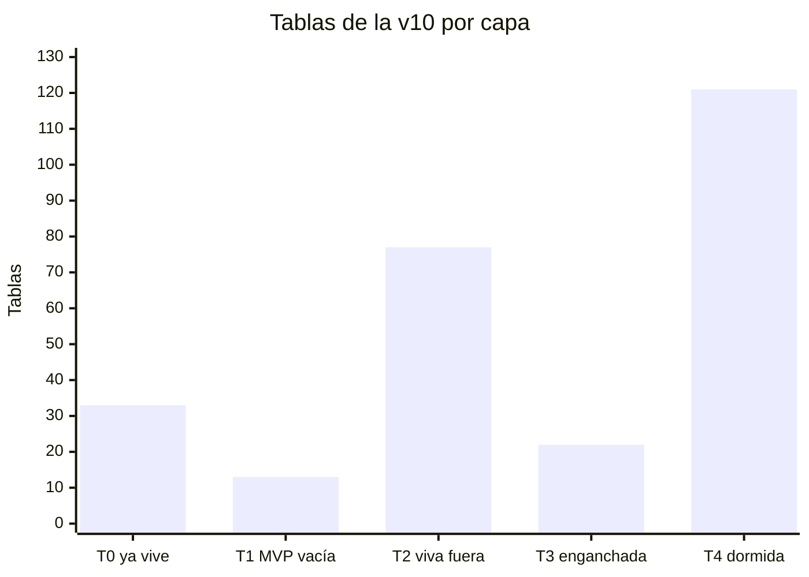
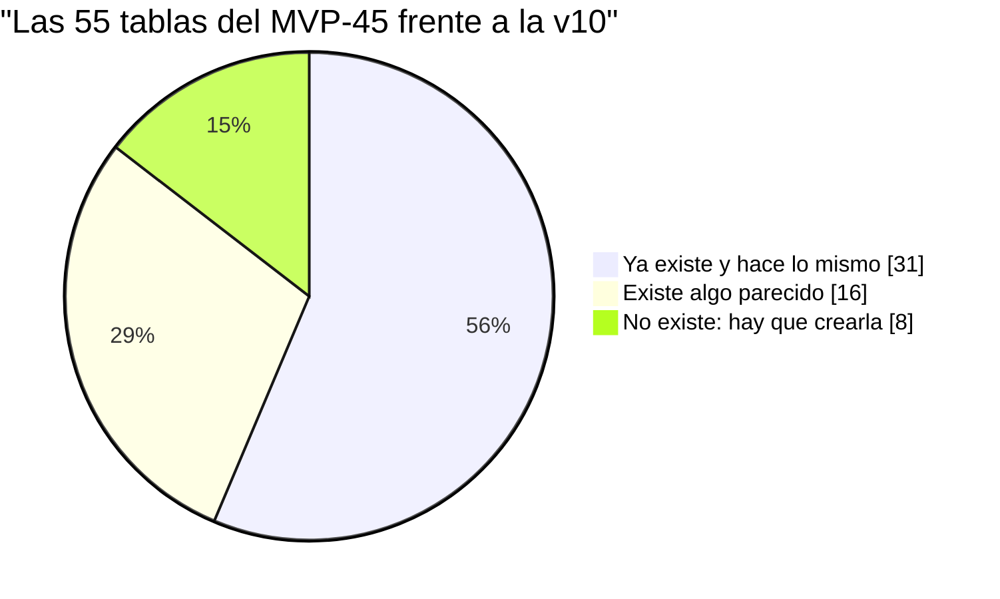
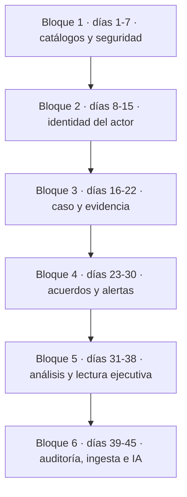

# Qué construir primero — capas de la v10 y puente con el MVP-45

**Para qué sirve este documento.** La v10 tiene 266 tablas; el MVP-45 pide 55 objetos para 45 días, que hoy se cumplen con 46 tablas existentes (33 con datos y 13 todavía vacías). Este documento dice, con medición sobre la base viva, **qué parte de la v10 ya está en pie, qué parte hay que crear primero y qué parte puede esperar**. No reemplaza al `mvp.md` ni al `AVISA_PRODUCE_v10.md`: los ordena en el tiempo.

> **Nota de medición.** Las cifras de capas salen de `mvp_prioridad_tablas.csv` regenerado el **2026-11-20**, con los parches 18 a 23 ya aplicados. Las dos tablas que trajo el parche 18 entran por la regla del clasificador, no por la lista del contrato MVP-45: `config.servicio_externo` (8 columnas, 4 filas) cae en **T2** porque el contrato no la nombra, y `config.tope_gasto` (11 columnas, 0 filas) en **T4**. El ERS las exige por RNF-13, así que en la práctica se programan junto con T0 y T1. El **parche 23** creó `core.alerta_destinatario`, que es la tabla exacta que el contrato del MVP pedía como `alerta_destinatario`: antes se aproximaba a `core.alertas_actores`, que relaciona la alerta con los actores del conflicto y no con quien recibe el aviso. La correspondencia del puente (§7) ya la apunta a la tabla nueva y por eso `core.alertas_actores` pasa a **T2**. Las migraciones de alineación `migration/12` a `migration/19` se aplicaron después, el **2026-11-22** —la 13 incluida—: no añaden tablas, pero reescriben el contenido de varios catálogos, así que las cifras de filas de los catálogos de §3 siguen siendo las de la medición del 2026-11-20 y no se reescriben aquí.

**Cómo se lee.** Cinco capas, de la que ya funciona a la que duerme. Después, el puente entre los nombres del MVP y los de la v10. Al final, el orden de construcción del backend, bloque por bloque.

---

## 1. Las cinco capas

Cada tabla de la v10 cae en una sola capa. La regla es simple: **primero lo que el MVP pide y ya tiene datos; al final lo que no toca nada**.



| Capa   | Qué significa                                        | Tablas |  Columnas |      Filas |
| ------ | ---------------------------------------------------- | -----: | --------: | ---------: |
| **T0** | El MVP la exige y ya tiene datos o cargador          |     33 |       367 |  **8 220** |
| **T1** | El MVP la exige y todavía está vacía                 |     13 |       110 |          0 |
| **T2** | No la pide el MVP, pero está viva (datos o cargador) |     77 |       544 |  **5 135** |
| **T3** | Vacía, pero algo vivo la usa (una FK, un disparador) |     22 |       226 |          0 |
| **T4** | Vacía y sin nada vivo que la toque                   |    121 |       914 |          0 |
| Total  |                                                      |    266 | **2 161** | **13 355** |

Las 13 355 filas se reparten solo entre T0 y T2. **La mitad baja del modelo está vacía hoy**: 143 tablas (T3 + T4) no tienen una sola fila.

---

## 2. Cómo se midió

Cinco señales por tabla, todas verificables:

| Señal            | Qué pregunta                                         | Fuente                                                                                                                      |
| ---------------- | ---------------------------------------------------- | --------------------------------------------------------------------------------------------------------------------------- |
| **Filas**        | ¿tiene datos hoy?                                    | `count(*)` real, tabla por tabla                                                                                            |
| **Cargador**     | ¿alguna fase del cargador de legado escribe en ella? | `migration/loader/*.py`                                                                                                     |
| **Dependencia**  | ¿cuántas tablas **vivas** la referencian?            | claves foráneas del catálogo                                                                                                |
| **Consumidores** | ¿el código de la aplicación la nombra?               | `app/`, `components/`, `lib/`, `frontend/`, `backend/`; desde el 2026-11-22 también `angular/`, que es la versión que queda |
| **Contrato**     | ¿el MVP-45 la exige?                                 | `mvp.md` §2.4 y §2.5                                                                                                        |

Dos advertencias para no sobreinterpretar:

- **Los consumidores casi no aportan todavía.** El código de la aplicación es un esqueleto: el backend tiene 147 líneas y la UI Next —congelada como referencia de diseño— 48; la versión que queda es la SPA Angular (`angular/`). Ninguna tabla tiene consumo real, así que esa señal vale cero hoy y valdrá mucho dentro de tres semanas.
- **El DDL no es un consumidor.** Al medir por primera vez aparecieron 115 tablas "usadas por el código"; todas eran falsos positivos: el escáner estaba leyendo el archivo `PRODUCE_OAIPCS_AVISA_v9_ddl(1).sql`, que **define** las tablas, no las consulta.

**Qué entra en la cuenta.** El universo son las relaciones de tipo tabla (`relkind` `r` y `p`), con cada tabla particionada contada **una vez** —sus 24 particiones hijas quedan fuera— y sin vistas, vistas materializadas ni catálogos del sistema. Se excluyen además `legacy` (87 tablas: la copia en bruto del libro, fase 0 del cargador) y `public.spatial_ref_sys`, que no forman parte del modelo. De 354 tablas contadas así sobran 88: el modelo son **266**.

---

## 3. Capa T0 — lo que ya vive (33 tablas)

Es el punto de partida real. Todo esto ya tiene filas en la base y ya es parte del MVP.

| Tabla                           | Filas | La referencian | Columnas |
| ------------------------------- | ----: | -------------: | -------: |
| `core.usuarios`                 |    32 |             89 |       13 |
| `core.cat_clasificacion`        |     3 |             63 |        2 |
| `core.casos`                    |    35 |             47 |       40 |
| `core.actores`                  | 1 160 |             37 |       31 |
| `core.distritos`                |   698 |             18 |        4 |
| `kag.documento_fuente`          |    10 |             12 |       10 |
| `core.alertas_tempranas`        |    83 |              7 |       37 |
| `core.compromisos`              |     8 |              5 |       25 |
| `kag.aristas`                   |   450 |              3 |       17 |
| `core.caso_cronologia`          |    80 |              2 |       20 |
| `core.cat_estados_caso`         |     4 |              2 |        3 |
| `core.cat_estados_hito`         |     5 |              2 |        3 |
| `core.cat_niveles_conflicto`    |     4 |              2 |        4 |
| `core.cat_niveles_riesgo`       |     3 |              2 |        3 |
| `ref.base_legal_tratamiento`    |     5 |              2 |       12 |
| `core.cat_estados_compromiso`   |     5 |              1 |        4 |
| `core.cat_prioridades_alerta`   |     4 |              1 |        4 |
| `core.cat_tipos_actor`          |     7 |              1 |        3 |
| `core.cat_tipos_hecho`          |     9 |              1 |        2 |
| `core.hitos_compromiso`         |    12 |              1 |       12 |
| `core.roles`                    |    10 |              1 |        6 |
| `core.cat_nivel_identificacion` |     5 |              1 |        3 |
| `core.banco_datos_tratamiento`  |     1 |              1 |       18 |
| `audit.datos_personales_acceso` | 3 088 |              0 |        8 |
| `core.actor_datos_personales`   |   847 |              0 |       17 |
| `core.actor_membresia`          |   292 |              0 |        6 |
| `core.caso_estado_historial`    |    35 |              0 |       11 |
| `core.casos_actores`            |    60 |              0 |        4 |
| `core.cronologia_vinculos`      |     5 |              0 |        3 |
| `core.log_accesos`              |   857 |              0 |        9 |
| `core.organizaciones`           |   224 |              0 |       21 |
| `core.usuario_roles`            |    36 |              0 |        4 |
| `core.actor_alias`              |   143 |              0 |        8 |

**Qué dice la columna «la referencian».** Si es alta, esa tabla hay que crearla antes que las demás: `core.usuarios` (85) y `core.cat_clasificacion` (63) son la base de todo. Si es cero, no significa que sobre: `core.actor_datos_personales` (847 filas) no la referencia ninguna clave foránea, pero es donde vive el DNI cifrado.

Dos sorpresas útiles:

- **`kag` no es futuro.** `kag.aristas` tiene 450 filas y `kag.documento_fuente` 10: el grafo ya empezó a escribirse con el cargador. No es una capa diferida, es parte del presente.
- **`audit.datos_personales_acceso` (3 088 filas) es la tabla más movida de todo el modelo.** Es el registro de quién miró qué dato sensible.

---

## 4. Capa T1 — lo que el MVP pide y aún no tiene datos (13 tablas)

| Tabla                           | Columnas |
| ------------------------------- | -------: |
| `agent.run_log`                 |       13 |
| `core.alerta_destinatario`      |       11 |
| `core.compromiso_colaboradores` |        2 |
| `core.consulta_reniec`          |       10 |
| `core.output_contracts`         |       12 |
| `core.permiso_aprobacion`       |        6 |
| `core.reunion_participantes`    |        5 |
| `ind.resultado`                 |       16 |
| `kag.documento_fragmento`       |        9 |
| `kag.entity_merge_log`          |        7 |
| `policy.escenario_regla`        |        2 |
| `qda.mapeo_pseudonimo`          |        4 |
| `staging.lote`                  |       13 |

Son 110 columnas vacías que el MVP ya usa en su diseño. Se crean con su bloque (ver §8), no antes: una tabla vacía sin endpoint solo ocupa espacio.

---

## 5. Capa T2 — lo vivo que el MVP no pidió (77 tablas)

77 tablas con 5 135 filas que **no están en las 55 del contrato del MVP** pero ya tienen datos. No se tocan: se heredan.

| Esquema      | Tablas T2 | Qué es                                  |
| ------------ | --------: | --------------------------------------- |
| `core`       |        50 | catálogos, geografía y soporte del caso |
| `config`     |         7 | parámetros y guardrails                 |
| `kag`        |         6 | resto del grafo                         |
| `domain`     |         3 | reglas de negocio                       |
| `agent`      |         2 | bitácora de corridas                    |
| `analisis`   |         2 | planes de análisis                      |
| `ctx`        |         2 | captura de contexto                     |
| `policy`     |         2 | escenarios de política                  |
| `ind`        |         1 | indicadores                             |
| `model`      |         1 | ficha de modelo                         |
| `territorio` |         1 | catálogo de tipos de lugar              |

**Por qué importa.** El MVP se construye **sobre** estas tablas, no en paralelo. Si alguien "limpia" la base para dejar solo las 55 del contrato, borra 5 135 filas de historia.

---

## 6. Capa T3 y T4 — lo que espera

**T3 (22 tablas, 226 columnas):** vacías, pero enganchadas. 20 de las 22 llevan un disparador; 3 las referencia una tabla viva (`policy.gobierno`, `policy.titular`, `core.reuniones_dialogo`). **Ninguna se recorta**: están cableadas al modelo.

**T4 (121 tablas, 914 columnas):** vacías y sin nada vivo que las toque. Se agrupan en 51 islas: 9 islas de más de una tabla y 42 tablas sueltas. Las mayores:

| Isla | Integrantes                                                | Esquemas                                                                              |
| ---- | ---------------------------------------------------------- | ------------------------------------------------------------------------------------- |
| 37   | conversación, ingesta cruda, territorio, encuestas         | `chat`, `avisa`, `territorio`, `ctx`, `pesca`, `policy`, `community`, `core`, `agent` |
| 20   | sesiones de agente, planes de análisis, corpus léxico, QDA | `agent`, `analisis`, `lex`, `qda`                                                     |
| 6    | herramientas de captura, indicadores y vacíos del grafo    | `ctx`, `ind`, `kag`                                                                   |
| 4    | procesos de consulta                                       | `consultation`                                                                        |
| 3    | predicciones y deriva de modelos                           | `forecast`                                                                            |
| 3    | perfiles de actor y vectores                               | `kag`                                                                                 |
| 2    | acciones y planes de acción                                | `core`                                                                                |
| 2    | hipótesis y su evidencia                                   | `kag`                                                                                 |
| 2    | lecciones y retroalimentación del agente                   | `agent`                                                                               |
| 42   | una tabla cada una                                         | todos                                                                                 |

**Decisión recomendada: no borrar nada, no construir nada.** La v10 es el producto completo y estas islas son su alcance de año 2. Lo que sí conviene es **sacarlas del camino crítico**: que ningún entregable del MVP dependa de ellas.

> **Lo que la isla de 37 revela.** Está unida por una clave foránea curiosa: `chat.repositorio.territorio_lugar_id → territorio.lugares`. Un repositorio de conversación apuntando a un lugar pesquero es herencia del bloque de columnas de gobierno que se aplicó de forma desigual ( `nivel_clasificacion` está en 53 tablas, `caso_id` en 35, `created_at` en 46, pero `sujeto_actor_uid` solo en 2 ). No rompe nada; sí conviene revisarlo antes de que alguien lo interprete como diseño intencional.

---

## 7. El puente: 55 objetos del MVP contra 266 tablas de la v10

La correspondencia no se inventó aquí: sigue el **Anexo D.2** de `AVISA_PRODUCE_v10.md`. Al contrastarla con la base viva aparece el dato que ordena todo el trabajo. De los 55 objetos que pide el contrato, 47 se apoyan hoy en una tabla existente —46 tablas distintas, porque `policy.escenario_regla` cubre dos objetos: la regla exacta y la simulación parcial—: 33 tablas con datos y 13 vacías. Los otros 8 son piezas que todavía hay que crear. Cuando el alcance se recorta antes de migrar a SQL Server, quedan **45**: se difiere solo `kag.aristas`, porque el grafo de la red de actores es de 2027 y nada en diciembre lo consume. Las otras tres tablas de `kag` —`documento_fuente`, `documento_fragmento` y `entity_merge_log`— sí entran: son el corpus segmentado y el registro de fusiones sobre el que se apoya la base legal, y el procesamiento de documentos ya es de diciembre.



**30 exactas.** El MVP puede usar la tabla tal cual (por ejemplo `core.actores`, `core.casos`, `core.actor_datos_personales`, los nueve catálogos, `core.usuarios`, `core.roles`, `core.usuario_roles`, `audit.datos_personales_acceso`). Las últimas en sumarse son `core.cat_nivel_identificacion` y `ref.base_legal_tratamiento`, del parche 14, y `core.banco_datos_tratamiento`, del parche 16.

**17 parciales.** Existe algo que cubre parte, o con otro nombre de esquema. Los cuatro que más van a doler:

| MVP                        | Hoy en v10                   | Qué falta                                        |
| -------------------------- | ---------------------------- | ------------------------------------------------ |
| `core.hecho`               | `core.caso_cronologia`       | el hecho como entidad con tipo propio            |
| `core.cita`                | `kag.documento_fragmento`    | `offset_inicio` y `offset_fin` para citar exacto |
| `core.padron_asistencia`   | `core.reunion_participantes` | el padrón de una asamblea, no solo de reunión    |
| `core.alerta_destinatario` | `core.alertas_actores`       | el destinatario externo (no solo el actor)       |

**8 a crear.** Estas no existen en ninguna forma y **bloquean entregables**:

| Objeto del MVP              | Por qué existe en el MVP                                           |
| --------------------------- | ------------------------------------------------------------------ |
| `core.alerta_fuente`        | vínculo alerta → fuente que la disparó                             |
| `core.actor_consentimiento` | consentimiento por finalidad (§2.3.bis)                            |
| `analisis.caso_analogo`     | `forecast.whatif_scenarios`, prevista y no creada                  |
| `analisis.calidad_fuente`   | indicador de calidad de la información (vacíos, sesgos, caducidad) |
| `seg.usuario_actor_externo` | qué usuario externo ve qué actor (perfil C)                        |
| `seg.usuario_caso`          | qué usuario ve qué caso                                            |
| `audit.exportacion`         | cada salida del perímetro, con hash                                |
| `audit.incidente_seguridad` | reloj de las 48 horas ante incidentes                              |

`core.banco_datos_tratamiento` salió de esta lista: la creó el parche 16 con el banco `BD-GSCS` en estado `pendiente`. El trámite ante la ANPDP sigue siendo externo al sistema, así que DC-04 queda registrado, no cumplido.

Cinco de las ocho son de cumplimiento o de seguridad, no de funcionalidad. Es decir: **si el MVP se construye solo con lo que ya existe, no cumple la ley.**

---

## 8. Orden de construcción del backend

Seis bloques. Cada uno termina en algo demostrable y no abre el siguiente hasta cerrar su criterio.

**Sobre el plazo.** Los 45 días son el calendario del MVP-45 (`mvp.md`). El ERS toma ese documento como **fuente de funciones y reglas, no como plan de trabajo** (C-02), y fija el compromiso de diciembre en **20 días** con unos cuatro desarrolladores (RES-09, C-13). Este orden de bloques sirve para decidir **qué se construye primero** y con qué criterio se cierra cada parte; no es una promesa de 45 días.



### Bloque 1 — Catálogos y seguridad (días 1–7)

**Ya existe (T0):** `core.cat_clasificacion`, `core.cat_niveles_conflicto`, `core.cat_niveles_riesgo`, `core.cat_estados_caso`, `core.cat_estados_compromiso`, `core.cat_estados_hito`, `core.cat_prioridades_alerta`, `core.cat_tipos_actor`, `core.cat_tipos_hecho`, `core.cat_nivel_identificacion`, `ref.base_legal_tratamiento`, `core.usuarios`, `core.roles`, `core.usuario_roles`, `core.log_accesos`, `core.banco_datos_tratamiento`, `audit.datos_personales_acceso`. Los dos objetos del MVP que piden nivel de identificación y base legal ya tienen dónde apoyarse: `core.cat_nivel_identificacion` y `ref.base_legal_tratamiento`, cinco filas cada uno.

**Crear:** `seg.usuario_actor_externo`, `seg.usuario_caso`. Son las dos únicas piezas de este bloque que todavía no existen.

**Relaciones primero:** las 63 claves foráneas que apuntan a `core.cat_clasificacion` y las 85 que apuntan a `core.usuarios`. Son las que hacen que todo lo demás pueda existir.

**Cierra cuando:** dos perfiles distintos consultan la misma tabla y ven cosas distintas (RLS probado), y cada catálogo tiene sus filas semilla. El esquema ya cumple su parte: los parches 16, 18 y 20 dejaron `core` con 49 de 102 tablas con RLS (eran 12) y 319 políticas; hoy son **52 de 103** y **331 políticas**.

### Bloque 2 — Identidad del actor (días 8–15)

**Ya existe (T0):** `core.actores` (1 160), `core.actor_datos_personales` (847), `core.organizaciones` (224), `core.actor_membresia` (292), `core.actor_alias` (143), `kag.aristas` (450).

**Ya existe (T2):** `kag.actor_name_history` (1 160). Guarda el historial de nombres, pero queda fuera del contrato del MVP.

**Ya existe vacío (T1):** `core.consulta_reniec` (10 columnas y 4 disparadores ya instalados), `kag.entity_merge_log` (donde la fusión queda auditada, con `justificacion` y `reversible`) y `qda.mapeo_pseudonimo` (el token que enlaza con `actor_uid` en el corpus QDA).

**Crear:** `core.actor_consentimiento`. Los alias ya tienen tabla propia con datos.

**Endpoints:** `GET/POST/PATCH /actores`, `POST /actores/{id}/promover`, `POST /actores/fusionar`.

**Cierra cuando:** un actor sin DNI se registra, se promueve de nivel y se fusiona con otro **sin perder historial** — que es la brecha A1 del Anexo D.3. El historial de nombres ya está cargado en `kag.actor_name_history`; el MVP no lo migra, así que la fusión debe conservarlo en la v10.

### Bloque 3 — Caso y evidencia (días 16–22)

**Ya existe (T0):** `core.casos` (35), `core.casos_actores` (60), `core.caso_cronologia` (80), `core.cronologia_vinculos` (5), `core.caso_estado_historial` (35), `kag.documento_fuente` (10).

**Ya existe también (T0):** `core.distritos` (698), que cubre el objeto de ubigeo del MVP.

**Ya existe (T2):** `core.documentos` (153), con datos pero fuera del contrato.

**Ya existe vacío (T1):** `kag.documento_fragmento` (`inicio_char`, `fin_char`, `pagina_o_minuto`): es el soporte del parcial `core.cita`; sin él la cronología no puede citar con precisión.

**Crear:** `core.alerta_fuente` (se usa en el bloque 4, se define aquí).

**Endpoints:** `GET /casos`, `GET /casos/{id}/hechos`, `GET /casos/{id}/red`.

**Cierra cuando:** la ficha de un caso muestra su línea de tiempo con fuente por hecho, y nadie puede leer una fila de un caso que no le corresponde.

### Bloque 4 — Acuerdos y alertas (días 23–30)

**Ya existe (T0):** `core.compromisos` (8), `core.hitos_compromiso` (12), `core.alertas_tempranas` (83), `core.alertas_actores` (161).

**Ya existe (T2):** `core.envios_comunicacion` (17).

**Ya existe vacío (T1):** `core.compromiso_colaboradores`, `core.reunion_participantes`, `core.permiso_aprobacion`.

**Endpoints:** `POST /ingesta/alertas`, `POST /alertas/{id}/aprobar`, `POST /alertas/{id}/descartar`.

**Cierra cuando:** una alerta nace como candidata, un humano la aprueba o la descarta con motivo, y el compromiso queda con su hito y su responsable.

### Bloque 5 — Análisis y lectura ejecutiva (días 31–38)

**Ya existe vacío (T1):** `policy.escenario_regla`, `core.output_contracts`.

**Vacías y sin uso (T4):** `core.riesgo_social_ordinal` (K1 y K5) y `policy.snapshot`. Aquí el trabajo no es crear tablas: es poblarlas desde cero y probar que el simulador devuelve algo.

**Ya existe vacío (T1):** `ind.resultado` (16 columnas: `variante_id`, `distrito_id`, `periodo`, `valor`, `incertidumbre`): es donde aterriza el cálculo, por variante, distrito y periodo.

**Crear:** `analisis.caso_analogo` y `analisis.calidad_fuente`.

**Endpoints:** `POST /simulaciones`, `GET /casos/{id}/analogos`, `GET /ejecutivo/kpis`, `POST /informes/generar`.

**Cierra cuando:** el informe OE1–OE3 sale con cada afirmación enlazada a una cita verificable, y el tablero del Ministro carga en menos de dos minutos de lectura.

### Bloque 6 — Auditoría, ingesta e IA (días 39–45)

**Ya existe vacío (T1):** `agent.run_log`, `staging.lote`.

**Crear:** `audit.exportacion`, `audit.incidente_seguridad`.

**Cierra cuando:** toda exportación deja hash y destinatario, y un incidente abre el reloj de 48 horas con sus dos notificaciones.

---

## 9. Lo que no se construye ahora

- **15 tablas de `territorio`**, 12 de `chat`, 16 de `kag`, 11 de `lex`, 6 de `qda`, 8 de `agent`, 5 de `impact`, 4 de `consultation`, 3 de `forecast`, 3 de `economic`. Todas en T4: vacías y sin consumidor.
- **Los dos planes de acción.** `core.plan_acciones` (9 columnas) y `core.planes_accion` (4 columnas) coexisten, ambas vacías, con nombres casi idénticos y contenidos distintos: una describe acciones de un plan, la otra un documento presupuestal. Antes de construir cualquiera, conviene decidir cuál sobrevive.
- **La analítica de largo plazo** (`forecast`, `economic`, `impact`). Es el año 2.

---

## 10. Cómo se reproduce

```
python migration/prioridad_mvp.py
```

Lee la base, escribe `docs/03_ejecucion/mvp_prioridad_tablas.csv` (una fila por tabla, con capa y causa) e imprime el resumen. **Solo lee**: no crea, no borra, no comenta.

Si se añade una tabla a la v10 o se cambia el contrato del MVP, se edita el diccionario `MVP` del script y se vuelve a ejecutar. Las cifras de este documento salen de esa ejecución, no de una estimación. La corrida corresponde a la medición del **2026-11-20** e incluye los parches 14 a 23: `core.banco_datos_tratamiento` ya existe con una fila, y `core` tiene 52 de sus 103 tablas con RLS y 331 políticas. Los parches 20, 21 y 22 no mueven el número de tablas; el 23 llega a **266** lógicas y **55** objetos de contrato: el 20 sólo añade filas de catálogo y 4 políticas de RLS, el 21 dos columnas de aprobación, una cuenta de rol y 8 políticas, y el 22 una columna (`visibilidad`), su `CHECK`, un índice parcial, un trigger, una función y una vista, sin política nueva. Las cifras de arriba ya los incluyen.

**Este documento no se regenera.** `migration/prioridad_mvp.py` sólo escribe `docs/03_ejecucion/mvp_prioridad_tablas.csv` y el resumen por consola; el `.md` se edita a mano a partir de esas dos salidas. Volver a ejecutar el script refresca la medición, no el texto.

**Los bloques también viven en SQL.** `docs/AVISA_V10_PRIORIZACION.sql` materializa esta
medición y este cuadro en un esquema propio (`priorizacion`), de manera que la asignación de
cada tabla a su bloque sea una consulta y no una lectura. Carga `docs/03_ejecucion/mvp_prioridad_tablas.csv`,
crea las cinco capas, los seis bloques y las 51 tablas con bloque (46 del contrato y 5
heredadas), y termina verificando 266 tablas, 2 161 columnas y 13 355 filas, y que ninguna
tabla T0 quede sin bloque (si faltara una T1, el script lo avisa sin abortar). Se ejecuta a mano y es idempotente:

```
docker cp docs/03_ejecucion/mvp_prioridad_tablas.csv avisa-db:/tmp/docs/03_ejecucion/
docker cp docs/AVISA_V10_PRIORIZACION.sql avisa-db:/tmp/
docker exec -i -w /tmp avisa-db psql -U avisa -d avisa \
    -v ON_ERROR_STOP=1 -f /tmp/AVISA_V10_PRIORIZACION.sql
```

La segunda ruta del `docker cp` tiene que conservar `docs/03_ejecucion/`: el `\copy` del script lee
esa ruta relativa a la carpeta desde la que corre `psql` (`-w /tmp`), no la del propio archivo.

No toca nada fuera de `priorizacion` y no lleva ningún `DROP` ni `TRUNCATE`: reemplaza su tabla de
medición desde el CSV y sus semillas, y se puede repetir sin consecuencias. Si una versión anterior
dejó tablas con otra forma, borrar el esquema es una decisión humana (`DROP SCHEMA priorizacion
CASCADE`), no algo que el archivo haga solo. Tampoco se aplica por
defecto: es un **artefacto de consulta**, no una capa del sistema. No lo monta `compose.yaml` ni
lo ejecuta el `initdb`, y por eso no aparece en `docs/05_datos/DICCIONARIO_DATOS.md`, que se genera desde la
base viva.

---

## 11. Referencias

1. `docs/02_arquitectura/AVISA_PRODUCE_v10.md` — arquitectura objetivo; **Anexo D.2** (correspondencia de nombres MVP → v10) y **Anexo D.3** (brechas A1–R4).
2. `docs/03_ejecucion/mvp.md` — contrato del MVP-45: §2.4 y §2.5 (las 55 tablas), §3.5 (endpoints), §6 (plan día por día).
3. `docs/05_datos/LEGADO_A_V10_SIMILITUDES_Y_DIFERENCIAS.md` — puente sistema anterior ↔ v10, con la estadística en §11 y los componentes en §12.
4. `docs/05_datos/DICCIONARIO_DATOS.md` — significado de cada tabla y columna; versión máquina en `docs/05_datos/diccionario_datos.csv`.
5. `docs/03_ejecucion/mvp_prioridad_tablas.csv` — la medición completa, una fila por tabla.
6. `docs/AVISA_V10_PRIORIZACION.sql` — la misma priorización en SQL: medición, seis bloques, asignación de tablas a bloque y verificación, en un esquema propio (`priorizacion`).
7. `migration/prioridad_mvp.py` — el medidor.
8. `migration/loader/phases/` — las 14 fases del cargador de legado.
9. Ley N.° 29733 y su Reglamento (D.S. N.° 003-2013-JUS) — medidas de seguridad de nivel alto, bancos de datos y Oficial de Datos Personales.
10. D.U. N.° 007-2020 y D.S. N.° 029-2021-PCM — Marco de Confianza Digital y notificación de incidentes en 48 horas.
11. R.M. N.° 00207-2026-PRODUCE — Guía para la Prevención y Gestión de Conflictos Sociales del Sector Producción; triangulación y Marco Situacional.
12. D.S. N.° 115-2025-PCM — Reglamento de la Ley de Inteligencia Artificial; prohibición de perfilamiento y supervisión humana.
