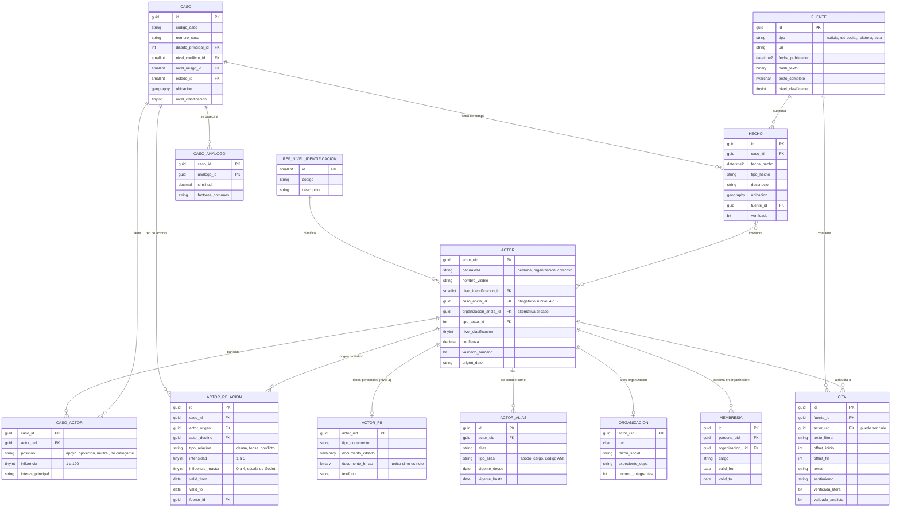
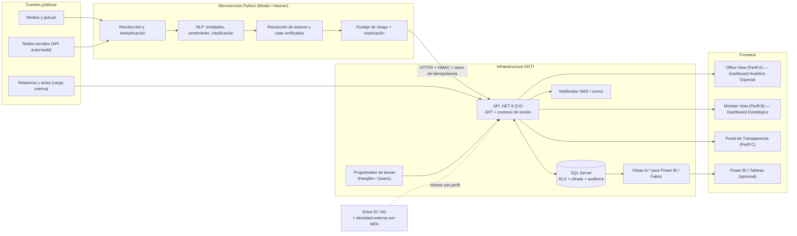
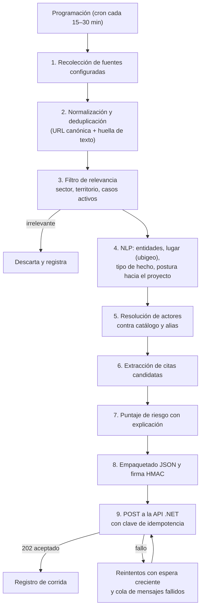

# AVISA-PRODUCE MVP-45

## Plataforma de inteligencia estratégica para la prevención de conflictos sociales

### Reescritura del TDR y Arquitectura Funcional del MVP de 45 días

|                     |                                                                                                                                                                                                                    |
| ------------------- | ------------------------------------------------------------------------------------------------------------------------------------------------------------------------------------------------------------------ |
| **Dirigido a**      | OAIPCS (Dirección) y OGTI — Ministerio de la Producción                                                                                                                                                            |
| **Elaborado por**   | Arquitecto Funcional (puente OAIPCS ↔ OGTI)                                                                                                                                                                        |
| **Fecha**           | 12 de noviembre de 2026                                                                                                                                                                                            |
| **Base documental** | `AVISA_PRODUCE_v10.md` (v9 + puente de ejecución MVP-45; arquitectura 2027–2031 con el perfil de despliegue SQL Server) y TDR Anexo B (servicio de base de datos de conflictividad y sistema de alertas tempranas) |
| **Estado**          | Borrador técnico para validación de la Dirección y de OGTI                                                                                                                                                         |

---

## ÍNDICE

0. Resumen ejecutivo y reglas de aterrizaje (incluye el glosario de lenguaje claro, §0.6)
1. Re-definición del TDR (§7.1, §7.5, §7.9, §11 y §12)
2. Modelo de datos lógico (DER para SQL Server) y solución al problema del DNI; §2.6 remite al orden de construcción (`PRIORIZACION_MVP_v10.md`)
3. Arquitectura de software, seguridad por perfil y automatización
4. Especificación del dashboard interactivo (KPIs; Office View = Dashboard Analítico Especial, Minister View = Dashboard Estratégico; simulador What-If; mapa MACTOR)
5. Estrategia de ingesta de IA (Python → API .NET, fuentes y etapas de procesamiento)
6. Plan de trabajo de 45 días, día por día
7. Riesgos, decisiones pendientes y criterios de éxito

---

# 0. RESUMEN EJECUTIVO Y REGLAS DE ATERRIZAJE

## 0.1 Tesis

La Oficina no necesita "un sistema de alertas": necesita **una capacidad institucional de anticipar, explicar y decidir** sobre conflictos sociales en el sector producción. El MVP-45 la materializa en tres movimientos:

1. **Un solo núcleo de verdad** (SQL Server) donde actores —identificados o no—, casos, hechos, compromisos y evidencias conviven con trazabilidad de fuente.
2. **Tres vistas del mismo núcleo** (Analista, Alta Dirección, Actor externo), separadas por **seguridad por fila (RLS)** —la base decide qué filas ve cada usuario—, no por copias de datos.
3. **Un método de análisis incorporado** (OE1 → OE2 → OE3) que replica el estándar de consultoría del caso SANIPES Sechura: caracterización de actores, evaluación de riesgos y condiciones de diálogo, y escenarios de intervención.

La IA acelera la recolección y la redacción; **no decide ni publica**. Toda alerta, cita o borrador generado por IA pasa por revisión humana antes de llegar a la Alta Dirección o a un actor externo.

**Cómo se relacionan este MVP y la guía v10.** v10 es la arquitectura completa; este MVP es lo que se construye en 45 días. Cuando una regla aparece en los dos, **manda v10** y el MVP la resume con su referencia `[v10 §…]`. El mapa completo de referencias está en `[v10 Anexo D.1]`, la correspondencia de nombres de tabla en `[v10 Anexo D.2]` y las decisiones D22–D29 en `[v10 §18.ter]`.

## 0.2 Del v9 al MVP-45: qué se hereda y qué se difiere

El v9 es una arquitectura de cinco años (25 schemas, PostgreSQL); la base viva mide **266 tablas lógicas**. El MVP la aterriza sin traicionarla: se conserva el **modelo conceptual** y se difiere la **sofisticación**.

| Componente v9                                                                                    | Decisión MVP-45                                                                                                                                                                                      | Justificación                                                                                                                                                                                                                                                                        | Referencia v10                                                                                     |
| ------------------------------------------------------------------------------------------------ | ---------------------------------------------------------------------------------------------------------------------------------------------------------------------------------------------------- | ------------------------------------------------------------------------------------------------------------------------------------------------------------------------------------------------------------------------------------------------------------------------------------ | -------------------------------------------------------------------------------------------------- |
| Motor de datos PostgreSQL 16 + PostGIS + pgvector                                                | **SQL Server** (stack OGTI); `geography` nativo; embeddings fuera de la BD (servicio Python)                                                                                                         | Restricción de plataforma de OGTI                                                                                                                                                                                                                                                    | `[v10 §3.17.2.v10]`                                                                                |
| 266 tablas lógicas / 25 schemas                                                                  | **55 objetos del contrato** sobre **46 tablas reales** —33 con datos y 13 vacías—, **8 por crear** y **45** si se difiere `kag.aristas`; 6 schemas (`core`, `analisis`, `ia`, `seg`, `ref`, `audit`) | De las 266, el MVP exige **46** (T0 33 + T1 13); lo mínimo que sostiene OE1–OE3, MACTOR, simulador y alertas                                                                                                                                                                         | `[v10 Anexo D.2]` (los schemas `seg`, `ia`, `audit`, `ref` se absorben en los de v9: decisión D22) |
| Capa KAG bitemporal (grafo con tiempo válido/transaccional)                                      | **Diferida.** Se conserva `valid_from/valid_to` en relaciones y membresías                                                                                                                           | No cabe en 45 días; el valor inmediato está en la matriz de actores                                                                                                                                                                                                                  | `[v10 §0.7.1]`                                                                                     |
| RAG-MACTOR y RAG-Territorio multinivel                                                           | **Reducido** a búsqueda de casos análogos + extracción de citas con verificación textual                                                                                                             | Cubre el estándar SANIPES sin infraestructura RAG completa                                                                                                                                                                                                                           | `[v10 §0.7.1]`, `[v10 §13.5.v10]` (casos análogos)                                                 |
| Tres agentes (A1, A2, A3) + Guardrails G1–G18                                                    | **Un pipeline de ingesta + un Agente Sintetizador** + los guardrails G19–G22 (§3.4)                                                                                                                  | Reducción de superficie de riesgo                                                                                                                                                                                                                                                    | `[v10 §9.2.v10]`, `[v10 §16.1.quater]` (G19–G22)                                                   |
| What-if determinístico (M5a)                                                                     | **Se adelanta como M5a-lite** (v9 lo sitúa en el año 2). Se mantienen el rótulo «ESCENARIO — no vigente» y la prueba T42. Declarado en `[v10 §0.7.1]`                                                | Es explicable y auditable; no exige datos históricos para entrenar                                                                                                                                                                                                                   | `[v10 §13.5.v10]`                                                                                  |
| Protocolo SGSD/SSGC, estados de compromiso, niveles de conflicto y riesgo (catálogos de la Guía) | **Se conserva** íntegro: los catálogos viven en **`core.cat_*`** (34 tablas) y `ref` queda como **fachada normativa**                                                                                | Alineación normativa con PCM                                                                                                                                                                                                                                                         | `[v10 §1.2]`                                                                                       |
| PII separada (`actor_datos_personales`), pseudonimización                                        | **Se conserva y se extiende** con niveles de identificación (§2.3)                                                                                                                                   | Resuelve el bloqueo por DNI                                                                                                                                                                                                                                                          | `[v10 §3.6.v10]`                                                                                   |
| Minister View (= **Dashboard Estratégico**)                                                      | **Solo los KPIs calculables**: los cinco quedan definidos, pero en diciembre entra únicamente el que tenga datos y validación humana (G14); hoy `analytics.vw_indicadores_minister` devuelve 0 filas | «Completa» en Nivel 2 en v9 (§17.13); el MVP la limita a lo verificable. Publish to Web: 4 usuarios de Alta Dirección; además leen el Analítico con licencia Pro y cada lectura de datos personales se audita; por el canal público, solo agregados y nunca datos personales (RD-08) | `[v10 §0.7.1]`, `[v10 §8.4.ter]`                                                                   |
| Integración SESIGUE                                                                              | **Diferida** (solo contrato de interfaz documentado)                                                                                                                                                 | Dependencia externa no controlable en 45 días                                                                                                                                                                                                                                        | `[v10 §15]`                                                                                        |

**Dónde viven los catálogos (medido contra la base viva).** El esquema `ref` **no** guarda los catálogos de las secretarías: tiene **cuatro objetos** —las tablas `ref.base_legal_evidencia` y `ref.base_legal_tratamiento`, la vista `ref.nivel_identificacion` (sobre `core.cat_nivel_identificacion`) y la vista `ref.vw_base_legal_fuente`—. Los catálogos del Protocolo SGSD/SSGC —niveles de conflicto y de riesgo, niveles y prioridades de alerta, estados de compromiso, tipos de hecho y el resto— están en **`core`**, en **34 tablas `core.cat_*`**, y desde ahí los referencian las claves ajenas de **35 tablas de `core`** —entre ellas `core.actores`, `core.casos` y `core.compromisos`— (86 tablas en todo el modelo). La regla, para quien construye: **`core.cat_*` es el almacén operativo** (donde están las filas y a donde apuntan las FK) y **`ref` es la fachada del vocabulario normativo** (base legal y niveles de identificación del PCM), que expone vistas y tablas pequeñas de referencia. **No se mueve nada:** pasar los catálogos a `ref` rompería las claves ajenas de esas tablas, las vistas que los leen y el contrato de objetos del MVP (§2.4); los nombres `ref.*` de §2.4 son los de la redacción original del MVP y la decisión D22 los resuelve en la pasada de renombrado, no al revés.

## 0.3 Alcance priorizado: ambición completa, entrega garantizada por capas

Un solo profesional en 45 días calendario no puede entregar con la misma profundidad todo lo que la Dirección ha pedido. Por eso el documento mantiene la **ambición completa** pero fija qué queda **garantizado** (lo que condiciona la conformidad) y qué es **meta de mejor esfuerzo**.

| Prioridad                  | Contenido                                                                                                                                                                                                                                                                                                                                                                                                                                                                                      | Condición de conformidad                                                                                                 |
| -------------------------- | ---------------------------------------------------------------------------------------------------------------------------------------------------------------------------------------------------------------------------------------------------------------------------------------------------------------------------------------------------------------------------------------------------------------------------------------------------------------------------------------------- | ------------------------------------------------------------------------------------------------------------------------ |
| **MUST** (garantizado)     | Modelo de datos + actores no identificados; RLS para A/B/C probado; API .NET v1; matriz de actores y relaciones MACTOR (método para medir quién influye sobre quién entre los actores de un caso); ingesta IA con revisión humana; Office View y tablero ejecutivo con los KPIs que resulten calculables (hoy solo `K3_TAA`); mapa de afinidad MACTOR; simulador de escenarios («¿qué pasa si…?») E1–E4; módulo de citas verificadas; 1 informe OE1–OE3 autogenerado + 1 resumen de una página | Sí                                                                                                                       |
| **SHOULD**                 | Mapa GIS interactivo con capas; línea de tiempo con _play/rewind_; casos análogos con re-ranking; remisión por correo de toda alerta aprobada y SMS solo para la crisis                                                                                                                                                                                                                                                                                                                        | Sí, en versión funcional mínima                                                                                          |
| **COULD** (mejor esfuerzo) | Portal Perfil C en producción con gremios reales; integración Power BI/Fabric sobre vistas `bi.*`; proyecciones socioeconómicas avanzadas                                                                                                                                                                                                                                                                                                                                                      | Se entrega **diseñado, en ambiente de pruebas y con guía de despliegue** si OGTI no habilita exposición externa a tiempo |

**Qué se demuestra en cada verificación (y con qué caso de uso y prueba).**

| Día | Entregable / hito                              | Se demuestra                                                               | Caso de uso `[v10 §24.ter]` | Pruebas `[v10 §22.3.ter]` |
| --- | ---------------------------------------------- | -------------------------------------------------------------------------- | --------------------------- | ------------------------- |
| 8   | Verificación intermedia                        | Modelo de datos; actor sin DNI; promoción sin perder historial             | UC-10                       | T91–T96                   |
| 15  | **Entregable 1**                               | Matriz de actores, RLS A/B/C, API v1, carga desde AVISA con reconciliación | UC-12, UC-14                | T97–T99, T105             |
| 21  | Verificación intermedia (el Día 22 es feriado) | Ingesta con IA, bandeja del analista, Office View                          | UC-11                       | T99, T100, T104           |
| 36  | Verificación intermedia                        | Los tres perfiles, KPIs, What-if                                           | UC-11, UC-13                | T101–T104                 |
| 45  | **Entregable 2**                               | Sistema completo con actas de demostración                                 | UC-10 a UC-14               | T91–T105                  |

> **T101 y T102 en este cronograma.** Las filas de los días 36 y 45 las incluyen, pero ninguna de las dos es ejecutable hoy: dependen de que `ind` tenga semilla (§4.1). Hasta entonces se sustituyen por la comprobación de fórmula a mano (IRE 55,5; IPA 61,25). No son un entregable pendiente, son una prueba bloqueada por una decisión que todavía no se tomó.

> **Nota de realismo.** 45 días calendario equivalen a ≈ 31–32 días hábiles. Los feriados de diciembre (8 y 25) reducen aún más la capacidad. El cronograma del §6 ya los considera como días de integración liviana o colchón.

## 0.4 Dependencias críticas de OGTI (con fecha límite)

El éxito del MVP depende de que OGTI entregue lo siguiente. Un retraso aquí es **causa justificada de ampliación de plazo** (TDR §15, penalidad por mora) y conviene dejarlo por escrito en el acta de inicio.

| #   | Dependencia                                                                                                                                                                                    | Fecha límite (día del plazo) | Si no llega                                                                                                        |
| --- | ---------------------------------------------------------------------------------------------------------------------------------------------------------------------------------------------- | ---------------------------- | ------------------------------------------------------------------------------------------------------------------ |
| D-1 | Instancia SQL Server de desarrollo/pruebas (versión ≥ 2019, con RLS y `geography`) y usuario con permisos DDL. Confirmar versión, _Full-Text Search_, SQL Agent y tipo vectorial (`[v10 Q34]`) | Día 2                        | Plan B: SQL Server Developer en equipo del proveedor con VPN para pruebas de integración (solo datos no sensibles) |
| D-2 | VPN y acceso a repositorio Git institucional o autorización de repositorio privado externo                                                                                                     | Día 2                        | Repositorio privado del proveedor; migración al final                                                              |
| D-3 | Host para API .NET (IIS/contenedor) y certificado TLS                                                                                                                                          | Día 10                       | API en entorno de pruebas del proveedor                                                                            |
| D-4 | Proveedor de identidad (Entra ID/AD) con grupos `OAIPCS-Analistas`, `Direccion-Ejecutiva`                                                                                                      | Día 8                        | Autenticación local con JWT firmado, migrable a Entra                                                              |
| D-5 | Pasarela de correo institucional y definición de proveedor SMS                                                                                                                                 | Día 25                       | Solo correo; SMS queda como interfaz simulada                                                                      |
| D-6 | Dictamen de Legal/OGTI sobre envío de **texto público** a proveedores de LLM externos y sobre datos personales (Ley 29733)                                                                     | Día 12                       | La IA opera solo con modelos autoalojados (menor calidad)                                                          |
| D-7 | Validación del catálogo de estados de caso (en el v9 figura "A validar con OAIPCS")                                                                                                            | Día 5                        | Se usa el catálogo del v9 y se registra como supuesto                                                              |
| D-8 | Acceso a la exportación de la matriz actual de AVISA (hojas y columnas) `[v10 Q36, UC-14]`                                                                                                     | Día 3                        | Se trabaja con una muestra anonimizada; la reconciliación del Día 15 se declara parcial                            |
| D-9 | Decisión sobre proveedor de escucha social o API de redes, con costo y cuota `[v10 Q39, §7.5.v10]`                                                                                             | Día 25                       | Las redes quedan como interfaz simulada, **sin recurrir a _scraping_**                                             |

## 0.5 Supuestos sobre los insumos

- No se tuvo acceso al informe de consultoría del **caso SANIPES Sechura**; los componentes pedidos (OE1–OE3, afinidad MACTOR, escenarios E1–E4, citas) se especifican según la descripción de la Dirección. **La matriz E1–E4 del §4.4 y los pesos del IRE son una propuesta de mapeo que debe contrastarse con el informe SANIPES Sechura** `[v10 Q35]` antes del Día 20; hasta entonces el semáforo se rotula «PROVISIONAL».
- El v9 está construido en PostgreSQL. La traducción a SQL Server cambia tipos (`UUID` → `UNIQUEIDENTIFIER`, `JSONB` → `NVARCHAR(MAX)` con `ISJSON`) y el mecanismo de RLS (políticas de seguridad con predicados en funciones en línea).
- **«Tiempo real» se define operativamente como tres tramos medibles** `[v10 §10.2.v10]`: (1) publicación en la fuente → bandeja del analista en ≤ 30 min; (2) cambio aprobado → tablero en ≤ 60 s (consulta automática cada 60 s); (3) crisis confirmada → SMS o correo en ≤ 10 min. La aprobación humana es un paso deliberado y no cuenta como retraso.
- **Proyecciones socioeconómicas** = tendencia del IRE a 30 días + exposición socioeconómica a 30 días (`P1_IPS30`), siempre rotuladas «TENDENCIA / PROXY — no es una predicción» `[v10 §8.4.ter, D29]`.
- **Redes sociales** solo por API oficial o proveedor licenciado, con lista blanca de cuentas públicas `[v10 §7.5.v10, G22]`.
- **AVISA:** se extrae una copia congelada, se carga por _staging_ y se reconcilia; hasta el _cutover_ se carga el delta una vez por semana `[v10 UC-14, D27]`.

## 0.6 Lenguaje claro: cómo se nombra cada cosa la primera vez

Cada término técnico aparece con su nombre completo la primera vez y después solo con su sigla. Glosario completo: `[v10 §19.v10]`.

| Término                 | Primera mención                                                                                                                                                                                            |
| ----------------------- | ---------------------------------------------------------------------------------------------------------------------------------------------------------------------------------------------------------- |
| HITL                    | revisión humana obligatoria (HITL, _human in the loop_)                                                                                                                                                    |
| RLS                     | seguridad por fila (RLS): la base decide qué filas ve cada usuario                                                                                                                                         |
| HMAC                    | huella irreversible del documento (HMAC), que permite detectar duplicados sin mostrar el número                                                                                                            |
| MDI / MIDI              | matriz de influencias directas (MDI) e indirectas (MIDI) entre actores                                                                                                                                     |
| MACTOR                  | método para medir quién influye sobre quién entre los actores de un caso                                                                                                                                   |
| What-if                 | simulador de escenarios («¿qué pasa si…?»)                                                                                                                                                                 |
| SLA                     | plazo máximo de atención según la prioridad de la alerta                                                                                                                                                   |
| NLP                     | procesamiento de lenguaje natural: la máquina lee noticias y extrae quién, dónde y qué                                                                                                                     |
| Idempotencia            | si el mismo mensaje llega dos veces, se procesa una sola vez                                                                                                                                               |
| _Polling_               | consulta automática cada 60 segundos                                                                                                                                                                       |
| IRE, ICC, TAA, IPA, ICD | primera vez con su nombre completo (`[v10 §19.v10]`)                                                                                                                                                       |
| Office View             | **es** el **Dashboard Analítico Especial**: Power BI Pro (11 licencias: 7 de la OAIPCS y 4 de la Alta Dirección, a confirmar: H-78), permite búsqueda por DNI                                              |
| Minister View           | **es** el **Dashboard Estratégico**: Publish to Web, 4 usuarios de Alta Dirección (Ministro, 2 Viceministros y Secretario General), solo agregados en el canal público, **nunca** datos personales (RD-08) |

---

# 1. RE-DEFINICIÓN DEL TDR

## 1.1 Resumen de cambios propuestos

| Numeral                    | Texto vigente                                   | Cambio propuesto                                                                                                  | Motivo                                                        |
| -------------------------- | ----------------------------------------------- | ----------------------------------------------------------------------------------------------------------------- | ------------------------------------------------------------- |
| 7.1 Funciones              | 5 funciones generales                           | 8 funciones que incorporan interoperabilidad multimodal, actores no identificados, método OE1–OE3 y transferencia | Reflejar el pedido de la Dirección                            |
| 7.1 Productos              | Dos entregables descritos en una línea cada uno | Productos con componentes verificables y criterios de aceptación en §12                                           | Evitar ambigüedad en la conformidad (art. 144 del Reglamento) |
| 7.5 Recursos de la Entidad | VPN y viáticos                                  | Se agregan entornos, identidad, correo/SMS y dictamen legal (§1.3)                                                | Dependencias reales del MVP                                   |
| 7.9 Otras obligaciones     | No aplica                                       | Entrega de código fuente, cesión de derechos patrimoniales, confidencialidad y protección de datos personales     | Sistema propiedad del Estado; datos sensibles                 |
| 11 Plazo                   | Hasta 45 días con dos entregas                  | Se mantiene; se agregan hitos de verificación intermedia (Día 8, 22, 36)                                          | Reducir riesgo de rechazo en conformidad                      |
| 12 Entregables             | Descripción general                             | Contenido detallado y criterios de conformidad por entregable                                                     | Conformidad objetiva                                          |

> Los numerales 7.5 y 7.9 no estaban en el pedido original de reescritura, pero se incluyen porque sin ellos el MVP no es ejecutable ni auditable.

## 1.2 Numeral 7.1 — Alcance y descripción de los servicios a contratar

### FUNCIONES Y PRODUCTO TÉCNICO

**Funciones principales.** El (la) proveedor(a) desarrollará las siguientes funciones:

1. **Registro de actores, casos y escenarios.** Administrar el registro actualizado de actores —identificados y **no identificados** (sin documento de identidad)—, casos y escenarios de conflictividad social, con trazabilidad de fuente y nivel de confianza por dato. Detalle del diseño en `[v10 §3.6.v10]`.
2. **Seguimiento de compromisos.** Realizar el seguimiento y monitoreo de los compromisos asumidos en mesas de diálogo y espacios de participación ciudadana, con hitos, estados y alertas de vencimiento.
3. **Sistematización de fuentes.** Sistematizar información de alertas tempranas, noticias, reuniones, relatorías y ayudas memoria.
4. **Flujos automatizados de IA.** Diseñar e implementar flujos automatizados (procesamiento de lenguaje natural y análisis de datos) para el procesamiento de grandes volúmenes de fuentes, con **revisión humana obligatoria** antes de difundir cualquier alerta. El flujo y sus controles están en `[v10 §9.2.v10]` y `[v10 §16.1.quater]`.
5. **Interoperabilidad multimodal.** Diseñar e implementar un modelo de interoperabilidad con tres perfiles de acceso —**Perfil A** (analistas de la OAIPCS), **Perfil B** (alta dirección) y **Perfil C** (actores externos y gremios)—, mediante interfaces de programación (API), vistas y control de acceso por fila.
6. **Método analítico estructurado.** Estructurar la información en tres objetivos de análisis: **OE1** caracterización de actores y línea de tiempo; **OE2** evaluación de riesgos y condiciones de diálogo; **OE3** escenarios de intervención; y generar de forma automatizada informes analíticos y resúmenes ejecutivos.
7. **Productos de inteligencia.** Elaborar reportes ejecutivos, dashboards (tableros de control), indicadores, mapa de afinidad de actores, simulador de escenarios, línea de tiempo y mapas georreferenciados para la toma de decisiones.
8. **Documentación y transferencia.** Documentar, capacitar al personal de la OAIPCS y transferir a OGTI el código fuente, los modelos de datos y los procedimientos de operación.

**Productos.** Los productos objeto de la contratación son dos (02) entregables, en el marco de las competencias del Ministerio de la Producción y respecto de los ámbitos, casos y/o temas asignados, con énfasis en Pesca Artesanal, Acuicultura y MYPE, según corresponda.

- **Primer entregable (Producto 1):** Matriz de actores y base de datos de conflictividad social actualizada, estructurada e **interoperable**, con control de acceso por perfil (A, B, C) y registro de actores no identificados. Hasta los quince (15) días calendario.
- **Segundo entregable (Producto 2):** Sistema de alertas tempranas ligado a un tablero de control interactivo en **tiempo real operativo** (tres tramos medibles: 30 minutos hasta la bandeja del analista, 60 segundos hasta el tablero y 10 minutos hasta la notificación de crisis confirmada), que integra fuentes de información (noticias, redes, relatorías), muestra indicadores y **proyecciones socioeconómicas (tendencia del IRE a 30 días y exposición socioeconómica proxy)**, y provee las vistas diferenciadas por perfil, el mapa de afinidad de actores, el simulador de escenarios y la generación automatizada de informes. Hasta los cuarenta y cinco (45) días calendario.

La información consignada en cada entregable deberá encontrarse debidamente sustentada y organizada, de modo que permita verificar los resultados presentados.

### Perfiles de interoperabilidad

| Atributo             | **Perfil A — Office View** (= Dashboard Analítico Especial)                                       | **Perfil B — Minister View** (= Dashboard Estratégico)                                                                                                                                                                                                              | **Perfil C — Portal de Transparencia**                                            |
| -------------------- | ------------------------------------------------------------------------------------------------- | ------------------------------------------------------------------------------------------------------------------------------------------------------------------------------------------------------------------------------------------------------------------- | --------------------------------------------------------------------------------- |
| Usuarios             | Sectoristas, Directora y administrador de la OAIPCS (7 usuarios)                                  | Ministro, 2 Viceministros y Secretario General (4); la Dirección de la OAIPCS usa el Perfil A                                                                                                                                                                       | Gremios, organizaciones y actores con compromisos                                 |
| Propósito            | Analizar, validar y producir                                                                      | Decidir y priorizar                                                                                                                                                                                                                                                 | Transparentar el cumplimiento y recibir alertas sectoriales                       |
| Contenido            | Detalle granular, matriz MACTOR, historial de hechos, alertas de IA en crudo, informes analíticos | KPIs de riesgo, mapas de calor, proyecciones, resumen de una página                                                                                                                                                                                                 | **Solo** el estado de **sus** compromisos y alertas sectoriales aprobadas         |
| No ve                | Datos personales Nivel 3 sin permiso específico                                                   | Alertas sin las dos firmas; ningún dato personal en el canal público (RD-08), sí —con cada lectura auditada— en la aplicación y en el Analítico                                                                                                                     | Otros casos, actores, análisis, evidencias internas, datos personales de terceros |
| Canal                | Aplicación web React                                                                              | Aplicación web (modo ejecutivo); correo para toda alerta aprobada y SMS solo para la crisis                                                                                                                                                                         | Portal web restringido                                                            |
| Autenticación        | Entra ID/AD (SSO)                                                                                 | Entra ID/AD (SSO) + MFA                                                                                                                                                                                                                                             | Credencial externa con MFA por código (OTP)                                       |
| Mecanismo de control | RLS por unidad/caso asignado                                                                      | `alta_direccion` en clasificación **3** y **solo lectura** (sin escritura; D25 quedó sin efecto el 2026-11-20, `[v10 §11.8.v10]`); el tablero público no se protege por nivel de clasificación sino porque **Publish to Web no lleva ningún dato personal** (RD-08) | RLS por `actor_externo_id`                                                        |

> **Quiénes son usuarios.** Los usuarios nominales de diciembre son **11**: **7 de la OAIPCS** —1 Directora, con privilegio RENIEC; 5 sectoristas; 1 administrador— y **4 de Alta Dirección** —1 Ministro, 2 Viceministros y el Secretario General—. Las **jefaturas de gabinete** **no son usuarios del sistema**: son **destinatarios** de los envíos de alertas **no graves** y no tienen cuenta; el **Secretario General**, en cambio, **sí es usuario** de Alta Dirección. La Alta Dirección lee **todas las vistas operativas y analíticas**, con el **Dashboard Estratégico como pantalla de inicio**, y cada lectura de datos personales queda auditada (RD-08 sigue vigente para el canal público). De las **32 cuentas** migradas del sistema anterior, 28 están activas y 4 inactivas; el resto queda como **dato histórico** precargado, no como acceso activo del día 1. Los **Gobiernos Regionales/Locales** y la **ciudadanía** son los usuarios finales de la _misión_ de la OAIPCS, pero **no acceden al sistema** en este MVP: el Perfil C, como mucho, se entrega diseñado y probado en ambiente de pruebas (§0.3), y su apertura en producción es de 2027.

## 1.3 Numeral 7.5 — Recursos y facilidades a ser provistos por la Entidad (ampliado)

1. Servicio de red privada virtual (VPN) para el acceso a las aplicaciones y servidores del Ministerio necesarios.
2. Instancia de SQL Server para desarrollo y pruebas (y, al cierre, para producción) con los permisos descritos en el plan de trabajo.
3. Entorno de alojamiento del backend .NET y certificados TLS.
4. Proveedor de identidad institucional (grupos de seguridad por perfil).
5. Servicio de correo institucional y, de requerirse notificaciones SMS, la pasarela o el proveedor autorizado.
6. Dictamen de las áreas competentes sobre el tratamiento de datos personales (Ley N.° 29733) y sobre el uso de servicios de IA de terceros con información de fuentes públicas.
7. Designación de un(a) punto focal de la OAIPCS (validación funcional) y de un(a) punto focal de OGTI (infraestructura y seguridad).
8. Traslado de la persona natural en el ámbito nacional, cuando sea necesario, con pasajes y viáticos a cargo del Ministerio.

## 1.4 Numeral 7.9 — Otras obligaciones del contratista (propuesta)

- Entregar el **código fuente completo**, scripts de base de datos, modelos y documentación, en el repositorio indicado por OGTI.
- **Cesión de derechos patrimoniales** sobre los desarrollos específicos a favor del Ministerio; las librerías de terceros se rigen por su licencia, listada en un inventario de componentes.
- **Confidencialidad** sobre la información de casos, actores y alertas.
- Cumplir la normativa de **protección de datos personales** y las instrucciones de OGTI sobre clasificación de la información.
- No enviar a proveedores externos datos personales, documentos internos ni información clasificada.

## 1.5 Numeral 11 — Lugar y plazo de prestación del servicio

La prestación se llevará a cabo en la Región Lima, Provincia de Lima, Distrito de San Isidro. El plazo de ejecución es de **hasta cuarenta y cinco (45) días calendario**, contados a partir del día siguiente de la notificación de la orden de servicio, con dos (02) entregas.

| Entregable                          | Plazo de presentación                                                                                                     | Verificaciones intermedias (no sustituyen la conformidad)                                                                                       |
| ----------------------------------- | ------------------------------------------------------------------------------------------------------------------------- | ----------------------------------------------------------------------------------------------------------------------------------------------- |
| **Primer entregable (Producto 1)**  | Hasta quince (15) días calendario desde el día siguiente de la notificación electrónica de la orden de servicio           | Día 8: demostración del modelo de datos y de la carga de actores no identificados                                                               |
| **Segundo entregable (Producto 2)** | Hasta cuarenta y cinco (45) días calendario desde el día siguiente de la notificación electrónica de la orden de servicio | Día 22 (o Día 21 si el 22 cae en feriado): demostración de la ingesta de IA y Office View · Día 36: demostración integral con los tres perfiles |

> **Recomendación de gestión.** Las verificaciones intermedias se registran en acta de reunión firmada por el punto focal de la OAIPCS. Reducen el riesgo de observaciones tardías en la conformidad, que dispone de 7 días (o hasta 20 si se requieren pruebas) y de un plazo de subsanación de hasta el 30 % del plazo del entregable.

## 1.6 Numeral 12 — Productos/entregables

### Entregable 1 — Matriz de actores y base de datos de conflictividad social interoperable (Día 15)

**Contenido:**

| N.° | Componente                           | Descripción                                                                                                                                                                                                      |
| --- | ------------------------------------ | ---------------------------------------------------------------------------------------------------------------------------------------------------------------------------------------------------------------- |
| 1.1 | Modelo de datos físico               | Scripts DDL de SQL Server, DER, diccionario de datos y catálogos alineados con la Guía y el Protocolo SGSD/SSGC                                                                                                  |
| 1.2 | Registro de actores no identificados | Niveles de identificación, alias, anclaje obligatorio a organización o caso, y ruta de promoción a actor identificado                                                                                            |
| 1.3 | Matriz de actores (OE1)              | Actores por caso con tipo, rol, posición (apoyo / oposición / neutral / no dialogante), influencia (1–100) y relaciones (densa / tensa / conflicto)                                                              |
| 1.4 | Matriz MACTOR                        | Matrices de influencias directas (MDI) e indirectas (MIDI) entre actores, calculadas y consultables                                                                                                              |
| 1.5 | Seguridad por perfil                 | RLS implementado para Perfiles A, B y C, con respaldo de lectura para el BI por DirectQuery y batería de pruebas automatizadas de aislamiento; incluye el runbook de membresías de roles y su control automático |
| 1.6 | API REST v1 (.NET)                   | Lectura y escritura de actores, casos, hechos y compromisos; endpoint de ingesta de alertas; contrato OpenAPI; autenticación con tokens                                                                          |
| 1.7 | Carga inicial y calidad              | Migración de los casos históricos de la matriz actual (AVISA), con reporte de reconciliación y de calidad de datos                                                                                               |
| 1.8 | Documentación                        | Guía de interoperabilidad, protocolo de tratamiento de datos personales y manual del modelo de datos                                                                                                             |
| 1.9 | Informe técnico del entregable       | El numeral 7.1 del TDR define el producto como un «informe técnico»; este informe indexa los componentes 1.1–1.8 con enlaces a las pruebas y actas (`[v10 Anexo D.1]`)                                           |

**Criterios de conformidad (verificables):**

- Se puede registrar un actor **sin DNI** y vincularlo a una organización o a un caso, sin error de validación. Pruebas T91 a T96 `[v10 §22.3.ter]`.
- La batería de pruebas RLS pasa al 100 %: ninguna consulta con token de Perfil C devuelve filas de otro actor; ninguna con token de Perfil B devuelve datos personales. Pruebas T97 a T99.
- La API responde con p95 < 1 s para consultas de lectura sobre la carga inicial.
- La matriz de actores de cada caso cargado muestra posición, influencia y relaciones por actor.
- El reporte de calidad indica completitud, duplicados detectados y registros pendientes de validación humana. Reconciliación: origen = cargados + fusionados + descartados + pendientes (T105, UC-14).

### Entregable 2 — Sistema de alertas tempranas con tablero de control interactivo (Día 45)

**Contenido:**

| N.°  | Componente                     | Descripción                                                                                                                                                                                                                                                                                          |
| ---- | ------------------------------ | ---------------------------------------------------------------------------------------------------------------------------------------------------------------------------------------------------------------------------------------------------------------------------------------------------- |
| 2.1  | Servicio de ingesta de IA      | Recolección de fuentes públicas, extracción de entidades, sentimiento hacia el proyecto, clasificación y envío de alertas a la API .NET                                                                                                                                                              |
| 2.2  | Flujo de alertas               | Bandeja de revisión del analista (revisión humana obligatoria, HITL), niveles de prioridad con su plazo máximo de atención (SLA); remisión por correo de toda alerta aprobada, con SMS reservado a la crisis                                                                                         |
| 2.3  | Office View (Perfil A)         | Tablero analítico con filtros por actor, caso, territorio y tiempo — es el **Dashboard Analítico Especial** (Power BI Pro: 11 licencias, 7 de OAIPCS y 4 de Alta Dirección; las 4 nuevas, a confirmar: H-78)                                                                                         |
| 2.4  | Minister View (Perfil B)       | Tablero ejecutivo con los KPIs calculables (hoy solo `K3_TAA`), mapa de calor y resumen de una página — es el **Dashboard Estratégico** (Publish to Web, 4 usuarios de Alta Dirección —Ministro, 2 Viceministros y Secretario General—, solo agregados y nunca datos personales en el canal público) |
| 2.5  | Mapa de afinidad MACTOR        | Grafo interactivo de actores por posición y tipo de relación                                                                                                                                                                                                                                         |
| 2.6  | Simulador What-If              | Matriz de escenarios E1–E4 (viabilidad social × control del predio) con palancas de simulación                                                                                                                                                                                                       |
| 2.7  | Módulo de evidencia            | Citas textuales verificadas contra la fuente y búsqueda de casos análogos                                                                                                                                                                                                                            |
| 2.8  | Mapa GIS y línea de tiempo     | Capas territoriales, línea de tiempo con _play/rewind_                                                                                                                                                                                                                                               |
| 2.9  | Generador de informes          | Informe OE1–OE3 y resumen de una página (Agente Sintetizador), con marca de **borrador por validar**                                                                                                                                                                                                 |
| 2.10 | Portal Perfil C                | Vista de compromisos y alertas sectoriales del actor externo (piloto o ambiente de pruebas según §0.3)                                                                                                                                                                                               |
| 2.11 | Transferencia                  | Código fuente, manual de operación y de usuario, capacitación y _runbook_ de OGTI                                                                                                                                                                                                                    |
| 2.12 | Informe técnico del entregable | Mismo propósito que 1.9, para los componentes 2.1–2.11                                                                                                                                                                                                                                               |

**Criterios de conformidad (verificables):**

- Una noticia publicada en una fuente configurada llega a la bandeja del analista en un máximo de 30 minutos y queda trazada a su URL y fecha (T104).
- Toda alerta visible para Perfiles B o C tiene registro de aprobación humana.
- Toda cita textual mostrada en un informe coincide **literalmente** con el texto de la fuente (verificación automática) (G20, T100).
- Los 5 KPIs quedan **definidos** con fórmula documentada; en diciembre solo `K3_TAA` es calculable y su cálculo es reproducible desde las tablas. T101 y T102 quedan bloqueadas como verificación de integración hasta que `ind` tenga semilla.
- El simulador reproduce los cuatro escenarios con los insumos del caso piloto y deja registro de cada simulación (T103).
- La demostración integral con los tres perfiles se realiza con usuarios reales de prueba y queda en acta.
- OGTI puede reconstruir el sistema en un entorno limpio siguiendo el _runbook_.

**Forma de presentación.** Mesa de partes física o PRODUCE Virtual, con el informe de entregable, enlaces de acceso a los ambientes, repositorio y actas de demostración.

---

# 2. MODELO DE DATOS LÓGICO (SQL SERVER)

## 2.1 Principios de diseño

1. **El actor es el centro.** Personas, organizaciones y colectivos son filas de `core.actor`; lo que cambia es su **nivel de identificación**, no su existencia en el sistema.
2. **Datos personales aislados.** Documento de identidad, teléfono y similares viven en `core.actor_pii` (clasificación nivel 3), nunca en las tablas que consumen los perfiles B y C.
3. **Toda afirmación tiene fuente y confianza.** Posiciones, relaciones, citas y alertas apuntan a `core.fuente` y llevan `confianza` y `validado_humano`.
4. **Vigencia en lugar de sobrescritura.** Membresías y relaciones usan `valid_from` / `valid_to`, lo que alimenta la línea de tiempo con _rewind_.
5. **Catálogos normativos intactos.** Niveles de conflicto y de riesgo, estados de caso y de compromiso, prioridades y SLA se heredan del v9 en el schema `ref`.

Schemas: `core` (actores, casos, hechos, compromisos) · `analisis` (OE1–OE3, MACTOR, escenarios, informes) · `ia` (corridas y _staging_ de alertas) · `seg` (perfiles, predicados RLS) · `ref` (catálogos) · `audit` (bitácora). Capas de consumo: `portal.*` (Perfil C) y `bi.*` (vistas para BI).

## 2.2 DER simplificado

**Nombres de tabla.** El DER usa nombres singulares del MVP. Al implementar se usan los **nombres de v9** (`core.actores`, `core.casos`, …) según la tabla de `[v10 Anexo D.2]` (decisión D22). Es una pasada mecánica de renombrado y evita deuda al migrar al modelo completo.

### a) Núcleo: actores, casos, hechos y evidencia



### b) Compromisos, alertas, análisis y seguridad

```mermaid
erDiagram
    CASO ||--o{ COMPROMISO : genera
    COMPROMISO ||--o{ HITO_COMPROMISO : "se cumple por"
    COMPROMISO ||--o{ COMPROMISO_ACTOR : "responsable"
    ACTOR ||--o{ COMPROMISO_ACTOR : asume
    CASO ||--o{ ALERTA : origina
    ALERTA ||--o{ ALERTA_FUENTE : "se basa en"
    ALERTA ||--o{ ALERTA_DESTINATARIO : "se notifica a"
    CASO ||--o{ EVALUACION_RIESGO : "OE2"
    ESCENARIO_REGLA ||--o{ SIMULACION : aplica
    CASO ||--o{ SIMULACION : "OE3"
    CASO ||--o{ INFORME : documenta
    PERFIL ||--o{ USUARIO_PERFIL : "se asigna"
    USUARIO ||--o{ USUARIO_PERFIL : tiene
    USUARIO ||--o{ USUARIO_ACTOR_EXTERNO : representa
    ACTOR ||--o{ USUARIO_ACTOR_EXTERNO : "es representado"

    COMPROMISO {
        guid id PK
        string codigo_compromiso
        guid caso_id FK
        string accion_compromiso
        date fecha_inicio
        date fecha_limite
        smallint estado_id FK
        string nivel_gobierno
        string evidencia_uri
        tinyint nivel_clasificacion
    }
    HITO_COMPROMISO {
        guid id PK
        guid compromiso_id FK
        string descripcion
        date fecha_prevista
        date fecha_real
        smallint estado_id FK
    }
    COMPROMISO_ACTOR {
        guid compromiso_id PK
        guid actor_uid PK
        string rol "responsable, colaborador, beneficiario"
    }
    ALERTA {
        guid id PK
        guid caso_id FK
        smallint prioridad_id FK
        string estado "pendiente, aprobada, descartada, enviada"
        string origen "ia, analista, campo, whatsapp"
        decimal score_riesgo
        string explicacion
        string visibilidad "interna, ejecutiva, sectorial"
        guid aprobada_por FK
        datetime2 aprobada_en
        string idempotency_key
    }
    ALERTA_FUENTE {
        guid alerta_id PK
        guid fuente_id PK
    }
    ALERTA_DESTINATARIO {
        guid alerta_id PK
        guid actor_uid PK
    }
    EVALUACION_RIESGO {
        guid id PK
        guid caso_id FK
        date fecha_evaluacion
        decimal ire "indice de riesgo de escalamiento"
        decimal icd "indice de condiciones de dialogo"
        string detalle_json "ISJSON"
        guid evaluado_por FK
    }
    ESCENARIO_REGLA {
        guid id PK
        string codigo "E1 a E4"
        string viabilidad_social "si o no"
        string control_predio "si o no"
        string desenlace
        string version_regla
    }
    SIMULACION {
        guid id PK
        guid caso_id FK
        guid escenario_id FK
        string insumos_json
        string resultado_json
        guid ejecutada_por FK
        datetime2 ejecutada_en
    }
    INFORME {
        guid id PK
        guid caso_id FK
        string tipo "OE1, OE2, OE3, resumen 1 pagina"
        string estado "borrador IA, validado"
        guid validado_por FK
        string uri_archivo
    }
    PERFIL {
        char codigo PK "A, B, C"
        string nombre
        tinyint max_clasificacion
    }
    USUARIO {
        guid id PK
        string upn
        string origen_identidad "entra, externo"
        bit activo
    }
    USUARIO_PERFIL {
        guid usuario_id PK
        char perfil_codigo PK
        date desde
        date hasta
    }
    USUARIO_ACTOR_EXTERNO {
        guid usuario_id PK
        guid actor_uid PK
    }
```



## 2.3 Solución explícita al problema del DNI

### Diagnóstico

El sistema actual exige DNI como condición para registrar un actor. En conflictos sociales eso **excluye justo a los actores más relevantes**: manifestantes y dirigentes que desconfían de la institución, colectivos informales, voceros que aparecen en prensa solo con nombre o apodo. El resultado es una matriz de actores sesgada hacia quienes ya están formalizados.

### Diseño: identificación gradual y reversible

| Nivel | Código                  | Qué se conoce                                          | DNI            | Ejemplo                                                                    |
| ----- | ----------------------- | ------------------------------------------------------ | -------------- | -------------------------------------------------------------------------- |
| 1     | `IDENTIFICADO_DNI`      | Persona plenamente identificada                        | Sí             | Dirigente con documento verificado                                         |
| 2     | `IDENTIFICADO_OTRO_DOC` | Documento alterno (CE, pasaporte) o RUC                | No (otro doc.) | Representante legal de una empresa                                         |
| 3     | `IDENTIFICADO_SIN_DOC`  | Nombre confirmado por 2+ fuentes, sin documento        | No             | Vocero citado en acta y en prensa                                          |
| 4     | `SEUDONIMO`             | Alias o cargo; identidad deliberadamente no registrada | No             | "Dirigente de pescadores de la caleta X (no identificado)" · `ANI-SEC-014` |
| 5     | `COLECTIVO_ANONIMO`     | Grupo sin individuos registrables                      | No             | "Manifestantes del bloqueo del 12/11"                                      |

Ejemplo completo de un actor que sube de nivel 4 a nivel 1 sin cambiar de identificador: `[v10 §3.6.v10]`. Recorrido en la interfaz: `[v10 UC-10]`.

### Reglas de integridad

1. **El DNI es opcional y está fuera del actor.** Si existe, se guarda en `core.actor_pii` cifrado, junto con una huella irreversible del documento (HMAC), que permite detectar duplicados sin mostrar el número.
2. **Anclaje obligatorio.** Un actor de nivel 4 o 5 **debe** estar vinculado a un caso o a una organización. Así nunca queda "flotando" y siempre aparece en la matriz de su caso.
3. **Alias con historial.** Los alias (apodos, cargos, códigos `ANI-*`) se guardan en `core.actor_alias` con vigencia, de modo que el mismo actor puede ser reconocido por distintas fuentes.
4. **Promoción sin pérdida.** Si luego se identifica a la persona, se **promueve** (cambia el nivel y se crea `actor_pii`); el `actor_uid` no cambia, por lo que se conservan posiciones, relaciones, citas e historial. Si se descubre que dos actores son el mismo, se **fusionan** con un registro en `core.actor_fusion` (el nombre `audit.actor_fusion` es el mismo objeto; el schema `audit` queda solo para bitácoras, §2.5).
5. **Sin reidentificación automática.** La IA **no** intenta identificar a actores de nivel 4 o 5 ni cruzarlos con registros personales; solo puede asociarlos a un alias o a una organización ya existente.
6. **Exposición mínima.** Los perfiles B y C nunca ven `actor_pii`; los actores de nivel 4 o 5 se muestran agregados (p. ej., "Colectivo no identificado — Caleta X") y sin ubicación fina.
7. **Actores heredados de AVISA:** con DNI válido entran en nivel 1; sin DNI, en nivel 3 `[v10 UC-14]`. El Resolver nunca fusiona automáticamente actores de nivel 4 o 5 `[v10 §9.2]`.

### DDL (extracto)

```sql
CREATE TABLE ref.nivel_identificacion (
    id SMALLINT PRIMARY KEY,
    codigo VARCHAR(30) NOT NULL UNIQUE,
    descripcion NVARCHAR(200) NOT NULL
);
INSERT INTO ref.nivel_identificacion VALUES
 (1,'IDENTIFICADO_DNI',N'Persona identificada con DNI'),
 (2,'IDENTIFICADO_OTRO_DOC',N'Identificada con otro documento o RUC'),
 (3,'IDENTIFICADO_SIN_DOC',N'Nombre confirmado, sin documento'),
 (4,'SEUDONIMO',N'Alias o cargo; identidad no registrada'),
 (5,'COLECTIVO_ANONIMO',N'Grupo sin individuos registrables');

CREATE TABLE core.actor (
    actor_uid UNIQUEIDENTIFIER NOT NULL DEFAULT NEWSEQUENTIALID() PRIMARY KEY,
    naturaleza VARCHAR(12) NOT NULL
        CHECK (naturaleza IN ('persona','organizacion','colectivo')),
    nombre_visible NVARCHAR(255) NOT NULL,
    nivel_identificacion_id SMALLINT NOT NULL REFERENCES ref.nivel_identificacion(id),
    caso_ancla_id UNIQUEIDENTIFIER NULL,            -- la FK se agrega con ALTER TABLE al final
    organizacion_ancla_id UNIQUEIDENTIFIER NULL,   -- FK diferida a core.organizacion
    tipo_actor_id INT NOT NULL REFERENCES ref.tipo_actor(id),
    nivel_clasificacion TINYINT NOT NULL DEFAULT 2,
    confianza DECIMAL(3,2) NULL CHECK (confianza BETWEEN 0 AND 1),
    validado_humano BIT NOT NULL DEFAULT 0,
    origen_dato VARCHAR(20) NOT NULL DEFAULT 'MANUAL',
    created_at DATETIME2 NOT NULL DEFAULT SYSUTCDATETIME(),
    -- Un actor seudónimo o colectivo siempre debe quedar anclado
    CONSTRAINT ck_actor_anclaje CHECK (
        nivel_identificacion_id <= 3
        OR caso_ancla_id IS NOT NULL
        OR organizacion_ancla_id IS NOT NULL)
);

CREATE TABLE core.actor_pii (
    actor_uid UNIQUEIDENTIFIER PRIMARY KEY REFERENCES core.actor(actor_uid),
    tipo_documento VARCHAR(10) NULL,            -- DNI, CE, PAS
    documento_cifrado VARBINARY(256) NULL,      -- cifrado en columna / Always Encrypted
    documento_hmac BINARY(32) NULL,             -- HMAC-SHA256 calculado en .NET (clave en bóveda)
    telefono NVARCHAR(50) NULL,
    base_legal NVARCHAR(100) NULL,
    fecha_consentimiento DATE NULL
);
-- Unicidad solo cuando hay documento: ya no se bloquea a quien no lo tiene
CREATE UNIQUE INDEX ux_actor_pii_documento
    ON core.actor_pii(documento_hmac) WHERE documento_hmac IS NOT NULL;

CREATE TABLE core.actor_alias (
    id UNIQUEIDENTIFIER NOT NULL DEFAULT NEWSEQUENTIALID() PRIMARY KEY,
    actor_uid UNIQUEIDENTIFIER NOT NULL REFERENCES core.actor(actor_uid),
    alias NVARCHAR(150) NOT NULL,
    tipo_alias VARCHAR(20) NOT NULL CHECK (tipo_alias IN ('apodo','cargo','codigo_ani','otro')),
    vigente_desde DATE NOT NULL DEFAULT CAST(SYSUTCDATETIME() AS DATE),
    vigente_hasta DATE NULL
);

-- Cierre diferido: core.caso se crea después de core.actor (§2.2 a),
-- por eso la referencia no puede declararse en línea.
ALTER TABLE core.actor
    ADD CONSTRAINT fk_actor_caso_ancla
    FOREIGN KEY (caso_ancla_id) REFERENCES core.caso(id);
```

> **Nota de implementación.** La clave de cifrado y la clave del HMAC se custodian fuera de la base (bóveda de secretos o Always Encrypted con clave en almacén de certificados de OGTI). La clave que permite descifrar no se entrega al proveedor.

## 2.3.bis Cumplimiento de datos personales: consentimiento, padrones y seudónimos (DC-03 a DC-07)

Estas tablas son la contraparte técnica del estándar de **Nivel Alto** de la Ley N.° 29733 y de la inscripción del banco de datos ante la ANPDP. No existían en el MVP anterior.

```sql
CREATE TABLE ref.base_legal_tratamiento (
    id SMALLINT PRIMARY KEY,
    codigo VARCHAR(30) NOT NULL UNIQUE,           -- CONSENTIMIENTO, LEY, CONTRATO, INTERES_PUBLICO
    finalidad NVARCHAR(200) NOT NULL,
    plazo_conservacion_meses SMALLINT NOT NULL,
    flujo_transfronterizo BIT NOT NULL DEFAULT 0
);

CREATE TABLE core.banco_datos_tratamiento (
    id SMALLINT PRIMARY KEY,
    nombre NVARCHAR(200) NOT NULL,                -- "Banco de Datos de Gestión Social y Conflictividad Sectorial"
    finalidades NVARCHAR(MAX) NOT NULL,
    categorias_datos NVARCHAR(MAX) NOT NULL,
    medidas_seguridad NVARCHAR(200) NOT NULL,     -- Nivel Alto
    oficial_datos NVARCHAR(150) NOT NULL,         -- ODP designado
    fecha_inscripcion_anpdp DATE NULL,            -- NULL = pendiente de inscripción
    codigo_registro VARCHAR(40) NULL
);

CREATE TABLE core.actor_consentimiento (
    id UNIQUEIDENTIFIER NOT NULL DEFAULT NEWSEQUENTIALID() PRIMARY KEY,
    actor_uid UNIQUEIDENTIFIER NOT NULL REFERENCES core.actor(actor_uid),
    base_legal_id SMALLINT NOT NULL REFERENCES ref.base_legal_tratamiento(id),
    otorgado_en DATETIME2(0) NULL,
    revocado_en DATETIME2(0) NULL,
    evidencia_uri NVARCHAR(500) NULL,
    CONSTRAINT ck_consent_revocacion CHECK (revocado_en IS NULL OR otorgado_en IS NOT NULL)
);

-- Padrón de asistencia: el dato sensible del enunciado (nombre + DNI + afiliación)
CREATE TABLE core.padron_asistencia (
    id UNIQUEIDENTIFIER NOT NULL DEFAULT NEWSEQUENTIALID() PRIMARY KEY,
    reunion_id UNIQUEIDENTIFIER NULL,             -- FK a core.hecho cuando la reunión exista
    actor_uid UNIQUEIDENTIFIER NOT NULL REFERENCES core.actor(actor_uid),
    organizacion_id UNIQUEIDENTIFIER NULL REFERENCES core.organizacion(id),
    documento_cifrado VARBINARY(256) NULL,        -- mismo par que core.actor_pii
    documento_hmac BINARY(32) NULL,
    firmo BIT NOT NULL DEFAULT 0,
    registrado_por UNIQUEIDENTIFIER NOT NULL,
    CONSTRAINT ck_padron_doc CHECK (documento_cifrado IS NULL OR documento_hmac IS NOT NULL)
);

CREATE TABLE core.actor_seudonimo (
    actor_uid UNIQUEIDENTIFIER NOT NULL REFERENCES core.actor(actor_uid),
    contexto VARCHAR(40) NOT NULL,
    token CHAR(32) NOT NULL,
    vigente_desde DATE NOT NULL DEFAULT CAST(SYSUTCDATETIME() AS DATE),
    vigente_hasta DATE NULL,
    PRIMARY KEY (actor_uid, contexto)
);

-- Presunción de inocencia: repositorio restringido, jamás etiqueta de criminal
CREATE TABLE core.situacion_judicial_restricta (
    id UNIQUEIDENTIFIER NOT NULL DEFAULT NEWSEQUENTIALID() PRIMARY KEY,
    actor_uid UNIQUEIDENTIFIER NOT NULL REFERENCES core.actor(actor_uid),
    tipo VARCHAR(30) NOT NULL CHECK (tipo IN ('bajo_investigacion','sentencia_firme')),
    fuente NVARCHAR(100) NOT NULL,
    fecha_hecho DATE NULL,
    documento_uri NVARCHAR(500) NULL,
    acceso_autorizado_por UNIQUEIDENTIFIER NULL,
    CONSTRAINT ck_situacion_documento CHECK (tipo <> 'sentencia_firme' OR documento_uri IS NOT NULL)
);
```

Una fila de `core.situacion_judicial_restricta` **no** se expone en ninguna vista de `bi` ni en el portal: su única lectura es por `core.permiso_aprobacion` con vigencia. `core.permiso_aprobacion` ya existe en el DDL v9 (L1994); se documenta aquí, no se crea.

## 2.3.ter Calidad de la información (DC-08, DC-10)

```sql
CREATE TABLE analisis.calidad_fuente (
    id UNIQUEIDENTIFIER NOT NULL DEFAULT NEWSEQUENTIALID() PRIMARY KEY,
    caso_id UNIQUEIDENTIFIER NOT NULL REFERENCES core.caso(id),
    fuente_id UNIQUEIDENTIFIER NOT NULL REFERENCES core.fuente(id),
    tipo_fuente VARCHAR(20) NOT NULL CHECK (tipo_fuente IN ('primaria','secundaria','testimonio')),
    incompletitud DECIMAL(4,3) NOT NULL CHECK (incompletitud BETWEEN 0 AND 1),
    desactualizacion DECIMAL(4,3) NOT NULL CHECK (desactualizacion BETWEEN 0 AND 1),
    triangulado BIT NOT NULL DEFAULT 0,
    consistencia BIT NOT NULL DEFAULT 0,
    correspondencia BIT NOT NULL DEFAULT 0,
    coherencia_contextual BIT NOT NULL DEFAULT 0,
    saturacion BIT NOT NULL DEFAULT 0,
    trazabilidad BIT NOT NULL DEFAULT 0,
    evaluado_por UNIQUEIDENTIFIER NOT NULL,
    evaluado_en DATETIME2(0) NOT NULL DEFAULT SYSUTCDATETIME()
);
```

`triangulado` solo puede ser `1` si existen al menos tres filas del mismo `caso_id` con los tres `tipo_fuente` distintos: es la condición de la Guía para la Prevención y Gestión de Conflictos Sociales del Sector Producción (R.M. N.° 00207-2026-PRODUCE). Los seis campos siguientes son los cinco criterios del Marco Situacional más la trazabilidad.

## 2.4 Tablas del MVP por schema (50)

El total del MVP es **55**: las 50 de esta tabla más las 5 del schema `audit` (§2.5). Las tablas nuevas de §2.3.bis y §2.3.ter ya están incorporadas aquí.

| Schema     | Tablas                                                                                                                                                                                                                                                                                                                                                                                                                             |
| ---------- | ---------------------------------------------------------------------------------------------------------------------------------------------------------------------------------------------------------------------------------------------------------------------------------------------------------------------------------------------------------------------------------------------------------------------------------- |
| `ref`      | `nivel_identificacion`, `tipo_actor`, `nivel_conflicto`, `nivel_riesgo`, `estado_caso`, `estado_compromiso`, `estado_hito`, `prioridad_alerta`, `clasificacion`, `tipo_hecho`, `ubigeo`, `base_legal_tratamiento`                                                                                                                                                                                                                  |
| `core`     | `actor`, `actor_pii`, `actor_alias`, `organizacion`, `membresia`, `caso`, `caso_actor`, `actor_relacion`, `hecho`, `hecho_actor`, `fuente`, `cita`, `compromiso`, `hito_compromiso`, `compromiso_colaboradores`, `alerta`, `alerta_fuente`, `alerta_destinatario`, `actor_consentimiento`, `padron_asistencia`, `actor_seudonimo`, `situacion_judicial_restricta`, `banco_datos_tratamiento`, `permiso_aprobacion`, `actor_fusion` |
| `analisis` | `evaluacion_riesgo`, `escenario_regla`, `simulacion`, `caso_analogo`, `informe`, `calidad_fuente`                                                                                                                                                                                                                                                                                                                                  |
| `ia`       | `corrida_ingesta`, `candidato_alerta` (_staging_ previo a `core.alerta`)                                                                                                                                                                                                                                                                                                                                                           |
| `seg`      | `usuario`, `perfil`, `usuario_perfil`, `usuario_actor_externo`, `usuario_caso`                                                                                                                                                                                                                                                                                                                                                     |

> **Nota de nombres.** Los nombres de esta tabla son, en general, los del MVP en su redacción original; la decisión D22 prevé una pasada mecánica de renombrado a los de v9, con la correspondencia completa en `[v10 Anexo D.2]`. Dos correcciones ya aplicadas aquí: `compromiso_actor` → `compromiso_colaboradores` y `audit.actor_fusion` → `core.actor_fusion`, porque ninguno de esos dos nombres existe en el DDL v9. El schema `seg` sí se conserva: no existe en v9 (se absorbe en `core`), pero es local al MVP y su mapeo es explícito en D.2.
>
> **Dónde están hoy esos catálogos.** De los doce objetos de la fila `ref`, en la base v9 solo existen dos en ese esquema: `nivel_identificacion` (como **vista** sobre `core.cat_nivel_identificacion`) y `base_legal_tratamiento`. Los otros diez —`tipo_actor`, `nivel_conflicto`, `nivel_riesgo`, `estado_caso`, `estado_compromiso`, `estado_hito`, `prioridad_alerta`, `clasificacion`, `tipo_hecho` y `ubigeo`— son en v9 tablas **`core.cat_*`**, y son esas a las que apuntan las claves ajenas. Lo mismo vale para el `CREATE TABLE` de §2.3 y para la columna «Fuente de datos» de los KPI: `ref.tipo_actor` hoy es `core.cat_tipos_actor` y `ref.prioridad_alerta` hoy es `core.cat_prioridades_alerta`. Esos nombres son los del contrato de 50 objetos y se resuelven en la pasada de renombrado de D22; mientras no se ejecute, **quien construya busca en `core.cat_*`** (ver §0.2).

## 2.5 Schema `audit` — bitácoras inmutables (DC-11, DC-12)

Cinco tablas _append-only_. La inmutabilidad se impone con `DENY UPDATE, DELETE` sobre el rol de aplicación, no con triggers (mismo criterio que `agent.run_log` en v10, §10.4). `core.actor_fusion` es la sexta pieza de trazabilidad, pero vive en `core` porque es un hecho de identidad, no una bitácora de acceso (§2.4).

| Tabla                       | Qué registra                                                                                                         |
| --------------------------- | -------------------------------------------------------------------------------------------------------------------- |
| `audit.bitacora_acceso`     | inicio de sesión, token, perfil y motivo declarado                                                                   |
| `audit.bitacora_cambio`     | alta, modificación o baja con estado anterior y nuevo, ticket y autorizantes                                         |
| `audit.lectura_dato`        | **toda lectura individualizada** de `core.actor_pii`, `core.padron_asistencia` y `core.situacion_judicial_restricta` |
| `audit.exportacion`         | cada salida del perímetro (PDF, Excel, Word, `.qdpx`) con hash del archivo y destinatario                            |
| `audit.incidente_seguridad` | reloj de las 48 h: `detectado_en`, `notificado_anpdp_en`, `notificado_cnsd_en`, `alcance`                            |

El schema `audit` es exclusivo del MVP-45 sobre SQL Server. En v10 no existe como schema separado: la bitácora es `agent.run_log` (§10.4). Es la decisión **DC-09** y resuelve una contradicción que ambos documentos tenían sin declarar.

### 2.6 En qué orden se construyen las 55 tablas

Este §2 dice **qué** tablas necesita el MVP; no dice en cuál orden construirlas. Ese orden está medido en **`docs/03_ejecucion/PRIORIZACION_MVP_v10.md`**, que cruza el contrato del MVP con las **265** tablas lógicas de la v10 y las reparte en cinco capas: **T0, 34** tablas que el MVP exige y ya tienen datos o cargador; **T1, 12** que el MVP exige y siguen vacías; **T2, 76** que el MVP no pide pero están vivas; **T3, 22** vacías que algo vivo usa; y **T4, 121** vacías y dormidas. T0 + T1 suman **46**.

**Por qué 55 objetos no son 46 tablas.** Las 55 son los **objetos que pide el contrato** —la lista de diseño de §2.4 y §2.5, con los nombres de la época del MVP-45—; las 46 son las **tablas reales de la v10** que hoy los cubren. La diferencia no es un error de cuenta: es el puente entre dos vocabularios, y el índice (`docs/README.md`) lo dice igual: «55 piezas pedidas, 46 tablas existentes que las cubren».

Lo que hay que retener antes de leer el plan día por día:

- **De los 55 objetos, 47 se apoyan en una tabla existente** —**46 tablas distintas**, porque `policy.escenario_regla` cubre dos objetos—: **34 con datos** y **12 vacías**. **Los otros 8 son piezas por crear.** Si el alcance se recorta antes de migrar a SQL Server quedan **45**, porque se difiere solo `kag.aristas`: el grafo de la red de actores es de 2027 y nada en diciembre lo consume. Cinco de las ocho por crear son de cumplimiento o de seguridad: sin ellas el MVP funciona y no cumple la ley.
- **El MVP no se construye en paralelo a la v10, se construye encima.** Miles de filas de historia viven en tablas que el MVP no pidió; borrarlas para «dejar solo lo del MVP» es la forma más rápida de perder el expediente.
- **El grafo no es futuro.** `kag.aristas` ya tiene 450 filas y `kag.documento_fuente` 10, escritas por el cargador de legado. Lo de 2027 es la _lectura_ de la red de actores, no la escritura del dato: por eso es la única tabla del contrato que se difiere en el recorte.

---

# 3. ARQUITECTURA DE SOFTWARE Y AUTOMATIZACIÓN

## 3.1 Vista general



## 3.2 Responsabilidades por componente

| Componente                 | Responsabilidad                                                                                                                                        | Lo que **no** hace                                                              |
| -------------------------- | ------------------------------------------------------------------------------------------------------------------------------------------------------ | ------------------------------------------------------------------------------- |
| **SQL Server**             | Fuente única de verdad; RLS; cifrado de PII; auditoría; cálculo de MDI/MIDI mediante vistas y procedimientos                                           | No ejecuta lógica de IA                                                         |
| **API .NET**               | Autenticación, autorización por perfil, reglas de negocio, _endpoint_ de ingesta, orquestación de aprobaciones, generación de informes, notificaciones | No procesa lenguaje natural                                                     |
| **Python (Modal/Hetzner)** | Recolección, NLP, resolución de entidades, citas verificadas, puntaje de riesgo, borradores de síntesis                                                | No accede a la base de datos; solo habla con la API. No recibe datos personales |
| **React**                  | Office View (= Dashboard Analítico Especial), Minister View (= Dashboard Estratégico) y Portal C; grafo MACTOR, simulador, mapa GIS y línea de tiempo  | No consulta la base directamente                                                |
| **Power BI / Fabric**      | Capa opcional de análisis libre sobre vistas `bi.*`                                                                                                    | No es la ruta crítica del MVP                                                   |
| **Notificador**            | Correo y borrador en Drive para toda alerta aprobada; SMS solo para crisis                                                                             | No envía nada sin aprobación humana                                             |

**Decisión de frontend.** Las visualizaciones pedidas —grafo de afinidad MACTOR, simulador What-If, línea de tiempo con _play/rewind_, mapa con capas y filtros por actor— exceden lo que Power BI hace de forma nativa. Por eso el frontend principal es **React** (MapLibre GL para el mapa, Cytoscape.js o D3 para el grafo). Power BI/Tableau/Fabric se ofrece como **capa complementaria** de exploración libre para analistas, apoyada en vistas `bi.*` que ya respetan los niveles de clasificación. Si OGTI ya licenció Fabric, esas vistas pueden alimentar un modelo semántico sin trabajo adicional en el backend.

## 3.3 Seguridad por perfil: defensa en tres capas

| Capa                         | Mecanismo                                                                                                                                                                                                                                                                                                                                           | Qué impide                                                                                                                              |
| ---------------------------- | --------------------------------------------------------------------------------------------------------------------------------------------------------------------------------------------------------------------------------------------------------------------------------------------------------------------------------------------------- | --------------------------------------------------------------------------------------------------------------------------------------- |
| 1. Identidad                 | Entra ID/AD para A y B (con MFA para B); identidad externa con OTP para C. El token lleva los _claims_ `perfil`, `usuario_id`, `actor_externo_id`                                                                                                                                                                                                   | Acceso anónimo; suplantación entre perfiles                                                                                             |
| 2. Permisos de base de datos | Tres roles SQL (`rol_perfil_a`, `rol_perfil_b`, `rol_perfil_c`). El perfil C solo tiene `SELECT` sobre el schema `portal`; el B, sobre las vistas operativas y analíticas, en solo lectura. Para el BI hay dos roles de solo lectura, `rol_bi_perfil_a` y `rol_bi_perfil_b`, que **no** se otorgan a la cuenta de servicio de la API (limitación 5) | Que un error de código de la API exponga tablas internas                                                                                |
| 3. RLS de SQL Server         | Políticas de seguridad con predicados en funciones en línea; el contexto lo fija la API con `sp_set_session_context(..., @read_only = 1)` al abrir cada conexión                                                                                                                                                                                    | Que una consulta —correcta o no— devuelva filas fuera del alcance del perfil. Código y advertencias actualizados en `[v10 §3.17.2.v10]` |

Además: enmascaramiento dinámico de datos (_dynamic data masking_) en columnas sensibles y **auditoría** de lectura de `actor_pii`.

### RLS en SQL Server (extracto)

```sql
CREATE SCHEMA seg;
GO
-- La API .NET fija el contexto al abrir CADA conexión, a partir de los claims del token
-- (nunca de datos que envíe el cliente):
--   EXEC sp_set_session_context N'perfil',              N'A', @read_only = 1;
--   EXEC sp_set_session_context N'clasificacion_max',   3,    @read_only = 1;
--   EXEC sp_set_session_context N'usuario_id',          @uid, @read_only = 1;
--   EXEC sp_set_session_context N'actor_externo_id',    @aid, @read_only = 1;  -- solo perfil C
-- Un ÚNICO predicado por tabla, con todas las condiciones dentro de la misma función.
-- Dos caminos excluyentes, nunca dos políticas:
--   (a) camino normal — la API fijó el contexto: manda el claim del token;
--   (b) respaldo sin contexto — Power BI/Fabric por DirectQuery + SSO: manda el rol del usuario.
-- El respaldo exige que el contexto esté AUSENTE y un rol de BI dedicado, para que la cuenta de
-- servicio de la API (que siempre fija contexto) no pueda caer en él y ver de más por error.
-- IS_MEMBER devuelve NULL si el rol no existe: allí el respaldo no concede nada (falla cerrado).
CREATE FUNCTION seg.fn_acceso_caso(@clasificacion TINYINT)
RETURNS TABLE
WITH SCHEMABINDING
AS RETURN
SELECT 1 AS permitido
WHERE (
        -- (a) API: el techo sale del claim
        SESSION_CONTEXT(N'perfil') IS NOT NULL
        AND CAST(SESSION_CONTEXT(N'perfil') AS NCHAR(1)) IN (N'A', N'B')   -- el perfil C no ve casos
        AND @clasificacion <= TRY_CAST(SESSION_CONTEXT(N'clasificacion_max') AS TINYINT)
      )
   OR (
        -- (b) Sin contexto: solo roles de BI, con el techo fijo de la matriz de acceso
        --     (el techo del Perfil B ya no es 2: D25 quedó sin efecto el 2026-11-20)
        SESSION_CONTEXT(N'perfil') IS NULL
        AND (
              (IS_MEMBER(N'rol_bi_perfil_a') = 1 AND @clasificacion <= 3)  -- Perfil A: hasta 3
           OR (IS_MEMBER(N'rol_bi_perfil_b') = 1 AND @clasificacion <= 3)  -- Perfil B: hasta 3, solo lectura; sus lecturas de datos personales se auditan
            )
      );
GO
CREATE SECURITY POLICY seg.pol_caso
    ADD FILTER PREDICATE seg.fn_acceso_caso(nivel_clasificacion) ON core.casos,
    ADD BLOCK  PREDICATE seg.fn_acceso_caso(nivel_clasificacion) ON core.casos AFTER INSERT,
    ADD BLOCK  PREDICATE seg.fn_acceso_caso(nivel_clasificacion) ON core.casos AFTER UPDATE
WITH (STATE = ON);
GO
-- Perfil C: solo compromisos donde el actor externo es responsable o beneficiario.
-- Mismo respaldo que fn_acceso_caso: sin contexto, la lectura la habilitan los roles de BI;
-- el nivel agregado del Perfil B lo siguen impidiendo los objetos que ese rol puede leer.
CREATE FUNCTION seg.fn_acceso_compromiso(@compromiso_id UNIQUEIDENTIFIER)
RETURNS TABLE
WITH SCHEMABINDING
AS RETURN
SELECT 1 AS permitido
WHERE CAST(SESSION_CONTEXT(N'perfil') AS NCHAR(1)) IN (N'A', N'B')
   OR (SESSION_CONTEXT(N'perfil') IS NULL
       AND (IS_MEMBER(N'rol_bi_perfil_a') = 1 OR IS_MEMBER(N'rol_bi_perfil_b') = 1))
   OR EXISTS (SELECT 1 FROM core.compromiso_colaboradores ca
              WHERE ca.compromiso_id = @compromiso_id
                AND ca.actor_uid = CAST(SESSION_CONTEXT(N'actor_externo_id') AS UNIQUEIDENTIFIER));
GO
CREATE SECURITY POLICY seg.pol_compromiso
    ADD FILTER PREDICATE seg.fn_acceso_compromiso(id) ON core.compromiso
WITH (STATE = ON);
GO
-- Quien consulta una tabla protegida necesita SELECT sobre la función predicado,
-- incluidos los roles de BI que usan el camino (b). Se otorga a los roles, nunca a usuarios.
GRANT SELECT ON seg.fn_acceso_caso
    TO rol_perfil_a, rol_perfil_b, rol_bi_perfil_a, rol_bi_perfil_b;
GRANT SELECT ON seg.fn_acceso_compromiso
    TO rol_perfil_a, rol_perfil_b, rol_bi_perfil_a, rol_bi_perfil_b;
GO
```

> **Limitaciones que OGTI debe conocer.** (1) RLS no protege frente a quien tenga permiso `ALTER ANY SECURITY POLICY` o rol de administrador: por eso se audita el DDL de seguridad. (2) Con _pooling_ de conexiones, el contexto debe fijarse **en cada apertura** de conexión (interceptor en Entity Framework Core). (3) Los predicados con subconsultas penalizan el rendimiento; se indexan `core.compromiso_colaboradores(actor_uid, compromiso_id)` y se mide en la prueba de carga del Día 14. (4) Los nombres de tabla del SQL siguen los de v9 (`core.casos`); en el DER del §2.2 figuran en singular — correspondencia en `[v10 Anexo D.2]`. (5) Si Power BI o Fabric entra por DirectQuery con SSO, la consulta llega **sin contexto de sesión** y el predicado devolvería cero filas. Por eso la función tiene un segundo camino: cuando el contexto está ausente, el techo de clasificación sale de los roles `rol_bi_perfil_a` (≤ 3) y `rol_bi_perfil_b` (≤ 3, solo lectura, con las lecturas de datos personales auditadas; el techo 2 era la mitad de D25 que quedó sin efecto el 2026-11-20 y el rol `alta_direccion` está en nivel 3, `[v10 §11.8.v10]`). Esos roles son de **solo lectura** y **no** se otorgan a la cuenta de servicio de la API, de modo que la misma función sirve a la API y al tablero sin abrir una segunda política; si los roles no existen, `IS_MEMBER` devuelve `NULL` y el respaldo no concede nada (`[v10 §3.17.2.v10]`).

### Matriz de acceso por entidad

| Entidad                                        | Perfil A                                  | Perfil B                                                                       | Perfil C                                                          |
| ---------------------------------------------- | ----------------------------------------- | ------------------------------------------------------------------------------ | ----------------------------------------------------------------- |
| `core.actor` (niveles 1–5)                     | Lectura/escritura (hasta clasificación 3) | Lectura (operativo y agregado)                                                 | Solo el propio actor                                              |
| `core.actor_pii`                               | Solo con permiso específico y auditoría   | Lectura auditada en la aplicación y el Analítico; sin acceso en el Estratégico | Sin acceso                                                        |
| `core.caso`, `actor_relacion`, `hecho`         | Lectura/escritura                         | Lectura                                                                        | Sin acceso                                                        |
| `core.fuente` (texto completo)                 | Lectura                                   | Lectura de las fuentes de alertas aprobadas e informes validados               | Sin acceso                                                        |
| `core.alerta` en estado _pendiente_            | Lectura y aprobación                      | Sin acceso                                                                     | Sin acceso                                                        |
| `core.alerta` aprobada (visibilidad ejecutiva) | Lectura                                   | Lectura                                                                        | Sin acceso                                                        |
| `core.alerta` aprobada (visibilidad sectorial) | Lectura                                   | Lectura                                                                        | Solo si es destinatario                                           |
| `core.compromiso`                              | Lectura/escritura                         | Lectura                                                                        | Solo los propios (lectura; el cumplimiento lo registra la OAIPCS) |
| `analisis.*` (OE1–OE3, simulaciones, informes) | Lectura/escritura                         | Lectura de informes validados                                                  | Sin acceso                                                        |

**Decisión D25 (quedó sin efecto el 2026-11-20).** El Perfil B lee todas las vistas operativas y analíticas, con el Dashboard Estratégico como pantalla de inicio, y sigue sin crear, editar, borrar ni aprobar; sus lecturas de datos personales quedan auditadas y nunca pasan por el canal público (RD-08). Correspondencia completa de perfiles y roles: `[v10 §11.8.v10]`.

**Sin las dos firmas, la alerta no sale de `interna`.** Las filas «aprobada» de la matriz solo existen después de la validación previa del Sectorista y de la aprobación definitiva de la Dirección, y lo impone la base, no la aplicación: el _trigger_ `alertas_g21_visibilidad` (parche 22) rechaza con `G21_SIN_APROBACION` cualquier `visibilidad` distinta de `interna` mientras falte una de las dos.

### Roles y membresías: runbook

La RLS decide por rol, así que el control real no está en el predicado sino en **quién puede poner a alguien en un rol**.

**Los diez roles de acceso y el flujo de alertas.** `core.roles` tiene **10 filas**: nueve heredadas y una nueva, `direccion_oaipcs`. Solo cuatro intervienen en el flujo de alerta:

| Rol                | Nivel | Crea / edita / borra | Dónde actúa                                                          |
| ------------------ | ----: | -------------------- | -------------------------------------------------------------------- |
| `sectorista`       |     3 | sí / sí / sí         | pasos 1 (Elaboración), 2 (Validación previa) y 5 (Archivo)           |
| `direccion_oaipcs` |     3 | sí / sí / **no**     | paso 3 (Aprobación definitiva): el acto que autoriza la salida       |
| `servicio_agente`  |     3 | sí / sí / **no**     | paso 4 (Remisión): envía y lo registra en `core.envios_comunicacion` |
| `alta_direccion`   |     3 | no / no / no         | **no aprueba**: es el ministerio que recibe, nivel 3 y solo lectura  |

Los otros seis —`administrador` (mantiene catálogos y membresías), `auditor`, `consulta_lectura`, `externo_publico`, `curador_politica` y `analista_cualitativo`— no aparecen en ningún paso. **`analista_cualitativo` ya no participa en el flujo de alertas**: el paso 2 apuntaba a él y hoy apunta a `sectorista`. El rol sigue existiendo para el análisis cualitativo REFI-QDA, que es su sitio, y no debe figurar como responsable de ningún paso.

**La aprobación ya tiene a quién ejecutarla: la Directora.** Edith Bautista León (código legado `SEC-11`) acumula **cuatro** roles: `sectorista`, `administrador`, `alta_direccion` y, desde el **parche 21** (2026-11-20), **`direccion_oaipcs`**. El rol `direccion_oaipcs` nació en el parche 20 con **0 cuentas** —quién ocupa la Dirección es un acto administrativo que el SQL no puede deducir— y el parche 21 se lo asignó a ella y solo a ella: `core.usuario_roles` pasó de 35 a 36 filas y hoy el paso 3 tiene **una cuenta elegible**. El `INSERT` idempotente que la creó —bloque 1 de `PARCHE_21_DIRECCION_Y_FLUJO.sql`, descrito en §4.1 de `P21_DIRECCION_Y_FLUJO.md`— es la referencia si hay que rehacer el entorno: comprueba que exista **exactamente un** usuario con `codigo_legado = 'SEC-11'`, no duplica una asignación abierta (`hasta IS NULL`) y deja `desde = 2026-11-20`. Una suplencia futura, en cambio, sigue el procedimiento de abajo.

**Reglas duras.**

1. **Nadie se otorga roles a sí mismo.** Toda membresía se cambia con el script versionado `deploy/roles/membresias.sql`, revisado por PR y ejecutado por el DBA de OGTI. En producción no hay `ALTER ROLE` a mano.
2. **Doble autorización.** El DBA de OGTI ejecuta; la OAIPCS (dueña funcional del dato) autoriza por escrito y Seguridad de la Información valida. Sin ticket con ambas firmas no hay alta ni baja.
3. **La cuenta de servicio de la API (`svc_avisa_api`) nunca pertenece a `rol_bi_perfil_a` ni a `rol_bi_perfil_b`.** Si perteneciera, cualquier conexión que se abriera sin contexto entraría por el camino (b) del predicado.
4. **El techo se define en el rol, no en la persona.** Los roles de BI son de solo lectura sobre vistas ejecutivas y sin escritura; no se dan `GRANT` directos sobre tablas ni `GRANT` a personas fuera de rol, porque un permiso directo saltearía el techo y anularía el diseño.
5. **A grupos cerrados con nombre propio.** Nada de grupos abiertos (por ejemplo «Todos los usuarios del dominio») ni del rol `public`. La doble pertenencia a los dos roles de BI equivale al techo del Perfil A —el predicado combina con `OR`—, así que exige excepción escrita.

**Procedimiento y evidencia.**

| Paso               | Quién                                | Evidencia que se archiva                                                                                     |
| ------------------ | ------------------------------------ | ------------------------------------------------------------------------------------------------------------ |
| 1. Solicitud       | Punto focal de la OAIPCS             | Ticket con rol, persona, justificación y fecha de revisión                                                   |
| 2. Verificación    | DBA de OGTI                          | Control automático (abajo) en cero antes de aplicar                                                          |
| 3. Ejecución       | DBA de OGTI                          | Script aplicado y `seg.usuario_perfil` actualizado (nombre local del MVP; en v9/v10 es `core.usuario_roles`) |
| 4. Registro        | DBA de OGTI                          | Fila en `audit.bitacora_cambio`: entidad «membresia_rol», estado anterior y nuevo, ticket y autorizantes     |
| 5. Recertificación | OAIPCS + Seguridad de la Información | Anexo de acta en los Días 15 y 45: quien no figura en el manifiesto `deploy/roles/miembros.csv`, se retira   |

**Control automático.** Corre en cada despliegue y en la prueba del Día 14; si devuelve alguna fila, el despliegue se detiene:

```sql
-- (1) Cuentas de servicio y rol public dentro de roles de RLS: debe devolver cero filas
SELECT r.name AS rol, m.name AS miembro, N'cuenta de servicio o public' AS motivo
FROM sys.database_role_members drm
JOIN sys.database_principals r ON r.principal_id = drm.role_principal_id
JOIN sys.database_principals m ON m.principal_id = drm.member_principal_id
WHERE r.name IN (N'rol_perfil_a', N'rol_perfil_b', N'rol_perfil_c',
                 N'rol_bi_perfil_a', N'rol_bi_perfil_b')
  AND (m.name LIKE N'svc[_]%' OR m.name = N'public');
GO
-- (2) Doble pertenencia a los roles de BI: exige excepción escrita (equivale al techo del Perfil A)
SELECT r1.name + N' + ' + r2.name AS roles, m.name AS miembro
FROM sys.database_role_members d1
JOIN sys.database_principals r1 ON r1.principal_id = d1.role_principal_id
JOIN sys.database_principals m  ON m.principal_id  = d1.member_principal_id
JOIN sys.database_role_members d2 ON d2.member_principal_id = m.principal_id
JOIN sys.database_principals r2 ON r2.principal_id = d2.role_principal_id
WHERE r1.name = N'rol_bi_perfil_a' AND r2.name = N'rol_bi_perfil_b';
```

Dos notas de operación: el cambio de rol aplica en la **siguiente conexión**, y con SSO por Kerberos el alta o la baja no llega al tablero hasta que el usuario **renueve el ticket** (se le pide cerrar sesión en el portal). La baja se hace con el mismo script: `ALTER ROLE rol_bi_perfil_b DROP MEMBER [DOMINIO\usuario];`.

## 3.3.bis Cifrado en tránsito y en reposo — Nivel Alto (DC-01)

- **Tránsito.** TLS 1.3 obligatorio en toda conexión a la base y a la API. En SQL Server esto exige **SQL Server 2022 o posterior**, o bien un proxy inverso que termine TLS 1.3 delante de un 2019. Si OGTI confirma 2019 sin proxy, la línea base baja a TLS 1.2 con suites AEAD y se registra como **excepción firmada**. Esta nota modifica el alcance de la decisión D-3.
- **Reposo.** Las columnas de `core.actor_pii` ya están previstas como `VARBINARY` cifrado (§2.3); el padrón `core.padron_asistencia` usa el mismo par `documento_cifrado` + `documento_hmac`. La clave se custodia fuera de la base (bóveda de OGTI) y no se entrega al proveedor.
- **Cifrado de la base completa (TDE).** Requisito de OGTI, no del modelo; se verifica en el acta de puesta en producción.

## 3.3.ter Identificador sintético y control de acceso por fila — Nivel Alto (DC-02)

`core.actor_seudonimo` (token opaco por actor y por contexto) es lo que ven los perfiles no habilitados: el nombre y el documento solo son visibles para analistas y facilitadores de la OAIPCS y para la Alta Dirección. La RLS del MVP se mantiene en tres capas (§3.3) y añade un predicado por **sujeto**: `clasificacion_max` del token más pertenencia del usuario a `core.permiso_aprobacion` para los objetos de identificación.

La auditoría de esas lecturas es `audit.lectura_dato` (§2.5), no un log de aplicación.

## 3.4 Ciclo de vida de una alerta (automatización con control humano)

Toda alerta recorre **cinco pasos** de `core.flujo_definicion` (`tipo_flujo = 'alerta'`). La gravedad no cambia el recorrido: cambia a quién se avisa y con qué plazo.

```mermaid
sequenceDiagram
    autonumber
    participant F as Fuente pública
    participant P as Python (Modal)
    participant A as API .NET
    participant D as SQL Server
    participant SEC as Sectorista
    participant DIR as Dirección OAIPCS
    participant SVC as Servicio (remisión)
    participant N as Notificador
    participant M as Ministro
    participant MV as Destinatarios no graves

    F->>P: Nueva publicación
    P->>P: Deduplica, extrae entidades, sentimiento, riesgo
    P->>A: POST /ingesta/alertas (JSON firmado, clave de idempotencia)
    A->>D: ia.candidato_alerta (pendiente) y alerta con paso 1
    A-->>SEC: Aparece en bandeja de revisión
    SEC->>A: Valida, edita o descarta (paso 2, con motivo)
    A->>D: Cierra el paso 2 y audita
    A-->>DIR: Solicita la aprobación definitiva (paso 3)
    DIR->>A: Aprueba (toda alerta, grave o no)
    A->>D: Cierra el paso 3; estado Aprobado
    A-->>SVC: Ordena la remisión (paso 4)
    SVC->>D: Registra el envío en core.envios_comunicacion
    SVC->>N: Orden de notificación
    alt Crisis, prioridad nivel 1
        N-->>M: Aviso al Ministro (≤ 24 h)
    else Alerta grave
        N-->>M: Aviso al Ministro
    else Alerta no grave
        N-->>MV: Aviso a Viceministros, Secretaría General y jefaturas de gabinete
    end
    A->>D: Archivo (paso 5)
```

| Paso | Nombre                | Rol responsable    | Estado que deja | `codigo_legado`    | Qué se registra                                                                                                                                |
| ---: | --------------------- | ------------------ | --------------- | ------------------ | ---------------------------------------------------------------------------------------------------------------------------------------------- |
|    1 | Elaboración           | `sectorista`       | Registrado      | `DPPA-1`           | La alerta en `core.alertas_tempranas` y su fila de paso 1. Lo crea el trigger `core.tg_alerta_nace()`, también cuando la alerta viene de la IA |
|    2 | Validación previa     | `sectorista`       | Validado        | `DPPA-2`           | La decisión humana sobre el candidato —validar, editar o descartar, con motivo— y el cierre del paso 2 en `core.proceso_instancia`             |
|    3 | Aprobación definitiva | `direccion_oaipcs` | Aprobado        | `V10-ALERTA-APROB` | El acto de la Dirección: quién aprueba y cuándo, en `core.alertas_tempranas` (`aprobada_por`, `aprobada_en`) y en `core.proceso_instancia`     |
|    4 | Remisión              | `servicio_agente`  | Remitido        | `DPPA-3`           | El envío en `core.envios_comunicacion`: canal, destinatarios y resultado de la entrega                                                         |
|    5 | Archivo               | `sectorista`       | Archivado       | `DPPA-4`           | El cierre del expediente; la alerta deja de estar viva                                                                                         |

`core.flujo_definicion.rol_responsable` **no es texto libre**: desde el **parche 21** guarda **códigos de `core.roles`** —`sectorista`; `sectorista,direccion_oaipcs` en los pasos de `caso`—, con un `CHECK` de formato (minúsculas y comas sin espacios) y el disparador `core.flujo_definicion_valida_rol`, que rechaza cualquier token que no exista en `core.roles` y nombra el token culpable. Convención: un código es «solo ese rol»; varios separados por coma, «cualquiera de ellos».

**Dos niveles obligatorios, el segundo de ellos de la Dirección.** Toda alerta —grave o no— pasa por la **validación previa del Sectorista** (paso 2) y por la **aprobación definitiva de la Dirección de la OAIPCS** (paso 3) antes de salir; ninguna llega a los perfiles B o C sin las dos. La aprobación es un acto de escritura del rol `direccion_oaipcs`, que cierra el paso en `core.proceso_instancia` y deja la alerta en estado «Aprobado». **No se apoya en `alta_direccion`**: ese es el ministerio que **recibe**, con nivel 3 y solo lectura.

**La remisión la ejecuta el servicio.** El paso 4 no es un acto de criterio: es el envío, y su rastro vive en `core.envios_comunicacion` (correo institucional, WhatsApp, borrador en Drive). Por eso lo ejecuta `servicio_agente`, un rol automático con 0 cuentas y con `puede_crear`/`puede_editar` pero sin borrado. La gravedad decide después a quién se envía y con qué plazo: la **crisis (prioridad nivel 1)** va al **Ministro** en **≤ 24 h**; una **alerta grave**, al Ministro; una **alerta no grave**, a los **Viceministros**, a la **Secretaría General** y a las **jefaturas de gabinete** —el Secretario General es además usuario de Alta Dirección; las jefaturas de gabinete son solo destinatarias—. Esto evita notificaciones falsas al Ministro y la fatiga de alertas.

**Quién puede devolver y a qué paso.** Devolver no es borrar: la alerta conserva sus filas y su historia, y el paso queda observado (`EST-03`) o devuelto (`EST-04`); `core.flujo_estado` no cambia.

- En el **paso 2**, el Sectorista devuelve a **Elaboración (paso 1)** cuando el candidato no sustenta una alerta, o lo descarta con motivo.
- En el **paso 3**, la Dirección devuelve a **Validación previa (paso 2)** pidiendo corrección, y a **Elaboración (paso 1)** si lo que falta es la alerta misma. No se devuelve a Remisión: todavía no se ha enviado nada.
- En el **paso 4** no hay decisión de contenido: si el envío falla, el servicio reintenta en el mismo paso; agotados los reintentos, la alerta vuelve a **Aprobado** para que la Dirección reordene la remisión. No retrocede sola a un paso de criterio.
- En el **paso 5** no se devuelve: reabrir exige una alerta nueva o una suplencia autorizada en `core.permiso_aprobacion`, que hoy tiene 0 filas.

**Lo que falta y lo que no.** Las dos columnas del aprobador ya existen: el **parche 21** (2026-11-20) añadió `core.alertas_tempranas.aprobada_por` —`uuid` con clave ajena a `core.usuarios` y `ON DELETE RESTRICT`— y `aprobada_en` —`timestamptz`—, con el `CHECK` `alertas_aprobacion_coherente` (una fecha de aprobación sin aprobador no se puede guardar) y el índice parcial `core.ix_alertas_aprobada_por`; `core.vw_alerta_estado` las proyecta al final y, con `visibilidad`, llega a **20 columnas** (la 20.ª es `visibilidad`). Las **83 alertas migradas** quedan con `aprobada_por` en `NULL` **a propósito**: el sistema anterior nunca registró quién aprobaba, y rellenarlo con el sectorista asignado o con la Directora sería fabricar un acto administrativo que nadie firmó. El **parche 22** (2026-11-20) cerró las dos piezas que entonces faltaban: `core.alertas_tempranas.visibilidad` existe —`varchar(12)` `NOT NULL DEFAULT 'interna'`, con el `CHECK` `alertas_visibilidad_valida` de **tres valores** (**interna**, solo la OAIPCS; **ejecutiva**, visible al Perfil B; **sectorial**, solo destinatarios nombrados) y su índice parcial, con la tabla en **36 columnas**—, y el _trigger_ `alertas_g21_visibilidad` (`BEFORE INSERT OR UPDATE`) hace **ejecutable** el gate G21: rechaza con `G21_SIN_APROBACION` cualquier visibilidad distinta de `interna` mientras falte la validación previa del Sectorista o la aprobación definitiva de la Dirección. `core.permiso_aprobacion` sigue con **0 filas** —a propósito: no hay suplente designado, y nombrarlo es acto administrativo de la OAIPCS—, pero ya tiene consumidor: `core.puede_aprobar(uuid, text)` la consulta y `core.vw_permiso_aprobacion` la expone a la administración. Lo que **sí** sigue abierto es de otro orden: la visibilidad `sectorial` no tiene todavía tabla de destinatarios que le dé contenido, el gate no impone que quien valida no apruebe (H-79) y los **9** registros del flujo `reporte` que ocupan los pasos 4–6 quedan documentados como pasos del sistema anterior sin equivalente en el modelo de tres pasos (no se inventó un flujo de seis).

| Punto de control del ciclo                                           | Guardrail `[v10 §16.1.quater]` | Prueba |
| -------------------------------------------------------------------- | ------------------------------ | ------ |
| La fuente está en la lista blanca (ingesta)                          | G22                            | T104   |
| Las citas existen literalmente en la fuente (ingesta)                | G20                            | T100   |
| Los actores no identificados no se reidentifican (ingesta)           | G19                            | T95    |
| La alerta no se ve en B ni C sin validar (paso 2) y aprobar (paso 3) | G21                            | T99    |

Recorrido con horas reales de un caso: `[v10 §10.2.v10]` y `[v10 UC-11]`.

## 3.5 Catálogo de endpoints (API v1)

| Método y ruta                                             | Perfil               | Función                                                                                    |
| --------------------------------------------------------- | -------------------- | ------------------------------------------------------------------------------------------ |
| `GET/POST/PATCH /actores`                                 | A                    | CRUD de actores (incluye niveles 4–5)                                                      |
| `POST /actores/{id}/promover`                             | A                    | Promoción de nivel de identificación                                                       |
| `POST /actores/fusionar`                                  | A                    | Fusión de duplicados con auditoría                                                         |
| `GET /casos`, `GET /casos/{id}/red`                       | A, B (vista)         | Casos y red MACTOR                                                                         |
| `GET /casos/{id}/hechos`                                  | A, B (vista)         | Línea de tiempo                                                                            |
| `POST /ingesta/alertas`                                   | Servicio Python      | Recepción de candidatos de alerta (HMAC)                                                   |
| `POST /alertas/{id}/validar` · `/descartar` · `/devolver` | A (Sectorista)       | Validación previa (paso 2): valida, edita o descarta el candidato con motivo               |
| `POST /alertas/{id}/aprobar` · `/devolver`                | A (Dirección OAIPCS) | Aprobación definitiva (paso 3): acto del rol `direccion_oaipcs`; sin él no hay remisión    |
| `POST /alertas/{id}/remitir`                              | Servicio             | Remisión (paso 4): registra canal, destinatarios y resultado en `core.envios_comunicacion` |
| `POST /simulaciones`                                      | A                    | Ejecuta el simulador What-If                                                               |
| `GET /casos/{id}/analogos`, `GET /citas`                  | A                    | Casos análogos y citas verificadas                                                         |
| `POST /informes/generar`                                  | A                    | Genera informe OE1–OE3 o resumen de una página (borrador)                                  |
| `GET /ejecutivo/kpis`, `/ejecutivo/mapa`                  | B                    | Agregados del Dashboard Estratégico (sin datos personales)                                 |
| `GET /portal/compromisos`, `/portal/alertas`              | C                    | Solo lo propio                                                                             |

## 3.6 Operación y automatización

| Tarea                                         | Frecuencia                         | Ejecuta                                                    |
| --------------------------------------------- | ---------------------------------- | ---------------------------------------------------------- |
| Recolección y análisis de fuentes             | Cada 15–30 min                     | Modal (programación)                                       |
| Recalculo de IRE e ICD por caso               | Cada hora y al aprobar una alerta  | Hangfire/Quartz                                            |
| Recalculo MDI/MIDI                            | Al cambiar una relación o posición | Procedimiento almacenado                                   |
| Vencimiento de compromisos e hitos            | Diario                             | Hangfire/Quartz                                            |
| Escalamiento por SLA de alertas sin atender   | Cada 15 min                        | Hangfire/Quartz                                            |
| Notificación de alertas aprobadas y remitidas | Al aprobar y al remitir            | API → Notificador (registro en `core.envios_comunicacion`) |
| Informe semanal borrador (OE1–OE3)            | Semanal                            | API → generador de informes                                |
| Pruebas automáticas de aislamiento RLS        | En cada despliegue                 | Canal de integración continua                              |
| Verificación de salud y alertas técnicas      | Continua                           | Registro estructurado + _health checks_                    |

**Dos tableros para dos públicos, y la remisión no es solo de crisis.** La **Dirección de la OAIPCS** —Directora, 5 sectoristas y administrador, 7 usuarios— trabaja en el **Dashboard Analítico Especial** (Power BI Pro; las 7 licencias del equipo ya están pagadas y las 4 de la Alta Dirección quedan a confirmar con OGTI, **H-78**; permite búsqueda por DNI con seguridad por fila). La **Alta Dirección** —Ministro, 2 Viceministros y Secretario General, 4 usuarios— entra al **Dashboard Estratégico** como pantalla de inicio y, con licencia Pro, lee también las vistas operativas y analíticas, con cada lectura de datos personales auditada; por el canal público del Estratégico solo hay agregados y **nunca** datos personales (RD-08). El **correo institucional, con borrador en Drive, cubre toda alerta aprobada**; el **SMS queda reservado a la crisis** (prioridad nivel 1, ≤ 24 h) y al aviso técnico de ≤ 10 min. La gravedad decide destinatarios y plazo; **no** decide si hay remisión ni sustituye ninguno de los dos niveles de aprobación.

---

# 4. ESPECIFICACIÓN DEL DASHBOARD INTERACTIVO

## 4.1 Los cinco KPIs: qué está definido y qué es calculable

Los cinco indicadores están **definidos** —fórmula documentada, semáforo, fuente y actualización—, pero **definido no es calculable**. Al 20 de noviembre de 2026 la capa `ind` está vacía y la única fuente que alimentaría el tablero, `analytics.vw_indicadores_minister`, devuelve **0 filas**. Por eso esta sección separa las dos cosas: no promete cifras en diciembre, sino definiciones y el estado real de cada insumo. Los pesos y umbrales vivirán en `config.parametro` con versión. Son índices de gestión, **no probabilidades**: se calibran con las y los analistas y se contrastan con los casos históricos antes de presentarse como definitivos.

**Lo medido** (contenedor `avisa-db`, usuario `avisa`, base `avisa`, 2026-11-20):

| Dato                                                                                                             |                                                                            Valor |
| ---------------------------------------------------------------------------------------------------------------- | -------------------------------------------------------------------------------: |
| `ind.indicador` · `ind.resultado` · `ind.variante` · `ind.seleccion` · `ind.brecha` · `ind.relacion_dependencia` |                                                            0 · 0 · 0 · 0 · 0 · 0 |
| `ind.plantilla`                                                                                                  |                                                                                3 |
| `analytics.vw_indicadores_minister`                                                                              |                                                                          0 filas |
| `core.casos`                                                                                                     |                                                                               35 |
| `core.alertas_tempranas`                                                                                         |                                                                               83 |
| `core.compromisos`                                                                                               |                                          8, todos «En_proceso»: **0 «Cumplido»** |
| `core.actores`                                                                                                   |                                                                            1 160 |
| `kag.aristas`                                                                                                    | 450 (MIEMBRO_DE 292 · EXIGE 98 · PARTICIPA_EN 60); `intensidad` vacía en las 450 |
| `core.permiso_aprobacion`                                                                                        |                                                                                0 |

**KPI definido frente a KPI calculable en diciembre.**

| KPI        | ¿Definido? | ¿Calculable en diciembre de 2026?              | Por qué                                                                                                                                                                                 |
| ---------- | :--------: | ---------------------------------------------- | --------------------------------------------------------------------------------------------------------------------------------------------------------------------------------------- |
| `K1_IRE`   |     Sí     | **No como índice**                             | Proxy parcial de RF-J01, que §17.15 sitúa en el **tramo 2 de 2027**: exige la red de actores completa y la calibración contra el informe del caso SANIPES Sechura (**H-34**), hoy vacía |
| `K2_ICC`   |     Sí     | **Sí, pero sobre 8 compromisos y 0 cumplidos** | La fórmula corre y devuelve 0 ÷ 0: no hay plazo en la cabecera del compromiso y ningún compromiso cerrado. El valor no dice nada del cumplimiento del Estado                            |
| `K3_TAA`   |     Sí     | **Sí: el único candidato real**                | 83 alertas con fecha de reporte y 218 instancias de proceso. Le falta una sola pieza: que el flujo registre la **fecha de decisión**. No requiere calibración estadística               |
| `K4_IPA`   |     Sí     | **No**                                         | 450 aristas, pero `intensidad` vacía en las 450 y 0 aristas de tipo TENSION, EN_CONTRA_DE, A_FAVOR_DE o INFLUYE_SOBRE; los 60 vínculos actor-caso están todos «Neutral»                 |
| `K5_ICD`   |     Sí     | **No, todavía**                                | Es juicio humano con evidencia y no necesita calibración, pero no hay dónde persistir la evaluación                                                                                     |
| `P1_IPS30` |     Sí     | **No**                                         | Falta el factor de empleo local (EJ) en `core.casos`; las fracciones FP son hipótesis de trabajo                                                                                        |

En una línea: **`K3_TAA` es el único KPI que puede cerrarse en diciembre**; `K2_ICC` es calculable pero su denominador está vacío; `K4_IPA` y `P1_IPS30` no lo son; `K1_IRE` es un proxy y no «el índice del sistema»; y `K5_ICD` espera una decisión de persistencia. La frase «cinco KPIs en el tablero» describe la intención de diseño, no el estado entregable. Esto es el mismo criterio de `[v10 §8.4.ter]` y no lo contradice: allí se fija qué entra si hay semilla, aquí se dice qué hay hoy.

**Fórmulas y ejemplos.** Las fórmulas son la definición vigente. Las cifras de los ejemplos son **ILUSTRATIVAS** y **verificables a mano** con su fórmula: son ejemplos de diseño, no resultados de la base. Las pruebas T101 y T102 quedan **bloqueadas** como verificación de integración hasta que `ind` tenga filas y existan las vistas por KPI.

| #      | KPI                                                | Qué responde                                   | Fórmula (versión inicial)                                                                                                                                                                                                                                                                                                                                                                                     | Fuente de datos                                         | Semáforo inicial                                        | Actualización                      | Perfil                     |
| ------ | -------------------------------------------------- | ---------------------------------------------- | ------------------------------------------------------------------------------------------------------------------------------------------------------------------------------------------------------------------------------------------------------------------------------------------------------------------------------------------------------------------------------------------------------------- | ------------------------------------------------------- | ------------------------------------------------------- | ---------------------------------- | -------------------------- |
| **K1** | **Índice de Riesgo de Escalamiento (IRE)**, 0–100  | ¿Qué casos tienen más probabilidad de escalar? | Suma ponderada de seis dimensiones normalizadas 0–1: nivel de conflicto (0,20; normalizado como Diferencia 0 · Controversia 0,33 · Conflicto social 0,67 · Crisis 1) · intensidad de hechos de los últimos 14 días con decaimiento exponencial (0,20) · polarización IPA/K4 (0,20) · compromisos vencidos/K2 (0,15) · señales de IA aprobadas (0,15) · actores no dialogantes con influencia ≥ 60 (0,10)      | `caso`, `hecho`, `alerta`, `compromiso`, `caso_actor`   | < 30 verde · 30–59 amarillo · 60–79 naranja · ≥ 80 rojo | Cada hora y al aprobar alertas     | A, B                       |
| **K2** | **Índice de Cumplimiento de Compromisos (ICC)**    | ¿El Estado está cumpliendo lo que prometió?    | Compromisos exigibles cumplidos en plazo ÷ compromisos exigibles (fecha límite ≤ hoy). Se informa también el número de vencidos y los que vencen en 15 días                                                                                                                                                                                                                                                   | `compromiso`, `hito_compromiso`                         | ≥ 85 % verde · 60–84 % amarillo · < 60 % rojo           | Diaria                             | A, B, C (solo los propios) |
| **K3** | **Tiempo de Atención de Alertas (TAA)**            | ¿Reaccionamos a tiempo?                        | Mediana de horas entre el ingreso del candidato de alerta y la decisión del analista; y % de alertas críticas atendidas dentro del SLA de su prioridad                                                                                                                                                                                                                                                        | `ia.candidato_alerta`, `alerta`, `ref.prioridad_alerta` | Críticas dentro de SLA ≥ 95 % verde                     | Continua                           | A, B                       |
| **K4** | **Índice de Polarización de Actores (IPA)**, 0–100 | ¿Qué tan fracturada está la red de actores?    | 50 × (influencia de actores en oposición o no dialogantes ÷ influencia total) + 50 × (suma de intensidades de las relaciones tensas o de conflicto ÷ suma de intensidades de todas las relaciones)                                                                                                                                                                                                            | `caso_actor`, `actor_relacion`                          | < 35 verde · 35–64 amarillo · ≥ 65 rojo                 | Al cambiar posiciones o relaciones | A, B                       |
| **K5** | **Índice de Condiciones de Diálogo (ICD)**, 0–100  | ¿Existen condiciones para dialogar? (OE2)      | Lista estructurada de seis condiciones (interlocutores legítimos, agenda definida, confianza y cumplimiento previo, canal institucional abierto, ausencia de violencia reciente, mediación disponible), cada una puntuada 0–4 **con evidencia obligatoria**, más un **ajuste automático acotado a ±10 puntos y mostrado aparte, rotulado PROXY** (`[v10 Q40]`), nunca mezclado con la evaluación del analista | `evaluacion_riesgo`, `hecho`, `compromiso`              | ≥ 60 favorable · 40–59 incierto · < 40 desfavorable     | Con cada reevaluación del analista | A, B                       |

### Proyecciones

El TDR pide "proyecciones socioeconómicas". El MVP entrega dos, rotuladas **«TENDENCIA / PROXY — no es una predicción»** `[v10 §8.4.ter, D29]`:

1. **Tendencia del IRE a 30 días** (suavizamiento exponencial simple, α inicial 0,3, con banda del 80 % calculada con los residuos de los últimos 30 días), por caso y agregada, con la fecha de la última recalibración.
2. **`P1_IPS30`, exposición socioeconómica a 30 días:** empleos vinculados × la fracción expuesta (FP) según el cuadrante E1–E4, informada siempre como rango. Hoy no es calculable: falta el factor de empleo local (EJ) y las FP son hipótesis. Hasta calibrar con al menos cinco casos AVISA, `P1_IPS30` tiene incertidumbre «alta» y, por G14, se ve solo en la Office View; al pasar a incertidumbre «media» puede entrar al Dashboard Estratégico.

El contexto socioeconómico del ámbito (pobreza, clima, condiciones de pesca, según disponibilidad) se muestra junto al caso para orientar el análisis, sin atribuir causalidad automática.

## 4.2 Office View (= Dashboard Analítico Especial) vs. Minister View (= Dashboard Estratégico)

La separación de vistas sigue la lógica de **salida dual** del v9 (oficina vs. ministerio): mismas fuentes de verdad, distinto lenguaje, densidad y acciones.

**Los nombres de producto y lo que son.** «Office View» **es** el **Dashboard Analítico Especial**: Power BI Pro, **11 licencias** —7 de la OAIPCS (Directora, 5 sectoristas y administrador) y 4 de la Alta Dirección, estas últimas **a confirmar**: H-78—, con búsqueda por DNI y seguridad por fila. «Minister View» **es** el **Dashboard Estratégico**: Publish to Web, 4 usuarios de Alta Dirección (Ministro, 2 Viceministros y Secretario General), **solo agregados** y **nunca** datos personales en el canal público; con licencia Pro leen además el Analítico y las vistas operativas, y cada lectura de datos personales queda auditada (RD-08). Se conservan los nombres de producto; el tablero es el mismo que el ERS llama «Dashboard Estratégico» (§6.2).

### Office View (Perfil A) = Dashboard Analítico Especial — "explorar, validar, producir"

```text
┌────────────────────────────────────────────────────────────────────────────────────┐
│ Filtros: Caso ▾  Actor ▾  Territorio ▾  Tema ▾  │  Tiempo: ◀◀  ◀  ▶ play  ▶▶  [fecha] │
├───────────────┬─────────────────────────────────────────┬──────────────────────────┤
│ Bandeja de    │            Mapa GIS con capas           │  Ficha de actor / caso   │
│ alertas IA    │  casos · hechos · actores · territorio  │  posición · influencia   │
│ (pendientes)  │                                         │  relaciones · citas      │
│ aprobar /     ├─────────────────────┬───────────────────┤  nivel de identificación │
│ editar /      │  Grafo de afinidad  │  Línea de tiempo  │                          │
│ descartar     │  MACTOR             │  dinámica         │                          │
├───────────────┴─────────────────────┴───────────────────┴──────────────────────────┤
│ OE1 Actores │ OE2 Riesgos y diálogo │ OE3 Escenarios │ Evidencia │ Compromisos │ Informes │
└────────────────────────────────────────────────────────────────────────────────────┘
```

### Minister View (Perfil B) = Dashboard Estratégico — "entender y decidir en dos minutos"

```text
┌────────────────────────────────────────────────────────────────────────────────────┐
│  K1 Riesgo (IRE)  │ K2 Compromisos │ K3 Atención alertas │ K4 Polarización │ K5 Diálogo │
│   62 ▲ naranja    │   71 % ▼       │   96 % en SLA       │   58 ▲          │   44 ▼     │
├───────────────────────────────────────────┬────────────────────────────────────────┤
│  Mapa de calor nacional por IRE           │  Casos que requieren una decisión (top 5)│
│  (clic → resumen del caso)                │  - qué ocurre · qué se necesita · plazo │
├───────────────────────────────────────────┴────────────────────────────────────────┤
│  Resumen de una página (Agente Sintetizador)   │   Tendencia a 30 días + próximos hitos │
└────────────────────────────────────────────────────────────────────────────────────┘
```

_(Valores de la maqueta solo ilustrativos.)_ En diciembre solo `K3_TAA` tiene serie real (§4.1); las demás casillas se rotulan «no calculable».

| Dimensión    | Office View (A) · Dashboard Analítico Especial     | Minister View (B) · Dashboard Estratégico                                                                             |
| ------------ | -------------------------------------------------- | --------------------------------------------------------------------------------------------------------------------- |
| Pregunta     | ¿Qué está pasando y cómo lo sustento?              | ¿Qué requiere mi decisión y cuándo?                                                                                   |
| Densidad     | Alta; hasta cuatro paneles simultáneos             | Baja; ≤ 7 elementos por pantalla y ≤ 3 clics a cualquier dato                                                         |
| Lenguaje     | Técnico (MACTOR, posiciones, nivel de conflicto)   | Político-estratégico (riesgo, decisión, plazo, responsable)                                                           |
| Alertas      | En crudo, con puntaje, fuente y estado de revisión | **Aprobadas** según el flujo de cinco pasos de §3.4; el SMS se reserva a la crisis (nivel 1) y el resto va por correo |
| Actores      | Detalle, alias, relaciones, citas                  | Agregados por bloque (Estado, empresas, organizaciones, colectivos)                                                   |
| Exportables  | Informes OE1–OE3, matrices, tablas                 | PDF de una página; sin datos personales                                                                               |
| Dispositivo  | Escritorio                                         | Escritorio y móvil                                                                                                    |
| Trazabilidad | Navegable hasta la fuente                          | "¿Por qué este semáforo?" con los factores del índice                                                                 |

**Principios del Minister View.** (1) Cada número responde "¿y qué hago con esto?"; (2) todo semáforo se explica con sus factores; (3) nunca se muestra una alerta sin aprobación humana; (4) sin datos personales ni texto de fuentes; (5) el resumen de una página lleva fecha, versión y responsable de validación.

## 4.3 Gráfico de afinidad MACTOR (especificación)

**Objetivo.** Ver, para un caso y una fecha, **quién está a favor, en contra o neutral, con qué peso y con qué tipo de vínculo**.

**Codificación visual**

| Elemento                | Codificación                                                                                                                                                                                   |
| ----------------------- | ---------------------------------------------------------------------------------------------------------------------------------------------------------------------------------------------- |
| Nodo = actor            | Tamaño proporcional a la influencia (1–100)                                                                                                                                                    |
| Posición                | Color **y** forma: apoyo (verde, círculo) · oposición (rojo, cuadrado) · neutral (gris, rombo) · no dialogante (rojo oscuro, hexágono). No se usa solo el color                                |
| Nivel de identificación | Niveles 1–3: borde sólido. Niveles 4–5: borde punteado y relleno hueco, con etiqueta "no identificado"                                                                                         |
| Tipo de actor           | Icono interior: Estado · empresa · organización social · colectivo                                                                                                                             |
| Arista = relación       | **Densa**: línea continua gruesa · **Tensa**: línea discontinua ámbar · **Conflicto**: línea roja doble. El grosor refleja la intensidad (1–5); la dirección indica quién ejerce la influencia |

**Dos disposiciones**

1. **Posicional (por defecto):** eje horizontal de oposición a apoyo, con el neutral al centro; eje vertical por tipo de actor. Es la lectura que se lleva a la presentación ejecutiva.
2. **Por fuerzas:** agrupa por cercanía de relaciones para descubrir bloques y puentes.

**Interacciones:** filtrar por posición, tipo de actor, nivel de identificación y rango de fechas; clic en un nodo abre la ficha (citas, hechos, compromisos); clic en una arista muestra la fuente que la sustenta; **modo "red en la fecha t"** reconstruye posiciones y relaciones vigentes ese día (con `valid_from`/`valid_to`); botón de **exportar** imagen para el informe.

**Plano MACTOR (pestaña adicional).** A partir de la matriz de influencias directas (MDI, escala 0–4 de Godet: 0 sin influencia, 1 procesos, 2 proyectos, 3 misión, 4 existencia):

- **Influencia directa (MDI):** suma de la fila del actor (sin la diagonal); **dependencia:** suma de la columna.
- **Influencia indirecta (MIDI):** a la influencia directa de _i_ sobre _j_ se suma, para cada intermediario _k_, el mínimo entre la influencia de _i_ sobre _k_ y la de _k_ sobre _j_ (rutas de longitud 2).
- Clasificación en el plano influencia–dependencia: **dominantes**, **de enlace**, **dominados** y **autónomos**.

> La matriz MID la completan las y los analistas con evidencia; el sistema la calcula y visualiza, pero no la inventa. Las convergencias y divergencias de objetivos (2MAO/3MAO del método completo) quedan fuera del MVP.

## 4.4 Simulador What-If — Matriz de escenarios E1–E4

**Estado respecto de v9.** Este simulador es el **M5a-lite**, un adelanto declarado del M5a (año 2) `[v10 §0.7.1, §13.5.v10]`. Conserva el rótulo «ESCENARIO — no vigente» y no alimenta proyecciones sin marca humana.

**Pregunta que responde.** Dada la situación del caso, ¿la obra **avanza o se paraliza**, y qué palanca la cambia?

**Ejes de la matriz**

- **Viabilidad social (Sí/No):** _Sí_ cuando el ICD (K5) ≥ umbral configurable (por defecto 60) **y** no hay actores no dialogantes con influencia ≥ 70. El analista puede sobrescribir con justificación registrada.
- **Control del predio (Sí/No):** lista de verificación fechada y con evidencia: titularidad o derecho de uso, posesión efectiva, acceso físico sin impedimento, ausencia de medidas judiciales o de hecho que bloqueen. _Sí_ solo si todas se cumplen.

**Mapeo propuesto (a validar con el informe SANIPES Sechura antes del Día 20)**

|                           | **Control del predio: Sí**                                                                                                                                        | **Control del predio: No**                                                                                                                                          |
| ------------------------- | ----------------------------------------------------------------------------------------------------------------------------------------------------------------- | ------------------------------------------------------------------------------------------------------------------------------------------------------------------- |
| **Viabilidad social: Sí** | **E1 — Avanza.** Condiciones favorables; mantener monitoreo y cumplimiento de compromisos                                                                         | **E2 — Avanza condicionada / frenada por el predio.** Sin barrera social, pero depende del saneamiento físico-legal y la coordinación con las entidades competentes |
| **Viabilidad social: No** | **E3 — Avanza con alto riesgo de paralización.** Puede iniciar, pero el rechazo social probablemente la detenga; prioridad: diálogo y cumplimiento de compromisos | **E4 — Paralizada.** Ni condición social ni control del predio; requiere intervención integral y replanteamiento                                                    |

En tablas y código los cuadrantes se nombran `caso.E1`…`caso.E4`, para no confundirlos con los escenarios de política `E-A`/`E-B` de v9.

**Palancas "what-if"** (cada una modifica insumos y recalcula ICD, IPA e IRE):

| Palanca                                         | Efecto simulado                                                                            |
| ----------------------------------------------- | ------------------------------------------------------------------------------------------ |
| Cumplir el compromiso X                         | Mejora la condición "confianza y cumplimiento previo" del ICD; reduce compromisos vencidos |
| Mover al actor Y de oposición a neutral         | Cambia posición e influencias en la red; recalcula IPA y viabilidad                        |
| Abrir una mesa de diálogo o designar mediación  | Mejora las condiciones de canal institucional y mediación                                  |
| Resolver un impedimento del predio              | Cambia un ítem de la lista de control del predio                                           |
| Incidente adverso (hecho de violencia, bloqueo) | Empeora la condición "ausencia de violencia reciente" y el IRE                             |

**Salida:** escenario resultante (E1–E4), banda de riesgo **Baja/Media/Alta** (no una probabilidad numérica), indicadores **antes y después**, acciones recomendadas del banco de intervención (OE3), **disparadores a vigilar** y supuestos utilizados.

**Naturaleza del motor.** Es un **motor de reglas versionado** (`analisis.escenario_regla`) basado en juicio experto estructurado, coherente con el "What-if determinístico" del v9. Es auditable y explicable, y no requiere datos históricos para entrenarse. Los efectos de cada palanca se calibran con al menos cinco casos históricos y con el caso SANIPES Sechura antes de la demostración del Día 36. **Cada simulación se registra** (insumos, resultado, usuario, versión de reglas).

**Interfaz:** cuadrícula 2×2 con el caso resaltado en su cuadrante actual, panel de palancas (interruptores y deslizadores), flechas de transición al activar una palanca, comparación lado a lado "hoy vs. simulado" y botón "Incluir en informe OE3".

Recorrido con números (de E4 a E1 en tres pasos): `[v10 UC-13]`. Prueba T103.

## 4.5 Evidencia comparativa y citas textuales

**Casos análogos**

- **Pregunta:** "¿Qué pasó en situaciones parecidas y qué funcionó?" (p. ej., otras plantas de tratamiento o desembarcaderos).
- **Búsqueda:** similitud combinada —60 % estructurada (subsector, tipo de infraestructura, fase, factores de conflicto, tipos de actores, nivel de conflicto) y 40 % semántica (embeddings del resumen del caso)—, con los cinco más parecidos y los factores comunes explicados.
- **Corpus del MVP:** casos históricos de la matriz AVISA, reportes públicos de conflictividad y prensa recolectada. Para cada análogo, un borrador de síntesis ("qué pasó / qué funcionó / qué falló") **con enlace a las fuentes** y marca de validación del analista.

**Citas textuales ("voz de la población")**

- **Extracción:** el modelo propone fragmentos con su posición en el texto; el servidor **verifica de forma determinista** que el fragmento exista **literalmente** en la fuente (tras normalizar espacios y codificación). Si no coincide, se descarta. Así no puede aparecer una cita inventada.
- **Atributo de cada cita:** fuente y fecha, tema (empleo, ambiente, salud, predio, consulta, etc.), sentimiento hacia el proyecto, actor al que se atribuye.
- **Privacidad:** si la fuente no identifica al hablante, se atribuye de forma genérica ("poblador del distrito"). En informes ejecutivos no se nombran personas privadas.
- **Uso:** el analista marca las citas que entran al informe; las citas breves se presentan con atribución a la fuente. Un ejemplo de lo que mostraría el panel: _"Dejen trabajar a la gente"_ — tema: empleo · sentimiento: favorable al proyecto · atribución: poblador (no identificado) · fuente: enlace.

## 4.6 Mapa GIS y línea de tiempo

| Capa                      | Contenido                                                                      | Quién la ve    |
| ------------------------- | ------------------------------------------------------------------------------ | -------------- |
| Casos                     | Marcador coloreado por IRE                                                     | A, B           |
| Hechos                    | Puntos por tipo y fecha                                                        | A (B agregado) |
| Actores georreferenciados | Organizaciones y actores de nivel 1–3 con ubicación pública; nunca niveles 4–5 | A              |
| Territorio                | Distritos, caletas, desembarcaderos y plantas (según datos del v9)             | A, B           |
| Alertas aprobadas         | Por prioridad                                                                  | A, B           |
| Calor                     | Densidad de hechos o IRE por distrito                                          | B              |

- **Línea de tiempo con _play/rewind_:** un control temporal único mueve el mapa, el grafo MACTOR y los KPIs a la fecha _t_, reconstruyendo el estado vigente ese día. Velocidades ×1, ×7 y ×30.
- **Filtro por actor:** al seleccionar un actor se resaltan sus hechos, relaciones, citas y compromisos en las tres vistas.
- **Mosaicos del mapa:** los mosaicos públicos de OpenStreetMap tienen política de uso; para producción debe utilizarse un servidor institucional o un proveedor con acuerdo de nivel de servicio. Los límites territoriales provienen de fuentes oficiales abiertas.

## 4.7 Generación automática del informe OE1–OE3

| Sección del informe                                    | Contenido generado                                                                                      | Fuente de datos                           |
| ------------------------------------------------------ | ------------------------------------------------------------------------------------------------------- | ----------------------------------------- |
| **OE1 — Caracterización de actores y línea de tiempo** | Matriz de actores, gráfico de afinidad MACTOR, línea de tiempo de hechos, relaciones clave              | `caso_actor`, `actor_relacion`, `hecho`   |
| **OE2 — Riesgos y condiciones de diálogo**             | IRE, IPA, ICD con sus factores, riesgos priorizados, compromisos y brechas, citas de la población       | `evaluacion_riesgo`, `compromiso`, `cita` |
| **OE3 — Escenarios de intervención**                   | Matriz E1–E4 con el cuadrante actual, resultados de simulaciones, acciones recomendadas, casos análogos | `simulacion`, `caso_analogo`              |

**Cómo se genera.** Las plantillas se llenan con datos estructurados (Word/PDF desde la API .NET). La redacción narrativa la propone el modelo de lenguaje **a partir de un paquete de datos cerrado**: las cifras salen siempre de las tablas, y cada afirmación lleva el identificador de su evidencia. El documento sale con marca **"BORRADOR IA — requiere validación"** y solo pasa a **"VALIDADO"** cuando un analista lo aprueba; únicamente los informes validados son visibles para el Perfil B.

**Resumen de una página (Agente Sintetizador).** Estructura fija: _Situación · Qué cambió en 7 días · Riesgo y tendencia · Decisión requerida y plazo · Próximos hitos._ Máximo 350 palabras, con enlace al detalle.

---

# 5. ESTRATEGIA DE INGESTA DE IA

## 5.1 Flujo del script en Python



Ejemplo del mensaje JSON que envía el paso 9 —con firma HMAC y clave de idempotencia: si el mismo mensaje llega dos veces, se procesa una sola vez— y lo que la API hace con él: `[v10 §9.2.v10]`.

## 5.2 Fuentes y reglas de uso

| Fuente                                                                                     | Método                                                                                                                                                                                      | Frecuencia                          | Condiciones                                                                                                                                                                                                                                       |
| ------------------------------------------------------------------------------------------ | ------------------------------------------------------------------------------------------------------------------------------------------------------------------------------------------- | ----------------------------------- | ------------------------------------------------------------------------------------------------------------------------------------------------------------------------------------------------------------------------------------------------- |
| AVISA (matriz actual)                                                                      | Exportación congelada → `staging` → núcleo; delta semanal hasta el _cutover_                                                                                                                | Único (Día ≤ 10) + semanal          | Reconciliación obligatoria `[v10 UC-14]`                                                                                                                                                                                                          |
| Medios digitales nacionales y regionales                                                   | RSS, mapas de sitio y páginas públicas                                                                                                                                                      | 15–30 min                           | Respeto de `robots.txt` y términos de uso; solo texto necesario para el análisis                                                                                                                                                                  |
| Portales oficiales (notas de prensa, normas, reportes de conflictos de entidades públicas) | Lectura de páginas públicas / RSS                                                                                                                                                           | 1–4 h                               | Fuentes de alta confianza                                                                                                                                                                                                                         |
| Redes sociales                                                                             | **Solo mediante API oficial o proveedor licenciado de escucha social**; cuentas y páginas públicas de organizaciones, autoridades y medios locales                                          | 15–30 min                           | No se accede a grupos privados ni a perfiles de personas; revisión legal previa (D-6). Lista blanca de cuentas públicas aprobada por la OAIPCS y Legal `[v10 §7.5.v10]`. Verificar disponibilidad, costo y cuota de la API antes del Día 25 (D-9) |
| Relatorías, actas y ayudas memoria                                                         | Carga por el analista (documento) a la API                                                                                                                                                  | Bajo demanda                        | Pasa por el mismo flujo de entidades y citas                                                                                                                                                                                                      |
| Información de campo (mensajería)                                                          | El sistema sigue **invisible** para el personal de campo (sin cuenta), pero la entrada ya no es manual: <u>WhatsApp/Meta (SVC-07)</u> entrega los mensajes y la corrida programada los trae | Automática cada 24 h + bajo demanda | El mensaje entra como **candidato con origen «WhatsApp», pendiente de revisión** (CU-36, RF-E12) y se revisa como cualquier otro candidato                                                                                                        |

> **Advertencia legal.** La recolección automatizada está sujeta a los términos de uso de cada sitio y a la Ley N.° 29733. El MVP arranca con una lista blanca aprobada por la OAIPCS y Legal y la hace cumplir con el guardrail G22 `[v10 §16.1.quater]`; ampliar la lista exige la misma aprobación.

## 5.3 Etapas de procesamiento

| Etapa                 | Técnica                                                                                                       | Salida                                                                                                                                            | Control          |
| --------------------- | ------------------------------------------------------------------------------------------------------------- | ------------------------------------------------------------------------------------------------------------------------------------------------- | ---------------- |
| Deduplicación         | URL canónica + huella de similitud de texto (SimHash/MinHash)                                                 | Una sola fila por noticia, con las fuentes que la replican                                                                                        | §5.1 paso 2      |
| Relevancia            | Reglas (territorios, organizaciones y casos activos) + clasificador ligero                                    | Puntaje de relevancia; descarte por debajo del umbral configurable, con el motivo registrado                                                      | G22              |
| NLP                   | Entidades nombradas, ubigeo, tipo de hecho, postura hacia el proyecto y sentimiento                           | Campos estructurados del candidato, nunca conclusiones                                                                                            | §5.1 paso 4      |
| Resolución de actores | Coincidencia contra catálogo, alias vigentes y códigos `ANI-*`                                                | Actor existente o propuesta de actor nuevo; con similitud entre 0,85 y 0,95 se abre una **tarea de revisión humana**, nunca una fusión automática | G19, T95         |
| Citas candidatas      | El modelo propone el fragmento con sus offsets; el servidor comprueba que exista **literalmente** en el texto | `cita.verificada_literal`; la que no coincide se descarta y queda registrada                                                                      | G20, T100        |
| Puntaje de riesgo     | Reglas versionadas con explicación por factores                                                               | `score_riesgo` y `explicacion` legibles por el analista                                                                                           | K1, T101         |
| Empaquetado y firma   | JSON con HMAC-SHA256 del cuerpo y clave de idempotencia                                                       | Mensaje firmado listo para `POST /ingesta/alertas`                                                                                                | `[v10 §9.2.v10]` |
| Idempotencia          | La clave se persiste; el reenvío responde 202 sin duplicar                                                    | Un candidato por noticia, aunque el script reintente                                                                                              | T104             |
| Cola de fallidos      | Reintentos con espera creciente; tras N intentos, cola muerta con alerta técnica                              | Ninguna noticia se pierde en silencio                                                                                                             | §3.6             |

**Lo que el pipeline no hace** `[v10 §9.2.v10]`: no accede a la base (solo habla con la API), no recibe datos personales, no aprueba ni publica nada y no fusiona actores. Todo lo que produce es un **candidato**; la decisión es del analista (G21).

**Dos piezas nuevas de producto, ambas MVP.** **CU-35 — pedir lo último.** Un botón en la ficha del caso y en el directorio dispara una **sincronización manual bajo demanda** de esa pieza (RF-E13), con el **sello de fecha y hora** de la última actualización (RF-E14) y un **límite de frecuencia por usuario** —el tope exacto, a confirmar: **H-76**—; al superarlo, el sistema usa el último dato sincronizado y lo marca con su fecha (RN-18). **CU-36 — mensajería de WhatsApp.** <u>WhatsApp/Meta (SVC-07)</u> entrega los mensajes, la corrida programada o la llegada de un mensaje nuevo dispara el procesamiento con **Gemini** (SVC-02, RF-E12) y el mensaje entra **automáticamente como candidato con origen «WhatsApp»**, pendiente de revisión: recorre el mismo circuito que los candidatos del pipeline y se revisa como cualquier otro. Ninguna de las dos salta la revisión humana: el dato traído nace «pendiente de revisión» (RN-19) y nada llega a la Alta Dirección sin las dos firmas.

Cada corrida deja un registro en `ia.corrida_ingesta`: fuentes consultadas, elementos descartados con su motivo, costo y duración. Ese registro es lo que se muestra en la verificación del Día 21 para medir el tramo **T-ingesta** (publicación → bandeja en ≤ 30 minutos) `[v10 §10.2.v10]`.

---

# 6. PLAN DE TRABAJO DE 45 DÍAS, DÍA POR DÍA

El plazo del TDR se cuenta en **días calendario**, así que el plan se enumera de D1 a D45. En la práctica son **31 días hábiles**: los feriados del 8 y del 25 de diciembre (Días 22 y 39) se usan como colchón, no como avance. Un solo profesional no puede tocar todos los frentes el mismo día: cada fila cierra con **un artefacto verificable** y ese artefacto es lo que se muestra en la verificación correspondiente.

**Fechas referenciales** (si la orden de servicio se notifica el lunes 16/11/2026, el Día 1 es el martes 17/11/2026):

| Hito                          | Día                | Fecha                 |
| ----------------------------- | ------------------ | --------------------- |
| Acta de inicio y arranque     | 1                  | mar 17/11             |
| **Verificación intermedia 1** | 8                  | mar 24/11             |
| **Entregable 1**              | 15                 | mar 01/12             |
| **Verificación intermedia 2** | 21 (22 es feriado) | lun 07/12             |
| **Verificación intermedia 3** | 36                 | mar 22/12             |
| **Entregable 2**              | 45                 | jue 31/12             |
| Días no hábiles (colchón)     | 22 y 39            | mar 08/12 y vie 25/12 |

Si la orden se notifica en otra fecha, se desplazan todas las fechas y los Días 22 y 39 pueden dejar de caer en feriado; los hitos conservan su número de día.

| Día | Foco                                                                                                                                                                             | Cierre verificable                                                                                                                                                     | Leer en v10            | Probar          |
| --- | -------------------------------------------------------------------------------------------------------------------------------------------------------------------------------- | ---------------------------------------------------------------------------------------------------------------------------------------------------------------------- | ---------------------- | --------------- |
| 1   | Acta de inicio, accesos, repositorio, inventario de fuentes y de casos AVISA                                                                                                     | Acta firmada y matriz de dependencias D-1 a D-9 con responsable                                                                                                        | §0.7, Anexo D.4        | —               |
| 2   | Entorno SQL Server (D-1), confirmación de versión (Q34); roles y política de respaldo                                                                                            | Script de instalación reproducible en limpio                                                                                                                           | §3.17.2.v10            | —               |
| 3   | Exportación de la matriz AVISA (D-8); perfilado de hojas y columnas                                                                                                              | Informe de perfilado: actores, casos, duplicados y campos vacíos                                                                                                       | UC-14, Q36             | —               |
| 4   | Catálogos `ref.*` y `core.actor` con niveles de identificación                                                                                                                   | DDL 1/4 ejecutable en limpio                                                                                                                                           | §3.6.v10               | T91             |
| 5   | `actor_pii` (cifrado + HMAC), `actor_alias`, `organizacion`, `membresia`; catálogo de estados (D-7)                                                                              | DDL 2/4 y prueba de unicidad por HMAC                                                                                                                                  | §3.6.v10               | T92, T94        |
| 6   | `caso`, `caso_actor`, `actor_relacion`, `hecho`, `fuente`, `cita` con vigencias                                                                                                  | DDL 3/4 y consulta de «red en la fecha t»                                                                                                                              | §3.6.v10               | T93             |
| 7   | `compromiso*`, `alerta*`, `seg.*`, `audit.*`; diccionario de datos (1.1)                                                                                                         | DDL 4/4 y diccionario publicado                                                                                                                                        | Anexo D.2              | —               |
| 8   | **Verificación intermedia 1**: modelo, actor sin DNI, promoción y fusión                                                                                                         | Acta con T91–T96 en verde                                                                                                                                              | UC-10                  | T91–T96         |
| 9   | `staging` de AVISA: mapeo de columnas y carga de actores y casos                                                                                                                 | Tabla de mapeo documentada y primera carga                                                                                                                             | UC-14                  | —               |
| 10  | Carga de hechos y compromisos; API v1 de actores y casos (1.6); hosting (D-3)                                                                                                    | Endpoints de lectura en ambiente de pruebas                                                                                                                            | §9.2.v10               | —               |
| 11  | Reconciliación v1 y reporte de calidad (1.7); procedimientos MDI/MIDI                                                                                                            | Reporte que cuadra origen = cargados + fusionados + descartados + pendientes                                                                                           | UC-14, §4.3            | T105 (parcial)  |
| 12  | RLS: `fn_acceso_caso`, `pol_caso` con bloqueo INSERT y UPDATE, roles A/B/C y roles `rol_bi_perfil_a/b` de solo lectura (1.5); runbook de membresías (§3.3); dictamen legal (D-6) | Política activa, contexto tomado del token y control de membresías en cero                                                                                             | §3.17.2.v10, §11.8.v10 | T96             |
| 13  | RLS del Perfil C sobre compromisos; interceptor de contexto en Entity Framework Core                                                                                             | Ninguna fuga entre perfiles en prueba manual                                                                                                                           | §11.8.v10              | T97             |
| 14  | Prueba de aislamiento y de carga; control de membresías de roles; matriz OE1 y MACTOR (1.3, 1.4)                                                                                 | Batería de aislamiento al 100 %, incluido el camino sin contexto del BI (con rol de BI ve lo permitido; sin rol no ve nada), control de membresías en cero y p95 < 1 s | UC-12                  | T98, T99        |
| 15  | **Entregable 1**: informe técnico 1.9, documentación 1.8 y acta de demostración                                                                                                  | Entrega por mesa de partes con anexos y enlaces                                                                                                                        | Anexo D.1              | T97–T99, T105   |
| 16  | Ingesta: recolección, normalización y deduplicación (2.1)                                                                                                                        | Corrida registrada en `ia.corrida_ingesta`                                                                                                                             | §9.2.v10               | —               |
| 17  | Relevancia y NLP: entidades, ubigeo, tipo de hecho y postura                                                                                                                     | Candidatos con campos estructurados y descartes motivados                                                                                                              | §9.2.v10               | —               |
| 18  | Resolución de actores con umbral y tarea HITL; citas verificadas (2.7)                                                                                                           | Citas no literales descartadas y registradas                                                                                                                           | G19, G20               | T95, T100       |
| 19  | Empaquetado, firma HMAC, idempotencia y `POST /ingesta/alertas`                                                                                                                  | El segundo envío del mismo mensaje no duplica                                                                                                                          | §9.2.v10               | T104 (parcial)  |
| 20  | Bandeja de revisión y flujo de alertas (2.2); contraste de la matriz E1–E4 y de los pesos del IRE con el informe SANIPES (Q35, Q40)                                              | Acta de contraste; semáforo rotulado «PROVISIONAL»                                                                                                                     | §8.4.ter               | T99             |
| 21  | **Verificación intermedia 2** (adelantada, porque el Día 22 es feriado): ingesta, bandeja y Office View (2.3)                                                                    | Acta y medición real del tramo T-ingesta                                                                                                                               | UC-11, §10.2.v10       | T99, T100, T104 |
| 22  | Feriado 8/12 — colchón: se corrige lo observado en la verificación                                                                                                               | Observaciones cerradas o declaradas                                                                                                                                    | —                      | —               |
| 23  | Minister View (Dashboard Estratégico): `K3_TAA` calculado desde tablas (2.4)                                                                                                     | La serie de atención de alertas es real; las fórmulas de K1–K5 se comprueban a mano                                                                                    | §8.4.ter               | T101 (fórmula)  |
| 24  | Semáforos, «¿por qué este semáforo?» y resumen de una página (2.4)                                                                                                               | Vista ejecutiva con ≤ 7 elementos y ≤ 3 clics; `K1_IRE` y `K4_IPA` rotulados «no calculable»                                                                           | §8.4.ter, G14          | T102 (fórmula)  |
| 25  | Grafo de afinidad MACTOR interactivo (2.5); decisión de correo/SMS (D-5) y de redes (D-9, Q39)                                                                                   | Grafo navegable con filtros y decisión registrada                                                                                                                      | §13.5.v10              | —               |
| 26  | Simulador What-If: motor de reglas y cuatro cuadrantes (2.6)                                                                                                                     | Las cuatro combinaciones devuelven E1–E4                                                                                                                               | §13.5.v10, UC-13       | T103            |
| 27  | Palancas del simulador, registro de cada simulación y «Incluir en informe OE3»                                                                                                   | Simulaciones trazadas con insumos, usuario y versión de reglas                                                                                                         | UC-13                  | T103            |
| 28  | Casos análogos y citas en la ficha del caso (2.7)                                                                                                                                | Cinco análogos con factores comunes explicados                                                                                                                         | G20                    | T100            |
| 29  | Mapa GIS con capas (2.8)                                                                                                                                                         | Capas de casos, hechos, actores y territorio                                                                                                                           | §4.6                   | —               |
| 30  | Línea de tiempo con _play/rewind_; calibración con casos AVISA (Q38)                                                                                                             | Red y KPIs reconstruidos en la fecha t                                                                                                                                 | §4.6                   | —               |
| 31  | Generador OE1–OE3 (2.9)                                                                                                                                                          | Informe completo con cifras de las tablas y evidencia por afirmación                                                                                                   | Anexo D.1              | —               |
| 32  | Marca «BORRADOR IA», gate de validación y visibilidad para el Perfil B                                                                                                           | Informe validado visible para B; el borrador no                                                                                                                        | §10.2.v10, G21         | —               |
| 33  | Portal Perfil C: compromisos y alertas sectoriales (2.10)                                                                                                                        | Un actor externo ve solo lo propio                                                                                                                                     | §11.8.v10              | T97             |
| 34  | Remisión por correo de toda alerta aprobada y SMS solo para la crisis                                                                                                            | Tres notificaciones de prueba en ≤ 10 min, una de ellas de crisis                                                                                                      | §10.2.v10, G21         | T104            |
| 35  | Rendimiento (índices, vistas `bi.*`) y repaso del alcance MUST                                                                                                                   | Lista explícita de pendientes SHOULD/COULD                                                                                                                             | §3.17.2.v10            | —               |
| 36  | **Verificación intermedia 3**: los tres perfiles, KPIs y What-if                                                                                                                 | Acta con usuarios de prueba reales                                                                                                                                     | UC-11 a UC-13          | T101–T104       |
| 37  | Corrección de observaciones y regresión completa                                                                                                                                 | T91–T105 en verde otra vez                                                                                                                                             | Anexo D.4              | T91–T105        |
| 38  | _Runbook_ de OGTI, manual de usuario y de operación (2.11)                                                                                                                       | Reconstrucción en entorno limpio documentada                                                                                                                           | Anexo D.4              | —               |
| 39  | Feriado 25/12 — colchón                                                                                                                                                          | —                                                                                                                                                                      | —                      | —               |
| 40  | Capacitación a la OAIPCS (analistas y puntos focales)                                                                                                                            | Lista de asistencia y guía rápida                                                                                                                                      | —                      | —               |
| 41  | Ensayo de la demostración integral y de la reconstrucción por OGTI                                                                                                               | Guion de demostración probado de punta a punta                                                                                                                         | —                      | —               |
| 42  | Congelamiento de código, respaldo y entrega al repositorio de OGTI                                                                                                               | Etiqueta de versión y respaldo verificado                                                                                                                              | —                      | —               |
| 43  | Informe técnico 2.12, anexos de actas e inventario de componentes y licencias                                                                                                    | Informe completo y revisado                                                                                                                                            | Anexo D.1              | —               |
| 44  | Revisión final con los puntos focales de OAIPCS y OGTI                                                                                                                           | Observaciones cerradas o declaradas por escrito                                                                                                                        | —                      | —               |
| 45  | **Entregable 2** por mesa de partes                                                                                                                                              | Sistema completo, actas y enlaces de acceso                                                                                                                            | UC-10 a UC-14          | T91–T105        |

> **T101 y T102, otra vez.** El Día 36 y el Día 45 nombran la serie `T101–T104` y `T91–T105`. Las dos pruebas de KPI siguen bloqueadas hasta sembrar `ind` (§4.1); lo que se verifica esos días es la **fórmula a mano**, no la integración.

**Reglas del cronograma.**

- Un MUST del §0.3 no se mueve. Si algo tiene que caer, cae un COULD del §0.3 y se declara en acta antes del Día 30.
- Ningún día se cierra sin el artefacto verificable de su fila: el avance no se declara por horas trabajadas.
- Las tres verificaciones intermedias se registran en acta firmada por el punto focal de la OAIPCS (§1.5) y evitan que las observaciones aparezcan en la conformidad.
- Si una dependencia D-1 a D-9 se retrasa, se activa su plan B del §0.4 y se deja constancia en acta: es la base de una eventual ampliación de plazo.
- Los dos feriados no se usan para avanzar trabajo nuevo: se usan para corregir lo observado y para absorber retrasos.
- El plan no contempla horas extra como supuesto. Si el Día 35 el MUST no está cerrado, se recorta el COULD, no se promete más.

---

# 7. RIESGOS, DECISIONES PENDIENTES Y CRITERIOS DE ÉXITO

## 7.1 Riesgos

Las probabilidades son juicio experto, no cálculo estadístico. Cada riesgo tiene una **señal temprana**: el momento en que todavía se puede hacer algo.

| Riesgo                                                                               | Prob. | Impacto | Mitigación                                                                                                                                                        | Señal temprana                                          | Referencia               |
| ------------------------------------------------------------------------------------ | ----- | ------- | ----------------------------------------------------------------------------------------------------------------------------------------------------------------- | ------------------------------------------------------- | ------------------------ |
| Un solo profesional: enfermedad, ausencia o sobrecarga                               | Media | Alto    | Plan día por día con dos colchones (Días 22 y 39); commits diarios y documentación continua en el repositorio                                                     | Dos días seguidos sin artefacto cerrado                 | §6                       |
| El numeral 7.1 define el producto como «informe técnico» y el MVP entrega un sistema | Media | Alto    | Cada entregable lleva su informe técnico (componentes 1.9 y 2.12) con anexos y actas de demostración                                                              | Observación en la revisión de conformidad               | §1.6, `[v10 Anexo D.1]`  |
| La carga de migración desde AVISA no cierra                                          | Alta  | Alto    | La carga no se acepta sin reconciliación; los pendientes se declaran por escrito                                                                                  | Reporte de reconciliación que no cuadra                 | `[v10 UC-14]`            |
| La matriz E1–E4 y los pesos del IRE no coinciden con el informe SANIPES              | Media | Medio   | Contraste antes del Día 20; el semáforo se rotula «PROVISIONAL» hasta calibrar                                                                                    | Sin acta de contraste al Día 20                         | `[v10 Q35, §8.4.ter]`    |
| Menos de cinco casos históricos para calibrar                                        | Media | Medio   | `P1_IPS30` queda solo en Office View (G14); el IRE se presenta como índice, no como probabilidad                                                                  | Inventario de casos < 5 al Día 30                       | `[v10 Q38]`              |
| La API de redes no está disponible o es costosa                                      | Alta  | Bajo    | Interfaz simulada declarada en acta; **sin _scraping_**                                                                                                           | Sin decisión de proveedor al Día 25                     | `[v10 §7.5.v10, Q39]`    |
| Legal no autoriza el uso de un LLM externo                                           | Media | Medio   | Modelos autoalojados con menor calidad; el Sintetizador sigue como borrador con marca visible                                                                     | Sin dictamen al Día 12                                  | D-6, `[v10 Q37]`         |
| El contexto de sesión se filtra entre usuarios con _pooling_                         | Baja  | Alto    | Contexto fijado en cada apertura de conexión; prueba en cada despliegue                                                                                           | Una fila ajena en la batería de aislamiento             | `[v10 §3.17.2.v10, T98]` |
| El respaldo sin contexto del BI se vuelve una vía de acceso amplia                   | Baja  | Alto    | El respaldo solo actúa con contexto ausente y exige un rol de BI de solo lectura, nunca otorgado a la cuenta de la API; revisión de membresías en cada despliegue | El rol de servicio aparece como miembro de un rol de BI | §3.3, T98                |
| OGTI no entrega la instancia SQL Server ni los accesos en plazo                      | Media | Alto    | Plan B del §0.4 (Developer + VPN) y dependencia declarada en el acta de inicio                                                                                    | D-1 vencida el Día 2                                    | §0.4                     |
| Falsos positivos llegan al Ministro y desgastan la herramienta                       | Media | Alto    | Regla de crisis con confirmación de la Dirección; G21 impide ver alertas sin aprobación                                                                           | Cualquier envío sin acta de aprobación                  | G21, §3.4                |
| Exposición de datos personales (Ley N.° 29733)                                       | Baja  | Alto    | PII aislada y cifrada, RLS, auditoría de lectura y dictamen legal                                                                                                 | Lectura de `actor_pii` sin registro de auditoría        | §2.3, D-6                |
| La IA reidentifica a un actor de nivel 4 o 5                                         | Baja  | Alto    | G19, umbral de similitud con tarea HITL y prohibición de cruzar con registros personales                                                                          | Candidato que propone un nombre civil                   | G19, T95                 |
| El frontend crece más que el backend (mapa, grafo, _play/rewind_)                    | Media | Medio   | React con MapLibre y Cytoscape (§3.2); Power BI solo como capa complementaria                                                                                     | Días de frontend que consumen tiempo de datos           | §3.2                     |
| Observaciones de conformidad por ambigüedad del TDR                                  | Media | Alto    | Criterios de conformidad verificables (§1.6) y verificaciones intermedias en acta                                                                                 | Algún criterio sin número ni prueba asociada            | §1.6, §0.3               |
| Los mosaicos públicos de mapa no sirven para producción                              | Media | Bajo    | Servidor institucional o proveedor con acuerdo de nivel de servicio antes del Día 45                                                                              | Sin proveedor definido al Día 40                        | §4.6                     |

## 7.2 Decisiones pendientes

Ninguna de estas decisiones bloquea el arranque, pero cada una bloquea un día concreto del plan. Si la respuesta no llega, se usa el valor por defecto indicado y se registra como supuesto en acta.

| ID   | Decisión                                                                                                  | Quién responde   | Antes de         | Valor por defecto si no llega                                        |
| ---- | --------------------------------------------------------------------------------------------------------- | ---------------- | ---------------- | -------------------------------------------------------------------- |
| Q34  | Versión de SQL Server, _Full-Text Search_, SQL Agent y tipo vectorial                                     | OGTI             | Día 2            | SQL Server 2019 sin búsqueda vectorial nativa                        |
| Q35  | Contraste de la matriz E1–E4 y de los pesos del IRE con el informe SANIPES                                | OAIPCS           | Día 20           | Se mantiene la propuesta, rotulada «PROVISIONAL»                     |
| Q36  | Formato y ubicación de la matriz actual de AVISA                                                          | OAIPCS           | Día 3            | Muestra anonimizada; reconciliación parcial                          |
| Q37  | Autorización para enviar texto público a un LLM externo                                                   | Legal / OGTI     | Día 12           | Modelos autoalojados                                                 |
| Q38  | Número de casos históricos disponibles para calibrar                                                      | OAIPCS           | Día 30           | `P1_IPS30` solo en Office View                                       |
| Q39  | Proveedor de escucha social o API de redes, con costo y cuota                                             | OAIPCS / OGTI    | Día 25           | Interfaz simulada, sin _scraping_                                    |
| Q40  | Tope de ±10 puntos para el ajuste automático del ICD                                                      | Dirección OAIPCS | Día 20           | Se aplica el tope y se rotula «PROXY»                                |
| H-78 | Confirmación de las **4 licencias Power BI Pro** de la Alta Dirección (las 7 del equipo ya están pagadas) | OGTI             | Antes del Día 45 | **A confirmar**; este documento no tiene precio unitario de licencia |

Las decisiones **D22 a D29** de `[v10 §18.ter]` están en estado de propuesta: D22 (nombres de tabla de v9), D25 (Perfil B en clasificación ≤ 2, **sin efecto desde el 2026-11-20**: la Alta Dirección lee todas las vistas operativas y analíticas, con el Estratégico como inicio), D26 (tiempo real en tres tramos), D27 (carga de AVISA), D28 (redes autorizadas) y D29 (proyección como tendencia y proxy). El MVP las adopta; si la Dirección u OGTI deciden otra cosa, el cambio se aplica en v10 y baja al MVP en la siguiente revisión.

## 7.3 Lo que este MVP no resuelve

Se dice explícitamente para que nadie lo descubra en la demostración:

- **No hay capa KAG bitemporal:** se guarda la vigencia del dato, no el tiempo transaccional. No se puede preguntar «¿qué sabía el sistema el día X?» `[v10 §0.7.1]`.
- **No hay RAG completo:** solo casos análogos y citas verificadas; las ramas MACTOR y Territorio multinivel esperan a la reactivación de KAG.
- **No hay integración SESIGUE:** solo contrato de interfaz documentado `[v10 §15]`.
- **No hay portal público de transparencia:** el Perfil C es una vista autenticada por sujeto, no el portal abierto de M9 `[v10 §11.8.v10]`.
- **No hay predicción:** el IRE y el IPA son índices de gestión, y las proyecciones son tendencia y proxy rotulados `[v10 §8.4.ter]`.
- **No hay aplicación móvil.** El personal de campo sigue sin cuenta y sin app; lo que sí entra automáticamente son sus mensajes de WhatsApp, como **candidatos** con origen «WhatsApp» (CU-36), que se revisan como cualquier otro candidato.
- **Quedan fuera M5b, el análisis de convergencias 2MAO/3MAO, las ramas de cuenca y CITES y el dominio MYPE-financiero** del v9.

## 7.4 Criterios de éxito

El MVP se considera exitoso cuando, al Día 45:

1. Los **dos entregables** se conforman sin observaciones sustantivas, con sus dos informes técnicos (1.9 y 2.12).
2. Las pruebas **T91 a T105 pasan** en el entorno de OGTI, no solo en el del proveedor, **salvo T101 y T102**, que quedan bloqueadas hasta sembrar `ind` y se sustituyen por la **comprobación de fórmula a mano** (IRE 55,5; IPA 61,25).
3. La **reconciliación de AVISA cuadra** o los faltantes están declarados y aceptados por el punto focal.
4. Un sectorista y la Dirección de la OAIPCS **operan el ciclo completo sin el proveedor** con los **dos niveles de aprobación**: validación previa, aprobación definitiva, remisión y archivo, además del descarte y la generación de un informe.
5. La **Dirección de la OAIPCS usa el Dashboard Analítico Especial** en una reunión real y la **Alta Dirección consulta el Dashboard Estratégico** (en el canal público, solo agregados y sin datos personales; con licencia Pro lee además las vistas operativas y analíticas, con cada lectura de datos personales auditada); el resumen de una página no requiere corrección de cifras.
6. OGTI **reconstruye el sistema desde el repositorio** siguiendo el _runbook_, con el contexto de sesión y la RLS funcionando, y el **control automático de membresías en cero**.

Si los seis se cumplen, lo que sigue no es más código: es la migración al modelo completo de v10 con la deuda ya declarada y acotada.
