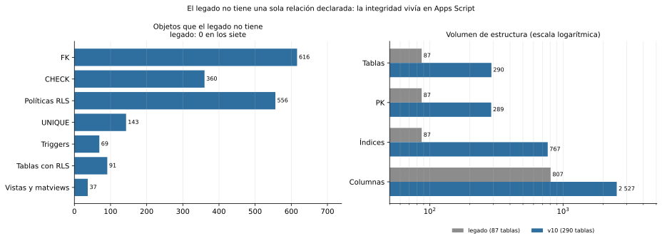
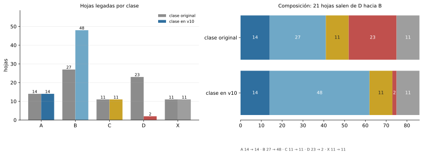
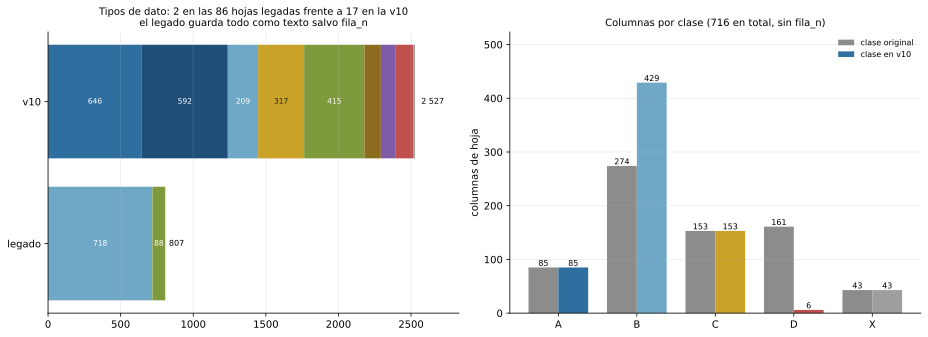
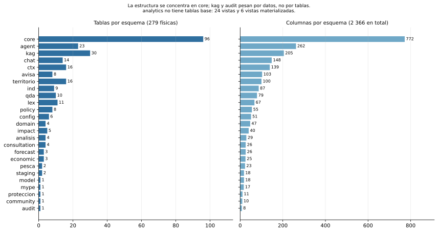
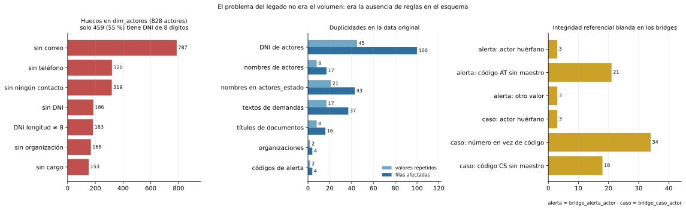
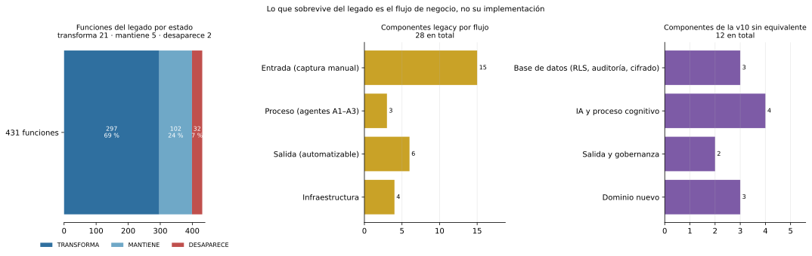

# Sistema anterior y versión 10: qué es igual, qué cambia y qué desaparece

> **Estado:** vigente. Es el único documento que compara, de principio a fin, el
> sistema que hoy está en producción (Google Sheets y Apps Script) con la
> arquitectura nueva en PostgreSQL (v10). Está registrado en el índice del
> conjunto documental **[8]**.

**Qué responde.** Tres preguntas, en una sola lectura: qué del sistema anterior
sigue igual, qué cambia de forma y qué desaparece. No reemplaza a los documentos
técnicos del proyecto: los resume y los ordena.

**Qué no hace.** No repite el mapeo columna por columna ni la clasificación
funcional de las tablas. Los totales por grupo están en §4 y el detalle hoja por
hoja en §11.5. Cada dato vive en un solo documento a propósito: repetirlo en dos
lugares es justamente el problema que este conjunto documental está corrigiendo.

**Cómo se citan otros documentos.** Cada vez que este texto remite a otro
archivo aparece un número entre corchetes, por ejemplo **[3]**. La lista completa,
con el nombre del archivo y qué contiene, está al final, en §13 Referencias.

---

## Cómo leer este documento

Tres palabras se repiten en todo el texto. Conviene fijarlas desde el inicio:

| Palabra                           | Qué significa aquí                                                                                                                                                            |
| --------------------------------- | ----------------------------------------------------------------------------------------------------------------------------------------------------------------------------- |
| **Sistema anterior** o **legado** | Lo que hoy está en producción: 86 hojas de Google Sheets con datos y código de Apps Script que las lee y las escribe. En la base hay una copia exacta en el esquema `legacy`. |
| **v10**                           | La arquitectura nueva: una base PostgreSQL con tablas relacionadas entre sí, reglas de validación y permisos por usuario.                                                     |
| **Clase**                         | La letra (A, B, C, D o X) que dice qué pasó con cada hoja del sistema anterior al pasar a la v10. Se explica en §4.                                                           |

Estos son los términos técnicos que aparecen más adelante. No hace falta
memorizarlos: están aquí para consultarlos cuando aparezcan.

| Término                         | En palabras simples                                                                                        |
| ------------------------------- | ---------------------------------------------------------------------------------------------------------- |
| **Tabla**                       | Una hoja con nombre, filas y columnas, dentro de la base.                                                  |
| **Esquema**                     | Una carpeta que agrupa tablas. `core` es la carpeta del núcleo del sistema.                                |
| **Columna**                     | Un campo de la tabla.                                                                                      |
| **Llave primaria (PK)**         | El campo que identifica una fila sin posibilidad de confusión.                                             |
| **Llave foránea (FK)**          | Un campo que apunta a una fila de otra tabla. Es lo que impide que queden datos sueltos.                   |
| **UNIQUE**                      | Regla que prohíbe repetir un valor, por ejemplo un código de caso.                                         |
| **CHECK**                       | Regla que exige que un valor cumpla una condición.                                                         |
| **Índice**                      | Estructura auxiliar que hace las búsquedas más rápidas.                                                    |
| **Vista**                       | Una consulta guardada con nombre; se lee como si fuera una tabla.                                          |
| **Vista materializada**         | Una vista que guarda el resultado ya calculado.                                                            |
| **Trigger**                     | Una acción automática que se dispara cuando alguien inserta o modifica una fila.                           |
| **Seguridad por fila (RLS)**    | Una regla que decide, fila por fila, qué puede ver cada usuario.                                           |
| **Partición**                   | Una tabla grande dividida en partes más pequeñas para que las consultas sean más rápidas.                  |
| **Tabla lógica y tabla física** | Una tabla particionada cuenta como una sola tabla lógica, pero como varias tablas físicas.                 |
| **Append-only (solo agregar)**  | Un registro donde solo se pueden agregar filas: no se puede modificar ni borrar nada.                      |
| **Datos personales (PII)**      | Nombre, DNI, teléfono o correo de una persona.                                                             |
| **Agente**                      | Un programa que usa un modelo de lenguaje para convertir texto libre en datos ordenados.                   |
| **Revisión humana (HITL)**      | Una persona revisa y aprueba lo que produjo el agente antes de que se use.                                 |
| **Grafo de conocimiento (KAG)** | Una red de actores, casos y fuentes conectados por sus relaciones.                                         |
| **Análisis cualitativo (QDA)**  | Codificar entrevistas y actas para poder rastrear cada afirmación hasta su origen.                         |
| **Ubigeo**                      | El código oficial que identifica departamento, provincia y distrito.                                       |
| **JSON**                        | Un formato de texto para guardar datos con estructura, por ejemplo `{"tema": "pesca"}`.                    |
| **Idempotente**                 | Que se puede ejecutar dos veces sin duplicar datos.                                                        |
| **RADAR**                       | Un módulo del sistema anterior para mapear actores y su red de contactos. Quedó fuera de la v10 por ahora. |

---

## 1. Las dos arquitecturas de un vistazo

| Aspecto                     | Sistema anterior (2026)                                                                                                                 | v10                                                                                                          |
| --------------------------- | --------------------------------------------------------------------------------------------------------------------------------------- | ------------------------------------------------------------------------------------------------------------ |
| **Plataforma**              | Google Sheets y Apps Script: 244 funciones en el servidor y 450 nombres en el navegador (158 escritos una vez y 292 redefinidos encima) | PostgreSQL 16 con dos extensiones (mapas y vectores): 289 tablas físicas, 265 lógicas y 610 llaves foráneas  |
| **Modelo de datos**         | 86 hojas planas (75 con datos), sin llaves foráneas ni reglas de unicidad; el tipo de cada valor se adivina al leerlo                   | 265 tablas lógicas con llaves foráneas, reglas de validación, catálogos cerrados y seguridad por fila        |
| **Nivel de detalle**        | Una fila por fila de hoja: el mismo conflicto se escribe hasta cuatro veces con distinto detalle                                        | Un concepto por tabla: caso, alerta, demanda, hecho, actor y compromiso son cosas distintas                  |
| **Identidad**               | Códigos de texto (`ID_*`); el DNI hace de identificador de persona                                                                      | Identificador interno + el código original conservado + un identificador único generado cuando no hay código |
| **Acceso**                  | Una clave numérica guardada en una hoja; los permisos se aplican en la pantalla                                                         | Inicio de sesión único, permisos por rol y seguridad por fila, con tres perfiles                             |
| **Auditoría**               | Una hoja de envíos y el registro de inicio de sesión                                                                                    | Bitácoras que solo agregan filas + registro de cada ejecución de agente                                      |
| **Salida**                  | Se redacta a mano y se archiva el PDF en Drive (153 documentos, 153 enlaces)                                                            | Plantillas y consultas guardadas; la redacción automática solo cuando el texto no se puede derivar           |
| **Proceso**                 | No existe como flujo de trabajo: ocurre en la cabeza del analista. Hubo una maqueta de consultas con IA que nunca operó (§6)            | Agentes A1 (extrae), A2 (pauta) y A3 (sintetiza), con revisión humana                                        |
| **Inteligencia artificial** | Ninguna en operación. Un conector a Gemini y una pantalla «Consultas con IA» quedaron en maqueta, sin clave válida y sin uso (§6)       | Grafo de conocimiento, análisis cualitativo, contexto del entorno y reglas de control G1 a G25               |
| **Certificación**           | —                                                                                                                                       | 4 649 filas declaradas en 86 hojas cargadas; la verificación automática da 58 de 58 controles                |

**En una línea.** El sistema anterior registra y después imprime. La v10 registra
datos ordenados y produce las salidas a partir de ellos. La diferencia entre los
dos no está en el volumen sino en si el sistema entiende lo que guarda.

Los totales de la fila «Certificación» y las cifras certificadas de la carga
provienen del acta de cierre **[7]**.

---

## 2. Lo que no cambia

Estos conceptos significan lo mismo en los dos sistemas:

| Concepto               | Sistema anterior                                                  | v10                                                                              | ¿Cambia el significado?                                                            |
| ---------------------- | ----------------------------------------------------------------- | -------------------------------------------------------------------------------- | ---------------------------------------------------------------------------------- |
| **Caso**               | `fact_casos` (35 filas)                                           | `core.casos` (35)                                                                | No. Se conserva el mismo código legible (`CS-PRODUCE-2026-007`)                    |
| **Alerta temprana**    | `dim_alertas` (83)                                                | `core.alertas_tempranas` (83)                                                    | No                                                                                 |
| **Demanda**            | `dim_demandas` (325)                                              | `core.demandas` (325)                                                            | **Sí en la forma**: una descripción libre pasa a tener problema y pedido separados |
| **Actor**              | `dim_actores` + `dim_actores_estado` + `dim_organizacion` (1 160) | `core.actores` + `organizaciones` + `actor_datos_personales` + `actor_membresia` | El concepto no; el nivel de detalle sí                                             |
| **Hecho o cronología** | `fact_hechos_casos` (80)                                          | `core.caso_cronologia` (80)                                                      | No                                                                                 |
| **Compromiso o hito**  | `dim_acciones_hitos` (8) + `dim_hitos` (12)                       | `core.compromisos` + `hitos_compromiso`                                          | Cambia de qué depende (ver §3.2)                                                   |
| **Documento**          | 8 tablas de documentos + PDFs en Drive                            | `core.documentos` (153) + tabla de 15 tipos                                      | El concepto no; el formato de entrega sí                                           |
| **Mesa de diálogo**    | `dim_mesas_grupos` (21)                                           | `core.mesas_dialogo` (21) + `mesa_miembros` (62)                                 | No; la v10 la trata como una entidad propia                                        |
| **Local o sede**       | `dim_locales` (27)                                                | `core.locales` (27)                                                              | No                                                                                 |
| **Usuario y rol**      | `dim_sectoristas` + `dim_pf` + `dim_autoridades` (34)             | `core.usuarios` (32) + `usuario_roles` (35)                                      | Cambia cómo se entra al sistema, no el rol                                         |
| **Envío**              | `LOG_Envios` (17)                                                 | `core.envios_comunicacion` (17)                                                  | No                                                                                 |

**Las tres cosas que importan:**

1. **Nada se inventa.** Las 4 649 filas declaradas del sistema anterior están
   representadas. Lo único agregado es la unidad orgánica `OAIPCS` (decisión D26)
   y los compromisos creados para dar padre a los 12 hitos que no lo tenían
   (decisión D13). Las decisiones D1 a D51 están en **[4]**.
2. **Los códigos siguen sirviendo para buscar.** `CS-PRODUCE-2026-007`,
   `AT-2026-01` o `RECU-008`: quien hoy busca un caso por su código lo sigue
   encontrando igual.
3. **La naturaleza del conflicto tampoco cambia.** Cambia cuántas veces se escribe
   y en cuántas piezas.

---

## 3. Lo que cambia de forma

### 3.1 Nombres nuevos

| Sistema anterior                                         | v10                                                                                             |
| -------------------------------------------------------- | ----------------------------------------------------------------------------------------------- |
| Prefijos `dim_*`, `fact_*`, `bridge_*` (estilo estrella) | `esquema.tabla` (`core.`, `kag.`, `agent.`, `ind.`, `territorio.`…)                             |
| `ID_Caso`, `ID_Actor`, `ID_Alerta` (texto)               | Identificador interno (`id`) + código natural (`codigo_caso`, `codigo_alerta`, `codigo_legado`) |
| Columnas genéricas `c01…c09` en `legacy.*`               | Columnas con nombre y tipo definido                                                             |
| Una hoja equivale a una pantalla                         | Una tabla equivale a un concepto, y varias pantallas la leen                                    |

### 3.2 Los cinco cambios de fondo

Son los cinco puntos donde el sistema anterior no encaja en la v10 sin tomar una
decisión. Aquí está la diferencia conceptual real entre las dos versiones.

| #   | Qué exige la v10                                                                                                                             | Qué traía el sistema anterior                                                             | Decisión tomada                                                                                                                                                                                                       |
| --- | -------------------------------------------------------------------------------------------------------------------------------------------- | ----------------------------------------------------------------------------------------- | --------------------------------------------------------------------------------------------------------------------------------------------------------------------------------------------------------------------- |
| 1   | `core.casos` con seis campos obligatorios: distrito principal, subsector, temática, unidad responsable, nivel de conflicto y nivel de riesgo | Ubigeo, sector y temática incompletos; **ningún** nivel de conflicto explícito            | Ubigeo se reparte en región más distrito, o queda vacío (D3); se crea la unidad `OAIPCS` (D4); el riesgo se deriva de sus alertas en 1 caso (D48); el nivel de conflicto **se lee** de `DIM_Tipo_Caso`, no se calcula |
| 2   | `core.demandas` con el problema y el pedido separados, y un caso obligatorio                                                                 | Una sola descripción de texto libre (325 demandas)                                        | El texto se conserva íntegro; 222 demandas cuelgan de una alerta y 26 no tienen padre (D2)                                                                                                                            |
| 3   | `core.hitos_compromiso` depende de un **compromiso** y el código de hito no se puede repetir                                                 | 12 hitos que dependen del **caso**, sin compromisos                                       | Se crean compromisos para cada caso que los necesitaba (D13)                                                                                                                                                          |
| 4   | No existían espacios de diálogo permanentes: las reuniones eran puntuales                                                                    | `dim_mesas_grupos`: 21 filas con base legal, presidente, secretario técnico y prórrogas   | Tabla nueva `core.mesas_dialogo` más `mesa_miembros` (decisión f)                                                                                                                                                     |
| 5   | Los catálogos son cerrados, y las tablas de temáticas y subsectores se creaban **vacías**                                                    | `dim_tipo_tematica` (7), `dim_tipo_sector` (3), `dim_tipo_actor` (3), `dim_rol_actor` (4) | Se llenan desde las tablas del sistema anterior; sin eso **ningún** caso o actor se puede registrar                                                                                                                   |

Las decisiones se citan por su código: **D1 a D51** son las decisiones de carga, y
las que llevan una letra son decisiones de otro bloque. Todas están catalogadas y
explicadas en **[4]**.

### 3.3 Lo que se partió en varias tablas

El caso más claro es el **actor**. En el sistema anterior, una persona, su DNI, su
organización y su rol son columnas de la misma fila. En la v10 son cuatro tablas,
cada una con su propia clasificación de datos:

```
sistema anterior:  dim_actores (una sola fila, DNI en claro, organización como texto)
                        │
v10:                    ├── core.actores                 (identidad pública)
                        ├── core.actor_datos_personales  (DNI y contacto, datos reservados)
                        ├── core.actor_membresia         (292 vínculos con vigencia)
                        └── core.organizaciones          (224 organizaciones)
```

La razón legal está explicada en **[2]** §2.3.bis y en las decisiones DC-03 a
DC-07 de **[1]** anexo E. El DNI vive en una tabla aparte precisamente para poder
ocultarlo sin ocultar al actor.

### 3.4 Lo que se fusionó

`dim_actores` (828) + `dim_actores_estado` (108) + `dim_organizacion` (224) son
hoy **una sola** `core.actores` con 1 160 filas, más una forma de consultar la
organización. En el sistema anterior eran tres listas que se solapaban, y además
45 DNI aparecían en 100 filas distintas (decisión D43). Por eso el DNI dejó de ser
único y pasó a ser un campo con cola de revisión.

---

## 4. Las cinco clases, explicadas una por una

Las clases **A, B, C, D y X** no describen la función de una hoja: dicen **qué
pasó con ella** al pasar a la v10.

| Clase | Qué significa                                                                          |  Hojas | Columnas | Filas de origen |
| ----- | -------------------------------------------------------------------------------------- | -----: | -------: | --------------: |
| **A** | **Pasa tal cual.** Mismo concepto; solo cambian los tipos de identificador             |     14 |       85 |           1 342 |
| **B** | **Se transforma.** Cambia de qué depende, cambia el nivel de detalle o hay que crearla |     48 |      429 |           3 205 |
| **C** | **Se absorbe** dentro de un documento JSON o se convierte en un valor calculado        |     11 |      153 |              90 |
| **D** | **No tiene destino.** El concepto no existe en la v10                                  |      2 |        6 |               6 |
| **X** | **Estaba vacía.** No tenía ni una fila                                                 |     11 |       43 |               0 |
|       | **Total**                                                                              | **86** |  **716** |       **4 643** |

**Cómo se lee.** 73 hojas (A, B y C) tienen destino en la v10. Solo 2 no lo
tienen: el RADAR, que quedó diferido al esquema `territorio` (decisión D18), y una
tabla que apuntaba a otras por nombre en un campo de texto, reemplazada por
llaves foráneas. Las 21 hojas que hoy tienen destino y antes no lo tenían son una
decisión de la v10, no un cambio de medición: 16 lo consiguieron por las tablas de
soporte, 4 por el flujo por pasos y 1 por `core.cat_ciclos_intervencion`. El
detalle está en **[4]** anexo A.2.

**Sobre las columnas.** Son las 716 registradas en el manifiesto `legacy._hojas`,
un registro que guarda cuántas columnas y filas tiene cada hoja copiada, y no las
697 que declaraba el análisis original. El motivo: el manifiesto mide la copia
real, no lo que el documento decía. Por eso el total de columnas de `legacy` es
**807 = 716 de hojas + 86 de la columna `fila_n` + 5 de la propia tabla
manifiesto**.

**Qué dice cada clase del sistema anterior:**

- Que **73 de 86 hojas** fueran trasladables confirma que el modelo de datos no
  era el problema: el problema era que nada lo validaba.
- Que **11 hojas estén vacías** confirma que el sistema tenía módulos que nunca se
  usaron: el análisis de conflictividad (4 tablas y 5 tablas de relación) jamás se
  llenó.
- Que solo **2 hojas (6 filas)** no tengan destino confirma que la v10 no dejó el
  tema fuera: lo que queda afuera es el RADAR y un campo que apuntaba a otra tabla
  por su nombre.

---

## 5. Lo que solo existe en uno de los dos sistemas

### 5.1 Solo en el sistema anterior

| Hoja                   | Filas | Qué era                             | Qué pasó                                 |
| ---------------------- | ----: | ----------------------------------- | ---------------------------------------- |
| `dim_tipo_actor_radar` |     3 | Catálogo del RADAR                  | Se irá a `territorio` cuando se abra D18 |
| `dim_responsable`      |     3 | Apuntaba a otra tabla por su nombre | Se descarta: la v10 usa llaves foráneas  |

Son las dos únicas hojas sin lugar, y suman **6 filas**. El resto de hojas que en
su momento no tenían destino ya lo tienen: `core.proceso_instancia` (135),
`core.flujo_definicion` (7), `core.flujo_estado` (5) y
`core.cat_ciclos_intervencion` (4). Las 4 tablas y 5 tablas de relación del
análisis de conflictividad existen vacías, y su contenido terminó en
`core.documentos.contenido_json` (1 fila).

### 5.2 Solo en v10

| Esquema                                                                                                           |          Tablas | Qué aporta                                                            | Qué tiene hoy                         |
| ----------------------------------------------------------------------------------------------------------------- | --------------: | --------------------------------------------------------------------- | ------------------------------------- |
| `agent`                                                                                                           |         11 (23) | Los agentes A1, A2 y A3, sus instrucciones y su registro de ejecución | 5 filas                               |
| `kag`                                                                                                             |              30 | Grafo de conocimiento, vectores, comunidades e hipótesis              | 1 520 nodos, 450 relaciones           |
| `avisa`                                                                                                           |           2 (8) | Captura de datos crudos, en tablas divididas                          | 0                                     |
| `ind`                                                                                                             |               9 | Plantillas, indicadores y resultados                                  | 3 plantillas, 0 espacios definidos    |
| `ctx`                                                                                                             |         10 (16) | Contexto del entorno (clima, pobreza, zonas marítimas)                | 28                                    |
| `qda` + `lex` + `chat`                                                                                            |              35 | Análisis cualitativo, vocabulario y conversaciones                    | 0                                     |
| `policy` + `config` + `model`                                                                                     |              17 | Reglas de control, parámetros y fichas de modelo                      | 10 reglas / 17 parámetros / 12 fichas |
| `territorio`                                                                                                      |              16 | Lugares, caletas, plantas y zonas de pesca                            | 9 catálogos                           |
| `ref`                                                                                                             |               2 | Base legal que respalda cada tratamiento de datos y cada evidencia    | 5 filas                               |
| `analisis`                                                                                                        |               4 | Plan de análisis y marcos situacionales                               | 14                                    |
| `analytics`                                                                                                       | 0 (+22 objetos) | Indicadores y agregados: 17 vistas y 5 vistas materializadas          | sin tablas propias                    |
| `forecast`, `impact`, `economic`, `consultation`, `community`, `domain`, `mype`, `pesca`, `proteccion`, `staging` |              26 | Módulos previstos para los próximos cinco años                        | catálogos ya creados                  |

Los números entre paréntesis son tablas físicas: una tabla dividida en partes
cuenta una vez como tabla lógica y varias como tabla física. Con `core` (102) y
`audit` (1), que no figuran aquí por ser el núcleo compartido, la suma da las
**265 tablas lógicas** de §11.1.

Además hay un grupo de **tablas creadas para que los datos del sistema anterior
pudieran aterrizar**: `core.log_accesos`, `core.mesas_dialogo`,
`core.mesa_miembros`, `core.locales`, `core.alerta_especies`,
`core.capacitaciones`, `core.capacitacion_participantes`, `core.usuario_territorio`,
`core.suscripcion_notificacion`, `core.documento_actores`, entre otras.

---

## 6. Las tres funciones: entrada, proceso y salida

| Tipo de función | Sistema anterior                                                                                                                                                 | v10                                                                                  | Qué falta                                                                                            |
| --------------- | ---------------------------------------------------------------------------------------------------------------------------------------------------------------- | ------------------------------------------------------------------------------------ | ---------------------------------------------------------------------------------------------------- |
| **Entrada**     | 6 puntos de captura manual: caso, hecho, alerta, reporte rápido, clima social y catálogos                                                                        | `avisa.raw_ingest` + `staging` + `ctx.captura` (los tres **en cero**)                | Convertir el paquete de datos recibidos en campos ordenados                                          |
| **Proceso**     | **No existe en operación.** Ninguna de las 244 funciones convierte texto libre en datos ordenados; la consulta con IA existió como maqueta y nunca operó (abajo) | `agent.*`, `analisis.*`, `qda.*`, `kag.*` (55 tablas; 12 con filas y 3 206 en total) | Reconocer entidades y generar la pauta del análisis                                                  |
| **Salida**      | 12 funciones `generar*` (unas 1 400 líneas) que rearman lo que una persona ya escribió; 153 PDFs archivados en Drive                                             | `ind.plantilla` + vistas + agente A3                                                 | Falta el esquema de 15 tipos de documento (está vacío) y la tabla de espacios de plantilla (0 filas) |

**La IA del sistema anterior.** No es cierto que no tuviera ninguna: sí tenía un módulo de consultas con IA. En `Código.txt`, un conector a Gemini (`_llamarGemini`) con `analizarConsultaGeneral`, `buscarConIA` y `analizarCasoConIA`; en el navegador, una pantalla «Consultas con IA» que ofrecía análisis de riesgos, de demandas e histórico. **Nunca operó**: la clave era el marcador `PENDIENTE_API_KEY_GEMINI`, cada llamada devolvía el aviso de que faltaba configurarla y no hay uso en producción. Era una maqueta. Por eso el balance no cambia: el sistema registraba a mano lo que esa maqueta nunca llegó a generar.

**El hallazgo que resume las dos arquitecturas:** el sistema anterior **captura,
guarda e imprime** —la consulta con IA quedó en maqueta—. La v10 **captura, procesa
e imprime a partir de los datos**.
Lo que separa a las dos no es una tabla: son las ocho brechas C1 a C8 descritas en
**[3]** §12.9, y ninguna de ellas exige crear una tabla nueva.

---

## 7. Qué no se lleva del código

| Situación                                                                                            |                                             Volumen | Qué se hace                            |
| ---------------------------------------------------------------------------------------------------- | --------------------------------------------------: | -------------------------------------- |
| Funciones redefinidas más adelante en el mismo archivo                                               |                                         ~35 nombres | Se conserva solo la última definición  |
| Funciones duplicadas dentro del mismo archivo                                                        | 2 en el servidor y 2 copias completas del navegador | Se conserva la que está en uso         |
| Código de compatibilidad generado automáticamente y archivos que ejecutan texto como si fuera código |                                          7 archivos | Se elimina con el arranque por módulos |
| Alias de compatibilidad que nadie llama                                                              |                                           6 nombres | No se trasladan                        |
| Rutinas de mantenimiento que viven dentro del código de negocio                                      |                                         3 funciones | Salen del sistema de negocio           |

De los 244 + 450 nombres, el código de negocio real ronda las **300 a 350
funciones**, y alrededor del **25 a 30 %** es código que ya no se usa. Dimensionar
la migración con el conteo bruto agranda el trabajo sin motivo. Para saber qué es
cada uno de esos archivos del sistema actual, ver **[10]**.

---

## 8. Cómo se reconoce una fila del sistema anterior dentro de la v10

Sin esto no se pueden conciliar las dos versiones. Son cuatro mecanismos, y los
cuatro están ya aplicados:

1. **Se conserva el código original.** `core.casos.codigo_caso` guarda el
   `ID_Caso`; `core.alertas_tempranas.codigo_alerta` guarda el `ID_Alerta`;
   `core.documentos.codigo` guarda el identificador que tenía el documento; y hay
   un `codigo_legado` en usuarios, especies y catálogos.
2. **Se genera un identificador único y reproducible** cuando no hay código:
   `md5('avisa2026:' || legacy_id)::uuid`. Es lo que permite repetir la carga sin
   duplicar nada.
3. **Cada fila dice de dónde vino.** Todas llevan `origen_dato='AVISA_HISTORICO'`,
   `fuente_original='avisa_historico'`, `es_validado_humano=TRUE`,
   `confidence=1.0` y nivel de clasificación 2 (3 cuando son datos personales).
   Hoy el **100 %** de los datos de negocio tiene esa marca: no hay ni una fila
   creada dentro de la v10.
4. **La copia del sistema anterior no se toca.** `legacy.*` son 87 tablas con las
   hojas tal como estaban, en columnas numeradas `c01…c09`.

**Regla para resolver dudas:** si un conteo no cuadra, no se discute con un
documento: se consulta `legacy.*` y se cuenta con `count(*)`. Esa copia es la
única fuente que se puede reproducir (decisión D21).

---

## 9. Errores de lectura frecuentes

1. **«109 tablas con datos» no significa que el sistema funcione.** Todo lo que
   hay es histórico. Cualquier indicador que se calcule hoy se calcula sobre
   historia congelada, y con `ind.indicador` en 0 filas el tablero no tiene de
   dónde salir.
2. **`kag.nodos` = 1 520 no es conocimiento.** Es `core.actores` (1 160) más
   `core.casos` (35) y `core.demandas` (325) copiados como nodos, con 450 aristas
   que solo repiten vínculos ya escritos en `core`, y `kag.embedding` en 0. Sirve
   para reconocer entidades y recorrer vínculos, no es el grafo de conocimiento.
3. **Las «filas sin destino» son 2 hojas y 6 filas.** Cualquier total mayor está
   contando hojas antes de que la v10 les diera lugar (el flujo por pasos, las
   tablas de soporte) o está sumando columnas absorbidas en JSON, que sí se cargan
   aunque pierdan estructura.
4. **El problema de clasificación de documentos ya está corregido.** Quedan **3 de
   153** documentos en «Otro (sin clasificar)», y son los `CT-2026-00x`, que no
   vienen de `dim_redaccion`. El resto ya tiene su tipo asignado. Ver **[3]** §13.1.

---

## 10. Por dónde empezar

| Si tu pregunta es…                            | Ve a                                                                      |
| --------------------------------------------- | ------------------------------------------------------------------------- |
| ¿Qué tengo que construir primero?             | §6 de este documento, luego **[3]** §12.9 (las ocho brechas) y **[5]** §3 |
| ¿Se perdió algo del sistema anterior?         | §2 y §5 de este documento, y **[4]** anexo A.4                            |
| ¿Por qué esta tabla no tiene equivalente?     | **[6]** §5, y **[4]** anexo A.4                                           |
| ¿Qué puede hacer un agente y qué no?          | **[9]** §3 y §7                                                           |
| ¿Cumple con la Ley 29733?                     | **[2]** §2.3.bis, §2.5 y §3.3.bis, y **[1]** anexo E (DC-01 a DC-12)      |
| ¿Está listo para ponerse en producción?       | **[3]** §7 (prioridades 0 y 1) y §11                                      |
| ¿Cuánto cambió de verdad?                     | §11 de este documento (gráficos) y §11.5 (tabla de las 86 hojas)          |
| ¿Qué se mantiene y qué desaparece del código? | §12 de este documento, y **[9]** §3                                       |

---

## 11. Estadística del sistema

**Medido el 2026-11-19** sobre la base `avisa` (PostgreSQL 16.14 con PostGIS
3.7 y pgvector 0.8.3), contando fila por fila con `count(*)`. No se usó la
estimación aproximada que guarda el motor (`pg_class.reltuples`) porque en esta
base está sin actualizar, con valor `-1`, y habría dado ceros falsos. Todo lo que
sigue lo calcula el script del proyecto **[11]**, que también produce los seis
gráficos de esta sección y escribe la tabla de §11.5.

### 11.1 Los dos sistemas en números

| Dimensión                      | Sistema anterior (`legacy`)                           | v10                                                                                   |
| ------------------------------ | ----------------------------------------------------- | ------------------------------------------------------------------------------------- |
| Esquemas (carpetas)            | 1                                                     | 28 (27 con tablas; `analytics` solo tiene vistas; `public` es de PostGIS y no cuenta) |
| Tablas físicas                 | 87                                                    | 289 (24 son partes de tablas divididas)                                               |
| Tablas lógicas                 | 87                                                    | 265                                                                                   |
| Columnas                       | 807                                                   | 2 511                                                                                 |
| Filas                          | 4 729                                                 | 13 352                                                                                |
| Con datos / vacías             | 76 / 11                                               | 110 / 179 físicas (155 lógicas)                                                       |
| Llaves primarias               | 87                                                    | 288                                                                                   |
| Llaves foráneas                | **0**                                                 | **610**                                                                               |
| Reglas de unicidad (UNIQUE)    | **0**                                                 | 143                                                                                   |
| Reglas de validación (CHECK)   | **0**                                                 | 347                                                                                   |
| Índices                        | 87                                                    | 757 (sin contar los internos de PostgreSQL ni los 6 de vistas materializadas)         |
| Vistas y vistas materializadas | **0**                                                 | 36 (30 + 6)                                                                           |
| Tablas con seguridad por fila  | **0**                                                 | 87 (todas activas también para el dueño de la tabla)                                  |
| Políticas de seguridad         | **0**                                                 | 540                                                                                   |
| Triggers                       | **0**                                                 | 66                                                                                    |
| Tipos de dato distintos        | 3 (2 en las hojas y la fecha de carga del manifiesto) | 17                                                                                    |



**De dónde salen los totales del sistema anterior.** Las 4 729 filas son 4 643
filas de hoja más las 86 filas de `legacy._hojas`, la tabla que registra qué se
copió. Las 807 columnas son 716 de hoja, más 86 de la columna `fila_n` y 5 de la
propia tabla registro. Los dos tipos de dato de las hojas son `text` y el `int4` de
`fila_n`; el tercero, `timestamptz`, es la fecha de carga y no pertenece a ninguna
hoja. Las **76 tablas con datos son 75 hojas más la tabla registro**; las 11 vacías
son hojas que nunca se usaron (§4).

**Dos detalles que la tabla deja ver.** Hay 288 llaves primarias para 289 tablas
físicas: la única sin llave primaria es `core.cronologia_vinculos`, que es una
tabla de vínculos entre registros. Y las 610 llaves foráneas se reparten en 208 en
`core`, 67 en `ctx`, 61 en `kag`, 48 en `chat`, 31 en `agent`, 25 en `qda` y 170
en el resto.

**De dónde salen los números de la v10.** Las 13 352 filas se reparten así: `core`
6 903 · `kag` 3 187 · `audit` 3 088 · `config` 68 · `ctx` 28 · `policy` 15 ·
`domain` 15 · `analisis` 14 · `model` 12 · `territorio` 9 · `ref` 5 · `agent` 5 ·
`ind` 3. Y hay **13 esquemas con tablas que hoy tienen cero filas**: `avisa`,
`chat`, `community`, `consultation`, `economic`, `forecast`, `impact`, `lex`,
`mype`, `pesca`, `proteccion`, `qda` y `staging`.

**Lo que el gráfico muestra y no suele verse.** El sistema anterior no es «un
modelo más simple»: es una base **sin una sola relación**. Cero llaves foráneas,
cero reglas de unicidad, cero validaciones, cero seguridad por fila y cero
triggers. Toda la integridad vivía en el código de Apps Script.

### 11.2 Las clases, en hojas y columnas

| Clase | Significado                                    | Hojas | Columnas | Filas de origen |
| ----- | ---------------------------------------------- | ----: | -------: | --------------: |
| **A** | Pasa tal cual                                  |    14 |       85 |           1 342 |
| **B** | Se transforma                                  |    48 |      429 |           3 205 |
| **C** | Se absorbe en JSON o se vuelve valor calculado |    11 |      153 |              90 |
| **D** | Sin destino                                    |     2 |        6 |               6 |
| **X** | Estaba vacía                                   |    11 |       43 |               0 |



**Qué explica el reparto.** Las **21 hojas que pasaron de D a B** son un cambio de
la v10, no de la medición: 16 llegaron a tener tabla por las tablas de soporte, 4
por el flujo por pasos y 1 por `dim_intervencion`, que hoy vive en
`core.cat_ciclos_intervencion`. Las **2 que siguen en D son 6 filas**, y ninguna
tendrá tabla mientras el RADAR siga diferido.

### 11.3 Los tipos de dato: de dos a diecisiete



El sistema anterior guarda **todo como texto** salvo `fila_n`: no hay fechas,
números, valores verdadero/falso ni referencias. La v10 usa **17 tipos distintos**
repartidos en 2 511 columnas.

| Tipo             | Columnas | Para qué sirve                                       |
| ---------------- | -------: | ---------------------------------------------------- |
| `varchar`        |      642 | Texto corto y acotado (nombres, códigos, estados)    |
| `uuid`           |      583 | Identificadores únicos, la mayoría de las llaves     |
| `int2`           |      246 | Números pequeños (ordinales, niveles, códigos)       |
| `timestamptz`    |      208 | Fecha y hora con zona horaria                        |
| `int4`           |      150 | Enteros                                              |
| `text`           |      139 | Texto libre, sin límite                              |
| `bool`           |      121 | Verdadero/falso                                      |
| `numeric`        |      113 | Decimales exactos (coordenadas, montos, porcentajes) |
| `date`           |      105 | Fecha sin hora                                       |
| `jsonb`          |      103 | Contenido variable, sin columnas fijas               |
| `bpchar`         |       68 | Texto de longitud exacta (códigos de una letra)      |
| `int8`           |       19 | Enteros grandes (contadores)                         |
| `bytea`          |        6 | Binario (archivos, hashes)                           |
| `geography`      |        3 | Punto o área en el mapa                              |
| `_text`, `_uuid` |        4 | Listas dentro de una sola columna                    |
| `vector`         |        1 | Huella numérica para búsqueda semántica              |

Los dos tipos que más crecieron son los dos que el sistema anterior no tenía en
absoluto: **identificadores** y **fechas**. `uuid` aparece 583 veces porque cada
entidad y cada relación tiene su propia llave; `timestamptz` más `date` suman 313
columnas de tiempo, contra cero antes.

**Por qué importa.** El tipo de dato es donde vive la validación que antes no
existía. Un DNI de longitud distinta de 8, una fecha escrita como número o un
`AT-2026-48` repetido dejaron de ser posibles en el momento en que la columna
dejó de aceptar cualquier texto.

### 11.4 Dónde se concentra la estructura



La estructura no se reparte igual que los datos. `core` tiene **102 tablas y 839
columnas**; le siguen `agent` **23 físicas y 304 columnas** (11 lógicas: 12 de las
23 son pedazos de tablas divididas por mes), `kag` **30 y 205**, `chat` **14 y
148**, `ctx` **16 y 139** (10 lógicas) y `territorio` **16 y 100**.

Hay un esquema que no pertenece al modelo y conviene no confundir: `avisa`
(**8 físicas, 2 lógicas, 103 columnas**) es la bandeja de entrada de datos crudos,
una tabla particionada por mes más su tabla de rechazos. No guarda información del
sistema: guarda lo que llegó y todavía no se procesó.

`analytics` no tiene ni una tabla propia: sus **17 vistas y 5 vistas materializadas**
son la capa de lectura. El resto de vistas se reparte en `core` (4), `config` (2),
`ref` (2), `mype` (2 más 1 materializada), `lex` (1), `pesca` (1) y `territorio` (1),
para 30 vistas y 6 materializadas en total.

Dicho al revés: **`kag` y `audit` tienen muchas filas pero pocas tablas**. Su peso
está en los datos, no en la estructura. Quien dimensione el sistema contando
tablas se equivocará en los dos sentidos.

### 11.5 Hoja por hoja, qué pasó con cada una

La tabla se genera desde `legacy._hojas` (columnas y filas reales) y las clases
del análisis original, ya con las 21 reclasificaciones de **[4]** anexo A.2. No se
edita a mano: se regenera con el script descrito en §11.7.

- **Clase original**: la que tenía en el análisis de portabilidad.
- **Clase actual**: la vigente hoy; aparece en **negrita** cuando cambió.
- **Dónde vive hoy**: la tabla o el esquema donde está esa información, o por qué
  no tiene lugar.

<!-- INICIO TABLA 86 HOJAS -->
| # | Hoja del sistema anterior | Clase original | Clase actual | Columnas | Filas | Dónde vive hoy |
| --: | --- | :---: | :---: | ---: | ---: | --- |
| 1 | `respuestas_de_formulario_1` | B | B | 23 | 1 | `core.alertas_tempranas`, `core.actores` |
| 2 | `bridge_capacitacion_participant` | D | **B** | 5 | 9 | `core.capacitacion_participantes` |
| 3 | `dim_capacitaciones` | D | **B** | 20 | 1 | `core.capacitaciones` |
| 4 | `fact_analisis_casos` | C | C | 26 | 1 | `core.documentos` |
| 5 | `bridge_alerta_recurso` | D | **B** | 3 | 32 | `core.alerta_especies` |
| 6 | `bridge_caso_actorestado` | B | B | 3 | 1 | `core.casos_actores` |
| 7 | `log_accesos` | D | **B** | 5 | 857 | `core.log_accesos` |
| 8 | `fact_casos` | B | B | 29 | 35 | `core.casos` |
| 9 | `fact_proceso_caso` | D | **B** | 10 | 36 | `core.proceso_instancia` |
| 10 | `fact_red_radar` | D | **B** | 6 | 1 | diferido a `territorio.*` por D18 |
| 11 | `fact_nodo` | D | **B** | 9 | 1 | diferido a `territorio.*` por D18 |
| 12 | `fact_proceso_reporte` | D | **B** | 8 | 99 | `core.proceso_instancia` |
| 13 | `dim_paso_proceso_caso` | D | **B** | 6 | 4 | `core.flujo_definicion` |
| 14 | `dim_paso_proceso` | D | **B** | 5 | 3 | `core.flujo_definicion` |
| 15 | `fact_historial_estado` | B | B | 10 | 27 | `core.caso_estado_historial` |
| 16 | `dim_tipo_cambio` | C | C | 3 | 6 | — |
| 17 | `log_envios` | B | B | 13 | 17 | `core.notificaciones` |
| 18 | `dim_alertas` | B | B | 31 | 83 | `core.alertas_tempranas` |
| 19 | `dim_reporte_rapido` | C | C | 25 | 1 | `core.documentos` |
| 20 | `dim_climasocial` | C | C | 28 | 7 | `core.documentos` |
| 21 | `dim_climasocial_focalizado` | C | C | 26 | 6 | `core.documentos` |
| 22 | `dim_riesgos` | A | A | 2 | 3 | `core.cat_niveles_riesgo` |
| 23 | `dim_locales` | D | **B** | 15 | 27 | `core.locales` |
| 24 | `dim_destinatarios_fijos` | D | **B** | 7 | 4 | `core.suscripcion_notificacion` |
| 25 | `dim_recurso_pesca` | A | A | 6 | 37 | `core.cat_especies` |
| 26 | `dim_estado_proceso` | B | B | 4 | 5 | `core.flujo_estado` |
| 27 | `bridge_caso_recurso` | X | X | 3 | 0 | — |
| 28 | `bridge_caso_demandas` | A | A | 5 | 12 | — |
| 29 | `bridge_alerta_demandas` | B | B | 5 | 231 | `core.demandas` |
| 30 | `bridge_alerta_actorestado` | A | A | 3 | 5 | `core.alertas_actores` |
| 31 | `dim_tipo_tematica` | A | A | 3 | 7 | `core.cat_tematicas` |
| 32 | `dim_demandas` | B | B | 9 | 325 | `core.demandas` |
| 33 | `dim_anuncios_acuerdos` | X | X | 7 | 0 | — |
| 34 | `dim_nivel_alertas` | B | B | 4 | 4 | — |
| 35 | `bridge_caso_descencadenantes` | C | C | 4 | 1 | `documentos.contenido_json` |
| 36 | `bridge_caso_impulsores` | C | C | 4 | 5 | `documentos.contenido_json` |
| 37 | `bridge_caso_causas` | C | C | 4 | 4 | `documentos.contenido_json` |
| 38 | `bridge_caso_medios` | C | C | 7 | 4 | `documentos.contenido_json` |
| 39 | `bridge_actor_grupo` | X | X | 3 | 0 | `kag.aristas` |
| 40 | `bridge_caso_posiciones` | X | X | 5 | 0 | — |
| 41 | `bridge_caso_intereses` | X | X | 5 | 0 | `kag.actor_profile_attribute` |
| 42 | `bridge_caso_necesidades` | X | X | 5 | 0 | — |
| 43 | `bridge_caso_ineteres_comunes` | X | X | 4 | 0 | — |
| 44 | `dim_descencadenantes` | X | X | 2 | 0 | — |
| 45 | `dim_impulsores` | X | X | 2 | 0 | — |
| 46 | `dim_causas` | X | X | 2 | 0 | — |
| 47 | `dim_medios` | X | X | 5 | 0 | — |
| 48 | `dim_tipo_proceso` | B | B | 6 | 4 | `core.cat_tipos_documento` |
| 49 | `dim_acciones_hitos` | B | B | 13 | 8 | `core.plan_acciones` |
| 50 | `dim_hitos` | B | B | 13 | 12 | `core.hitos_compromiso` |
| 51 | `dim_redaccion` | C | C | 13 | 51 | `core.documentos` |
| 52 | `dim_coordinacion_tecnica` | C | C | 13 | 4 | `core.documentos` |
| 53 | `dim_mesas_grupos` | D | **B** | 23 | 21 | `core.mesas_dialogo`, `core.mesa_miembros` |
| 54 | `dim_organizacion` | A | A | 16 | 224 | `core.actores`, `core.organizaciones` |
| 55 | `dim_tipo_org` | B | B | 2 | 4 | `core.cat_tipos_actor` |
| 56 | `dim_actores` | B | B | 16 | 828 | `core.actores` |
| 57 | `dim_actores_estado` | B | B | 16 | 108 | `core.actores` |
| 58 | `fact_hechos_casos` | B | B | 13 | 80 | `core.caso_cronologia` |
| 59 | `bridge_caso_depto` | A | A | 6 | 87 | `core.caso_distritos` |
| 60 | `bridge_caso_actor` | B | B | 3 | 80 | `core.casos_actores` |
| 61 | `bridge_radar_actor` | D | **B** | 4 | 1 | diferido a `territorio.*` por D18 |
| 62 | `bridge_nodo_actor` | D | **B** | 4 | 3 | diferido a `territorio.*` por D18 |
| 63 | `bridge_caso_actor_estado` | B | B | 3 | 61 | `core.casos_actores` |
| 64 | `bridge_alerta_actor` | A | A | 6 | 162 | `core.alertas_actores` |
| 65 | `bridge_reporte_actor` | D | **B** | 5 | 1 | `core.documento_actores` |
| 66 | `bridge_reporte_actor_estado` | D | **B** | 5 | 1 | `core.documento_actores` |
| 67 | `bridge_clima_actor` | D | **B** | 5 | 1 | `core.documento_actores` |
| 68 | `bridge_clima_actor_estado` | D | **B** | 5 | 1 | `core.documento_actores` |
| 69 | `bridge_sectorista_departamento` | D | **B** | 3 | 27 | `core.usuario_territorio` |
| 70 | `dim_departamentos` | A | A | 11 | 27 | `core.regiones` |
| 71 | `dim_provincias` | A | A | 8 | 70 | `core.provincias` |
| 72 | `dim_distritos` | A | A | 11 | 698 | `core.distritos` |
| 73 | `dim_tipo_caso` | B | B | 3 | 4 | `core.cat_tematicas` |
| 74 | `dim_rol_actor` | A | A | 3 | 4 | `core.cat_roles_actor` |
| 75 | `dim_tipo_sector` | A | A | 3 | 3 | `core.cat_subsectores` |
| 76 | `dim_tipo_actor` | A | A | 2 | 3 | `core.cat_tipos_actor` |
| 77 | `dim_tipo_actor_radar` | D | D | 2 | 3 | — |
| 78 | `dim_perfil` | B | B | 2 | 3 | — |
| 79 | `dim_intervencion` | D | **B** | 2 | 4 | `core.cat_ciclos_intervencion` |
| 80 | `dim_sectoristas` | B | B | 13 | 15 | `core.usuarios` |
| 81 | `dim_punto_focal` | B | B | 12 | 17 | — |
| 82 | `dim_autoridades` | B | B | 12 | 2 | — |
| 83 | `dim_responsable` | D | D | 4 | 3 | — |
| 84 | `dim_entidad_responsable` | B | B | 5 | 23 | `core.actores` |
| 85 | `dim_area_responsable` | B | B | 5 | 66 | `core.cat_unidades_organicas` |
| 86 | `dim_unidades_organicas_responsa` | B | B | 6 | 27 | `core.cat_unidades_organicas` |

<!-- FIN TABLA 86 HOJAS -->

**Nota de conciliación.** De las 86 hojas, **6** declaran columnas distintas de
las reales (697 frente a 716) y solo **1** declara filas distintas
(`fact_historial_estado`: 33 declaradas frente a 27 reales). Por eso el total
declarado (4 649) y el medido (4 643) difieren en **6**.

### 11.6 Inconsistencias y duplicidades de los datos originales



El sistema anterior no tenía reglas, así que la calidad de sus datos se mide aquí
por primera vez.

**Datos que faltan en `dim_actores` (828 actores).**

| Qué falta o qué falla           | Actores | Porcentaje |
| ------------------------------- | ------: | ---------: |
| Sin DNI                         |     186 |      22,5% |
| DNI con longitud distinta de 8  |     183 |      22,1% |
| DNI con caracteres no numéricos |       0 |         0% |
| Con DNI válido de 8 dígitos     |     459 |      55,4% |
| Sin teléfono                    |     320 |      38,6% |
| Sin correo                      |     787 |      95,0% |
| Sin ningún dato de contacto     |     319 |      38,5% |
| Sin organización                |     168 |      20,3% |
| Sin cargo                       |     153 |      18,5% |

**Valores repetidos.**

| Dónde                                             | Qué se encontró                                                  |
| ------------------------------------------------- | ---------------------------------------------------------------- |
| DNI en `dim_actores`                              | 45 DNI repetidos, que ocupan 100 filas                           |
| Nombres en `dim_actores`                          | 8 nombres repetidos, en 17 filas                                 |
| Filas idénticas                                   | 0                                                                |
| `dim_actores_estado`                              | 108 filas, todas con el DNI escrito «N/D»; 21 nombres repetidos  |
| Nombres repetidos entre las dos listas de actores | 0 nombres que aparezcan en ambas                                 |
| Organizaciones                                    | 2 nombres repetidos, en 4 filas (de 224)                         |
| Textos de demandas                                | 17 textos repetidos, en 37 filas (de 325)                        |
| Títulos de documentos                             | 8 títulos repetidos, en 16 filas (de 153)                        |
| Códigos de alerta                                 | 2 códigos repetidos (`AT-2026-48` y `AT-2026-49`), de 83 alertas |
| Códigos de caso                                   | 0 repetidos, de 35 casos                                         |

**Relaciones que apuntan a filas que no existen.**

| Tabla de relación     | Filas | Qué está roto                                                                                                                                              |
| --------------------- | ----: | ---------------------------------------------------------------------------------------------------------------------------------------------------------- |
| `bridge_alerta_actor` |   162 | 3 filas apuntan a actores inexistentes; 21 códigos `AT-%` no tienen alerta de origen; 3 filas tienen otro tipo de valor                                    |
| `bridge_caso_actor`   |    80 | 3 filas apuntan a actores inexistentes; el campo del caso mezcla 46 códigos `CS-%` con 34 números sueltos, y 18 de esos códigos no existen en `fact_casos` |

**Qué significa todo esto.** El problema del sistema anterior no era el volumen
(4 643 filas de hoja) sino la ausencia de reglas: el software no impedía escribir el mismo
DNI 45 veces ni dejar 186 actores sin DNI. La v10 lleva esa validación al esquema
—**610 llaves foráneas, 143 reglas de unicidad y 351 reglas de validación**— y la
cola de revisión de DNI es la consecuencia directa de esas 45 repeticiones: lo que
el sistema anterior aceptaba, la v10 lo detecta y lo pone en cola para revisión.

### 11.7 Cómo se reproducen estas cifras

```sh
python migration/reporte_estadistica.py
```

El script lee la dirección de la base desde el archivo `.env`, mide con
`count(*)`, regenera los seis gráficos en `docs/img/` y escribe la tabla de §11.5
en este documento. No escribe nada en la base. Las clases las toma del análisis de
portabilidad y de las **21 reclasificaciones de [4] anexo A.2**, de modo que si
una de esas dos fuentes cambia, la tabla y el gráfico cambian con ellas. Cómo
levantar la base y conectarse está en **[12]**, y el flujo completo —crear, cargar,
y aplicar parches— en **[16]**.

Las cifras de este documento corresponden a la medición del **2026-11-19**. La
prioridad del MVP la calcula otro script, `migration/prioridad_mvp.py`, que cruza
cada tabla con el contrato MVP-45 y escribe `docs/03_ejecucion/mvp_prioridad_tablas.csv`; sus
totales son los que cita el documento **[15]**. Si se vuelve a ejecutar cualquiera
de los dos, las cifras cambian con la base.

El diccionario de **[13]** se regenera aparte, cuando cambia el esquema o la carga:

```sh
python migration/generar_diccionario.py
```

De las **2 145 columnas** de las tablas lógicas, **todas tienen descripción**
escrita en la propia base; las **366 de las particiones** la heredan de su tabla
padre, porque PostgreSQL no propaga los comentarios. Las **19 últimas** las cerró
el parche 19: estaban en `core.cat_privilegio`, `core.privilegio_usuario`,
`core.consulta_reniec` y `core.envios_comunicacion`, objetos que creó el parche 17
después de que el parche 12 hubiera comentado el resto. En el sistema anterior se describen
**209 de sus 807 columnas**, y las 598 restantes son, en su mayoría, columnas
posicionales (`c01`, `c02`, …) del volcado de formularios: para explicarlas hace
falta la hoja original.

---

## 12. Funciones y componentes: qué se mantiene, qué se transforma y qué es nuevo

El sistema anterior tiene **244 funciones** en el servidor (`Code.gs`) y **450
nombres** en el navegador (158 definidos en `AppJs` sobre los que se redefinen 292
en `AppFixes`). Descontando redefiniciones, duplicados, código generado y alias que
nadie llama (§7), queda una superficie con lógica real de **431 funciones en 28
módulos**. Este es el mapa de esa superficie.

### 12.1 El mapa, módulo por módulo

| Módulo del sistema anterior                  | Funciones | Dónde vive en la v10                                                                                                     | Qué pasa      |
| -------------------------------------------- | --------: | ------------------------------------------------------------------------------------------------------------------------ | ------------- |
| Casos                                        |        37 | `core.casos` + `caso_cronologia` + `casos_actores` + `caso_distritos`                                                    | Se mantiene   |
| Alertas tempranas                            |        26 | `core.alertas_tempranas` + `alertas_actores`                                                                             | Se mantiene   |
| Demandas                                     |        21 | `core.demandas` + `demandas_actores` + `demandas_evidencias`                                                             | Se mantiene   |
| Hechos ocurridos                             |        12 | `core.caso_cronologia` + `fuentes_evidencia` + `cronologia_vinculos`                                                     | Se mantiene   |
| Registro de envíos                           |         6 | `core.envios_comunicacion`                                                                                               | Se mantiene   |
| Navegación, permisos y pantallas de relación |        43 | Permisos por rol y seguridad por fila (87 tablas, 540 políticas); las relaciones muchos-a-muchos pasan a llaves foráneas | Se transforma |
| Análisis de casos (formato Anexo 8)          |        33 | `core.documentos` + `analytics.vw_anexo_15_matriz_conflictividad`                                                        | Se transforma |
| Sectoristas, puntos focales y autoridades    |        29 | `core.usuarios` + `usuario_roles` + `usuario_territorio`                                                                 | Se transforma |
| Catálogos y datos de referencia              |        27 | `core.cat_*` (38 catálogos) + regiones, provincias y distritos                                                           | Se transforma |
| Documentos y reportes                        |        20 | `core.documentos` + `cat_tipos_documento` + `documento_actores` + `output_contracts`                                     | Se transforma |
| Actores sociales                             |        16 | `core.actores` + `actor_datos_personales` + `actor_membresia`                                                            | Se transforma |
| Acciones e hitos                             |        14 | `core.compromisos` + `hitos_compromiso`; el hito deja de depender del caso                                               | Se transforma |
| Proceso por pasos                            |        14 | `core.proceso_instancia` + `caso_estado_historial` + `cat_pip_etapas`                                                    | Se transforma |
| Capacitaciones                               |        14 | `core.capacitaciones` + `capacitacion_participantes`                                                                     | Se transforma |
| Búsqueda, exportación y utilidades           |        13 | Búsqueda global sobre `core` y el grafo; exportación a Excel por contratos de salida                                     | Se transforma |
| Clima social                                 |        12 | `core.documentos` (tipos `clima_social_general` y `clima_social_focalizado`)                                             | Se transforma |
| Reporte rápido                               |        11 | `core.documentos` tipo `reporte_rapido` + `core.compromisos` para los acuerdos                                           | Se transforma |
| Actores del Estado                           |        10 | `core.actores` fusionado (tipo de actor 1) + `casos_actores`                                                             | Se transforma |
| Inicio de sesión                             |         9 | `core.usuarios` + `usuario_roles` + `core.log_accesos`; sin clave guardada en hoja                                       | Se transforma |
| WhatsApp y correo                            |         7 | `core.outbox_integracion` + `core.integraciones` + `envios_comunicacion`                                                 | Se transforma |
| Análisis regional                            |         7 | `analytics.vw_anexo_02_panorama_regional`                                                                                | Se transforma |
| Tablero de mando (21 indicadores)            |         6 | `analytics.*` + `ind.indicador`; hoy sin filas, el tablero no tiene de dónde salir                                       | Se transforma |
| Organizaciones sociales                      |         5 | `core.organizaciones` + `cat_tipos_organizacion`                                                                         | Se transforma |
| Distritos y geografía                        |         4 | `core.regiones` + `provincias` + `distritos` + `territorio.lugares`                                                      | Se transforma |
| Locales y sedes                              |         3 | `core.locales`                                                                                                           | Se transforma |
| Mesas de diálogo                             |       n/d | `core.mesas_dialogo` + `mesa_miembros` (entidad nueva, no reunión puntual)                                               | Se transforma |
| Arranque y servido de la interfaz            |         9 | Ninguno: los archivos generados no se trasladan                                                                          | Desaparece    |
| RADAR y red de actores                       |        23 | Diferido a `territorio` (decisión D18); las 4 hojas quedan en `legacy`                                                   | Desaparece    |

**Conteo.** 5 módulos se mantienen (102 funciones), 21 se transforman (297) y 2
desaparecen (32): **28 módulos y 431 funciones**. El módulo «Mesas de diálogo» no
suma porque el catálogo de funciones del código no le dedica una sección propia:
sus 11 funciones existen en el código pero no están inventariadas. Contarlas
llevaría el total a 442, y se dejaron fuera para no mezclar lo medido con lo
supuesto.

### 12.2 Los mismos números, en una imagen



| Qué pasa      | Módulos | Funciones | Cómo se lee                                                              |
| ------------- | ------: | --------: | ------------------------------------------------------------------------ |
| Se mantiene   |       5 |       102 | Sobrevive el flujo de negocio: casos, alertas, demandas, hechos y envíos |
| Se transforma |      21 |       297 | Cambia cómo está hecho, no para qué sirve                                |
| Desaparece    |       2 |        32 | Código duplicado y tareas que no son del negocio                         |
| **Total**     |  **28** |   **431** | 69 % se transforma, 24 % se mantiene y 7 % desaparece                    |

**Por tipo de función.** De los 28 módulos, **15 son de entrada** (captura manual:
casos, alertas, hechos, actores, demandas, catálogos, locales, organizaciones,
mesas, capacitaciones, geografía y otros), **3 son de proceso** (ordenar el relato
de un caso, redactar y graduar una alerta, generar la pauta del análisis de
conflictividad) y **6 son de salida** (tablero de mando, documentos y reportes,
WhatsApp y correo, proceso por pasos, análisis regional y registro de envíos). Los
4 restantes son infraestructura. Dicho de otro modo: **el sistema anterior solo
automatiza la salida**, y ni eso, porque sus 20 funciones de reporte rearman texto
que alguien escribió a mano. La consulta con IA existió como maqueta y nunca operó
(§6), así que tampoco aportaba proceso.

### 12.3 Lo que solo existe en la v10

Doce componentes que el sistema anterior no tenía y que ninguna hoja podía
reemplazar. No son mejoras de algo existente: son piezas nuevas.

| Componente nuevo                                         | Dónde                                             | Qué aporta                                                                                                                            |
| -------------------------------------------------------- | ------------------------------------------------- | ------------------------------------------------------------------------------------------------------------------------------------- |
| Seguridad por fila                                       | 87 tablas, 540 políticas                          | El aislamiento por rol, territorio y nivel de reserva vive en la base. En el alcance del MVP quedan 26 tablas y 170 políticas         |
| Auditoría que solo agrega filas                          | `audit.datos_personales_acceso` + `agent.run_log` | Historial que no se puede alterar: rechaza modificar, borrar y vaciar                                                                 |
| Cifrado de datos personales con registro de cada lectura | `actor_datos_personales.dni_cifrado` y `dni_hmac` | El DNI queda cifrado, con una huella para detectar duplicados, y cada descifrado deja rastro                                          |
| Agentes A1, A2 y A3                                      | `agent.sesion`, `agent.llm_call`, `agent.run_log` | Extraer, pautar y sintetizar, con traza de cada llamada                                                                               |
| Grafo de conocimiento (KAG)                              | `kag.nodos`, `kag.aristas`, `kag.hipotesis`       | Relaciones entre actores, casos y fuentes, con evidencia. Hoy tiene 1 520 nodos (1 160 actores, 325 demandas, 35 casos) y 450 aristas |
| Análisis cualitativo (QDA)                               | `qda.proyecto`, `segmento`, `codigo`, `memo`      | Codificación rastreable del material, que hoy es texto libre en hojas                                                                 |
| Contexto del entorno                                     | `ctx.observaciones`, `ctx.cat_variables`          | Variables del entorno, versionadas y citables por las salidas                                                                         |
| Plantillas de indicador                                  | `ind.plantilla`, `plantilla_slot`, `indicador`    | El documento y el tablero pasan a ser el resultado de una definición                                                                  |
| Reglas de control G1 a G25                               | `policy.regla`, `policy.snapshot`                 | Reglas que se verifican antes de emitir algo, con registro de cuáles regían                                                           |
| Proceso por pasos como modelo                            | `core.proceso_instancia`, `flujo_definicion`      | El paso es un dato con plazo y transición, no un campo de texto                                                                       |
| Mesas de diálogo como entidad                            | `core.mesas_dialogo`, `mesa_miembros`             | La mesa existe por sí misma, separada de la reunión puntual                                                                           |
| Territorio con coordenadas                               | `territorio.lugares`, `caleta_detalle`            | Lugares, caletas y plantas con ubicación real, no solo un código de ubigeo                                                            |

### 12.4 Lo que no se traslada

| Qué                                                                       | Volumen                                                            | Por qué                                                                                |
| ------------------------------------------------------------------------- | ------------------------------------------------------------------ | -------------------------------------------------------------------------------------- |
| Funciones redefinidas más adelante                                        | ~35 nombres                                                        | Gana la última definición; las anteriores son código muerto                            |
| Duplicados y la copia completa de AppJs dentro de AppFixes                | 292 funciones sobre 158, más 3 duplicadas dentro del mismo archivo | Es la misma lógica repetida; se conserva una sola versión vigente                      |
| Código generado automáticamente y archivos que ejecutan texto como código | 7 archivos                                                         | Impide trabajar por módulos, usar caché y aplicar políticas de seguridad del navegador |
| Alias de compatibilidad que nadie llama                                   | 6 nombres                                                          | Ninguna pantalla los usa                                                               |
| Rutinas de mantenimiento dentro del sistema de negocio                    | 3 funciones                                                        | Son operación de datos, no negocio                                                     |
| Archivar el PDF en Drive como si fuera el dato                            | 1 patrón (una carpeta por caso)                                    | El PDF no se puede consultar; la v10 guarda el dato y el archivo aparte                |

### 12.5 Qué dicen estos números de las dos arquitecturas

**Lo que sobrevive es el flujo de trabajo, no el código.** 102 de las 431
funciones se mantienen, y son justamente las de registro: caso, alerta, demanda,
hecho y envío. Todo lo demás cambia porque cambia el lugar donde vive la regla.

**El problema no estaba en las pantallas sino en la salida.** 43 de las 431
funciones producen documentos, mensajes o tableros, y varias de ellas son el único
registro de un dato que nunca se guardó por separado. Por eso el mayor salto de la
v10 no es una tabla: es convertir esos documentos en consultas y plantillas que se
puedan verificar.

**La automatización tiene un límite claro.** Solo 3 módulos admiten trabajo con
agentes (A1 ordena el relato, A2 arma la pauta, A3 sintetiza) y 6 son de salida
determinista. Los otros 15 son de captura: un agente puede ayudar a llenarlos,
pero no reemplazarlos, porque el dato nace de una persona en territorio.

---

## 13. Referencias

Cada número entre corchetes en este documento remite a uno de estos archivos.
Todos están en `docs/` salvo donde se indica otra ruta; la carpeta se escribe entre paréntesis.

| #    | Documento                                                             | Qué contiene                                                                                                                                                                                                                                                         |
| ---- | --------------------------------------------------------------------- | -------------------------------------------------------------------------------------------------------------------------------------------------------------------------------------------------------------------------------------------------------------------- |
| [1]  | `02_arquitectura/AVISA_PRODUCE_v10.md`                                | La arquitectura objetivo de la v10. El anexo D.2 compara los nombres del MVP con los de la v10 y el anexo E reúne las doce decisiones legales DC-01 a DC-12.                                                                                                         |
| [2]  | `03_ejecucion/mvp.md`                                                 | El alcance del MVP de 45 componentes. El §2.3.bis y el §2.5 tratan la protección de datos personales y los límites de los agentes; el §3.3.bis, la clasificación de la información.                                                                                  |
| [3]  | `05_datos/BRECHA_CAPA_DATOS_V9.md`                                    | El diagnóstico de la base tal como está hoy. El §7 ordena las prioridades 0 y 1, el §11 mide el estado, el §12 explica qué hace cada tabla y describe las ocho brechas C1 a C8, y el §13.1 trata la clasificación de documentos.                                     |
| [4]  | `04_migracion/DECISIONES_CARGA_LEGADO_V9.md`                          | Las 51 decisiones de carga (D1 a D51). El anexo A da los totales por clase, el A.2 las 21 reclasificaciones y el A.4 las filas que quedaron sin destino.                                                                                                             |
| [5]  | `04_migracion/PLAN_PORTE_LEGADO_V9.md`                                | Cómo se ejecuta la carga paso a paso. El §2 corrige el mapa de origen y el §3 a §4 describen el proceso; el anexo E lista de qué hoja sale cada tabla.                                                                                                               |
| [6]  | `05_datos/ANALISIS_PORTABILIDAD_AVISA_2026_A_V9.md`                   | El análisis que asignó las clases A, B, C, D y X. El anexo A dice la clase de cada hoja, y el §3 a §5 explican columna por columna y por qué una hoja no tiene equivalente.                                                                                          |
| [7]  | `04_migracion/ACTA_CIERRE_CARGA_V9.md`                                | Las cifras certificadas de la carga, firmadas al cerrarla.                                                                                                                                                                                                           |
| [8]  | `INDICE.md`                                                           | El índice del conjunto documental: qué documento existe, en qué estado está y cuál reemplaza a cuál.                                                                                                                                                                 |
| [9]  | `avisa_actual/CLASIFICACION_INPUT_PROCESO_OUTPUT.md`                  | Qué función del código es de entrada, de proceso o de salida. El §3 da la clasificación y el §7 los criterios.                                                                                                                                                       |
| [10] | `avisa_actual/README.md`                                              | Qué es cada archivo del sistema que hoy está en producción.                                                                                                                                                                                                          |
| [11] | `migration/reporte_estadistica.py` (raíz del proyecto, no en `docs/`) | El script que mide la base, calcula las cifras de §11 y genera los seis gráficos de este documento. Solo lee la base; no la modifica.                                                                                                                                |
| [12] | `ENTORNO_DOCKER_POSTGRES.md`                                          | Cómo levantar la base en Docker, con sus credenciales, y cómo conectarse.                                                                                                                                                                                            |
| [13] | `DICCIONARIO_DATOS.md` y `diccionario_datos.csv`                      | El diccionario de las dos capas: propósito de cada tabla, significado de cada columna, claves, relaciones y la correspondencia entre el sistema anterior y la v10. El CSV es la versión máquina, una fila por columna.                                               |
| [14] | `_archivo/REVISION_DICCIONARIO_Y_V10.md`                              | La auditoría del diccionario y del modelo: qué estaba sin describir, cómo conviven dos significados del nivel de clasificación y qué le falta al documento de diseño.                                                                                                |
| [15] | `PRIORIZACION_MVP_v10.md`                                             | Qué parte de la v10 se construye primero: cinco capas medidas sobre la base viva (34 tablas con datos, 12 vacías del MVP, 75 vivas fuera del MVP, 22 enganchadas y 120 dormidas) y el puente de los 55 objetos del MVP, que hoy se cumplen con 46 tablas existentes. |
| [16] | `FLUJO_BASE_MVP_Y_MIGRACION.md`                                       | El flujo completo, en orden y con comandos: crear la base MVP, cargar el legado, aplicar los parches, recortar el alcance y migrar a SQL Server. Incluye la tabla de errores conocidos.                                                                              |

**Los seis gráficos** citados en §11 están en `docs/img/` y los genera el script
[11]: `delta_estructura.svg`, `delta_clases_legacy.svg`, `delta_atributos.svg`,
`delta_esquemas.svg`, `delta_calidad.svg` y `delta_componentes.svg`.
