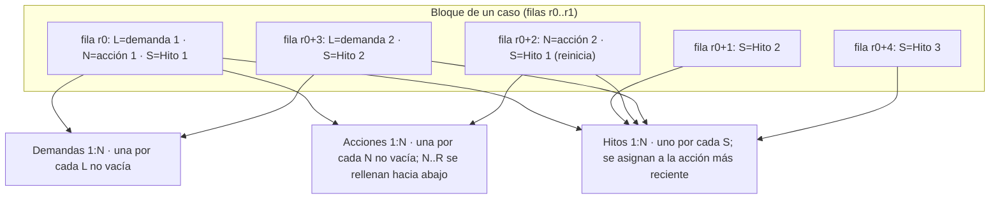

# Matriz de conflictos sociales del equipo: diagnóstico y diseño de importación/exportación

**Fecha de corte:** 2026-11-23
**Fuente Excel:** `docs/01_requisitos/23NOV2026 MATRIZ DE CONFLICTOS SOCIALES (1).xlsx`
**Fuente base:** Neon, consultas de sólo lectura (`conn.set_session(readonly=True)`)
**Parser:** `scripts/matriz/parse_matriz.py` → `scripts/matriz/salida/casos.json` y `resumen_validacion.json`

Este documento tiene dos partes. La primera describe el Excel tal como está y en qué se diferencia de lo que la base puede guardar. La segunda propone cómo importarlo y exportarlo sin inventar datos. Cada afirmación cita la hoja y fila, o la tabla y columna, de donde sale. Lo que no se pudo verificar se marca «por confirmar».

---

## 1. Qué es

La matriz del equipo es un registro operativo **por caso**, donde cada caso se abre en varias filas paralelas: una lista de demandas, una lista de acciones/compromisos y una lista de hitos por acción, todo sobre una sola hoja y un solo eje de filas.

No es lo mismo que el **Anexo 15 institucional**. La vista `analytics.vw_anexo_15_matriz_conflictividad` emite **una fila por caso** con campos agregados:

```
codigo_caso, region, alcance, subsector, tematica, responsable, nivel_conflicto,
nivel_riesgo, descripcion_riesgo, prioridad_atencion, nombre_caso,
narracion_cronologica, alertas_vinculadas, actores_involucrados, punto_focal
```

(fuente: `information_schema.columns` de `analytics.vw_anexo_15_matriz_conflictividad`).

Esa vista **no contiene listas 1:N**: no hay una fila por demanda, por acción ni por hito. La matriz del equipo sí. Por eso el Anexo 15 sirve como producto imprimible, pero no como formato de carga: importar desde el Anexo 15 perdería las 23 demandas, las 56 acciones y los 111 hitos. La matriz del equipo es el insumo operativo; el Anexo 15 es una de sus salidas.

El mockup del Anexo 15 está en `docs/07_frontend/mockups/anexo-15-matriz-conflictividad.html` y figura como vista 15 en `docs/07_frontend/frontend.md` («Anexo 15 · matriz de conflictividad», sección «Lo que no es una pantalla»).

---

## 2. Anatomía del Excel

El libro tiene **8 hojas** (el enunciado hablaba de 6; se documentan las 8 que existen). La hoja principal mide **1003 × 28** y tiene **408 fusiones** de celdas (`ws.merged_cells.ranges`), lo que explica por qué la lectura ingenua falla.

| Hoja                              | Dimensiones | Qué aporta                                                                                                                                                                                                                                                                                                                                              |
| --------------------------------- | ----------- | ------------------------------------------------------------------------------------------------------------------------------------------------------------------------------------------------------------------------------------------------------------------------------------------------------------------------------------------------------- |
| `CASOS OAIPCS - OPERATIVO`        | 1003 × 28   | La matriz. 6 grupos de columnas en la fila 1 (IDENTIFICACIÓN, ANÁLISIS Y RIESGOS, ACTORES Y DEMANDAS, INTERVENCIÓN, VERIFICACIÓN, HITOS); cabeceras en la fila 2. Es la hoja que manda.                                                                                                                                                                 |
| `METADATOS CASOS`                 | 1002 × 6    | Código de Caso, Fecha registro, Departamento, Sectorista, Prioridad y Nombre oficial. Sólo **31 códigos**. Alineación posicional con la principal (su fila `r-1` corresponde al caso que empieza en la fila `r`).                                                                                                                                       |
| `Reporte de avance de casos punt` | 1005 × 38   | Añade Alcance Geográfico, Sub Sector, Temática, Problemática/Resumen, **Nivel de Riesgo Inicial** (col 9), **Validación de Hito** (col 16), **Resumen Ejecutivo** (col 21) y **8 semanas** de «Nudos Críticos / Seguimiento» en 16 columnas (22 a 37), más **Nivel de Riesgo Actual** (col 38). Contiene **31 celdas `#REF!`**, todas en la columna 21. |
| `Seguimiento de Alertas`          | 899 × 28    | Tipo, Código de reporte (RR-2026-24), Código de caso, Responsable, Fecha, Región/Provincia/Distrito, Título, Tipo de Alerta, Resumen, Contenido, Conclusiones, Documento. **50 códigos** de reporte y **101 títulos**.                                                                                                                                  |
| `Seguimiento de Reuniones`        | 922 × 22    | Tipo, Código, Sector, Responsable, Fecha, Departamento, Lugar, Título, banderas **Asistencia / AM / RELATORIA / PUBLICACIÓN // NOTA** y Documentos. **44 títulos**, **18 con tipo**.                                                                                                                                                                    |
| `Maestros`                        | 99 × 27     | Catálogos propios del equipo. Es la clave para entender las escalas (ver más abajo).                                                                                                                                                                                                                                                                    |
| `DVPA`                            | 998 × 28    | Padrón de actores con DNI, cargo, organización, teléfono, SUNARP, recursos, embarcaciones, **Perfil de Incidencia, Postura vs PRODUCE y Capacidades 1–5**. **218 nombres**, 5 DNI, 24 con capacidades y 24 con postura.                                                                                                                                 |
| `DVMYPE-I`                        | 6 × 17      | Plantilla vacía: 4 filas y **20 celdas «(Por confirmar)»**. No se importa.                                                                                                                                                                                                                                                                              |

### 2.1 Columnas de la hoja principal (A..X)

Los ejemplos son literales de la fila 3 salvo donde se indica otra fila.

| Col | Cabecera                                  | Tipo de contenido                                                                            | Ejemplo real                                     |
| --- | ----------------------------------------- | -------------------------------------------------------------------------------------------- | ------------------------------------------------ |
| A   | `N°`                                      | Número, guardado como **float** (`1.0`)                                                      | `1.0`                                            |
| B   | `Departamento`                            | Texto, a veces multirregión                                                                  | `Piura` / `Piura / Tumbes / … / Tacna`           |
| C   | `Sectorista`                              | Nombre                                                                                       | `Ivan Ascurra Santillán`                         |
| D   | `Prioridad de Atención`                   | Catálogo de 3 valores                                                                        | `Urgente`                                        |
| E   | `Nombre de Caso`                          | Texto largo                                                                                  | `Zonificación del área de pesca en Cabo Blanco…` |
| F   | `Narración Cronológica técnica social`    | Texto largo                                                                                  | párrafo por caso                                 |
| G   | `Análisis de Caso`                        | **Hipervínculo** a carpeta de Google Drive (Canva); la celda dice «Análisis del Caso- Canva» | 32 enlaces                                       |
| H   | `Timestamp de ultima actualización`       | **Estado**, no fecha                                                                         | `Actualizado ` / `No aplica` / `Pendiente`       |
| I   | `Descripción del Riesgo Actual`           | Texto                                                                                        | párrafo por caso                                 |
| J   | `Actores del Estado`                      | Texto libre                                                                                  | lista no estructurada                            |
| K   | `Actores Sociedad Civil`                  | Texto libre                                                                                  | lista no estructurada                            |
| L   | `Demandas`                                | Texto, **una demanda por fila**                                                              | 23 filas con dato                                |
| M   | `Temática`                                | Catálogo de 4 valores                                                                        | `Infraestructura`                                |
| N   | `Acciones/Compromisos/Acuerdos`           | Texto, **una acción por fila**                                                               | 56 filas con dato                                |
| O   | `Medios de Verificaciones`                | **Instrucción**, no adjunto                                                                  | `Acción 1: Adjuntar`                             |
| P   | `Área Responsable de Monitoreo de Acción` | Texto                                                                                        | `DIPFORPA / DGPA`                                |
| Q   | `Punto Focal Monitoreo`                   | Nombre                                                                                       | `Juan Salinas Casana`                            |
| R   | `Documentos / Archivos / Otros`           | **Etiqueta**, no archivo                                                                     | `Documentos`                                     |
| S   | `Hito`                                    | Etiqueta que reinicia por acción                                                             | `Hito 1` … `Hito 4`                              |
| T   | `Descripción del Hito`                    | Texto                                                                                        | `Aprobación de términos de referencia`           |
| U   | `Responsable del Hito`                    | Texto, **fusionado sobre varios hitos**                                                      | `SERNANP / DGPA`                                 |
| V   | `Fecha Planificada`                       | Fecha o texto mixto                                                                          | `06.11.2025` / `No aplica`                       |
| W   | `Fecha Real`                              | Fecha o texto mixto                                                                          | `06.11.2025` / vacío                             |
| X   | `Estado Actual`                           | Catálogo de 3 valores                                                                        | `Cumplido` / `No Cumplido` / `Desestimado`       |

### 2.2 Los catálogos del equipo (`Maestros`)

La hoja `Maestros` declara las escalas que el equipo usa. Importa porque varias **no coinciden con los catálogos de la base**:

| Catálogo (col)                 | Valores (fuente: `Maestros`)                                                                                                                                     | Coincidencia con la base                                                                               |
| ------------------------------ | ---------------------------------------------------------------------------------------------------------------------------------------------------------------- | ------------------------------------------------------------------------------------------------------ |
| `Tipo_Caso` (col 3)            | `Alerta Temprana`, `Conflicto Social`                                                                                                                            | sin tabla propia; «por confirmar»                                                                      |
| `Prioridad` (col 3)            | `Urgente`, `Moderado `, `Bajo`                                                                                                                                   | **coincide** con `core.cat_prioridades_atencion` (1/2/3)                                               |
| `Estado del Caso` (col 3)      | `En Observación `, `Resuelto`, `Prevención`, `Seguimiento`, `En Tratamiento`                                                                                     | **no coincide**: `core.cat_estados_caso` es `Abierto`/`Resuelto`/`Archivado`; sólo `Resuelto` coincide |
| `Punto Focal` (col 3)          | 15 nombres                                                                                                                                                       | mapeo parcial a `core.usuarios.nombre`                                                                 |
| `Alcance Geográfico` (col 5)   | `Nacional `, `Norte`, `Centro`, `Sur`, `Oriente`                                                                                                                 | sin tabla 1:1; «por confirmar»                                                                         |
| `Sub Sector` (col 5)           | `Pesca y Acuicultura`, `Mype e Industria`                                                                                                                        | **coincide** con `core.cat_subsectores` (1/2)                                                          |
| `Temática` (col 5)             | `Infraestructura`, `Recursos y Regulación`, `Socio-Ambiental`, `Mesas de Conflictos`                                                                             | **sólo `Infraestructura`** existe en `core.cat_tematicas`; las otras tres no                           |
| `Nivel de Riesgo` (col 7)      | `Bajo (inicial y sin protestas)`, `Intermedio (acciones públicas de protestas)`, `Inminente (Escala por decisión o hecho)`, `Crítico (violencia, bloqueos, etc)` | **no coincide**: `core.cat_niveles_riesgo` es `Bajo`/`Moderado`/`Alto` (3 valores); el equipo usa 4    |
| `Sectorista` (col 7)           | 5 nombres                                                                                                                                                        | mapeo parcial a `core.usuarios.nombre`                                                                 |
| `Prioridad del Sector` (col 7) | `Alta Prioridad Sectorial`, `Media Prioridad Sectorial`, `Baja Prioridad Sectorial`                                                                              | sin catálogo en la base                                                                                |
| `Actualización` (col 7)        | `Actualizado `, `En proceso`, `Pendiente`, `No aplica`                                                                                                           | no es fecha; sin destino                                                                               |
| `Estado Actual` (col 9)        | `Cumplido`, `No Cumplido`, `Desestimado`                                                                                                                         | `Cumplido`→4 y `Desestimado`→5 existen; **`No Cumplido` no**                                           |
| `Riesgo` (col 9)               | `Riesgo Crítico`, `Riesgo Alto`, `Riesgo Medio`, `Riesgo Bajo`                                                                                                   | no mapea a `cat_niveles_riesgo` (otra escala)                                                          |
| `Impacto Social` (col 9)       | `Alto Impacto Social`, `Impacto Social Moderado`, `Bajo Impacto Social`                                                                                          | sin catálogo                                                                                           |
| `Rol en Conflicto` (col 11)    | `Decisor Principal`, `Decisor técnico `, `Proveedor evidencia`, `Implementador`, `Articulador territorial`, …                                                    | sin catálogo                                                                                           |
| `Fases` (col 11)               | `Temprana`, `Implementación de Acuerdos`, `Desescalamiento`, `Diálogo`, `Escalamiento`, `Crisis`                                                                 | sin catálogo                                                                                           |

Además, la columna `Punto Focal` de `Maestros` contiene valores sucios como `FALTA PUNTO FOCAL` repetido 17 veces y el literal `120000`, que no son nombres.

---

## 3. La regla de parseo

### 3.1 El bloque y las tres listas sobre el mismo eje

Un caso no es una tabla plana. Dentro de un bloque de filas conviven tres listas independientes que **comparten el mismo número de fila**:



Reglas exactas, implementadas en `scripts/matriz/parse_matriz.py`:

1. **Límite del bloque.** Un caso empieza en toda fila donde **E (`Nombre de Caso`) no está vacía**. Como las celdas del bloque están fusionadas, sólo la fila superior tiene valor; eso delimita el bloque.
2. **Campos de caso A..K.** Se rellenan hacia abajo: se toma el primer valor no vacío del bloque (expandiendo fusiones).
3. **Demandas.** Cada fila con L no vacía es una demanda. Su temática es la M de **esa misma fila**; no se hereda.
4. **Acciones.** Cada fila con N no vacía **inicia** una acción; N..R se rellenan hacia abajo hasta la siguiente acción.
5. **Hitos.** Cada fila con S no vacía es un hito. El texto S reinicia en «Hito 1» al comenzar cada acción, así que cada hito se asigna a la acción cuyo inicio es **la fila más reciente menor o igual** a la fila del hito. Es exacto porque toda acción empieza en una fila que también tiene «Hito 1».

### 3.2 Por qué leer fila a fila produce datos cruzados

Si se lee cada fila como un registro plano se obtienen demandas y acciones cruzadas: una fila con `L` y `N` a la vez genera una «demanda» que en realidad pertenece a la acción anterior, y las filas de hitos sin `N` se pierden. El ejemplo real es la fila 3: tiene `L` (demanda 1), `N` (acción 1) y `S` («Hito 1») simultáneamente. Tratarla como un solo registro mezcla tres entidades.

### 3.3 Corrección al enunciado: se delimita por E, no por A

El enunciado proponía usar la columna A (`N°`) como delimitador. Se comprobó y **falla**:

- A está guardada como **float** (`1.0`, `2.0`); `isinstance(v, int)` no devuelve ninguna fila.
- Delimitar por A da **34 bloques**, pero **engulle 3 casos que no llevan número**: fila 118 («Presunta depredación de Anchoveta por alta pesca juvenil»), fila 127 («Disconformidad ciudadana en Chilca…») y fila 132 («Mortandad masiva de truchas… en Junín»).
- Además hay un **«15» duplicado** en la fila 128 (el caso 15 real está en la fila 48), y falta el 32.

Delimitar por E da **37 casos** y conserva los totales 23/56/111 (fuente: `resumen_validacion.json`, bloque `validacion.bloques_a_contra_e`).

### 3.4 Test del bloque 1

El bloque 1 (filas 3..15) es el caso de referencia. El resultado del parser es:

| Medida   | Valor  |
| -------- | ------ |
| Demandas | **7**  |
| Acciones | **5**  |
| Hitos    | **13** |

**Discrepancia con el enunciado:** el enunciado afirmaba «6 demandas». Son **7**. Las filas 3, 4, 5, 6, 9, 12 y 15 traen texto distinto en L y **no hay ninguna fusión en L** (la única fusión de esa zona es `J1:M1`, que es de cabecera). El total de 23 demandas se reparte así (fuente: `casos.json`):

| Caso                             | Demandas |
| -------------------------------- | -------- |
| Caso 1 (`CS-PA-REG-2024-01`)     | 7        |
| Caso 2 (`CS-PA-INF-2025-02`)     | 3        |
| Caso 8 (`CS-PA-REG-2024-08`)     | 6        |
| Caso 11 (`CS-PA-REG-2021-11`)    | 3        |
| Bloque «15» duplicado (fila 128) | 4        |
| **Total**                        | **23**   |

Sólo 5 de los 37 casos tienen demandas. El desvío es del enunciado, no del parser; el total sí cuadra y no se forzó el 6.

### 3.5 Excepciones que el parser declara

- **Hitos antes de la acción.** El caso de la fila 74 (hitos 1..4 escritos antes que su única acción, en la fila 78) contradice la afirmación «toda acción empieza con Hito 1». El parser asigna esos hitos a la primera acción y lo registra como advertencia, en lugar de perderlos.
- **Fusiones.** U (Responsable), V, W y X están fusionadas sobre varios hitos (por ejemplo `U114:U117='DGAAMI'`, `V114:V117`, `W128:W131`). El parser expande las fusiones para leer el valor efectivo de cada celda; **los inicios se detectan siempre sobre el valor crudo**, para que una fusión no convierta cada fila en un «nuevo» inicio.
- **Descripciones sin etiqueta.** Hay 8 filas con `Descripción del Hito` pero sin etiqueta S (filas 68, 113 y 118–123). No cuentan como hito y se declaran.

### 3.6 Validación real del parser

Salida de `python scripts/matriz/parse_matriz.py` (2026-11-23):

```
TOTAL casos=37  demandas=23  acciones=56  hitos=111
Esperado          demandas=23  acciones=56  hitos=111
CUADRA: SÍ
Bloque 1: obtenido 7/5/13  ·  realidad 7/5/13 -> True  ·  enunciado 6/5/13 -> False
Hitos asignados a una acción: 111/111 (sin acción: 0) -> True
```

El parser se ejerce como test de regresión: si una futura versión del Excel cambia el reparto, `CUADRA` pasa a `NO` y el proceso termina con código de salida 1.

---

## 4. Cobertura Excel → base

Tres valores: **Existe** (mapeo directo), **Existe con matiz** (hay destino, pero con una pérdida o transformación que se declara) y **No existe** (no hay columna ni tabla de destino).

### 4.1 Columnas de la hoja principal

| Excel                              | Contenido                              | Valoración           | Destino real                                                                                  | Observación (fuente)                                                                                                                                                  |
| ---------------------------------- | -------------------------------------- | -------------------- | --------------------------------------------------------------------------------------------- | --------------------------------------------------------------------------------------------------------------------------------------------------------------------- |
| A `N°`                             | Numeración del caso (float)            | **No existe**        | —                                                                                             | No es clave: 34 bloques por A vs 37 por E; «15» duplicado en fila 128; falta el 32 (principal col A).                                                                 |
| B `Departamento`                   | Texto, a veces multirregión            | **Existe con matiz** | `core.casos.region_principal_id` + `core.caso_regiones`                                       | 19 valores; listas con `/` (p. ej. «Piura / Tumbes / … / Tacna», 2 filas) y «Nacional». Requiere partir y resolver región.                                            |
| C `Sectorista`                     | Nombre                                 | **Existe con matiz** | `core.usuarios.nombre` → `core.casos.punto_focal_usuario_id`                                  | 5 nombres. 4 de 5 aparecen en `core.usuarios` por nombre; `Daniel Vela` no. No hay columna «sectorista»; el campo de caso es punto focal.                             |
| D `Prioridad de Atención`          | `Urgente`/`Moderado`/`Bajo`            | **Existe**           | `core.casos.prioridad_id`                                                                     | 6/20/11; coincide 1:1 con `cat_prioridades_atencion`. El riesgo **no** está aquí (vive en `Reporte de avance` col 9/38 y en `Maestros`).                              |
| E `Nombre de Caso`                 | Texto                                  | **Existe**           | `core.casos.nombre_caso`                                                                      | Es el delimitador de bloque; 37 valores.                                                                                                                              |
| F `Narración Cronológica`          | Texto largo                            | **Existe con matiz** | `core.caso_cronologia.descripcion_hecho` (varios) / `core.casos.resumen_ejecutivo`            | Un texto por caso; la base tiene 80 filas de cronología **fechadas**; requiere segmentar en hechos.                                                                   |
| G `Análisis de Caso (Canva)`       | Hipervínculo a Drive                   | **No existe**        | `core.casos.link_reporte_pdf` (discutible) / sin columna propia                               | 32 enlaces, 1 duplicado (fila 128 reusa el de la 48). El front ya lo declara no disponible (item 97).                                                                 |
| H `Timestamp última actualización` | Estado, no fecha                       | **No existe**        | —                                                                                             | Valores `Actualizado `/`Pendiente`/`No aplica`; `core.casos.fecha_ultima_actualizacion` no aplica.                                                                    |
| I `Descripción del Riesgo Actual`  | Texto                                  | **Existe**           | `core.casos.descripcion_riesgo`                                                               | —                                                                                                                                                                     |
| J `Actores del Estado`             | Texto libre                            | **Existe con matiz** | `core.actores` + `core.casos_actores`                                                         | Texto no estructurado; hay que separar actores y vincular con `caso_id`.                                                                                              |
| K `Actores Sociedad Civil`         | Texto libre                            | **Existe con matiz** | `core.actores` + `core.casos_actores`                                                         | Igual que J.                                                                                                                                                          |
| L `Demandas`                       | Texto, 1:N                             | **Existe con matiz** | `core.demandas.descripcion_demanda`                                                           | 23 filas. Una sola columna → sólo descripción; el desglose 3P **no existe en el Excel**.                                                                              |
| M `Temática`                       | Catálogo de 4 valores                  | **Existe con matiz** | `core.demandas.tematica_id`                                                                   | 16/23 con dato; 7 sin temática. `Recursos y Regulación`, `Socio-Ambiental`, `Mesas de Conflictos` no están en `cat_tematicas`.                                        |
| N `Acciones/Compromisos/Acuerdos`  | Texto, 1:N                             | **Existe**           | `core.compromisos.accion_compromiso`                                                          | 56 acciones; la base tiene 8.                                                                                                                                         |
| O `Medios de Verificaciones`       | Instrucción                            | **Existe con matiz** | `core.hitos_compromiso.descripcion_evidencia` / `link_evidencia` / `core.demandas_evidencias` | Es «Acción 1: Adjuntar», no una URI ni un archivo. Requiere adjuntar antes de cargar.                                                                                 |
| P `Área Responsable de Monitoreo`  | Texto (`DIPFORPA / DGPA`)              | **Existe con matiz** | `core.compromisos.unidad_responsable_id` / `core.casos.unidad_responsable_id`                 | Requiere curaduría a `core.cat_unidades_organicas`; el texto trae varias áreas por barra.                                                                             |
| Q `Punto Focal Monitoreo`          | Nombre                                 | **Existe con matiz** | `core.casos.punto_focal_usuario_id`                                                           | En el Excel es **por acción**; en la base es **por caso**. Mapeo de nombre a usuario parcial.                                                                         |
| R `Documentos / Archivos / Otros`  | Etiqueta (`Documentos`)                | **Existe con matiz** | `core.documentos`                                                                             | Es una etiqueta, no un archivo; requiere alta real del documento.                                                                                                     |
| S `Hito`                           | Etiqueta (`Hito N`)                    | **Existe**           | `core.hitos_compromiso.codigo_hito`                                                           | 111 hitos; «Hito N» reinicia por acción.                                                                                                                              |
| T `Descripción del Hito`           | Texto                                  | **Existe**           | `core.hitos_compromiso.descripcion_hito`                                                      | 8 descripciones sin etiqueta S no cuentan.                                                                                                                            |
| U `Responsable del Hito`           | Texto, fusionado                       | **No existe**        | —                                                                                             | 100 hitos con responsable (103 celdas U crudas; 6 caen en filas sin S). `core.hitos_compromiso` no tiene columna de responsable.                                      |
| V `Fecha Planificada`              | Fecha o mixto                          | **Existe con matiz** | `core.hitos_compromiso.fecha_vencimiento`                                                     | 21 valores no convertibles: `31.12.2025, 02, 03 y 05.01.2026`, `12, 20, 21, 25 y 27,02,2026`, `No aplica`, `Constante`, `-`, `Julio 2026 - Noviembre 2026`, `2024.0`. |
| W `Fecha Real`                     | Fecha o mixto                          | **Existe con matiz** | `core.hitos_compromiso.fecha_real`                                                            | Mismos formatos sucios.                                                                                                                                               |
| X `Estado Actual`                  | `Cumplido`/`No Cumplido`/`Desestimado` | **Existe con matiz** | `core.hitos_compromiso.estado_id`                                                             | Reparto: Cumplido 59, No Cumplido 41, No cumplido 2, Desestimado 1, vacío 8. **`No Cumplido` (43) no está en `cat_estados_hito`.**                                    |

### 4.2 Columnas de `Reporte de avance`

| Dato                                                                                              | Valoración           | Destino real                                                                   | Observación (fuente)                                                                                                                       |
| ------------------------------------------------------------------------------------------------- | -------------------- | ------------------------------------------------------------------------------ | ------------------------------------------------------------------------------------------------------------------------------------------ |
| `Alcance Geográfico` (col 3)                                                                      | **Existe con matiz** | `core.cat_alcances_geograficos` (existe) / `core.alcance_caso` «por confirmar» | Valores `Nacional`/`Norte`/`Centro`/`Sur`/`Oriente`.                                                                                       |
| `Sub Sector` (col 5)                                                                              | **Existe**           | `core.casos.subsector_id`                                                      | `Pesca y Acuicultura`/`Mype e Industria` = `cat_subsectores` 1/2.                                                                          |
| `Temática del Caso` (col 6)                                                                       | **Existe con matiz** | `core.casos.tematica_id`                                                       | `Recursos y Regulación` aparece 18 veces y no está en `cat_tematicas`.                                                                     |
| `Problemática/Resumen` (col 7)                                                                    | **Existe**           | `core.casos.resumen_ejecutivo`                                                 | —                                                                                                                                          |
| `Descripción del Riesgo` (col 8)                                                                  | **Existe**           | `core.casos.descripcion_riesgo`                                                | —                                                                                                                                          |
| `Nivel de Riesgo Inicial` (col 9)                                                                 | **No existe**        | —                                                                              | Escala de 4 valores (`Intermedio` 18, `Bajo` 8, `Inminente` 2, `Crítico` 1); no hay columna propia y no coincide con `cat_niveles_riesgo`. |
| `Validación de Hito` (col 16)                                                                     | **Existe**           | `core.hitos_compromiso.validacion`                                             | `Validado` 85, variantes `Validación Pendiente`/`Pendiente validacion`/`Plan pendiente de aprobación`/`Validad`/`Por Validar` (15).        |
| `Resumen Ejecutivo` (col 21)                                                                      | **Existe con matiz** | `core.casos.resumen_ejecutivo`                                                 | **31 celdas `#REF!`**, todas en esta columna.                                                                                              |
| **Nudos Críticos / Seguimiento** (cols 22–37, 16 columnas = 8 semanas, del 01-feb al 11-may-2026) | **No existe**        | —                                                                              | No hay tabla de seguimiento semanal. Búsqueda `information_schema.columns where column_name ~* 'nudo                                       | semana | critic'`sólo devuelve`core.caso_cronologia.es_hecho_critico`y`kag.metrica_nodo.es_critico`. |
| `Nivel de Riesgo Actual` (col 38)                                                                 | **Existe con matiz** | `core.casos.nivel_riesgo_id`                                                   | 4 valores del equipo; la base sólo tiene 3 (`Bajo`/`Moderado`/`Alto`).                                                                     |

### 4.3 Hojas auxiliares y DVPA

| Dato                                                                                                                                         | Valoración           | Destino real                                                                                          | Observación                                                                                                                |
| -------------------------------------------------------------------------------------------------------------------------------------------- | -------------------- | ----------------------------------------------------------------------------------------------------- | -------------------------------------------------------------------------------------------------------------------------- |
| Alertas: Tipo, Código (RR-2026-24), Caso, Responsable, Fecha, Región/Provincia/Distrito, Título, Resumen, Contenido, Conclusiones, Documento | **Existe con matiz** | `core.alertas_tempranas` (83 en base; 50 códigos / 101 títulos en Excel)                              | La base ya tiene alertas, pero de otra carga; no hay clave por código de reporte contra la del Excel «por confirmar».      |
| Reuniones: Tipo, Código, Sector, Responsable, Fecha, Departamento, Lugar, Título, banderas, Documentos                                       | **Existe con matiz** | `core.reuniones_dialogo` (**0 filas**) + `core.reunion_participantes` (**0**)                         | Sin masa crítica: la tabla existe vacía. Banderas booleanas: Asistencia 16, AM 3, RELATORIA 7, PUBLICACIÓN 2 (verdaderos). |
| DVPA: Nombre, DNI, Cargo, Organización, Teléfono                                                                                             | **Existe con matiz** | `core.actores` + `core.actor_datos_personales` (`dni`, `dni_cifrado`, `dni_hmac`, `telefono_cifrado`) | 218 nombres, 5 DNI. PII cifrada; requiere flujo autorizado.                                                                |
| DVPA: Perfil de Incidencia                                                                                                                   | **Existe con matiz** | `core.actores.perfil_descripcion`                                                                     | 24 con perfil: `DIALOGANTE` 10, `DISRUPTIVO` 9, `LEGITIMANTE` 4, `SIN INFORMACIÓN` 1.                                      |
| DVPA: Postura vs PRODUCE                                                                                                                     | **Existe con matiz** | `core.casos_actores.posicion` (analogía)                                                              | 24 con postura: `Confrontacional` 7, `Colaborativa` 6, etc. La columna de la base es por vínculo caso–actor, no por actor. |
| DVPA: Capacidades 1–5                                                                                                                        | **No existe**        | —                                                                                                     | No hay columnas en `core.actores`.                                                                                         |
| `DVMYPE-I` (plantilla)                                                                                                                       | **No existe**        | —                                                                                                     | Todo «(Por confirmar)»; no se importa.                                                                                     |

---

## 5. Diagnóstico de masa crítica

La matriz del equipo **casi no está cargada** en la base. Los totales lo muestran sin ambigüedad (Excel: `casos.json`; base: `SELECT count(*)` de sólo lectura, 2026-11-23):

| Elemento               | Excel del equipo           | Base Neon                        | Lectura                                                                                                                                |
| ---------------------- | -------------------------- | -------------------------------- | -------------------------------------------------------------------------------------------------------------------------------------- |
| Casos                  | 37 bloques (31 con código) | `core.casos` = 35                | Números parecidos, **contenido distinto**: no hay clave que los una.                                                                   |
| Demandas               | **23**                     | `core.demandas` = **325**        | La base tiene **14 veces más** demandas de las que trae la matriz. Vienen de otra fuente (códigos `DEM-2026-XXXX`), no de esta matriz. |
| Acciones / compromisos | **56**                     | `core.compromisos` = **8**       | La matriz trae **7 veces más** acciones de las cargadas.                                                                               |
| Hitos                  | **111**                    | `core.hitos_compromiso` = **12** | La matriz trae **9 veces más** hitos de los cargados.                                                                                  |
| Alertas                | 50 códigos / 101 títulos   | `core.alertas_tempranas` = 83    | Fuente distinta; sin clave de unión verificada.                                                                                        |
| Reuniones              | 44 títulos                 | `core.reuniones_dialogo` = **0** | La tabla existe vacía.                                                                                                                 |
| Actores DVPA           | 218 nombres                | `core.actores` = 1160            | El padrón DVPA no está cargado como tal (sólo 5 DNI).                                                                                  |
| Documentos             | —                          | `core.documentos` = 153          | De tipo `analisis_caso` (id 6) hay **1**.                                                                                              |

### 5.1 No hay clave de unión Excel → base

De los **31 códigos** del Excel (`CS-PA-REG-2024-01`, `CS-PA-INF-2025-02`, …), sólo **2** coinciden textualmente con `core.casos.codigo_caso`, y **ambos apuntan a otro caso**:

| Código              | Nombre en el Excel                             | Nombre en la base                                                | `codigo_legado` en base |
| ------------------- | ---------------------------------------------- | ---------------------------------------------------------------- | ----------------------- |
| `CS-PA-INF-2025-02` | «Pescadores artesanales del DPA Los Órganos…»  | «Mejoramiento de infraestructura del DPA de Chimbote»            | `CS-PRODUCE-2026-013`   |
| `CS-PA-INF-2025-05` | «La OSPA José Olaya Balandra… IPA Chorrillos…» | «Mejoramiento de infraestructura del DPA de San Juan de Marcona» | `CS-PRODUCE-2026-019`   |

Conclusión: **la matriz no se puede casar con la base por código**. Hace falta una **tabla de mapeo manual** Excel-N°/nombre → `core.casos.codigo_caso`. Los 6 casos sin código (el «15» duplicado, Anchoveta, Chilca, Junín y dos más) tampoco tienen identificador.

### 5.2 Qué se puede prometer y qué no

**Se puede prometer:**

- Cargar la matriz como **fuente nueva**, caso por caso, con el mapeo explícito.
- Que el import es **idempotente** y transaccional: no deja estados a medias.
- Que cada fila rechazada se informa con motivo; nada se descarta en silencio.
- Que la exportación reproduce las cabeceras del equipo y declara las celdas sin dato.

**No se puede prometer:**

- Que la base «refleje» la matriz sin el mapeo: hoy 0 casos son identificables por código.
- Que las 325 demandas de la base salgan de la matriz: la matriz sólo tiene 23.
- Que los huecos (responsable del hito, 3P, nudos semanales, capacidades, riesgo inicial, Canva) se guarden sin un cambio de esquema.
- Cifras totales «completas» mientras la matriz siga siendo la única fuente de esos 56/111 registros.

---

## 6. Diseño de importación

### 6.1 Plantilla XLSX

Se proponen dos formatos. El **formato equipo** (una hoja con las columnas A..X) sirve para que el equipo siga trabajando en lo suyo; el **formato normalizado** es el que el importador consume.

**Formato normalizado** (una hoja por entidad), con `codigo_caso` de AVISA en todas:

- `Casos`: `codigo_caso`, A..K (B `Departamento`, C `Sectorista`, D `Prioridad`, E `Nombre`, F `Narración`, G `Análisis Canva`, H `Timestamp`, I `Riesgo`, J/K `Actores`).
- `Demandas`: `codigo_caso`, `fila_origen`, L `Demanda`, M `Temática`.
- `Acciones`: `codigo_caso`, `fila_origen`, `codigo_accion`, N..R.
- `Hitos`: `codigo_caso`, `codigo_accion`, S..X.

Se mantiene `fila_origen` como trazabilidad a la hoja del equipo, no como clave.

### 6.2 Validaciones (bloqueantes vs advertencia)

| Regla                                                                              | Nivel                   | Motivo                                                                         |
| ---------------------------------------------------------------------------------- | ----------------------- | ------------------------------------------------------------------------------ |
| `codigo_caso` no existe en `core.casos`                                            | **Rechazo**             | Sin caso no hay destino; 31/37 y 2 falsos positivos lo hacen probable.         |
| `codigo_caso` duplicado dentro del archivo                                         | **Rechazo**             | Ambigüedad de destino.                                                         |
| Fecha que no es fecha (V/W: `No aplica`, `31.12.2025, 02…`, `2024.0`)              | **Advertencia**         | Se omite la fecha y se conserva el texto crudo en el informe.                  |
| Estado del hito no mapeable (`No Cumplido`)                                        | **Advertencia**         | Se mapea a `Registrado` (borrador) o se rechaza la fila según decisión 2 (§9). |
| Temática fuera de catálogo (`Recursos y Regulación`, …)                            | **Advertencia**         | Se deja `tematica_id` nulo y se informa.                                       |
| Acción sin hito                                                                    | **Advertencia**         | 11 acciones del Excel están así; se cargan sin hitos.                          |
| Hito con descripción pero sin etiqueta S                                           | **Rechazo de esa fila** | No es un hito; se informa.                                                     |
| Duplicado por `codigo_hito` dentro del mismo compromiso, o mismo texto normalizado | **Rechazo**             | Evita doble carga en reimportaciones.                                          |
| Responsable del hito (col U) presente                                              | **Advertencia**         | No hay destino; se guarda en el informe como «dato no almacenado».             |
| `Nombre de caso` vacío en `Casos`                                                  | **Rechazo**             | El nombre es el delimitador.                                                   |

### 6.3 Resolución de conflictos (crear / actualizar / ignorar)

Por cada entidad, la política se decide a nivel de lote (parámetro `modo`):

| Entidad    | Clave de conciliación                       | Crear        | Actualizar                          | Ignorar           |
| ---------- | ------------------------------------------- | ------------ | ----------------------------------- | ----------------- |
| Compromiso | `caso_id` + `accion_compromiso` normalizada | Si no existe | Si existe y cambia texto/fechas     | Si existe e igual |
| Hito       | `compromiso_id` + `codigo_hito`             | Si no existe | Si cambia descripción/estado/fechas | Si igual          |
| Demanda    | `caso_id` + texto normalizado               | Si no existe | Si cambia texto/temática            | Si igual          |

El «ignorar» **no** borra: no hay borrado físico; si el archivo omite una fila existente, la fila se conserva (el import es incremental, no una sincronización destructiva).

### 6.4 Orden transaccional e idempotencia

1. Validar el archivo completo en memoria **sin escribir** (fase de previsualización, §8).
2. Por lote (un caso por transacción):
   ```
   BEGIN;
     upsert core.casos (si corresponde);
     upsert core.compromisos por (caso_id, accion_compromiso);
     upsert core.hitos_compromiso por (compromiso_id, codigo_hito);
     upsert core.demandas por (caso_id, texto);
   COMMIT;
   ```
   Cualquier error revierte **ese lote** (`ROLLBACK`) y no los anteriores.
3. **Idempotencia:** `codigo_legado` del compromiso y del hito se calcula como `hash(codigo_caso + codigo_accion + codigo_hito)`. Reimportar el mismo archivo produce los mismos `codigo_legado` y actualiza en vez de duplicar.
4. Se registra un `run` (fecha, usuario, archivo, conteos) para auditoría, reutilizando el patrón del item 59 («pipeline observable»).

### 6.5 Informe de importación (lo que la UI debe mostrar)

Estructura mínima, por fila (las cifras del ejemplo son ilustrativas del formato, no medidas):

```
{
  "resumen": { "filas_fuente": 190,
               "aceptadas": 160, "advertencias": 18, "rechazadas": 12 },
  "conciliacion": "aceptadas + advertencias + rechazadas = filas_fuente",
  "detalle": [
    { "hoja": "Hitos", "fila": 47, "codigo_caso": "CS-PA-REG-2024-01",
      "estado": "advertencia",
      "motivo": "Fecha Planificada 'No aplica' no es fecha; se omite la fecha." }
  ]
}
```

La pantalla muestra los tres contadores, la tabla de rechazos con motivo y un botón para descargar el CSV de rechazos. Es el mismo contrato que pide el item 59 (tabla de rechazos/errores con motivo y descarga).

---

## 7. Diseño de exportación

### 7.1 Columnas y formatos

- **XLSX:** reproduce las cabeceras del equipo (A..X) en una hoja `Matriz`, más una columna `codigo_caso` (de AVISA) al inicio. Opcionalmente, una hoja `Sin datos` que lista celda por celda qué no se pudo exportar.
- **CSV:** una fila por hito (formato largo), con columnas `codigo_caso, accion, hito, descripcion, fecha_planificada, fecha_real, estado, validacion`.
- **JSON:** el mismo contrato que emite `scripts/matriz/salida/casos.json` (`{meta, auxiliares, casos[]}`), para reimportación y consumo programático.

### 7.2 Celdas que salen como «sin dato»

Por la regla del `_BRIEF.md` («el dato ausente se declara, no se estima»), estas celdas **no se rellenan con un valor inventado**. Se exportan vacías y se listan en la hoja `Sin datos` con el motivo:

| Celda / campo                               | Motivo                                                                          |
| ------------------------------------------- | ------------------------------------------------------------------------------- |
| U `Responsable del Hito`                    | No existe columna de destino.                                                   |
| G `Análisis de Caso (Canva)`                | Enlace externo; sin columna propia.                                             |
| Desglose 3P de la demanda                   | No existe en el Excel.                                                          |
| Nudos críticos semanales                    | No existe tabla.                                                                |
| Nivel de Riesgo Inicial                     | No existe columna.                                                              |
| Capacidades 1–5 y postura de actores        | No existe columna.                                                              |
| V/W cuando la fecha no es convertible       | Se exporta el texto crudo en una columna `fecha_texto_origen` y la fecha vacía. |
| M cuando la temática está fuera de catálogo | `tematica_id` nulo; se conserva el texto original.                              |
| X cuando el estado es `No Cumplido`         | Sin catálogo; se marca `sin_catalogo`.                                          |

---

## 8. Qué necesita la UI

### 8.1 Contrato mínimo de endpoints

| Método y ruta                                                      | Función                                                      | Escribe           |
| ------------------------------------------------------------------ | ------------------------------------------------------------ | ----------------- |
| `POST /api/v1/casos/{codigo}/matriz/import/preview`                | Sube el XLSX, valida y devuelve el informe **sin escribir**. | No                |
| `POST /api/v1/casos/{codigo}/matriz/import`                        | Ejecuta el import por lotes; exige el token del preview.     | Sí, transaccional |
| `GET /api/v1/casos/{codigo}/matriz/export?formato=xlsx\|csv\|json` | Descarga.                                                    | No                |

`{codigo}` es `core.casos.codigo_caso` (no el `N°` del Excel, que no es clave).

### 8.2 Previsualización en dos pasos

1. **Paso 1 — previsualizar:** se sube el archivo, se corre la validación completa y se muestra el informe (§6.5) con los contadores y los rechazos. **No se escribe nada.**
2. **Paso 2 — confirmar:** el usuario confirma; se ejecuta el import transaccional y se muestra el mismo informe con los conteos definitivos. Si se rechaza, el preview caduca.

### 8.3 Pantalla que lo hospeda

La ficha del caso, `/casos/:codigo` (fuente: `docs/07_frontend/frontend.md`), en una pestaña nueva de importación/exportación de la matriz. El mockup previsto es `docs/07_frontend/mockups/matriz-conflictividad-caso.html` (en dibujo paralelo a la fecha de corte; **no se edita desde este documento**). Mientras ese mockup no exista, el primer mockup funcional es `ficha-pestanas.html`.

Items del catálogo que se conectan con este diseño (fuente: `docs/07_frontend/frontend_detalle.md`):

- **42** — exportación con filtros y hoja de impresión (base para el export).
- **58–62** — módulo ETL de tres pestañas: lectura real de XLSX, pipeline observable con tabla de rechazos y motivo, y conciliación `cargados + fusionados + descartados + pendientes = registros fuente`. El import de la matriz es un caso particular de ese pipeline.
- **75** — generador de anexos con contrato de esquema; el export XLSX de la matriz es un anexo más.
- **86** — generación por lote; reutiliza el mismo stepper e informe.
- **97** — «Caso de análisis (Canva)»: hoy se declara no disponible; explica el hueco de la columna G.

---

## 9. Riesgos y decisiones abiertas

1. **Sin clave de unión.** 31 códigos en el Excel; sólo 2 coinciden con `core.casos.codigo_caso` y ambos apuntan a otro caso. Sin una tabla de mapeo manual, el import no puede asignar filas a casos. Riesgo alto.
2. **Escalas incompatibles.** Temática (4 valores del equipo vs 6 de la base; sólo `Infraestructura` coincide), riesgo (4 valores vs 3), estado del hito (`No Cumplido` ausente). Cada una exige una tabla de equivalencias o el rechazo de la fila.
3. **Huecos sin destino.** Responsable del hito (100 hitos), Análisis Canva (32 enlaces), 3P de la demanda, seguimiento semanal de nudos críticos (16 columnas), capacidades 1–5 y postura de actores, riesgo inicial. Ninguno se puede guardar hoy sin cambio de esquema.
4. **Masa crítica invertida.** Base 8 compromisos / 12 hitos / 325 demandas frente a matriz 56 / 111 / 23. La matriz no es la fuente de las 325 demandas; el import la añade como fuente nueva, no reemplaza la existente.
5. **Numeración no fiable.** `N°` es float, hay un «15» duplicado (fila 128) y falta el 32; usar E como delimitador da 37 casos. Cualquier script que use A pierde 3 casos.
6. **PII del DVPA.** DNI y teléfono van cifrados (`core.actor_datos_personales`); importarlos exige el flujo de cifrado y permisos, no una carga directa. Sólo 5 de 218 nombres traen DNI.
7. **Datos sucios bloqueantes.** 31 `#REF!` en resumen ejecutivo, 21 fechas no convertibles, 43 estados fuera de catálogo, 11 acciones sin hito, 8 descripciones sin etiqueta.
8. **Reuniones vacías.** `core.reuniones_dialogo` y `core.reunion_participantes` tienen 0 filas; importar las 44 reuniones del Excel es un proyecto aparte del import de la matriz.
9. **Idempotencia y reversión.** El import debe ser transaccional por lote y reversible; sin `codigo_legado` estable, una reimportación duplica.
10. **UI en paralelo.** El mockup `matriz-conflictividad-caso.html` se está dibujando por otro frente; el contrato de endpoints de §8 es el que debe respetar.

### 9.1 Decisiones que requieren aprobación

| #   | Decisión                                                                            | Opciones                                                                                                                                                             |
| --- | ----------------------------------------------------------------------------------- | -------------------------------------------------------------------------------------------------------------------------------------------------------------------- |
| D1  | Cómo resolver la falta de clave Excel → base                                        | (a) tabla de mapeo manual mantenida por OAIPCS; (b) regenerar los códigos del Excel con el esquema de la base; (c) importar como casos nuevos con `codigo_legado`.   |
| D2  | Qué hacer con `No Cumplido` (43 hitos)                                              | (a) añadir el estado al catálogo `cat_estados_hito`; (b) mapearlo a `Registrado`; (c) rechazar la fila.                                                              |
| D3  | Qué hacer con los huecos sin destino (U, G, 3P, nudos, capacidades, riesgo inicial) | (a) ampliar el esquema con tablas/columnas; (b) exportarlos a un JSON/hoja aparte «no almacenado»; (c) declararlos no disponibles en la UI mientras no haya esquema. |

---

## Anexo. Cómo se reproduce

```
python scripts/matriz/parse_matriz.py
```

Salidas:

- `scripts/matriz/salida/casos.json` — `{meta, auxiliares, casos[]}`; un único archivo global (volumen pequeño; el importador necesita el orden y los totales en una lectura).
- `scripts/matriz/salida/resumen_validacion.json` — validación, no mapeado y conteos de hojas auxiliares.

El parser no escribe en la base: sólo abre el XLSX con `openpyxl` en modo lectura.
