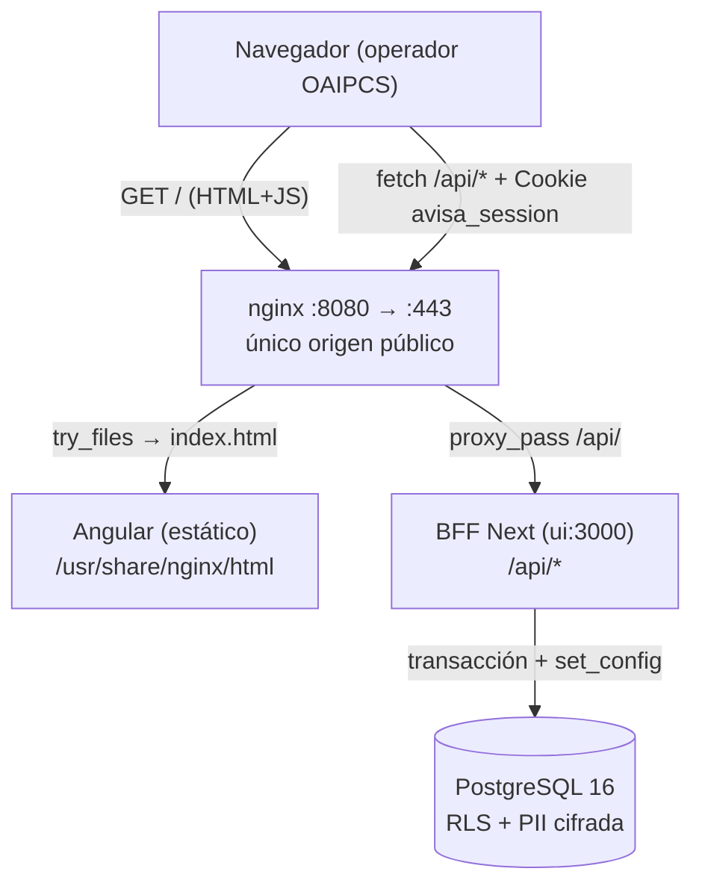
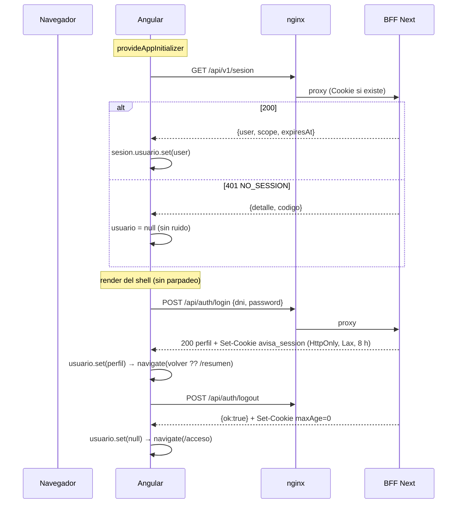

# Diseño de migración de AVISA a Angular

> **Tipo de documento:** diagnóstico + diseño. **No** es implementación y no modifica código.
> **Fecha:** 2026-11-21. **Autor:** arquitectura de frontend.
> **Alcance:** migrar la interfaz Next.js/React a una SPA Angular, conservando el backend actual.
> **Complementa a:** `docs/07_frontend/angular/INVENTARIO_PARIDAD_UI.md` (inventario de vistas) y
> `docs/07_frontend/migracion_angular.md` (análisis previo). Este documento **decide**; el inventario
> **enumera**. Donde difiero del análisis previo lo digo explícitamente (§0.3).
> **Regla de evidencia:** toda afirmación sobre el repo se apoya en una lectura del archivo citado.
> Lo que no pude verificar está marcado como **supuesto** (§0.4) o **inferencia**.

> **Estado (2026-11-22): ejecutado y superado en parte.** Las citas a `app/page.tsx`,
> `components/`, `frontend/` y `lib/api-*` describen el repositorio del 2026-11-21 y se
> conservan como registro de las decisiones. La UI React se retiró: hoy `app/` sólo tiene
> rutas de API, `lib/api/roles.ts` guarda el vocabulario de rol y la consola Angular se
> sirve desde `public/` en el mismo despliegue. El estado vigente está en
> `docs/06_operacion/DESPLIEGUE_VERCEL_NEON.md`.

---

## 0. Diagnóstico verificado (base de las decisiones)

### 0.1 Lo que confirmé leyendo el código

| Hecho                                                                                                                                                                                                 | Evidencia                                                                                                                                                  | Consecuencia de diseño                                                                        |
| ----------------------------------------------------------------------------------------------------------------------------------------------------------------------------------------------------- | ---------------------------------------------------------------------------------------------------------------------------------------------------------- | --------------------------------------------------------------------------------------------- |
| La app es una SPA React con **una sola ruta** (`/`), que alterna login/dashboard con `useState`                                                                                                       | `app/page.tsx:12-71`                                                                                                                                       | No hay superficie de URLs que "estrangular" (§1)                                              |
| Ningún dato llega por RSC/Server Actions: todo es `fetch` desde el navegador                                                                                                                          | `app/page.tsx:21`, `lib/api-client.ts:32-37`, `lib/avisa-store.tsx:232-355`                                                                                | El porting no tiene el problema difícil de Next→Angular                                       |
| Sesión = cookie firmada HMAC-SHA256 `avisa_session`, `base64url(payload).base64url(mac)`                                                                                                              | `lib/db/auth.ts:3-4,30-36`                                                                                                                                 | El navegador no puede leerla → hace falta `GET /api/v1/session`                               |
| Flags de cookie: `httpOnly`, `sameSite=lax`, `path=/`, `maxAge` 8 h, `secure` **solo** si `NODE_ENV==='production'`; **sin `Domain`** (host-only)                                                     | `app/api/auth/login/route.ts:113-119`; `lib/db/auth.ts:4`                                                                                                  | Origen único obligatorio; ojo con `localhost` vs `127.0.0.1`                                  |
| El logout borra la cookie con `maxAge:0` pero **omite `secure`**                                                                                                                                      | `app/api/auth/logout/route.ts:9-14`                                                                                                                        | Funciona igual (la identidad de cookie es nombre+dominio+ruta), pero conviene alinearlo       |
| `POST /api/auth/login` recibe `{dni, password}`, valida `8..12` y `1..128`, y devuelve el **perfil** (no el token)                                                                                    | `app/api/auth/login/route.ts:40-64,100-111`                                                                                                                | Angular guarda perfil en un signal, nunca un token                                            |
| `GET /api/v1/session` → `{user, scope:{mode:"all",regiones}, expiresAt}`                                                                                                                              | `app/api/v1/session/route.ts:12-29`, `lib/db/scope.ts:20-22`                                                                                               | Todos los roles ven todo; el rol no recorta datos, solo la presentación                       |
| 401 → `{detail, code:"NO_SESSION"}` con `Cache-Control: no-store`                                                                                                                                     | `lib/db/http.ts:8-25`                                                                                                                                      | Un único punto de traducción de error en Angular                                              |
| Errores de API: `{detail, code}` con códigos `42501/22023/P0002/…`                                                                                                                                    | `lib/db/errors.ts:19-86`                                                                                                                                   | Mapear a mensajes es-ES **sin** filtrar SQL ni mensajes crudos                                |
| Listas: `{items, total, page, pageSize, generatedAt}`, `pageSize` tope 100, por defecto 25                                                                                                            | `lib/db/repos/cases.ts:91-97,139-140`                                                                                                                      | Contrato paginado real, hoy desaprovechado por la UI                                          |
| **Hay un N+1 real en el arranque:** 1 lista + **una petición de detalle por caso** + 4 colecciones                                                                                                    | `lib/avisa-store.tsx:239-292`                                                                                                                              | Es la cascada "de ~11 colecciones" que hay que eliminar (§6.4)                                |
| El cliente paginaba a `.pageSize=100` hasta 50 páginas (≈5 000 filas)                                                                                                                                 | `lib/api-client.ts:56-57,83-117`                                                                                                                           | Un `total` de 400 casos = 400+ peticiones al abrir                                            |
| Los contadores de la barra lateral se calculan filtrando **todas** las filas en el navegador                                                                                                          | `components/avisa-dashboard.tsx:164-177,226-234`                                                                                                           | Por eso hoy hay que cargarlo todo; se corrige con un agregado en servidor                     |
| La base **sí** tiene permisos explícitos: columnas `core.roles.puede_crear/puede_editar/puede_eliminar` y funciones `core.puede_crear()/puede_editar()/puede_eliminar()` (verificado en la base viva) | `docker exec avisa-db psql -c "select codigo,puede_editar,puede_eliminar from core.roles"`; `docs/AVISA_V10_ESQUEMA_UNIFICADO.sql:14136-14137,14243-14271` | Los permisos existen; lo que **falta es exponerlos** en `/api/v1/sesion` y en el login (§5.4) |
| La UI usa `<input type="date">` nativo en 9 lugares                                                                                                                                                   | `avisa-crud.tsx:984-1004,1493-1500,1596-1603`; `avisa-dashboard.tsx:462-480`; `avisa-workspace.tsx:1739-1745,2341-2347,3707-3713`                          | **No hace falta un datepicker de librería**; decisivo para §7                                 |
| El calendario de compromisos es propio (`avisa-calendar.tsx`), no una dependencia                                                                                                                     | `components/avisa-calendar.tsx`                                                                                                                            | Tampoco obliga a librería de UI                                                               |
| Tema oscuro = 546 reglas generadas desde `globals.css` por un script Node                                                                                                                             | `scripts/generate_dark_theme.mjs:1-18,419-436`                                                                                                             | Se reutiliza el generador; no se reescribe el tema                                            |
| `.dockerignore` excluye `docs`, `migration`, `docker/postgres`… **pero no** `angular`                                                                                                                 | `.dockerignore:5-13`                                                                                                                                       | `COPY . .` de la imagen Next arrastraría `angular/` (§12)                                     |
| `node_modules` vive en el volumen `avisa_node_modules`, no en el host                                                                                                                                 | `compose.yaml:244-248`; `docker/ui/Dockerfile:15-33`                                                                                                       | El workspace Angular necesita su propio volumen o instalación en host                         |
| El servicio `api` (FastAPI) **no es el backend real** y ocupa 8000                                                                                                                                    | `compose.yaml:182-206`                                                                                                                                     | Se ignora; nunca se le apunta el proxy                                                        |

### 0.2 Lo que el contrato **va a** cambiar (diseño contra el destino, no contra el hoy)

Se diseña contra el contrato **en español** como canónico y el inglés como transitorio:

| Hoy                                      | Canónico (decidido; pendiente de implementación)                                                |
| ---------------------------------------- | ----------------------------------------------------------------------------------------------- |
| `items`                                  | `elementos`                                                                                     |
| `page` / `pageSize`                      | `pagina` / `tamanoPagina`                                                                       |
| `q`                                      | `busqueda`                                                                                      |
| `detail` / `code` (sobre **errores**)    | `detalle` / `codigo`                                                                            |
| `/api/v1/cases`                          | `/api/v1/casos`                                                                                 |
| `DELETE` físico                          | anulación lógica + `POST /api/v1/{recurso}/{id}/restaurar` (decidido; endpoints pendientes, E2) |
| `404` en la ficha de un actor sin ficha  | `200` con `null` en los datos inexistentes                                                      |
| Normalización de etiquetas en el cliente | **prohibida**: la etiqueta canónica del catálogo es la única que se muestra                     |

La API en español está **decidida y pendiente**: hoy las rutas siguen en inglés (`/api/v1/cases`,
`/api/v1/alerts`, …) y la UI traduce en un solo punto. La anulación lógica también está decidida; sus
endpoints `anular`/`restaurar` no existen todavía (E2).

**Regla de diseño:** el rename se absorbe en **un solo archivo** (`core/http/coleccion.ts`, §5.5).
Ni un componente debe saber si la clave se llama `items` o `elementos`.

### 0.3 Deltas respecto de `migracion_angular.md`

| Tema             | Análisis previo                                     | Este documento                                                                                                                   |
| ---------------- | --------------------------------------------------- | -------------------------------------------------------------------------------------------------------------------------------- |
| Datepicker       | Contemplaba construir/reemplazar controles de fecha | **Innecesario**: 9 `<input type="date">` nativos (verificado)                                                                    |
| Librería de UI   | "CDK puro vs. Material puntual" (M-03, abierto)     | **Decidido**: CDK + CSS propio, sin librería de componentes (§7)                                                                 |
| Permisos         | Asumía `puede_editar`/`puede_eliminar` disponibles  | **Existen en la base** (columnas + funciones), pero **no se exponen** en la API; es un hueco de contrato a resolver (§5.4, D-06) |
| Formularios      | Reactive Forms                                      | Reactive Forms tipados, con Signal Forms solo como piloto acotado (§9)                                                           |
| Fases            | 0–7 (8 fases)                                       | P0–P4 (5 fases) con el mismo orden lógico (§11)                                                                                  |
| Esfuerzo         | 95–133 d-p                                          | 79–115 d-p (planificar ≈ 95); la diferencia se explica en §11.6                                                                  |
| Escala de listas | No tratada                                          | El N+1 y la paginación cliente son un riesgo de primer orden (§6.4, §13)                                                         |

### 0.4 Supuestos que hay que verificar antes de escribir código

Hoy es 2026-11-21 y mi información de versiones tiene un corte anterior. **No invento cifras**:

| Supuesto                     | Qué asumo                                                                                    | Confianza      | Cómo verificarlo                                |
| ---------------------------- | -------------------------------------------------------------------------------------------- | -------------- | ----------------------------------------------- |
| Versión mayor de Angular     | ~~Asumida v22/v23~~ **Verificado: `latest = 22.3.0`** (npm, 2026-11-21); `v21-lts = 21.2.26` | **alta**       | `npm view @angular/core version` (ya ejecutado) |
| Zoneless                     | `provideZonelessChangeDetection()` estable y recomendado; `zone.js` fuera del bundle         | alta           | docs de `provideZonelessChangeDetection`        |
| `httpResource` / `resource`  | Estable o, como mínimo, _developer preview_ usable                                           | **media-baja** | docs de `resource` y `httpResource`             |
| Signal Forms                 | Posiblemente **aún `experimental`**                                                          | **baja**       | docs de "Signal Forms"                          |
| Vitest como runner oficial   | Sustituye a Karma/Jasmine y es el camino recomendado                                         | media-alta     | docs de `ng test`                               |
| Madurez de Spartan/ng        | Paridad parcial; primitivas de tabla/fecha más jóvenes                                       | media          | repo de spartan-ng                              |
| `generatedAt` → `generadoEn` | El rename alcanza también ese campo                                                          | **media**      | confirmar con quien ejecuta el rename (D-05)    |

**Consecuencia:** la §2 fija un criterio de selección de versión que **no depende** de que estos
supuestos se cumplan: se elige la última estable y se aísla cada API inestable detrás de una fachada
propia (una sola línea de cambio si hay que revertir).

---

## 1. Estrategia recomendada

### 1.1 Decisión: reescritura paralela de la UI + _strangler_ solo en la API, detrás de un único origen

**Recomiendo (a) reescritura paralela de la SPA, con nginx como costura permanente, y aplicar el
patrón _strangler fig_ exclusivamente a la superficie `/api/*`.**

Descarto el _strangler_ clásico de UI, y lo justifico con hechos medidos, no con preferencia:

1. **No hay rutas que estrangular.** El producto entero vive en `/` (`app/page.tsx`), y las 13 vistas
   se conmutan con `useState<WorkspaceView>` (`components/avisa-dashboard.tsx:96`, `:527`). Para
   estrangular por ruta habría que **inventar** un router en React y otro en Angular, dos layouts y dos
   estados de sesión, para una app interna con una sola pantalla de login. Se paga andamiaje (8–12 d-p)
   para comprar un beneficio que no existe.
2. **El _strangler_ que sí aporta valor ya está pedido**: la API se está renombrando a español y
   ganando anulación/restauración. Ese es el contrato que evoluciona. Angular consume HTTP; no le
   importa si detrás está Next, Node o .NET.
3. **El corte por sesión, no por URL, resuelve el riesgo de "big bang".** Con un `map` de nginx sobre
   una cookie de bandera (`avisa_beta`) se enruta a Angular o a React **por usuario interno**, sin dos
   shells ni doble login (§12.4). Es un _canary_ real y reversible en un `nginx -s reload`.
4. **La red de seguridad son las E2E, no la topología.** Hoy el repo tiene **cero pruebas**
   (`migracion_angular.md:31`). Ninguna estrategia de despliegue sustituye una línea base de paridad.

### 1.2 ¿Quién sirve la API durante la transición?

**Next sigue siendo el BFF y el dueño de la API. No se mueve nada de `lib/db/**`.**

Razones (todas verificables):

- La seguridad **es** la base de datos: cada petición abre transacción y fija `app.rol_codigo`,
  `app.usuario_id`, `app.crypto_key`, `app.p9_origen` con `set_config(..., true)` (`lib/db/tenant.ts:27-49`).
- La PII se descifra con `APP_CRYPTO_KEY`, que **vive fuera de la base** (`lib/db/tenant.ts:14-16`;
  `compose.yaml:232-233`).
- El rol se deriva del token firmado, nunca de un parámetro del cliente (`lib/db/http.ts:19-25`).
- Los errores de PostgreSQL se traducen a respuestas estables sin filtrar SQL (`lib/db/errors.ts`).

**Regla no negociable:** `APP_DATABASE_URL`, `APP_CRYPTO_KEY` y `APP_SESSION_SECRET` nunca salen del
servidor; el navegador **jamás** habla con Postgres. Angular solo conoce `/api/*`.

### 1.3 ¿Dónde se pone el proxy para que `avisa_session` siga siendo _first-party_?

**En el borde, como único origen público.** nginx publica `https://<host>/`:

- `/` → build estático de Angular;
- `/api/` → `proxy_pass` al BFF Next (`ui:3000`).

Como la cookie es `path=/` y **no** tiene `Domain`, cualquier respuesta de `/api/*` que atraviese ese
mismo hostname instala una cookie _first-party_ para el host. No hay CORS, no hay
`SameSite=None`, no hay CSRF por dominio cruzado, no hay login doble.



**La UI React no se publica por nginx.** nginx solo proxya `/api/`, nunca `/` hacia Next. Así no hay
dos shells accesibles en producción y desaparece el riesgo de doble login. El equipo sigue entrando a
`localhost:3000` en desarrollo para comparar.

### 1.4 Despliegue de desarrollo (sin tocar Docker para el frontend)

`ng serve` en el host (puerto 4200) con `proxy.conf.json` → `http://localhost:3000`. El navegador ve
**un solo origen** (`localhost:4200`) y la cookie viaja sola. Si el equipo prefiere todo en contenedor,
`ui` ya publica 3000 (`compose.yaml:241-242`) y el proxy apunta a `http://avisa-ui:3000`.

> **Nota de cookies (inferencia, RFC 6265):** el puerto **no** forma parte de la identidad de una
> cookie. `localhost:3000`, `localhost:4200` y `localhost:8080` **comparten** `avisa_session`. Es cómodo
> para comparar A/B y es una advertencia de seguridad: cualquier cosa servida en ese host comparte la
> sesión. En producción, un hostname dedicado.

---

## 2. Arquitectura objetivo

### 2.1 Versión de Angular: **v22.3.0** (verificada)

Verificado el 2026-11-21 en el registro de npm: `npm view @angular/core version` → **22.3.0**
(`dist-tags.latest = 22.3.0`; existe además `v21-lts`). Por tanto se fija **Angular 22**.

Criterio (si en el momento de escribir código ha cambiado):

1. **Pin a la última estable publicada**, con versión exacta (sin `^`) en `package.json` y `engines`.
2. **Preferir la penúltima mayor** si la última tiene menos de ~3 semanas: una reescritura _brownfield_
   no debe estrenar un `.0`. Angular da soporte a varias mayores en LTS, así que no hay prisa.
3. **Nada marcado `experimental` en la ruta crítica.** Si `resource`/`httpResource` o Signal Forms
   siguen en _preview_, se usan **solo** detrás de una fachada propia (§2.4, §9) para poder revertir.

### 2.2 Decisiones de plataforma

| Decisión             | Elección                                                                                                                              | Motivo                                                            |
| -------------------- | ------------------------------------------------------------------------------------------------------------------------------------- | ----------------------------------------------------------------- |
| Componentes          | **Standalone** (sin `NgModule`)                                                                                                       | Es el modelo por defecto; menos ceremonia                         |
| Estado               | **Signals** (`signal`, `computed`, `effect` con moderación)                                                                           | Mapea 1:1 el `useState`/`useMemo` actual y evita `zone.js`        |
| Detección de cambios | **Zoneless** (`provideZonelessChangeDetection`)                                                                                       | Sin `zone.js`; obliga a disciplina de signals, que igual queremos |
| Estrategia           | `ChangeDetectionStrategy.OnPush` explícito en **todos** los componentes                                                               | Con signals no hay fricción                                       |
| Lazy                 | `loadComponent` por ruta + `@defer` para el mapa                                                                                      | El mapa no debe entrar en el _bundle_ inicial                     |
| Estado servidor      | `HttpClient` para escrituras; lecturas por la fachada `consulta<T>` (envuelve `HttpClient`; ningún componente importa `httpResource`) | Cada uno donde es fuerte                                          |
| **SSR**              | **NO**                                                                                                                                | Ver §2.3                                                          |
| Estilos              | CSS global portado + Tailwind v4 mínimo (§2.5)                                                                                        | El sistema de diseño ya existe                                    |
| i18n                 | `LOCALE_ID='es-PE'`, `America/Lima`, sin librería de i18n                                                                             | Un solo idioma, un solo mercado                                   |
| Formularios          | Reactive Forms tipados (§9)                                                                                                           | Estabilidad y validadores cruzados                                |
| Plantillas           | `templateUrl` con el `.html` aparte                                                                                                   | Sin plantillas inline en componentes de feature                   |
| Entradas y salidas   | `input()` / `output()`                                                                                                                | Sin decoradores `@Input` / `@Output`                              |
| Control de flujo     | `@if` / `@for` con `track`                                                                                                            | Sintaxis de control de flujo vigente                              |
| Tailwind             | Utilidades sólo en plantillas                                                                                                         | Nunca en `styleUrl` de componentes                                |
| HTTP de lectura      | Fachada `consulta<T>`                                                                                                                 | Ningún componente importa `httpResource`                          |

### 2.3 SSR: recomendación explícita en contra

**No usar SSR ni prerender.** Es una SPA interna autenticada por cookie:

- El HTML inicial no puede contener datos: todo exige la cookie, y la cookie está en el navegador.
  SSR solo renderizaría un _shell_ vacío y luego hidrataría — coste sin beneficio.
- Nadie indexa nada: es un sistema institucional tras login.
- SSR metería `window`/Leaflet, cookies y `APP_*` en un segundo runtime, con un servidor Node extra
  que hay que operar. Es exactamente el problema del que se sale.
- El único "primer pintado" que importa es el del tema (claro/oscuro). Se resuelve con un `<script>`
  en línea en `index.html`, igual que hoy (`app/layout.tsx:36-52`), no con SSR.

`outputMode: 'static'` (o el _builder_ de aplicación por defecto sin `server`), `prerender: false`.

### 2.4 `resource`/`httpResource` vs `HttpClient` + RxJS

**Ambos, con frontera clara y detrás de una fachada propia:**

| Uso                                        | Herramienta                                                                | Por qué                                                                                         |
| ------------------------------------------ | -------------------------------------------------------------------------- | ----------------------------------------------------------------------------------------------- |
| **GET** ligado a params ruta/query signals | `consulta<T>` (hoy sobre `HttpClient`)                                     | Da `valor/estado/error/reload` sin `subscribe`, se re-dispara al cambiar la señal de parámetros |
| **POST/PATCH/DELETE** + invalidación       | `HttpClient` (Observable)                                                  | Se testea con `HttpTestingController`; se compone con `switchMap`, `catchError`, `finalize`     |
| Cancelación al navegar                     | La fachada cancela la petición anterior (`takeUntilDestroyed`/unsubscribe) | Evita respuestas viejas pisando estado nuevo                                                    |
| Errores                                    | Un `manejarError()` único → `ErrorApi{estado, detalle, codigo}`            | Un punto de traducción                                                                          |

**Fachada obligatoria** — `core/http/consulta.ts`:

```ts
// Si resource/httpResource cambia de nombre o de firma, se toca SOLO este archivo.
export function consulta<T>(params: {
  fuente: () => string | null; // null ⇒ no dispara (p. ej. sin :codigo)
  esquema: (v: unknown) => T; // normaliza ES/EN y valida forma
}): {
  valor: Signal<T | undefined>;
  estado: Signal<"cargando" | "listo" | "error">;
  recargar(): void;
};
```

Ningún componente importa `httpResource` directamente. Eso convierte un supuesto inestable (§0.4) en
un riesgo de una línea.

### 2.5 Tailwind v4 en un workspace Angular (CSS-first, sin `tailwind.config.js`)

Tailwind v4 no usa archivo de configuración: se configura en CSS. En Angular se conecta por PostCSS.

**`angular/.postcssrc.json`**

```json
{ "plugins": { "@tailwindcss/postcss": {} } }
```

**`angular/src/styles/tailwind.css`** — nótese que **no** se importa `preflight`:

```css
@layer theme, base, components, utilities;
@import "tailwindcss/theme.css" layer(theme);
@import "tailwindcss/utilities.css" layer(utilities);

/* El detector automático se equivoca en monorepos: se declara el origen. */
@source "../../src/**/*.{html,ts}";

/* Una sola paleta: los tokens de AVISA se exponen como utilidades. */
@theme {
  --color-tinta: var(--ink);
  --color-tinta-2: var(--ink-2);
  --color-tenue: var(--muted);
  --color-linea: var(--line);
  --color-papel: var(--paper);
  --color-lienzo: var(--canvas);
  --color-azul: var(--blue);
  --color-azul-oscuro: var(--blue-dark);
  --color-azul-palido: var(--blue-pale);
  --font-sans: var(--font-sans);
  --font-display: var(--font-display);
}
```

**Orden en `angular.json → projects.app.architect.build.options.styles`** (el orden es la decisión):

```json
[
  "src/styles/tokens.css",
  "src/styles/avisa.css",
  "src/styles/theme-dark.generated.css",
  "node_modules/leaflet/dist/leaflet.css",
  "src/styles/tailwind.css"
]
```

- **Preflight desactivado a propósito**: un reset de Tailwind pelearía con 6 782 líneas de CSS portado.
  Se omite `preflight.css` y se usa `base` vacío. Si se quiere reset, se escribe uno mínimo propio.
- **Utilidades al final** para que puedan ganar a las clases heredadas.
- **`leaflet.css` es global** (Leaflet lo exige); pesa poco y no necesita ser _lazy_.
- **Trampa de Angular:** los `styles` de componente están encapsulados (`Emulation`) y **no** procesan
  utilidades de Tailwind de forma fiable. Regla del equipo: **las utilidades de Tailwind solo se usan
  en plantillas, nunca en `styleUrl` de componentes**. Todo lo demás va en `avisa.css`.

**Uso recomendado de Tailwind:** mínimo y solo para maquetación nueva (`flex`, `gap`, `grid`). La
identidad visual y los componentes vienen del CSS portado. No se reescribe CSS existente en utilidades:
eso sería un rediseño encubierto y rompería la paridad visual (§10).

---

## 3. Layout del workspace

### 3.1 Un solo repositorio: `angular/` dentro del monorepo

**Recomiendo `angular/` en este repositorio**, no un repo aparte. Razones concretas:

1. **La costura es `/api`**, y el contrato cambia en paralelo **dentro de este repo**. Un repo aparte
   garantiza que el contrato se desincronice en silencio y que nadie pueda hacer un cambio atómico
   contrato+consumidor en un solo PR.
2. **Los activos portables están aquí**: `lib/api-mappers.ts`, `components/avisa-catalogs.ts`,
   `components/avisa-ubigeo.ts`, `components/avisa-export.ts`, `app/globals.css`,
   `scripts/generate_dark_theme.mjs`. Copiarlos a otro repo los vuelve una bifurcación
   (`INVENTARIO_PARIDAD_UI.md` §4).
3. **La paridad E2E necesita las dos apps vivas y versionadas juntas** mientras dure la transición.
4. Un repo aparte solo se justificaría si el equipo de Angular fuera **otro** con otro ciclo de
   release y otro permiso de escritura. Eso es una decisión organizativa, no técnica (D-02).

**Coste de tenerlo aquí (hay que gestionarlo, no ignorarlo):**

- `pnpm-workspace.yaml` es hoy un archivo casi vacío (`pmOnFail`, `minimumReleaseAgeExclude`); si se
  añade `packages: ['.', 'angular']`, pnpm intentará resolver ambos. **Recomiendo no unirlos**: Angular
  es un workspace independiente con su propio `package.json` y su propio `node_modules`. Mezclar dos
  resolución de dependencias (Next 16 + Angular) en un mismo store invita a _hoisting_ sorpresa.
- `.dockerignore` **no** excluye `angular`: hay que añadirlo, o la imagen de Next (`COPY . .`,
  `docker/ui/Dockerfile:27`) copiará el workspace Angular y su `node_modules` en cada build (§12.6).

### 3.2 Árbol de directorios

```
avisa/
├─ app/ lib/                        # Next.js: sólo la API (`app/api/**`, `lib/db/**`)
├─ lib/api/roles.ts                 # vocabulario de rol que publica el login (antes en frontend/)
├─ docs/07_frontend/angular/        # este documento + el inventario
├─ scripts/generate_dark_theme.mjs  # se reutilizó para generar el tema de la consola
└─ angular/                         # workspace Angular independiente
   ├─ angular.json
   ├─ package.json                  # deps propias; versiones EXACTAS
   ├─ tsconfig.json                 # strict, strictTemplates, noUncheckedIndexedAccess
   ├─ .postcssrc.json
   ├─ proxy.conf.json               # solo desarrollo
   ├─ public/
   │  ├─ env.js                     # config de runtime (§12.3)
   │  ├─ favicon / icon-*.svg
   │  └─ fuentes/                   # DM Sans y Manrope AUTOALOJADAS (no @import a Google)
   └─ src/
      ├─ index.html                 # <html lang="es">, script de tema, splash, env.js
      ├─ main.ts
      ├─ styles/
      │  ├─ tokens.css              # :root de app/globals.css:5-24
      │  ├─ avisa.css               # el resto del CSS portado, por secciones
      │  ├─ theme-dark.generated.css
      │  └─ tailwind.css
      └─ app/
         ├─ app.config.ts
         ├─ app.routes.ts
         ├─ app.component.ts
         ├─ core/
         │  ├─ auth/        sesion.store.ts · sesion.guard.ts · sesion.interceptor.ts · sesion.model.ts
         │  ├─ permisos/    capacidades.service.ts · capacidades.model.ts
         │  ├─ http/        api-base.ts · coleccion.ts · errores.ts · consulta.ts
         │  ├─ i18n/        locale.ts · formato.ts   (es-PE, America/Lima)
         │  ├─ config/      entorno.ts · ENTORNO.ts
         │  └─ errores/     manejador-global.ts
         ├─ shared/
         │  ├─ ui/          panel-host · dialogo · popover · combobox · tabs · tabla
         │  │               paginacion · confirmar · campo · aviso
         │  │               estado-vacio · estado-carga · estado-error · esqueleto
         │  ├─ directivas/  foco-trampa · clic-fuera · atajo
         │  ├─ pipes/       fecha-pe · etiqueta-catalogo · numero-pe
         │  └─ data/        coleccion-cache.ts
         ├─ layouts/
         │  ├─ shell/       shell · barra-lateral · cabecera · pie · selector-ambito
         │  └─ acceso/      layout de login (pantalla partida)
         ├─ features/
         │  ├─ acceso/ resumen/ bandeja/ casos/ alertas/ compromisos/
         │  ├─ documentos/ directorio/ mapa/ direccion/ busqueda/
         │  └─ notificaciones/ preferencias/ ayuda/
         └─ dominio/        # TS PURO portado, sin Angular: se testea sin TestBed
            ├─ api-mappers.ts     (desde lib/api-mappers.ts)
            ├─ catalogos.ts       (desde components/avisa-catalogs.ts, sin demoReferenceDate)
            ├─ ubigeo.ts          (desde components/avisa-ubigeo.ts)
            ├─ exportar.ts        (desde components/avisa-export.ts)
            ├─ ambito.ts          (isTerritoryVisible, isValidTimeRange, describeTimeScope…)
            ├─ sla.ts             (24/48/72 h y sin plazo, por prioridad)
            └─ modelos.ts         (Caso, Alerta, Compromiso, Documento…)
```

**`dominio/` no importa nada de `@angular/*`.** Es la parte que sobrevive a cualquier framework y la
que se puede portar copiando y borrando imports (`INVENTARIO_PARIDAD_UI.md` §4).

### 3.3 Idioma de los identificadores: español para el dominio, inglés para el rol técnico

**Recomiendo un híbrido explícito, no una mezcla accidental:**

> **El sustantivo del dominio va en español. El rol técnico del archivo va en inglés.**

| Qué                                 | Idioma      | Ejemplos                                                                             |
| ----------------------------------- | ----------- | ------------------------------------------------------------------------------------ |
| Entidades/DDT y campos              | **Español** | `Caso`, `Alerta`, `Compromiso`, `codigoCaso`, `nivelConflicto`, `unidadResponsable`  |
| Rutas y query params                | **Español** | `/casos/:codigo`, `?riesgo=&estado=&orden=`                                          |
| Servicios de dominio                | **Español** | `CasosStore`, `CatalogosStore`, `AmbitoStore`                                        |
| Infraestructura Angular             | **Inglés**  | `core/`, `shared/`, `layouts/`, `features/`                                          |
| Sufijos de archivo                  | **Inglés**  | `.page.ts`, `.component.ts`, `.store.ts`, `.guard.ts`, `.interceptor.ts`, `.pipe.ts` |
| Textos de UI, mensajes, aria-labels | **Español** | —                                                                                    |

**Justificación contra el contrato español (la razón de fondo):** con la API canónica en español,
`ApiCasoItem` se mapea a `Caso` sin renombrar campos. Eso elimina una capa entera de traducción y —más
importante— **impide que el "churn bilingüe" del contrato (§13, R-03) se convierta en un churn
bilingüe del código**. Si el dominio se llamara `Case`, cada cambio del contrato obligaría a tocar dos
vocabularios (el del DTO y el del modelo).

**Por qué no todo en español:** las convenciones de Angular, sus _schematics_ y toda su documentación
son en inglés. Forzar `servicio/` o `guarda/` haría el código menos reconocible para cualquiera que
llegue después y tendría fricción con `angular.json`/CLI. La regla del "rol técnico en inglés" es la
que menos discute.

### 3.4 Vocabulario de las etiquetas de interfaz

Las etiquetas de la UI usan **sólo** los valores canónicos de los doce ejes del
`GLOSARIO_ALINEACION_GUIA.md` §1. El cliente no normaliza variantes ni inventa valores: la etiqueta
del catálogo es la única que se muestra. En particular, el riesgo es del caso
(`Bajo` · `Moderado` · `Alto`); la alerta no tiene nivel de riesgo.

**D9 · ciclo de intervención.** La base conserva cuatro valores legados y la UI los muestra con una
equivalencia explícita, no por deducción:

| Valor legado                 | Etiqueta que muestra la UI                   |
| ---------------------------- | -------------------------------------------- |
| `Prevención`                 | Prevención operativa                         |
| `Seguimiento`                | Monitoreo de compromisos                     |
| `Gestión del Conocimiento`   | Gestión de la información y del conocimiento |
| `Intervención y tratamiento` | Intervención y tratamiento                   |

«Prevención estratégica» **no se emite** mientras la base no la distinga; inventarla sería clasificar
un caso en una etapa que el registro no soporta.

**D10 · `origen_dato`.** Cada valor del `CHECK` debe tener una etiqueta **declarada**. El mapeo actual
envía `KAG` y `WORKFLOW` a `Manual` por el valor de respaldo: eso es un descarte silencioso y no es
aceptable. La correspondencia oficial sigue pendiente (D10); hasta que se fije, la UI no debe
presentar esos valores como si fueran manuales.

---

## 4. Mapa de rutas

### 4.1 Tabla vista actual → ruta Angular

| #     | Vista actual (`WorkspaceView`) | Ruta Angular                 | Carga                        | Guard                                      | Params / query                                                           |
| ----- | ------------------------------ | ---------------------------- | ---------------------------- | ------------------------------------------ | ------------------------------------------------------------------------ |
| 1     | login (`avisa-login`)          | `/acceso`                    | `loadComponent`              | `visitanteGuard` (con sesión → `/resumen`) | `?motivo=sesion-expirada&volver=<url>`                                   |
| 2     | `overview`                     | `/resumen`                   | `loadComponent`              | `sesionGuard`                              | `?region&ventana&desde&hasta`                                            |
| 3     | `inbox`                        | `/bandeja`                   | `loadComponent`              | `sesionGuard`                              | `?tipo&visor&busqueda`                                                   |
| 4     | `cases`                        | `/casos`                     | `loadComponent`              | `sesionGuard`                              | `?busqueda&riesgo&estado&prioridad&alcance&tematica&unidad&orden&pagina` |
| 4-bis | demandas sin caso              | `/casos/sin-caso`            | `loadComponent`              | `sesionGuard`                              | `?busqueda&pagina`; **declarar antes de** `:codigo`                      |
| 5     | `case-detail`                  | `/casos/:codigo`             | hijo de `CasosShell` (panel) | `sesionGuard`                              | `:codigo`                                                                |
| 5.1   | pestaña Resumen                | `/casos/:codigo`             | hijo                         | —                                          | —                                                                        |
| 5.2   | pestaña Demandas               | `/casos/:codigo/demandas`    | hijo                         | —                                          | —                                                                        |
| 5.3   | pestaña Cronología             | `/casos/:codigo/cronologia`  | hijo                         | —                                          | —                                                                        |
| 5.4   | pestaña Documentos             | `/casos/:codigo/documentos`  | hijo                         | —                                          | —                                                                        |
| 5.5   | pestaña Alertas                | `/casos/:codigo/alertas`     | hijo                         | —                                          | —                                                                        |
| 5.6   | pestaña Compromisos            | `/casos/:codigo/compromisos` | hijo                         | —                                          | —                                                                        |
| 6     | `alerts`                       | `/alertas`                   | `loadComponent`              | `sesionGuard`                              | `?estado&busqueda`                                                       |
| 7     | `commitments`                  | `/compromisos`               | `loadComponent`              | `sesionGuard`                              | `?estado&vista=tabla\|calendario\|resumen&archivados&busqueda&mes`       |
| 8     | `documents`                    | `/documentos`                | `loadComponent`              | `sesionGuard`                              | `?consulta&estado&tipo&doc=:id`                                          |
| 9     | `directory-actors`             | `/directorio/actores`        | `loadComponent`              | `sesionGuard`                              | `?busqueda`                                                              |
| 10    | `directory-organizations`      | `/directorio/organizaciones` | `loadComponent`              | `sesionGuard`                              | `?busqueda`                                                              |
| 11    | `directory-institutions`       | `/directorio/instituciones`  | `loadComponent`              | `sesionGuard`                              | `?busqueda`                                                              |
| 12    | `directory-locals`             | `/directorio/locales`        | `loadComponent`              | `sesionGuard`                              | `?busqueda`                                                              |
| 13    | `map`                          | `/mapa`                      | `loadComponent` + `@defer`   | `sesionGuard`                              | `?modo&capas&region`; **aplazado (§8)**                                  |
| 14    | `executive`                    | `/direccion`                 | `loadComponent`              | `sesionGuard`                              | `?region&ventana`                                                        |
| —     | (fallback)                     | `**` → `/resumen`            | —                            | —                                          | —                                                                        |

> **Superado (2026-11-24).** Esta tabla es el **plan** de rutas, no el estado. Hoy hay **33
> pantallas con componente** (32 hijas del shell y `/acceso`): `casos/sin-caso`, `busqueda` y
> `notificaciones` tienen ruta, `mapa` dejó de estar aplazado y ninguna pantalla queda en
> `EnMigracionComponent`. Dos rutas de esta tabla redirigen en vez de pintar: `/directorio/instituciones`
> → `/directorio/organizaciones` y `/papelera` → `/archivo`. Ocho rutas que el plan no preveía existen
> ya: `/dashboard`, `/red-radar`, `/matriz-conflictividad`, `/gobierno-sugerencias`,
> `/exportaciones`, `/administracion`, `/administracion/etl` y `/directorio/autoridades`. El estado
> vigente está en `ESTADO_MIGRACION_ANGULAR.md` §6–§7 y en `../frontend.md`.
>
> **Estado de implementación (2026-11-22, histórico).** Cableadas: `casos`, `casos/:codigo`,
> `alertas`, `compromisos`, `documentos`, `directorio/actores` y `directorio/instituciones`. Siguen
> en marcador `EnMigracionComponent`: `resumen`, `bandeja`, `directorio/organizaciones`,
> `directorio/locales`, `direccion`, `ayuda`, `preferencias` y `mapa`; `mapa` está aplazado.

### 4.2 Paneles, drawers y modales → ruta (para que sean enlazables)

El encargo pide **drawers en lugar de cambios de vista completos**. Un drawer que no está en la URL no
se puede enlazar, no sobrevive a F5 y rompe el botón "atrás". Por eso **todo panel con identidad va en
la ruta**, y el _chrome_ del drawer lo pone el layout, no el componente.

Ese es también el patrón para la **línea de tiempo** (hitos) y para las **alertas**: la edición se hace
en un panel lateral, igual que en las demás vistas, en lugar de navegar a otra pantalla; el panel
mantiene su ruta para ser enlazable. **Estado:** decidido y en curso; la vista de alertas ya abre su
panel lateral.

| Superficie actual                     | Ruta                                                    | Nota                                   |
| ------------------------------------- | ------------------------------------------------------- | -------------------------------------- |
| Alta de caso (`CaseForm`)             | `/casos/nuevo`                                          | **Declarar antes de** `:codigo`        |
| Edición de caso                       | `/casos/:codigo/editar`                                 | `canDeactivate` si hay cambios         |
| Alta de alerta (`AlertForm`)          | `/alertas/nueva`                                        | Panel lateral                          |
| Edición de alerta                     | `/alertas/:id/editar`                                   | Panel lateral                          |
| Alta de compromiso                    | `/compromisos/nuevo`                                    | —                                      |
| Edición de compromiso                 | `/compromisos/:id/editar`                               | —                                      |
| Registrar demanda                     | `/casos/:codigo/demandas/nueva`                         | Dentro de la pestaña                   |
| Alta de hito                          | `/casos/:codigo/cronologia/nuevo`                       | Panel lateral sobre la línea de tiempo |
| Carga de documento                    | `/documentos/nuevo` y `/casos/:codigo/documentos/nuevo` | —                                      |
| Preferencias (`PreferencesDrawer`)    | `/preferencias`                                         | Drawer global                          |
| Ayuda / glosario (`HelpDrawer`)       | `/ayuda`                                                | Drawer global; imprimible              |
| Notificaciones (`AvisaNotifications`) | `/notificaciones`                                       | Drawer global                          |
| Búsqueda global (`AvisaSearch`)       | **sin ruta** (`Ctrl/Cmd+K`)                             | Overlay efímero; ver D-14              |
| Confirmación de anulación             | **sin ruta**                                            | Diálogo invocado por la acción         |
| Menú de perfil                        | **sin ruta**                                            | `menu` del CDK                         |
| Sidebar móvil                         | **sin ruta**                                            | Estado del layout                      |

La confirmación de anulación es un diálogo de diseño, pero **no se muestra** mientras no existan los
endpoints (E2).

### 4.3 "Un componente, dos anfitriones" para la ficha de caso

Hoy la ficha **reemplaza** la vista (`case-detail` es un `view` más). El encargo pide drawer. La
solución que preserva _deep links_ y a la vez da la sensación de drawer:

```ts
// app.routes.ts (extracto)
export const routes: Routes = [
  {
    path: "acceso",
    loadComponent: () =>
      import("./features/acceso/acceso.page").then((m) => m.AccesoPage),
    canActivate: [visitanteGuard],
  },

  {
    path: "",
    canActivate: [sesionGuard],
    loadComponent: () =>
      import("./layouts/shell/shell.component").then((m) => m.ShellComponent),
    children: [
      { path: "", pathMatch: "full", redirectTo: "resumen" },
      {
        path: "resumen",
        loadComponent: () =>
          import("./features/resumen/resumen.page").then((m) => m.ResumenPage),
      },

      {
        // El layout de casos mantiene la LISTA montada; el hijo se pinta en el panel.
        path: "casos",
        loadComponent: () =>
          import("./features/casos/casos-shell.component").then(
            (m) => m.CasosShellComponent,
          ),
        children: [
          // Sin hijo ⇒ el <router-outlet> del panel queda vacío y el drawer no se abre.
          {
            path: "nuevo",
            loadComponent: () =>
              import("./features/casos/caso-form.page").then(
                (m) => m.CasoFormPage,
              ),
            canActivate: [permisoGuard("editar")],
            canDeactivate: [descartarCambios],
          },
          {
            path: ":codigo",
            loadComponent: () =>
              import("./features/casos/caso-panel.component").then(
                (m) => m.CasoPanelComponent,
              ),
            children: [
              { path: "", pathMatch: "full", redirectTo: "resumen" },
              {
                path: "resumen",
                loadComponent: () =>
                  import("./features/casos/tabs/resumen.tab").then(
                    (m) => m.ResumenTab,
                  ),
              },
              {
                path: "demandas",
                loadComponent: () =>
                  import("./features/casos/tabs/demandas.tab").then(
                    (m) => m.DemandasTab,
                  ),
              },
              {
                path: "cronologia",
                loadComponent: () =>
                  import("./features/casos/tabs/cronologia.tab").then(
                    (m) => m.CronologiaTab,
                  ),
              },
              {
                path: "documentos",
                loadComponent: () =>
                  import("./features/casos/tabs/documentos.tab").then(
                    (m) => m.DocumentosTab,
                  ),
              },
              {
                path: "alertas",
                loadComponent: () =>
                  import("./features/casos/tabs/alertas.tab").then(
                    (m) => m.AlertasTab,
                  ),
              },
              {
                path: "compromisos",
                loadComponent: () =>
                  import("./features/casos/tabs/compromisos.tab").then(
                    (m) => m.CompromisosTab,
                  ),
              },
            ],
          },
        ],
      },

      {
        path: "alertas",
        loadComponent: () =>
          import("./features/alertas/alertas.page").then((m) => m.AlertasPage),
      },
      {
        path: "compromisos",
        loadComponent: () =>
          import("./features/compromisos/compromisos.page").then(
            (m) => m.CompromisosPage,
          ),
      },
      {
        path: "documentos",
        loadComponent: () =>
          import("./features/documentos/documentos.page").then(
            (m) => m.DocumentosPage,
          ),
      },
      {
        path: "directorio/:vista",
        loadComponent: () =>
          import("./features/directorio/directorio.page").then(
            (m) => m.DirectorioPage,
          ),
      },
      {
        path: "mapa",
        loadComponent: () =>
          import("./features/mapa/mapa.page").then((m) => m.MapaPage),
      },
      {
        path: "direccion",
        loadComponent: () =>
          import("./features/direccion/direccion.page").then(
            (m) => m.DireccionPage,
          ),
      },

      // Drawers globales: entran sobre el outlet principal
      {
        path: "preferencias",
        loadComponent: () =>
          import("./features/preferencias/preferencias.panel").then(
            (m) => m.PreferenciasPanel,
          ),
      },
      {
        path: "ayuda",
        loadComponent: () =>
          import("./features/ayuda/ayuda.panel").then((m) => m.AyudaPanel),
      },
      {
        path: "notificaciones",
        loadComponent: () =>
          import("./features/notificaciones/notificaciones.panel").then(
            (m) => m.NotificacionesPanel,
          ),
      },
    ],
  },
  { path: "**", redirectTo: "" },
];
```

- `CasosShellComponent` pinta **lista + panel**: en `≥1024px` el hijo se ve dentro de un drawer a la
  derecha (chrome propio, `cdkOverlay`/`cdkDialog` anclado); en `<1024px` es pantalla completa. El
  componente de la ficha **es el mismo**: solo cambia el anfitrión.
- Un enlace directo a `/casos/CS-PA-INF-2026-01/demandas` funciona sin JavaScript de estado previo: la
  lista carga detrás y el panel abre en la pestaña correcta. Eso es paridad **mejorada** (hoy la ficha
  no tiene URL).

### 4.4 Filtros como query params: cambio de comportamiento deliberado

Hoy los filtros **se reinician al cambiar de vista** porque el contenido se remonta con `key={view}`
(`components/avisa-dashboard.tsx:527`; `INVENTARIO_PARIDAD_UI.md` §2.1, §7.5). Con query params:

- los filtros **viven en la URL** y sobreviven a F5, al enlace compartido y al botón "atrás";
- al cambiar de **vista** los params no aplican (cada ruta lee solo los suyos) → el reinicio se mantiene;
- _trade-off_: `?riesgo=Alto` aparece en la barra de direcciones. Es un cambio visible; **requiere
  visto bueno** (D-10). Mi recomendación: aceptarlo, es una mejora y cuesta cero.

**Regla de implementación:** un `FiltrosService` por feature convierte `queryParamMap` → `signal` →
`computed` del recurso. Nunca se guarda estado de filtros en un store global (eso rompería el reinicio).

### 4.5 Guards funcionales

```ts
// core/auth/sesion.guard.ts
export const sesionGuard: CanActivateFn = (_r, estado) => {
  const sesion = inject(SesionStore);
  const router = inject(Router);
  if (!sesion.restaurada()) return router.parseUrl("/acceso");
  if (sesion.usuario()) return true;
  // 401 real → login, conservando el destino
  return router.createUrlTree(["/acceso"], {
    queryParams: { volver: router.url },
  });
};

export const visitanteGuard: CanActivateFn = () =>
  inject(SesionStore).usuario() ? inject(Router).parseUrl("/resumen") : true;

// core/permisos/capacidades.service.ts
export const permisoGuard =
  (accion: "editar" | "eliminar"): CanActivateFn =>
  () => {
    const cap = inject(CapacidadesService);
    const permitido =
      accion === "editar" ? cap.puedeEditar() : cap.puedeEliminar();
    // No se redirige en silencio: se muestra "sin permiso" (mejor que un 404 fantasma).
    return permitido
      ? true
      : inject(Router).createUrlTree(["/sin-permiso"], {
          queryParams: { accion },
        });
  };
```

**Importante:** el guard es **UX, no seguridad**. La autoridad es `core.clasificacion_max()` en la base
(`INSERT/UPDATE ≥ 2`, `DELETE ≥ 3`). Todo `403` (`42501`) del backend debe seguir mostrándose como
error de permiso, aunque el guard haya dejado pasar.

---

## 5. Autenticación y sesión

### 5.1 Flujo exacto (verificado contra el código)



Detalles que hay que respetar (todos verificados):

| Detalle                         | Valor                                                                    | Fuente                                    |
| ------------------------------- | ------------------------------------------------------------------------ | ----------------------------------------- |
| Nombre de cookie                | `avisa_session`                                                          | `lib/db/auth.ts:3`                        |
| Vida                            | 8 h (`28800 s`), validada también por `exp`                              | `lib/db/auth.ts:4,61`                     |
| Flags                           | `HttpOnly; SameSite=Lax; Path=/` + `Secure` en producción                | `app/api/auth/login/route.ts:113-119`     |
| Secreto                         | `APP_SESSION_SECRET` ≥ 32 caracteres o **lanza**                         | `lib/db/auth.ts:20-28`                    |
| Cuerpo del login                | `{ dni, password }`; `dni` 8..12, `password` 1..128                      | `app/api/auth/login/route.ts:51-64`       |
| Respuesta del login             | `{dni, nombre, rol, id, area, email, cargo, regiones, rolCodigo, roles}` | `:100-111`                                |
| `rol` (UI) ≠ `rolCodigo` (base) | `UI_ROLE` traduce; la base manda                                         | `:32-38,82`                               |
| `GET /api/v1/sesion`            | `{user, scope, expiresAt}`                                               | `app/api/v1/session/route.ts:15-29`       |
| Errores                         | `{detail, code}` (→ `detalle`/`codigo`) y `no-store`                     | `lib/db/http.ts:8-25`, `lib/db/errors.ts` |

**Angular guarda el perfil, nunca el token.** La cookie es `httpOnly`: leerla es imposible por diseño.

### 5.2 Restauración sin parpadeo con `provideAppInitializer`

```ts
// app.config.ts (extracto)
export const appConfig: ApplicationConfig = {
  providers: [
    provideZonelessChangeDetection(),
    provideRouter(
      routes,
      withComponentInputBinding(),
      withInMemoryScrolling({ scrollPositionRestoration: "enabled" }),
    ),
    provideHttpClient(withInterceptors([sesionInterceptor, errorInterceptor])),
    provideAppInitializer(async () => {
      const sesion = inject(SesionStore);
      // Nunca lanza. Con tope de 5 s: si la API no responde, se entra en estado
      // "sin conexión" con reintento, en vez de dejar la app en blanco.
      await sesion.restaurar({ timeoutMs: 5000 });
    }),
    { provide: LOCALE_ID, useValue: "es-PE" },
    {
      provide: DATE_PIPE_DEFAULT_OPTIONS,
      useValue: { timezone: "America/Lima" },
    },
  ],
};
```

**Cómo se evita el parpadeo:** Angular no arranca hasta que el inicializador resuelve. Por eso el
`index.html` pinta un _splash_ (logo + "Restaurando sesión…", igual que
`app/page.tsx:55-61`) que muere al bootstrapear `<app-root>`. No hay frame con "login" y luego "shell".

**Distinguir 401 de caída de red** es obligatorio (hoy el código React confunde ambos y cae a datos
demo, `lib/avisa-store.tsx:319-331` — eso **no** se porta):

| Situación                                        | Estado        | UI                                                                                                                                    |
| ------------------------------------------------ | ------------- | ------------------------------------------------------------------------------------------------------------------------------------- |
| 200                                              | `autenticado` | shell                                                                                                                                 |
| 401 `NO_SESSION`                                 | `anonimo`     | `/acceso` (sin mensaje de error)                                                                                                      |
| timeout / red / 503                              | `errorRed`    | pantalla "No se pudo contactar el servicio" + **Reintentar**                                                                          |
| cookie vencida durante la sesión (401 en un GET) | `expirada`    | diálogo bloqueante "Tu sesión expiró" con CTA a `/acceso?volver=<url>`; **no** redirigir en frío, se pierde el trabajo del formulario |

### 5.3 Interceptor funcional

```ts
// core/auth/sesion.interceptor.ts
export const sesionInterceptor: HttpInterceptorFn = (req, next) => {
  const esApi = req.url.startsWith("/api") || req.url.startsWith("http");
  // Mismo origen: la cookie viaja sola; withCredentials es redundante aquí,
  // pero se deja explícito para que un futuro origen cruzado no rompa en silencio.
  const peticion = esApi ? req.clone({ withCredentials: true }) : req;
  return next(peticion);
};

// core/http/errores.ts
export const errorInterceptor: HttpInterceptorFn = (req, next) => {
  const sesion = inject(SesionStore);
  return next(req).pipe(
    catchError((e: HttpErrorResponse) => {
      if (e.status === 401 && !esSondaDeSesion(req)) sesion.marcarExpirada();
      return throwError(() => normalizarError(e)); // ErrorApi{estado, detalle, codigo}
    }),
  );
};
```

### 5.4 Permisos: el hueco de contrato más importante

**Hallazgo:** ni `GET /api/v1/session` ni el login devuelven `puede_editar`, `puede_eliminar` ni
`max_clasificacion` (`app/api/v1/session/route.ts:15-29`; `app/api/auth/login/route.ts:100-111`). Los
permisos **sí existen en la base** —columnas `core.roles.puede_crear/puede_editar/puede_eliminar` y
funciones `core.puede_crear()/puede_editar()/puede_eliminar()`— y son los que aplican las políticas
RLS. El hueco es de **exposición**: el cliente no puede leerlos hoy.

Dos caminos, y el diseño debe soportar ambos:

**Camino A (recomendado) — el contrato expone capacidades.** Que el rename en curso añada a
`/api/v1/sesion` y al login:

```json
{
  "permisos": {
    "puedeEditar": true,
    "puedeEliminar": false,
    "maxClasificacion": 2
  }
}
```

Entonces `CapacidadesService` es un `computed` sobre la sesión. Cero lógica duplicada.

**Camino B (interino, si A tarda) — espejo explícito y **descartable**.** Si hay que arrancar antes,
se lee la tabla real una vez y se replica en el cliente:

```sql
select codigo, puede_crear, puede_editar, puede_eliminar, max_clasificacion
  from core.roles;   -- única fuente de verdad
```

Valores ya verificados en la base viva (2026-11-21):

| rol                                                  | crea | edita | elimina | max_clas. |
| ---------------------------------------------------- | ---- | ----- | ------- | --------- |
| `administrador`                                      | sí   | sí    | sí      | 3         |
| `sectorista`                                         | sí   | sí    | sí      | 3         |
| `direccion_oaipcs`                                   | sí   | sí    | **no**  | 3         |
| `alta_direccion`                                     | no   | no    | no      | 3         |
| `analista_cualitativo`, `auditor`, `servicio_agente` | sí   | sí    | no      | 3         |
| `curador_politica`                                   | sí   | sí    | no      | 2         |
| `consulta_lectura`                                   | no   | no    | no      | 2         |
| `externo_publico`                                    | no   | no    | no      | 1         |

y en el cliente:

```ts
const MIN_ESCRITURA = 2, MIN_BORRADO = 3;   // espejo de las políticas p_ins/p_upd/p_del
readonly puedeEditar  = computed(() => this.maxClasificacion() >= MIN_ESCRITURA);
readonly puedeEliminar = computed(() => this.maxClasificacion() >= MIN_BORRADO);
```

**Ojo:** el espejo por `max_clasificacion` **no reproduce** la tabla de arriba (p. ej. `alta_direccion`
tiene 3 y no edita). El espejo correcto es un mapa por código de rol copiado de las columnas booleanas,
no la fórmula `>= N`. Marcarlo como deuda con fecha de caducidad: cuando exista A, B se borra (D-06).

**PII.** El DNI, los teléfonos y el correo no viajan en los listados: se piden **bajo demanda** al abrir
la ficha, con un motivo, y el descifrado queda auditado. Es visible para `sectorista`,
`direccion_oaipcs` y `alta_direccion` (más `administrador`); no para `consulta_lectura` ni
`externo_publico`.

### 5.5 Un solo punto para el rename bilingüe

```ts
// core/http/coleccion.ts
export type Coleccion<T> = {
  elementos: T[];
  total: number;
  pagina: number;
  tamanoPagina: number;
  generadoEn: string;
};

/** Acepta el contrato español (canónico) y el inglés (transitorio). Único lugar del repo que lo sabe. */
export function normalizarColeccion(bruto: any): Coleccion<unknown> {
  return {
    elementos: bruto.elementos ?? bruto.items ?? [],
    total: bruto.total ?? 0,
    pagina: bruto.pagina ?? bruto.page ?? 1,
    tamanoPagina: bruto.tamanoPagina ?? bruto.pageSize ?? 25,
    generadoEn: bruto.generadoEn ?? bruto.generatedAt ?? "",
  };
}
```

### 5.6 `proxy.conf.json` (desarrollo)

```json
{
  "/api": {
    "target": "http://localhost:3000",
    "secure": false,
    "changeOrigin": false,
    "logLevel": "warn",
    "ws": false
  }
}
```

- `changeOrigin: false` mantiene `Host: localhost:4200`. El BFF solo usa `new URL(request.url).searchParams`
  (`lib/db/http.ts:27-29`) y comprueba la cookie, así que no hay lógica de _vhost_ que justifique cambiarlo.
- En contenedor, `target` pasa a `http://avisa-ui:3000`.
- **Ser consistente con el hostname** (`localhost` **o** `127.0.0.1`, no ambos): la cookie no tiene
  `Domain`, así que es _host-only_.

### 5.7 nginx de producción (esbozo)

```nginx
upstream bff { server ui:3000; }          # BFF Next hoy; mañana, la API de OAGTI

server {
    listen 80;
    server_name _;
    root /usr/share/nginx/html;           # build de Angular

    # ── Cabeceras de seguridad (equivalentes a next.config.mjs:8-21) ──────────
    # OJO: un `add_header` dentro de un `location` CANCELA los heredados del server.
    # Si se añade uno en un location, hay que repetir aquí toda la lista.
    add_header X-Content-Type-Options "nosniff"            always;
    add_header Referrer-Policy "strict-origin-when-cross-origin" always;
    add_header Strict-Transport-Security "max-age=63072000" always;
    add_header X-Frame-Options "SAMEORIGIN"                always;
    add_header Permissions-Policy "camera=(), microphone=(), geolocation=()" always;

    # ── Estáticos ─────────────────────────────────────────────────────────────
    location = /index.html { add_header Cache-Control "no-store" always; }
    location = /env.js     { add_header Cache-Control "no-store" always; }

    location ~* \.(?:js|css|woff2?|ttf|png|svg|jpe?g|webp|ico)$ {
        try_files $uri =404;
        add_header Cache-Control "public, max-age=31536000, immutable" always;
    }

    # Deep links de la SPA: todo lo demás cae a index.html
    location / { try_files $uri $uri/ /index.html; }

    # ── API: mismo origen ⇒ avisa_session es first-party ──────────────────────
    location /api/ {
        proxy_pass http://bff;                    # SIN URI: conserva /api/…
        proxy_http_version 1.1;
        proxy_set_header Host              $host;
        proxy_set_header X-Real-IP         $remote_addr;
        proxy_set_header X-Forwarded-For   $proxy_add_x_forwarded_for;
        proxy_set_header X-Forwarded-Proto $scheme;

        proxy_pass_request_headers on;             # Cookie / Set-Cookie intactas
        proxy_cookie_path / /;                     # NO reescribir la ruta de la cookie
        proxy_read_timeout 60s;
        client_max_body_size 10m;                  # metadatos de documento

        add_header Cache-Control "no-store" always;
        # Aquí se repiten las 5 cabeceras de seguridad de arriba (ver nota).
    }
}
```

### 5.8 Implicaciones de `SameSite` y CORS

| Escenario                                          | Consecuencia                                                                                   | Postura                          |
| -------------------------------------------------- | ---------------------------------------------------------------------------------------------- | -------------------------------- |
| **Mismo origen vía nginx** (recomendado)           | `Lax` basta; no hay CORS; no hace falta token CSRF                                             | **Adoptado**                     |
| Orígenes distintos (`app.dominio` → `api.dominio`) | `withCredentials` real, `Access-Control-Allow-Credentials: true`, origen explícito (nunca `*`) | Prohibido en transición          |
| `SameSite=None`                                    | Exige `Secure` **y** token CSRF; navegadores bloquean cookies de terceros                      | Prohibido                        |
| Cambios de estado por `GET`                        | CSRF trivial incluso con `Lax`                                                                 | El API ya cumple: `GET` solo lee |

**Defensa en profundidad barata (recomendada al BFF, no a Angular):** comprobar la cabecera `Origin`
en las mutaciones (`POST/PATCH/DELETE`) y responder `403` si no coincide con el host público. Cuesta
~5 líneas y cubre un futuro despliegue con origen cruzado por error.

---

## 6. Capa de estado

### 6.1 Responsabilidades actuales de `lib/avisa-store.tsx` → servicios Angular

| Responsabilidad hoy (`lib/avisa-store.tsx`)                  | Servicio Angular                                                                           | Naturaleza                   |
| ------------------------------------------------------------ | ------------------------------------------------------------------------------------------ | ---------------------------- |
| `useState` de 5 colecciones + `loading` (`:217-230`)         | `CasosStore`, `AlertasStore`, `CompromisosStore`, `DocumentosStore`, `NotificacionesStore` | `resource` por colección     |
| Cascada de hidratación con `Promise.allSettled` (`:236-292`) | se **elimina**: cada feature carga lo suyo (§6.4)                                          | —                            |
| Fallback a datos demo (`:319-331`)                           | **no se porta** (ver §13, R-08)                                                            | —                            |
| Aviso de fallo parcial (`:315-331`)                          | `AvisosStore` + estado de error por recurso                                                | `signal`                     |
| 30 acciones `create*/update*/delete*` en memoria (`:357-…`)  | métodos de cada store → `HttpClient` + invalidación                                        | Observable                   |
| `readNotifications` local (`:229`)                           | `NotificacionesStore` (o backend cuando exista)                                            | `signal`                     |
| Notificaciones / preferencias                                | `NotificacionesStore`, `PreferenciasStore`                                                 | `resource` / `localStorage`  |
| Catálogos duplicados en TS (`avisa-catalogs.ts`)             | `CatalogosStore` ← `/api/v1/catalogos`                                                     | `resource` + caché de sesión |
| Selectores derivados (estado SLA, conteos)                   | `computed` en stores y en `dominio/`                                                       | `computed`                   |
| `notice` (`:228`)                                            | `AvisosStore`                                                                              | `signal`                     |

### 6.2 Qué es `computed` y qué es `resource`

| Categoría            | Herramienta                                             | Ejemplos                                                                                                                                                                       |
| -------------------- | ------------------------------------------------------- | ------------------------------------------------------------------------------------------------------------------------------------------------------------------------------ |
| Viene de HTTP        | `consulta<T>` (fachada sobre `HttpClient`)              | listas paginadas, detalle de caso (con su riesgo Bajo/Moderado/Alto), catálogos, agregados, notificaciones                                                                     |
| Derivado en cliente  | `computed`                                              | estado SLA 24/48/72 h/sin plazo, conteos de la barra, filtrado/orden local cuando ya se tiene la página, visibilidad por ámbito, entradas de la bandeja, agrupaciones del mapa |
| Escritura puntual    | método + `HttpClient` + `reload()` del recurso afectado | crear/editar/anular/restaurar                                                                                                                                                  |
| Persistencia local   | `signal` + `effect` → `localStorage`                    | tema, densidad, notificaciones, región por defecto                                                                                                                             |
| Estado de UI efímero | `signal` **local del componente**                       | drawer abierto, fila expandida, borrador de formulario                                                                                                                         |

**Regla dura:** nada que el backend ya pueda filtrar se recalcula en cliente. Hoy la UI pagina en
cliente 6 elementos por página (`CASE_PAGE_SIZE = 6`) teniendo un backend con `pagina`/`tamanoPagina`
(`lib/db/repos/cases.ts:139-140`) — eso es deuda, no paridad a preservar.

### 6.3 Servicios y sus señales

```ts
@Injectable({ providedIn: "root" })
export class SesionStore {
  readonly usuario = signal<Usuario | null>(null);
  readonly estado = signal<
    "cargando" | "autenticado" | "anonimo" | "expirada" | "errorRed"
  >("cargando");
  readonly restaurada = computed(() => this.estado() !== "cargando");
  // …
}

@Injectable({ providedIn: "root" })
export class CatalogosStore {
  // Vocabulario de referencia: inmutable durante la sesión → caché de sesión, no TTL.
  private readonly recurso = consulta<Catalogos>({
    fuente: () => "/api/v1/catalogos",
    esquema: normalizarCatalogos,
  });
  readonly tematicas = computed(() => this.recurso.valor()?.tematicas ?? []);
  readonly porCodigo = computed(() => indexar(this.recurso.valor())); // Map<string, CatalogItem>
}

@Injectable({ providedIn: "root" })
export class CasosStore {
  readonly filtros = inject(FiltrosCasosService); // query params → signals
  readonly pagina = consulta<Coleccion<CasoListaItem>>({
    fuente: () => `/api/v1/casos?${this.filtros.aQueryString()}`,
    esquema: normalizarColeccion,
  });
  readonly caso = new Map<string, ReturnType<typeof consulta<CasoDetalle>>>(); // uno por :codigo

  async actualizar(codigo: string, cambios: Partial<Caso>): Promise<void> {
    await firstValueFrom(
      this.http.patch(`/api/v1/casos/${encodeURIComponent(codigo)}`, cambios),
    );
    this.pagina.recargar(); // invalidación explícita y quirúrgica
  }
}
```

`AvisosStore`, `AmbitoStore`, `PreferenciasStore`, `CapacidadesService`, `NotificacionesStore`,
`DirectorioStore` siguen el mismo patrón. **Ningún store hace `fetch` de más de una colección.**

### 6.4 Cómo eliminar la cascada de ~11 colecciones

Diagnóstico exacto del arranque actual (`lib/avisa-store.tsx:239-292`):

1. `GET /api/v1/cases?pageSize=100` (hasta 50 páginas → hasta 5 000 filas).
2. **Una petición `GET /api/v1/cases/{code}` por cada caso** (`:241-247`). Un N+1 puro.
3. `GET /api/v1/alerts`, `/commitments`, `/documents` (más hasta 50 páginas cada uno).
4. `GET /api/v1/notifications`.
5. Todo lo anterior se filtra en cliente para pintar tres contadores (`avisa-dashboard.tsx:164-177`).

**Plan de eliminación, por orden de impacto:**

| #   | Acción                                                                                                                                                                                                                           | Efecto                              |
| --- | -------------------------------------------------------------------------------------------------------------------------------------------------------------------------------------------------------------------------------- | ----------------------------------- |
| 1   | **Matar el N+1.** La lista ya trae lo que la lista pinta (`CaseListItem`, `repos/cases.ts:155-177`). El detalle se pide al abrir `/casos/:codigo`.                                                                               | de 1+N a 1                          |
| 2   | **Prohibir `apiGetAllPages` en el cliente.** Un solo helper paginado, con `pagina`/`tamanoPagina` reales.                                                                                                                        | acota cada colección a 1 petición   |
| 3   | **Contadores con los totales paginados.** `?tamanoPagina=1` y leer `total`; los agregados se calculan con esos totales. `/api/dashboard` no existe y no se reintroduce. Un endpoint de agregados es opcional y no está decidido. | 3 tarjetas sin cargar filas         |
| 4   | **Carga por feature, no global.** `resumen` no debe exigir que `documentos` esté cargado. Cada ruta monta su `resource`.                                                                                                         | paralelismo real y fallos aislados  |
| 5   | **Catálogos y sesión en el inicializador** (pequeños, necesarios siempre).                                                                                                                                                       | 2 peticiones fijas                  |
| 6   | **Precarga por intención**: `routerLink` con `prefetch on hover` / `requestIdleCallback`.                                                                                                                                        | percepción de instantaneidad        |
| 7   | **`@defer` para el mapa** y para las pestañas de la ficha.                                                                                                                                                                       | el inicial no carga lo que no se ve |

**Criterio de aceptación medible:** abrir `/casos` con 400 casos debe producir **≤ 4** peticiones a
`/api/*` (sesión, catálogos, agregado, casos). Hoy produce ≥ 405. Esto se verifica en E2E contando
peticiones (`page.on('request')`), no "a ojo".

### 6.5 `@tanstack/angular-query` vs caché propia: **recomiendo la propia**

| Criterio                              | Propia (signals + `resource`)                                      | `@tanstack/angular-query`                                                                   |
| ------------------------------------- | ------------------------------------------------------------------ | ------------------------------------------------------------------------------------------- |
| Encaje con signals                    | nativo                                                             | buena, pero es una segunda fuente de verdad                                                 |
| Nombre del paquete                    | —                                                                  | arrastra `-experimental` desde hace años → riesgo de cambios de API (asumo esto; verificar) |
| Dedupe / reintento / SWR              | hay que escribirlo (~150 líneas)                                   | gratis                                                                                      |
| Invalidación                          | explícita y quirúrgica (`reload()` por recurso)                    | por claves; potente pero fácil de equivocar                                                 |
| Mutaciones optimistas                 | manual                                                             | soportadas                                                                                  |
| Coste cognitivo para un equipo de 2–4 | bajo                                                               | medio                                                                                       |
| Ajuste al dominio                     | el problema real es el **contrato** (N+1, contadores), no el caché | el caché no arregla el N+1                                                                  |

**Recomendación: caché propia.** Con tres matices que la hacen honesta:

1. El problema dominante de AVISA **no es un problema de caché**: es que el cliente pide demasiado.
   Adoptar TanStack para "resolver" la cascada sería tapar el síntoma.
2. Solo se necesita **invalidación explícita tras escribir** (5 recursos, sin _offline_), y eso son
   pocas líneas dentro de `ColeccionCache`.
3. **Condición de quiebre** (escrita, para que la decisión no sea dogma): si ≥ 3 pantallas acaban
   necesitando _stale-while-revalidate_ + dedupe + reintento con la misma semántica, o si aparece
   requisito _offline_/optimista fuerte, se migra a TanStack. El envoltorio `consulta()` (§2.4) hace
   que ese cambio no toque componentes.

`ColeccionCache` cubre lo mínimo: `Map<clave, {valor, actualizadoEn}>`, `reload()`, `invalidar(prefijo)`,
y un `TTL` explícito por recurso (catálogos: ∞ durante la sesión; listas: 0, sin caché).

---

## 7. Kit de UI: la decisión más consecuente

### 7.1 Criterio: paridad visual primero

Un dato manda sobre todos: **el sistema de diseño ya existe**. Son 6 782 líneas de CSS con tokens
propios (`app/globals.css:5-24`), 543 selectores de clase, y un tema oscuro generado con un script
(`scripts/generate_dark_theme.mjs`). Cualquier librería con opinión visual obliga a **rediseñar**, y un
rediseño hace imposible la puerta de paridad visual (§10) por definición.

Segundo dato decisivo, ya verificado en §0.1: **los componentes "caros" de una librería no hacen
falta aquí**.

| Componente del encargo                      | Cómo existe hoy                                               | ¿Necesita librería?                                           |
| ------------------------------------------- | ------------------------------------------------------------- | ------------------------------------------------------------- |
| Tablas de datos con orden/filtro/paginación | tabla propia con `<table>` + `computed`                       | **No** (ordenar/paginar una página es un `computed`)          |
| Drawers / sheets                            | drawer propio (`FormDrawer`, `avisa-crud.tsx:44-117`)         | **No** (CDK Dialog/Overlay para foco y apilado)               |
| Diálogos                                    | propios                                                       | **No** (CDK Dialog)                                           |
| Pestañas                                    | propias (`avisa-workspace.tsx:2204-2211`)                     | **No**                                                        |
| Toasts                                      | **no existen**; avisos inline (`avisa-dashboard.tsx:495-518`) | N/A (decisión D-14)                                           |
| **Date pickers**                            | **9 `<input type="date">` nativos** (§0.1)                    | **No** — este era el argumento fuerte de Material y no aplica |
| Combobox                                    | buscador propio con teclado (`avisa-search.tsx`)              | **No** (CDK `listbox` + Overlay)                              |
| Command palette                             | **no existe**; sin `Cmd/Ctrl+K`                               | **No** (CDK si se decide añadir)                              |
| Multi-select de filtros                     | popover + casillas propio                                     | **No** (CDK Overlay)                                          |
| Calendario                                  | propio (`avisa-calendar.tsx`)                                 | **No**                                                        |

### 7.2 Comparación

| Criterio                    | Angular Material                                   | PrimeNG                                       | Spartan UI (shadcn)                                                                                   | **Tailwind + CDK (elegido)**                             |
| --------------------------- | -------------------------------------------------- | --------------------------------------------- | ----------------------------------------------------------------------------------------------------- | -------------------------------------------------------- |
| Encaje con el CSS existente | malo: tipografía y densidad propias (13 px) chocan | medio: modo _unstyled_ existe pero es verboso | malo: su vocabulario de tokens (`--background`, `--primary`, zinc) compite con `--ink/--paper/--blue` | **total**: los estilos ya son nuestros                   |
| Rediseño necesario          | sí, en ~34 superficies                             | sí, parcial                                   | sí (paleta distinta)                                                                                  | **no**                                                   |
| Paridad visual E2E          | imposible                                          | difícil                                       | imposible                                                                                             | **viable**                                               |
| Comportamiento accesible    | resuelto                                           | resuelto                                      | parcial                                                                                               | **CDK lo da** (Overlay, FocusTrap, Listbox, Table, A11y) |
| Coste de construcción       | bajo                                               | bajo                                          | medio                                                                                                 | **medio** (12 envoltorios)                               |
| Peso del bundle             | alto                                               | muy alto                                      | bajo                                                                                                  | **bajo**                                                 |
| Riesgo de versión           | bajo                                               | medio (ciclo propio)                          | alto (paridad joven)                                                                                  | **bajo**                                                 |
| Mantenibilidad por OGTI     | alta (conocido)                                    | media                                         | baja                                                                                                  | media (requiere documentar 12 primitivas)                |

### 7.3 Decisión

> **Tailwind v4 (utilidades de maquetación) + Angular CDK (comportamiento) + el CSS portado como
> sistema de diseño. Sin librería de componentes.**

### 7.4 El riesgo de "construir un sistema de diseño desde cero" — y por qué no aplica

Es la objeción correcta, y hay que responderla con precisión:

- **No estamos construyendo un sistema de diseño: lo estamos portando.** Existe, está aprobado y tiene
  tema oscuro generado. Lo que falta no es _aspecto_, es _comportamiento_ (posición de overlays, foco
  atrapado, teclado, `aria`), y eso lo aporta el CDK, no una librería visual.
- **El alcance está acotado y numerado.** No es "hagamos un design system": son **12 envoltorios** con
  criterio de aceptación escrito cada uno:

  | Envoltorio                   | Aceptación                                                                    |
  | ---------------------------- | ----------------------------------------------------------------------------- |
  | `panel-host` (drawer/página) | Foco entra y vuelve al disparador; `Esc` cierra si no hay cambios; responsive |
  | `dialogo`                    | `aria-modal`, foco atrapado, `Esc`, clic fuera configurable                   |
  | `popover`                    | Posicionamiento con volteo, cierre al clic fuera y a `Esc`                    |
  | `combobox`                   | `ArrowUp/Down`, `Enter`, `Esc`, `aria-activedescendant`                       |
  | `tabs`                       | `role=tablist`, flechas, `aria-selected`                                      |
  | `tabla`                      | `<th scope>`, orden anunciado, fila enfocable                                 |
  | `paginacion`                 | Rango anunciado, deshabilitado en extremos                                    |
  | `campo`                      | `label` asociado, error con `aria-describedby`, `aria-invalid`                |
  | `aviso`                      | `role=status` vs `role=alert` según severidad                                 |
  | `confirmar` (dos pasos)      | Paridad con `DeleteButton`                                                    |
  | `estado-vacio/carga/error`   | Paridad con `avisa-view-state.tsx`                                            |
  | `esqueleto`                  | Opcional; decide D-14                                                         |

- **Hay una salida de emergencia escrita.** Si a la salida de P1 los envoltorios han consumido más del
  presupuesto, se adopta Material **solo** para tabla y fecha, **por dentro** de nuestros envoltorios
  (los componentes de feature no cambian). Eso acota el daño a 2 archivos en vez de a 34 superficies.

### 7.5 Iconos

`lucide-angular` es el port 1:1 de `lucide-react` (53 iconos distintos hoy). Se adopta. Los iconos se
importan **uno por uno** (son _tree-shakeables_), nunca el módulo completo.

---

## 8. Mapas

> **Superado (2026-11-24).** El aplazamiento se levantó: `/mapa` es la ventana principal y ya dibuja
> la capa distrital de `territorio.distrito` (1 892 distritos con geometría y centroide). Lo que sigue
> abierto es la nube de puntos del KML, las redes RADAR y la agrupación de puntos.
>
> **Aplazado por decisión del usuario (2026-11-22)** hasta que exista el dataset de ubigeo/centroide.
> No se construye la pantalla `mapa` ni se documenta una fórmula de calibración de riesgo. Lo que sigue
> queda como referencia para cuando se reabra.

### 8.1 Decisión: `leaflet` imperativo dentro de un componente

**Recomiendo `leaflet` directo (imperativo) y no `@bluehalo/ngx-leaflet`.**

| Criterio                                                              | Imperativo `L`                               | `@bluehalo/ngx-leaflet`                               |
| --------------------------------------------------------------------- | -------------------------------------------- | ----------------------------------------------------- |
| Encaje con lo que hay                                                 | el mapa actual ya es imperativo "por debajo" | hay que traducir capas y eventos a declarativo        |
| Clústeres manuales con _offset_ por índice                            | directo                                      | incómodo (luchas contra el wrapper)                   |
| `AutoFit` / `FocusOnPoint` / `FitAll` (hoy parcheados sobre `useMap`) | `map.fitBounds(...)` sin ceremonia           | hay que exponer el `Map` del wrapper                  |
| 3 modos + capas por defecto + cronología                              | control total                                | más indirección                                       |
| Superficie de dependencia                                             | 1 (`leaflet`)                                | 2 (wrapper + leaflet) + riesgo de desfase con Angular |
| Testabilidad                                                          | jsdom + _stubs_                              | depende del wrapper                                   |

Es el mismo criterio que el inventario ya apuntó (`INVENTARIO_PARIDAD_UI.md` §5.1, §5.2): "no hay
_wrapper_ Angular oficial maduro; `leaflet` directo".

### 8.2 Reglas de integración con Angular

```ts
@Component({
  selector: "app-mapa",
  templateUrl: "./mapa.component.html",
  changeDetection: ChangeDetectionStrategy.OnPush,
  // mapa.component.html: <div #host class="mapa-host" role="application" aria-label="Mapa territorial"></div>
})
export class MapaComponent {
  private readonly host =
    viewChild.required<ElementRef<HTMLDivElement>>("host");
  private readonly zona = inject(NgZone);
  private mapa?: L.Map;

  constructor() {
    afterNextRender(() => {
      // Leaflet exige DOM medido y `window`. Sin SSR, aquí ya existe.
      if (typeof window === "undefined") return;
      // Los eventos de Leaflet disparan decenas de veces por arrastre: fuera de CD.
      this.zona.runOutsideAngular(() => this.inicializar());
    });
  }
}
```

Reglas no negociables:

1. **Sin SSR** (§2.3) → no hay riesgo de `window` en servidor. Aun así, guarda `typeof window` para tests.
2. **`afterNextRender`**, nunca `ngOnInit`: el contenedor necesita medidas reales.
3. **`runOutsideAngular`** para arrastre/zoom; **escribir en un `signal`** solo en eventos con
   significado (selección de punto, cambio de modo). En zoneless, un `signal` es lo que programa CD;
   sin él, la vista no se actualiza. Es el error número uno al portar mapas.
4. **`map.remove()` en `DestroyRef`** para no filtrar listeners entre navegaciones.
5. **`leaflet.css` global** en `angular.json` (§2.5).
6. **Tema oscuro**: la regla `html[data-theme="dark"] .leaflet-tile-pane { filter: invert(1) … }` ya
   existe en el generador (`generate_dark_theme.mjs:53-72`) y se conserva tal cual.
7. **Atribución y licencia de teselas**: hoy se usan teselas de OSM (`unoptimized` en
   `next.config.mjs:5-7`). Mantener la atribución; si el uso crece, revisar el proveedor (fuera de
   alcance).

**Superado (2026-11-24).** El ubigeo, los centroides y los límites distritales ya están cargados en
`territorio.distrito`, así que el mapa se construyó; sigue sin documentarse una fórmula de
calibración de riesgo, por decisión de producto. Si falta la ubicación, la UI lo dice
(`No ubicado`), no omite la fila.

---

## 9. Formularios

### 9.1 Decisión: Reactive Forms tipados

| Opción                     | Estado (a verificar, §0.4)  | Validadores cruzados       | `FormArray` (hitos, fuentes) | Testabilidad | Veredicto                    |
| -------------------------- | --------------------------- | -------------------------- | ---------------------------- | ------------ | ---------------------------- |
| **Reactive Forms tipados** | **estable**                 | sí                         | sí                           | excelente    | **Elegido**                  |
| Signal Forms               | posiblemente `experimental` | sí, pero API en movimiento | sí, pero API en movimiento   | buena        | Solo piloto acotado          |
| Template-driven            | estable                     | incómodo                   | incómodo                     | media        | No (6 formularios complejos) |

**Por qué no apostar el CRUD (≈1 650 líneas, 6 formularios) a una API experimental:** el coste de un
cambio de firma se paga multiplicado por seis formularios, y el riesgo se materializa justo en la fase
más larga (P2). El encargo pide explícitamente juzgar la "estabilidad del estado": hoy la respuesta
honesta es "no lo suficiente como para ser la base".

**Piloto permitido, con puerta:** si al arrancar P2 Signal Forms ya es estable, se pilotan **solo** en
el formulario más pequeño (`CaseEventForm`: 3 campos + fecha) y se decide con evidencia. No se migra el
resto por gusto.

### 9.2 Patrón trabajado: select dinámico desde catálogo + visualización de validación

```ts
// shared/ui/campo.component.ts — un solo lugar para label + error + aria
@Component({
  selector: "app-campo",
  changeDetection: ChangeDetectionStrategy.OnPush,
  templateUrl: "./campo.component.html",
})
export class CampoComponent {
  readonly control = input.required<AbstractControl>();
  readonly etiqueta = input.required<string>();
  readonly id = input.required<string>();

  // Solo se muestra tras tocar el campo: evita el "todo en rojo" al abrir.
  readonly mensaje = computed(() => {
    const c = this.control();
    if (!c.touched || c.valid) return "";
    if (c.hasError("required")) return "Este dato es obligatorio.";
    if (c.hasError("duplicado"))
      return "Ya existe un registro con este título en la región.";
    if (c.hasError("ubigeo"))
      return "El código UBIGEO no corresponde a un distrito del catálogo.";
    if (c.hasError("maxlength")) return "El texto excede el largo permitido.";
    return "Revisa este dato.";
  });
}
```

```html
<!-- shared/ui/campo.component.html -->
<label [for]="id()">{{ etiqueta() }}</label>
<ng-content />
@if (mensaje(); as m) {
<p class="form-error" [id]="id() + '-error'" role="alert">{{ m }}</p>
}
```

```ts
// features/casos/caso-form.page.ts — el select se alimenta del catálogo real (no duplicado en TS)
@Component({/* … */})
export class CasoFormPage {
  private readonly catalogos = inject(CatalogosStore);
  private readonly fb = inject(NonNullableFormBuilder);

  readonly tematicas = computed(() => this.catalogos.tematicas());
  readonly unidades = computed(() => this.catalogos.unidades());

  readonly form = this.fb.group(
    {
      titulo: ["", [Validators.required, Validators.maxLength(160)]], // único obligatorio
      region: [""],
      tematica: [""], // ← catálogo; no obligatoria
      unidadResponsable: [""], // ← catálogo
      nivelConflicto: ["Diferencia"],
      prioridad: ["Moderado"], // ← catálogo
      ubigeo: ["", [validadorUbigeo()]], // validador propio
      resumen: [""],
    },
    { asyncValidators: [tituloDuplicado(this.api)], updateOn: "blur" },
  );
}

/** Validador asíncrono con debounce: 1 petición al dejar el campo, cancelable. */
function tituloDuplicado(api: ApiCasos) {
  return (c: AbstractControl) => {
    const titulo = String(c.get("titulo")?.value ?? "");
    const region = String(c.get("region")?.value ?? "");
    if (!titulo || !region) return of(null);
    return timer(300).pipe(
      switchMap(() => api.existeTituloEnRegion(titulo, region)),
      map((existe) => (existe ? { duplicado: true } : null)),
    );
  };
}
```

```html
<!-- plantilla: el catálogo es la única fuente de etiquetas -->
<app-campo id="tematica" etiqueta="Temática" [control]="form.controls.tematica">
  <select
    id="tematica"
    formControlName="tematica"
    [attr.aria-invalid]="form.controls.tematica.touched && form.controls.tematica.invalid"
    aria-describedby="tematica-error"
  >
    <option value="" disabled>Selecciona una temática…</option>
    @for (t of tematicas(); track t.codigo) {
    <option [value]="t.codigo">{{ t.etiqueta }}</option>
    }
  </select>
</app-campo>
```

**Notas de paridad con el CRUD actual:**

- **Alta mínima:** el caso se crea con el título; región, temática, unidad, nivel de conflicto y
  prioridad se completan después (la temática deja de ser obligatoria).
- `lockDismiss` (`avisa-crud.tsx:44-117`) se traduce a `canDeactivate` con
  `form.dirty` → diálogo "¿Descartar los cambios?".
- El `DeleteButton` de dos pasos (`avisa-crud.tsx:137-170`) se mantiene como envoltorio `confirmar`.
- Confirmaciones con **motivo obligatorio** (descarte de alerta, anulación) son validadores, no
  `if`s dispersos.
- `UBIGEO`: portar `components/avisa-ubigeo.ts` (38 distritos curados) a `dominio/ubigeo.ts` y usarlo
  como validador sincrónico.
- `SLA 24/48/72 h y sin plazo` (`avisa-crud.tsx:499-500`): mover a `dominio/sla.ts`, porque hoy está duplicado en
  tres sitios (`INVENTARIO_PARIDAD_UI.md` §7.4).
- **Vencimiento de compromisos:** `fecha_vencimiento` manual manda; si falta, se usa la fecha efectiva
  derivada del próximo hito; si tampoco hay, la interfaz avisa para registrarla a mano. Nunca se
  inventa una fecha.

---

## 10. Pruebas y puerta de paridad

### 10.1 Herramientas

| Nivel         | Herramienta                            | Justificación                                                                                            |
| ------------- | -------------------------------------- | -------------------------------------------------------------------------------------------------------- |
| Unidad        | **Vitest**                             | El runner oficial sustituye a Karma/Jasmine; mucho más rápido y sin navegador. Verificar versión en §0.4 |
| Componente    | **Angular Testing Library**            | Prueba lo que ve el usuario (`getByRole`), no la implementación; encaja con `aria`                       |
| E2E / paridad | **Playwright**                         | Único con capturas estables, control de reloj y conteo de peticiones                                     |
| A11y          | `axe-core` dentro de Playwright        | Barato y detecta lo grave                                                                                |
| Contrato      | Esquemas JSON + `zod` en `normalizar*` | Detecta el churn bilingüe en un punto                                                                    |

**Nota de método:** para funciones puras de `dominio/` **no se usa `TestBed`**. `sla.ts`, `ambito.ts`,
`api-mappers.ts`, `exportar.ts` son TS puro y se prueban en milisegundos.

### 10.2 Capas de paridad (qué significa "igual")

| Capa            | Se verifica con                                                   | Ejemplo                                                                                                                  |
| --------------- | ----------------------------------------------------------------- | ------------------------------------------------------------------------------------------------------------------------ |
| **L1 Datos**    | red (método, ruta, query) + campos renderizados                   | `/casos` pide `pagina=1&tamanoPagina=25&riesgo=Alto` y pinta los mismos 6 campos                                         |
| **L2 Acciones** | una aserción por acción                                           | "Anular caso" → confirmación → `POST .../anular` → fila desaparece → `POST .../restaurar` la devuelve (cuando exista E2) |
| **L3 Estados**  | vacío, carga, error, 401, 403, sin permiso, deshabilitado por rol | rol `consulta_lectura` no ve el botón de editar y un `403` muestra mensaje                                               |
| **L4 Visual**   | captura comparada                                                 | 0,3 % de píxeles distintos como máximo                                                                                   |

### 10.3 Puerta de paridad (definición concreta)

**Preparación del entorno de capturas (obligatoria para que no haya _flakes_):**
`es-PE`, `America/Lima`, reloj fijado, `demoReferenceDate` erradicada, datos sembrados deterministas,
`prefers-color-scheme` forzado, 1440×900 y 390×844.

| Puerta | Cuándo    | Criterio de aprobación                                                                                                                                                                                                                   |
| ------ | --------- | ---------------------------------------------------------------------------------------------------------------------------------------------------------------------------------------------------------------------------------------- |
| **G1** | fin de P0 | Login, logout, restauración y navegación del shell verdes. Capturas del shell (claro/oscuro) con diff ≤ 0,3 %. Recargar en ruta protegida no pierde sesión.                                                                              |
| **G2** | fin de P1 | Las 9 superficies de lectura verdes. `≤ 4` peticiones para pintar `/casos`. Riesgo del caso (Bajo/Moderado/Alto) y SLA (24/48/72 h y sin plazo) con los valores canónicos de la Guía.                                                    |
| **G3** | fin de P2 | Los 6 formularios: mismas reglas y mensajes. Ciclo crear → editar → anular → restaurar persistente tras F5. `canDeactivate` probado.                                                                                                     |
| **G4** | fin de P3 | Bandeja, alertas (8 sub-acciones), compromisos (3 vistas + calendario + hitos + evidencia + Anexo 14), documentos (fragmentos + versiones), directorio (4), mapa (3 modos), dirección, búsqueda, notificaciones, preferencias, glosario. |
| **G5** | corte     | **100 %** de la checklist `INVENTARIO_PARIDAD_UI.md` §6 marcada. `axe`: 0 violaciones _serious/critical_. Bundle inicial ≤ 250 kB gzip **sin mapa**. 0 errores no capturados en 24 h con tráfico interno. _Rollback_ ensayado.           |

**Regla de gobierno:** ninguna desviación de paridad se acepta sin una **exención escrita** del usuario,
con motivo y fecha. Sin esa regla, la paridad se erosiona en dos semanas.

### 10.4 Qué se escribe primero

**Las E2E de la app React, antes de crear el proyecto Angular.** Hoy no existe ni una prueba
(`migracion_angular.md:31`), y los datos son de demostración → son deterministas y fáciles de congelar.
Es la única red de seguridad que hay.

---

## 11. Plan por fases

Ordenado para que **la app siga siendo usable en cada paso**: nunca se retira una capacidad de React
antes de que su equivalente Angular esté tras G-correspondiente.

### P0 — Fundación: andamiaje, auth, shell

|                              |                                                                                                                                                                                                                                                                                                                                                                                                                                                                                                                                                   |
| ---------------------------- | ------------------------------------------------------------------------------------------------------------------------------------------------------------------------------------------------------------------------------------------------------------------------------------------------------------------------------------------------------------------------------------------------------------------------------------------------------------------------------------------------------------------------------------------------- |
| **Entregables**              | `ng new` standalone + zoneless + presupuestos; `tokens.css`/`avisa.css`/`theme-dark.generated.css` portados; fuentes autoalojadas (fuera el `@import` de Google, `globals.css:1`); `index.html` con script de tema y _splash_; `LOCALE_ID`/`America/Lima`; `SesionStore` + interceptor + guards + `provideAppInitializer`; `AccesoPage`; `ShellComponent` (barra, cabecera, pie, selector de ámbito, avisos); 12 envoltorios de `shared/ui`; esqueleto de rutas con `loadComponent`; Vitest + ATL + Playwright; **capturas base de la app React** |
| **Criterios de salida (G1)** | Login/logout/restauración verdes; shell con paridad visual ≤ 0,3 % en ambos temas; `generate_dark_theme.mjs --check` en CI; bundle inicial ≤ 250 kB gzip                                                                                                                                                                                                                                                                                                                                                                                          |
| **Riesgos**                  | encapsulación de CSS rompe selectores globales (ver R-09); `preflight` de Tailwind peleando con el CSS portado (mitigado: desactivado)                                                                                                                                                                                                                                                                                                                                                                                                            |
| **Días-persona**             | **12–17**                                                                                                                                                                                                                                                                                                                                                                                                                                                                                                                                         |

### P1 — Lectura: casos y ficha

|                              |                                                                                                                                                                                                                                                                                                                                                                                                                                        |
| ---------------------------- | -------------------------------------------------------------------------------------------------------------------------------------------------------------------------------------------------------------------------------------------------------------------------------------------------------------------------------------------------------------------------------------------------------------------------------------- |
| **Entregables**              | `CatalogosStore` desde `/api/v1/catalogos`; `/casos` (grid/tabla, orden, filtros como query params, estados vacío/carga/error; exportación PDF/Excel/JSON **decidida, pendiente E5**); `/casos/sin-caso` **declarada antes de** `:codigo`; `/casos/:codigo` con las 6 pestañas **de solo lectura**; `AmbitoStore` (región + ventana) en la URL; riesgo del caso como atributo (Bajo/Moderado/Alto); la alerta no tiene nivel de riesgo |
| **Criterios de salida (G2)** | 9 superficies de lectura verdes; **N+1 eliminado** (`≤ 4` peticiones); `apiGetAllPages` no existe en el cliente                                                                                                                                                                                                                                                                                                                        |
| **Riesgos**                  | huecos de contrato (campos ausentes en el payload: `subject:""`, `documentacionNormativa`, `puntoFocal` — `INVENTARIO_PARIDAD_UI.md` §3.3); si hay que replicarlos, queda documentado como deuda                                                                                                                                                                                                                                       |
| **Días-persona**             | **14–20**                                                                                                                                                                                                                                                                                                                                                                                                                              |

### P2 — Escrituras: CRUD, anulación y restauración

|                              |                                                                                                                                                                                                                                                                                                                 |
| ---------------------------- | --------------------------------------------------------------------------------------------------------------------------------------------------------------------------------------------------------------------------------------------------------------------------------------------------------------- |
| **Entregables**              | 6 formularios con Reactive Forms tipados; validadores UBIGEO/duplicado/SLA; `canDeactivate`; confirmación en dos pasos; **anulación lógica** + `POST /{recurso}/{id}/restaurar` (decidido; depende de E2); `CapacidadesService` con ocultar/deshabilitar y manejo de `403`; invalidación de caché tras escribir |
| **Criterios de salida (G3)** | Ciclo crear → editar → anular → restaurar persistente tras F5 (no puede aprobarse mientras E2 siga abierto); permisos coherentes con la base; ninguna acción "solo en esta sesión" sobrevive                                                                                                                    |
| **Riesgos**                  | contrato de escritura por formulario no verificado (payloads distintos a los del prototipo); ausencia de `permisos` en la sesión (D-06)                                                                                                                                                                         |
| **Días-persona**             | **20–28**                                                                                                                                                                                                                                                                                                       |

### P3 — Módulos pesados

|                              |                                                                                                                                                                                                                                                                                                                                                                                                                                                                                                                                                                                                                                            |
| ---------------------------- | ------------------------------------------------------------------------------------------------------------------------------------------------------------------------------------------------------------------------------------------------------------------------------------------------------------------------------------------------------------------------------------------------------------------------------------------------------------------------------------------------------------------------------------------------------------------------------------------------------------------------------------------ |
| **Entregables**              | Bandeja derivada (ranking 1–4 + paneles asignar/posponer/completar); Alertas (SLA + aprobar/descartar con motivo/editar cita/atender/reabrir/deshacer/derivar); Compromisos (3 vistas, calendario, hitos, evidencia, Anexo 14 en PDF/Excel/JSON — decidido, pendiente E5; vencimiento manual > próximo hito > aviso); Documentos (maestro-detalle, fragmentos, versiones); Directorio real (4 vistas **con datos**, no los 6 sintéticos); Mapa: implementado con capa distrital coroplética (2026-11-24; faltan los puntos del KML y las redes RADAR); Dirección (`window.print`); Búsqueda global; Notificaciones; Preferencias; Glosario |
| **Criterios de salida (G4)** | Toda la checklist §6 cubierta salvo el mapa, que está aplazado; cuando se construya, fuera del bundle inicial                                                                                                                                                                                                                                                                                                                                                                                                                                                                                                                              |
| **Riesgos**                  | calendario, mapa y derivaciones son lo más caro; riesgo alto de _scope creep_ (D-14)                                                                                                                                                                                                                                                                                                                                                                                                                                                                                                                                                       |
| **Días-persona**             | **28–42**                                                                                                                                                                                                                                                                                                                                                                                                                                                                                                                                                                                                                                  |

### P4 — Cutover

|                              |                                                                                                                                                                                                                                            |
| ---------------------------- | ------------------------------------------------------------------------------------------------------------------------------------------------------------------------------------------------------------------------------------------ |
| **Entregables**              | Imagen nginx (build estático + proxy `/api/`); servicio `web` en `compose.yaml`; cabeceras, caché y `env.js`; despliegue por cookie de bandera; un día de tráfico interno en paralelo; retirada de la UI React; documentación de operación |
| **Criterios de salida (G5)** | 24 h sin 5xx; _rollback_ por `nginx -s reload` probado; cabeceras verificadas                                                                                                                                                              |
| **Riesgos**                  | configuración de borde (cookies, `add_header`, caché)                                                                                                                                                                                      |
| **Días-persona**             | **5–8**                                                                                                                                                                                                                                    |

### 11.6 Totales y calendario

| Fase                       | Días-persona |
| -------------------------- | ------------ |
| P0 Fundación               | 12–17        |
| P1 Lectura                 | 14–20        |
| P2 Escrituras              | 20–28        |
| P3 Módulos pesados         | 28–42        |
| P4 Cutover                 | 5–8          |
| **Total**                  | **79–115**   |
| **Cifra de planificación** | **≈ 95 d-p** |

**Calendario indicativo:** 1 desarrollador ≈ 4,5–5,5 meses; 2 desarrolladores ≈ 2,5–3,5 meses
(las dependencias P0→P1→P2 no se paralelizan más allá de eso).

**Por qué difiere del análisis previo (95–133):**
no hace falta datepicker de librería (9 inputs nativos), shadcn/Tailwind prácticamente no se usan (no
hay que "reemplazar" nada), el calendario ya es propio, y el CSS se reutiliza en vez de reconstruirse.
El análisis previo incluía además una fase de "endurecimiento" separada (13–19 d-p) que aquí se
distribuye entre P1–P4.

**Fuera de este alcance (pero necesario):** cerrar el contrato de escritura y añadir `permisos` y el
cálculo de agregados con los totales de los listados paginados en el backend: **≈ 8–14 d-p** que no son
frontend. `/api/dashboard` no existe y no se reintroduce. Sin ellos, P2 y los contadores de la barra se
apoyan en supuestos.

---

## 12. Despliegue

### 12.1 Servicio `web` (nginx) en `compose.yaml`

```yaml
web:
  build:
    context: ./angular
    dockerfile: Dockerfile # builder node → nginx:alpine
  image: avisa/web:dev
  container_name: avisa-web
  restart: unless-stopped
  ports:
    - "${WEB_PORT:-8080}:80"
  depends_on:
    - ui # el BFF Next (3000) sigue siendo el dueño de /api
```

`angular/Dockerfile` (dos etapas):

```dockerfile
FROM node:22-alpine AS build
WORKDIR /app
COPY package.json pnpm-lock.yaml ./
RUN corepack enable && pnpm install --frozen-lockfile
COPY . .
RUN pnpm build                      # salida: dist/avisa/browser

FROM nginx:1.27-alpine
COPY --from=build /app/dist/avisa/browser /usr/share/nginx/html
COPY nginx.conf /etc/nginx/conf.d/default.conf
```

### 12.2 Convivencia

| Momento    | Quién sirve `/`                                       | Quién sirve `/api/*`              |
| ---------- | ----------------------------------------------------- | --------------------------------- |
| Desarrollo | `ng serve` (4200)                                     | Next (3000) vía `proxy.conf.json` |
| Transición | nginx → Angular **o** React según cookie `avisa_beta` | Next (3000)                       |
| Final      | nginx → Angular                                       | Next (o .NET, mismo contrato)     |

**Durante la transición la UI React _no_ se publica por nginx** (§1.3): solo el equipo la alcanza en
`localhost:3000`. Así no hay dos shells públicos ni doble login.

### 12.3 Configuración de runtime (`env.js`) vs build-time

**Recomiendo `env.js` para muy poco, y build-time para todo lo demás.**

`angular/public/env.js` (sin hash, servido con `no-store`):

```js
window.AVISA_ENTORNO = {
  apiBase: "/api",
  version: "0.0.0-dev",
};
```

```ts
// core/config/entorno.ts
// Lee `window.AVISA_ENTORNO` y cae en { apiBase: "/api", version: "0.1.0" }.
export type Entorno = { apiBase: string; version: string };

export const ENTORNO: Entorno = leerEntorno();

export function urlApi(ruta: string): string {
  /* une ENTORNO.apiBase con la ruta */
}
```

**Por qué tan poco:** como la SPA es _same-origin_, `apiBase` es `/api` y no cambia entre entornos. Lo
único que justifica runtime es lo que el equipo de operación quiera cambiar **sin recompilar**
(versión visible, banderas, DSN de telemetría). Todo lo demás (presupuestos, `locale`, optimizaciones)
es build-time: no tiene sentido pagar la indirección.

**Regla:** un valor que cambia por entorno y no afecta al bundle → `env.js`. Un valor que afecta al
bundle → build-time. Nunca los dos.

### 12.4 Corte por cookie de bandera (canary reversible)

La UI React se empaqueta en su propio contenedor `ui-legacy` (nginx sirviendo el `out` estático de
Next o, más simple, el propio `next start`). El borde decide **por cookie**, no por URL:

```nginx
# Ausente o "1" → Angular (estable).  "0" → React heredada.
map $cookie_avisa_beta $legacy {
    default 0;
    "0"     1;
}

server {
    root /usr/share/nginx/html;

    location / {
        # `proxy_pass` dentro de `if` es uno de los usos admitidos por nginx;
        # aun así, esta rama desaparece en cuanto G5 se cumple (D-03).
        if ($legacy) { proxy_pass http://ui-legacy; }
        try_files $uri $uri/ /index.html;
    }
}
```

Cuando G5 se cumple, se elimina el `map` y la rama `if`, y queda una sola UI. El _rollback_ inmediato
es volver a poner la cookie `avisa_beta=0` (o revertir el `map`) y `nginx -s reload`: segundos, sin
despliegue.

**Ventaja frente al `split_clients` por porcentaje:** los usuarios internos son pocos y conocidos; un
corte por usuario permite que dirección y soporte validen en paralelo con el resto del equipo, y evita
que un mismo operador caiga en dos UIs distintas entre dos clics (lo que le haría perder el estado).

### 12.5 Cabeceras de caché

| Recurso                             | Cabecera                                                 | Motivo                                     |
| ----------------------------------- | -------------------------------------------------------- | ------------------------------------------ |
| `/index.html`                       | `no-store`                                               | Debe apuntar siempre a los _hashes_ nuevos |
| `/env.js`                           | `no-store`                                               | Config de runtime                          |
| `*.js`, `*.css`, fuentes (con hash) | `public, max-age=31536000, immutable`                    | Inmutables por nombre                      |
| `/assets/*` sin hash                | `public, max-age=604800`                                 | Evitar _stale_ eterno                      |
| `/api/*`                            | `no-store` (ya lo emite `jsonOk`, `lib/db/http.ts:8-13`) | Datos de sesión; jamás cachear             |

**No** se configura _service worker_: una app interna que cambia seguido sufre más con caché de SW que
sin ella.

### 12.6 Cambios obligatorios en el repo para el despliegue

| Archivo               | Cambio                                                     | Motivo                                                                                  |
| --------------------- | ---------------------------------------------------------- | --------------------------------------------------------------------------------------- |
| `.dockerignore`       | añadir `angular`                                           | Evita copiar el workspace Angular y su `node_modules` en la imagen de Next (`COPY . .`) |
| `compose.yaml`        | nuevo servicio `web`                                       | Servir la SPA y proxear `/api`                                                          |
| `pnpm-workspace.yaml` | **no** añadir `angular`                                    | Dos resoluciones de dependencias distintas; mejor aisladas (§3.1)                       |
| `.gitignore`          | `angular/node_modules`, `angular/dist`, `angular/.angular` | —                                                                                       |

---

## 13. Registro de riesgos

| ID       | Riesgo                                                                                                                                                                                                        | Prob.    | Impacto  | Mitigación                                                                                                                                                                   |
| -------- | ------------------------------------------------------------------------------------------------------------------------------------------------------------------------------------------------------------- | -------- | -------- | ---------------------------------------------------------------------------------------------------------------------------------------------------------------------------- |
| **R-01** | Cookie/CSRF mal configurados en el borde: se reescribe `Path`, se pierde `Set-Cookie`, o `NODE_ENV` no es `production` y la cookie no lleva `Secure`                                                          | media    | **alto** | `proxy_cookie_path / /` explícito; probar login **a través de nginx** desde el día 1; fijar `NODE_ENV=production` en el contenedor del BFF                                   |
| **R-02** | CORS por accidente (alguien publica la API en otro hostname)                                                                                                                                                  | baja     | alto     | Regla de un solo origen; comprobación de `Origin` en el BFF como defensa en profundidad                                                                                      |
| **R-03** | **Churn del contrato bilingüe**: `items`/`elementos` cambia a mitad de P1; `code` es ambiguo (código de error vs. `code` del caso)                                                                            | **alta** | **alto** | `normalizarColeccion` + `normalizarError` en **un** archivo; congelar el contrato en un doc y generar tipos; desambiguar `codigo` (D-05)                                     |
| **R-04** | Tamaño del bundle (Leaflet + 53 iconos + CDK)                                                                                                                                                                 | media    | medio    | `@defer` en mapa y pestañas; iconos uno por uno; presupuesto en CI que **falla** el build                                                                                    |
| **R-05** | Leaflet + `window`/zoneless: listeners que no disparan CD o que se filtran entre navegaciones                                                                                                                 | **alta** | medio    | `afterNextRender` + `runOutsideAngular` + escribir en `signal` solo en eventos significativos + `DestroyRef` (§8.2)                                                          |
| **R-06** | Locale `es-PE` / `America/Lima` mal aplicado; `new Date('2026-11-21')` desplaza un día por UTC                                                                                                                | **alta** | medio    | `LOCALE_ID` + `DATE_PIPE_DEFAULT_OPTIONS`; helper `fechaLocal()` para fechas sin hora; prohibir `new Date(string)` en revisión                                               |
| **R-07** | Descomposición del monolito de 3 881 líneas (`avisa-workspace.tsx`): estimar mal o transcribir en vez de descomponer                                                                                          | **alta** | **alto** | Portar **por comportamiento**, no por archivo; un feature dir por vista; prohibido crear archivos > 300 líneas                                                               |
| **R-08** | Paridad de pantallas: se "mejora" algo sin querer y se rompe la puerta visual                                                                                                                                 | media    | alto     | G1–G5 + exención escrita (§10.3); **no** portar los fallbacks demo (`lib/avisa-store.tsx:319-331`, `demoReferenceDate` en `avisa-catalogs.ts:126`, los 6 actores sintéticos) |
| **R-09** | "Falta paridad con shadcn": **falsa alarma verificada** — shadcn/CVA/`@base-ui`/`tailwind-merge` no se usan en ningún componente renderizado; `components/ui/button.tsx` es código muerto                     | —        | —        | No portar nada de shadcn; la paridad es con el **CSS**, no con una librería                                                                                                  |
| **R-10** | **Permisos no expuestos en el contrato**: la base los tiene (`core.roles.puede_editar/puede_eliminar`), pero `/api/v1/sesion` no los devuelve, así que la UI no puede saber si editar/eliminar está permitido | **alta** | **alto** | Camino A (exponer `permisos`) y B (mapa por rol copiado de las columnas) documentados; tratar todo `403`                                                                     |
| **R-11** | **Escala**: N+1 + paginación en cliente (≈5 000 filas) hace la app inusable con datos reales                                                                                                                  | **alta** | **alto** | §6.4; criterio `≤ 4` peticiones en G2                                                                                                                                        |
| **R-12** | Dos _runtimes_ y deriva de dependencias (volumen `avisa_node_modules` vs `angular/node_modules`; `docker compose build ui` cuando cambia `package.json`)                                                      | media    | medio    | Volumen propio para `angular` o instalación en host; `angular/` fuera del contexto de build de Next                                                                          |
| **R-13** | Sin pruebas hoy: cualquier regresión es invisible                                                                                                                                                             | **alta** | alto     | P0 escribe Playwright **antes** de tocar Angular; dueño de la suite nombrado (D-12)                                                                                          |
| **R-14** | _Scope creep_: añadir `Cmd+K`, toasts, skeletons, rediseños                                                                                                                                                   | media    | medio    | Lista de **no objetivos** explícita; cada añadido exige decisión del usuario (D-14)                                                                                          |
| **R-15** | Identity provider: hoy DNI/clave local; mañana login institucional (SVC-09)                                                                                                                                   | baja     | medio    | `SesionStore` no asume el mecanismo: solo `POST login → perfil` / `GET sesion`                                                                                               |
| **R-16** | Exportación PDF/Excel/JSON decidida y no implementada (E5): un botón presente sería simulado                                                                                                                  | media    | medio    | No ofrecer la exportación hasta que exista; anotarla como pendiente en cada vista                                                                                            |

---

## 14. Puntos de decisión (solo el usuario puede resolverlos)

1. ~~**D-01 · Versión de Angular a fijar.**~~ **Resuelto:** v22.3.0 es la estable hoy (verificado en npm).
   Si prefieres prudencia, la alternativa es `v21-lts` (21.2.26).
2. **D-02 · ¿El prototipo Angular es el entregable de diciembre o una referencia para OGTI?** Define si
   se migran las 14 pantallas o solo el subconjunto del alcance de diciembre, y si el equipo es interno
   o de OGTI.
3. **D-03 · ¿Dónde vivirá la API después del corte?** Next hoy; .NET después (y con qué fecha). Decide a
   qué apunta el `upstream` de nginx.
4. **D-04 · ¿Se corrigen o se replican las 9 discrepancias de contrato?** (riesgo derivado de la última
   alerta —el destino lo fija como atributo del caso, recalculable—, `refCode` UUID que rompe el
   enlace notificación→caso, `progress` fijo en 0…). Corregirlas cambia las líneas base E2E.
5. **D-05 · ¿Está congelado el rename a español?** En particular: ¿`generatedAt` → `generadoEn`? ¿El
   campo de dominio `code` del caso también se renombra, o solo el `code` de error? Sin esta respuesta,
   R-03 no se puede cerrar.
6. **D-06 · ¿Se exponen `permisos` en `/api/session`** o se replica `core.roles.max_clasificacion` en el
   cliente mientras tanto?
7. **D-07 · Kit de UI.** Confirmar CDK + CSS propio (recomendado) o imponer Material/PrimeNG por
   mantenibilidad de OGTI, aceptando un rediseño y la pérdida de la paridad visual.
8. **D-08 · ¿Se conserva Tailwind?** Hoy casi no se usa. Mantenerlo para maquetación nueva (recomendado)
   o retirarlo del todo.
9. **D-09 · ¿Se conserva `globals.css` tal cual** (recomendado, con encapsulación desactivada donde haga
   falta) o se refactoriza a SCSS/tokens por componente? La segunda opción invalida la paridad visual.
10. **D-10 · Filtros en la URL**: aceptar que `?riesgo=Alto` sea visible y enlazable (recomendado), o
    mantener el comportamiento actual de estado puramente interno.
11. ~~**D-11 · Paginación.**~~ **Resuelto:** paginación en servidor en todas las vistas de lista
    (`?pagina&tamanoPagina`, con `total` en la respuesta); no se carga todo de una vez.
12. **D-12 · ¿Quién es el dueño de la suite Playwright** y dónde viven las capturas base?
13. **D-13 · Autenticación futura**: ¿se mantiene DNI/clave o se migra a login institucional (SVC-09)? y
    ¿cuándo?
14. **D-14 · ¿Se añaden capacidades nuevas** (`Cmd/Ctrl+K`, toasts, skeletons) o se mantiene la paridad
    estricta (avisos inline, spinner)? Cada "sí" es alcance nuevo.
15. ~~**D-15 · ¿Se mantiene el "modo demostración"?**~~ **Resuelto:** no. Se retiran los datos ficticios
    y el fallback a datos de demostración desaparece cuando falla la base.

---

## 15. Conclusión

### 15.1 Esfuerzo total

**79–115 días-persona** (planificar **≈ 95**), más **8–14 d-p de backend** para cerrar el contrato de
escritura, los permisos y el cálculo de agregados con los totales de los listados paginados.

- 1 desarrollador ≈ 4,5–5,5 meses.
- 2 desarrolladores ≈ 2,5–3,5 meses.
- **Los 20 días de diciembre no alcanzan** para las 14 pantallas. Si hay una fecha límite, el alcance se
  recorta a P0+P1+P2 (auth + lectura + escritura de casos), no se comprime la calidad.

### 15.2 Los tres riesgos que de verdad importan

1. **Inestabilidad del contrato (R-03 + R-10 + R-11).** El rename a español, la anulación lógica y los
   permisos llegan **a la vez** que la migración. Es el riesgo que puede invalidar trabajo ya hecho.
   Se neutraliza con una frontera única de normalización y **congelando el contrato antes de P1**.
2. **Descomposición del monolito y paridad sin red (R-07 + R-13).** Hay 3 881 líneas que concentran 13
   vistas y **cero pruebas**. Sin líneas base E2E escritas antes de empezar, cada "queda igual" es una
   opinión.
3. **Borde y sesión (R-01).** La seguridad entera depende de que la cookie `HttpOnly`, `SameSite=Lax`,
   `Path=/` y sin `Domain` siga siendo _first-party_ a través de nginx. Un `proxy_cookie_path` o un
   `NODE_ENV` mal puesto rompe el login de forma silenciosa.

_(Cuarto, si hubiera que nombrarlo: Leaflet + zoneless — R-05 — que es un problema de un solo
componente y por eso no entra en el podio.)_

### 15.3 Qué hacer primero, en orden

1. **Congelar el contrato** en un documento único (ES canónico, EN transitorio, anulación/restauración,
   `permisos`, agregado de panel) y **desambiguar `code`/`codigo`**. Sin esto, nada más es estable.
2. **Escribir las E2E de la app React** y guardar capturas. Es la única red de seguridad que existe y
   caduca si se retrasa (los datos demo son deterministas **hoy**).
3. **Añadir `angular` a `.dockerignore`** y decidir `node_modules` (volumen propio o instalación en
   host). Dos minutos que evitan un build roto.
4. **Cerrar D-06 (permisos) y D-05 (rename a español)**. Son las dos decisiones que bloquean la
   primera línea de código.
5. Recién entonces, **P0**.

---

**Resumen de la decisión:** reescritura paralela de la **UI** en Angular (standalone, signals,
zoneless, sin SSR) servida por **nginx** como único origen público, con el **BFF Next intacto** detrás de
`/api/` y `avisa_session` siempre _first-party_; **CDK + CSS portado** como kit de UI (sin librería de
componentes, porque el sistema de diseño ya existe y no hay datepickers ni tablas que justifiquen una);
formularios con **Reactive Forms tipados**; y una **puerta de paridad** medida (G1–G5) que exige escribir
las E2E de la app actual **antes** de crear el proyecto Angular.
