# Especificación de Requisitos de Software (ERS)

## Sistema de inteligencia para la prevención de conflictos sociales — AVISA-PRODUCE / SIPRECS

|                   |                                                                                                                                                                                                                                                                                                                                                                                                                                                                                                                                                                                                                                                                                            |
| ----------------- | ------------------------------------------------------------------------------------------------------------------------------------------------------------------------------------------------------------------------------------------------------------------------------------------------------------------------------------------------------------------------------------------------------------------------------------------------------------------------------------------------------------------------------------------------------------------------------------------------------------------------------------------------------------------------------------------ |
| **Versión**       | 0.6 (roles homologados contra los 10 usuarios nominales de diciembre y los 9 roles de la base; dos tableros separados por costo —Analítico Especial y Estratégico—; sincronización con Gemini automática cada 24 h y manual bajo demanda; gravedad de alertas con 5 factores y 3 niveles; cifras de la base v10 remedidas el 20-nov-2026)                                                                                                                                                                                                                                                                                                                                                  |
| **Fecha**         | 2026-11-20                                                                                                                                                                                                                                                                                                                                                                                                                                                                                                                                                                                                                                                                                 |
| **Dirigido a**    | OAIPCS (usuarios y Dirección) y OGTI (equipo que construirá el sistema) — Ministerio de la Producción                                                                                                                                                                                                                                                                                                                                                                                                                                                                                                                                                                                      |
| **Elaborado por** | Diego — OAIPCS                                                                                                                                                                                                                                                                                                                                                                                                                                                                                                                                                                                                                                                                             |
| **Estado**        | Borrador para validación. Las secciones marcadas **[EN BLANCO]** no se pueden responder todavía con la información disponible                                                                                                                                                                                                                                                                                                                                                                                                                                                                                                                                                              |
| **Base**          | Conversaciones del proyecto (reunión con OGTI y entrevistas a usuarios) · `mvp.md` (MVP-45, 12-nov-2026) · `DICCIONARIO_DATOS.md` (18-nov-2026) · `LEGADO_A_V10_SIMILITUDES_Y_DIFERENCIAS.md` · `mvp_prioridad_tablas.csv` · Diagnóstico y plan de diciembre tras la reunión con OGTI (R6) · Decisiones de OAIPCS posteriores a la versión 0.2 (R7) · Confirmaciones técnicas de OGTI: Angular/.NET, SQL Server, ~4 desarrolladores, inicio 24-nov-2026 (R8) · Notas sobre gravedad de alertas y marco normativo de protección de datos e IA (R9) · Actualizaciones de OAIPCS para la versión 0.6: 10 usuarios nominales, dos tableros, sincronización 24 h y manual, costos ocultos (R10) |

---

## Índice

> **El orden de las secciones sigue el que definió OAIPCS**, pensado para presentarse tal como se lee: primero el problema y las personas, luego lo que el sistema debe hacer, luego cómo se usa día a día, y al final lo técnico y lo administrativo.

0. Cómo leer este documento, contradicciones y qué se lleva a la reunión
1. Introducción
2. Contexto y objetivos de negocio
3. Actores e interesados — **incluye el diagrama de casos de uso (§3.4)**
4. Requisitos funcionales
5. **Circuito funcional y paridad con el AVISA actual**
6. **Roles y permisos**
7. **Pantallas y tableros prioritarios**
8. **Datos maestros mínimos a precargar**
9. Requisitos no funcionales
10. Historias de usuario con criterios de aceptación
11. Reglas de negocio
12. Requisitos de datos
13. Interfaces externas (ficha por servicio) — _material interno_
14. Arquitectura del sistema (modelo C4) y servicios por integrar — _material interno_; el §14.3.3 trae el mapa completo de la base del MVP
15. Estados de error y casos límite
16. Verificación y criterios de aceptación
17. Matriz de trazabilidad
18. Plan de 20 días, dependencias, decisiones pendientes y riesgos
19. Acuerdo de alcance (borrador para firma)
20. Visión posterior
21. Catálogo de vistas y tableros del sistema futuro
22. Anexos: A glosario · B cambios respecto de versiones anteriores · C registro de secciones en blanco · **D marco normativo y cumplimiento**

---

# 0. CÓMO LEER ESTE DOCUMENTO Y QUÉ HACER CON LAS CONTRADICCIONES

## 0.1 Cómo se marcan los vacíos

Cuando falta información para responder una sección, no se inventa: se deja una marca como esta.

> **[EN BLANCO · H-00]** Falta: _qué dato falta._ Responde: _quién puede dar el dato._

Todos los vacíos están numerados (H-01, H-02…) y reunidos en el Anexo C, para poder resolverlos en las próximas reuniones.

Los servicios que hay que conectar con el sistema aparecen <u>subrayados</u> y llevan un código **SVC-nn**. Su ficha completa está en la sección 13.

## 0.2 Regla de prelación entre fuentes

Cuando dos fuentes dicen cosas distintas, manda el siguiente orden:

1. **El plan de diciembre acordado tras la reunión con OGTI (R6)**: es lo más reciente y prevalece sobre todo lo demás.
2. **Lo conversado antes de compartir los documentos** (reunión con OGTI y entrevistas a los usuarios).
3. **La versión 10 (proyecto madre)**, en las reglas que también aparecen en el MVP (el propio MVP-45 dice que en ese caso manda v10).
4. **El MVP-45.**

## 0.3 Contradicciones detectadas y cómo se resolvieron

| N.°  | Tema                                                 | Lo conversado (prevalece)                                                                                                                                                                                                                                                                                                        | Lo que dicen los documentos                                                                                                                                                     | Cómo queda en este ERS                                                                                                                                                                                                                                               |
| ---- | ---------------------------------------------------- | -------------------------------------------------------------------------------------------------------------------------------------------------------------------------------------------------------------------------------------------------------------------------------------------------------------------------------- | ------------------------------------------------------------------------------------------------------------------------------------------------------------------------------- | -------------------------------------------------------------------------------------------------------------------------------------------------------------------------------------------------------------------------------------------------------------------- |
| C-01 | Motor de base de datos                               | La base se **diseñó y probó en PostgreSQL**, y OGTI podría modificarla                                                                                                                                                                                                                                                           | El MVP-45 la traduce a **SQL Server** («stack OGTI»); el diccionario y la v10 están en PostgreSQL 16                                                                            | **Resuelto (H-01):** OGTI **solo aloja SQL Server**. Se activa la alternativa de traducción que ya preveía el MVP-45. Ver 12.1 para los tres puntos de incompatibilidad y la sección 18.2 para el plan de migración                                                  |
| C-02 | Quién construye y hasta dónde llega este equipo      | Este equipo entrega la **base de datos, el ERS y el mockup**; **OGTI construye** a partir de ellos                                                                                                                                                                                                                               | El MVP-45 supone un único proveedor que entrega todo el sistema en 45 días                                                                                                      | OGTI construye. El MVP-45 se usa como **fuente de funciones y reglas**, no como plan de trabajo. El plazo real es de **20 días** (ver C-13) **[Resuelto (H-02): ≈ 4 desarrolladores; falta confirmar si la dedicación es exclusiva (H-70)]**                         |
| C-03 | Lenguaje para el mantenimiento                       | OGTI **solo tiene especialistas en .NET**                                                                                                                                                                                                                                                                                        | El MVP-45 pone la inteligencia artificial en un servicio **Python** externo (Modal / Hetzner)                                                                                   | El procesamiento se **describe sin depender del lenguaje**. Python se conserva solo como demostración. Dónde y cómo se ejecuta en producción lo decide OGTI **[EN BLANCO · H-03]**. No se adoptan servicios de terceros como Modal ni Hetzner                        |
| C-04 | Modelo de lenguaje (IA)                              | OGTI ya ejecuta DeepSeek con Ollama, pero **prefiere Google** porque nadie sabe mantener Python                                                                                                                                                                                                                                  | El MVP-45 usa modelos autoalojados como respaldo y exige dictamen legal para modelos externos                                                                                   | **Google (Gemini)** como proveedor preferente, detrás de una conexión intercambiable. El modelo local queda como posible respaldo. El dictamen legal sigue pendiente **[EN BLANCO · H-04]**                                                                          |
| C-05 | Tablero y diagramas                                  | OGTI tiene **licencia de Power BI**. Se necesitan, además, **diagramas interactivos**                                                                                                                                                                                                                                            | El MVP-45 usa React como pantalla principal y Power BI solo como complemento                                                                                                    | **Power BI** para indicadores, tablas y mapas. Los **diagramas interactivos** (red de actores, línea de tiempo, simulador) se piden como vistas web aparte que se incrustan; con qué tecnología lo decide OGTI **[EN BLANCO · H-05]**                                |
| C-06 | Canales de aviso                                     | **Correo con borrador en Drive**; alertas tempranas por **WhatsApp**, cuyo costo asumirá la oficina y **aún no se conoce**                                                                                                                                                                                                       | El MVP-45 propone SMS y correo; el comparativo dice que el sistema actual ya tiene un módulo de WhatsApp y correo                                                               | MVP: **correo + borrador en Drive.** WhatsApp entra en diciembre con alcance acotado, sujeto a costo **[EN BLANCO · H-06]**. SMS no se incluye **[EN BLANCO · H-07]**                                                                                                |
| C-07 | Usuarios                                             | Notas de **Edith, Iván y Esteban**                                                                                                                                                                                                                                                                                               | El MVP-45 usa tres perfiles de acceso (A analistas, B alta dirección, C actores externos)                                                                                       | Los tres perfiles se conservan como **roles de seguridad**. Las necesidades de los tres usuarios mandan para el caso ancla. El Perfil C (actores externos) pasa a la fase siguiente                                                                                  |
| C-08 | Tamaño del primer alcance                            | Un **caso ancla** (ficha de actor y territorio con alertas escalonadas), 1 o 2 fuentes, pocos indicadores; el análisis de la pota va después                                                                                                                                                                                     | El MVP-45 pide como obligatorio: método OE1–OE3, mapa de afinidad, simulador, GIS, informes y portal externo                                                                    | Solo el caso ancla es **obligatorio**. Lo demás del MVP-45 se reclasifica como **deseable** o **fase siguiente** **[EN BLANCO · H-08: confirmar con la Dirección de OAIPCS]**                                                                                        |
| C-09 | Quién recibe cada alerta                             | Si es **grave**, directo al ministro; si no, a viceministros, secretario general y jefes de gabinete, para no saturar al ministro                                                                                                                                                                                                | El MVP-45 exige que un analista apruebe y que la Dirección confirme la crisis antes de avisar                                                                                   | Se combinan: la **gravedad** decide los destinatarios y la **revisión humana** se conserva. Los factores y los niveles de gravedad están en 11.1; el **peso** de cada factor sigue **[EN BLANCO · H-09]**                                                            |
| C-10 | Redes sociales                                       | Esteban indica que cerca del **70 % de las acciones** de las organizaciones pesqueras llegan por redes sociales                                                                                                                                                                                                                  | El MVP-45 solo admite API oficial o proveedor licenciado, nunca extracción masiva; falta decidir el proveedor                                                                   | Se mantiene la regla del MVP. Entra en la fase siguiente **[EN BLANCO · H-10]**                                                                                                                                                                                      |
| C-11 | Número de tablas del MVP                             | —                                                                                                                                                                                                                                                                                                                                | El MVP-45 dice «≈ 38», «50» y «55» tablas en distintos apartados; el inventario generado de la base viva da **46** (34 con datos + 12 vacías)                                   | Se usan **46**; 42 si se descuentan las 4 de `kag`                                                                                                                                                                                                                   |
| C-12 | Carga de datos históricos                            | —                                                                                                                                                                                                                                                                                                                                | El MVP-45 planifica migrar la matriz actual en los primeros 10 días; el diccionario muestra que **la carga ya está hecha** (p. ej. 35 casos, 83 alertas, 1 160 actores)         | La migración histórica **ya existe**. Falta repetir la **reconciliación** en el entorno de OGTI                                                                                                                                                                      |
| C-13 | Alcance de diciembre                                 | Un **módulo mínimo en producción** según el uso actual de AVISA, con **login institucional, datos maestros precargados y tableros**. El **procesamiento automático masivo pasa a 2027**, igual que todo lo que no quepa en **20 días**; la **IA acotada (Gemini) y WhatsApp sí entran en diciembre**, con reglas de costo (13.3) | La versión 0.1 de este ERS y el MVP-45 incluían procesamiento con IA, Gemini, diagrama interactivo de la red de actores y candidatos de alerta automáticos en el primer alcance | El primer alcance es el **módulo de diciembre**. El procesamiento automático masivo y la red de actores interactiva pasan al horizonte **2027**; **Gemini y WhatsApp entran en diciembre** con alcance acotado y las reglas RM-11 a RM-21 (13.3)                     |
| C-14 | Cómo se aprueba el alcance                           | Idea → **prototipo en Figma** (para verlo en conjunto) → **documento de análisis** con reglas y roles → **acuerdo firmado** entre ambas partes sobre el alcance definitivo → recién entonces la parte técnica                                                                                                                    | La versión 0.1 suponía que OGTI construiría directamente desde el ERS y el mockup                                                                                               | Este documento hace de **documento de análisis**; la sección 19 es el borrador del **acuerdo de alcance**. El prototipo lo **diseña OAIPCS** (Diego), a partir de las secciones 5 a 8 y de la metodología 7.4                                                        |
| C-15 | Expectativa de OGTI frente al rediseño               | OGTI esperaba recibir la **aplicación actual** para levantarla tal cual; OAIPCS llegó con un **rediseño** (de Excel a modelo relacional)                                                                                                                                                                                         | R3 y R4 describen el modelo v10 completo (265 tablas)                                                                                                                           | La sección 5 muestra la **paridad con el AVISA actual**. **Decidido:** el módulo se levanta sobre el **modelo relacional (v10)**, traducido a **SQL Server** (H-01), sujeto a optimizaciones de OGTI; primero se presenta la necesidad y después el modelo (ver 5.4) |
| C-16 | Nivel de la conversación                             | Hablar de LLM, WhatsApp, Python, servidores y Extranet **no corresponde a esta etapa**                                                                                                                                                                                                                                           | Las secciones 14 y 13 de este ERS las describen                                                                                                                                 | Se conservan como **material interno** y **no se llevan** a la reunión (ver 0.4)                                                                                                                                                                                     |
| C-17 | Necesidades de los tres usuarios                     | Notas de Edith, Iván y Esteban                                                                                                                                                                                                                                                                                                   | El plan de diciembre habla del «uso actual de AVISA»                                                                                                                            | En diciembre entra lo que AVISA ya hace hoy; lo demás se reclasifica a 2027 **[EN BLANCO · H-45]**                                                                                                                                                                   |
| C-18 | Costo de los servicios externos                      | **Minimizar** las dependencias externas para reducir los costos que asumirá OAIPCS                                                                                                                                                                                                                                               | El MVP-45 prevé servicios de terceros (Modal, Hetzner, modelos externos, SMS, redes, mapas, Extranet)                                                                           | Presupuesto y requisitos de cada actor externo en 13.3 y 13.4; reglas de minimización en 13.5. En diciembre solo se usan servicios que la institución ya tiene                                                                                                       |
| C-19 | Orden de construcción                                | Falta determinar **qué capas se programan primero**                                                                                                                                                                                                                                                                              | R2 propone un orden por días para un solo proveedor                                                                                                                             | Capas y orden propuesto en 5.5 **[EN BLANCO · H-63]**                                                                                                                                                                                                                |
| C-20 | Consulta de datos sensibles (requisitorias, delitos) | **Edith** realiza pedidos a **PIDE-RENIEC**; **solo ella**, como actor con privilegios, puede hacerlo                                                                                                                                                                                                                            | Ningún documento previo menciona este servicio                                                                                                                                  | **Nuevo:** <u>SVC-16</u> en 13.1, acceso exclusivo en RA-07 y requisito RF-D13                                                                                                                                                                                       |

## 0.4 Qué se lleva a la reunión y qué es material interno

> **Uso interno: retirar este apartado antes de compartir el documento.**

Lo que pidió Luis para el martes: **circuito funcional, pantallas y tableros prioritarios, datos mínimos, reglas y roles**. Lo demás de este documento es respaldo.

| Sección                                                  | ¿Se lleva?                  | Nota                                                              |
| -------------------------------------------------------- | --------------------------- | ----------------------------------------------------------------- |
| 0 Contradicciones                                        | Interno                     | Sirve para que OAIPCS hable con una sola voz                      |
| 2.3 y 2.4 Caso de uso y objetivos                        | Una página                  | Para encuadrar                                                    |
| 3.1 Actores                                              | Sí                          |                                                                   |
| 13 Interfaces y 14 Arquitectura                          | **No**                      | Es el nivel técnico que no corresponde esta vez                   |
| 13.3 a 13.5 Presupuesto y requisitos de actores externos | **Interno**                 | Sirve para decidir con OAIPCS qué se contrata                     |
| 7.4 a 7.7 Metodología y sistema de diseño                | Interno (método de trabajo) | Se muestra el resultado, no el método                             |
| 9 a 12 Requisitos, historias, reglas, datos              | Respaldo                    | Solo si preguntan                                                 |
| **5 Circuito funcional y paridad** (incluye 5.4 y 5.5)   | **Sí**                      | Responde a la expectativa de OGTI de recibir lo que AVISA ya hace |
| **6 Roles y permisos**                                   | **Sí**                      | Pedido por Luis                                                   |
| **7 Pantallas y tableros prioritarios**                  | **Sí**                      | Pedido por Luis                                                   |
| **8 Datos mínimos**                                      | **Sí**                      | Pedido por Luis                                                   |
| 18 Plan y 19 Acuerdo de alcance                          | Sí (borrador)               | El acuerdo es el paso que sigue al documento de análisis          |
| **20 Visión posterior**                                  | **Una línea**               | Se conversa en 2027                                               |

**Antes del martes:** enviar un avance a Dilayda y acordar dentro de OAIPCS la postura única **[EN BLANCO · H-57: rol de Luis y de Dilayda en la aprobación]**.

---

# 1. INTRODUCCIÓN

## 1.1 Propósito

Este documento dice **qué debe hacer el sistema**, para quién y con qué condiciones, de modo que OGTI pueda construirlo sin tener que interpretar. Describe lo que se necesita, no cómo programarlo.

## 1.2 Alcance

**Qué es el sistema.** Una plataforma que reúne en un solo lugar la información sobre conflictos sociales del sector producción (con énfasis en pesca artesanal, acuicultura y MYPE): actores, casos, hechos, compromisos, alertas y documentos. Ayuda al personal de la OAIPCS a **preparar reuniones, validar alertas, informar a la Alta Dirección y dar seguimiento a los compromisos**.

**Cuatro horizontes.** Este ERS convive con documentos más grandes y por eso cada requisito indica a qué horizonte pertenece.

| Horizonte                | Qué es                                                                                                                                              | Dónde se describe                              |
| ------------------------ | --------------------------------------------------------------------------------------------------------------------------------------------------- | ---------------------------------------------- |
| **ENTREGA**              | Lo que prepara este equipo: base de datos, este documento de análisis e información para el prototipo                                               | Este documento                                 |
| **MVP (diciembre 2026)** | **Módulo mínimo en producción en 20 días**: el uso actual de AVISA, con login institucional, datos maestros precargados y tableros                  | Secciones 5 a 8 y requisitos con horizonte MVP |
| **2027**                 | Inteligencia artificial a escala, procesamiento automático de documentos y todo lo que no quepa en 20 días                                          | Requisitos con horizonte 2027                  |
| **MADRE**                | El proyecto completo (v10): 265 tablas, grafo de conocimiento, análisis cualitativo, agentes, indicadores y módulos de expansión; mucho más extenso | Documentos de la v10                           |

**Dentro del alcance del MVP (diciembre):** el circuito de lo que AVISA ya hace hoy —casos, hechos, alertas tempranas, demandas, actores y organizaciones, compromisos, documentos y envíos—, con **login institucional**, **datos maestros precargados**, **tableros prioritarios** y reglas y roles definidos.

**Fuera del alcance del MVP (pasa a 2027 o después):** procesamiento automático masivo de documentos, lectura de fuentes públicas y redes sociales, diagrama interactivo de la red de actores, simulador de escenarios, mapa con línea de tiempo, portal para actores externos (Extranet), integración con SESIGUE, análisis de la pota y de los perfiles de pescadores, y el grafo de conocimiento completo.

## 1.3 Definiciones en lenguaje claro

| Término                       | Qué significa aquí                                                                                                                                                         |
| ----------------------------- | -------------------------------------------------------------------------------------------------------------------------------------------------------------------------- |
| **Caso**                      | Un conflicto social con código propio (p. ej. `CS-PRODUCE-2026-007`)                                                                                                       |
| **Alerta temprana**           | Aviso de que algo puede escalar; en el sistema siempre es una propuesta hasta que una persona la aprueba                                                                   |
| **Actor**                     | Persona u organización que participa en un caso (autoridad, dirigente, empresa, organización pesquera, etc.); puede estar **identificado** (con DNI) o **sin identificar** |
| **Compromiso**                | Acuerdo asumido en una mesa o reunión, con hitos y estados                                                                                                                 |
| **Relatoría / ayuda memoria** | Documento que resume lo conversado y acordado en una reunión                                                                                                               |
| **OSPA**                      | Organización pesquera artesanal                                                                                                                                            |
| **Revisión humana (HITL)**    | Una persona revisa y aprueba lo que propone la inteligencia artificial antes de que se use                                                                                 |
| **Seguridad por fila (RLS)**  | La base decide qué filas ve cada usuario, sin copiar datos                                                                                                                 |
| **MACTOR**                    | Método para medir quién influye sobre quién entre los actores de un caso                                                                                                   |
| **Caso ancla**                | El primer flujo completo que se construye: ficha de actor y territorio con alertas escalonadas                                                                             |
| **Sistema anterior (legado)** | Hojas de Google Sheets con código Apps Script que hoy están en producción                                                                                                  |

El glosario completo está en el Anexo A.

## 1.4 Referencias

| Código | Documento                                                               | Para qué se usa                                                                                                                   |
| ------ | ----------------------------------------------------------------------- | --------------------------------------------------------------------------------------------------------------------------------- |
| R1     | Conversaciones del proyecto (reunión con OGTI y entrevistas a usuarios) | Fuente que **prevalece**                                                                                                          |
| R2     | `mvp.md` — AVISA-PRODUCE MVP-45                                         | Funciones, perfiles, indicadores, ciclo de la alerta                                                                              |
| R3     | `DICCIONARIO_DATOS.md`                                                  | Qué existe hoy en la base (265 tablas lógicas, 26 esquemas con tablas, 36 objetos derivados: 30 vistas y 6 tablas materializadas) |
| R4     | `LEGADO_A_V10_SIMILITUDES_Y_DIFERENCIAS.md`                             | Qué cambia del sistema anterior a la v10                                                                                          |
| R5     | `mvp_prioridad_tablas.csv`                                              | Qué tablas son del MVP (T0 y T1) y cuáles quedan para después                                                                     |
| R6     | Diagnóstico y plan de diciembre acordado tras la reunión con OGTI       | Plazos de 20 días, alcance inicial y reparto de responsabilidades                                                                 |
| R7     | Decisiones de OAIPCS posteriores a la versión 0.2                       | Privilegio RENIEC y reglas de consulta a PIDE-RENIEC                                                                              |
| R8     | Confirmaciones técnicas de OGTI                                         | Angular/.NET, SQL Server, ≈4 desarrolladores, inicio 24-nov-2026                                                                  |
| R9     | Notas de OAIPCS sobre gravedad de alertas y marco normativo             | Factores y niveles de gravedad; Ley N.° 29733 y marco de confianza digital                                                        |
| R10    | Actualizaciones de OAIPCS para la versión 0.6                           | 10 usuarios nominales, dos tableros separados por costo, sincronización 24 h y manual, análisis de costos ocultos                 |

## 1.5 Visión general del documento

Las secciones 2 y 3 explican el negocio y las personas; la 4 lista los requisitos funcionales; de la 5 a la 8 está lo que se lleva a la reunión (circuito funcional, roles y permisos, pantallas y tableros, datos maestros); de la 9 a la 12 van los requisitos no funcionales, las historias, las reglas de negocio y los requisitos de datos; la 13 y la 14 son material interno (interfaces externas y arquitectura); de la 15 a la 17 están los estados de error, la verificación y la trazabilidad; la 18 y la 19 contienen el plan, los riesgos y el borrador del acuerdo de alcance; de la 20 a la 22 quedan la visión posterior, el catálogo de vistas y tableros, y los anexos.

---

# 2. CONTEXTO Y OBJETIVOS DE NEGOCIO

> Esta sección es una **inferencia** a partir de las notas de la reunión, de las entrevistas y de los documentos. Debe validarse con la Dirección de la OAIPCS **[EN BLANCO · H-11]**.

## 2.1 Situación actual

Según R4, el sistema que hoy está en producción tiene estas características:

- **86 hojas de Google Sheets** (75 con datos, 11 vacías) con **244 funciones** en el servidor y **450 nombres** en el navegador; cerca de un cuarto del código ya no se usa.
- Las hojas **no tienen llaves entre sí ni reglas de unicidad**: el mismo conflicto puede escribirse hasta cuatro veces con distinto detalle y el DNI hace de identificador de persona.
- Los permisos se aplican en la pantalla, con una clave numérica guardada en una hoja.
- El sistema **captura, guarda e imprime**: 12 funciones `generar*` rearman documentos que alguien escribió a mano y se archivan **153 PDF en Drive**. **No existe ningún proceso** que convierta texto libre en datos ordenados.
- Datos relevantes hoy: **35 casos, 83 alertas tempranas, 325 demandas, 1 160 actores, 153 documentos, 21 mesas de diálogo, 27 locales, 31 usuarios y 17 envíos**.

Según R3, esos datos ya fueron cargados a la base PostgreSQL (modelo v10), que además contiene un grafo de conocimiento inicial (1 520 nodos, 450 relaciones).

## 2.2 Problema que se quiere resolver

1. **No existe control de acceso por rol.** Los permisos se aplican en la pantalla, con una clave guardada en una hoja; cualquiera con el enlace puede ver datos de actores, incluidos teléfonos y DNI, sin que quede registro de quién los consultó. Esto no cumple con el estándar de **Nivel Alto de seguridad** que exige la Ley N.° 29733 para datos personales vinculados a la afiliación sindical o gremial de una persona en conflicto (ver el marco normativo del Anexo D).
2. **Las alertas no tienen una fuente única ni trazabilidad.** Se cargan y validan a mano, sin una regla clara de a quién informar según su gravedad, y sin que quede registrado el origen de cada dato ni quién lo aprobó.
3. **Los tableros no son confiables.** El sistema no tiene de dónde sacar indicadores (la tabla de resultados está vacía) y lo poco que se calcula no se puede verificar contra un registro auditable; la Alta Dirección no puede apoyar decisiones en esas cifras.
4. Los **documentos (relatorías, reportes, noticias) no se convierten en datos consultables**; solo se guardan como PDF.
5. El modelo actual (86 hojas sin llaves ni reglas de unicidad) hace que un mismo conflicto pueda escribirse varias veces con distinto detalle, lo que añade trabajo de digitación y dificulta precisamente el control de acceso, la trazabilidad y la confiabilidad de los tableros de los puntos 1 a 3.
6. Quien mantendrá el sistema (OGTI) **solo cuenta con especialistas en .NET**.

## 2.3 Caso de uso de negocio (inferido)

**CAS-01 — Prepararse, alertar y dar seguimiento con información confiable.**
La OAIPCS necesita, ante cada zona o caso, **saber rápidamente quiénes actúan, qué ha pasado, qué se acordó y a quién avisar según la gravedad**, con la certeza de que lo que ve fue revisado por una persona y se puede rastrear hasta su fuente.

| Sub-caso                                                                | Quién lo pide            | Qué resuelve                                                                                                                                              | Horizonte              |
| ----------------------------------------------------------------------- | ------------------------ | --------------------------------------------------------------------------------------------------------------------------------------------------------- | ---------------------- |
| **CAS-01a** Ficha de actor y territorio                                 | Edith, Iván, Esteban     | Antes de una reunión: perfil de actores, directorios de autoridades, contactos, OSPA a la que pertenecen, últimos reportes remitidos y locales apropiados | MVP                    |
| **CAS-01b** Alertas tempranas con envío escalonado                      | Edith, Iván              | Cargar, validar y enviar alertas, decidiendo destinatarios según la gravedad                                                                              | MVP                    |
| **CAS-01c** Compromisos y relatorías                                    | Edith, Iván              | Registrar y consultar compromisos de ayudas memoria y transcripciones de reuniones                                                                        | MVP                    |
| **CAS-02** Análisis de controversias (la pota) y perfiles de pescadores | Esteban                  | Ver a través del tiempo conflictos, capa normativa y acciones de las OSPA, y la diversidad de perfiles de pescadores y sus alineamientos                  | MADRE (fase siguiente) |
| **CAS-03** Riesgos, condiciones de diálogo y escenarios                 | Dirección (según MVP-45) | Evaluar riesgo y probar escenarios («¿qué pasa si…?»)                                                                                                     | MADRE                  |

> Con el plan de diciembre, CAS-01a, CAS-01b y CAS-01c entran **solo en lo que AVISA ya hace hoy**; la carga asistida por IA y el procesamiento automático de relatorías pasan a 2027, mientras que el envío por WhatsApp entra en diciembre con alcance acotado (RM-16 a RM-19) **[EN BLANCO · H-45]**.

## 2.4 Objetivos de negocio

| ID     | Objetivo                                                                                | Origen                         |
| ------ | --------------------------------------------------------------------------------------- | ------------------------------ |
| OBJ-01 | Reducir el tiempo de preparar una reunión o una ficha de actor                          | Notas de Edith, Iván y Esteban |
| OBJ-02 | Validar y enviar alertas tempranas con reglas claras de gravedad y destinatarios        | Notas de Iván y Edith; R2      |
| OBJ-03 | Informar a la Alta Dirección sin saturar al ministro                                    | Notas de Iván                  |
| OBJ-04 | Dar cuenta de los compromisos asumidos en reuniones y mesas                             | Notas de Edith; R2             |
| OBJ-05 | Tener **una sola fuente de verdad** con trazabilidad de cada dato, en lugar de 86 hojas | R4                             |
| OBJ-06 | Proteger los datos personales (Ley N.° 29733)                                           | R2, R3                         |
| OBJ-07 | Que OGTI pueda **mantener y modificar** el sistema con sus propios especialistas        | Reunión con OGTI               |
| OBJ-08 | Entender conflictos y alineamientos a través del tiempo (pota, perfiles de pescadores)  | Notas de Esteban               |

## 2.5 Cómo se sabrá que funcionó

| ID    | Indicador de éxito                                                                          | Línea base                                                                            | Meta                                    | Estado                                                |
| ----- | ------------------------------------------------------------------------------------------- | ------------------------------------------------------------------------------------- | --------------------------------------- | ----------------------------------------------------- |
| IE-01 | Tiempo para armar una ficha de actor y territorio                                           | **[EN BLANCO · H-12]**                                                                | **[EN BLANCO · H-12]**                  | Falta medir cómo se hace hoy                          |
| IE-02 | Tiempo desde que una noticia o reporte se publica hasta que está en la bandeja del analista | No existe                                                                             | ≤ 30 minutos _(referencia del MVP-45)_  | 2027: depende del procesamiento automático **[H-13]** |
| IE-03 | Tiempo desde que se aprueba un cambio hasta que se ve en el tablero                         | No existe                                                                             | ≤ 60 segundos _(referencia del MVP-45)_ | 2027: depende del procesamiento automático **[H-13]** |
| IE-04 | Alertas críticas atendidas dentro de su plazo                                               | Plazos ya fijados (11.1, RN-13): ≤ 24 h, 24-48 h y ≤ 5 días **[H-14 medio resuelto]** | ≥ 95 % _(referencia del MVP-45)_        | Falta homologar con los 4 niveles de la base          |
| IE-05 | Compromisos exigibles cumplidos en plazo                                                    | Calculable con los 8 compromisos y 12 hitos existentes                                | ≥ 85 % _(referencia del MVP-45)_        | Muestra muy pequeña                                   |
| IE-06 | Alertas enviadas sin aprobación humana                                                      | —                                                                                     | 0                                       | Regla fija                                            |
| IE-07 | Actores con datos personales visibles a quien no corresponde                                | —                                                                                     | 0                                       | Regla fija                                            |

## 2.6 Supuestos y restricciones

| ID     | Tipo        | Descripción                                                                                                                                              | Origen                 |
| ------ | ----------- | -------------------------------------------------------------------------------------------------------------------------------------------------------- | ---------------------- |
| RES-01 | Restricción | El mantenimiento lo hará OGTI y **solo cuenta con especialistas en .NET**                                                                                | Reunión con OGTI       |
| RES-02 | Restricción | OGTI tiene **licencia de Power BI**                                                                                                                      | Reunión con OGTI       |
| RES-03 | Restricción | Para 2027, la inteligencia artificial preferida es la de **Google**                                                                                      | Reunión con OGTI       |
| RES-04 | Restricción | **WhatsApp** tiene costo; lo asumirá la oficina; el monto real no se conoce                                                                              | Reunión con OGTI       |
| RES-05 | Restricción | **Resuelto (H-01):** OGTI solo aloja **SQL Server**; la base de producción se migra desde PostgreSQL (`AVISA_V10_ESQUEMA_UNIFICADO.sql` adaptado)        | Conversación, R8       |
| RES-06 | Restricción | La IA **no decide ni publica**: toda alerta, cita o borrador pasa por revisión humana                                                                    | R2                     |
| RES-07 | Restricción | Las redes sociales solo se consultan por API oficial o proveedor licenciado; sin extracción masiva                                                       | R2                     |
| RES-08 | Restricción | El tratamiento de datos personales se rige por la Ley N.° 29733                                                                                          | R2, R3                 |
| RES-09 | Restricción | El módulo de diciembre debe estar en producción en **20 días**                                                                                           | Plan de diciembre (R6) |
| RES-10 | Restricción | Las decisiones técnicas (plataforma, servidores y desarrolladores) las toma OGTI; los desarrolladores disponibles tienen presupuesto **hasta diciembre** | R6                     |
| RES-11 | Restricción | El alcance definitivo se cierra con un **acuerdo firmado** entre OAIPCS y OGTI **antes** de la parte técnica                                             | R6                     |
| RES-12 | Restricción | La IA y el procesamiento automático de datos quedan para **2027**                                                                                        | R6                     |
| SUP-01 | Supuesto    | Las notas de Edith, Iván y Esteban representan al grupo de usuarios del caso ancla                                                                       | Conversación           |
| SUP-02 | Supuesto    | La carga histórica del sistema anterior es completa y fiable                                                                                             | R3, R4                 |
| SUP-03 | Supuesto    | OGTI construirá a partir del ERS y del mockup en una reunión posterior                                                                                   | Conversación           |

---

# 3. ACTORES E INTERESADOS

## 3.1 Personas que usan o deciden sobre el sistema

| ID     | Quién                                                                                                                | Qué hace con el sistema                                                                                             | Perfil de acceso                                                                     | Horizonte          |
| ------ | -------------------------------------------------------------------------------------------------------------------- | ------------------------------------------------------------------------------------------------------------------- | ------------------------------------------------------------------------------------ | ------------------ |
| INT-01 | **Analistas y sectoristas de la OAIPCS** (entre ellos Edith, Iván y Esteban; su cargo exacto **[EN BLANCO · H-15]**) | Cargan y validan alertas, preparan reuniones, consultan actores, registran relatorías y compromisos                 | **A** (analista)                                                                     | MVP                |
| INT-02 | **Dirección de la OAIPCS**                                                                                           | Confirma las crisis, valida productos antes de que lleguen a la Alta Dirección                                      | A (con permiso de confirmación)                                                      | MVP                |
| INT-03 | **Alta Dirección**: ministro, viceministros, secretaría general, jefaturas de gabinete                               | Reciben alertas y resúmenes según la gravedad; ven indicadores                                                      | **B** (alta dirección)                                                               | MVP                |
| INT-04 | **Actores externos y gremios**                                                                                       | Consultan el estado de **sus** compromisos y las alertas sectoriales aprobadas                                      | **C** (externo)                                                                      | MADRE              |
| INT-05 | **OGTI** (infraestructura, seguridad, desarrollo y mantenimiento en .NET)                                            | Construye, aloja, opera y mantiene el sistema                                                                       | Administración técnica                                                               | MVP                |
| INT-06 | **Legal / protección de datos**                                                                                      | Emite el dictamen sobre datos personales y uso de IA externa                                                        | —                                                                                    | MVP                |
| INT-07 | **Personal de campo sin cuenta en el sistema** (informantes en territorio)                                           | Aportan información; el sistema debe ser **invisible** para ellos: el analista registra lo que llega por mensajería | Sin acceso directo                                                                   | MVP                |
| INT-08 | **Administrador del sistema** (catálogos, usuarios, parámetros)                                                      | Mantiene catálogos y permisos                                                                                       | **[EN BLANCO · H-16]** quién será; **hoy lo cubre Edith** (rol `administrador`, 6.1) | MVP                |
| INT-09 | **Quienes aprueban el alcance** (Luis; Dilayda recibe el avance previo)                                              | Revisan el prototipo y firman el acuerdo de alcance                                                                 | —                                                                                    | MVP                |
| INT-10 | **Diseñador del prototipo** (OAIPCS: Diego)                                                                          | Diseña el prototipo en Figma y entrega los documentos del modelo relacional                                         | —                                                                                    | MVP                |
| INT-11 | **Analista con privilegio de consulta a RENIEC** (hoy, Edith)                                                        | Única persona autorizada para pedir datos de requisitorias y antecedentes a <u>PIDE-RENIEC (SVC-16)</u>             | A + privilegio especial                                                              | MVP (si se activa) |

> El cargo y el papel en la aprobación de quienes firman el alcance: **[EN BLANCO · H-57]**.

> **Quiénes son los usuarios finales de la misión, y quiénes no son usuarios del sistema.** La OAIPCS existe para servir a los **Gobiernos Regionales/Locales** y a la **Ciudadanía**, pero en este MVP **no acceden al sistema**: lo harán con el Perfil C (Extranet, 2027, H-54). Los 10 usuarios nominales de diciembre son los de 6.1.

## 3.2 Actores que no son personas (servicios por integrar)

Se detallan en la sección 13.5 y en la sección 13: <u>SVC-01 a SVC-16</u>.

## 3.3 Qué pidió cada usuario y dónde se atiende

Las frases son las de las notas de las entrevistas.

| N.°  | Usuario | Lo que pidió                                                                                                                                                                | Requisito      | Horizonte                             |
| ---- | ------- | --------------------------------------------------------------------------------------------------------------------------------------------------------------------------- | -------------- | ------------------------------------- |
| N-01 | Edith   | Averiguar perfiles de actores (quiénes son) para reuniones                                                                                                                  | RF-F01, RF-F02 | MVP                                   |
| N-02 | Edith   | Reportes ya remitidos (qué ha habido lo último en Áncash)                                                                                                                   | RF-F05         | MVP                                   |
| N-03 | Edith   | Compromisos de ayuda memoria (relatorías)                                                                                                                                   | RF-C01, RF-C02 | MVP                                   |
| N-04 | Edith   | Locales apropiados para las reuniones                                                                                                                                       | RF-F06         | MVP                                   |
| N-05 | Edith   | Directorios de alcaldes                                                                                                                                                     | RF-F03         | MVP                                   |
| N-06 | Edith   | Prefectos, subprefectos, comisarios, capitanes de puerto, sargento                                                                                                          | RF-F03         | MVP                                   |
| N-07 | Edith   | Análisis de casos o secciones de análisis de casos                                                                                                                          | RF-G05         | MADRE                                 |
| N-08 | Edith   | Validar alertas tempranas, clima social (todo lo que sale para alta dirección) e informes                                                                                   | RF-D04, RF-G01 | MVP                                   |
| N-09 | Iván    | Buscar teléfonos para listas de asistencia y mapa de actores; contactos importantes (directores); saber a qué OSPA pertenecen                                               | RF-F04         | MVP                                   |
| N-10 | Iván    | Cargar alertas tempranas                                                                                                                                                    | RF-D01         | MVP                                   |
| N-11 | Iván    | Plantilla con selección múltiple de todos los productos (informe a Edith); si es grave, directo al ministro; si no, a viceministros, secretario y jefes de gabinete         | RF-G03, RN-02  | MVP                                   |
| N-12 | Iván    | Relatorías: transcripciones de reunión                                                                                                                                      | RF-E01, RF-C02 | MVP (registro) / 2027 (procesamiento) |
| N-13 | Iván    | Envíos a correo con borrador en Drive; alertas tempranas por WhatsApp                                                                                                       | RF-D07, RF-D08 | MVP (WhatsApp con alcance acotado)    |
| N-14 | Iván    | Riesgos basados en la clasificación de acciones y eventos (por ejemplo, bloqueo de carreteras)                                                                              | RF-D05, RN-01  | MVP                                   |
| N-15 | Esteban | Sacar información estructurada, como quiénes actúan en una zona                                                                                                             | RF-F01         | MVP                                   |
| N-16 | Esteban | Análisis de la pota: controversias nacionales a través del tiempo, capa normativa, acciones de OSPA (70 % por redes sociales) que llegan a la DGPA, conflictos relacionados | RF-H03, RF-N01 | MADRE                                 |
| N-17 | Esteban | Diversidad de perfiles de pescadores y sus capitales, y sus alineamientos cambiantes                                                                                        | RF-H03, RF-N02 | MADRE                                 |

## 3.4 Diagrama de casos de uso

Esta es la vista que faltaba: **qué puede hacer cada actor con el sistema**. Los demás diagramas del documento responden otras preguntas: la sección 2.3 dice qué necesita el negocio, la 5.1 cómo se recorre el sistema en diciembre y la 14.1 quién se conecta con quién. Ninguno decía, de un vistazo, qué actor puede hacer qué.

**Cómo se lee.** La caja punteada es el sistema: dentro solo hay casos de uso. **Todos los actores están fuera**, sean personas o servicios, que es la regla de UML: un actor es quien intercambia mensajes con el sistema, no una pieza interna. Por eso el diagrama sirve como prueba de frontera: si algo aparece dentro de la caja, es que el sistema lo hace, no que alguien lo pide.

**Quién no aparece como actor, y por qué.**

- **Personal de campo (INT-07)**: no tiene acceso al sistema. El analista registra lo que llega por mensajería; incluirlo como actor daría a entender que entra al sistema.
- **Legal (INT-06), quienes aprueban el alcance (INT-09) y el diseñador del prototipo (INT-10)**: son interesados del proyecto, no usuarios del sistema. Están en 3.1; Legal vuelve a aparecer en 13.4 y el prototipo y la firma, en 18. Aquí no.
- **Tareas programadas (CT-04)** sí es actor en la página 3: dispara trabajos por horario, sin persona detrás.

**Los requisitos que no son casos de uso.** Los controles RF-A02, RF-A03, RF-A04, RF-D12, RF-E10 y RF-X01 no se dibujan como casos: son reglas que se aplican en todos. Van anotados en la descripción del caso que los sufre (por ejemplo, CU-01 carga A02 a A04 y CU-09 carga D12); el detalle está en la tabla **«Controles que viajan con cada caso»**, al final de esta sección.

### Página 1 — el día del analista

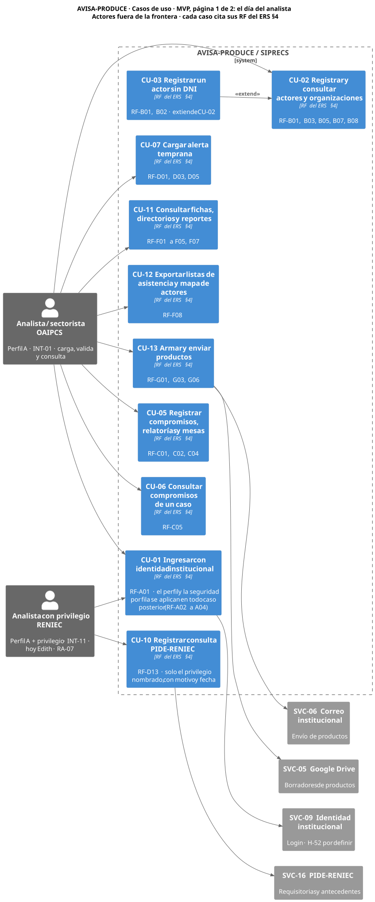

| Caso                                                  | Quién lo usa                             | Requisitos                           | Horizonte          |
| ----------------------------------------------------- | ---------------------------------------- | ------------------------------------ | ------------------ |
| CU-01 Ingresar con identidad institucional            | Analista, analista con privilegio RENIEC | RF-A01 (y el perfil de RF-A02 a A04) | MVP                |
| CU-02 Registrar y consultar actores y organizaciones  | Analista                                 | RF-B01, B03, B05, B07, B08           | MVP                |
| CU-03 Registrar un actor sin DNI _(extiende CU-02)_   | Analista                                 | RF-B01, B02                          | MVP                |
| CU-05 Registrar compromisos, relatorías y mesas       | Analista                                 | RF-C01, C02, C04                     | MVP                |
| CU-06 Consultar compromisos de un caso                | Analista                                 | RF-C05                               | MVP                |
| CU-07 Cargar alerta temprana                          | Analista                                 | RF-D01, D03, D05                     | MVP                |
| CU-10 Registrar consulta PIDE-RENIEC                  | Solo el analista con privilegio          | RF-D13                               | MVP (si se activa) |
| CU-11 Consultar fichas, directorios y reportes        | Analista                                 | RF-F01 a F05, F07                    | MVP                |
| CU-12 Exportar listas de asistencia y mapa de actores | Analista                                 | RF-F08                               | MVP                |
| CU-13 Armar y enviar productos                        | Analista                                 | RF-G01, G03, G06                     | MVP                |

### Página 2 — lo que se valida, se envía y se administra

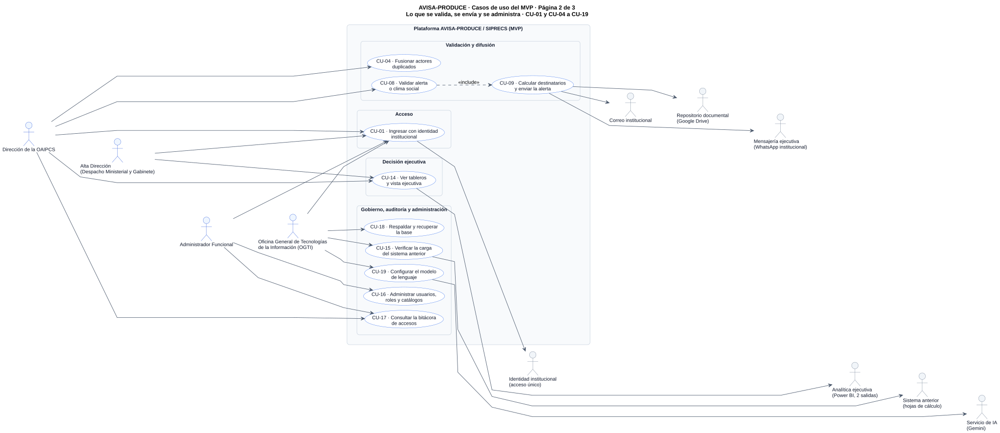

| Caso                                                                   | Quién lo usa                                                                    | Requisitos                 | Horizonte              |
| ---------------------------------------------------------------------- | ------------------------------------------------------------------------------- | -------------------------- | ---------------------- |
| CU-01 Ingresar con identidad institucional                             | Dirección, Alta Dirección, administrador y OGTI (mismo caso que en la página 1) | RF-A01                     | MVP                    |
| CU-04 Fusionar actores duplicados                                      | Dirección                                                                       | RF-B04                     | MVP                    |
| CU-08 Validar alerta o clima social                                    | Dirección                                                                       | RF-D04, D09                | MVP                    |
| CU-09 Calcular destinatarios y enviar la alerta _(incluido por CU-08)_ | Se dispara al validar                                                           | RF-D06, D07, D08, D10, D12 | MVP (WhatsApp acotado) |
| CU-14 Ver tableros y vista ejecutiva                                   | Alta Dirección, Dirección                                                       | RF-H02, H05                | MVP                    |
| CU-15 Verificar la carga del sistema anterior                          | OGTI                                                                            | RF-M01, M02, M03           | MVP                    |
| CU-16 Administrar usuarios, roles y catálogos                          | Administrador                                                                   | RF-X02                     | MVP                    |
| CU-17 Consultar la bitácora de accesos                                 | Dirección, administrador                                                        | RF-X01                     | MVP                    |
| CU-18 Respaldar y recuperar la base                                    | OGTI                                                                            | RF-X04                     | MVP                    |
| CU-19 Configurar el modelo de lenguaje                                 | OGTI                                                                            | RF-E08, E09, E10           | MVP                    |

### Página 3 — 2027 y fase MADRE

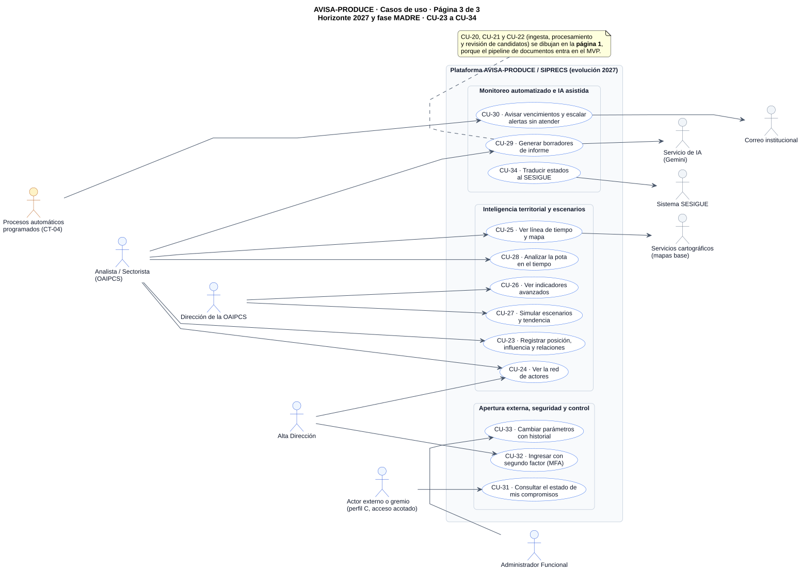

| Caso                                                    | Quién lo usa                         | Requisitos            | Horizonte    |
| ------------------------------------------------------- | ------------------------------------ | --------------------- | ------------ |
| CU-20 Procesar documentos y proponer candidatos         | Analista (lo dispara la recolección) | RF-E01, E05, E06, E11 | 2027         |
| CU-21 Recolectar fuentes de la lista blanca             | Tareas programadas                   | RF-E02, E03           | 2027         |
| CU-22 Revisar candidatos y coincidencias dudosas        | Analista                             | RF-D02, D03, E04      | 2027         |
| CU-23 Registrar posición, influencia y relaciones       | Analista                             | RF-B06                | 2027         |
| CU-24 Ver la red de actores                             | Analista, Alta Dirección             | RF-H01                | 2027         |
| CU-25 Ver línea de tiempo y mapa                        | Analista                             | RF-H03, H04           | MADRE        |
| CU-26 Ver indicadores avanzados                         | Dirección                            | RF-J01, J02, J03      | 2027 / MADRE |
| CU-27 Simular escenarios y tendencia                    | Dirección                            | RF-J04, J05           | MADRE        |
| CU-28 Analizar la pota en el tiempo                     | Analista                             | RF-N01, N02           | MADRE        |
| CU-29 Generar borradores de informe                     | Analista                             | RF-G02, G04           | 2027         |
| CU-30 Avisar vencimientos y escalar alertas sin atender | Tareas programadas                   | RF-C03, D11           | 2027         |
| CU-31 Consultar el estado de mis compromisos            | Actor externo o gremio (perfil C)    | RF-A05                | MADRE        |
| CU-32 Ingresar con segundo factor                       | Alta Dirección                       | RF-A07                | 2027         |
| CU-33 Cambiar parámetros con historial                  | Administrador                        | RF-X03                | 2027         |
| CU-34 Traducir estados al SESIGUE                       | SESIGUE (actor secundario)           | RF-C06                | MADRE        |

### Controles que viajan con cada caso

La frase de arriba —«los controles no se dibujan como casos, van anotados en el caso que los sufre»— se cumple en esta tabla, que es la que hay que leer junto al diagrama. Son los RF que no tienen óvalo propio porque se aplican a toda operación del caso:

| Caso  | Controles que arrastra | Qué obliga                                                                                                                      |
| ----- | ---------------------- | ------------------------------------------------------------------------------------------------------------------------------- |
| CU-01 | RF-A01, A02, A03, A04  | Un solo rol por sesión, tomado de `core.roles`; la base aplica RLS y la aplicación se conecta con un login **sin** `BYPASSRLS`  |
| CU-07 | RF-D01, D03, D05       | La alerta nace como borrador en bandeja de revisión; no sale sin pasar por CU-08                                                |
| CU-08 | RF-D04, D09, D12       | Confirmación de la Dirección antes de avisar una crisis; ninguna alerta sin aprobación humana llega a los perfiles B y C        |
| CU-09 | RF-D06, D07, D08, D10  | Destinatarios según gravedad (RN-02); borrador en Google Drive; cada envío queda registrado con canal, destinatario y resultado |
| CU-10 | RF-A06, D13, X01       | Solo el privilegio RENIEC; resultado cifrado, con motivo y fecha, y cada lectura auditada                                       |
| CU-12 | RF-F08, X01            | Toda salida del perímetro deja hash en `audit.exportacion`                                                                      |
| CU-14 | RF-H02, H05, RD-08     | Ningún dato personal pasa por el Dashboard Estratégico (Publish to Web no tiene control de acceso por fila)                     |
| CU-19 | RF-E08, E09, E10       | Cada corrida registrada; proveedor intercambiable; ningún dato personal ni documento interno al modelo externo                  |
| CU-20 | RF-E05, E08, E10       | Una cita solo se acepta si aparece literalmente en la fuente; corrida registrada                                                |
| CU-22 | RF-E04, E05            | Similitud intermedia (0,85–0,95) abre tarea humana; nada se fusiona automáticamente                                             |

### Cómo se mantiene este diagrama

La fuente es `docs/casos_uso/AVISA_CASOS_USO.puml`, en **PlantUML con UML 2 puro**: no usa la librería C4 —los diagramas C4 del sistema están en la sección 14 y son mermaid—. El archivo tiene **tres bloques**, y el nombre de cada bloque es exactamente el del SVG que se publica, de modo que regenerar no deja huérfanos: `AVISA_CU_MVP_DIA`, `AVISA_CU_MVP_SALIDA` y `AVISA_CU_2027`.

**Qué relaciona el diagrama.** Además de las flechas actor → caso, las láminas dibujan:

- en la **página 1**, la **generalización de actores**: el analista con privilegio RENIEC hereda del analista, de modo que puede hacer todo lo suyo y además el CU-10;
- los `<<extend>>` e `<<include>>` que las tablas ya declaran (CU-03 extiende CU-02; CU-12 extiende CU-11; CU-10 incluye CU-01; CU-09 es incluido por CU-08);
- en la **página 3**, el **encadenamiento real de la ingesta**: la recolección dispara el procesamiento (`«dispara»`) y el procesamiento propone candidatos a la revisión (`«propone candidatos»`). El paso siguiente —lo aprobado entra al circuito de validación y envío del MVP— cruza de lámina y por eso no se dibuja: es CU-08 en la página 2;
- las **integraciones externas** de cada caso, de modo que un caso sin sistema externo se ve de inmediato como un caso cuyo resultado vive solo en la base.

Se regeneran con un comando. Graphviz es lo recomendado; sin él, `smetana` evita el fallo pero desordena el trazado.

```sh
# con Graphviz instalado (recomendado)
java -jar plantuml.jar -tsvg -charset UTF-8 -o ../img docs/casos_uso/AVISA_CASOS_USO.puml

# sin Graphviz (no falla, pero el trazado queda peor)
java -jar plantuml.jar -tsvg -charset UTF-8 -Playout=smetana -o ../img docs/casos_uso/AVISA_CASOS_USO.puml
```

**Regla de mantenimiento.** Si se añade o se cambia un requisito funcional, el diagrama se actualiza en el mismo cambio. Cada caso lleva escrito su **código CU y sus RF** en la tabla de su página, así que la comprobación es mecánica: **un caso sin RF es un error**, y un RF que no aparezca en ningún caso debe justificarse como control o como requisito de soporte que no se dibuja. Los códigos CU-nn aparecen también dentro de cada óvalo, de forma que el diagrama y la tabla se pueden cotejar a la vista.

---

# 4. REQUISITOS FUNCIONALES

**Cómo leer las tablas.** _Prioridad:_ **Must** (sin esto no hay MVP), **Should** (importante, entra si el tiempo alcanza), **Could** (deseable), **Won't** (fuera de esta versión). _Horizonte:_ **MVP** (módulo de diciembre, 20 días), **2027** o **MADRE**. La prioridad se lee dentro de cada horizonte; algunos requisitos MVP podrían pasar a 2027 según H-44 y H-45. _Verificación:_ P = prueba, I = inspección, D = demostración con usuarios. Un servicio externo <u>subrayado</u> indica que el requisito depende de una integración.

## 4.1 Acceso y seguridad (RF-A)

| ID     | Requisito                                                                                                                                                                                                                                                                                           | Origen | Prior. | Hor.  | Ver. |
| ------ | --------------------------------------------------------------------------------------------------------------------------------------------------------------------------------------------------------------------------------------------------------------------------------------------------- | ------ | ------ | ----- | ---- |
| RF-A01 | El sistema deberá identificar a cada usuario mediante el <u>servicio de identidad institucional (SVC-09)</u> **[EN BLANCO · H-20]**                                                                                                                                                                 | R2     | Must   | MVP   | P    |
| RF-A02 | El sistema deberá dar a cada usuario un rol de acceso (perfiles A analista, B alta dirección, C externo) y mostrar solo lo que ese rol permite ver; el nivel y las capacidades salen de `core.roles` —no los declara la aplicación ni el proveedor de identidad— y la sesión aplica **un solo rol** | R2     | Must   | MVP   | P    |
| RF-A03 | La base de datos deberá aplicar la seguridad por fila de modo que ninguna consulta devuelva filas fuera del alcance del perfil, aunque el código de la aplicación falle; la aplicación se conectará con un rol de login **sin `BYPASSRLS`**                                                         | R2, R3 | Must   | MVP   | P    |
| RF-A04 | El sistema no deberá mostrar al Perfil B alertas sin aprobar ni datos personales en el Dashboard Estratégico; en la aplicación sí puede leer datos personales, con cada lectura auditada (RD-08)                                                                                                    | R2     | Must   | MVP   | P    |
| RF-A05 | El sistema deberá permitir que un actor externo (Perfil C) vea únicamente el estado de **sus** compromisos y las alertas sectoriales aprobadas                                                                                                                                                      | R2     | Could  | MADRE | P    |
| RF-A06 | El sistema deberá guardar los datos personales **cifrados** y registrar cada lectura                                                                                                                                                                                                                | R2, R3 | Must   | MVP   | P    |
| RF-A07 | El sistema deberá exigir un segundo factor de autenticación al Perfil B **[EN BLANCO · H-23: depende de lo que ofrezca SVC-09]**                                                                                                                                                                    | R2     | Should | 2027  | P    |

## 4.2 Actores y organizaciones (RF-B)

| ID     | Requisito                                                                                                                                                                                     | Origen     | Prior. | Hor. | Ver. |
| ------ | --------------------------------------------------------------------------------------------------------------------------------------------------------------------------------------------- | ---------- | ------ | ---- | ---- |
| RF-B01 | El sistema deberá permitir registrar un actor **sin DNI**, con alias y vinculado a una organización o a un caso                                                                               | R2, R3     | Must   | MVP  | P    |
| RF-B02 | El sistema deberá permitir **promover** un actor sin identificar a identificado sin perder su historial                                                                                       | R2         | Must   | MVP  | P    |
| RF-B03 | El sistema deberá detectar duplicados mediante una huella irreversible del documento de identidad, sin mostrar el número                                                                      | R2, R3     | Must   | MVP  | P    |
| RF-B04 | El sistema deberá permitir **fusionar** actores duplicados dejando registro de quién lo hizo y por qué                                                                                        | R2         | Should | MVP  | P    |
| RF-B05 | El sistema deberá registrar organizaciones (tipo, vigencia, miembros) y la **OSPA** a la que pertenece cada actor                                                                             | N-09       | Must   | MVP  | P    |
| RF-B06 | El sistema deberá registrar, por cada actor de un caso, su posición (apoyo, oposición, neutral, no dialogante), su influencia y sus relaciones con otros actores (densa, tensa, de conflicto) | R2         | Must   | 2027 | P    |
| RF-B07 | El sistema deberá registrar contactos (teléfono, correo, cargo) de los actores, protegidos según el perfil                                                                                    | N-09       | Must   | MVP  | P    |
| RF-B08 | El sistema deberá registrar el cargo y el ámbito territorial de cada autoridad                                                                                                                | N-05, N-06 | Must   | MVP  | P    |

## 4.3 Compromisos, relatorías y mesas (RF-C)

| ID     | Requisito                                                                                                                         | Origen     | Prior. | Hor.  | Ver. |
| ------ | --------------------------------------------------------------------------------------------------------------------------------- | ---------- | ------ | ----- | ---- |
| RF-C01 | El sistema deberá registrar compromisos con hitos, estados, responsables y fecha límite                                           | N-03, R2   | Must   | MVP   | P    |
| RF-C02 | El sistema deberá registrar relatorías y ayudas memoria y vincular a cada una los compromisos que contiene                        | N-03, N-12 | Must   | MVP   | P    |
| RF-C03 | El sistema deberá avisar de los compromisos que vencen (revisión diaria) **[EN BLANCO · H-31: con cuántos días de anticipación]** | R2         | Should | 2027  | P    |
| RF-C04 | El sistema deberá registrar mesas de diálogo con sus miembros, instrumento y vigencia                                             | R3         | Should | MVP   | P    |
| RF-C05 | El sistema deberá mostrar, por caso, los compromisos con su estado actual                                                         | N-03       | Must   | MVP   | D    |
| RF-C06 | El sistema deberá traducir el estado local de cada compromiso al que espera <u>SESIGUE (SVC-12)</u>                               | R2, R3     | Won't  | MADRE | P    |

## 4.4 Alertas tempranas (RF-D)

| ID     | Requisito                                                                                                                                                                                             | Origen | Prior. | Hor.               | Ver. |
| ------ | ----------------------------------------------------------------------------------------------------------------------------------------------------------------------------------------------------- | ------ | ------ | ------------------ | ---- |
| RF-D01 | El sistema deberá permitir **cargar alertas tempranas** mediante un formulario                                                                                                                        | N-10   | Must   | MVP                | D    |
| RF-D02 | El sistema deberá recibir **candidatos de alerta** del procesamiento de documentos sin duplicarlos si llegan dos veces                                                                                | R2     | Must   | 2027               | P    |
| RF-D03 | El sistema deberá ofrecer una **bandeja de revisión** donde el analista apruebe, edite o descarte cada candidato, con motivo                                                                          | R2     | Must   | MVP                | D    |
| RF-D04 | El sistema deberá permitir **validar** alertas tempranas y el clima social antes de que salgan a la Alta Dirección                                                                                    | N-08   | Must   | MVP                | D    |
| RF-D05 | El sistema deberá **clasificar** acciones y eventos (por ejemplo, bloqueo de carreteras) según un catálogo y asignarles prioridad **[EN BLANCO · H-24: catálogo y criterios]**                        | N-14   | Must   | MVP                | P    |
| RF-D06 | El sistema deberá determinar los **destinatarios** de cada alerta según su gravedad (RN-02)                                                                                                           | N-11   | Must   | MVP                | P    |
| RF-D07 | El sistema deberá enviar la alerta por <u>correo institucional (SVC-06)</u> con un enlace y dejar el **borrador en** <u>Google Drive (SVC-05)</u>                                                     | N-13   | Must   | MVP                | P    |
| RF-D08 | El sistema deberá enviar alertas tempranas por <u>WhatsApp (SVC-07)</u> **[EN BLANCO · H-06: costo y proveedor]**                                                                                     | N-13   | Could  | MVP                | P    |
| RF-D09 | El sistema deberá pedir confirmación de la Dirección de la OAIPCS antes de avisar una **crisis** a la Alta Dirección **[EN BLANCO · H-25: ¿aplica a toda alerta grave?]**                             | R2     | Must   | MVP                | P    |
| RF-D10 | El sistema deberá registrar cada envío: canal, destinatario, documento adjunto y resultado de la entrega                                                                                              | R3     | Must   | MVP                | P    |
| RF-D11 | El sistema deberá medir el plazo de atención de cada alerta según su prioridad y escalar las que no se atiendan **[H-14 medio resuelto: plazos en 11.1 y RN-13; el escalamiento automático es 2027]** | R2     | Should | 2027               | P    |
| RF-D12 | El sistema no deberá mostrar a los Perfiles B y C ninguna alerta que no tenga aprobación humana registrada                                                                                            | R2     | Must   | MVP                | P    |
| RF-D13 | El sistema deberá permitir que **solo el analista con privilegio RENIEC** registre el resultado de una consulta a <u>PIDE-RENIEC (SVC-16)</u> sobre un actor, con el motivo del pedido y la fecha     | R7     | Must   | MVP (si se activa) | P    |

## 4.5 Procesamiento de documentos (RF-E)

> El **procesamiento automático de documentos pasa a 2027** (plan de diciembre). Salvo **RF-E07, RF-E08, RF-E09 y RF-E10**, que son los controles que hacen seguro y acotado el uso de diciembre, y **RF-E12 a RF-E14**, que son la sincronización acotada de Gemini (13.1).

| ID     | Requisito                                                                                                                                                                                                                         | Origen   | Prior. | Hor. | Ver. |
| ------ | --------------------------------------------------------------------------------------------------------------------------------------------------------------------------------------------------------------------------------- | -------- | ------ | ---- | ---- |
| RF-E01 | El sistema deberá procesar relatorías, reportes y transcripciones cargados por el analista y **proponer** actores, eventos y compromisos                                                                                          | N-12, R2 | Must   | 2027 | P    |
| RF-E02 | El sistema deberá recolectar noticias y reportes de una **lista blanca** de <u>fuentes públicas (SVC-01)</u> **[EN BLANCO · H-32: la lista de fuentes]**                                                                          | R2       | Should | 2027 | P    |
| RF-E03 | El sistema deberá detectar noticias repetidas y conservar una sola, con las fuentes que la replican                                                                                                                               | R2       | Must   | 2027 | P    |
| RF-E04 | El sistema deberá comparar los actores encontrados contra el catálogo y abrir una **tarea de revisión humana** cuando la similitud sea intermedia (referencia del MVP: entre 0,85 y 0,95), sin fusionar automáticamente           | R2       | Must   | 2027 | P    |
| RF-E05 | El sistema deberá aceptar una cita textual solo si aparece **literalmente** en la fuente                                                                                                                                          | R2       | Must   | 2027 | P    |
| RF-E06 | El sistema deberá proponer un puntaje de riesgo con la explicación de sus factores                                                                                                                                                | R2       | Should | 2027 | P    |
| RF-E07 | El sistema deberá reintentar los envíos fallidos y guardar los que no se logren en una cola, con aviso técnico                                                                                                                    | R2       | Should | MVP  | P    |
| RF-E08 | El sistema deberá registrar cada corrida: fuentes consultadas, elementos descartados con su motivo, costo y duración                                                                                                              | R2, R3   | Must   | MVP  | I    |
| RF-E09 | El sistema deberá conectarse al <u>modelo de lenguaje de Google (SVC-02)</u> mediante una conexión **intercambiable**, de modo que pueda cambiarse de proveedor sin reescribir el sistema                                         | R1       | Must   | MVP  | I    |
| RF-E10 | El sistema no deberá enviar datos personales ni documentos internos al modelo externo **[EN BLANCO · H-04: depende del dictamen legal]**                                                                                          | R2       | Must   | MVP  | P    |
| RF-E11 | El sistema deberá poder medir la calidad de la extracción contra un **conjunto de referencia** anotado a mano (aciertos, omisiones y errores)                                                                                     | R1       | Must   | 2027 | P    |
| RF-E12 | El sistema deberá sincronizar automáticamente, cada **24 horas**, el lote de datos acotado de Gemini (~75 piezas/día, 13.1) sin intervención de un usuario                                                                        | R10      | Must   | MVP  | P    |
| RF-E13 | El sistema deberá permitir que un usuario autorizado dispare una **sincronización manual** de una pieza específica (un caso, un actor o una zona) preguntando por su «información más reciente», sin esperar al ciclo de 24 horas | R10      | Should | MVP  | D    |
| RF-E14 | El sistema deberá mostrar, junto a cualquier dato que provenga de una sincronización, la **fecha y hora de la última actualización** (automática o manual)                                                                        | R10      | Must   | MVP  | P    |

## 4.6 Fichas y consultas (RF-F)

| ID     | Requisito                                                                                                                                  | Origen     | Prior. | Hor. | Ver. |
| ------ | ------------------------------------------------------------------------------------------------------------------------------------------ | ---------- | ------ | ---- | ---- |
| RF-F01 | El sistema deberá mostrar, para una zona, **quiénes actúan** (actores, organizaciones y autoridades)                                       | N-01, N-15 | Must   | MVP  | D    |
| RF-F02 | El sistema deberá mostrar el **perfil de un actor**: quién es, organizaciones, casos, posición y reuniones                                 | N-01       | Must   | MVP  | D    |
| RF-F03 | El sistema deberá ofrecer **directorios** de alcaldes, prefectos, subprefectos, comisarios, capitanes de puerto y sargentos por territorio | N-05, N-06 | Must   | MVP  | D    |
| RF-F04 | El sistema deberá buscar **contactos** (incluidos directores) y mostrar a qué OSPA pertenecen                                              | N-09       | Must   | MVP  | D    |
| RF-F05 | El sistema deberá listar los **reportes remitidos** por zona, del más reciente al más antiguo                                              | N-02       | Must   | MVP  | D    |
| RF-F06 | El sistema deberá mostrar los **locales** apropiados para reuniones por zona                                                               | N-04       | Should | MVP  | D    |
| RF-F07 | El sistema deberá ofrecer una búsqueda global por nombre, organización, zona o caso                                                        | R4         | Should | MVP  | D    |
| RF-F08 | El sistema deberá exportar listas de asistencia y el mapa de actores                                                                       | N-09       | Should | MVP  | D    |

## 4.7 Productos e informes (RF-G)

| ID     | Requisito                                                                                                                                                                                              | Origen     | Prior. | Hor.  | Ver. |
| ------ | ------------------------------------------------------------------------------------------------------------------------------------------------------------------------------------------------------ | ---------- | ------ | ----- | ---- |
| RF-G01 | El sistema deberá ofrecer una **plantilla con selección múltiple** de los productos que se informan **[EN BLANCO · H-26: lista de productos]**                                                         | N-08, N-11 | Must   | MVP   | D    |
| RF-G02 | El sistema deberá generar borradores de informes con la IA, marcados «borrador por validar» hasta que una persona los valide                                                                           | R2         | Should | 2027  | D    |
| RF-G03 | El sistema deberá enviar los productos seleccionados a los destinatarios que corresponda según la gravedad                                                                                             | N-11       | Must   | MVP   | D    |
| RF-G04 | El sistema deberá generar un **resumen de una página** con estructura fija (situación, qué cambió, riesgo y tendencia, decisión requerida, próximos hitos) **[EN BLANCO · H-33: extensión y formato]** | R2         | Should | 2027  | D    |
| RF-G05 | El sistema deberá producir las secciones del análisis de casos **[EN BLANCO · H-27: formato oficial; el sistema anterior usa el «formato Anexo 8»]**                                                   | N-07       | Could  | MADRE | D    |
| RF-G06 | El sistema deberá guardar cada producto con su fuente, versión y responsable de validación                                                                                                             | R2         | Must   | MVP   | I    |

## 4.8 Tablero y diagramas interactivos (RF-H)

| ID     | Requisito                                                                                                                                                                                    | Origen | Prior. | Hor.  | Ver. |
| ------ | -------------------------------------------------------------------------------------------------------------------------------------------------------------------------------------------- | ------ | ------ | ----- | ---- |
| RF-H01 | El sistema deberá mostrar un **diagrama interactivo de la red de actores** de un caso o zona: nodos = actores, vínculos = relaciones; con filtros, selección de un actor y acceso a su ficha | R1, R2 | Must   | 2027  | D    |
| RF-H02 | El sistema deberá ofrecer un **tablero en** <u>Power BI (SVC-10)</u> con entre 4 y 6 indicadores del caso ancla **[EN BLANCO · H-28: cuáles indicadores]**                                   | R1     | Must   | MVP   | D    |
| RF-H03 | El sistema deberá mostrar una **línea de tiempo** de hechos y de normas por tema o conflicto                                                                                                 | N-16   | Could  | MADRE | D    |
| RF-H04 | El sistema deberá mostrar un **mapa** con capas de casos, hechos, actores georreferenciados y territorio, usando un <u>servicio de mapas (SVC-11)</u>                                        | R2     | Could  | MADRE | D    |
| RF-H05 | El sistema deberá ofrecer una vista ejecutiva para la Alta Dirección con indicadores explicados y sin datos personales                                                                       | R2     | Should | MVP   | D    |
| RF-H06 | El sistema deberá explicar cada semáforo con los factores que lo producen                                                                                                                    | R2     | Should | 2027  | D    |

## 4.9 Indicadores avanzados y simulador (RF-J)

> Fórmulas de referencia en R2 §4.1. **Son propuestas «PROVISIONALES»**: el propio MVP-45 indica que deben contrastarse con el informe del caso SANIPES Sechura **[EN BLANCO · H-34]**.

| ID     | Requisito                                                                                                                                    | Origen | Prior. | Hor.  | Ver. |
| ------ | -------------------------------------------------------------------------------------------------------------------------------------------- | ------ | ------ | ----- | ---- |
| RF-J01 | El sistema deberá calcular el Índice de Riesgo de Escalamiento (IRE) por caso con fórmula documentada y reproducible                         | R2     | Could  | MADRE | P    |
| RF-J02 | El sistema deberá calcular el Índice de Cumplimiento de Compromisos, el Tiempo de Atención de Alertas y el Índice de Polarización de Actores | R2     | Should | 2027  | P    |
| RF-J03 | El sistema deberá calcular el Índice de Condiciones de Diálogo con evidencia obligatoria por condición                                       | R2     | Could  | MADRE | P    |
| RF-J04 | El sistema deberá ofrecer un simulador de escenarios («¿qué pasa si…?») rotulado «ESCENARIO — no vigente»                                    | R2     | Won't  | MADRE | P    |
| RF-J05 | El sistema deberá mostrar la tendencia de riesgo a 30 días rotulada «TENDENCIA / PROXY — no es una predicción»                               | R2     | Won't  | MADRE | P    |

## 4.10 Migración y calidad de datos (RF-M)

| ID     | Requisito                                                                                                                                                                           | Origen | Prior. | Hor. | Ver. |
| ------ | ----------------------------------------------------------------------------------------------------------------------------------------------------------------------------------- | ------ | ------ | ---- | ---- |
| RF-M01 | El sistema deberá demostrar que la carga del <u>sistema anterior (SVC-04)</u> cuadra: filas de origen = cargadas + fusionadas + descartadas + pendientes, **en el entorno de OGTI** | R2, R4 | Must   | MVP  | P    |
| RF-M02 | El sistema deberá entregar un reporte de calidad: completitud, duplicados y registros pendientes de validación                                                                      | R2     | Should | MVP  | I    |
| RF-M03 | El sistema deberá cargar los cambios del sistema anterior hasta el día de cambio **[EN BLANCO · H-29: fecha de cambio y frecuencia]**                                               | R2     | Should | MVP  | P    |

## 4.11 Análisis temático (fase siguiente) (RF-N)

| ID     | Requisito                                                                                                                                                                                                                                                                  | Origen | Prior. | Hor.  | Ver. |
| ------ | -------------------------------------------------------------------------------------------------------------------------------------------------------------------------------------------------------------------------------------------------------------------------- | ------ | ------ | ----- | ---- |
| RF-N01 | El sistema deberá permitir analizar la **pota** a través del tiempo: controversias o conflictos nacionales, capa normativa, acciones de las OSPA que llegan a la DGPA y conflictos específicos relacionados **[EN BLANCO · H-35: definición de «controversia» y fuentes]** | N-16   | Could  | MADRE | D    |
| RF-N02 | El sistema deberá describir la **diversidad de perfiles de pescadores**, sus capitales y sus alineamientos cambiantes **[EN BLANCO · H-36: qué son los «capitales» y cómo se miden]**                                                                                      | N-17   | Could  | MADRE | D    |

## 4.12 Auditoría y administración (RF-X)

| ID     | Requisito                                                                                                                     | Origen | Prior. | Hor. | Ver. |
| ------ | ----------------------------------------------------------------------------------------------------------------------------- | ------ | ------ | ---- | ---- |
| RF-X01 | El sistema deberá guardar un registro de accesos y operaciones sobre datos personales que **no se pueda modificar ni borrar** | R2, R3 | Must   | MVP  | P    |
| RF-X02 | El sistema deberá permitir administrar catálogos, usuarios y roles                                                            | R3     | Must   | MVP  | D    |
| RF-X03 | El sistema deberá permitir cambiar parámetros (pesos, umbrales, plazos) con historial de versiones                            | R2     | Should | 2027 | I    |
| RF-X04 | El sistema deberá contar con copias de seguridad y recuperación **[EN BLANCO · H-30: frecuencia y plazo de recuperación]**    | —      | Must   | MVP  | I    |

---

# 5. CIRCUITO FUNCIONAL Y PARIDAD CON EL AVISA ACTUAL

> **Se lleva a la reunión.** Esta sección responde a la expectativa de OGTI de recibir **lo que AVISA ya hace hoy**: muestra que el módulo de diciembre cubre ese uso, aunque por debajo cambie de hojas de Excel a una base de datos relacional.

> **Aclaración sobre la IA del sistema anterior (verificada el 2026-11-20).** El AVISA actual **sí tenía** un módulo de consultas con IA (un conector a Gemini en `Code.gs`, con las funciones `_llamarGemini`, `analizarConsultaGeneral`, `buscarConIA` y `analizarCasoConIA`, y una pantalla «Consultas con IA» en el frontend). **Nunca operó: era una maqueta** — no hubo clave válida ni uso en producción. Por eso la paridad prometida en esta sección **no incluye** ese módulo, y la IA del sistema nuevo se planifica desde cero: el procesamiento de documentos es 2027 (RF-E01 a RF-E11) y solo la sincronización acotada entra en diciembre (RF-E12 a RF-E14, 14.3.2).

## 5.1 Circuito funcional del módulo de diciembre

> Propuesta construida a partir de los módulos del AVISA actual (R4, §12.1). Debe confirmarse con el **uso real** que hoy se le da **[EN BLANCO · H-47]**.

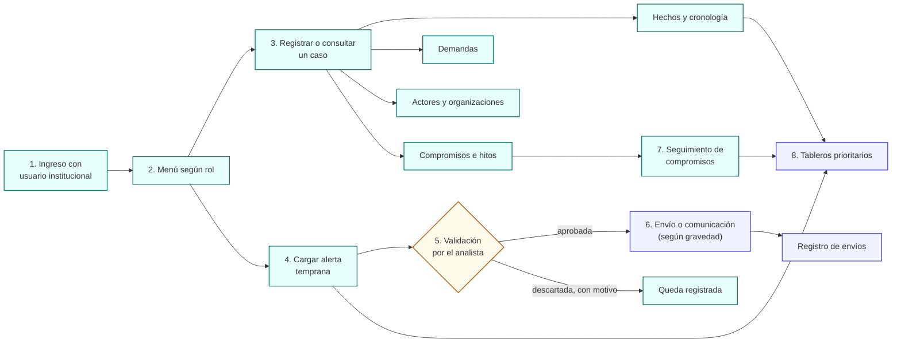

## 5.2 Qué hace hoy el AVISA y qué pasa en diciembre

Los 28 módulos del sistema actual (431 funciones con lógica real) y la propuesta para el módulo de diciembre.

| Módulo del AVISA actual                      | Funciones | Propuesta para diciembre                                                                          | Estado                 |
| -------------------------------------------- | --------: | ------------------------------------------------------------------------------------------------- | ---------------------- |
| Casos                                        |        37 | **Entra**                                                                                         | Por confirmar con Luis |
| Alertas tempranas                            |        26 | **Entra** (carga manual y validación)                                                             | Por confirmar          |
| Demandas                                     |        21 | **Entra**                                                                                         | Por confirmar          |
| Hechos ocurridos                             |        12 | **Entra**                                                                                         | Por confirmar          |
| Registro de envíos                           |         6 | **Entra**                                                                                         | Por confirmar          |
| Navegación, permisos y pantallas de relación |        43 | **Entra** como login institucional y roles (sección 6)                                            | Por confirmar          |
| Análisis de casos (formato Anexo 8)          |        33 | **Por confirmar** **[EN BLANCO · H-27]**                                                          | —                      |
| Sectoristas, puntos focales y autoridades    |        29 | **Entra** (usuarios y directorio de autoridades)                                                  | Por confirmar          |
| Catálogos y datos de referencia              |        27 | **Entra** (datos maestros, sección 8)                                                             | Por confirmar          |
| Documentos y reportes                        |        20 | **Entra** el registro y la consulta; la generación automática de PDF queda **[EN BLANCO · H-59]** | —                      |
| Actores sociales                             |        16 | **Entra**                                                                                         | Por confirmar          |
| Acciones e hitos                             |        14 | **Entra** (compromisos)                                                                           | Por confirmar          |
| Proceso por pasos                            |        14 | **Por confirmar**                                                                                 | —                      |
| Capacitaciones                               |        14 | **Por confirmar**                                                                                 | —                      |
| Búsqueda, exportación y utilidades           |        13 | **Entra** simplificado (búsqueda y exportación básica)                                            | Por confirmar          |
| Clima social                                 |        12 | **Por confirmar** (Edith lo menciona)                                                             | —                      |
| Reporte rápido                               |        11 | **Por confirmar**                                                                                 | —                      |
| Actores del Estado                           |        10 | **Entra** como tipo de actor                                                                      | Por confirmar          |
| Inicio de sesión                             |         9 | **Entra** como **login institucional**                                                            | Por confirmar          |
| WhatsApp y correo                            |         7 | Correo **por confirmar**; WhatsApp **entra en diciembre**, acotado **[EN BLANCO · H-06]**         | —                      |
| Análisis regional                            |         7 | **Tablero** (por confirmar)                                                                       | —                      |
| Tablero de mando (21 indicadores)            |         6 | **Tableros prioritarios**, no los 21 (sección 7)                                                  | —                      |
| Organizaciones sociales                      |         5 | **Entra**                                                                                         | Por confirmar          |
| Distritos y geografía                        |         4 | **Entra**                                                                                         | Por confirmar          |
| Locales y sedes                              |         3 | **Entra**                                                                                         | Por confirmar          |
| Mesas de diálogo                             |       n/d | **Entra**                                                                                         | Por confirmar          |
| Arranque y servido de la interfaz            |         9 | **No se traslada** (código generado)                                                              | Definido en R4         |
| RADAR y red de actores                       |        23 | **No entra** (diferido)                                                                           | Definido en R4         |

**Cómo se lee.** «Entra» significa que el módulo de diciembre debe permitir hacer lo mismo que hoy. «Por confirmar» significa que OAIPCS debe decir si ese uso es real y si es indispensable en diciembre. La fila **Mesas de diálogo** no lleva número porque el inventario del código no le dedica una sección: sus 11 funciones existen, pero no están contabilizadas (R4, §12.1).

## 5.3 Qué cambia por debajo (en palabras simples)

| Hoy (hojas de Excel con Apps Script)                                    | En el módulo de diciembre                                                                                       | Qué gana el usuario                                                                             |
| ----------------------------------------------------------------------- | --------------------------------------------------------------------------------------------------------------- | ----------------------------------------------------------------------------------------------- |
| Los permisos se aplican en la pantalla, con una clave en una hoja       | **Login institucional, roles y seguridad por fila en la base de datos** (control de acceso real, no decorativo) | Cada uno ve solo lo que le corresponde; se cumple el estándar de Nivel Alto de la Ley N.° 29733 |
| Nada queda registrado al consultar o cambiar un dato personal           | **Toda lectura y cambio queda en un registro de auditoría inmutable**                                           | Trazabilidad única de cada alerta y de cada dato personal consultado                            |
| El tablero no tiene de dónde salir (la tabla de indicadores está vacía) | Los tableros leen **datos ya relacionados**, con origen verificable                                             | Tableros confiables para la Alta Dirección                                                      |
| El DNI hace de identificador de la persona                              | Cada persona tiene un identificador interno; el DNI es un dato más, cifrado                                     | Se pueden registrar actores sin DNI                                                             |
| Un mismo conflicto se escribe hasta cuatro veces con distinto detalle   | Un caso se escribe **una vez** y se relaciona con sus hechos, demandas, actores y compromisos                   | Menos digitación y menos contradicciones (efecto secundario, no el objetivo principal)          |
| El PDF archivado en Drive es el dato                                    | El dato queda en la base y el PDF es un archivo aparte                                                          | Se puede consultar y filtrar                                                                    |

> **Decidido:** el módulo de diciembre se levanta sobre el **modelo relacional (v10)**. Lo que OGTI esperaba (la aplicación actual tal cual) se atiende mostrando la **paridad** de arriba y presentando primero la necesidad (ver 5.4).

## 5.4 Cómo se presenta: primero la necesidad, después el modelo

El módulo de diciembre se levanta sobre el **modelo relacional (v10)**, pero OGTI debe entender **primero la necesidad de OAIPCS**; el modelo es la respuesta a esa necesidad, no el punto de partida.

| Orden | Qué se muestra                                                                     | Para qué                                               |
| ----- | ---------------------------------------------------------------------------------- | ------------------------------------------------------ |
| 1     | **La necesidad**: circuito funcional (5.1), reglas y roles (sección 6)             | Que OGTI vea qué se necesita hacer y quién lo hace     |
| 2     | **La paridad** con el AVISA actual (5.2)                                           | Que vea que no se pierde nada de lo que hoy se usa     |
| 3     | **Pantallas y tableros prioritarios** (sección 7)                                  | Que vea cómo se usa                                    |
| 4     | **El modelo relacional** como respuesta: los documentos del modelo que recibe OGTI | Que entienda por qué los datos se guardan de esa forma |
| 5     | **El acuerdo de alcance** (sección 19)                                             | Cerrar qué se construye                                |

### Documentos del modelo que pasan a OGTI

| Documento                                                       | Qué contiene                                   | Estado                                                                                                         |
| --------------------------------------------------------------- | ---------------------------------------------- | -------------------------------------------------------------------------------------------------------------- |
| Diccionario de datos (R3)                                       | Cada tabla y columna que existe hoy en la base | Existe                                                                                                         |
| Comparativo sistema anterior – v10 (R4)                         | Qué se conserva, qué cambia y qué desaparece   | Existe                                                                                                         |
| Guía del modelo v10 (`AVISA_PRODUCE_v10.md`)                    | Diseño completo del modelo relacional deseado  | Existe (citado en R2)                                                                                          |
| Priorización de tablas (R5 y `PRIORIZACION_MVP_v10.md`)         | Qué tablas se construyen primero               | Existe                                                                                                         |
| Scripts de la base: esquema, catálogos, vistas, datos de prueba | Para reconstruir la base                       | **[EN BLANCO · H-61: lista exacta]**; deben entregarse en su versión **SQL Server** (H-01), no solo PostgreSQL |

### Qué puede optimizar OGTI y qué debe conservar (propuesta)

El modelo queda **sujeto a optimizaciones** de OGTI. Para que optimizar no cambie el negocio, se propone separar:

| OGTI puede ajustar                                                | OGTI debe conservar                                                                                                   |
| ----------------------------------------------------------------- | --------------------------------------------------------------------------------------------------------------------- |
| Tipos de datos, índices, particiones y vistas materializadas      | Los conceptos de negocio: caso, alerta, demanda, hecho, actor, organización y compromiso, cada uno como cosa distinta |
| Orden de construcción de las tablas                               | Los códigos legibles (`CS-PRODUCE-2026-007`, `AT-2026-01`)                                                            |
| Nombres internos que no se muestran al usuario                    | Las reglas de negocio de la sección 11                                                                                |
| Mecanismos de seguridad por fila (si cambia el motor)             | La separación y el cifrado de datos personales, y el registro de lecturas                                             |
| Tablas del horizonte 2027 y MADRE (se pueden dejar sin construir) | La trazabilidad de cada dato a su origen                                                                              |

> Lo que se puede y no se puede cambiar: **[EN BLANCO · H-62]**, a validar con OGTI.

## 5.5 Capas del sistema y qué se programa primero

Una **capa** es un conjunto de funciones que depende de las anteriores. Programar por capas permite entregar algo que funcione al terminar cada una.

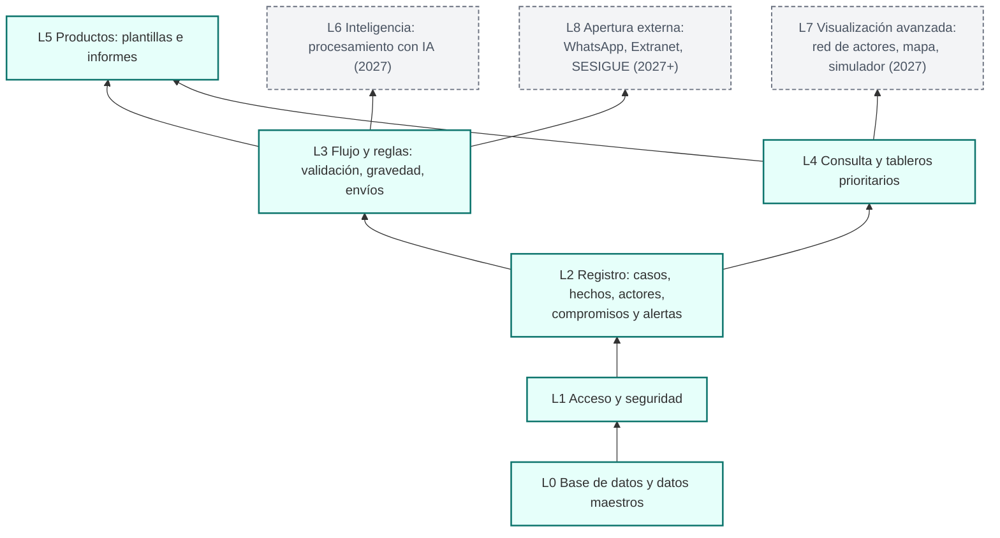

| Capa                                  | Qué contiene                                                                                                       | Depende de | Horizonte                               | Servicios externos                                 | Orden propuesto |
| ------------------------------------- | ------------------------------------------------------------------------------------------------------------------ | ---------- | --------------------------------------- | -------------------------------------------------- | --------------- |
| **L0** Base de datos y datos maestros | Esquema de las 46 tablas del MVP (42 sin las 4 de `kag`, que se difieren), catálogos, geografía, precarga y vistas | —          | MVP                                     | Sistema anterior (SVC-04)                          | **1**           |
| **L1** Acceso y seguridad             | Login institucional, roles, seguridad por fila, registro de accesos                                                | L0         | MVP                                     | Identidad (SVC-09)                                 | **2**           |
| **L2** Registro                       | Formularios de casos, hechos, demandas, actores, organizaciones, compromisos y alertas                             | L0, L1     | MVP                                     | Ninguno                                            | **3**           |
| **L3** Flujo y reglas                 | Validación de alertas, regla de gravedad y destinatarios, registro de envíos                                       | L2         | MVP                                     | Correo (SVC-06), por confirmar                     | **4**           |
| **L4** Consulta y tableros            | Fichas de actor, zona y caso; directorios; búsqueda; tableros prioritarios                                         | L0, L1, L2 | MVP                                     | Power BI (SVC-10)                                  | **5**           |
| **L5** Productos                      | Plantilla de selección múltiple, borradores e informes                                                             | L3, L4     | MVP parcial; redacción con IA en 2027   | Drive (SVC-05), por confirmar                      | **6**           |
| **L6** Inteligencia                   | Procesamiento de documentos, extracción, conjunto de referencia                                                    | L2, L3     | 2027 (apoyo acotado en dic.)            | Gemini (SVC-02, acotado en dic.), fuentes (SVC-01) | —               |
| **L7** Visualización avanzada         | Red interactiva de actores, mapa, línea de tiempo, simulador                                                       | L4         | 2027 / MADRE                            | Mapas (SVC-11)                                     | —               |
| **L8** Apertura externa               | WhatsApp, Extranet, SESIGUE, otros ministerios                                                                     | L3         | 2027 / MADRE (WhatsApp acotado en dic.) | SVC-07, SVC-12, SVC-14                             | —               |

**Criterios usados para ordenar:** (1) _dependencia_: nada funciona sin L0 y L1; (2) _valor inmediato_: lo que ya se usa hoy en AVISA va antes; (3) _riesgo_: lo que depende de decisiones aún abiertas va después; (4) _costo externo_: lo que no cuesta nada o ya existe va antes.

**Primer corte vertical (lo que se debe poder demostrar primero):** _caso → hecho y actor → alerta cargada → aprobada → envío registrado → aparece en un tablero_. Recorre L0 a L4 con el mínimo de pantallas.

**Punto de control al terminar cada capa:**

| Capa | Qué se demuestra                                                          |
| ---- | ------------------------------------------------------------------------- |
| L0   | La precarga cuadra con el origen (AC-05)                                  |
| L1   | Cada rol ve solo lo suyo y la auditoría no se borra (AC-01, AC-02, AC-07) |
| L2   | Se registran los datos del circuito sin errores (AC-04)                   |
| L3   | La alerta recorre el flujo completo (AC-03)                               |
| L4   | Los tableros coinciden con los registros (AC-06)                          |

> Orden definitivo y qué parte de L5 entra en diciembre: **[EN BLANCO · H-63]**, a acordar con OGTI.

---

# 6. ROLES Y PERMISOS

> **Se lleva a la reunión.** Es una de las cuatro cosas que pidió Luis: _reglas y roles_. Es una **propuesta** para validar.
>
> **Actualizado (R10):** OAIPCS confirma que, de las 32 cuentas migradas del sistema anterior (12.1), los **usuarios nominales que operan el módulo en diciembre son 10**: 7 en OAIPCS y 3 en Alta Dirección. El resto de las cuentas migradas queda como **dato histórico** precargado, no como acceso activo del día 1 — ver la homologación en 6.1.
>
> **Estado verificado en la base (2026-11-20).** `core.roles` tiene **9 roles** y **4 están en uso** en las 32 cuentas cargadas: `sectorista` (15), `consulta_lectura` (17), `alta_direccion` (2) y `administrador` (1). Edith Bautista León acumula **tres** roles (`sectorista`, `alta_direccion`, `administrador`) porque es Directora de la OAIPCS y, además, la persona designada en `core.banco_datos_tratamiento.oficial_datos_usuario_id` (D.4).

## 6.1 Roles propuestos y homologación con lo que ya existe

### Los 10 usuarios nominales de diciembre

| Grupo                     | Usuarios                                              | Rol propuesto                  | Qué dashboard usa                |
| ------------------------- | ----------------------------------------------------- | ------------------------------ | -------------------------------- |
| **Equipo OAIPCS (7)**     | Directora OAIPCS (1, hoy Edith)                       | Analista con privilegio RENIEC | **Dashboard Analítico Especial** |
|                           | Sectoristas OAIPCS (5)                                | Analista / sectorista          | **Dashboard Analítico Especial** |
|                           | Administrador (1) — **hoy Edith**, por el banco (D.4) | Administrador                  | Ambos                            |
| **Autoridad PRODUCE (3)** | Ministro (1) y Viceministros (2)                      | Alta Dirección                 | **Dashboard Estratégico**        |

> **Puestos y personas no coinciden todavía.** Los 10 son **puestos**: 7 de OAIPCS (Directora, 5 sectoristas y administrador) y 3 de Alta Dirección. Como Edith ocupa hoy la Dirección **y** la administración, mientras no se designe a otra persona para administrar (H-16), esos 10 puestos los cubren **9 personas**.

### Homologación de roles (para no confundir tres ejes distintos)

El sistema anterior y el modelo v10 usan **tres catálogos separados** que no deben mezclarse:

| Catálogo                     | Qué clasifica                                                    | Filas | Ejemplos                                                                          |
| ---------------------------- | ---------------------------------------------------------------- | ----- | --------------------------------------------------------------------------------- |
| `core.cat_roles_actor`       | El rol de un **actor del conflicto** (no un usuario del sistema) | 7     | Principal, Secundario, Tercero, Proveedor MYPE, Exportador CITES, Inspector CITE  |
| `core.cat_roles_funcionales` | El rol de un actor **en el análisis**                            | 4     | Decisor Principal, Proveedor de evidencia, Implementador, Articulador territorial |
| `core.roles`                 | El rol de **acceso al sistema** — este es el que importa aquí    | 9     | ver tabla siguiente                                                               |

De los **9 roles de acceso** (`core.roles`), **4 están en uso** en los datos migrados:

| Rol de acceso (`core.roles`)                                                                |                                             Nivel máx. |               Cuentas migradas (de 32) | Quién es                                      | ¿Usuario nominal de diciembre?                                                                    |
| ------------------------------------------------------------------------------------------- | -----------------------------------------------------: | -------------------------------------: | --------------------------------------------- | ------------------------------------------------------------------------------------------------- |
| `sectorista`                                                                                |                                                      3 |                                     15 | Field/Analyst/Director (punto focal en campo) | **Sí** — 6 de los 15 (5 sectoristas y Edith, que además tiene `administrador` y `alta_direccion`) |
| `consulta_lectura`                                                                          |                                                      2 | 17 (15 puntos focales + 2 sectoristas) | Lectura institucional                         | No en el día 1 — queda como dato precargado                                                       |
| `alta_direccion`                                                                            | 3 — lee hasta Confidencial, datos personales incluidos |            2 (Edith y AUT-002 «Admin») | Executive                                     | **Sí** — homologado a los 3 de Alta Dirección + Edith                                             |
| `administrador`                                                                             |                                                      3 |                              1 (Edith) | Dueña funcional del dato, incluye al ODP      | **Sí** — lo cubre Edith (D.4); H-16 abierto para un administrador operativo                       |
| `auditor`, `servicio_agente`, `externo_publico`, `analista_cualitativo`, `curador_politica` |                                                  1 a 3 |                                      0 | Sin cuentas hoy                               | No — quedan para 2027 o MADRE                                                                     |

Los **5 roles de la interfaz del sistema anterior** (`Admin`, `Sectorista`, `Directora`, `PuntoFocal`, `Autoridad`) ya están contenidos en lo anterior: Sectorista → `sectorista`, PuntoFocal → `consulta_lectura`, Autoridad y Admin → `alta_direccion`, y Directora es la cuenta de Edith (`sectorista` + `alta_direccion` + `administrador`).

### Lo que cada rol puede hacer, según la base

Una persona puede tener varios roles, pero **la sesión aplica uno solo**: la aplicación fija `app.rol_codigo` y la base deriva de ahí qué filas ve y qué puede hacer. No hay suma de permisos entre roles; por eso Edith, al entrar, opera con el rol de mayor alcance.

| Rol                    | Ve hasta                           | Crear | Editar | Borrar |
| ---------------------- | ---------------------------------- | ----- | ------ | ------ |
| `sectorista`           | Confidencial (datos personales)    | Sí    | Sí     | Sí     |
| `administrador`        | Confidencial (datos personales)    | Sí    | Sí     | Sí     |
| `alta_direccion`       | Confidencial (datos personales)    | No    | No     | No     |
| `auditor`              | Confidencial                       | Sí    | Sí     | **No** |
| `analista_cualitativo` | Confidencial                       | Sí    | Sí     | **No** |
| `curador_politica`     | Reservado                          | Sí    | Sí     | **No** |
| `servicio_agente`      | Confidencial (servicio automático) | Sí    | Sí     | **No** |
| `consulta_lectura`     | Reservado                          | No    | No     | No     |
| `externo_publico`      | Público                            | No    | No     | No     |

> **Quién puede ver datos personales.** Solo los roles que llegan a **Confidencial**: `sectorista`, `administrador`, `alta_direccion`, `auditor`, `analista_cualitativo` y el servicio automático. Las **17 cuentas `consulta_lectura`** —especialistas de otras direcciones— y el acceso externo quedan fuera. Cada lectura queda en `audit.datos_personales_acceso`. Si se quiere afinar más que "Confidencial sí o no", es **[EN BLANCO · H-39]**.

> **Calidad de los datos migrados (32 cuentas):** 28 activas, 4 inactivas; 21 sin DNI; 27 sin correo y 2 más con el dominio invertido (`produce.gbo.pe` en vez de `gob.pe`) y dirección de relleno (`oaipcs_temp*`), de modo que solo **3 cuentas** tienen un correo utilizable, y una de ellas es un Gmail personal. 0 contraseñas utilizables (las claves del sistema anterior venían en texto plano y no se migraron — **primer acceso obliga a restablecer contraseña**, decisión D11). El territorio solo está resuelto para 5 de los 15 sectoristas. Consecuencia práctica: **el correo migrado no sirve como dato de contacto ni como identidad**; el alta debe pasar por el login institucional (6.5).

### Gobiernos Regionales/Locales y Ciudadanía: usuarios de la misión, no del sistema (por ahora)

La misión de OAIPCS es servir en última instancia a los **Gobiernos Regionales/Locales y a la Ciudadanía**. Pero **en este MVP no son usuarios del sistema**: lo serán cuando se abra el Perfil C (Extranet, 2027, H-54). Mientras tanto, lo único que podrían ver de forma indirecta son los **indicadores abiertos** del Dashboard Estratégico, si OGTI decide publicarlos (13.2).

## 6.2 Los dos tableros: la diferencia es el costo, no solo el público

|                                           | **Dashboard Analítico Especial**                                                                                             | **Dashboard Estratégico**                                                                                                                 |
| ----------------------------------------- | ---------------------------------------------------------------------------------------------------------------------------- | ----------------------------------------------------------------------------------------------------------------------------------------- |
| **Para quién**                            | Equipo OAIPCS (7): Directora, sectoristas, administrador                                                                     | Autoridad PRODUCE (3): Ministro y viceministros                                                                                           |
| **Herramienta**                           | Power BI **Pro** (7 licencias ya pagadas por OAIPCS)                                                                         | Power BI **Publish to Web** (vista pública)                                                                                               |
| **Costo adicional**                       | US$ 0 (licencias ya pagadas)                                                                                                 | US$ 0, pero exige un **Gateway de datos on-premises** en OGTI (13.3.3)                                                                    |
| **Nivel de detalle**                      | Filas individuales: casos, actores, alertas                                                                                  | Solo **indicadores agregados** por región o periodo                                                                                       |
| **Búsqueda por DNI u otro dato personal** | **Sí permite** (es la diferencia de costo: una licencia Pro con seguridad por fila)                                          | **No permite, nunca** — el modo Publish to Web no tiene control de acceso por fila, así que **no puede** llevar ningún dato identificable |
| **Tableros que sirve (7.2)**              | TAB-02, TAB-03, TAB-04 (con detalle); TAB-01 y TAB-05 son candidatos de este mismo tablero, pero quedan fuera de los 20 días | TAB-04 (versión agregada), y candidatos futuros sin DNI                                                                                   |

> **Regla de diseño (RD-08):** ningún dato personal, ni una fila con nombre, DNI, teléfono o correo, pasa nunca por el Dashboard Estratégico. Esto no es una preferencia: Publish to Web expone los datos a quien tenga el enlace, sin autenticación, así que es una condición de seguridad, no de UX.
>
> **Dónde sí se pueden ver datos personales.** RD-08 habla del **tablero público**, no de la aplicación. En la aplicación, un usuario con rol `alta_direccion` (nivel Confidencial) puede abrir la ficha de un actor y ver sus datos personales; cada lectura queda registrada en `audit.datos_personales_acceso`. Lo que no existe es una vía por la que esos datos salgan al Dashboard Estratégico.

## 6.3 Matriz de permisos propuesta

**L** = leer · **E** = crear y editar · **A** = aprobar · **—** = sin acceso · **[?]** = por definir

| Información                                         | Analista                  | Directora (+ RENIEC)         | Alta Dirección                      | Administrador           |
| --------------------------------------------------- | ------------------------- | ---------------------------- | ----------------------------------- | ----------------------- |
| Casos                                               | L, E                      | L, E, A                      | L (agregado, Estratégico)           | L                       |
| Hechos y cronología                                 | L, E                      | L, E                         | L (agregado)                        | L                       |
| Alertas tempranas                                   | L, E                      | L, E, A                      | L solo si están **aprobadas**       | L                       |
| Demandas                                            | L, E                      | L, E                         | L (agregado)                        | L                       |
| Actores y organizaciones (datos generales)          | L, E                      | L, E                         | L (agregado)                        | L                       |
| Datos personales de actores (DNI, teléfono, correo) | L, E (nivel Confidencial) | L, E                         | L (auditado, solo en la aplicación) | L, E (corrige el banco) |
| Compromisos e hitos                                 | L, E                      | L, E, A                      | L                                   | L                       |
| Documentos y reportes                               | L, E                      | L, E, A                      | L solo los validados                | L                       |
| Envíos y comunicaciones (correo, WhatsApp)          | L, E                      | L, E, A                      | L                                   | L                       |
| Catálogos y datos maestros                          | L                         | L                            | —                                   | **E**                   |
| Datos de requisitorias y antecedentes (RENIEC)      | **—**                     | **E** (solo Directora/Edith) | **—**                               | **—**                   |
| Usuarios y roles                                    | —                         | —                            | —                                   | **E**                   |
| Dashboard Analítico Especial                        | L                         | L                            | —                                   | L                       |
| Dashboard Estratégico                               | —                         | L                            | L                                   | L                       |

## 6.4 Reglas de acceso

| ID        | Regla                                                                                                                                                                                                                     | Origen |
| --------- | ------------------------------------------------------------------------------------------------------------------------------------------------------------------------------------------------------------------------- | ------ |
| RA-01     | Se ingresa solo con **usuario institucional** (login institucional); no hay claves guardadas en hojas                                                                                                                     | R6, R4 |
| RA-02     | La Alta Dirección **nunca** ve alertas sin aprobar, y **nunca** ve datos personales en el Dashboard Estratégico. En la aplicación sí puede leer datos personales, y cada lectura queda auditada (RD-08)                   | R2     |
| RA-03     | Cada analista ve los casos que tiene asignados o los de su unidad **[EN BLANCO · H-48: cómo se asignan]**                                                                                                                 | R2     |
| RA-04     | Toda lectura de datos personales queda registrada y no se puede borrar                                                                                                                                                    | R2, R3 |
| RA-05     | Quién puede ver teléfonos y correos de actores: hoy lo resuelve el nivel de clasificación — los roles que llegan a Confidencial (tabla de 6.1). Si se quiere restringir más, por campo o por caso: **[EN BLANCO · H-39]** | R2     |
| RA-06     | Los permisos los hace cumplir la **base de datos**, no solo la pantalla                                                                                                                                                   | R2, R3 |
| RA-07     | Solo la **Directora con privilegio RENIEC** (hoy, Edith) puede iniciar una consulta a <u>PIDE-RENIEC (SVC-16)</u>; nadie más, ni siquiera el resto de la Dirección, puede pedirla directamente                            | R7     |
| RA-08     | El resultado de una consulta a RENIEC se guarda **cifrado**, vinculado al actor consultado y a la persona que lo consultó, y **no se muestra en tableros ni en exportaciones masivas**                                    | R7     |
| **RD-08** | **Ningún dato personal pasa por el Dashboard Estratégico** (Publish to Web no tiene control de acceso por fila)                                                                                                           | R10    |

## 6.5 Login institucional

El sistema deberá permitir ingresar con el usuario institucional, y el rol de cada persona deberá obtenerse de su pertenencia a un grupo **[EN BLANCO · H-52: servicio de identidad que usa OGTI, grupos disponibles y plazo para habilitarlo]**.

---

# 7. PANTALLAS Y TABLEROS PRIORITARIOS

> **Se lleva a la reunión.** Es la base para que el prototipo se diseñe en Figma. Aquí se dice **qué** pantalla y **para qué**; no cómo se ve ni con qué tecnología se construye.

## 7.1 Pantallas

> **Alcance recortado y cerrado (RIE-13):** para que los 4 desarrolladores lleguen a los objetivos en 20 días, el **núcleo** de diciembre es _login institucional + flujo central (casos, actores, alertas, validación y envío por correo)_. Todo lo demás es **secundario**: se anota en paralelo (18.1) y entra solo si el tiempo alcanza.

| ID     | Pantalla                                  | Para qué                                                                      | Roles               | Circuito (5.1) | Alcance                                                      |
| ------ | ----------------------------------------- | ----------------------------------------------------------------------------- | ------------------- | -------------- | ------------------------------------------------------------ |
| PAN-01 | Ingreso                                   | Entrar con usuario institucional                                              | Todos               | 1              | **Núcleo**                                                   |
| PAN-02 | Inicio                                    | Menú y accesos según el rol                                                   | Todos               | 2              | **Núcleo**                                                   |
| PAN-03 | Lista y búsqueda de casos                 | Encontrar un caso por código, zona o estado                                   | Analista, Dirección | 3              | **Núcleo**                                                   |
| PAN-04 | Ficha de caso                             | Ver y editar hechos, demandas, actores, compromisos y documentos de un caso   | Analista, Dirección | 3              | **Núcleo**                                                   |
| PAN-05 | Registro de alerta temprana               | Cargar una alerta                                                             | Analista            | 4              | **Núcleo**                                                   |
| PAN-06 | Revisión de alertas                       | Aprobar, editar o descartar con motivo                                        | Analista, Dirección | 5              | **Núcleo**                                                   |
| PAN-07 | Actores y organizaciones                  | Lista, ficha y contactos (según permiso)                                      | Analista, Dirección | 3              | **Núcleo**                                                   |
| PAN-08 | Compromisos e hitos                       | Seguimiento por caso y vencimientos (registro **manual**, ver HU-08)          | Analista, Dirección | 7              | **Núcleo**                                                   |
| PAN-09 | Envíos y comunicaciones                   | Preparar y registrar envíos según gravedad, **por correo**                    | Analista, Dirección | 6              | **Núcleo**                                                   |
| PAN-10 | Administración                            | Usuarios, roles y catálogos                                                   | Administrador       | —              | Secundaria: se anota en paralelo, entra si alcanza el tiempo |
| PAN-11 | Ficha de zona y directorio de autoridades | Quiénes actúan y a quién llamar en una zona (pedido de Edith, Iván y Esteban) | Analista            | 3              | **Fuera de los 20 días** — 2027 o según H-45                 |

> **9 pantallas núcleo**, no 11. PAN-10 y PAN-11 quedan fuera de la cuenta de los 20 días; se diseñan si el tiempo lo permite, sin bloquear L0-L1. Las pantallas que **Luis** considera prioritarias dentro de este núcleo: **[EN BLANCO · H-49]**.

## 7.2 Tableros

Hoy la tabla de indicadores está **vacía**, pero ya existen **vistas** que calculan datos a partir de los registros. Los candidatos salen de ahí.

> **Alcance recortado y cerrado (RIE-13):** **2 a 3 tableros**, todos sobre **vistas que ya existen** — no se construye ninguna vista nueva en diciembre.

| ID     | Tablero (candidato)            | Pregunta que responde                                       | Quién lo usa                        | Origen existente                      | Alcance                                                                                         | Dashboard                                                                      |
| ------ | ------------------------------ | ----------------------------------------------------------- | ----------------------------------- | ------------------------------------- | ----------------------------------------------------------------------------------------------- | ------------------------------------------------------------------------------ |
| TAB-02 | Seguimiento de compromisos     | ¿Qué compromisos están vigentes, cumplidos o vencidos?      | Analista, Dirección, Alta Dirección | `vw_anexo_14_seguimiento_compromisos` | **Núcleo**                                                                                      | Analítico Especial                                                             |
| TAB-04 | Foto para la Alta Dirección    | Casos activos, riesgo alto, compromisos vencidos por región | Alta Dirección                      | `mv_dashboard_alta_direccion`         | **Núcleo**                                                                                      | Ambos (detalle en Analítico Especial; versión agregada sin DNI en Estratégico) |
| TAB-03 | Casos estancados               | ¿Qué casos llevan tiempo sin avance?                        | Analista, Dirección                 | `vw_casos_estancados`                 | **Núcleo si el tiempo alcanza** (el 3.º)                                                        | Analítico Especial                                                             |
| TAB-01 | Panorama regional              | ¿Cómo está cada región?                                     | Analista, Dirección                 | `vw_anexo_02_panorama_regional`       | Fuera de los 20 días                                                                            | Analítico Especial                                                             |
| TAB-05 | Alertas por estado y prioridad | ¿Cuántas alertas hay y cuántas esperan revisión?            | Analista, Dirección                 | `core.vw_alerta_estado` (83 filas)    | **Fuera de los 20 días**: la vista ya existe, pero el recorte de RIE-13 deja fuera este tablero | Analítico Especial                                                             |

> Herramienta: **Power BI** (licencias ya existentes: Pro de OAIPCS para el Analítico Especial y Publish to Web en OGTI para el Estratégico, ver 6.2; licencias de lectura ya resueltas en H-64).

## 7.3 Cómo se pasa al prototipo

El prototipo en Figma lo **diseña OAIPCS (Diego)** a partir de esta sección y de la sección 5, siguiendo la metodología de 7.4. OAIPCS aporta: circuito funcional, pantallas y tableros prioritarios, datos mínimos, reglas y roles.

## 7.4 Metodología de diseño de pantallas y tableros

Esta metodología sirve para **decidir qué pantallas y tableros son prioritarios** (H-49) y para estimar la **duración de la fase de diseño** (H-53). Parte de cuatro preguntas que toda pantalla debe responder:

| Lente            | Pregunta                                                                   | Qué evita                                    |
| ---------------- | -------------------------------------------------------------------------- | -------------------------------------------- |
| **Público**      | ¿Quién la mira, para decidir qué y cada cuánto?                            | Pantallas «para todos» que no sirven a nadie |
| **Protagonista** | ¿De quién o de qué trata? (un caso, una región, un compromiso, una alerta) | Tableros con diez asuntos mezclados          |
| **Narrativa**    | ¿Qué historia cuenta, en qué orden, hasta qué decisión?                    | Cifras sueltas sin conclusión                |
| **Estilo**       | ¿Cómo se ve y se dice para que se entienda y se parezca a todo lo demás?   | Pantallas distintas que obligan a reaprender |

### Los diez pasos

| N.° | Paso                                             | Qué se hace                                                                                                                                                    | Producto                               | Se terminó cuando…                                                      | Días de referencia* |
| --- | ------------------------------------------------ | -------------------------------------------------------------------------------------------------------------------------------------------------------------- | -------------------------------------- | ----------------------------------------------------------------------- | ------------------: |
| 1   | **Definir el público**                           | Por cada rol (sección 6), describir qué decisión toma, cada cuánto, con qué dispositivo y cuánto tiempo tiene                                                  | Ficha de público (7.5-A)               | Cada pantalla tiene un público principal único                          |                 0,5 |
| 2   | **Elegir el protagonista y la pregunta central** | Por cada pantalla o tablero, fijar **un** protagonista y **una** pregunta que responde                                                                         | Ficha de protagonista (7.5-B)          | La pregunta cabe en una frase y no lleva «y»                            |                 0,5 |
| 3   | **Escribir la narrativa**                        | Ordenar el recorrido en cinco tiempos: **situación → qué cambió → riesgo → decisión requerida → próximos pasos**                                               | Guion narrativo (7.5-C)                | Cada título es una conclusión, no un rótulo                             |                   1 |
| 4   | **Verificar los datos**                          | Para cada elemento, indicar la vista y la columna de donde sale; descartar lo que no tiene dato                                                                | Tabla de origen de datos               | Ningún elemento del guion queda sin dato                                |                   1 |
| 5   | **Elegir la forma de mostrar**                   | Según la pregunta: _comparar_ (barras), _evolución_ (línea), _composición_ (apilado), _relación_ (red; 2027), _lugar_ (mapa; 2027), _lista de trabajo_ (tabla) | Tabla de formas                        | Cada forma responde a la pregunta, no al gusto                          |                 0,5 |
| 6   | **Fijar el estilo común**                        | Definir una sola hoja de estilo para todo el sistema (7.6)                                                                                                     | Hoja de estilo (7.5-D)                 | Todas las pantallas se arman con los mismos componentes                 |                   1 |
| 7   | **Bocetar en baja fidelidad**                    | Dibujar estructura y jerarquía, sin color ni detalle                                                                                                           | Bocetos en Figma                       | Se entiende qué es lo principal en 5 segundos                           |                   1 |
| 8   | **Probar con un usuario**                        | Mostrar 5 segundos y preguntar qué entendió; pedir una tarea                                                                                                   | Registro de prueba                     | El usuario identifica el protagonista y la conclusión                   |                 0,5 |
| 9   | **Diseñar en fidelidad media**                   | Pantallas con datos de ejemplo realistas (sin datos personales reales) y todos los estados (normal, cargando, vacío, error, sin permiso)                       | Prototipo navegable                    | Cubre el circuito completo de la sección 5.1                            |                   2 |
| 10  | **Anotar y validar**                             | Anotar el origen de cada dato, las reglas y los permisos; validar con cada rol y con OGTI                                                                      | Prototipo anotado y acta de validación | Cada pantalla tiene sus fichas completas y un usuario por rol la validó |                 1,5 |
|     | **Total de referencia**                          |                                                                                                                                                                |                                        |                                                                         |           **≈ 9,5** |

\* _Propuesta de referencia. La fecha real y la distribución dentro de los 20 días: **[EN BLANCO · H-53]**._

### Cómo decidir qué pantallas y tableros son prioritarios (H-49)

Se puntúa cada candidato de 1 a 3 en cada criterio y se ordenan de mayor a menor:

| Criterio                     | 3 puntos                                        | 1 punto                    |
| ---------------------------- | ----------------------------------------------- | -------------------------- |
| **Uso actual**               | Ya se hace hoy en AVISA (sección 5.2)           | No existe hoy              |
| **Decisión que habilita**    | Una persona toma una decisión concreta con ella | Solo informa               |
| **Datos disponibles**        | La vista ya existe y tiene filas                | No hay dato                |
| **Dependencias externas**    | Ninguna                                         | Requiere un servicio nuevo |
| **Esfuerzo de construcción** | Bajo                                            | Alto                       |

> Los candidatos que salgan arriba y que Luis confirme son las pantallas y tableros prioritarios: **[EN BLANCO · H-49]**.

### Ficha rápida de los tableros candidatos

| Tablero                               | Público              | Protagonista                           | Pregunta central                                  | Narrativa (verbo) | Estilo           |
| ------------------------------------- | -------------------- | -------------------------------------- | ------------------------------------------------- | ----------------- | ---------------- |
| TAB-04 Foto para la Alta Dirección    | Alta Dirección       | La región (y sus casos de riesgo alto) | ¿Qué requiere mi decisión y cuándo?               | **Decidir**       | Ejecutivo        |
| TAB-02 Seguimiento de compromisos     | Analista y Dirección | El compromiso y su responsable         | ¿Qué vence y qué se incumplió?                    | **Exigir**        | Operativo        |
| TAB-03 Casos estancados               | Dirección            | El caso sin avance                     | ¿Qué caso lleva tiempo sin moverse y quién actúa? | **Reactivar**     | Lista priorizada |
| TAB-01 Panorama regional              | Analista             | La región                              | ¿Cómo se comparan las regiones?                   | **Comparar**      | Operativo        |
| TAB-05 Alertas por estado y prioridad | Analista y Dirección | La alerta pendiente                    | ¿Cuántas esperan revisión y desde cuándo?         | **Atender**       | Operativo        |

## 7.5 Plantillas

### A. Ficha de público

| Campo                   | Contenido                                     |
| ----------------------- | --------------------------------------------- |
| Rol                     | [Analista / Dirección / Alta Dirección]       |
| Decisión que toma       |                                               |
| Frecuencia con que mira | [diaria / semanal / ante una alerta]          |
| Tiempo disponible       | [2 minutos / 15 minutos / trabajo prolongado] |
| Dispositivo             | [escritorio / celular]                        |
| Lenguaje                | [técnico / político-estratégico]              |
| Qué no debe ver         | [datos personales / alertas sin aprobar]      |

### B. Ficha de protagonista y pregunta central

| Campo                                | Contenido               |
| ------------------------------------ | ----------------------- |
| Pantalla o tablero                   | [ID]                    |
| Protagonista                         | [un solo sujeto]        |
| Pregunta central                     | [una frase sin «y»]     |
| Cifra o dato principal               | [lo primero que se lee] |
| Conclusión que debe sacar el público |                         |
| Acción posible desde aquí            |                         |

### C. Guion narrativo (cinco tiempos)

| Tiempo                | Pregunta                           | Elemento en la pantalla | Origen del dato (vista.columna) |
| --------------------- | ---------------------------------- | ----------------------- | ------------------------------- |
| 1. Situación          | ¿Dónde estamos?                    |                         |                                 |
| 2. Qué cambió         | ¿Qué es nuevo desde la última vez? |                         |                                 |
| 3. Riesgo             | ¿Qué podría empeorar?              |                         |                                 |
| 4. Decisión requerida | ¿Qué se necesita y de quién?       |                         |                                 |
| 5. Próximos pasos     | ¿Qué sigue y cuándo?               |                         |                                 |

### D. Hoja de estilo (se llena una sola vez)

| Elemento                | Definición                                                                     |
| ----------------------- | ------------------------------------------------------------------------------ |
| Colores institucionales | **[EN BLANCO · H-60]**                                                         |
| Colores de semáforo     | Ligados a los catálogos de nivel de conflicto y de riesgo (7.6)                |
| Tipografía              | [una familia; tres tamaños: título, cuerpo, nota]                              |
| Componentes             | Tarjeta de indicador · tabla · ficha · filtro · mensaje de estado · formulario |
| Iconografía             | [conjunto único]                                                               |
| Tono de los textos      | [claro, sin siglas sin explicar]                                               |

## 7.6 Sistema de diseño unificado

**Una sola identidad para todo**: las pantallas de trabajo, las fichas y los tableros comparten componentes, vocabulario y reglas. Quien aprende una pantalla entiende las demás.

### Principios

| ID  | Principio                                                                                               |
| --- | ------------------------------------------------------------------------------------------------------- |
| P-1 | **Un protagonista y una pregunta por pantalla**                                                         |
| P-2 | **Cada título es una conclusión** («Tres compromisos vencen esta semana»), no un rótulo («Compromisos») |
| P-3 | **Cada número responde «¿y qué hago con esto?»**                                                        |
| P-4 | **Todo semáforo se explica**: se puede ver por qué está en ese color                                    |
| P-5 | **Nada sin dato**: si la vista está vacía, la pantalla lo dice                                          |
| P-6 | **Lo mismo se ve igual**: un caso, una alerta o un compromiso tienen siempre la misma tarjeta           |
| P-7 | **Se entiende sin explicación técnica**                                                                 |

### Dos modos, un solo sistema

| Dimensión        | Modo trabajo (analista y Dirección)   | Modo ejecutivo (Alta Dirección)                                        |
| ---------------- | ------------------------------------- | ---------------------------------------------------------------------- |
| Pregunta         | ¿Qué está pasando y cómo lo sustento? | ¿Qué requiere mi decisión y cuándo?                                    |
| Densidad         | Alta, hasta cuatro paneles            | Baja: **≤ 7 elementos** y **≤ 3 clics** a cualquier dato               |
| Lenguaje         | Técnico del dominio                   | Político-estratégico (riesgo, decisión, plazo, responsable)            |
| Alertas          | Todas, con su estado de revisión      | Solo las aprobadas                                                     |
| Datos personales | Según permiso                         | Nunca en el Estratégico; en la aplicación, solo lectura auditada (6.2) |

### Vocabulario único

Los nombres que ve el usuario salen de los **catálogos de la base** (niveles de conflicto, de riesgo, estados de caso y de compromiso, prioridades de alerta). Una misma palabra significa lo mismo en todas las pantallas **[EN BLANCO · H-43: catálogo de estados de caso por validar]**.

### Reglas de coherencia

| ID    | Regla                                                                                                   |
| ----- | ------------------------------------------------------------------------------------------------------- |
| RD-01 | Los colores de semáforo se asignan **una vez por catálogo** y se usan en todo el sistema                |
| RD-02 | Nunca se usa solo el color: siempre va acompañado de texto o ícono (accesibilidad)                      |
| RD-03 | Toda pantalla tiene sus cinco estados: normal, cargando, sin datos, error y sin permiso                 |
| RD-04 | Las fichas (caso, actor, compromiso) tienen la misma estructura en todo el sistema                      |
| RD-05 | Los filtros están siempre en el mismo lugar y se comportan igual                                        |
| RD-06 | El Power BI, las pantallas de captura y el diagrama de 2027 usan la misma hoja de estilo                |
| RD-07 | Las pantallas de trabajo y los tableros se revisan con la lista de verificación 7.7 antes de congelarse |

## 7.7 Lista de verificación de coherencia

| Pregunta                                                        | Sí/No |
| --------------------------------------------------------------- | ----- |
| ¿La pantalla tiene un solo protagonista y una pregunta central? |       |
| ¿El título es una conclusión?                                   |       |
| ¿El público principal es único y está identificado?             |       |
| ¿Cada elemento tiene su vista y su columna de origen?           |       |
| ¿Respeta el límite de elementos y de clics de su modo?          |       |
| ¿Usa los componentes y los colores de la hoja de estilo?        |       |
| ¿Muestra los cinco estados?                                     |       |
| ¿No muestra datos personales a quien no corresponde?            |       |
| ¿Un usuario de ese rol entendió la conclusión en 5 segundos?    |       |

---

# 8. DATOS MAESTROS MÍNIMOS A PRECARGAR

> **Se lleva a la reunión.** «Datos maestros precargados» es parte del módulo de diciembre. Las cifras son las de la base actual (R3).

## 8.1 Qué se precarga

| Nivel                           | Conjunto            | Contenido                                                                                                                                             |                        Filas hoy | Propuesta                                         |
| ------------------------------- | ------------------- | ----------------------------------------------------------------------------------------------------------------------------------------------------- | -------------------------------: | ------------------------------------------------- |
| **1. Base común**               | Geografía           | Regiones, provincias y distritos (código oficial de ubicación)                                                                                        |                    698 distritos | **Precargar**                                     |
|                                 | Catálogos           | Estados de caso, de compromiso y de hito; niveles de conflicto y de riesgo; prioridades de alerta; tipos de actor y de hecho; clasificación (unos 38) |             ≈ 3 a 9 por catálogo | **Precargar** (validar estados de caso, **H-43**) |
|                                 | Roles y usuarios    | 9 roles y 32 usuarios (28 activos)                                                                                                                    |                           9 / 32 | **Precargar**                                     |
|                                 | Organizaciones      | Organizaciones sociales y pesqueras                                                                                                                   |                              224 | **Precargar**                                     |
| **2. Registros del uso actual** | Actores             | Personas y organizaciones vinculadas a casos                                                                                                          | 1 160 (847 con datos personales) | **[EN BLANCO · H-51]**                            |
|                                 | Casos y cronología  | Casos con sus hechos                                                                                                                                  |                          35 / 80 | **[EN BLANCO · H-51]**                            |
|                                 | Alertas tempranas   | Histórico                                                                                                                                             |                               83 | **[EN BLANCO · H-51]**                            |
|                                 | Demandas            | Histórico                                                                                                                                             |                              325 | **[EN BLANCO · H-51]**                            |
|                                 | Compromisos e hitos | Histórico                                                                                                                                             |                           8 / 12 | **[EN BLANCO · H-51]**                            |
|                                 | Documentos          | Registro de documentos (los PDF quedan en Drive)                                                                                                      |                              153 | **[EN BLANCO · H-51]**                            |
|                                 | Locales y mesas     | Sedes y mesas de diálogo con sus miembros                                                                                                             |                     27 / 21 y 62 | **[EN BLANCO · H-51]**                            |

## 8.2 Reglas de la precarga

| ID    | Regla                                                                                                                  |
| ----- | ---------------------------------------------------------------------------------------------------------------------- |
| RP-01 | La precarga se hace desde la **copia ya cargada** del sistema anterior, no desde cero                                  |
| RP-02 | La precarga se **reconcilia**: origen = cargados + fusionados + descartados + pendientes (RF-M01)                      |
| RP-03 | Los datos de **prueba y del prototipo** no llevan teléfonos ni DNI reales                                              |
| RP-04 | Los datos personales precargados se guardan **cifrados** y su lectura se registra                                      |
| RP-05 | Qué datos personales se precargan y cuáles se dejan fuera: **[EN BLANCO · H-51]**, con el dictamen de Legal **[H-04]** |
| RP-06 | Quién ejecuta la precarga y quién la valida: **[EN BLANCO · H-51]**                                                    |

---

# 9. REQUISITOS NO FUNCIONALES

Los volúmenes actuales son pequeños (13 352 filas en el modelo y 32 usuarios), de modo que la exigencia de capacidad es moderada. Las medidas en blanco deben acordarse con OGTI.

| ID     | Característica (ISO/IEC 25010) | Requisito                                                                                                            | Medida                                                                         | Estado                                                  |
| ------ | ------------------------------ | -------------------------------------------------------------------------------------------------------------------- | ------------------------------------------------------------------------------ | ------------------------------------------------------- |
| RNF-01 | Seguridad — acceso             | El sistema deberá exigir login institucional y aplicar los permisos por rol de la sección 6                          | 100 % de los accesos con identidad                                             | Definido                                                |
| RNF-02 | Seguridad — aislamiento        | Ninguna consulta de un rol deberá devolver filas fuera de su alcance                                                 | Pruebas de aislamiento sin fallas                                              | Definido                                                |
| RNF-03 | Seguridad — datos personales   | Los datos personales deberán guardarse cifrados y cada lectura quedar registrada                                     | 100 % de lecturas registradas                                                  | Definido                                                |
| RNF-04 | Mantenibilidad                 | El sistema deberá poder mantenerse con las competencias de OGTI (.NET) y estar documentado                           | Documentación y guía de reconstrucción entregadas                              | **[EN BLANCO · H-03]** hasta saber qué se usará         |
| RNF-05 | Portabilidad                   | El modelo de datos deberá migrarse de PostgreSQL a **SQL Server** sin perder reglas de negocio ni seguridad por fila | Reconciliación exitosa (RF-M01) sobre SQL Server                               | **Resuelto (H-01):** destino fijado; migración en curso |
| RNF-06 | Eficiencia                     | Las consultas de lectura deberán responder en un tiempo acordado                                                     | **[EN BLANCO · H-58]** (referencia del MVP-45: percentil 95 menor a 1 segundo) | Por acordar                                             |
| RNF-07 | Fiabilidad                     | Ningún dato registrado deberá perderse ante una falla; deberán existir copias de seguridad                           | **[EN BLANCO · H-30]**                                                         | Por acordar                                             |
| RNF-08 | Disponibilidad                 | El sistema deberá estar disponible en horario laboral                                                                | **[EN BLANCO · H-56]**: horario y ventanas de mantenimiento                    | Por acordar                                             |
| RNF-09 | Usabilidad                     | Un usuario del sistema actual deberá poder realizar las tareas del circuito (5.1) con una capacitación breve         | **[EN BLANCO · H-37]**: tiempo y capacitación                                  | Por acordar                                             |
| RNF-10 | Compatibilidad                 | La interfaz deberá funcionar en los navegadores institucionales                                                      | **[EN BLANCO · H-22]**: cuáles                                                 | Por acordar                                             |
| RNF-11 | Trazabilidad                   | Todo dato deberá poder rastrearse a su origen (carga, usuario, fecha)                                                | 100 % de registros con origen                                                  | Definido                                                |
| RNF-12 | Capacidad                      | El sistema deberá soportar el volumen actual con holgura                                                             | Volumen actual y crecimiento esperado **[EN BLANCO · H-58]**                   | Por acordar                                             |
| RNF-13 | Control de costos (MVP)        | El sistema deberá registrar el consumo de cada servicio externo y permitir un tope de gasto con aviso                | Consumo y costo por servicio y por mes                                         | **[EN BLANCO · H-65]**                                  |

---

# 10. HISTORIAS DE USUARIO CON CRITERIOS DE ACEPTACIÓN

Formato: _Como [quién] quiero [qué] para [para qué]_. Criterios en formato Dado / Cuando / Entonces. Los valores en blanco dependen de decisiones pendientes.

### HU-01 — Ficha de actor y territorio

**Como** analista **quiero** ver, para una zona, quiénes actúan y los reportes y compromisos recientes **para** preparar una reunión sin buscar en varios archivos. _(N-01, N-02, N-15 · RF-F01, RF-F02, RF-F05)_

- **Dado** una zona con actores y reportes cargados, **cuando** abro la ficha de la zona, **entonces** veo actores, organizaciones, autoridades, últimos reportes remitidos y compromisos vigentes.
- **Dado** una zona sin reportes recientes, **cuando** abro la ficha, **entonces** veo un mensaje que lo indica y no una pantalla vacía.
- **Dado** que mi rol no llega al nivel Confidencial (6.1), **cuando** abro la ficha, **entonces** esos campos aparecen ocultos.
- La ficha debe cargar en **[EN BLANCO · H-37: tiempo objetivo]**.

### HU-02 — Contactos y organización de pertenencia

**Como** analista **quiero** buscar el teléfono de una persona y saber a qué OSPA pertenece **para** llenar listas de asistencia y el mapa de actores. _(N-09 · RF-F04, RF-F08)_

- **Dado** un actor con teléfono registrado, **cuando** lo busco por nombre, **entonces** veo su contacto, cargo y organización.
- **Dado** un actor sin teléfono, **cuando** lo busco, **entonces** el sistema dice «sin contacto registrado».
- **Dado** una selección de actores, **cuando** pido la lista de asistencia, **entonces** obtengo un archivo con nombre, cargo, organización y contacto autorizado.

### HU-03 — Cargar una alerta temprana

**Como** analista **quiero** cargar una alerta con un formulario **para** que quede registrada y lista para revisión. _(N-10 · RF-D01)_

- **Dado** un formulario completo, **cuando** lo guardo, **entonces** la alerta queda en estado «pendiente de revisión» y no es visible para la Alta Dirección.
- **Dado** un formulario con campos obligatorios vacíos, **cuando** intento guardar, **entonces** el sistema indica cuáles faltan.

### HU-04 — Validar una alerta antes de que salga

**Como** analista **quiero** aprobar, editar o descartar una alerta con su motivo **para** que solo salgan alertas revisadas. _(N-08 · RF-D03, RF-D04, RF-D12)_

- **Dado** una alerta pendiente, **cuando** la apruebo, **entonces** queda registrado quién y cuándo, y recién entonces puede enviarse.
- **Dado** una alerta descartada, **cuando** la descarto, **entonces** debo indicar el motivo y queda registrada.
- **Dado** un usuario del Perfil B, **cuando** consulta alertas, **entonces** solo ve las aprobadas.

### HU-05 — Enviar una alerta según su gravedad

**Como** analista **quiero** que el sistema proponga los destinatarios según la gravedad **para** informar al ministro solo cuando corresponde. _(N-11 · RF-D06, RF-D07, RF-D09, RN-02)_

- **Dado** una alerta aprobada y clasificada como **grave**, **cuando** preparo el envío, **entonces** el destinatario propuesto es el ministro y el sistema pide la confirmación definida en RN-04.
- **Dado** una alerta aprobada **no grave**, **cuando** preparo el envío, **entonces** los destinatarios propuestos son viceministros, secretaría general y jefaturas de gabinete.
- **Dado** un envío realizado, **cuando** reviso el registro, **entonces** veo canal, destinatarios, documento y resultado.
- El criterio para que una alerta sea «grave» es **[EN BLANCO · H-09]**.

### HU-06 — Plantilla de productos

**Como** analista **quiero** elegir, en una plantilla de selección múltiple, qué productos informo **para** no armar cada envío a mano. _(N-11 · RF-G01, RF-G03)_

- **Dado** una lista de productos disponibles, **cuando** marco varios, **entonces** el envío incluye todos los marcados.
- **Dado** que no marqué ninguno, **cuando** intento enviar, **entonces** el sistema me avisa.
- La lista de productos es **[EN BLANCO · H-26]**.

### HU-07 — Reportes remitidos por zona

**Como** analista **quiero** ver qué se ha remitido últimamente en una zona (por ejemplo, Áncash) **para** no repetir ni contradecir lo ya informado. _(N-02 · RF-F05)_

- **Dado** una zona, **cuando** consulto los reportes, **entonces** veo fecha, tipo, destinatarios y enlace al documento, del más reciente al más antiguo.

### HU-08 — Compromisos y relatorías

**Como** analista **quiero** registrar la relatoría de una reunión y sus compromisos **para** dar seguimiento a lo acordado. _(N-03, N-12 · RF-C01, RF-C02)_

> **Corrección:** en diciembre el registro es **manual** — el analista digita el compromiso al revisar la relatoría. La propuesta automática por IA (RF-E01) es 2027, salvo lo acotado por CA-10 (migración y mandatos, 14.3.2), que no cubre este caso.

- **Dado** una relatoría cargada como documento, **cuando** el analista digita un compromiso a partir de ella, **entonces** queda vinculado a esa relatoría y en estado «registrado».
- **Dado** un compromiso registrado, **cuando** reviso el caso, **entonces** veo su estado, hitos y fecha límite.

### HU-08b — Preguntar por lo último antes de esperar el ciclo diario

**Como** Directora o sectorista **quiero** preguntar por la información más reciente de un caso o actor **para** no esperar hasta el próximo ciclo de 24 horas cuando la situación es urgente. _(RF-E13, RF-E14, RN-18)_

- **Dado** un caso con datos sincronizados hace más de una hora, **cuando** pregunto «¿qué hay de nuevo en [caso]?» (por WhatsApp o en la pantalla), **entonces** el sistema dispara una sincronización de esa pieza y me muestra el resultado con su fecha y hora.
- **Dado** que ya usé la sincronización manual el número máximo de veces permitido en la hora, **cuando** vuelvo a preguntar, **entonces** el sistema me muestra el último dato disponible y me indica cuándo se sincronizó.
- **Dado** un dato recién sincronizado, **cuando** lo veo, **entonces** aparece marcado como «pendiente de revisión» hasta que un analista lo confirme.

### HU-09 — Registrar un actor sin DNI

**Como** analista **quiero** registrar a una persona sin conocer su DNI **para** no frenar el análisis. _(RF-B01, RF-B02)_

- **Dado** un actor sin DNI vinculado a una organización o caso, **cuando** lo guardo, **entonces** no hay error de validación.
- **Dado** que luego obtengo su DNI, **cuando** lo promuevo a identificado, **entonces** conserva su historial.

### HU-10 — Ver la red de actores _(2027)_

**Como** analista **quiero** ver un diagrama interactivo de quién se relaciona con quién **para** entender posiciones y alineamientos. _(N-01, N-17 · RF-H01, RF-B06)_

- **Dado** un caso con actores y relaciones, **cuando** abro el diagrama, **entonces** veo nodos y vínculos con su tipo (densa, tensa, de conflicto).
- **Dado** que selecciono un actor, **cuando** hago clic, **entonces** se resaltan sus relaciones y puedo abrir su ficha.
- **Dado** un caso con más actores de los que caben en pantalla (límite **[EN BLANCO · H-38]**), **cuando** abro el diagrama, **entonces** el sistema permite filtrar antes de dibujarlo.

### HU-11 — Procesar una relatoría con IA _(2027)_

**Como** analista **quiero** que el sistema lea una relatoría y proponga actores, hechos y compromisos **para** ahorrar digitación. _(N-12 · RF-E01, RF-E04, RF-E05)_

- **Dado** una relatoría cargada, **cuando** se procesa, **entonces** cada dato propuesto indica el fragmento del texto del que salió.
- **Dado** una cita propuesta que no aparece literalmente en el texto, **cuando** se verifica, **entonces** se descarta y queda registrada.
- **Dado** un actor con nombre parecido a uno existente, **cuando** la similitud es intermedia, **entonces** se abre una tarea de revisión humana en lugar de fusionarlos.

### HU-12 — Resumen para la Alta Dirección _(tablero en MVP; resumen redactado con IA en 2027)_

**Como** miembro de la Alta Dirección **quiero** un resumen corto y explicado **para** decidir rápido. _(RF-G04, RF-H05)_

- **Dado** un caso con alertas aprobadas, **cuando** abro el resumen, **entonces** veo situación, cambios recientes, riesgo, decisión requerida y plazo, sin datos personales ni texto de las fuentes.
- **Dado** un indicador en semáforo, **cuando** pregunto por qué, **entonces** veo los factores que lo producen.

### HU-13 — Analizar la pota a través del tiempo _(fase siguiente)_

**Como** analista **quiero** ver controversias, normas y acciones de las OSPA sobre la pota en el tiempo **para** entender cómo evolucionó el conflicto. _(N-16 · RF-N01, RF-H03)_

- **[EN BLANCO · H-35]** Los criterios de aceptación no pueden escribirse hasta definir qué es una «controversia» y qué fuentes se usarán.

---

# 11. REGLAS DE NEGOCIO

| ID    | Regla                                                                                                                                                                                                                                                        | Origen | Parametrizable |
| ----- | ------------------------------------------------------------------------------------------------------------------------------------------------------------------------------------------------------------------------------------------------------------ | ------ | -------------- |
| RN-01 | Cada evento o acción se clasifica según un catálogo (por ejemplo, bloqueo de carreteras) y esa clasificación determina su prioridad. Catálogo y criterios: **[EN BLANCO · H-24]**                                                                            | N-14   | Sí             |
| RN-02 | Si una alerta es **grave**, se envía directamente al **ministro**; si no, a **viceministros, secretaría general y jefaturas de gabinete**, para no saturar al ministro. Qué es «grave»: ver la tabla de 11.1.                                                | N-11   | Sí             |
| RN-03 | Una alerta no es visible para los Perfiles B y C hasta que un analista la aprueba                                                                                                                                                                            | R2     | No             |
| RN-04 | Para avisar una **crisis** se exige: (a) aprobación del analista, (b) prioridad crítica y (c) confirmación de la Dirección de la OAIPCS. Si esto aplica también a toda alerta «grave»: **[EN BLANCO · H-25]**                                                | R2     | Sí             |
| RN-05 | La inteligencia artificial **propone**; una persona **decide**. Nada generado por IA llega a la Alta Dirección o a un actor externo sin revisión humana                                                                                                      | R2     | No             |
| RN-06 | Una cita solo se acepta si aparece **literalmente** en la fuente                                                                                                                                                                                             | R2     | No             |
| RN-07 | Un actor sin identificar **no se reidentifica** automáticamente cruzándolo con registros personales                                                                                                                                                          | R2     | No             |
| RN-08 | Actores con similitud intermedia se resuelven por **tarea humana**, nunca por fusión automática (referencia del MVP: 0,85 a 0,95)                                                                                                                            | R2     | Sí             |
| RN-09 | El DNI se guarda **cifrado** y con una huella para detectar duplicados; toda lectura queda registrada                                                                                                                                                        | R2, R3 | No             |
| RN-10 | Las redes sociales solo se consultan por API oficial o proveedor licenciado, con **lista blanca** de cuentas públicas aprobada por la OAIPCS y Legal                                                                                                         | R2     | Sí             |
| RN-11 | Los índices (riesgo, polarización, diálogo) son **índices de gestión, no probabilidades** y se rotulan «PROVISIONAL» o «PROXY» hasta calibrarse                                                                                                              | R2     | No             |
| RN-12 | Un compromiso es **exigible** cuando su fecha límite es menor o igual a hoy; el cumplimiento se mide sobre los exigibles                                                                                                                                     | R2     | No             |
| RN-13 | Cada nivel de gravedad tiene un plazo máximo de atención (**≤ 24 h, 24-48 h y ≤ 5 días**; tabla de 11.1); el escalamiento automático al vencer el plazo queda para 2027 **[H-14]**                                                                           | R2     | Sí             |
| RN-14 | Los códigos de casos y alertas conservan su formato legible (por ejemplo, `CS-PRODUCE-2026-007`, `AT-2026-01`) para que se puedan seguir buscando igual                                                                                                      | R4     | No             |
| RN-15 | Los teléfonos y correos de los actores siguen el nivel de clasificación: solo los roles que llegan a **Confidencial** los ven (6.1 y RA-05). Afinar más, por campo o por caso: **[EN BLANCO · H-39]**                                                        | R2     | Sí             |
| RN-16 | La información de campo recibida por mensajería **se registra manualmente** por el analista; el sistema no la automatiza                                                                                                                                     | R2     | No             |
| RN-17 | La consulta a PIDE-RENIEC se hace **una persona a la vez** y **solo** cuando hay un motivo de caso que la justifique; nunca de forma masiva ni automática                                                                                                    | R7     | No             |
| RN-18 | La sincronización manual bajo demanda tiene un **límite de frecuencia por usuario** (p. ej. máximo N veces por hora), para controlar el costo de Gemini (ver RM-04 y 13.3); al superarlo, el sistema usa el último dato sincronizado y lo marca con su fecha | R10    | Sí             |
| RN-19 | Una sincronización manual **nunca** reemplaza la revisión humana: el dato traído se muestra como «recién sincronizado, pendiente de revisión» hasta que un analista lo confirme, igual que cualquier otro dato que pasa por Gemini (RA-04, RM-15)            | R10    | No             |

## 11.1 Cómo se decide que una alerta es grave

La gravedad no se decide por intuición: se compone con **cinco factores**, que se evalúan sobre lo que el analista ya registró.

| #   | Factor                        | Qué mira                                                                                |
| --- | ----------------------------- | --------------------------------------------------------------------------------------- |
| 1   | **Medidas de presión**        | Bloqueos, paros, tomas, anuncios de movilización y su alcance                           |
| 2   | **Canales de diálogo**        | Si la mesa de diálogo está abierta, suspendida o rota                                   |
| 3   | **Impacto en gobernabilidad** | Autoridades involucradas, competencia del sector, riesgo de escalar a otros sectores    |
| 4   | **Radicalización**            | Presencia de grupos que empujan a la confrontación y ausencia de interlocutores válidos |
| 5   | **Cobertura mediática**       | Volumen y tono de la cobertura en medios y redes                                        |

Los factores se agrupan en **tres niveles**, y el nivel fija el plazo máximo de atención y el destinatario:

| Nivel | Nombre      | Plazo máximo de atención | Destinatario                                                   |
| ----- | ----------- | ------------------------ | -------------------------------------------------------------- |
| 1     | **Crítica** | ≤ 24 horas               | **Ministro** (y confirmación de la Dirección de OAIPCS, RN-04) |
| 2     | **Alta**    | 24 a 48 horas            | Ministro, y viceministros y secretaría general en copia        |
| 3     | **Media**   | ≤ 5 días                 | Viceministros, secretaría general y jefaturas de gabinete      |

Para RN-02, **se consideran graves los niveles 1 y 2** (los dos incluyen al ministro como destinatario); el nivel 3 no es grave y va a viceministros, secretaría general y jefaturas de gabinete. La palabra «crisis» de RN-04 corresponde al nivel 1.

> **Lo que sigue abierto (H-09):** el **peso** de cada factor para obtener el puntaje final, y si dos factores en nivel alto fuerzan el nivel 1. Esta tabla fija los factores, los niveles y los plazos; la fórmula de puntaje se confirma con OAIPCS.
>
> **Discrepancia con la base (H-14).** `core.cat_niveles_alerta` guarda **cuatro** niveles: 24 h, 24-48 h, 48-72 h y monitoreo; este ERS propone **tres** para diciembre, uniendo 24-48 h y 48-72 h en «Alta». Hay que decidir si el cuarto nivel se conserva como «monitoreo» (sin plazo) o si los tres del ERS reemplazan al catálogo.

---

# 12. REQUISITOS DE DATOS

## 12.1 Modelo de datos

El modelo de datos **ya existe y está probado** en PostgreSQL, y está descrito, tabla por tabla y columna por columna, en `DICCIONARIO_DATOS.md` (R3). Este ERS no lo repite: lo toma como parte de la entrega.

> **Resuelto (H-01): el destino de producción es SQL Server**, no PostgreSQL. OAIPCS entrega los scripts DDL/DML **ya traducidos** (existentes en el MVP-45, por confirmar su vigencia frente al modelo v10 **[EN BLANCO · H-69]**), y OGTI debe verificar cuatro puntos de incompatibilidad:

| #   | Incompatibilidad         | PostgreSQL                                                                                        | SQL Server                                                                                       | Responsable de verificar                    |
| --- | ------------------------ | ------------------------------------------------------------------------------------------------- | ------------------------------------------------------------------------------------------------ | ------------------------------------------- |
| 1   | Tipos de datos           | `UUID`                                                                                            | `UNIQUEIDENTIFIER`                                                                               | OGTI                                        |
|     |                          | `JSONB`                                                                                           | `NVARCHAR(MAX)` con restricción `ISJSON`                                                         | OGTI                                        |
|     |                          | `ARRAY` (`text[]`, `uuid[]`, `varchar[]`)                                                         | `NVARCHAR(MAX)` con el array en JSON, validado con `ISJSON`                                      | OGTI                                        |
|     |                          | `TIMESTAMPTZ`                                                                                     | `datetimeoffset(7)`, o `datetime2` con la hora siempre en UTC                                    | OGTI                                        |
| 2   | Seguridad por fila (RLS) | Políticas de PostgreSQL (520 políticas en 82 tablas)                                              | Predicados y `SECURITY POLICY` de SQL Server                                                     | OGTI, con apoyo de OAIPCS                   |
| 3   | Reconciliación (RF-M01)  | Cuadratura ya hecha sobre PostgreSQL (35 casos, 83 alertas, 1 160 actores)                        | **Debe repetirse** sobre SQL Server para garantizar que no se pierdan registros en la conversión | OAIPCS y OGTI, antes del 23-dic-2026 (H-29) |
| 4   | Palabras reservadas      | `plan` (existe la tabla `analisis.plan`); también son reservadas `user`, `order`, `group` y `key` | Entre corchetes (`[plan]`) o renombradas: SQL Server las rechaza sin escapar                     | OGTI                                        |

| Dato                                     | Valor                                                                                                                                                     |
| ---------------------------------------- | --------------------------------------------------------------------------------------------------------------------------------------------------------- |
| Tablas lógicas del modelo completo (v10) | 265, en 26 esquemas con tablas más el de vistas. Las particiones (24) no se cuentan como tablas: si se suman, la base física muestra 289 objetos de tabla |
| Tablas del MVP (medido en la base viva)  | **46** (34 con datos y 12 vacías); 42 si se descuentan las 4 de `kag`                                                                                     |
| Objetos derivados                        | 36 (30 vistas y 6 tablas materializadas)                                                                                                                  |
| Filas hoy                                | 13 352 en el modelo v10 y 4 729 en el archivo del sistema anterior                                                                                        |
| Llaves foráneas                          | 610                                                                                                                                                       |
| Seguridad por fila                       | 87 tablas con 540 políticas                                                                                                                               |

## 12.2 Datos principales y su volumen actual

| Concepto                               | Tabla                                   |   Filas hoy | Horizonte                                       |
| -------------------------------------- | --------------------------------------- | ----------: | ----------------------------------------------- |
| Casos                                  | `core.casos`                            |          35 | MVP                                             |
| Cronología de hechos                   | `core.caso_cronologia`                  |          80 | MVP                                             |
| Alertas tempranas                      | `core.alertas_tempranas`                |          83 | MVP                                             |
| Demandas                               | `core.demandas`                         |         325 | Heredado (T2)                                   |
| Actores                                | `core.actores`                          |       1 160 | MVP                                             |
| Datos personales de actores            | `core.actor_datos_personales`           |         847 | MVP                                             |
| Organizaciones                         | `core.organizaciones`                   |         224 | MVP                                             |
| Pertenencia a organizaciones           | `core.actor_membresia`                  |         292 | MVP                                             |
| Documentos                             | `core.documentos`                       |         153 | Heredado (T2)                                   |
| Compromisos / hitos                    | `core.compromisos` / `hitos_compromiso` |      8 / 12 | MVP                                             |
| Mesas de diálogo / miembros            | `core.mesas_dialogo` / `mesa_miembros`  |     21 / 62 | Heredado (T2)                                   |
| Locales                                | `core.locales`                          |          27 | Heredado (T2)                                   |
| Envíos de comunicación                 | `core.envios_comunicacion`              |          17 | Heredado (T2)                                   |
| Usuarios y roles                       | `core.usuarios` / `usuario_roles`       |     32 / 35 | MVP                                             |
| Distritos                              | `core.distritos`                        |         698 | MVP                                             |
| Grafo de conocimiento                  | `kag.nodos` / `kag.aristas`             | 1 520 / 450 | **Fuera del MVP** (2027, con CT-07; ver 14.3.3) |
| Registro de accesos a datos personales | `audit.datos_personales_acceso`         |       3 088 | MVP                                             |

> Observaciones: los **compromisos (8)** y las **reuniones** (`core.reuniones_dialogo`, 0 filas; 21 mesas con 62 miembros) son muy pocos para calcular indicadores confiables; y la tabla de indicadores está **vacía** (`ind.resultado`, 0 filas), por lo que el tablero hoy «no tiene de dónde salir».

> **Qué significa «Heredado (T2)».** Son tablas que **ya tienen datos y se conservan en el modelo**, pero que **no están entre las 46 que se migran en diciembre** (14.3.3): el contrato del MVP-45 no las pide. Importa porque algunos requisitos de diciembre sí parecen apoyarse en ellas: los reportes ya remitidos (RF-F05) leen documentos y envíos, y la matriz de trazabilidad (17) manda RF-D06 a `core.envios_comunicacion`. **Decisión que hay que tomar antes de cerrar la migración [EN BLANCO · H-75]:** incluirlas en el alcance de diciembre (suben las tablas y las filas a migrar) o resolver esos requisitos con vistas que no las necesiten.

**Cuánto de ese volumen ya está medido y cuánto sigue en H-67.** La base viva ya da los acumulados: 1 160 actores, 35 casos, 83 alertas tempranas, 153 documentos, 17 envíos de comunicación y 8 compromisos; 32 usuarios migrados (28 activos), 35 asignaciones de rol y 9 roles de acceso definidos, de los que 4 están en uso; 3 088 accesos a datos personales en la auditoría, y un grafo de conocimiento con 1 520 nodos y 450 aristas. Eso dice **cuánto hay**, no **a qué ritmo se usa**: las series por mes y el número de destinatarios por alerta no se pueden reconstruir con esos totales, así que esa parte del volumen de uso sigue abierta en **H-67**, que responde OAIPCS.

## 12.3 Vistas que alimentan tableros e informes

Ya existen en el esquema `analytics`. Las más relevantes para el MVP:

| Vista                                 | Qué responde                                                      | Uso en el MVP                              |
| ------------------------------------- | ----------------------------------------------------------------- | ------------------------------------------ |
| `vw_anexo_02_panorama_regional`       | Panorama por región                                               | Tablero                                    |
| `vw_anexo_14_seguimiento_compromisos` | Seguimiento de compromisos                                        | RF-C05                                     |
| `vw_anexo_15_matriz_conflictividad`   | Matriz de conflictividad                                          | MADRE (análisis de casos)                  |
| `vw_anexo_16_registro_reuniones`      | Registro de reuniones                                             | Ficha de zona                              |
| `vw_anexo_17_registro_reportes`       | Registro de reportes                                              | RF-F05                                     |
| `vw_casos_estancados`                 | Casos sin avance                                                  | Tablero                                    |
| `vw_mactor_red_actores`               | Red de actores (quién influye sobre quién)                        | RF-H01                                     |
| `vw_indicadores_minister`             | Indicadores para el ministro                                      | RF-H05                                     |
| `mv_dashboard_alta_direccion`         | Foto por región: casos activos, riesgo alto, compromisos vencidos | RF-H05                                     |
| `vw_carga_campo`                      | Carga de trabajo de campo                                         | **[EN BLANCO · H-40: ¿se usa en el MVP?]** |

La vista para la **ficha de actor y territorio** ya existe (`core.vw_actor_territorio`, 1 160 filas), aunque vive en `core` y no en `analytics`; las vistas para las **listas de contactos** siguen **[EN BLANCO · H-41: no figuran en el inventario actual; hay que definirlas]**.

## 12.4 Datos personales

- Niveles de identificación de actores del 1 al 5 (catálogo `ref.nivel_identificacion`): los niveles 4 (seudónimo) y 5 (colectivo anónimo) **nunca** se georreferencian ni se cruzan con registros personales.
- Los datos personales viven en tablas separadas, cifrados, con registro de cada lectura.
- **Quién puede leerlos:** los roles que llegan a nivel Confidencial (tabla de 6.1); ninguno de ellos los ve en el Dashboard Estratégico (RD-08). La regla completa está en 6.3 y 6.4.
- Dictamen de Legal y OGTI sobre datos personales y sobre envío de texto público a un modelo externo: **[EN BLANCO · H-04]**.
- **Tablas del parche 17 (soporte de RF-D13, RA-07 y RA-08):** `core.consulta_reniec` guarda el resultado de PIDE-RENIEC cifrado y con HMAC, no tiene columnas que etiqueten a la persona y solo admite `SELECT` e `INSERT` (es inmutable); `core.cat_privilegio` y `core.privilegio_usuario` registran la concesión nominal del privilegio, con motivo y caducidad, porque RA-07 pide una persona concreta y no un rol. Estas tres tablas no aparecen en tableros ni en exportaciones.

## 12.5 Calidad, retención y datos de prueba

| Aspecto                 | Requisito                                                                                             |
| ----------------------- | ----------------------------------------------------------------------------------------------------- |
| Calidad                 | Reporte de completitud, duplicados y pendientes (RF-M02)                                              |
| Reconciliación          | Origen = cargados + fusionados + descartados + pendientes (RF-M01)                                    |
| Retención de datos      | **[EN BLANCO · H-42: cuánto tiempo se conserva cada tipo de dato]**                                   |
| Datos de prueba         | Datos de ejemplo **anonimizados**; sin teléfonos ni DNI reales en el paquete que recibe OGTI          |
| Validación de catálogos | El catálogo de estados de caso figura como «a validar con OAIPCS» en el MVP-45 **[EN BLANCO · H-43]** |

---

# 13. INTERFACES EXTERNAS (FICHA POR SERVICIO)

> **Material interno.** No se lleva a la reunión. **Actualizado:** OAIPCS redefinió el alcance de servicios activos. A diferencia de la versión anterior (que dejaba Gemini, WhatsApp y PIDE-RENIEC para 2027), estos tres **sí entran en diciembre**, con un uso acotado y con mitigaciones obligatorias contra sus costos ocultos (13.3). Lo que permanece en 2027 es la lectura abierta de fuentes públicas y redes sociales (SVC-01, SVC-03), los mapas (SVC-11), SESIGUE y otros ministerios (SVC-12, SVC-14), y el acceso externo (Extranet, Perfil C).

## 13.1 Servicios activos para diciembre («Ahora»)

| ID             | <u>Servicio</u>                                     | Qué se intercambia                                                                                                                                                              | Quién lo provee            | Cómo se accede                                                      | Costo                                                                                                 | Decisión pendiente                                                                                           |
| -------------- | --------------------------------------------------- | ------------------------------------------------------------------------------------------------------------------------------------------------------------------------------- | -------------------------- | ------------------------------------------------------------------- | ----------------------------------------------------------------------------------------------------- | ------------------------------------------------------------------------------------------------------------ |
| <u>SVC-04</u>  | Sistema anterior (Google Sheets + Apps Script)      | Copia de los registros para la precarga y, si hace falta, los cambios hasta el cambio de sistema                                                                                | OAIPCS                     | Copia ya cargada en la base (`legacy`)                              | Sin costo                                                                                             | Fecha de cambio y frecuencia — **resuelto parcialmente: reconciliación antes del 23-dic-2026 (H-29)**        |
| <u>SVC-09</u>  | Identidad institucional                             | Identidad y grupo de cada usuario. Debe cubrir a los **10 usuarios nominales de diciembre** (6.1).                                                                              | OGTI                       | **[EN BLANCO · H-52]**                                              | Sin costo previsto                                                                                    | Servicio, grupos y plazo **[H-52]**                                                                          |
| <u>SVC-10a</u> | **Power BI Pro — Dashboard Analítico Especial**     | Lectura de vistas con detalle, incluida búsqueda por DNI                                                                                                                        | OAIPCS (licencias propias) | 7 licencias Pro ya pagadas por OAIPCS                               | **US$ 0 adicional** (ya pagado)                                                                       | Confirmar que cubre a los 7 usuarios núcleo (H-64, **resuelto**)                                             |
| <u>SVC-10b</u> | **Power BI Publish to Web — Dashboard Estratégico** | Vista pública de solo indicadores **agregados**, sin DNI ni datos personales                                                                                                    | OGTI / OAIPCS              | Publicación web (modo Importación obligatorio)                      | **US$ 0 extra**, pero exige un **Gateway de datos on-premises** en un servidor Windows de OGTI (13.3) | Quién instala y mantiene el Gateway **[EN BLANCO · H-71]**                                                   |
| <u>SVC-05</u>  | Google Drive                                        | PDF y borradores                                                                                                                                                                | OAIPCS / Google            | Cuenta institucional ya existente                                   | Sin costo adicional                                                                                   | Estructura de carpetas **[EN BLANCO · H-72]**                                                                |
| <u>SVC-06</u>  | Correo institucional                                | Envíos con enlace                                                                                                                                                               | OGTI                       | Cuenta institucional ya existente                                   | Sin costo adicional                                                                                   | Remitente autorizado **[EN BLANCO · H-59]**                                                                  |
| <u>SVC-02</u>  | **Gemini (modelo de lenguaje de Google)**           | Sincronización diaria de un lote de datos (**~75 piezas/día**), apoyo a mandatos y a la migración de diciembre. Dos modos: automático cada 24 h y manual bajo demanda (RF-E13). | Google Cloud               | API con facturación activa                                          | Por uso, **≈ US$ 15 a 22/mes en operación normal** antes de costos ocultos (13.3)                     | Qué son exactamente las «75 piezas» diarias y su fuente **[EN BLANCO · H-73]**; dictamen legal **[H-04]**    |
| <u>SVC-07</u>  | **WhatsApp Cloud API**                              | Mandatos (~5 veces al mes) y alertas, conectado **directo** a la Graph API de Meta (sin intermediario/BSP)                                                                      | Meta, vía OGTI             | Webhook propio en .NET (CT-03)                                      | Por mensaje de utilidad + línea dedicada (13.3)                                                       | Verificación de la cuenta de empresa; plantillas; línea telefónica dedicada **[EN BLANCO · H-74]**           |
| <u>SVC-16</u>  | **PIDE-RENIEC**                                     | Consulta de requisitorias y antecedentes de una persona identificada                                                                                                            | RENIEC, vía PIDE           | Convenio institucional; acceso **nominal, un solo usuario (Edith)** | Sin costo por consulta (convenio de Estado)                                                           | Convenio vigente y quién lo gestiona — **usuario resuelto: Edith**; el convenio sigue **[EN BLANCO · H-68]** |

## 13.2 Servicios de 2027 en adelante

| ID            | <u>Servicio</u>                                                                                                                                               | Para qué                                                  | Costo              | Decisión pendiente                              |
| ------------- | ------------------------------------------------------------------------------------------------------------------------------------------------------------- | --------------------------------------------------------- | ------------------ | ----------------------------------------------- |
| <u>SVC-01</u> | Medios digitales y portales oficiales                                                                                                                         | Leer noticias y reportes                                  | Sin costo conocido | Lista blanca **[H-32]**                         |
| <u>SVC-03</u> | Redes sociales (API oficial o proveedor)                                                                                                                      | Acciones de las OSPA                                      | **[EN BLANCO]**    | Proveedor **[H-10]**                            |
| <u>SVC-08</u> | SMS                                                                                                                                                           | Avisos de crisis                                          | **[EN BLANCO]**    | **[H-07]**                                      |
| <u>SVC-11</u> | Mapas base                                                                                                                                                    | Mapas                                                     | **[EN BLANCO]**    | Los mosaicos públicos no sirven para producción |
| <u>SVC-12</u> | SESIGUE                                                                                                                                                       | Estados de compromisos                                    | —                  | Solo contrato de interfaz                       |
| <u>SVC-13</u> | IMARPE, OEFA, SUNAT, VUCE                                                                                                                                     | Contexto del entorno                                      | —                  | Fase siguiente                                  |
| <u>SVC-14</u> | MEF, MINAM, MINCETUR, MININTER, RREE                                                                                                                          | Compromisos interministeriales                            | —                  | Fase siguiente                                  |
| <u>SVC-15</u> | Transcripción de audio a texto                                                                                                                                | Relatorías                                                | **[EN BLANCO]**    | **[H-21]**                                      |
| Extranet      | Acceso de **Gobiernos Regionales/Locales y Ciudadanía** (Perfil C) — los usuarios finales de la misión de OAIPCS, pero no del sistema en esta etapa (ver 3.1) | Consulta de indicadores abiertos y de compromisos propios | **[EN BLANCO]**    | **[H-54]**: pasa a 2027                         |

## 13.3 Presupuesto de servicios externos y costos ocultos

> El consumo directo de tokens y mensajes es bajo: **≈ US$ 15 a 22/mes en operación normal**. El riesgo real son los **costos ocultos** —técnicos, administrativos y tributarios— que pueden **duplicar o triplicar** ese presupuesto si no se bloquean desde la arquitectura. Fuente: análisis de costos ocultos aportado por OAIPCS (R10).

### 13.3.1 Costos ocultos de Gemini (SVC-02) y cómo se evitan

| #   | Costo oculto                                           | Cómo ocurre                                                                                                                                                    | Impacto                                                                        | Mitigación (regla)                                                                                                                           |
| --- | ------------------------------------------------------ | -------------------------------------------------------------------------------------------------------------------------------------------------------------- | ------------------------------------------------------------------------------ | -------------------------------------------------------------------------------------------------------------------------------------------- |
| 1   | **Tokens de razonamiento interno** («thinking tokens») | El modelo piensa antes de responder y Google cobra esos tokens a precio de salida (5× el de entrada)                                                           | Puede multiplicar el costo por 2× o 3× en cada extracción                      | **RM-11:** fijar `thinking_budget = 0` (o mínimo) y usar `responseSchema` (salida estructurada) en toda extracción                           |
| 2   | **PDFs e imágenes sin extraer**                        | Enviar un PDF entero a Gemini lo procesa como imagen por página (hasta 1 120 tokens/página)                                                                    | Un informe de 20 páginas pasa de ~4 000 a ~22 400 tokens (5,6× más caro)       | **RM-12:** extraer primero el texto plano en .NET (p. ej. PdfPig o iText) y enviar imágenes solo si son escaneos o fotos de campo            |
| 3   | **Grounding con Google Search activado**               | Si se habilita la búsqueda web en las llamadas, Google cobra US$ 14 por cada 1 000 búsquedas, además de tokens ocultos de instrucciones                        | Cargo adicional fuera del cálculo de tokens                                    | **RM-13:** mantener `google_search_retrieval` **desactivado** en los flujos de ingesta y mandatos internos                                   |
| 4   | **Reintentos por JSON malformado**                     | Sin validación estricta, un dato que falla al parsear se reintenta 3 veces en tiempo real → se paga 3× por lo mismo                                            | Desperdicio silencioso de cuota                                                | **RM-14:** usar salida estructurada nativa + cola de fallidos (Dead Letter Queue) con máximo 1 reintento                                     |
| 5   | **Nivel gratuito y retención de datos**                | El nivel gratuito da a Google derechos de revisión/entrenamiento sobre los datos; desde oct-2026 los proyectos de pago nuevos activan `store=true` por defecto | **Incumplimiento de la Ley N.° 29733** si viajan nombres o contextos sensibles | **RM-15:** usar siempre un proyecto con **facturación activa**, fijar `store=false`, y **anonimizar DNI/teléfonos antes de llamar a la API** |

### 13.3.2 Costos ocultos de WhatsApp Cloud API (SVC-07) y cómo se evitan

| #   | Costo oculto                               | Detalle                                                                                                                                                        | Estimado                                                 | Mitigación (regla)                                                                                                                      |
| --- | ------------------------------------------ | -------------------------------------------------------------------------------------------------------------------------------------------------------------- | -------------------------------------------------------- | --------------------------------------------------------------------------------------------------------------------------------------- |
| 1   | **Línea telefónica dedicada**              | Meta exige un número exclusivo, fuera de la app móvil; si es prepago sin recargas, la operadora lo recicla y se pierde la cuenta                               | S/ 30 a S/ 50/mes (≈ US$ 8–13)                           | **RM-16:** línea fija virtual o **postpago institucional**, gestionada por OGTI                                                         |
| 2   | **Reclasificación de plantillas por Meta** | Desde oct-2026, Meta cobra toda plantilla entregada; si el texto es genérico, una plantilla de «Utilidad» (≈ US$ 0,03 en Perú) se reclasifica como «Marketing» | La tarifa sube a más del doble (≈ US$ 0,07+ por mensaje) | **RM-17:** redactar plantillas **estrictamente transaccionales**, con variables obligatorias (`{{1}}` código de alerta, `{{2}}` región) |
| 3   | **Intermediarios (BSP) innecesarios**      | Contratar Twilio, Wati o Respond.io suma una cuota fija más 15 % a 20 % de recargo por mensaje                                                                 | US$ 20 a 55/mes adicionales                              | **RM-18:** OGTI conecta el webhook en .NET **directo contra la Graph API** de Meta (sin intermediario)                                  |
| 4   | **Exposición segura del webhook**          | Meta necesita enviar POST a un servidor público con SSL válido y reglas de firewall/WAF                                                                        | Horas de ingeniería de OGTI                              | **RM-19:** incluir el endpoint del webhook en el paquete de despliegue de CT-03 desde el inicio                                         |

### 13.3.3 Costos administrativos y tributarios (Google Workspace, Power BI, SUNAT)

| Concepto                              | Detalle                                                                                                                                                                                            | Mitigación (regla)                                                                                                      |
| ------------------------------------- | -------------------------------------------------------------------------------------------------------------------------------------------------------------------------------------------------- | ----------------------------------------------------------------------------------------------------------------------- |
| **IGV y retención a no domiciliados** | Pagar Gemini o Meta directo desde una entidad pública peruana aplica 18 % de IGV por servicios digitales del exterior, y eventual retención de renta si no hay distribuidor local autorizado       | **RM-20:** prever un margen de **+18 % a +30 %** sobre el consumo neto de API en el presupuesto                         |
| **Gateway de datos de Power BI**      | SQL Server está en OGTI y el Dashboard Estratégico usa Publish to Web (exige modo Importación); OGTI debe instalar y mantener un **On-Premises Data Gateway** para hasta 8 actualizaciones diarias | **RM-21:** incluir el Gateway en el plan de despliegue de OGTI (18.2); sin él, el Dashboard Estratégico no se actualiza |

### 13.3.4 Resumen de presupuesto

| Concepto                                                | Diciembre 2026                                                                           |
| ------------------------------------------------------- | ---------------------------------------------------------------------------------------- |
| Consumo directo (Gemini + WhatsApp) en operación normal | **≈ US$ 15 a 22/mes**                                                                    |
| Con las 5+4 mitigaciones de costos ocultos aplicadas    | Se mantiene cerca del rango anterior                                                     |
| Sin mitigaciones                                        | Puede **duplicarse o triplicarse** (RM-11 a RM-19)                                       |
| Margen tributario (RM-20)                               | **+18 % a 30 %** sobre el consumo neto                                                   |
| Línea WhatsApp dedicada                                 | US$ 8 a 13/mes                                                                           |
| PIDE-RENIEC                                             | US$ 0 por consulta (convenio de Estado)                                                  |
| Power BI Pro (7 licencias) y Publish to Web             | **US$ 0 adicional** (ya pagadas / gratis), salvo el Gateway (esfuerzo de OGTI, no cuota) |
| **Tope de gasto de OAIPCS**                             | **[EN BLANCO · H-65]**                                                                   |

> **Fuentes de referencia:** páginas de precios de Gemini (Google Cloud / Google AI for Developers); documentación de precios de WhatsApp Business Platform de Meta; análisis de costos ocultos de OAIPCS (R10). Las tarifas cambian con frecuencia — verificar antes de presupuestar en firme (H-66).

## 13.4 Qué exige cada actor externo al sistema

> **Alcance de esta tabla:** solo los servicios que se activan en diciembre (13.1). Los servicios de 2027 (13.2) no se detallan aquí: su ficha se completará cuando se aproxime su fecha de activación.

| Actor externo                                            | Qué exige al sistema (requisito exacto)                                                                                                | Qué hay que tramitar o contratar              | Costo                      | Mínimo propuesto para diciembre                                                                                        |
| -------------------------------------------------------- | -------------------------------------------------------------------------------------------------------------------------------------- | --------------------------------------------- | -------------------------- | ---------------------------------------------------------------------------------------------------------------------- |
| <u>SVC-09</u> Identidad institucional                    | Aceptar el inicio de sesión que ofrezca OGTI; leer el grupo del usuario para asignar su rol                                            | Alta de la aplicación y de los grupos por rol | Sin costo                  | Solo los 10 usuarios núcleo (6.1)                                                                                      |
| <u>SVC-10a</u> Power BI Pro                              | 7 licencias ya asignadas; acceso de solo lectura a las vistas                                                                          | Ya resuelto                                   | US$ 0 adicional            | Dashboard Analítico Especial para el equipo OAIPCS (7)                                                                 |
| <u>SVC-10b</u> Power BI Publish to Web                   | Datos **agregados únicamente**, sin DNI ni contacto; modo Importación; Gateway en OGTI                                                 | Gateway on-premises (RM-21)                   | US$ 0 + esfuerzo de OGTI   | Dashboard Estratégico para Alta Dirección (3)                                                                          |
| <u>SVC-04</u> Sistema anterior                           | Lectura de la hoja o de su exportación                                                                                                 | Autorización de acceso de OAIPCS              | Sin costo                  | Una carga congelada; reconciliación antes del 23-dic (H-29)                                                            |
| <u>SVC-06</u> Correo                                     | Remitente autorizado; plantillas; enlace, no adjunto                                                                                   | Autorización del remitente                    | Sin costo                  | Envío de alertas e informes                                                                                            |
| <u>SVC-05</u> Google Drive                               | Permiso de acceso a carpetas; estructura de carpetas                                                                                   | Cuenta de servicio o permisos                 | Sin costo                  | Borradores de documentos, enlazados desde el correo                                                                    |
| <u>SVC-02</u> Gemini                                     | Cuenta con facturación activa; `store=false`; sin datos personales en el texto; RM-11 a RM-15                                          | Dictamen legal (H-04); cuenta y tope de gasto | Por uso (13.3)             | Sincronización diaria acotada (~75 piezas); sin grounding web                                                          |
| <u>SVC-07</u> WhatsApp                                   | Cuenta de empresa verificada; número dedicado; plantillas transaccionales; webhook directo a Meta; RM-16 a RM-19                       | Verificación, número, plantillas, webhook     | Por mensaje + línea (13.3) | Mandatos (~5/mes) y alertas, sin intermediario (BSP)                                                                   |
| <u>SVC-16</u> PIDE-RENIEC                                | Convenio vigente; **usuario nominal único (Edith)**; motivo obligatorio por consulta; auditoría inmutable; resultado nunca en tableros | Gestión del convenio                          | Sin costo por consulta     | Solo Edith; ver RA-07, RA-08                                                                                           |
| **Gobiernos Regionales/Locales y Ciudadanía** (Perfil C) | Portal accesible desde internet; identidad externa; separación de datos; soporte                                                       | Hosting expuesto, seguridad reforzada (H-54)  | Alto                       | **No se abre en diciembre** — es el público final de la misión de OAIPCS, pero no un usuario del sistema en esta etapa |
| **Legal / protección de datos**                          | Dictamen sobre datos personales y uso de IA externa; inscripción del banco de datos personales (Anexo D)                               | Dictamen e inscripción (H-04)                 | Esfuerzo                   | Antes de activar Gemini y PIDE-RENIEC                                                                                  |

## 13.5 Reglas para minimizar costos y dependencias

| ID                | Regla                                                                                                                                                                                                                                        |
| ----------------- | -------------------------------------------------------------------------------------------------------------------------------------------------------------------------------------------------------------------------------------------- |
| RM-01             | Todo servicio de 13.1 que se activa en diciembre —en particular los tres con costo o riesgo (SVC-02, SVC-07, SVC-16)— lo es con **alcance acotado** (13.1) y mitigaciones obligatorias (13.3), no en abierto                                 |
| RM-02             | **Ninguna integración nueva** sin una persona o área que se haga cargo de su pago                                                                                                                                                            |
| RM-03             | Toda integración va detrás de un **adaptador** que permita cambiar de proveedor sin reescribir el sistema                                                                                                                                    |
| RM-04             | Se prefiere el **pago por uso con tope de gasto** y alerta de consumo a las cuotas fijas                                                                                                                                                     |
| RM-05             | Si la respuesta no es urgente, se usa el procesamiento **por lotes** (más barato) en lugar de tiempo real                                                                                                                                    |
| RM-06 a RM-10     | _(reglas generales previas: enlaces no adjuntos, no abrir Extranet sin sostenibilidad definida, ningún dato personal sin dictamen, evaluar cada servicio por decisión habilitada y costo por uso, registrar el consumo de cada integración)_ |
| **RM-11 a RM-15** | **Mitigación de costos ocultos de Gemini** (13.3.1): `thinking_budget` mínimo, extraer texto antes de enviar PDFs, sin grounding web, máximo 1 reintento con cola de fallidos, `store=false` y anonimización                                 |
| **RM-16 a RM-19** | **Mitigación de costos ocultos de WhatsApp** (13.3.2): línea postpago institucional, plantillas transaccionales, webhook directo sin BSP, endpoint seguro desde el inicio                                                                    |
| **RM-20, RM-21**  | **Mitigación de costos administrativos** (13.3.3): margen tributario de 18-30 %, Gateway de Power BI incluido en el despliegue                                                                                                               |

# 14. ARQUITECTURA DEL SISTEMA (MODELO C4)

El modelo C4 describe el sistema en tres niveles de acercamiento: **C1** (qué es y con quién se relaciona), **C2** (de qué grandes piezas se compone) y **C3** (qué hay dentro de las piezas más importantes). Todo lo que hay que **conectar con servicios externos** se marca con un recuadro de borde discontinuo y un código **SVC-nn**.

> **Cómo leer los diagramas.** Borde discontinuo naranja = servicio que hay que integrar. Borde sólido = pieza que se construye. Gris = **2027** o fase siguiente (no entra en el módulo de diciembre).

> **Importante.** Este capítulo es **material interno** y no se lleva a la reunión. Con el plan de diciembre se integran <u>SVC-04</u> (sistema anterior), <u>SVC-09</u> (login institucional) y <u>SVC-10</u> (Power BI, ya decidido en 6.2: <u>SVC-10a</u> Pro y <u>SVC-10b</u> Publish to Web; cuáles tableros se arman sigue **[H-50 parcialmente resuelto: 2 a 3 tableros sobre vistas existentes]**); <u>SVC-02</u> (Gemini), <u>SVC-07</u> (WhatsApp) y <u>SVC-16</u> (PIDE-RENIEC) se activan con el alcance acotado de 13.1, y <u>SVC-05</u> y <u>SVC-06</u> quedan por confirmar. Lo demás pasa a 2027.

## 14.1 Nivel 1 — Contexto del sistema

> **Actualizado por OAIPCS (R10).** Refleja el alcance real: 7 usuarios OAIPCS + 3 de Alta Dirección (10 nominales, ver 6.1); dos tableros según costo (6.2); Gemini, WhatsApp y PIDE-RENIEC activos ahora, acotados; Gobiernos Regionales/Locales y Ciudadanía son los usuarios finales de la **misión** de OAIPCS, pero no del sistema en esta etapa (Perfil C, 2027).

```mermaid
flowchart TB
  classDef persona fill:#eef2ff,stroke:#4f46e5,stroke-width:1.5px;
  classDef sistema fill:#e6fffa,stroke:#0f766e,stroke-width:2.5px;
  classDef activo fill:#fff7ed,stroke:#c2410c,stroke-width:2px,stroke-dasharray:5 3;
  classDef futuro fill:#f3f4f6,stroke:#6b7280,stroke-width:1.5px,stroke-dasharray:5 3,color:#4b5563;

  %% USUARIOS ACTUALES (10 NOMINALES)
  subgraph OAIPCS_USERS["Equipo OAIPCS (7 usuarios · Dashboard Analítico Especial)"]
    DIR["Directora OAIPCS (1)<br/>Valida crisis y mandatos<br/>privilegio RENIEC (RA-07)"]:::persona
    SEC["Sectoristas OAIPCS (5)<br/>Registra, valida, consulta personas"]:::persona
    ADM["Administrador (1)<br/>Usuarios, catálogos y auditoría"]:::persona
  end

  subgraph ALTA_USERS["Autoridad PRODUCE (3 usuarios · Dashboard Estratégico)"]
    AUT["Ministro (1) y Viceministros (2)<br/>Alertas aprobadas, tablero estratégico<br/>y consulta de perfil público de actores"]:::persona
  end

  OGTI["OGTI PRODUCE<br/>Construye, aloja y mantiene (.NET / Angular / SQL Server)"]:::persona
  EXT["Público externo OAIPCS (Futuro · Perfil C)<br/>Gobiernos Regionales/Locales, Ciudadanía y Gremios"]:::futuro

  %% SISTEMA CENTRAL
  SIS["SISTEMA AVISA-PRODUCE<br/>Ingesta diaria (75 pzas), gestión de casos y actores,<br/>consultas por rol, alertas y 2 tableros diferenciados"]:::sistema

  %% CONTENEDOR 1: SERVICIOS QUE YA PAGAMOS
  subgraph PAGADOS["Servicios que ya pagamos (Suite PRODUCE + 7 Power BI Pro · US$ 0 extra)"]
    S04["SVC-04 Google Sheets<br/>(Migración corte dic: 86 hojas / 4,729 filas)"]:::activo
    S05["SVC-05 Google Drive<br/>(Borradores y documentos)"]:::activo
    S06["SVC-06 Gmail Institucional<br/>(Envío de alertas e informes)"]:::activo
    S09["SVC-09 Identidad Institucional<br/>(Login y roles)"]:::activo
    S10A["SVC-10a Power BI Pro (7 lic. pagadas OAIPCS)<br/>Dashboard Analítico Especial"]:::activo
    S10B["SVC-10b Power BI Vista Pública (Publish to Web)<br/>Dashboard Estratégico (US$ 0 extra · datos agregados)"]:::activo
  end

  %% CONTENEDOR 2: SERVICIOS DE PAGA
  subgraph PAGA["Servicios de paga por consumo (API Pay-as-you-go)"]
    S02["SVC-02 Google Gemini API<br/>(Sync diario 75 pzas + mandatos + migración dic · Ahora)"]:::activo
    S07["SVC-07 WhatsApp Cloud API<br/>(Mandatos 5x/mes y alertas · Ahora)"]:::activo
    S03["SVC-03 Redes Sociales<br/>(API oficial / escucha · Futuro)"]:::futuro
    S11["SVC-11 Mapas Base<br/>(Mosaicos producción · Futuro)"]:::futuro
  end

  %% CONTENEDOR 3: SERVICIOS DEL ESTADO
  subgraph ESTADO["Servicios del Estado (Interoperabilidad y Portales)"]
    S16["SVC-16 PIDE-RENIEC<br/>(Consulta nominal solo 1 sectorista)"]:::activo
    S01["SVC-01 Portales Oficiales / gob.pe<br/>(Fuentes públicas · Futuro)"]:::futuro
    S12["SVC-12 SESIGUE<br/>(Seguimiento compromisos · Futuro)"]:::futuro
    S13["SVC-13 Entidades Sectoriales<br/>IMARPE, OEFA, SUNAT, VUCE (Futuro)"]:::futuro
    S14["SVC-14 Otros Ministerios<br/>MEF, MINAM, MININTER (Futuro)"]:::futuro
  end

  %% FLUJO DE USUARIOS
  DIR -->|"confirma crisis, consulta personas"| SIS
  SEC -->|"opera casos, alertas, consulta personas"| SIS
  ADM -->|"administra y audita"| SIS
  AUT <-->|"consulta perfil público y alertas"| SIS
  OGTI -->|"despliega y mantiene"| SIS
  EXT -.->|"consulta compromisos (Futuro)"| SIS

  %% FLUJO SERVICIOS YA PAGADOS
  S04 -->|"carga histórica y corte dic"| SIS
  SIS <-->|"archivos y enlaces"| S05
  SIS -->|"notificaciones"| S06
  S09 -->|"autenticación y grupos"| SIS
  SIS -->|"vistas analíticas detalladas"| S10A
  S10A -->|"Dashboard Analítico Especial (Pro)"| OAIPCS_USERS
  SIS -->|"vistas ejecutivas agregadas"| S10B
  S10B -->|"Dashboard Estratégico (Vista Pública)"| ALTA_USERS
  S10B -.->|"indicadores abiertos (Futuro)"| EXT

  %% FLUJO SERVICIOS DE PAGA
  SIS <-->|"75 pzas/día + texto/imagen + migración"| S02
  DIR <-->|"mandatos y consultas WA"| S07
  AUT <-->|"alertas y consultas WA"| S07
  S07 <-->|"webhook de comandos y envíos"| SIS
  S03 -.->|"acciones de OSPA"| SIS
  S11 -.->|"capas cartográficas"| SIS

  %% FLUJO SERVICIOS DEL ESTADO
  S16 -->|"antecedentes (solo sectorista autorizado)"| SIS
  S01 -.->|"noticias y normas"| SIS
  SIS <-.->|"estados de compromisos"| S12
  S13 -.->|"datos técnicos pesqueros"| SIS
  SIS <-.->|"coordinación interministerial"| S14
```

## 14.2 Nivel 2 — Contenedores (las grandes piezas)

Un **contenedor** es una pieza que se ejecuta y se puede desplegar por separado (no es necesariamente un contenedor de Docker).

> **Actualizado (R10):** SVC-02 (Gemini), SVC-07 (WhatsApp) y SVC-16 (PIDE-RENIEC) pasan a activos, con alcance acotado (13.1). El uso de Gemini **no es** el pipeline completo de procesamiento de documentos (CT-02, que sigue en 2027): es un apoyo puntual a la migración y a los mandatos por WhatsApp — su alcance exacto queda **[EN BLANCO · H-73]**. SVC-10 se divide en dos salidas de Power BI (Dashboard Analítico y Dashboard Estratégico, 6.2).

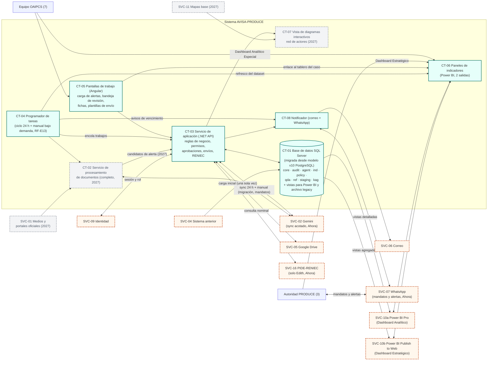

**Estado de cada contenedor**

| ID    | Contenedor                                         | Qué hace                                                                                                                                                          | Tecnología                                          | Estado                           |
| ----- | -------------------------------------------------- | ----------------------------------------------------------------------------------------------------------------------------------------------------------------- | --------------------------------------------------- | -------------------------------- |
| CT-01 | Base de datos                                      | Guarda todo; aplica seguridad por fila, cifrado de datos personales y auditoría                                                                                   | **SQL Server** (migrada desde PostgreSQL v10, H-01) | **Resuelto**; migración en curso |
| CT-02 | Servicio de procesamiento de documentos (completo) | Lee fuentes públicas y documentos, extrae actores, eventos y citas, propone puntaje de riesgo                                                                     | **[EN BLANCO · H-03]**                              | **2027**                         |
| CT-03 | Servicio de aplicación (API)                       | Reglas de negocio, permisos por perfil, aprobación de alertas, informes, envíos, **consulta nominal a RENIEC**                                                    | **.NET** (confirmado por OGTI)                      | **Resuelto**                     |
| CT-04 | Programador de tareas                              | Lanza recolecciones, sync con Gemini, recálculos de indicadores, vencimiento de compromisos (ciclo automático cada 24 h, más disparo manual bajo demanda, RF-E13) | **[EN BLANCO · H-17]**                              | Por construir                    |
| CT-05 | Pantallas de trabajo                               | Cargar alertas, revisar y aprobar, ver fichas, armar plantillas de envío                                                                                          | **Angular** (confirmado por OGTI)                   | **Resuelto**                     |
| CT-06 | Paneles de indicadores                             | Dos salidas: Dashboard Analítico Especial (detalle, DNI) y Dashboard Estratégico (agregado, sin DNI)                                                              | **Power BI** (Pro + Publish to Web)                 | Por construir                    |
| CT-07 | Vista de diagramas interactivos                    | Red de actores y relaciones; línea de tiempo (fase siguiente)                                                                                                     | **[EN BLANCO · H-05]**                              | **2027**                         |
| CT-08 | Notificador                                        | Envía correos y mensajes de WhatsApp con enlace; deja registro de cada envío                                                                                      | **[EN BLANCO · H-19]**                              | Por construir                    |

## 14.3 Nivel 3 — Componentes (qué hay dentro de las piezas clave)

### 14.3.1 Dentro del Servicio de procesamiento de documentos (CT-02) — horizonte 2027

> Este servicio **no entra en diciembre**. Se conserva como referencia para 2027.

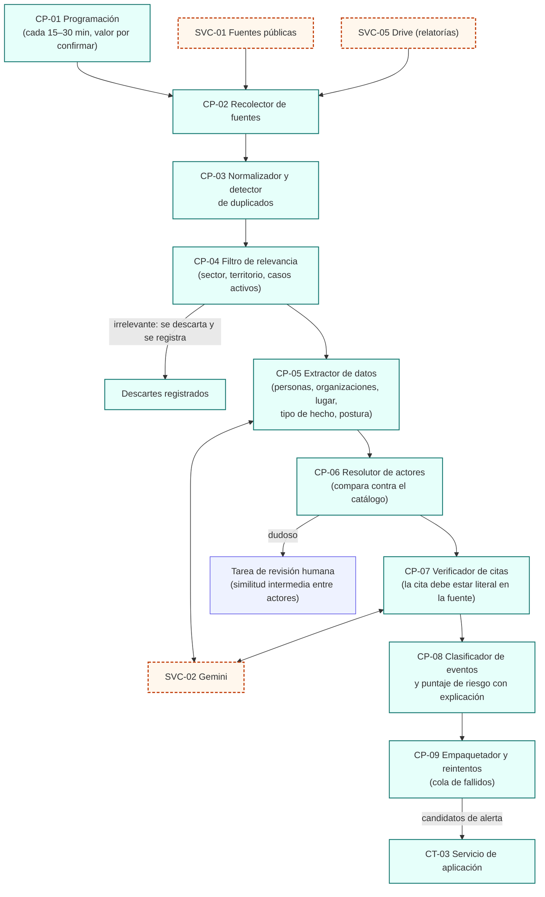

**Lo que este servicio no hace:** no aprueba ni publica nada, no fusiona actores por su cuenta, no recibe datos personales y no escribe directamente en las tablas de negocio (solo entrega **candidatos** al servicio de aplicación).

### 14.3.2 Dentro del Servicio de aplicación (CT-03)

> **Actualizado (R10):** en diciembre **CA-10** (conector de Gemini) se construye, pero **acotado** a la sincronización de la migración y al apoyo de mandatos por WhatsApp — no al procesamiento abierto de documentos (eso sigue en CT-02, 2027. **CA-05** (bandeja de revisión) funciona solo con alertas cargadas a mano, ya que no recibe candidatos automáticos de CT-02. Se agrega **CA-13**, exclusivo para el analista con privilegio RENIEC.

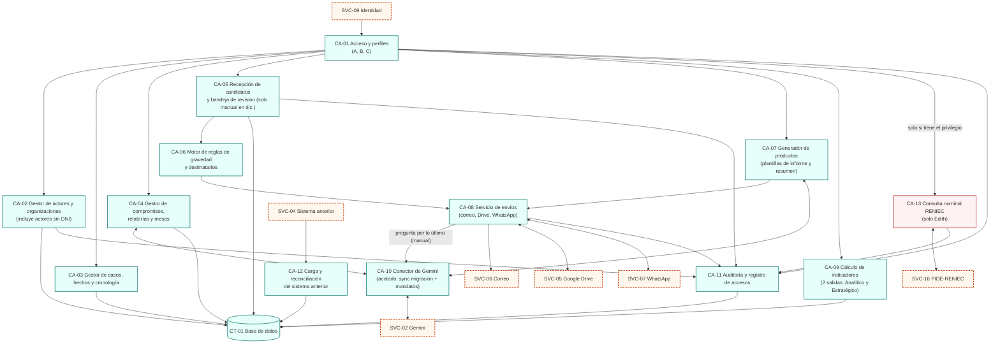

### 14.3.3 Dentro de la base de datos (CT-01): qué trae el MVP

Del inventario R5, **46 tablas** son del MVP: son las capas **T0 y T1** de `mvp_prioridad_tablas.csv` (34 ya tienen datos y 12 están todavía vacías). Las otras **217** no se usan aún. De esas 46, **42 se migran a SQL Server** en el módulo de diciembre, porque las **4 de `kag`** que R5 marca como prioritarias se difieren a 2027 (ver el recuadro siguiente). A esas 42 se suman las **tablas padre** que sus claves ajenas necesitan para tener destino —`core.regiones`, `core.cat_unidades_organicas` y compañía—, y el conjunto que llega al _staging_ de la migración son **78 tablas**: 58 de `core`, 7 de `policy`, 3 de `ind`, 3 de `kag`, 2 de `qda`, 2 de `ref`, 1 de `agent`, 1 de `audit` y 1 de `staging`. Ese es el número que aplica `migration/mssql/00_alcance_mvp.sql`, no las 42.

> **Corrección:** el esquema `kag` (grafo de conocimiento: `kag.nodos`, `kag.aristas`) **está creado y ya tiene datos de prueba —1 520 nodos y 450 aristas—, pero no entra en el MVP**. El diagrama interactivo de la red de actores (RF-H01, CT-07) es 2027, y nada en diciembre lo consume, así que construir y mantener el grafo ahora no tiene destino. Lo que **sí** entra, y siempre estuvo en `core`, es la **tabla de actores** (`core.actores`) con sus relaciones básicas (RF-B06): eso basta para las fichas y para los 4 perfiles de la matriz de permisos (6.3). El grafo se retoma en 2027 junto con CT-07. Aun así, la clausura de claves ajenas de la migración devuelve **3 tablas de `kag`** al conjunto final (`kag.cat_corpus`, `kag.documento_fragmento` y `kag.documento_fuente`) porque `ref.base_legal_evidencia` apunta a `kag.documento_fragmento`: entran solo para que esa clave ajena tenga destino y no se usan en diciembre.

**Qué hay dentro de la base, en un vistazo.** Las 46 tablas no son 46 piezas sueltas: son **nueve bloques funcionales dentro de `core`** (35 tablas) y **un esquema pequeño por cada uno de los otros ocho asuntos** (11 tablas). El primer diagrama muestra esa organización; el segundo abre `core` con los nombres reales de las tablas y las relaciones que ya existen en la base, medidas sobre el catálogo (no dibujadas a mano).

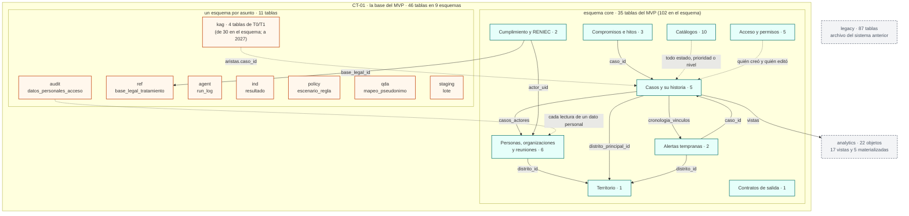

**Cómo se lee.** La caja grande es la base del MVP. Los nueve recuadros de `core` son bloques funcionales, no esquemas: agrupan las tablas que siempre se usan juntas. Los ocho recuadros de abajo son esquemas con una o cuatro tablas, cada uno con un solo asunto. `analytics` y `legacy` quedan **fuera** del recuento: el primero son las 22 vistas y tablas materializadas que alimentan los dos Power BI (el modelo tiene 36 objetos derivados en total); el segundo es la copia del sistema anterior, que se conserva como archivo y no se migra.

**El interior de core, con las tablas y sus relaciones.** Esta es la lámina de detalle. El relleno indica que la tabla ya tiene filas; el punteado, que está creada y todavía vacía. Las flechas son claves foráneas que existen hoy en la base, y llevan el nombre de la columna que las produce.

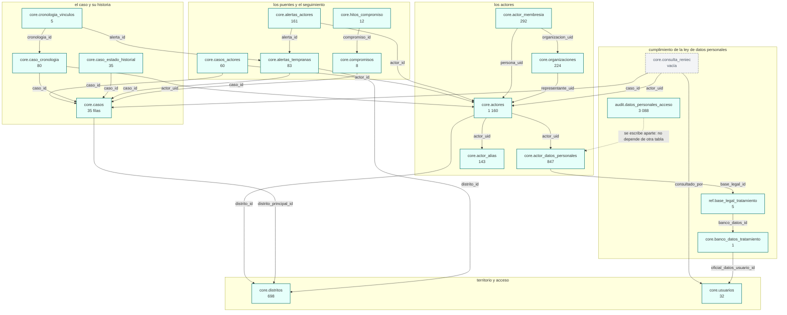

**Las tres cosas que este diagrama demuestra.** Primero, que el **caso es el centro**: la alerta, la cronología, el compromiso y el actor se cuelgan de él, y no al revés. Segundo, que el **actor es quien guarda el dato sensible**: el nombre y el DNI viven en `actor_datos_personales`, aparte de `actores`, que es la ficha que se consulta a diario; por eso la ley de datos personales se puede cumplir sin cifrar toda la base. Tercero, que **la ley tiene sus propias tablas**: la base legal en `ref.base_legal_tratamiento`, el banco de datos declarado en `core.banco_datos_tratamiento`, la consulta a RENIEC en `core.consulta_reniec` y el registro de cada lectura en `audit.datos_personales_acceso`, que se escribe aparte y **no depende de otra tabla** —esa es la garantía de que un borrado no se lleve la prueba de quién leyó qué.

| Esquema     | Qué guarda                                                                                                                                  | Tablas del MVP | Observación                                                      |
| ----------- | ------------------------------------------------------------------------------------------------------------------------------------------- | -------------: | ---------------------------------------------------------------- |
| `core`      | Casos, hechos, actores (incluida la relación entre ellos), organizaciones, compromisos, alertas, documentos, usuarios, catálogos, geografía |             35 | Núcleo del MVP                                                   |
| `audit`     | Registro inmutable de acceso a datos personales y a RENIEC                                                                                  |              1 | Obligatorio                                                      |
| `agent`     | Registro de ejecuciones del conector de Gemini (CA-10 acotado)                                                                              |              1 | Trazabilidad del uso de IA                                       |
| `ind`       | Indicadores y resultados (alimenta los dos Power BI)                                                                                        |              1 | Hoy sin filas                                                    |
| `policy`    | Reglas de control (gravedad, enrutamiento)                                                                                                  |              1 |                                                                  |
| `staging`   | Aterrizaje temporal de cargas (migración y sync de Gemini)                                                                                  |              1 |                                                                  |
| `qda`       | Equivalencia de seudónimos (análisis cualitativo)                                                                                           |              1 | Por confirmar si entra (RF-N, 2027)                              |
| `ref`       | Base legal de cada tratamiento (soporte del Anexo D)                                                                                        |              1 | Soporte del Anexo D                                              |
| `kag`       | Grafo de conocimiento (nodos, aristas, fuentes)                                                                                             |              4 | 30 tablas creadas; 2 con datos; las 4 del MVP se difieren a 2027 |
| `legacy`    | Copia exacta del sistema anterior (87 tablas)                                                                                               |              — | Se conserva como archivo                                         |
| `analytics` | Vistas para tableros e informes (filtradas: solo las de 7.2, Analítico y Estratégico)                                                       |              — | Alimenta los dos Power BI                                        |

> **Resuelto (H-01):** el motor de producción es **SQL Server**, no PostgreSQL. Las diferencias de tipos (`UUID`→`UNIQUEIDENTIFIER`, `JSONB`→`NVARCHAR(MAX)` + `ISJSON`) y de seguridad por fila se verifican según la tabla de 12.1.

## 14.4 Flujo de una alerta (de la fuente al destinatario)

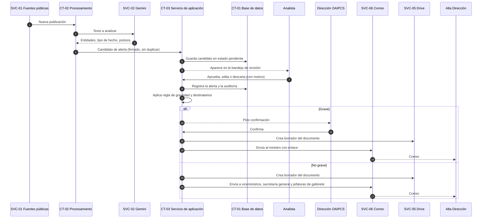

> **En diciembre** los pasos 1 a 5 (fuente → procesamiento → candidato) se reemplazan por la **carga manual de la alerta** (RF-D01); aprobación, regla de gravedad y envío se mantienen **[EN BLANCO · H-45]**.

> Las alertas tempranas por **WhatsApp** que pidió Iván entran en diciembre como un paso más de envío, con plantillas transaccionales y línea postpago institucional (RM-16 a RM-19, 13.3); el costo por mensaje y la línea siguen por confirmar **[EN BLANCO · H-06]**.

## 14.5 Catálogo de servicios por integrar

Aquí están reunidos todos los servicios que el sistema necesita conectar. La ficha detallada de cada uno está en la sección 13.

| ID            | <u>Servicio</u>                                                                     | Para qué                                                                                              | Sentido      | Horizonte                   | Estado                                                          |
| ------------- | ----------------------------------------------------------------------------------- | ----------------------------------------------------------------------------------------------------- | ------------ | --------------------------- | --------------------------------------------------------------- |
| <u>SVC-01</u> | Medios digitales, portales oficiales y gob.pe (RSS y páginas públicas)              | Recibir noticias y reportes para generar candidatos de alerta                                         | Entra        | 2027                        | Por definir lista blanca de fuentes                             |
| <u>SVC-02</u> | **Modelo de lenguaje de Google (Gemini)**                                           | Extraer datos de textos y redactar borradores                                                         | Entra y sale | diciembre (acotado)         | Preferencia de OGTI; dictamen legal pendiente **[H-04]**        |
| <u>SVC-03</u> | Redes sociales (API oficial o proveedor licenciado de escucha social)               | Recibir las acciones de las OSPA que hoy llegan por redes                                             | Entra        | MADRE                       | Sin proveedor ni costo                                          |
| <u>SVC-04</u> | Sistema anterior (Google Sheets + Apps Script)                                      | Fuente de la carga histórica y de los cambios hasta el cambio de sistema                              | Entra        | MVP                         | Carga histórica hecha; falta reconciliar                        |
| <u>SVC-05</u> | **Google Drive**                                                                    | Guardar borradores, relatorías y PDF                                                                  | Entra y sale | MVP (por confirmar)         | Por definir estructura de carpetas                              |
| <u>SVC-06</u> | **Correo institucional**                                                            | Enviar alertas, informes y resúmenes con enlace                                                       | Sale         | MVP (por confirmar)         | Por confirmar pasarela                                          |
| <u>SVC-07</u> | **WhatsApp**                                                                        | Enviar alertas tempranas                                                                              | Sale         | diciembre (acotado)         | Costo acotado con RM-16 a RM-19 (13.3)                          |
| <u>SVC-08</u> | SMS                                                                                 | Avisar crisis confirmadas                                                                             | Sale         | MADRE                       | No incluido en el MVP **[H-07]**                                |
| <u>SVC-09</u> | Identidad institucional (inicio de sesión con grupos por perfil)                    | Saber quién es el usuario y qué perfil tiene                                                          | Entra        | MVP                         | **[EN BLANCO · H-20]** qué servicio usa OGTI                    |
| <u>SVC-10</u> | **Power BI** (dos salidas: <u>SVC-10a</u> Pro y <u>SVC-10b</u> Publish to Web, 6.2) | Tableros, tablas y mapas                                                                              | Sale         | MVP                         | Licencia confirmada                                             |
| <u>SVC-11</u> | Servicio de mapas base (mosaicos)                                                   | Mostrar mapas en diagramas y tableros                                                                 | Entra        | 2027                        | Los públicos no sirven para producción                          |
| <u>SVC-12</u> | SESIGUE                                                                             | Enviar estados de compromisos                                                                         | Sale         | MADRE                       | Solo contrato de interfaz                                       |
| <u>SVC-13</u> | Fuentes oficiales previstas en la v10: IMARPE, OEFA, SUNAT, VUCE                    | Contexto del entorno y de la actividad pesquera                                                       | Entra        | MADRE                       | Catálogo ya existe en la base                                   |
| <u>SVC-14</u> | Sistemas de otros ministerios: MEF, MINAM, MINCETUR, MININTER, RREE                 | Seguimiento interministerial de compromisos                                                           | Sale         | MADRE                       | Vista ya prevista en la base                                    |
| <u>SVC-15</u> | Transcripción de audio a texto                                                      | Obtener las transcripciones de reuniones que pidió Iván                                               | Entra        | 2027 **[EN BLANCO · H-21]** | No se sabe si hoy se transcribe a mano o hace falta un servicio |
| <u>SVC-16</u> | **PIDE-RENIEC**                                                                     | Consultar requisitorias y antecedentes de un actor, **solo** para el analista con privilegio nombrado | Entra        | MVP (si se activa)          | Convenio con RENIEC; acceso nominal, nunca por rol genérico     |

## 14.6 Despliegue y ambientes

**[EN BLANCO · H-22]** Falta: dónde se aloja cada pieza (servidores de OGTI o nube), cuántos ambientes (desarrollo, pruebas, producción), cómo se accede (red privada), certificados y copias de seguridad. Responde: OGTI.

---

# 15. ESTADOS DE ERROR Y CASOS LÍMITE

| ID     | Situación                                          | Comportamiento requerido                                                                                 |
| ------ | -------------------------------------------------- | -------------------------------------------------------------------------------------------------------- |
| ERR-01 | El usuario ingresa bien pero no tiene rol asignado | Se informa que no tiene acceso y se avisa al administrador                                               |
| ERR-02 | Falla el servicio de login institucional           | Se muestra un mensaje claro; no se permite ingreso alternativo con claves locales **[EN BLANCO · H-52]** |
| ERR-03 | Un usuario intenta ver algo fuera de su rol        | No se muestra; queda registrado el intento                                                               |
| ERR-04 | Un caso no tiene actores o compromisos             | La ficha lo indica en lugar de mostrarse vacía                                                           |
| ERR-05 | Un actor no tiene DNI                              | Se permite el registro (RF-B01)                                                                          |
| ERR-06 | Se detecta un posible actor duplicado              | Se avisa y se ofrece revisar; no se fusiona solo                                                         |
| ERR-07 | Una alerta pendiente no se atiende                 | Aparece en la lista de pendientes; el escalamiento automático queda para 2027 **[H-14]**                 |
| ERR-08 | Falla un envío (correo)                            | Queda registrado con su motivo y se puede reintentar                                                     |
| ERR-09 | Un tablero no tiene datos                          | Se indica «sin datos» con el motivo, no una pantalla en blanco                                           |
| ERR-10 | La precarga encuentra registros inconsistentes     | Se separan, se reportan y no se cargan hasta validarlos                                                  |
| ERR-11 | Un documento registrado no tiene archivo           | Se muestra el aviso y se permite adjuntarlo después                                                      |

---

# 16. VERIFICACIÓN Y CRITERIOS DE ACEPTACIÓN

Criterios de aceptación **propuestos** para el módulo de diciembre. Las pruebas T91 a T105 del MVP-45 se reutilizan **solo en lo que corresponda al alcance de diciembre**.

| ID    | Criterio                                                                                                                                                    | Cómo se verifica                                                                                                                                                                                                                                                                                                                    | Requisitos             |
| ----- | ----------------------------------------------------------------------------------------------------------------------------------------------------------- | ----------------------------------------------------------------------------------------------------------------------------------------------------------------------------------------------------------------------------------------------------------------------------------------------------------------------------------- | ---------------------- |
| AC-01 | Un usuario ingresa con su usuario institucional y ve el menú de su rol                                                                                      | Prueba con usuarios de cada rol                                                                                                                                                                                                                                                                                                     | RF-A01, RF-A02         |
| AC-02 | Ninguna consulta de un rol devuelve filas de otro alcance; la Alta Dirección no ve datos personales en el Dashboard Estratégico ni alertas sin aprobar      | Batería de pruebas de aislamiento por rol; el aislamiento de los tableros se verifica en AC-06                                                                                                                                                                                                                                      | RF-A03, RF-A04, RF-D12 |
| AC-03 | Se completa el circuito de punta a punta con datos de prueba: crear caso → registrar hecho, actor y compromiso → cargar alerta → aprobar → enviar           | Demostración con usuarios de OAIPCS                                                                                                                                                                                                                                                                                                 | RF-D01, RF-D03, RF-D07 |
| AC-04 | Se registra un actor sin DNI y luego se promueve sin perder historial                                                                                       | Prueba                                                                                                                                                                                                                                                                                                                              | RF-B01, RF-B02         |
| AC-05 | Los datos maestros precargados cuadran con el origen (cargados + fusionados + descartados + pendientes)                                                     | Reporte de reconciliación                                                                                                                                                                                                                                                                                                           | RF-M01                 |
| AC-06 | Los tableros prioritarios muestran cifras que coinciden con los registros y ninguna vista de `analytics` devuelve datos personales al Dashboard Estratégico | Contraste con las tablas + revisión de cada vista de `analytics` (ese esquema **no tiene RLS**: el aislamiento por rol o territorio debe estar en la definición de la vista o en el modelo de Power BI, no en políticas de fila) y de la lista de columnas que se publican por Publish to Web, que no debe incluir ninguna personal | RF-H02, RF-A04, RD-08  |
| AC-07 | Toda lectura de datos personales queda registrada y no se puede borrar                                                                                      | Lecturas de `core.actor_datos_personales` (847 filas) verificadas en `audit.datos_personales_acceso` (3 088 filas), más un intento de borrado que debe fallar                                                                                                                                                                       | RF-X01                 |
| AC-08 | OGTI reconstruye el módulo en un entorno limpio con la guía entregada                                                                                       | Prueba por OGTI                                                                                                                                                                                                                                                                                                                     | RNF-04                 |
| AC-09 | Cada servicio integrado funciona y falla de forma controlada                                                                                                | Prueba por servicio                                                                                                                                                                                                                                                                                                                 | Sección 13.1           |

**Regla de cierre:** el módulo se acepta cuando pasan todos los AC _Must_ y los defectos abiertos son de gravedad **[EN BLANCO · H-55: definir con OGTI y firmar en el acuerdo de alcance]**.

---

# 17. MATRIZ DE TRAZABILIDAD

| Necesidad                                 | Historia     | Requisito              | Pantalla          | Origen de datos                                                    | Criterio        |
| ----------------------------------------- | ------------ | ---------------------- | ----------------- | ------------------------------------------------------------------ | --------------- |
| N-01, N-15 Quiénes actúan en una zona     | HU-01        | RF-F01, RF-F02         | PAN-11            | Vistas por definir **[H-41]**                                      | AC-03           |
| N-02 Reportes remitidos                   | HU-07        | RF-F05                 | PAN-04, PAN-11    | `analytics.vw_anexo_17_registro_reportes`                          | AC-03           |
| N-03 Compromisos de ayudas memoria        | HU-08        | RF-C01, RF-C02, RF-C05 | PAN-08            | `analytics.vw_anexo_14_seguimiento_compromisos`                    | AC-03, AC-06    |
| N-05, N-06 Directorios de autoridades     | HU-01        | RF-F03                 | PAN-11            | Vistas por definir **[H-41]**                                      | AC-03           |
| N-08 Validar alertas                      | HU-04        | RF-D03, RF-D04, RF-D12 | PAN-06            | `core.alertas_tempranas`                                           | AC-02, AC-03    |
| N-09 Teléfonos y OSPA                     | HU-02        | RF-B05, RF-B07, RF-F04 | PAN-07            | Vistas por definir **[H-41]**                                      | AC-02           |
| N-10 Cargar alertas                       | HU-03        | RF-D01                 | PAN-05            | `core.alertas_tempranas`                                           | AC-03           |
| N-11 Envío según gravedad                 | HU-05, HU-06 | RF-D06, RF-G01, RF-G03 | PAN-09            | `core.envios_comunicacion`                                         | AC-03           |
| N-14 Riesgos por clasificación de eventos | HU-05        | RF-D05, RN-01          | PAN-05, PAN-06    | Catálogo por definir **[H-24]**                                    | **[EN BLANCO]** |
| Login institucional                       | —            | RF-A01, RF-A02         | PAN-01            | Identidad **[H-52]**                                               | AC-01           |
| Datos maestros                            | —            | RF-M01                 | —                 | `legacy` → `core`                                                  | AC-05           |
| Tableros                                  | —            | RF-H02                 | TAB-01 a TAB-05   | Vistas `analytics`                                                 | AC-06           |
| N-04 Locales para reuniones               | —            | RF-F06                 | PAN-11            | `core.locales`                                                     | **[EN BLANCO]** |
| N-07 Análisis de casos                    | —            | RF-G05                 | PAN-04            | `analytics.vw_anexo_15_matriz_conflictividad`                      | **[EN BLANCO]** |
| N-12 Relatorías y transcripciones         | HU-08, HU-11 | RF-C02, RF-E01         | PAN-04, PAN-08    | `core.documentos`, `core.compromisos`                              | AC-03           |
| N-13 Envíos por correo y WhatsApp         | HU-05        | RF-D07, RF-D08         | PAN-09            | `core.envios_comunicacion`                                         | AC-03, AC-09    |
| N-16 Análisis de la pota                  | HU-13        | RF-H03, RF-N01         | —                 | Vistas por definir **[H-35]**                                      | **[EN BLANCO]** |
| N-17 Perfiles de pescadores               | —            | RF-N02                 | —                 | Vistas por definir **[H-36]**                                      | **[EN BLANCO]** |
| Sincronización bajo demanda               | HU-08b       | RF-E13, RF-E14, RN-18  | PAN-04 **[H-77]** | Sincronización con Gemini (SVC-02) **[H-73]**                      | AC-09           |
| Actores sin DNI                           | HU-09        | RF-B01, RF-B02         | PAN-07            | `core.actores`, `core.actor_datos_personales`                      | AC-04           |
| Red de actores (N-01, N-17)               | HU-10        | RF-H01                 | —                 | `analytics.vw_mactor_red_actores`                                  | **[EN BLANCO]** |
| Relatoría con IA                          | HU-11        | RF-E01, RF-E04, RF-E05 | —                 | `core.documentos`                                                  | **[EN BLANCO]** |
| Resumen para la Alta Dirección            | HU-12        | RF-G04, RF-H05         | TAB-04            | `mv_dashboard_alta_direccion`, `analytics.vw_indicadores_minister` | AC-02, AC-06    |
| Auditoría de datos personales             | —            | RF-X01                 | —                 | `audit.datos_personales_acceso`                                    | AC-07           |
| Entrega y reconstrucción del módulo       | —            | RNF-04                 | —                 | Guía de reconstrucción y scripts **[H-61]**                        | AC-08           |

> **Filas que apuntan a PAN-11** (N-01/N-15, N-02 y N-05/N-06): PAN-11 quedó **fuera de los 20 días** (7.1 y 19), así que esas filas trazan requisitos **MVP** a una pantalla que diciembre no entrega; entra solo si H-45 la reclasifica.

> **Cobertura pendiente (actualizada al 2026-11-20):** ya tienen fila N-04, N-07, N-12, N-13, N-16, N-17 y HU-08b a HU-13, y AC-04 (HU-09), AC-07 (RF-X01), AC-08 (RNF-04) y AC-09 (N-13 y HU-08b) son criterio de alguna fila. Queda abierto: **RF-D05 sigue [EN BLANCO]** porque ningún AC de la sección 16 verifica la clasificación de eventos, que depende del catálogo H-24; **N-04, N-07, N-16/HU-13, N-17, HU-10 y HU-11 no tienen AC** porque la sección 16 solo cubre diciembre y esas filas son MADRE o 2027 (en HU-13 no habrá criterio hasta que H-35 defina «controversia» y fuentes); y **N-04 vuelve a apuntar a PAN-11**, que sigue fuera de los 20 días, igual que N-01/N-15, N-02 y N-05/N-06.

---

# 18. PLAN DE 20 DÍAS, DEPENDENCIAS, DECISIONES PENDIENTES Y RIESGOS

## 18.1 El proceso acordado

> **Resuelto, pero invalida el plan secuencial (H-53):** OGTI fija el inicio de los **20 días técnicos** el **martes 24 de noviembre de 2026**. El documento preveía diseñar el prototipo (≈ 9,5 días, 7.4) **antes** de firmar el acuerdo y arrancar la parte técnica (18.1 original); con esta fecha **no hay margen previo**. El reparto que corresponde ahora:

| Cuándo                           | Qué se hace                                                                                                                                                                     |
| -------------------------------- | ------------------------------------------------------------------------------------------------------------------------------------------------------------------------------- |
| **Hoy (20-nov) al lunes 23-nov** | OAIPCS entrega: (a) los **wireframes del flujo principal** (circuito de 5.1, sin pulir las pantallas secundarias) y (b) los **scripts SQL Server** del modelo relacional (H-01) |
| **Martes 24-nov (día 1)**        | Los 4 desarrolladores arrancan **L0** (base de datos) y **L1** (login institucional) con lo entregado                                                                           |
| **Miércoles/jueves (días 2–3)**  | Mientras L0 y L1 avanzan, OAIPCS termina de **anotar las pantallas secundarias** (fichas 7.5) en paralelo, sin bloquear a OGTI                                                  |
| **Resto de los 20 días**         | Firma del acuerdo de alcance (sección 19) en paralelo a las primeras capas, no antes; se firma sobre lo ya construido en L0-L1 si hace falta ajustar                            |

> Esto reduce de **9,5 a ≈ 3 días hábiles** el tiempo de diseño previo. La metodología completa de 7.4 (los diez pasos) sigue siendo la referencia, pero se **comprime**: los pasos 1 a 6 (público, protagonista, narrativa, datos, forma, estilo) se hacen antes del martes; los pasos 7 a 10 (boceto, prueba, fidelidad media, anotación) se hacen **en paralelo** a L0 y L1, no antes.

> **Resuelto (H-02):** OGTI confirma **≈ 4 desarrolladores**. Propuesta de reparto por frente, siguiendo las capas de 5.5:

| Frente                                 | Capas                | Desarrollador(es) sugeridos |
| -------------------------------------- | -------------------- | --------------------------- |
| Base de datos y migración a SQL Server | L0                   | 1                           |
| API .NET, seguridad e identidad        | L1, L3               | 1 a 2                       |
| Frontend Angular y Power BI            | L2, L4, L5 (parcial) | 1 a 2                       |

> Dedicación exclusiva: **[EN BLANCO · H-70]**.

| Paso | Qué ocurre                                          | Entregable                        | Quién          | Cuándo                                             |
| ---- | --------------------------------------------------- | --------------------------------- | -------------- | -------------------------------------------------- |
| 1    | Wireframes del flujo principal y scripts SQL Server | Prototipo mínimo (no el completo) | OAIPCS (Diego) | Entre hoy y el lunes 23-nov                        |
| 2    | **Documento de análisis** con reglas y roles        | Este documento (secciones 4 a 8)  | OAIPCS         | Avance a Dilayda **antes del martes**              |
| 3    | **Parte técnica inicia** (L0 y L1)                  | Base de datos y login en marcha   | OGTI           | **Resuelto: martes 24-nov-2026**                   |
| 4    | **Acuerdo firmado** sobre el alcance definitivo     | Sección 19 firmada                | OAIPCS y OGTI  | En paralelo a L0-L1, primera semana                |
| 5    | **Resto de la parte técnica**                       | Módulo de diciembre en producción | OGTI           | 20 días desde el 24-nov → **cierre ≈ 13-dic-2026** |

> **Calendario:** 20 días corridos desde el **martes 24 de noviembre de 2026** hasta aproximadamente el **13 de diciembre de 2026**. La migración de datos (RF-M01) debe estar lista **al menos para el 23 de diciembre** (H-29), lo que deja un margen corto entre el cierre técnico y la reconciliación final — ver riesgo RIE-13 en 18.4.

## 18.2 Dependencias de OGTI

| ID  | Dependencia                                                                                                                                           | Fecha límite                                                                                                                               | Si no llega                                                  |
| --- | ----------------------------------------------------------------------------------------------------------------------------------------------------- | ------------------------------------------------------------------------------------------------------------------------------------------ | ------------------------------------------------------------ |
| D-1 | Entorno de base de datos (versión, extensiones y permisos)                                                                                            | **[EN BLANCO]**                                                                                                                            | Ver H-01                                                     |
| D-2 | Servicio de identidad institucional y grupos por rol                                                                                                  | **[EN BLANCO]**                                                                                                                            | Ver H-52                                                     |
| D-3 | Entorno de aplicación (servidor, certificados, acceso por red privada)                                                                                | **[EN BLANCO]**                                                                                                                            | Ver H-22                                                     |
| D-4 | Desarrolladores asignados y su dedicación                                                                                                             | **Resuelto (H-02): ≈ 4 desarrolladores** (propuesta de reparto en 18.1); falta confirmar si es dedicación exclusiva **[EN BLANCO · H-70]** | Se repite el cuello de botella de un solo recurso por frente |
| D-5 | Revisión del prototipo por OGTI                                                                                                                       | **[EN BLANCO]**                                                                                                                            | Se cierra el acuerdo sin la revisión técnica                 |
| D-6 | Diseñar el prototipo en Figma **pensando en componentes estándar de Angular**: tablas paginadas, formularios reactivos, modales y etiquetas de estado | Antes de iniciar L2                                                                                                                        | Recodificación de componentes por OGTI                       |
| D-6 | Validación del catálogo de estados de caso por OAIPCS                                                                                                 | **[EN BLANCO]**                                                                                                                            | Se usa el catálogo del MVP-45 y se registra como supuesto    |

## 18.3 Decisiones pendientes

**Para cerrar en la reunión del martes** (de ellas depende el resto): **H-45** (qué necesidades caben en diciembre), **H-47** (uso real del AVISA actual), **H-49** y **H-50** (pantallas y tableros prioritarios; el recorte de RIE-13 ya deja 2 o 3 tableros sobre vistas existentes), **H-51** (datos maestros), **H-52** (login institucional), ~~H-53~~ (calendario, **resuelto: inicia 24-nov-2026**), **H-57** (quién aprueba), **H-63** (orden de las capas), ~~**H-64**~~ (licencias de Power BI, **resuelto en 13.3.4**: las 7 Pro ya pagadas cubren a los 7 usuarios del Analítico Especial y el Estratégico va por Publish to Web, sin costo) y **H-65** (quién paga los servicios) y **H-68** (convenio con RENIEC y quién asigna el privilegio). Ya resueltos: **H-44** (modelo relacional) y **H-46** (OAIPCS diseña el prototipo).

**Para después:** el resto, registrado en el Anexo C — entre ellas **H-16** (administrador operativo: hoy lo cubre Edith, 6.1) y **H-09** (peso de los factores de gravedad, 11.1). **H-14** (plazos por prioridad) está **medio resuelto**: 11.1 ya fija ≤ 24 h, 24-48 h y ≤ 5 días, y RN-13 los usa; falta decidir si se homologan con los **4 niveles** que tiene la base en `core.cat_niveles_alerta` (24 h / 24-48 h / 48-72 h / monitoreo) o si la tabla de 11.1 suma un cuarto nivel **[por verificar]**.

## 18.4 Riesgos

| ID         | Riesgo                                                                                                                                                                                                                                                                                              | Prob.    | Impacto  | Mitigación                                                                                                                                                                                                                                                                                                                                                                                                                                                                                                                                                | Señal temprana                                                                        |
| ---------- | --------------------------------------------------------------------------------------------------------------------------------------------------------------------------------------------------------------------------------------------------------------------------------------------------- | -------- | -------- | --------------------------------------------------------------------------------------------------------------------------------------------------------------------------------------------------------------------------------------------------------------------------------------------------------------------------------------------------------------------------------------------------------------------------------------------------------------------------------------------------------------------------------------------------------- | ------------------------------------------------------------------------------------- |
| RIE-01     | Expectativas desalineadas: se espera recibir la aplicación actual tal cual                                                                                                                                                                                                                          | Alta     | Alto     | Mostrar primero la **paridad** (sección 5) y dejar el rediseño como mejora interna                                                                                                                                                                                                                                                                                                                                                                                                                                                                        | Preguntas por pantallas que ya existen                                                |
| RIE-02     | La conversación vuelve al nivel técnico (LLM, WhatsApp, servidores)                                                                                                                                                                                                                                 | Media    | Alto     | Llevar solo lo que se pidió; el resto, material interno                                                                                                                                                                                                                                                                                                                                                                                                                                                                                                   | Se abre un tema de la sección 13                                                      |
| RIE-03     | Postura no unificada de OAIPCS                                                                                                                                                                                                                                                                      | Media    | Alto     | Acordar una sola voz y enviar avance previo                                                                                                                                                                                                                                                                                                                                                                                                                                                                                                               | Mensajes distintos antes del martes                                                   |
| RIE-04     | 20 días no alcanzan                                                                                                                                                                                                                                                                                 | Alta     | Alto     | Alcance mínimo y reclasificación a 2027 **[H-45]**                                                                                                                                                                                                                                                                                                                                                                                                                                                                                                        | Pantallas sin priorizar                                                               |
| RIE-05     | Los desarrolladores solo tienen presupuesto hasta diciembre                                                                                                                                                                                                                                         | Media    | Alto     | Documentar y entregar de modo que el módulo sea mantenible                                                                                                                                                                                                                                                                                                                                                                                                                                                                                                | Sin asignación confirmada **[H-02]**                                                  |
| RIE-06     | La traducción PostgreSQL → SQL Server pierde reglas de seguridad por fila o datos en la conversión                                                                                                                                                                                                  | Media    | Alto     | Los tres puntos de incompatibilidad de 12.1; reconciliación obligatoria antes del 23-dic (H-29)                                                                                                                                                                                                                                                                                                                                                                                                                                                           | Diferencias en el conteo de filas tras la carga                                       |
| RIE-07     | Exposición de datos personales en la precarga o el prototipo                                                                                                                                                                                                                                        | Baja     | Alto     | Datos de prueba sin teléfonos ni DNI reales; cifrado y registro de lecturas                                                                                                                                                                                                                                                                                                                                                                                                                                                                               | Datos reales en archivos del prototipo                                                |
| RIE-08     | Pocos datos para calcular indicadores (8 compromisos, 0 resultados)                                                                                                                                                                                                                                 | Alta     | Medio    | Tableros sobre las vistas existentes; indicadores como índices de gestión                                                                                                                                                                                                                                                                                                                                                                                                                                                                                 | Tablero «sin datos»                                                                   |
| RIE-09     | El alcance se amplía después de la firma                                                                                                                                                                                                                                                            | Media    | Alto     | Control de cambios del acuerdo                                                                                                                                                                                                                                                                                                                                                                                                                                                                                                                            | Peticiones fuera del acuerdo                                                          |
| RIE-10     | Costos de servicios externos asumidos por OAIPCS sin presupuesto definido                                                                                                                                                                                                                           | Media    | Alto     | Reglas RM-01 a RM-10; solo servicios existentes en diciembre; tope de gasto                                                                                                                                                                                                                                                                                                                                                                                                                                                                               | Pedido de contratar un servicio sin responsable de pago                               |
| RIE-11     | Las licencias de Power BI no cubren a quienes ven los tableros                                                                                                                                                                                                                                      | Media    | Medio    | **[H-64 resuelto]**: las 7 Pro ya pagadas cubren a los 7 usuarios del Analítico Especial y el Estratégico va por Publish to Web sin costo (13.1, 13.3.4); si faltara capacidad, alternativa: resumen aprobado enviado a la Alta Dirección                                                                                                                                                                                                                                                                                                                 | Lectores sin acceso                                                                   |
| RIE-12     | El privilegio de RENIEC se usa fuera de un caso, o se comparte entre varias personas                                                                                                                                                                                                                | Baja     | Alto     | Usuario nominal único, motivo obligatorio, auditoría inmutable (RA-07, RA-08)                                                                                                                                                                                                                                                                                                                                                                                                                                                                             | Consultas sin caso asociado                                                           |
| **RIE-13** | **Sobrecarga de alcance: el documento deja abiertas 11 pantallas (7.1), 5 tableros (7.2), seguridad por fila en 82 tablas (12.1) y conexiones externas condicionadas (PIDE-RENIEC, Drive). Mantener todo eso a la vez pone en riesgo que los 4 desarrolladores lleguen a los objetivos en 20 días** | **Alta** | **Alto** | **Recortar antes del martes** a lo estrictamente necesario: login institucional + flujo central (casos, actores, alertas, validación y envío por correo) + 2 o 3 tableros sobre vistas ya existentes (ver 7.1, 7.2 y 19). **PIDE-RENIEC queda condicionada al convenio (H-68), no fuera de los 20 días**: si el convenio se firma, la base ya soporta el resultado en `core.consulta_reniec`; de las conexiones condicionadas, **Drive (SVC-05) es la única que sale de los 20 días**. Las pantallas secundarias se anotan en paralelo sin bloquear L0-L1 | Más de 6 pantallas o más de 3 tableros aún «por confirmar» al cierre del lunes 23-nov |
| RIE-14     | El cierre técnico (≈ 13-dic) deja poco margen hasta el plazo legal de migración (23-dic, H-29) para resolver hallazgos de la reconciliación                                                                                                                                                         | Media    | Medio    | Correr la reconciliación (RF-M01) sobre SQL Server **durante** los 20 días, no después                                                                                                                                                                                                                                                                                                                                                                                                                                                                    | Reconciliación programada solo para después del 13-dic                                |

---

# 19. ACUERDO DE ALCANCE (BORRADOR PARA FIRMA)

> **Borrador.** Se firma **en paralelo a las primeras capas (L0-L1)**, no antes: el 24-nov-2026 arranca la parte técnica y no hay margen previo (H-53, 18.1). El documento de análisis es el avance previo y el prototipo se termina mientras L0-L1 avanzan.

| Campo                                                         | Contenido                                                                                                                                                                                                                                                                                                                                                                                                                                                                                                        |
| ------------------------------------------------------------- | ---------------------------------------------------------------------------------------------------------------------------------------------------------------------------------------------------------------------------------------------------------------------------------------------------------------------------------------------------------------------------------------------------------------------------------------------------------------------------------------------------------------- |
| **Partes**                                                    | OAIPCS y OGTI — Ministerio de la Producción                                                                                                                                                                                                                                                                                                                                                                                                                                                                      |
| **Objeto**                                                    | Módulo mínimo en producción en diciembre de 2026: **login institucional + flujo central** (casos, actores, alertas, validación y envío por correo) + **2 o 3 tableros en Power BI sobre vistas ya existentes**                                                                                                                                                                                                                                                                                                   |
| **Plazo**                                                     | 20 días: **24-nov-2026 a ≈ 13-dic-2026**                                                                                                                                                                                                                                                                                                                                                                                                                                                                         |
| **Dentro del alcance (núcleo, recortado y cerrado — RIE-13)** | Circuito funcional (sección 5) · login institucional, roles y permisos (sección 6) · pantallas núcleo PAN-01 a PAN-09 (7.1) · tableros TAB-02 y TAB-04 (y TAB-03 si el tiempo alcanza) (7.2) · datos maestros precargados (sección 8)                                                                                                                                                                                                                                                                            |
| **Fuera del alcance de los 20 días**                          | **Google Drive (SVC-05)** · pantallas secundarias PAN-10 y PAN-11 · tableros TAB-01 y TAB-05 · inteligencia artificial y procesamiento automático · fuentes públicas y redes sociales · diagrama interactivo de la red de actores · WhatsApp · simulador · portal para actores externos · integración con SESIGUE · análisis de la pota y de los perfiles de pescadores · PIDE-RENIEC (SVC-16) queda **condicionada al convenio (H-68)**: si se firma, se usa y el resultado se guarda en `core.consulta_reniec` |
| **Plataforma y base de datos**                                | **Resuelto:** Angular (frontend) + .NET (API) + **SQL Server** (destino de producción), migrado desde el modelo relacional v10 · orden de capas **[EN BLANCO · H-63]**                                                                                                                                                                                                                                                                                                                                           |
| **Entregables**                                               | Módulo en producción · guía de reconstrucción · documentación de reglas y roles · reporte de reconciliación de la precarga (antes del 23-dic-2026, H-29)                                                                                                                                                                                                                                                                                                                                                         |
| **Criterios de aceptación**                                   | Sección 16 · gravedad de defectos aceptable para el cierre: **[EN BLANCO · H-55]**                                                                                                                                                                                                                                                                                                                                                                                                                               |
| **Responsabilidades de OAIPCS**                               | Diseñar el prototipo · entregar los documentos del modelo relacional, ya traducidos a SQL Server (5.4) · priorizar pantallas y tableros dentro del núcleo · validar catálogos · validar la precarga · designar punto focal                                                                                                                                                                                                                                                                                       |
| **Responsabilidades de OGTI**                                 | Plataforma (Angular, .NET, SQL Server) · login institucional · 4 desarrolladores · puesta en producción · revisar y optimizar el modelo relacional · cubrir los servicios existentes (identidad, Power BI, correo)                                                                                                                                                                                                                                                                                               |
| **Cambios al alcance**                                        | Solo por acuerdo escrito de ambas partes; **Drive (SVC-05)** solo se incorpora en una adenda posterior, no dentro de los 20 días; **PIDE-RENIEC (SVC-16)** depende del convenio (H-68)                                                                                                                                                                                                                                                                                                                           |
| **Restricciones y supuestos**                                 | RES-01 a RES-12 y SUP-01 y SUP-02 (sección 2.6)                                                                                                                                                                                                                                                                                                                                                                                                                                                                  |

| Firma  | Nombre                                                               | Cargo | Fecha |
| ------ | -------------------------------------------------------------------- | ----- | ----- |
| OAIPCS | **[EN BLANCO · H-57: quién de OAIPCS firma — Luis, Dilayda u otro]** |       |       |
| OGTI   | **[EN BLANCO · H-57]**                                               |       |       |

---

# 20. VISIÓN POSTERIOR

> **Se lleva a la reunión en una sola línea; se conversa en 2027.**

_Más adelante, el sistema podrá incorporar el procesamiento automático de documentos con revisión humana, la red interactiva de actores y el análisis de conflictos a través del tiempo._

---

---

# 21. CATÁLOGO DE VISTAS Y TABLEROS DEL SISTEMA FUTURO

> Lista de referencia construida a partir de las vistas ya existentes en la base (R3, esquemas `analytics` y `core`), las necesidades de Edith, Iván y Esteban (sección 3.3), los indicadores del MVP-45 (R2) y la metodología de diseño (7.4). Ordenada por **cuándo entra**: módulo de diciembre, 2027 y MADRE. Dentro de cada horizonte, por importancia (1 = más importante).

## 21.1 Diciembre 2026 (módulo mínimo)

Ya detallados en 7.2; aquí con su protagonista para dar coherencia a toda la lista.

| #   | Vista o tablero                    | Protagonista       | Pregunta que responde                     | Público                             | Vista existente                       |
| --- | ---------------------------------- | ------------------ | ----------------------------------------- | ----------------------------------- | ------------------------------------- |
| 1   | **Seguimiento de compromisos**     | El compromiso      | ¿Qué está vigente, cumplido o vencido?    | Analista, Dirección, Alta Dirección | `vw_anexo_14_seguimiento_compromisos` |
| 2   | **Alertas por estado y prioridad** | La alerta          | ¿Cuántas esperan revisión y desde cuándo? | Analista, Dirección                 | `core.vw_alerta_estado` (83 filas)    |
| 3   | **Foto para la Alta Dirección**    | La región          | ¿Qué requiere decisión y cuándo?          | Alta Dirección                      | `mv_dashboard_alta_direccion`         |
| 4   | **Casos estancados**               | El caso sin avance | ¿Qué caso lleva tiempo sin moverse?       | Dirección                           | `vw_casos_estancados`                 |
| 5   | **Panorama regional**              | La región          | ¿Cómo se comparan las regiones?           | Analista                            | `vw_anexo_02_panorama_regional`       |

> **A qué tablero va cada uno y qué entra en diciembre (6.2, 7.2, 19).** #1 (TAB-02), #4 (TAB-03) y #3 (TAB-04) se ven en el **Dashboard Analítico Especial**; #3 tiene además una versión **agregada, sin DNI, en el Estratégico**. Del catálogo solo entran TAB-02 y TAB-04 (y TAB-03 si el tiempo alcanza); #5 (TAB-01) y #2 (TAB-05) quedan **fuera de los 20 días**. Ojo: 6.2 no asigna TAB-01 ni TAB-05 a ningún tablero — 7.2 los pone en el Analítico Especial, asignación que queda **[por verificar]**.

## 21.2 2027 (con procesamiento automático e IA)

| #   | Vista o tablero                                      | Protagonista                  | Pregunta que responde                            | Público                   | Por qué entra aquí                                                                                        |
| --- | ---------------------------------------------------- | ----------------------------- | ------------------------------------------------ | ------------------------- | --------------------------------------------------------------------------------------------------------- |
| 6   | **Red de actores de un caso** (diagrama interactivo) | El actor y sus relaciones     | ¿Quién influye sobre quién y cómo se alinea?     | Analista                  | Pedido directo de los tres usuarios (N-01, N-17); depende de RF-H01 y de MACTOR (`vw_mactor_red_actores`) |
| 7   | **Bandeja de candidatos de alerta**                  | El candidato propuesto por IA | ¿Qué propuso el sistema y qué decido?            | Analista                  | Es la puerta de entrada de todo el procesamiento automático (RF-E04)                                      |
| 8   | **Clima social por zona**                            | La zona                       | ¿Cómo está el ambiente social hoy?               | Dirección, Alta Dirección | Pedido explícito de Edith (N-08); requiere agregación automática                                          |
| 9   | **Mapa de casos y actores**                          | El territorio                 | ¿Dónde están ocurriendo los casos?               | Analista, Dirección       | RF-H04; requiere servicio de mapas (SVC-11)                                                               |
| 10  | **Calidad de la extracción** (panel técnico)         | La corrida de procesamiento   | ¿Qué tan bien está funcionando la IA?            | Administrador             | RF-E11; necesario para confiar en los candidatos                                                          |
| 11  | **Explicación de riesgo** (detalle del semáforo)     | El caso                       | ¿Por qué este caso está en este nivel?           | Dirección                 | RF-H06; requiere el puntaje de riesgo con factores (RF-E06)                                               |
| 12  | **Resumen ejecutivo de una página**                  | El caso o la zona             | ¿Qué cambió y qué decisión se requiere?          | Alta Dirección            | RF-G04; es el resumen redactado con apoyo de IA                                                           |
| 13  | **Tiempo de atención de alertas**                    | La alerta                     | ¿Se está cumpliendo el plazo según su prioridad? | Dirección                 | RF-J02, RN-13                                                                                             |
| 14  | **Cumplimiento de compromisos** (índice)             | El conjunto de compromisos    | ¿Qué proporción de lo exigible se cumplió?       | Dirección                 | RF-J02, RN-12                                                                                             |
| 15  | **Polarización de actores** (índice)                 | El caso                       | ¿Qué tan enfrentados están los actores?          | Analista                  | RF-J02; depende de la red de actores (#6)                                                                 |

## 21.3 MADRE (proyecto completo v10)

| #   | Vista o tablero                                             | Protagonista                                  | Pregunta que responde                                                       | Público                            | Por qué entra aquí                                                       |
| --- | ----------------------------------------------------------- | --------------------------------------------- | --------------------------------------------------------------------------- | ---------------------------------- | ------------------------------------------------------------------------ |
| 16  | **Análisis de la pota a través del tiempo**                 | La controversia                               | ¿Cómo evolucionó este conflicto, con qué normas y qué acciones de las OSPA? | Esteban y analistas especializados | Pedido directo (N-16); requiere redes sociales (SVC-03) y capa normativa |
| 17  | **Perfiles y alineamientos de pescadores**                  | El pescador o la OSPA                         | ¿Qué diversidad de posiciones hay y cómo cambian?                           | Esteban                            | Pedido directo (N-17); requiere los «capitales» definidos (H-36)         |
| 18  | **Matriz de conflictividad**                                | El conjunto de casos                          | ¿Qué patrones se repiten entre casos?                                       | Dirección                          | `vw_anexo_15_matriz_conflictividad`, ya existe                           |
| 19  | **Análisis de casos (formato Anexo 8)**                     | El caso                                       | ¿Cuál es el análisis oficial completo de este caso?                         | Dirección, Alta Dirección          | Pedido de Edith (N-07); formato institucional (H-27)                     |
| 20  | **Simulador de escenarios** («¿qué pasa si…?»)              | El escenario hipotético                       | ¿Qué podría pasar si cambia una condición?                                  | Dirección                          | RF-J04; explícitamente rotulado como no vigente                          |
| 21  | **Tendencia de riesgo a 30 días**                           | El caso                                       | ¿Hacia dónde va el riesgo?                                                  | Dirección                          | RF-J05; rotulado como proxy, no predicción                               |
| 22  | **Condiciones de diálogo** (índice)                         | El caso                                       | ¿Existen las condiciones para dialogar?                                     | Dirección                          | RF-J03; exige evidencia por condición                                    |
| 23  | **Seguimiento interministerial**                            | El compromiso que involucra a otro ministerio | ¿En qué estado está ante MEF, MINAM, MININTER, etc.?                        | Dirección                          | <u>SVC-14</u>; requiere convenios                                        |
| 24  | **Panel de un actor externo** (Extranet)                    | El gremio o la organización                   | ¿Cómo está el compromiso que me corresponde?                                | Actor externo (Perfil C)           | RF-A05; solo si se abre la Extranet (H-54)                               |
| 25  | **Consultas a RENIEC** (panel de auditoría, nunca de datos) | El uso del privilegio                         | ¿Quién consultó, cuándo y con qué motivo?                                   | Administrador / Legal              | RA-08; **nunca** muestra el resultado de la consulta, solo su registro   |

## 21.4 Cómo se usa esta lista

- **Para diciembre:** los 5 primeros son el catálogo de la sección 7.2, del que entran TAB-02 y TAB-04 (y TAB-03 si el tiempo alcanza); confirma Luis (H-49, H-50).
- **Para 2027:** los números 6 a 15 son los primeros candidatos al abrir el procesamiento automático; el n.º 6 (red de actores) es el que más piden los tres usuarios.
- **Para MADRE:** los números 16 a 25 dependen de servicios externos o de convenios que aún no existen; se retoman cuando esas condiciones estén dadas.
- **Regla transversal:** ningún tablero del **Dashboard Estratégico** muestra datos personales (RD-08, 6.2) y ningún tablero, de ningún tipo, muestra resultados de RENIEC. Los datos personales solo se ven en el **Analítico Especial** (Power BI Pro, con búsqueda por DNI y seguridad por fila) o en fichas con permiso específico (sección 6); los resultados de RENIEC, solo en el panel de auditoría (n.º 25).

# 22. ANEXOS

## Anexo A — Glosario

| Término             | Definición                                                                                                                                   |
| ------------------- | -------------------------------------------------------------------------------------------------------------------------------------------- |
| ALERTA TEMPRANA     | Aviso de que algo puede escalar; siempre se revisa por una persona antes de salir                                                            |
| ACUERDO DE ALCANCE  | Documento firmado por OAIPCS y OGTI que fija qué se construye                                                                                |
| AES-256             | Cifrado de 256 bits que se aplica a los datos personales, al DNI y al resultado de PIDE-RENIEC (D.1)                                         |
| ANPDP               | Autoridad Nacional de Protección de Datos Personales: ante ella se inscriben los bancos y se notifican los incidentes (D.2, D.3)             |
| C4                  | Modelo que describe la arquitectura en tres niveles de acercamiento (C1, C2 y C3); se usa en las secciones 4 y 14                            |
| CNSD-PCM            | Centro Nacional de Seguridad Digital de la Presidencia del Consejo de Ministros; recibe las notificaciones de incidentes (D.2)               |
| DATOS MAESTROS      | Datos base que el sistema necesita para funcionar: geografía, catálogos, usuarios, roles, organizaciones                                     |
| DGPA                | Dirección General de Pesca Artesanal (PRODUCE)                                                                                               |
| KAG                 | Esquema `kag` de la base: grafo de conocimiento del sistema (1 520 nodos y 450 aristas); sus tablas están diferidas a 2027                   |
| LOGIN INSTITUCIONAL | Ingreso con el usuario y la clave de la institución                                                                                          |
| MACTOR              | Método para medir quién influye sobre quién entre los actores de un caso                                                                     |
| MADRE               | El proyecto completo (v10)                                                                                                                   |
| MINJUSDH            | Ministerio de Justicia y Derechos Humanos; aloja el Registro Nacional de Protección de Datos Personales (D.3)                                |
| MVP                 | En este documento, el módulo de diciembre de 2026; no confundir con el documento «MVP-45»                                                    |
| NIVEL ALTO          | Nivel de seguridad que la Ley N.° 29733 exige para datos sensibles: obliga a cifrar, controlar el acceso, aplicar RLS y auditar (D.1)        |
| OAIPCS              | Oficina de Articulación Intergubernamental y Prevención de Conflictos Sociales, de la Secretaría General del Ministerio de la Producción     |
| ODP                 | Oficial de Datos Personales: designado por R.S. N.° 00021-2022-PRODUCE en la OGTI; no es el responsable funcional del banco `BD-GSCS` (D.4)  |
| OGTI                | Oficina General de Tecnologías de la Información, del Ministerio de la Producción                                                            |
| OSPA                | Organización pesquera artesanal                                                                                                              |
| PARIDAD             | Que el sistema nuevo permita hacer lo mismo que el actual                                                                                    |
| PIDE                | Plataforma de Interoperabilidad del Estado Peruano, por la que las entidades públicas intercambian datos                                     |
| PII                 | Datos personales identificables: los de `core.actor_datos_personales` (847 filas, nivel 3); nunca se muestran en tableros                    |
| RLS                 | Seguridad por fila (_Row Level Security_): la base decide qué filas ve cada usuario según su rol y ámbito; 82 tablas con 520 políticas (D.1) |
| SESIGUE             | Sistema externo de seguimiento de compromisos                                                                                                |
| TLS                 | Protocolo de cifrado de las conexiones en tránsito; el ERS exige TLS 1.3 (D.1)                                                               |

## Anexo B — Qué cambia respecto de la versión 0.1

### B.1 Requisitos que pasan al horizonte 2027

| Requisito               | Qué es                                                                                                                                                | Motivo                                                                                                                                                                      |
| ----------------------- | ----------------------------------------------------------------------------------------------------------------------------------------------------- | --------------------------------------------------------------------------------------------------------------------------------------------------------------------------- |
| RF-E01 a RF-E06, RF-E11 | Extracción, clasificación y medición de calidad del procesamiento con IA                                                                              | La IA de extracción queda para 2027; RF-E07 a RF-E10 (reintentos, registro de corridas, conexión intercambiable y no enviar datos personales al modelo) entran en diciembre |
| RF-D02                  | Recepción de candidatos de alerta automáticos                                                                                                         | Depende del procesamiento                                                                                                                                                   |
| ~~RF-D08~~              | ~~Alertas por WhatsApp~~ **Cambió en la 0.6:** entra en diciembre con alcance acotado (13.1); solo el costo y el proveedor siguen abiertos (**H-06**) | —                                                                                                                                                                           |
| RF-D11                  | Plazos y escalamiento automático de alertas                                                                                                           | Depende de candidatos automáticos                                                                                                                                           |
| RF-G02, RF-G04          | Borradores y resúmenes redactados con IA                                                                                                              | Depende de IA                                                                                                                                                               |
| RF-H01                  | Diagrama interactivo de la red de actores                                                                                                             | No es parte del uso actual de AVISA                                                                                                                                         |
| RF-B06                  | Posición, influencia y relaciones entre actores                                                                                                       | Insumo del diagrama                                                                                                                                                         |
| RF-H06                  | Explicación de los factores de cada semáforo                                                                                                          | Depende de indicadores avanzados                                                                                                                                            |
| RF-J02                  | Índices de cumplimiento, atención y polarización                                                                                                      | Pocos datos y depende de lo anterior                                                                                                                                        |
| RF-A07, RF-C03, RF-X03  | Segundo factor, avisos de vencimiento y parámetros con historial                                                                                      | Fuera de los 20 días                                                                                                                                                        |

### B.2 Secciones nuevas o reescritas

| Sección                     | Qué cambia                                                                                                            |
| --------------------------- | --------------------------------------------------------------------------------------------------------------------- |
| 0.2, 0.3 (C-13 a C-17), 0.4 | Nueva regla de prelación, nuevas contradicciones y guía de qué se lleva                                               |
| 1.2                         | Cuatro horizontes (ENTREGA, MVP de diciembre, 2027, MADRE)                                                            |
| 2.6                         | Nuevas restricciones RES-09 a RES-12                                                                                  |
| 3.1                         | Nuevo interesado INT-09                                                                                               |
| 4                           | Marcada como material interno; diagramas actualizados (C1, C2 y C3)                                                   |
| **9**                       | **Nueva:** circuito funcional y paridad con el AVISA actual                                                           |
| **10**                      | **Nueva:** roles y permisos                                                                                           |
| **11**                      | **Nueva:** pantallas y tableros prioritarios                                                                          |
| **12**                      | **Nueva:** datos maestros mínimos                                                                                     |
| 13 a 17                     | Completadas (no funcionales, interfaces, errores, verificación y trazabilidad)                                        |
| **18**                      | **Nueva:** plan de 20 días, dependencias, decisiones y riesgos                                                        |
| **19**                      | **Nueva:** borrador del acuerdo de alcance                                                                            |
| **20**                      | **Nueva:** visión posterior en una línea                                                                              |
| **5.4, 5.5** (v0.3)         | Primero la necesidad y después el modelo; capas y orden de construcción                                               |
| **7.4 a 7.7** (v0.3)        | Metodología de diseño (público, protagonista, narrativa, estilo), plantillas, sistema unificado y lista de coherencia |
| **13.3 a 13.5** (v0.3)      | Presupuesto de servicios externos, requisitos exactos de cada actor externo y reglas de minimización                  |

**Versión 0.6 (2026-11-20).** Se reescribe la sección 6 completa (10 usuarios nominales, homologación de los 9 roles de `core.roles`, los dos tableros separados por costo y la regla RD-08). Se añaden RF-E12 a RF-E14, RN-18, RN-19, HU-08b y la tabla de gravedad 11.1. Se aclara que la IA del sistema anterior era una maqueta que nunca operó. Se registran los vacíos H-76 y H-77.

**Revisión de la sección 6 contra la base (2026-11-20).** Se contrastó el texto con `core.roles`, `core.usuario_roles`, `core.privilegio_usuario` y `core.banco_datos_tratamiento`. Se corrigieron cuatro cosas: el rol `administrador` ya no tiene cero cuentas (lo tiene Edith, designada en el banco de datos); `alta_direccion` sube a nivel **Confidencial** y queda como **solo lectura** (no crea, edita ni borra); los roles en uso son **4**, no 3; y la capacidad de ver datos personales se documenta por nivel de clasificación, que es como la aplica la base. RD-08, RA-02 y AC-02 se reescribieron para separar **tablero público** de **aplicación**. Se registran los vacíos H-78 (acto de designación del responsable del banco) y H-79 (cómo se elige el rol de la sesión cuando alguien tiene varios).

**Revisión del cuerpo y de los anexos (2026-11-20).** Las secciones 0 a 21 se revisaron con agentes el 2026-11-20. La sección 6 se reescribió para homologar los **9 roles de acceso** de `core.roles` con los **5 roles de la interfaz anterior** (`Admin`, `Sectorista`, `Directora`, `PuntoFocal`, `Autoridad`), las **32 cuentas migradas** (28 activas) y los **10 usuarios nominales de diciembre**. Se corrigió `alta_direccion`: nivel 3 de clasificación y **solo lectura** (no crea, edita ni borra).

## Anexo C — Registro de secciones en blanco

**Martes** = conviene cerrarlo en la reunión.

| ID       | Qué falta                                                                                                                                                                                                                                                                                                               | Quién responde        | Martes     |
| -------- | ----------------------------------------------------------------------------------------------------------------------------------------------------------------------------------------------------------------------------------------------------------------------------------------------------------------------- | --------------------- | ---------- |
| ~~H-01~~ | ~~¿OGTI puede alojar y mantener PostgreSQL?~~ **Resuelto:** no; el destino es **SQL Server**. Ver 12.1                                                                                                                                                                                                                  | —                     |            |
| ~~H-02~~ | ~~Cuántos desarrolladores~~ **Resuelto: ≈ 4**, dedicación exclusiva por confirmar                                                                                                                                                                                                                                       | —                     | **[H-70]** |
| H-03     | Dónde y cómo se ejecuta el procesamiento (2027)                                                                                                                                                                                                                                                                         | OGTI                  |            |
| H-04     | Dictamen legal sobre datos personales y uso de IA externa                                                                                                                                                                                                                                                               | Legal / OGTI          |            |
| H-05     | Tecnología de los diagramas interactivos (2027)                                                                                                                                                                                                                                                                         | OGTI                  |            |
| H-06     | Costo y proveedor de WhatsApp                                                                                                                                                                                                                                                                                           | OGTI                  |            |
| H-07     | Si se necesita SMS                                                                                                                                                                                                                                                                                                      | OAIPCS                |            |
| H-08     | Confirmar la reclasificación del alcance con la Dirección                                                                                                                                                                                                                                                               | OAIPCS                | Sí         |
| H-09     | Qué hace que una alerta sea «grave»                                                                                                                                                                                                                                                                                     | OAIPCS                |            |
| H-10     | Proveedor de redes sociales                                                                                                                                                                                                                                                                                             | OAIPCS / OGTI         |            |
| H-11     | Validar la inferencia de negocio (sección 2)                                                                                                                                                                                                                                                                            | OAIPCS                |            |
| H-12     | Línea base y meta del tiempo para armar una ficha                                                                                                                                                                                                                                                                       | OAIPCS                |            |
| H-13     | Tiempos objetivo de ingesta y de tablero (2027)                                                                                                                                                                                                                                                                         | OGTI                  |            |
| **H-14** | **Plazos de atención por prioridad de alerta** — **medio resuelto (11.1, RN-13):** ≤ 24 h, 24-48 h y ≤ 5 días; falta homologarlos con los **4 niveles** de `core.cat_niveles_alerta` (24 h / 24-48 h / 48-72 h / monitoreo) o añadir un cuarto nivel a 11.1                                                             | OAIPCS                |            |
| H-15     | Cargo exacto de Edith, Iván y Esteban                                                                                                                                                                                                                                                                                   | OAIPCS                |            |
| H-16     | Quién será el administrador del sistema                                                                                                                                                                                                                                                                                 | OAIPCS / OGTI         |            |
| H-17     | Programador de tareas                                                                                                                                                                                                                                                                                                   | OGTI                  |            |
| ~~H-18~~ | ~~Herramienta para las pantallas de captura y revisión~~ **Resuelto: Angular (frontend) + .NET (API)**                                                                                                                                                                                                                  | —                     |            |
| H-19     | Tecnología del notificador                                                                                                                                                                                                                                                                                              | OGTI                  |            |
| H-20     | Servicio de identidad institucional                                                                                                                                                                                                                                                                                     | OGTI                  | Sí         |
| H-21     | Si hace falta un servicio de transcripción de audio                                                                                                                                                                                                                                                                     | OAIPCS                |            |
| H-22     | Dónde se aloja cada pieza, ambientes, acceso y navegadores                                                                                                                                                                                                                                                              | OGTI                  |            |
| H-23     | Segundo factor de autenticación                                                                                                                                                                                                                                                                                         | OGTI                  |            |
| H-24     | Catálogo y criterios de clasificación de eventos                                                                                                                                                                                                                                                                        | OAIPCS                |            |
| H-25     | Si toda alerta grave necesita confirmación de la Dirección                                                                                                                                                                                                                                                              | OAIPCS                |            |
| H-26     | Lista de productos de la plantilla de selección múltiple                                                                                                                                                                                                                                                                | OAIPCS                |            |
| H-27     | Formato oficial del análisis de casos (Anexo 8)                                                                                                                                                                                                                                                                         | OAIPCS                |            |
| H-28     | Indicadores del tablero                                                                                                                                                                                                                                                                                                 | OAIPCS                |            |
| H-29     | Fecha de cambio y frecuencia de carga del sistema anterior                                                                                                                                                                                                                                                              | OAIPCS                |            |
| H-30     | Copias de seguridad: frecuencia y plazo de recuperación                                                                                                                                                                                                                                                                 | OGTI                  |            |
| H-31     | Anticipación de los avisos de vencimiento                                                                                                                                                                                                                                                                               | OAIPCS                |            |
| H-32     | Lista blanca de fuentes públicas                                                                                                                                                                                                                                                                                        | OAIPCS / Legal        |            |
| H-33     | Extensión y formato del resumen de una página                                                                                                                                                                                                                                                                           | OAIPCS                |            |
| H-34     | Contraste de las fórmulas con el informe del caso SANIPES Sechura                                                                                                                                                                                                                                                       | OAIPCS                |            |
| H-35     | Definición de «controversia» y fuentes para la pota                                                                                                                                                                                                                                                                     | OAIPCS                |            |
| H-36     | Qué son los «capitales» de los pescadores y cómo se miden                                                                                                                                                                                                                                                               | OAIPCS                |            |
| H-37     | Tiempos objetivo de ficha y capacitación necesaria                                                                                                                                                                                                                                                                      | OAIPCS                |            |
| H-38     | Límite de actores que el diagrama puede dibujar                                                                                                                                                                                                                                                                         | OGTI                  |            |
| H-39     | Roles que pueden ver teléfonos y correos                                                                                                                                                                                                                                                                                | OAIPCS / Legal        |            |
| H-40     | Si la vista de carga de campo se usa                                                                                                                                                                                                                                                                                    | OAIPCS                |            |
| H-41     | Vistas para la ficha de actor y territorio y para contactos                                                                                                                                                                                                                                                             | Este equipo           | Sí         |
| H-42     | Retención de cada tipo de dato                                                                                                                                                                                                                                                                                          | OAIPCS / Legal        |            |
| H-43     | Validación del catálogo de estados de caso                                                                                                                                                                                                                                                                              | OAIPCS                |            |
| ~~H-44~~ | ~~¿Modelo relacional o aplicación actual?~~ **Resuelto:** modelo relacional (v10), sujeto a optimizaciones                                                                                                                                                                                                              | —                     |            |
| **H-45** | **Qué necesidades de Edith, Iván y Esteban caben en diciembre**                                                                                                                                                                                                                                                         | OAIPCS                | **Sí**     |
| ~~H-46~~ | ~~Quién diseña el prototipo~~ **Resuelto:** lo diseña OAIPCS (Diego)                                                                                                                                                                                                                                                    | —                     |            |
| **H-47** | **Uso real del AVISA actual (qué módulos se usan)**                                                                                                                                                                                                                                                                     | OAIPCS                | **Sí**     |
| H-48     | Roles actuales (9) y su correspondencia; cómo se asignan los casos                                                                                                                                                                                                                                                      | OAIPCS                |            |
| **H-49** | **Pantallas prioritarias confirmadas** (método de priorización en 7.4)                                                                                                                                                                                                                                                  | OAIPCS / Luis         | **Sí**     |
| **H-50** | **Tableros prioritarios: cuáles, cuántos y con qué herramienta** — **parcialmente resuelto (7.2, RIE-13):** 2 o 3 tableros sobre vistas existentes, con Power BI (Pro en OAIPCS y Publish to Web en OGTI); las licencias de lectura son H-64, ya resueltas. Falta que OAIPCS confirme cuáles                            | OAIPCS / OGTI         | **Sí**     |
| **H-51** | **Datos maestros: cuáles, quién los carga y cómo se tratan los datos personales**                                                                                                                                                                                                                                       | OAIPCS / OGTI         | **Sí**     |
| **H-52** | **Login institucional: servicio, grupos y plazo**                                                                                                                                                                                                                                                                       | OGTI                  | **Sí**     |
| ~~H-53~~ | ~~Calendario~~ **Resuelto: los 20 días inician el martes 24-nov-2026** y cierran ≈ el 13-dic-2026                                                                                                                                                                                                                       | —                     |            |
| H-54     | Extranet para actores externos (2027)                                                                                                                                                                                                                                                                                   | OGTI                  |            |
| H-55     | Qué gravedad de defectos se acepta para cerrar el módulo                                                                                                                                                                                                                                                                | OAIPCS / OGTI         |            |
| H-56     | Horario de disponibilidad y ventanas de mantenimiento                                                                                                                                                                                                                                                                   | OGTI                  |            |
| **H-57** | **Rol de Luis y de Dilayda en la aprobación**                                                                                                                                                                                                                                                                           | OAIPCS                | **Sí**     |
| H-58     | Tiempos de respuesta y capacidad esperados                                                                                                                                                                                                                                                                              | OGTI                  |            |
| H-59     | Si Drive, correo y generación de PDF entran en diciembre                                                                                                                                                                                                                                                                | OAIPCS / OGTI         | Sí         |
| H-60     | Identidad visual institucional (colores, tipografía, manual de marca)                                                                                                                                                                                                                                                   | OAIPCS / OGTI         |            |
| H-61     | Lista exacta de documentos y scripts del modelo relacional que se entregan a OGTI                                                                                                                                                                                                                                       | Este equipo           | Sí         |
| H-62     | Qué puede optimizar OGTI del modelo y qué debe conservar                                                                                                                                                                                                                                                                | OGTI / OAIPCS         | Sí         |
| H-63     | Orden definitivo de las capas y qué parte de L5 entra en diciembre                                                                                                                                                                                                                                                      | OGTI / OAIPCS         | Sí         |
| ~~H-64~~ | ~~Licencias de Power BI: cuántas y si cubren a los lectores de la Alta Dirección~~ **Resuelto (13.1, 13.3.4):** las 7 licencias Pro ya pagadas por OAIPCS cubren a los 7 usuarios del Analítico Especial; el Estratégico va por Publish to Web, sin costo                                                               | —                     |            |
| H-65     | Quién paga cada servicio y tope de gasto de OAIPCS                                                                                                                                                                                                                                                                      | OAIPCS                | Sí         |
| H-66     | Verificar tarifas vigentes (Gemini, WhatsApp en Perú, SMS) con los proveedores                                                                                                                                                                                                                                          | Este equipo           |            |
| H-67     | Volumen real de uso: usuarios, alertas y documentos por mes, destinatarios por alerta                                                                                                                                                                                                                                   | OAIPCS                |            |
| H-68     | Convenio con RENIEC: si ya existe, quién lo gestiona y quién asigna el privilegio nominal                                                                                                                                                                                                                               | OAIPCS / OGTI / Legal | Sí         |
| H-69     | Vigencia de los scripts DDL/DML del MVP-45 traducidos a SQL Server frente al modelo v10                                                                                                                                                                                                                                 | Por definir           |            |
| H-70     | Si la dedicación de los ≈ 4 desarrolladores es exclusiva                                                                                                                                                                                                                                                                | OAIPCS / OGTI         | **Sí**     |
| H-71     | Quién instala y mantiene el Gateway on-premises del Power BI Publish to Web                                                                                                                                                                                                                                             | OGTI                  |            |
| H-72     | Estructura de carpetas de Google Drive                                                                                                                                                                                                                                                                                  | OAIPCS / OGTI         |            |
| H-73     | Qué son las «75 piezas» diarias de la sincronización con Gemini, su fuente y el alcance exacto                                                                                                                                                                                                                          | Por definir           |            |
| H-74     | Verificación de la cuenta de empresa de WhatsApp, plantillas y línea telefónica dedicada                                                                                                                                                                                                                                | OGTI                  |            |
| H-75     | Si las seis tablas heredadas con datos (`core.demandas`, `core.documentos`, `core.mesas_dialogo`, `core.mesa_miembros`, `core.locales`, `core.envios_comunicacion`) entran en la migración de diciembre o quedan para después                                                                                           | OAIPCS                |            |
| H-76     | Cuál es el límite de frecuencia (N veces por hora) de la sincronización manual con Gemini, y si el límite es por usuario o por pieza consultada                                                                                                                                                                         | OAIPCS / OGTI         |            |
| H-77     | Si la pregunta por «lo último» puede hacerse también desde la pantalla, además de por WhatsApp                                                                                                                                                                                                                          | OAIPCS                |            |
| H-78     | Acto administrativo de designación del ODP para el banco `BD-GSCS`: quién lo firma, con qué documento (resolución o delegación del ODP institucional de la OGTI a favor de Edith) y su número. Hoy la base solo tiene el registro del banco con estado «pendiente»                                                      | OAIPCS / OGTI         |            |
| H-79     | Cómo se elige el rol de la sesión cuando la persona tiene más de un rol: la sesión aplica **un solo** rol vía `app.rol_codigo` (lo leen `core.rol_actual` y `core.puede_auditar`), y hoy Edith tiene tres (`sectorista`, `alta_direccion` y `administrador`); falta decidir el criterio y si la persona puede cambiarlo | OAIPCS / OGTI         |            |

---

## Anexo D — Marco normativo y protección de datos personales

Este anexo reúne las normas que obligan al sistema y dice, para cada una, qué parte del ERS la cumple. No sustituye al dictamen legal, que sigue pendiente (**H-04**), ni al convenio con RENIEC (**H-68**).

### D.1 Ley N.° 29733, de Protección de Datos Personales, y su Reglamento

El sistema trata datos de dirigentes y actores en conflicto, y en varios casos revela su afiliación gremial; por eso le corresponde el **Nivel Alto de seguridad** que exige la norma para datos sensibles.

| Exigencia del Nivel Alto  | Cómo la cumple AVISA                                                                                                                   |
| ------------------------- | -------------------------------------------------------------------------------------------------------------------------------------- |
| Cifrado en tránsito       | TLS 1.3 en todas las conexiones: aplicación, base de datos y servicios externos                                                        |
| Cifrado en reposo         | AES-256 sobre los datos personales, el DNI y el resultado de PIDE-RENIEC                                                               |
| Control de acceso por rol | Los roles de 6.1 y la matriz de 6.3; ningún permiso se aplica solo en pantalla (RNF-01, RA-01)                                         |
| Control por fila          | Seguridad por fila (RLS) en **82 tablas** con **520 políticas**: cada consulta devuelve solo las filas del ámbito del usuario (RNF-02) |
| Auditoría inalterable     | `audit.datos_personales_acceso` registra cada lectura (hoy, 3 088 filas) y no admite borrado ni edición (RA-04, RNF-03)                |

La consulta a PIDE-RENIEC es el caso más sensible: se hace **una persona a la vez**, con motivo de caso (**RN-17**), solo por el analista con privilegio nominal (**RA-07**) y deja rastro obligatorio (**RA-08**). El resultado se guarda cifrado y firmado en `core.consulta_reniec`, tabla que no tiene columnas que etiqueten a la persona y que solo admite `SELECT` e `INSERT`: no se puede alterar ni borrar.

### D.2 Decreto de Urgencia N.° 007-2020 y D.S. N.° 029-2021-PCM (Marco de Confianza Digital)

Obligan a gestionar la seguridad digital como un proceso y a **notificar los incidentes en un plazo de 48 horas** a la Autoridad Nacional de Protección de Datos Personales (ANPDP) y al Centro Nacional de Seguridad Digital de la PCM (CNSD-PCM).

En el sistema, `agent.run_log` y `agent.llm_call` registran cada ejecución del conector de IA, y `audit.datos_personales_acceso` registra cada lectura de datos personales: con ambos se reconstruye qué pasó y cuándo. La notificación en sí es una obligación organizativa y la asume la **OGTI**, con el Oficial de Datos Personales.

### D.3 Inscripción del banco de datos personales

El artículo 34 de la Ley N.° 29733 exige inscribir el banco de datos personales en el **Registro Nacional de Protección de Datos Personales del MINJUSDH**. La inscripción es de **aprobación automática y sin costo**.

La base ya tiene dónde sostenerla: `core.banco_datos_tratamiento` registra el banco y su finalidad, `ref.base_legal_tratamiento` la base legal de cada tratamiento y `core.cat_nivel_identificacion` el nivel de identificación aplicable. El trámite de inscripción queda pendiente de la institución (**H-04**).

### D.4 Oficial de Datos Personales

La **Resolución Secretarial N.° 00021-2022-PRODUCE** designa al Oficial de Datos Personales del ministerio, a cargo de la **OGTI**. Es quien atiende los derechos de los titulares, autoriza los tratamientos y canaliza las notificaciones de incidentes.

**Quién responde por el banco, en la práctica.** La base registra un banco de datos: `core.banco_datos_tratamiento` (código `BD-GSCS`, «Banco de Datos de Gestión Social y Conflictividad Sectorial», estado **pendiente** de inscripción). La persona designada en su columna `oficial_datos_usuario_id` es **Edith Bautista León**, Directora de la OAIPCS. Por eso tiene tres roles en `core.roles`: `sectorista` (su trabajo de campo y análisis), `alta_direccion` (su rango de lectura) y `administrador` (mantener el banco y corregir sus datos).

Son dos papeles distintos que conviene no confundir:

| Papel                                 | Quién                                                        | Qué hace                                                                                      |
| ------------------------------------- | ------------------------------------------------------------ | --------------------------------------------------------------------------------------------- |
| **ODP institucional**                 | Director General de la **OGTI**, por R.S. 00021-2022-PRODUCE | Responde ante la ANPDP: derechos de los titulares, autoriza tratamientos, notifica incidentes |
| **Responsable funcional del BD-GSCS** | **Edith** (OAIPCS), `oficial_datos_usuario_id`               | Mantiene el banco, autoriza accesos, atiende la operación diaria                              |

> **Lo que falta confirmar (H-78):** si existe un acto formal de designación o una delegación del ODP institucional a favor de Edith para este banco, y su número de resolución. Sin ese acto, la base dice quién opera el banco, pero el nexo formal ante la ANPDP sigue siendo la OGTI.

### D.5 D.S. N.° 115-2025-PCM (Reglamento de la Ley de IA)

El reglamento prohíbe el **perfilamiento delictivo** y el **social scoring** sobre personas, exige respetar la **presunción de inocencia** y mantener **supervisión humana en el bucle**.

| Prohibición o exigencia | Cómo se cumple                                                                                                                                                |
| ----------------------- | ------------------------------------------------------------------------------------------------------------------------------------------------------------- |
| Perfilamiento delictivo | El sistema no calcula riesgo por persona ni cruza antecedentes para puntuar a nadie; la consulta a RENIEC es informativa y va ligada a un caso (RA-07, RN-17) |
| Social scoring          | Los índices de riesgo, polarización y diálogo son **de gestión, no probabilidades**, y se rotulan como provisionales (**RN-11**)                              |
| Presunción de inocencia | Ningún dato de requisitoria califica a una persona; se muestra con su fuente y su fecha                                                                       |
| Supervisión humana      | La IA propone y una persona decide: nada generado por IA llega a la Alta Dirección ni a un tercero sin revisión (**RN-05**)                                   |
| No reidentificación     | Un actor sin identificar no se cruza con registros personales (**RN-07**; niveles 4 y 5 de 12.4)                                                              |

### D.6 Resumen de cumplimiento

| Norma                                     | Obligación                                                  | Dónde se cumple en el sistema                                                                  |
| ----------------------------------------- | ----------------------------------------------------------- | ---------------------------------------------------------------------------------------------- |
| Ley N.° 29733 y su Reglamento             | Seguridad de Nivel Alto                                     | TLS 1.3, AES-256, roles de 6.3, RLS en 82 tablas y `audit.datos_personales_acceso`             |
| Ley N.° 29733, artículo 34                | Inscribir el banco de datos personales                      | `core.banco_datos_tratamiento`, `ref.base_legal_tratamiento` y `core.cat_nivel_identificacion` |
| D.U. N.° 007-2020 y D.S. N.° 029-2021-PCM | Notificar incidentes en 48 horas                            | `agent.run_log`, `agent.llm_call` y `audit.datos_personales_acceso`; gestión de la OGTI        |
| R.S. N.° 00021-2022-PRODUCE               | Oficial de Datos Personales                                 | Función de la OGTI; no es un usuario del sistema                                               |
| D.S. N.° 115-2025-PCM                     | Prohibir perfilamiento y social scoring; supervisión humana | RN-05, RN-07 y RN-11; `core.privilegio_usuario` y `core.consulta_reniec` para RA-07 y RA-08    |

### D.7 Lo que queda pendiente

- **H-04:** dictamen de Legal sobre datos personales y sobre el envío de texto a un modelo externo.
- **H-68:** convenio con RENIEC y designación del privilegio nominal.
- La inscripción del banco y la notificación de incidentes son trámites de la institución; el sistema solo aporta el registro que los hace verificables.
