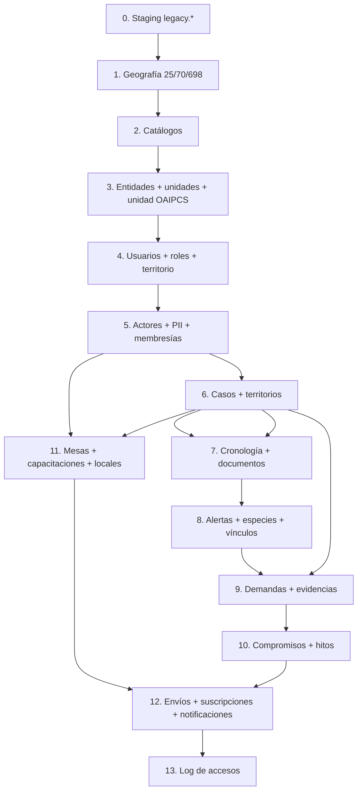

# Plan de porte de datos: legado AVISA 2026 → v9

**Fecha:** 2026-10-31
**Compañía de:** `docs/ANALISIS_PORTABILIDAD_AVISA_2026_A_V9.md` (diagnóstico de las 86 hojas),
`docs/_archivo/MAPA_CARGA_LEGADO_A_V9.md` (mapa por dominio y decisiones D1–D22),
`docs/PREPARACION_V9_CARGA_LEGADO.sql` (parche 1) y
`docs/PREPARACION_V9_CARGA_LEGADO_2.sql` (parche 2, nuevos huecos).

**Objeto.** Bajar el mapa a _especificación de carga_: qué hoja entra en qué tabla,
columna por columna, con qué transformación, en qué orden y con qué validación.
Y dejar registradas las decisiones que **todavía faltan** para poder escribir el
cargador (D23–D42).

**Estado de la preparación.** Los dos parches se probaron contra PostgreSQL 16 real
(contenedor `avisa-v9-test`, DDL v9 aplicado). Parche 1: verde. Parche 2: verde e
idempotente. Catálogos verificados en base:

| Catálogo                     |                Filas | Origen              |
| ---------------------------- | -------------------: | ------------------- |
| `core.cat_tematicas`         |                    7 | `DIM_Tipo_Tematica` |
| `core.cat_subsectores`       |                    3 | `DIM_Tipo_Sector`   |
| `core.cat_tipos_actor`       | 3 (+4 preexistentes) | `DIM_Tipo_Actor`    |
| `core.cat_roles_funcionales` |                    4 | `DIM_Rol_Actor`     |

Las 4 tablas que pediste sembrar están creadas y pobladas. Nota de nomenclatura:
`dim_tipo_sector` **no** se sembró en una tabla `cat_sectores` (v9 no tiene ninguna);
se sembró en `core.cat_subsectores`, que es la que consume `casos.subsector_id`.
Lo mismo con `dim_rol_actor`: va a la tabla **nueva** `core.cat_roles_funcionales`,
no a `core.cat_roles_actor` (esa es el eje relacional Principal/Secundario/Tercero).

---

## 1. Inventario verificado

Recontado desde el `.xlsx` con `migration/inspect_legacy.py`
(salida completa: `migration/out_legacy_columns.txt`, valores reales:
`docs/_archivo/_legacy_samples.txt`).

| Métrica                                                 | Valor     |
| ------------------------------------------------------- | --------- |
| Hojas                                                   | 86        |
| Hojas con datos                                         | **75**    |
| Hojas vacías                                            | 11        |
| Filas con al menos un valor                             | **4 643** |
| Filas completamente en blanco dentro de hojas con datos | 6         |
| Total incluyendo esas 6                                 | 4 649     |

Las 6 filas de diferencia son filas con sólo espacios: no aportan dato. El cargador
debe descartarlas, no contarlas.

**11 hojas vacías** (no generan trabajo, sólo se documenta su ausencia):
`BRIDGE_Caso_Recurso`, `DIM_anuncios_acuerdos`, `BRIDGE_ACTOR_GRUPO`,
`BRIDGE_Caso_POSICIONES`, `BRIDGE_Caso_INTERESES`, `BRIDGE_Caso_NECESIDADES`,
`BRIDGE_Caso_INETERES_COMUNES`, `DIM_Descencadenantes`, `DIM_Impulsores`,
`DIM_Causas`, `DIM_Medios`.

---

## 2. Correcciones al mapa anterior (leer antes de codificar)

Al especificar columna por columna aparecieron seis cosas que **cambian el plan**.
Varias contradicen lo escrito en `MAPA_CARGA_LEGADO_A_V9.md`.

### 2.1 `regiones.ubigeo` no se puede derivar de `Codigo_Depto` ⚠

`DIM_Departamentos.Codigo_Depto` **no es el código ubigeo INEI** a partir del
departamento 16. Está corrido por la presencia de dos filas que no son regiones:

| Fila   | Nombre              | `Codigo_Depto` | Prefijo INEI real (de sus provincias) |
| ------ | ------------------- | -------------: | ------------------------------------- |
| DEP-15 | Lima                |             15 | `15`                                  |
| DEP-16 | **Lima Provincias** |             16 | `15`                                  |
| DEP-17 | Loreto              |             17 | `16`                                  |
| DEP-18 | Madre de Dios       |             18 | `17`                                  |
| DEP-20 | **Más de Uno**      |             20 | _(ninguno: no tiene provincias)_      |
| DEP-22 | Piura               |             22 | `20`                                  |
| DEP-27 | Ucayali             |             27 | `25`                                  |

Consecuencias obligatorias:

1. `regiones.ubigeo` debe salir del **prefijo de `DIM_Provincias.Cod_INEI`**, nunca
   de `Codigo_Depto`. Si se usa `Codigo_Depto`, Loreto queda con ubigeo `17`
   (que en INEI es Madre de Dios) y todo el país se corre.
2. **DEP-15 y DEP-16 son la misma región INEI `15`.** `core.regiones.ubigeo` tiene
   `UNIQUE`, así que no pueden coexistir: hay que **fusionarlas** en una sola
   región `15 Lima`. La separación Lima / Lima Provincias se conserva donde
   corresponde, en `provincias` (`1501` Lima vs `1502..1505` Barranca, Cajatambo,
   Canta, Cañete).
3. **DEP-20 "Más de Uno" no es una región.** No tiene provincias ni distritos.
   Se excluye de `regiones`. Los 8 casos que la referencian se resuelven con
   `BRIDGE_Caso_Depto` (§4.5) y, si no alcanza, con `region_principal_id NULL`
   y `alcance_id = 5 (Nacional)`.

Resultado: **25 regiones**, no 27.

> Defecto adicional: `DIM_Departamentos` trae `DEP-22 Piura` con `Latitud = -51.945`
> (debería ser ≈ `-5.19`). No se carga latitud de región en v9, así que no bloquea,
> pero queda registrado.

### 2.2 `BRIDGE_Caso_Actor` y `BRIDGE_Caso_Actor_Estado` sí son recuperables ⚠

El mapa anterior decía "inservibles". Falso. Las referencias numéricas
(`1.0`, `10.0`, …) son **ordinales posicionales de `FACT_Casos`**: las 34 caen
todas en `1..35`, sin excepción. El resto de filas usa el código largo.

| Bridge                     | Filas | Recuperables                    | Cubre casos |
| -------------------------- | ----: | ------------------------------- | ----------: |
| `BRIDGE_Caso_Actor`        |    80 | **62** (34 ordinal + 28 código) |     24 / 35 |
| `BRIDGE_Caso_Actor_Estado` |    61 | **45** (34 ordinal + 11 código) |     24 / 35 |

No recuperables: 18 y 16 filas, casi todas por el caso fantasma
`CS-PA-REG-2026-01` (12 filas en cada bridge) y `CS-PA-REG-2026-04` (2).
Ambos bridges referencian **`ACT-xxx` de `DIM_Actores`**, no `ACT-EST-xxx`
(0 coincidencias con el censo de Estado en ambos). Es decir:
`BRIDGE_Caso_Actor_Estado` **no es el bridge del censo estatal**, es un subconjunto
duplicado del otro. Se cargan como **unión deduplicada** por `(caso, actor)`.

### 2.3 Los dos censos de personas son disjuntos ⚠ (anula D9)

`DIM_Actores_Estado.DNI` vale literalmente `'N/D'` en **108/108** filas. Y los
nombres no se cruzan con `DIM_Actores`:

|                      | Filas | Nombres distintos | Nombres en común |
| -------------------- | ----: | ----------------: | ---------------: |
| `DIM_Actores`        |   828 |               819 |                — |
| `DIM_Actores_Estado` |   108 |                86 |            **0** |

No hay nada que fusionar: son **dos poblaciones distintas**.
`DIM_Actores` = actores externos (pescadores, dirigentes, gremios).
`DIM_Actores_Estado` = funcionarios de PRODUCE (Titular del Despacho, Secretario
General, Jefe OCI). Se cargan las dos, la segunda con `tipo_actor_id = 1`
(Actor del Estado). **D9 queda cancelada.**

### 2.4 La columna `demandas.alerta_id` es superset del bridge ⚠ (corrige D20)

`D20` decía "el bridge es autoritativo (231, 1:1)". Los números reales:

| Fuente                   |             Pares (alerta, demanda) |
| ------------------------ | ----------------------------------: |
| `BRIDGE_Alerta_Demandas` |                                 231 |
| `DIM_Demandas.ID_ALERTA` |                                 236 |
| Coinciden                |                                 220 |
| Sólo en bridge           | 11 (misma demanda, **otra** alerta) |
| Sólo en columna          |                                  16 |

Toda demanda del bridge está también en la columna (231 ⊂ 236). Es decir:
**la columna es la fuente principal** y el bridge corrige 11 emparejamientos.
Regla: unión de 247 vínculos; 233 pares válidos tras descartar 14 referencias a alertas inexistentes; en los 11 conflictos gana el bridge y 222 demandas reciben `alerta_id`.
Además 5 códigos de alerta del bridge no existen en `DIM_Alertas`
(`AT-2026-19/24/27/34/39`): arrastran **14 pares**, que se descartan para dejar los 233 válidos.

### 2.5 `BRIDGE_Caso_Depto` tiene las columnas corridas ⚠

Cabecera: `ID_Relacion | ID_Caso | ID_Ubigeo | Departamento | Es_Principal | <sin nombre>`
Datos: `BCD-…-01 | CS-PRODUCE-2026-002 | CS-PRODUCE-2026-002 | DEP-22 | Piura | Sí`

Hay un duplicado de `ID_Caso` que empuja todo una posición:

| Posición real | 1        | 2           | 3             | 4          | 5            | 6         |
| ------------- | -------- | ----------- | ------------- | ---------- | ------------ | --------- |
| Contenido     | relación | **ID_Caso** | ID_Caso (dup) | **DEP-xx** | nombre depto | **Sí/No** |

Leído así, el bridge es un dato excelente: **85/87 filas válidas, 34 casos, y
exactamente un `Sí` por caso** (34 principales). 2 filas apuntan a casos
inexistentes (`CS-PRODUCE-2026-037/038`) y se descartan.

### 2.6 Colisión de códigos `TC-xx` ⚠

Dos hojas distintas usan el mismo prefijo `TC-`:

| Hoja              | Códigos          | Destino                                     |
| ----------------- | ---------------- | ------------------------------------------- |
| `DIM_Tipo_Caso`   | `TC-01`..`TC-04` | `cat_niveles_conflicto` (escala de la Guía) |
| `DIM_Tipo_Cambio` | `TC-01`..`TC-06` | `cat_tipos_cambio_caso`                     |

Ningún cargador puede resolver "TC-03" sin saber de qué hoja viene. **El namespace
es la hoja, no el código.** Es el mismo tipo de colisión que el caso #85.

---

## 3. Orden de carga

v9 arranca con **cero geografía, cero unidades y cero usuarios** (verificado:
`regiones`/`provincias`/`distritos` se siembran aparte, `cat_unidades_organicas` = 0,
`usuarios` = 0, `entidades` = 1 sola fila PRODUCE). El orden no es negociable.



> ⚠ **Corrección de orden (fase 8 ↔ 9).** `core.demandas.alerta_id` tiene FK
> real a `core.alertas_tempranas(id)` y 222 de las 325 demandas llevan alerta.
> Con el orden original (8 demandas → 9 alertas) la carga aborta por violación
> de clave foránea. Por eso **alertas va antes que demandas**. Los vínculos
> `cronologia_vinculos` alerta↔hecho se completan también en la fase 8, porque
> dependen de las alertas ya cargadas.

Fase **0 — staging** (`legacy.*`): una tabla por hoja, **todas las columnas `TEXT`**,
`fila_n` ordinal, y **mapeo por posición, nunca por nombre**. Los nombres están
mutilados en el origen (`descripcin`, `situacin`, `fotografa`,
`bridge_caso_ineteres_comunes`, `DIM_Unidades_Organicas_Responsa`). Se conserva
tal cual para auditoría (D21).

Sesión obligatoria en cada transacción:

```sql
SET LOCAL app.clasificacion_max = '3';   -- sin esto SELECT/RETURNING devuelve 0 filas
SET LOCAL app.user_id = '<uuid admin>';
```

`core.clasificacion_max()` hace `COALESCE(current_setting('app.clasificacion_max'),0)`.
Con el valor por defecto (0), las políticas `p_clasificacion`
(`nivel_clasificacion <= 0`) **no ven ninguna fila**: los `INSERT` pasan, pero
`RETURNING` y todo `INSERT … ON CONFLICT` se comportan como si la tabla estuviera
vacía. Hay **11 tablas** con `FORCE ROW LEVEL SECURITY`, no 9:

`actor_datos_personales`, `actores`, `acuerdo_ospa_sni`, `alertas_tempranas`,
`caso_cronologia`, `casos`, `compromisos`, `demandas`, `documentos`,
`reuniones_dialogo`, `riesgo_social_ordinal`.

---

## 4. Especificación de carga por tabla

Convenciones: `→` = mapeo directo; `⟳` = transformación indicada;
`⊘` = no se carga; `⚠` = defecto del origen con regla explícita.

### 4.1 Geografía — 795 filas

**`core.regiones` — 25 filas**

| Origen              | Destino    | Regla                                                                                                                                                                           |
| ------------------- | ---------- | ------------------------------------------------------------------------------------------------------------------------------------------------------------------------------- |
| `DIM_Departamentos` | `regiones` | Excluir `DEP-20`. **Fusionar DEP-15 + DEP-16** en una región `15 Lima`. `ubigeo` = prefijo de `provincias.Cod_INEI`, no de `Codigo_Depto`. `nombre` = "Lima" para la fusionada. |

**`core.provincias` — 70 filas**

`ubigeo = Cod_INEI` (ya son 4 dígitos, `'1502'`); `region_id` = `left(ubigeo,2)`;
`nombre = Nombre_Provincia`. 70/70 códigos únicos ✓.

**`core.distritos` — 698 filas**

`ubigeo = Cod_INEI` (ya son 6 dígitos, `'10101'`); `provincia_id` por ubigeo de 4;
`nombre = Nombre_Distrito`. 698/698 únicos ✓. `Estado` = `Activo` en todas: ⊘.
Cobertura: 698 de los 1 874 distritos del Perú. **Los que falten se reportan,
no se inventan.**

### 4.2 Catálogos — 129 filas

| Hoja                      | Filas | Destino                     | Nota                                                                                                                                                                                                                                                                                                                                   |
| ------------------------- | ----: | --------------------------- | -------------------------------------------------------------------------------------------------------------------------------------------------------------------------------------------------------------------------------------------------------------------------------------------------------------------------------------- |
| `DIM_Tipo_Tematica`       |     7 | `cat_tematicas` ✅          | ⚠ descripciones de TEMA-03/TEMA-04 cruzadas. TEMA-03 (`Normatividad`) recibe el texto de "Distribución de beneficios"; TEMA-04 recibe un texto copiado de `DIM_Tipo_Caso TC-04`. El script guarda el bruto en `descripcion_legado`, deja `descripcion` NULL en TEMA-03 y marca `nota_calidad`. **OAIPCS debe redactar TEMA-03** (D15). |
| `DIM_Tipo_Sector`         |     3 | `cat_subsectores` ✅        | `id_area_legado` = `AR-001/002/047`. `"Mype e Industria "` trae espacio final: normalizado.                                                                                                                                                                                                                                            |
| `DIM_Tipo_Actor`          |     3 | `cat_tipos_actor` ✅        | ids 1–3; v9 ya tenía 4 filas (NEC, Exportador CITES, CITE, SANIPES) → total 7.                                                                                                                                                                                                                                                         |
| `DIM_Rol_Actor`           |     4 | `cat_roles_funcionales` ✅  | `ROL-01..04`. `Descripcion` vacía en todas.                                                                                                                                                                                                                                                                                            |
| `DIM_Tipo_Caso`           |     4 | `cat_niveles_conflicto`     | **Es la escala de 4 niveles de la Guía** (decisión h). No se inserta: ya existe y está protegida por trigger. Sólo se usa como tabla de mapeo.                                                                                                                                                                                         |
| `DIM_Riesgos`             |     3 | `cat_niveles_riesgo`        | `RIE-001 Alto→3`, `RIE-002 Moderado→2`, `RIE-003 Bajo→1`. ⚠ `'Moderado '` con espacio final.                                                                                                                                                                                                                                           |
| `DIM_Nivel_Alertas`       |     4 | `cat_niveles_alerta`        | `NA-001..NA-004`; `Categoria` = Reactivo/Preventivo.                                                                                                                                                                                                                                                                                   |
| `DIM_Tipo_Cambio`         |     6 | `cat_tipos_cambio_caso` ✅  | ⚠ colisión `TC-xx` con `DIM_Tipo_Caso` (§2.6).                                                                                                                                                                                                                                                                                         |
| `DIM_Perfil`              |     3 | `cat_perfiles_actor`        | **Nuevo en parche 1.** Dialogante / Legitimante / Disruptivo.                                                                                                                                                                                                                                                                          |
| `DIM_Intervencion`        |     4 | `cat_ciclos_intervencion`   | **Nuevo en parche 1.** `Ciclo-001..004`.                                                                                                                                                                                                                                                                                               |
| `DIM_Tipo_Org`            |     4 | `cat_tipos_organizacion` ✅ | `TIPO_ORG_001..004`.                                                                                                                                                                                                                                                                                                                   |
| `DIM_Estado_Proceso`      |     5 | ⊘                           | Workflow inexistente en v9 (D17).                                                                                                                                                                                                                                                                                                      |
| `DIM_Tipo_Proceso`        |     4 | ⊘                           | idem.                                                                                                                                                                                                                                                                                                                                  |
| `DIM_Tipo_Actor_Radar`    |     3 | ⊘                           | D18 (RADAR diferido).                                                                                                                                                                                                                                                                                                                  |
| `DIM_Recurso_Pesca`       |    37 | `cat_especies`              | ⚠ ver §4.12: **3 reutilizadas**, se insertan **34** (total **39**).                                                                                                                                                                                                                                                                    |
| `DIM_Entidad_Responsable` |    23 | `entidades`                 | `codigo_legado = E-xxx` (parche 2). E-014 = PRODUCE = `id 1`, ya existe.                                                                                                                                                                                                                                                               |
| `DIM_Responsable`         |     3 | ⊘                           | Puntero polimórfico sin valor.                                                                                                                                                                                                                                                                                                         |

### 4.3 Organización interna — 168 filas

**`core.cat_unidades_organicas` — 66 filas**

| Origen                                 | Regla                                                                                                                                                                                                                                                                        |
| -------------------------------------- | ---------------------------------------------------------------------------------------------------------------------------------------------------------------------------------------------------------------------------------------------------------------------------- |
| `DIM_Area_Responsable` (66)            | `codigo_legado_area = AR-xxx`; `siglas = Abreviatura`; `nombre_completo = Nombre_Area`; `entidad_id = 1` (todas son E-014); `estado`. 66 abreviaturas distintas → cumple `UNIQUE(entidad_id, siglas)`.                                                                       |
| `DIM_Unidades_Organicas_Responsa` (27) | ⊘ **como filas**. Se rellenan `codigo_legado_unidad = U-xxx` sobre 27 de las 66 mediante match de `Abreviatura` (único en ambas hojas). Colisión #85 resuelta.                                                                                                               |
| `OAIPCS` (`AR-047`)                    | ⚠ La fila **ya existe en el origen**: `AR-047` es literalmente la OAIPCS. El parche 3 la siembra como `id=1` porque el cargador la necesita antes de esta fase (unidad del usuario de auditoría); aquí sólo se le rellena `codigo_legado_area='AR-047'`. **No hay fila 67.** |

**`core.entidades` — 23 filas**: `E-001..E-023`, `nivel='Nacional'`, `estado='Activo'`.
Sólo E-014 es tenant real. Las otras 22 son ministerios externos: se cargan para
no perder el catálogo, pero **ninguna** debe usarse como tenant de unidades
(todas las unidades cuelgan de `entidad_id = 1`).

### 4.4 Personas y organizaciones — 1 160 filas

**`core.actores` — 1 160 filas**

| Origen               | Filas | `naturaleza`   | `tipo_actor_id`                                              | Regla                                                                                                                               |
| -------------------- | ----: | -------------- | ------------------------------------------------------------ | ----------------------------------------------------------------------------------------------------------------------------------- |
| `DIM_Actores`        |   828 | `persona`      | ⚠ `Tipo-Act-xx`; `Regional`(7) y `Sí`(4) → **1** por defecto | `codigo_legado = ACT-xxx`                                                                                                           |
| `DIM_Actores_Estado` |   108 | `persona`      | **1** fijo                                                   | `codigo_legado = ACT-EST-xxx`                                                                                                       |
| `DIM_ORGANIZACION`   |   224 | `organizacion` | 2 si `ASOCIACIÓN/SINDICATO/COOPERATIVA`, 3 si `GREMIO`       | `codigo_legado` ⚠ **la hoja no trae ID de actor**: usar `Cod_Actor` cuando exista (220/224 son `ACT-xxx` válidos), si no `ORG-xxx`. |

Mapeo de campos:

| Origen               | Destino                                           | Regla                                                                                                          |
| -------------------- | ------------------------------------------------- | -------------------------------------------------------------------------------------------------------------- |
| `Nombre_Actor`       | `nombre_actual`                                   | truncar a 255                                                                                                  |
| `DNI`                | → `actor_datos_personales.dni`                    | **PII, ver §4.4.1**                                                                                            |
| `Telefono`           | → `actor_datos_personales.telefono_raw`           | viene como float (`'222.0'`) ⟳ normalizar                                                                      |
| `Email`              | `email_contacto` + `actor_datos_personales.email` |                                                                                                                |
| `Cargo`              | `cargo_actual`                                    |                                                                                                                |
| `Abreviatura`        | `abreviatura`                                     | ⚠ hasta **115** chars → parche 2 ensancha a 150                                                                |
| `Nivel_Gobierno`     | `nivel_gobierno`                                  | ⚠ CHECK sólo admite `Nacional/Regional/Local/Empresa/Sociedad_Civil`. `Perfil-01`(4), `Sí`(1) → **NULL** (D12) |
| `Categoria`          | `rol_actor_id`                                    | `Actor Primario→1`, `Actor Secundario→2`; `ROL-01/02` y resto → **7** (`No_determinado`)                       |
| `ID_Perfil`          | `perfil_id`                                       | `Perfil-0x`; `ROL-01`(1) → NULL                                                                                |
| `ID_Ubigeo`          | `distrito_id`                                     | ⚠ `ID_Ubigeo` es `DEP-xx` (nivel departamento) → **NULL**                                                      |
| `Fotografía`         | `foto_url`                                        |                                                                                                                |
| `Activo`             | `activo`                                          | `Sí→true`, `No→false`, **NULL→true** (530 casos)                                                               |
| `Descripcion_Perfil` | `perfil_descripcion`                              |                                                                                                                |

Campos fijos: `origen_dato='AVISA_HISTORICO'`, `confidence=1.00`,
`es_validado_humano=true`, `nivel_clasificacion=2`.

**Identidad de organizaciones.** `core.organizaciones` tiene PK `actor_uid` y
**no** tiene `codigo_legado`; la trazabilidad va en `actores.codigo_legado`.

| Origen                | Destino                | Regla                                                                               |
| --------------------- | ---------------------- | ----------------------------------------------------------------------------------- |
| `NOMBRE_ORGANIZACIÓN` | `razon_social`         |                                                                                     |
| `RUC` (5)             | `ruc CHAR(11)`         | ⚠ BIGINT → left-pad a 11. `UNIQUE` en v9                                            |
| `Dirección`           | `direccion`            |                                                                                     |
| `Fecha_constitución`  | `fecha_constitucion`   |                                                                                     |
| `ID_TIPO_ORG`         | `tipo_organizacion_id` | ⚠ mezcla nombres y códigos (`ASOCIACIÓN`, `TIPO_ORG_001`) → normalizar por nombre   |
| `Inscripción_sunarp`  | `inscripcion_sunarp`   |                                                                                     |
| `Integrantes`         | `numero_integrantes`   |                                                                                     |
| `Embarcaciones`       | `n_embarcaciones`      |                                                                                     |
| `Armadores`           | `n_armadores`          |                                                                                     |
| `Fotografía`          | `foto_url`             |                                                                                     |
| `Perfil_Organizacion` | `perfil`               |                                                                                     |
| `Abreviatura`         | `abreviatura`          |                                                                                     |
| `Cod_Actor`           | `representante_uid`    | 220/220 son `ACT-xxx` válidos → FK a `actores`. Requiere que ese actor exista (D42) |

#### 4.4.1 `core.actor_datos_personales` — PII (decisión e)

Se **conservan** DNI y teléfonos. Una fila por persona con al menos un dato.

| Origen                           | Destino             | Regla                                                                                |
| -------------------------------- | ------------------- | ------------------------------------------------------------------------------------ |
| `DNI` (642/828 en `DIM_Actores`) | `dni VARCHAR(12)`   | ⚠ llegan como texto con ceros a la izquierda (`'00245199'`): **no** castear a número |
| `Telefono`                       | `telefono_raw`      | original tal cual (`'222.0'`)                                                        |
| ⟳ normalizado                    | `telefono_contacto` | quitar `.0`, espacios y guiones; prefijar `+51` si son 9 dígitos                     |
| `Email`                          | `email`             |                                                                                      |

`base_legal` y `fecha_consentimiento` quedan NULL: el legado no tiene consentimiento.
`nivel_clasificacion = 3` (Confidencial) por defecto, como define la tabla.

**`core.actor_membresia` — 292 de 660 filas (254 sin fecha)**

`DIM_Actores.Id_organizacion` guarda **nombres** (no IDs): 11 referencias resuelven por
`ORG-xxx`, 272 por nombre exacto y 8 por `pg_trgm` ≥ 0.85; **368 (56 %) no resuelven** y
van a `core.migracion_conflicto` (`MEMBRESIA_SIN_MATCH`).

De las 292 filas-persona con organización identificada, sólo **38** tienen fecha
derivable: 13 por `organizaciones.fecha_constitucion` y 25 por `Fecha_Inicio` del caso
más antiguo del actor. Las otras **254** no tienen fecha en el origen y entran con
`valid_from = NULL` (**D50**, parche 4): nunca `CURRENT_DATE` ni una fecha inventada.

### 4.5 Casos — 35 filas

**`core.casos` — 35 filas**

| Origen                                             | Destino                              | Regla                                                                                                                                                                       |
| -------------------------------------------------- | ------------------------------------ | --------------------------------------------------------------------------------------------------------------------------------------------------------------------------- |
| `ID_Caso`                                          | `codigo_caso` + `codigo_legado`      | 35/35 formato largo `CS-PRODUCE-2026-0NN`                                                                                                                                   |
| `Nombre_Caso`                                      | `nombre_caso`                        |                                                                                                                                                                             |
| `ID_Tipo`                                          | `nivel_conflicto_id`                 | **decisión (h)**: `TC-01→1 Diferencia`, `02→2 Controversia`, `03→3 Conflicto_social`, `04→4 Crisis_social`. Cobertura **34/35**; `CS-PRODUCE-2026-024` sin `ID_Tipo` → NULL |
| `ID_Riesgos`                                       | `nivel_riesgo_id`                    | 34/35. El faltante → derivar de `Prioridad` (D5/D27)                                                                                                                        |
| `Prioridad`                                        | `prioridad_id`                       | `Urgente→1`, `Moderado→2`, `Bajo→3` (17/11/7)                                                                                                                               |
| `ID_Sector`                                        | `subsector_id`                       | `Sector-01→1`, `Sector-02→2` (29/6). **`Sector-03` no se usa**                                                                                                              |
| `ID_Tematica`                                      | `tematica_id`                        | 35/35                                                                                                                                                                       |
| `ID_Ubigeo`                                        | `alcance_id` + `region_principal_id` | ⚠ ver abajo                                                                                                                                                                 |
| `ID_Provincia`                                     | `provincia_principal_id`             | 25/35                                                                                                                                                                       |
| `ID_Distrito`                                      | `distrito_principal_id`              | 23/35 ⚠ v9 lo exige NOT NULL sólo si no hay región: está relajado ✓                                                                                                         |
| `ID_Sectorista`                                    | `punto_focal_usuario_id`             | `SEC-xx → usuarios`                                                                                                                                                         |
| `ID_Intervencion`                                  | `ciclo_intervencion_id`              | `Ciclo-00x`; 34/35                                                                                                                                                          |
| `Pct_Avance`                                       | `pct_avance`                         | ⚠ `0.0/0.7/0.8/0.9` → **×100** (`0..90`). El CHECK de v9 es `0..100`, lo que confirma la escala (D6/D40)                                                                    |
| `Descripcion_Riesgo`                               | `descripcion_riesgo`                 |                                                                                                                                                                             |
| `Resumen_Ejecutivo`                                | `resumen_ejecutivo`                  |                                                                                                                                                                             |
| `Fecha_Inicio`                                     | `fecha_inicio`                       | 32/35                                                                                                                                                                       |
| `N_Reaperturas`                                    | `n_reaperturas`                      | todas 0                                                                                                                                                                     |
| `Fecha_Cierre`/`Motivo_Cierre`                     | idem                                 | vacías                                                                                                                                                                      |
| `N_Acciones`, `N_Hitos_Total`, `N_Hitos_Cumplidos` | ⊘                                    | **0 en los 35 casos**: no se cargan como verdad                                                                                                                             |
| `Link_PDF_Drive`, envíos                           | ⊘                                    | vacíos en `FACT_Casos`                                                                                                                                                      |

Fijos: `entidad_id=1`, `estado_id=1 (Activo)`, `fuente_original='avisa_historico'`,
`es_seed_historico=true`, `origen_dato='AVISA_HISTORICO'`, `confidence=1.00`.

**Territorio.** `ID_Ubigeo` es un **departamento** (`DEP-xx`), no un distrito.
Reparto de los 35 casos: `DEP-20` **8**, `DEP-22` 5, `DEP-15` 4, `DEP-16` 4,
`DEP-07` 3, `DEP-11` 2, `DEP-04` 2, `DEP-17` 2, y 5 casos con 1 cada uno
(`DEP-26`, `DEP-02`, `DEP-14`, `DEP-19`, `DEP-12`).
Regla: `region_principal_id` desde `DEP-xx→región` (DEP-15 y DEP-16 → 15,
DEP-20 → NULL), `alcance_id` desde `Alcance` del departamento
(`Oriente/Centro/Sur/Norte/Nacional`, coincide 5/5 con `cat_alcances_geograficos`).
Los 8 casos con DEP-20 se completan con `BRIDGE_Caso_Depto`.

**`core.caso_regiones` — 81 filas** (tabla nueva del parche 2)
Desde `BRIDGE_Caso_Depto` leído con las columnas corridas (§2.5):
`caso_id` ← col 2, `region_id` ← col 4 (`DEP-xx`), `es_principal` ← col 6.
87 filas en el origen; 2 apuntan a casos inexistentes (`CS-PRODUCE-2026-037/038`,
no están en `FACT_Casos`) y 4 pares se colapsan porque `DEP-15` y `DEP-16` son la
misma región (`15`). Resultado verificado: **81 filas, 32 casos, 32 principales**.

**`core.casos_actores` — 60 filas** desde la unión deduplicada de
`BRIDGE_Caso_Actor` (80) y `BRIDGE_Caso_Actor_Estado` (61), con referencias
ordinales (D23). 141 filas de origen → 60 pares `(caso, actor)` distintos: 24
casos con actor, **11 sin actor** (esperado). Los 12 pares que no entran
referencian casos ausentes de `FACT_Casos` (`CS-PA-REG-2026-01/04`, `…-037/038`,
`…-06/07` sin relleno) o al actor `ACT-003`, que no existe en `DIM_Actores`.

**`core.caso_distritos` — 23 filas**: de `FACT_Casos.ID_Distrito` (17 distritos distintos).

**`core.caso_estado_historial` — 35 filas, automáticas.** El trigger
`core.caso_historial()` inserta la fila inicial al crear el caso. **No se carga
`FACT_Historial_Estado`** (D7): sus 27 filas apuntan todas a `CS-MI-REG-*`
inexistentes y tienen `fecha_cambio` = `TEMA-01` e `id_estado_nuevo` = fechas
(columnas intercambiadas). Queda en `legacy.*` para reconstrucción manual.

### 4.6 Cronología y documentos — 167 filas

**`core.caso_cronologia` — 80 filas** ← `FACT_Hechos_Casos`

| Origen                 | Destino                 | Regla                                                                                                 |
| ---------------------- | ----------------------- | ----------------------------------------------------------------------------------------------------- |
| `ID_Hecho`             | `codigo_legado`         | ⚠ 78 distintos de 80 (`HECHO-012`, `HECHO-047` duplicados) → sufijar el segundo                       |
| `ID_Caso`              | `caso_id`               | 80/80 válidos                                                                                         |
| `Fecha`                | `fecha_evento`          |                                                                                                       |
| `Tipo_Hecho`           | `tipo_hecho_id`         | 9 valores ↔ 9 filas de `cat_tipos_hecho`, match 1:1 por nombre ✓                                      |
| `Hecho_Crítico`        | `es_hecho_critico`      | `Sí/No` → boolean                                                                                     |
| `Descripcion`          | `descripcion_hecho`     |                                                                                                       |
| `ID_Sectorista`        | `sectorista_usuario_id` |                                                                                                       |
| `Tipo_evidencia_hecho` | `tipo_evidencia_legado` |                                                                                                       |
| `Link_Evidencia`       | `link_evidencia`        | 63/80                                                                                                 |
| `ID_Alerta`            | ⊘                       | ⚠ 2 filas traen una **URL** en vez de `AT-xxxx`; el vínculo alerta↔hecho va por `cronologia_vinculos` |

**`core.documentos` — 153 filas**

| Origen                       | Filas | `tipo_id`                                     | Regla                          |
| ---------------------------- | ----: | --------------------------------------------- | ------------------------------ |
| `DIM_Alertas.Link_PDF_Drive` |    83 | 13 `reporte_alerta_temprana`                  | `codigo = <ID_Alerta>_pdf`     |
| `DIM_REDACCION`              |    51 | `Ayuda Memoria→10`, `Relatoria→11`, `Otro→15` | 34 `Otro`                      |
| `DIM_COORDINACION_TECNICA`   |     4 | idem                                          |                                |
| `DIM_Reporte_Rapido`         |     1 | 1 `reporte_rapido`                            | 25 columnas → `contenido_json` |
| `DIM_ClimaSocial`            |     7 | 2 `clima_social_general`                      | idem                           |
| `DIM_ClimaSocial_Focalizado` |     6 | 3 `clima_social_focalizado`                   | idem                           |
| `FACT_Analisis_Casos`        |     1 | 6 `analisis_caso`                             | 26 columnas → `contenido_json` |

Campos: `titulo`, `fecha`, `resumen_ejecutivo` (`Descripcion`/`Resumen`),
`url_pdf` (`Link_Archivo`/`Link_PDF_Drive`), `url_lista`, `url_foto`,
`distrito_id` ⚠ `ID_Ubigeo` es `DEP-xx` → NULL, `estado`,
`responsable_usuario_id` ← `ID_Sectorista`/`Sectorista`,
`codigo_legado` ← `ID_Redaccion`/`ID_CT`/`ID_RR`/`ID_Clima`.
`codigo` (UNIQUE) se genera determinístico: `<codigo_legado>`; si choca, sufijar.
⚠ `DIM_REDACCION` tiene `RED-2026-010` duplicado (50 distintos de 51).

### 4.7 Demandas — 325 filas

**`core.demandas` — 325 filas**

| Origen                    | Destino                                      | Regla                                                            |
| ------------------------- | -------------------------------------------- | ---------------------------------------------------------------- |
| `ID_DEMANDA`              | `codigo_legado`                              | 325/325 únicos ✓                                                 |
| `Descripcion_Demanda`     | `descripcion_demanda`                        | texto íntegro                                                    |
| ⊘                         | `problema_3p` / `propuesta_3p` / `pedido_3p` | **NULL**: no se fabrica la estructura 3P (relajado en parche 1)  |
| `ID_CASO`                 | `caso_id`                                    | 100/325                                                          |
| `ID_ALERTA`               | `alerta_id`                                  | **236** códigos `AT-` — fuente principal (§2.4)                  |
| `ID_TEMATICA`             | `tematica_id`                                | 277; ⚠ un valor es un _timestamp_ (`2026-09-18 14:05:58`) → NULL |
| `Fecha`                   | `fecha_registro`                             | 324/325                                                          |
| `Tipo_Evidencia_Registro` | `tipo_evidencia_legado`                      |                                                                  |
| `Link_Evidencia_Registro` | `referencia_evidencia_legado`                |                                                                  |

`estado_atencion='Pendiente'` (default), `afecta_diferenciadamente_mujeres=false`.

**`core.demandas_evidencias` — 77 filas** (sólo las 77 con tipo de evidencia)

| Origen                               | `fuente_tipo`   |
| ------------------------------------ | --------------- |
| `Hecho Ocurrido` (74)                | `Institucional` |
| `Publicaciones o Redes Sociales` (3) | `Medios`        |

`url_referencia` ← `Link_Evidencia_Registro` (valores `HECHO-037`, no URLs).

**`core.demandas_actores` — 98 filas**: `ID_ORGANIZACION` → `ORG-xxx` → `actor_uid`,
`rol_en_demanda='Formulador'`.

### 4.8 Alertas — 83 filas

**`core.alertas_tempranas` — 83 filas**

| Origen                      | Destino                           | Regla                                                                                                                             |
| --------------------------- | --------------------------------- | --------------------------------------------------------------------------------------------------------------------------------- |
| `ID_Alerta`                 | `codigo_alerta` + `codigo_legado` | ⚠ **81 distintos de 83**: `AT-2026-48` y `AT-2026-49` están duplicados → sufijar (`-bis`) el segundo (D32/D41)                    |
| `ID_Caso_Vinculado`         | `caso_id`                         | 50/83; 33 → NULL (D1). 50/50 resuelven ✓                                                                                          |
| `Sectorista`                | `sectorista_usuario_id`           | 83/83                                                                                                                             |
| `Fecha`                     | `fecha_reporte`                   |                                                                                                                                   |
| `ID_Ubigeo`                 | ⊘                                 | ⚠ es `DEP-xx` (departamento), no un distrito: no se usa para `distrito_id`                                                        |
| `ID_Distrito`               | `distrito_id`                     | 41/83 `DIS-xxxx`, resueltos por ubigeo INEI; el resto → NULL                                                                      |
| `Titulo_Alerta`             | `titulo`                          | máx. 470 → cabe en 500                                                                                                            |
| `ID_Sector`                 | `subsector_id`                    | ⚠ guarda `AR-001/AR-002` (código de **área**) → `cat_subsectores.id_area_legado` (AR-001→1, AR-002→2). Columna nueva del parche 2 |
| `Situacion_Actual`          | `situacion_actual`                |                                                                                                                                   |
| `Hechos_Recientes`          | `hechos_recientes`                |                                                                                                                                   |
| `ID_NIVEL_ALERTA`           | `nivel_alerta_id`                 | `NA-001..004`; 81/83                                                                                                              |
| `ID_Riesgos`                | ⊘                                 | v9 guarda riesgo en el caso, no en la alerta                                                                                      |
| `Descripcion_Riesgo_Alerta` | `descripcion_riesgo`              |                                                                                                                                   |
| `Acciones_sugeridas`        | `acciones_sugeridas_json`         | `{"texto": …}`                                                                                                                    |
| `Acciones_OAIPCS`           | `acciones_oaipcs`                 |                                                                                                                                   |
| `Paso_Actual`               | `paso_actual`                     | 1 en todas                                                                                                                        |
| `Link_PDF_Drive`            | → `documentos` tipo 13            |                                                                                                                                   |
| `Estado`                    | `estado_legado`                   | `Archivado` en las 83                                                                                                             |
| `Tipo_Fuente`               | `fuente_tipo`                     | 20/83                                                                                                                             |
| `Descripción_Fuente`        | `fuente_descripcion`              | 18/83                                                                                                                             |
| `Link_fuente`               | `fuente_url`                      | 5/83                                                                                                                              |
| `ID_MESA_GRUPO`             | `mesa_id`                         | **vacío en las 83** → NULL                                                                                                        |

`prioridad_id` es `NOT NULL` en v9 y se deriva del nivel:
`NA-001→1`, `NA-002→2`, `NA-003→3`, `NA-004→4`. ⚠ 2 alertas sin nivel
(`AT-2026-80`, `AT-2026-59`) → ver D30.

**`core.alertas_actores` — 161 filas** ← `BRIDGE_Alerta_Actor` (162) +
`BRIDGE_Alerta_ActorEstado` (5) = 167 filas, 166 pares distintos.
⚠ 3 filas de `BRIDGE_Alerta_Actor` traen alerta y actor intercambiados
(`ID_Actor` en la columna de alerta): se detectan y se reordenan. 5 vínculos
apuntan a alertas inexistentes (`AT-2026-24` ×3, `AT-2026-19` ×2) y quedan en
`migracion_conflicto`; quedan **161** cargadas (verificado).

**`core.alerta_especies` — 30 filas** ← `BRIDGE_Alerta_Recurso` (32)
(12 recursos distintos). 2 filas citan alertas inexistentes (`AT-2026-34`,
`AT-2026-35`) → `ALERTA_INEXISTENTE`.

**Códigos de alerta con dos rellenos.** `DIM_Alertas` los escribe a 2 dígitos
(`AT-2026-01`); `BRIDGE_Alerta_Actor` mezcla 143 de 2 con 16 de 3
(`AT-2026-001`). Se canonizan a 2 dígitos antes de resolver.

### 4.9 Compromisos e hitos — 20 filas

Estrategia: **no** se usan `plan_acciones`/`planes_accion` (exigen un
`documento_id` padre y no encajan). Cada `ACC-xxxx` se convierte en un
**compromiso sintético** y cada `HIT-xxxx` en un **hito de ese compromiso** (D13).

**`core.compromisos` — 8 filas** ← `DIM_Acciones_Hitos`

| Origen               | Destino                 | Regla                                                                                                                   |
| -------------------- | ----------------------- | ----------------------------------------------------------------------------------------------------------------------- |
| `ID_Accion`          | derivado                | `codigo_compromiso = <codigo_caso>_COMP00N` (cumple `~ '_COMP[0-9]{3}$'`)                                               |
| `ID_Caso`            | `caso_id`               | 3 casos                                                                                                                 |
| `Descripcion_Accion` | `accion_compromiso`     |                                                                                                                         |
| `ID_Area`            | `unidad_responsable_id` | 4/8; resto → unidad OAIPCS (D26)                                                                                        |
| —                    | `fecha_inicio`          | `NOT NULL`: usar `casos.fecha_inicio`                                                                                   |
| —                    | `tipo_compromiso`       | `'Actividad'` (el CHECK sólo admite `Actividad`/`PIP`)                                                                  |
| —                    | `estado_id`             | **2 (`En_proceso`)** — nunca `Cumplido`: el trigger `chk_compromiso` lanza excepción si estado `Cumplido` sin evidencia |
| `ID_PF`              | ⊘                       | va al hito si aplica                                                                                                    |

**`core.hitos_compromiso` — 12 filas** ← `DIM_Hitos`

`compromiso_id` ← `ID_Accion` mapeado; `codigo_hito = ID_Hitos` (`HIT-0001`,
UNIQUE ✓); `descripcion_hito`; `fecha_vencimiento` ← `Fecha_Planificada`;
`estado_id` ← `Estado_Hito` (`Cumplido→4`, `En curso→2`, `No Cumplido→1`).
`validacion` ← `Validacion_Hito` (`Validado` en 12/12), `fecha_real`,
`descripcion_evidencia` → columnas nuevas del parche 2.
`Responsable_Hito` (`PF-xxx`, 3/12) → `compromiso_colaboradores` o se ignora.

### 4.10 Mesas, capacitaciones, locales, envíos, login — 927 filas

**`core.mesas_dialogo` — 21 filas**

| Origen                     | Destino                                                                                                                                |
| -------------------------- | -------------------------------------------------------------------------------------------------------------------------------------- |
| `ID_MESA_GRUPO`            | `codigo` (`OAIPCS-001`…, UNIQUE ✓)                                                                                                     |
| `TIPO_ESPACIO`             | `tipo_espacio_id` — 7 valores distintos ↔ 7 filas de `cat_tipos_espacio_dialogo`, match exacto ✓                                       |
| `CON_NORMA`                | `tiene_norma` (columna nueva, parche 2) — `Sí 19 / No 2`                                                                               |
| `LINEA_OAIPCS`             | `linea_oaipcs` (Descentralización / Conflictos sociales / Desarrollo territorial / Desarrollo productivo)                              |
| `TITULO_MESA`              | `titulo` (máx. 218 ✓)                                                                                                                  |
| `TIPO_INSTRUMENTO`         | `tipo_instrumento`                                                                                                                     |
| `BASE_LEGAL`               | `base_legal`                                                                                                                           |
| `FECHA_NORMA`              | `fecha_norma` ⚠ viene con hora → cast a `date`                                                                                         |
| `PRORROGAS_MODIFICATORIAS` | `prorrogas_modificatorias`                                                                                                             |
| `FECHA_INSTALACION`        | `fecha_instalacion`                                                                                                                    |
| `NATURALEZA`               | `naturaleza` ⚠ CHECK admite justo `Permanente/Temporal/No definida` ✓                                                                  |
| `FECHA_FIN_VIGENCIA`       | `fecha_fin_vigencia` ⚠ viene **vacía en 8/21** y con hora en el resto → `date` o NULL. El literal `'Sin fecha'` **no** está aquí (D37) |
| `ESTADO_VIGENCIA`          | `estado_vigencia` (`Vencido` 9, `Permanente` 6, `Vigente` 2, `Por vencer` 2, `Sin fecha` 2) ⚠ el literal vive aquí, no en la fecha     |
| `OBJETIVO`                 | `objetivo`                                                                                                                             |
| `ROL_PRODUCE`              | `rol_produce`                                                                                                                          |
| `AMBITO_DEPARTAMENTO`      | `ambito_departamento` (texto con lista de departamentos)                                                                               |
| `DOC_DESIGNACION`          | `doc_designacion`                                                                                                                      |
| `ID_SECTORISTA`            | `sectorista_usuario_id` (16/21)                                                                                                        |
| `Link_Evidencia`           | `link_evidencia` (2/21)                                                                                                                |

**`core.mesa_miembros` — 62 filas**: `PRESIDENTE`(21) → rol `Presidente`,
`SECRETARIO_TECNICO`(12) → `Secretario_tecnico`, `TITULAR`(15) → `Titular`,
`ALTERNO`(14) → `Alterno`. Todos con `nombre_texto` (texto libre, sin fuzzy, D14)
y `doc_designacion` cuando aplica. Sin `actor_uid`.

**`core.capacitaciones` — 1 fila**: `codigo = CAP-2026-001`;
`tipo_id` ← `Taller` → 1; `distrito_id` ⚠ `ID_Ubigeo = DEP-15` es departamento → NULL.

**`core.capacitacion_participantes` — 9 filas**: ⚠ `ID_Capacitacion` sólo
está presente en **1** de las 9 filas; las otras 8 se asignan al único curso
existente, `CAP-2026-001` (D46, `confidence=0.90`).

**`core.locales` — 27 filas**: `codigo = LOC-xxx` (hay huecos: no existen
`LOC-005/009/028/030`); `distrito_id` ⚠ `ID_Ubigeo` es `DEP-xx` → NULL;
`aforo`, `ingresos` (`'1'`, `'2'`, `'1 y emergencia'` → varchar),
`tiene_proyector`/`tiene_equipos_computo`/`tiene_audio_micro` ← `Si/No`,
`contacto_*`, `recomendacion`.

**`core.suscripcion_notificacion` — 4 filas** ← `DIM_Destinatarios_Fijos`.
`unidad_id` ← `ID_AREA`; ⚠ `AR-000` (2 filas) no existe → NULL.
`canal_preferido` (`Email`, `WhatsApp`, `Email / WhatsApp`).

**`core.envios_comunicacion` — 17 filas** ← `LOG_Envios` (D38).
El corrimiento de columnas **no es único**: hay dos formas de fila.

|              | `ENV-0001..0007`                | `ENV-0008..0017`  |
| ------------ | ------------------------------- | ----------------- |
| mensaje      | `c11`                           | `c11`             |
| resultado    | `c13`                           | `c12`             |
| remitente    | `c12` (`AUT-001`/`SEC-02`)      | `c07` = `Sistema` |
| destinatario | `c08` (email) / `c10` (celular) | `c09`             |
| canal        | `c03`                           | `c03`             |

`ID_Tipo_Reporte` (c04) contiene el **código de caso** (`CS-PRODUCE-2026-020`,
y también `-02` sin relleno) e `ID_Documento` (c05) el **número de paso**.
Regla aplicada: `canal` ← `Correo`/`WhatsApp` (`Caso` → `Otro`; resultan
Correo 5, WhatsApp 5, Otro 7), `entidad_tipo='caso'`, `entidad_id` resolviendo
el código de caso (17/17), `remitente_usuario_id` ← `SEC-xx`/`AUT-xx`
(las filas `Sistema` → NULL), `destinatario_texto` ← email/celular,
`resultado`, `observacion` (con el paso anexado).
⚠ **`url_pdf` queda NULL en las 17**: ninguna celda contiene una URL; `c10`
guarda el celular en las 7 filas detalladas. `rol_remitente` tampoco tiene
fuente → NULL.

**`core.log_accesos` — 857 filas** ← `LOG_Accesos`.
`dni`, `nombre` (811/857), `rol_declarado`
(`Sectorista 748`, `Desconocido 46`, `Directora 40`, `Admin 23`),
`resultado` (`OK` 811 / `FALLIDO` 46), `fecha`, y `usuario_id` resuelto por
DNI contra `core.usuarios.dni`.
⚠ D39: las **2 cuentas de prueba** (`11111111`, `1234567`) suman **25 filas**
(no 2) y quedan con `usuario_id=NULL`. Además hay **3 filas** con DNI que no
existe (`7626563` ×2, probable typo de `76265630`, y `76265630`) → NULL.
Total `usuario_id` NULL: **28**.

**`core.usuarios` — 31 filas**. 15 sectoristas + 17 puntos focales + 2 autoridades,
con 3 solapamientos por DNI/nombre (PF-016 = SEC-15, PF-017 = SEC-01,
AUT-001 = SEC-11). `codigo_legado = SEC-xx|PF-xxx|AUT-xxx`.
`clave_hash`: ver D11 — las claves vienen **en claro y en un entero**
(`46078289`); se descartan y se fuerza reseteo.
`usuario_roles`: `sectorista` (1), puntos focales → `consulta_lectura` (3),
autoridades → `alta_direccion` (4).
`usuario_territorio` — **25 filas** ← `BRIDGE_Sectorista_Departamento`
(`DEP-xx → region_id`), sobre 27 de origen. Se pierden dos: `DEP-20`
("Más de Uno") no tiene provincias y por tanto no tiene región, y `SEC-02`
reparte `DEP-15` + `DEP-16`, que colapsan en la región `15` y chocan contra
`PRIMARY KEY (usuario_id, region_id)`. Ambas se registran en
`core.migracion_conflicto`.

### 4.11 Sin destino en v9 — 165 filas (142 de workflow + 6 de RADAR + 14 absorbidas en JSON + 3 descartadas)

> **Aritmética, porque hay tres cifras circulando.** Este desglose suma **165**.
> El acta y el mapa citan **160**; el desglose sin `DIM_Responsable` suma **162**.
> La diferencia no altera ninguna carga —las 14 de JSON se absorben en
> `documentos.contenido_json` y las 3 de `DIM_Responsable` se descartan—, pero la
> cifra que cuadra con las hojas es **165** y es la que debe citarse.

| Hoja                                                                     |         Filas | Tratamiento                                             |
| ------------------------------------------------------------------------ | ------------: | ------------------------------------------------------- |
| `FACT_Proceso_Caso`                                                      |            36 | D17: v9 no tiene workflow. `legacy.*`                   |
| `FACT_Proceso_Reporte`                                                   |            99 | idem                                                    |
| `DIM_Paso_Proceso_Caso` / `DIM_Paso_Proceso`                             |         4 + 3 | idem (catálogos del workflow)                           |
| `FACT_RED_RADAR`, `FACT_NODO`, `BRIDGE_RADAR_Actor`, `BRIDGE_Nodo_Actor` | 1 + 1 + 1 + 3 | D18: RADAR diferido                                     |
| `BRIDGE_Caso_{Descencadenantes,Impulsores,Causas,Medios}`                |       1+5+4+4 | van a `documentos.contenido_json` del análisis (tipo 6) |
| `DIM_Responsable`                                                        |             3 | ⊘                                                       |

### 4.12 `cat_especies` — 37→39 filas (hallazgo nuevo)

`core.cat_especies` **no está vacía**: trae 5 filas (ids 11–15), sin
`codigo_legado`, de las cuales 3 sirven y 2 no tienen relación con los 37 recursos.

| Situación                                      |                                                        Filas |
| ---------------------------------------------- | -----------------------------------------------------------: |
| Coinciden por nombre exacto con lo ya sembrado | **2** (`RECU-008 Tiburón azul`, `RECU-009 Tiburón martillo`) |
| Coincide por nombre científico (misma especie) |          **1** (`RECU-025 Trucha` ↔ `Trucha arcoíris` id 11) |
| A insertar como nuevas (ids 16–49)             |                                                       **34** |
| Total tras la carga                            |                                                       **39** |

Regla: a las 3 reutilizadas se les asigna `codigo_legado`; las 34 restantes se
insertan con id explícito y `codigo_legado='RECU-xxx'`. **`Trucha`** (RECU-025)
y la semilla **`Trucha arcoíris`** (id 11) **son la misma especie** (mismo nombre
científico), así que el total es **39** filas (D25).

---

## 5. Cambios de esquema que faltaban (parche 2)

Aplicados y verificados en `docs/PREPARACION_V9_CARGA_LEGADO_2.sql`:

| #   | Cambio                                                                                                                            | Por qué                                                                      |
| --- | --------------------------------------------------------------------------------------------------------------------------------- | ---------------------------------------------------------------------------- |
| 1   | `entidades.codigo_legado`, `.nivel`, `.estado` + índice único                                                                     | Las 23 entidades no tenían identidad de origen                               |
| 2   | `actores.abreviatura` → `varchar(150)`                                                                                            | El legado llega a 115 chars; `varchar(50)` truncaba                          |
| 3   | `alertas_tempranas.subsector_id`                                                                                                  | `DIM_Alertas.ID_Sector` guarda `AR-xxx`; no había columna donde ponerlo      |
| 4   | `hitos_compromiso.fecha_real`, `.validacion`, `.descripcion_evidencia`, `.link_evidencia`, `.origen_dato`, `.nivel_clasificacion` | `DIM_Hitos` tiene esos datos y no había destino                              |
| 5   | `mesas_dialogo.tiene_norma`                                                                                                       | `CON_NORMA` no es derivable de `tipo_espacio`                                |
| 6   | `core.caso_regiones` (tabla nueva)                                                                                                | 8 casos multi-departamento no cabían en `caso_distritos` (que pide distrito) |

**Defectos de la DDL v9 que siguen abiertos** (bloquean una instalación limpia,
no esta carga):

1. `core.cambio_normativo` (L137) tiene FK hacia `core.usuarios`, que se crea en
   L297 → la DDL **no corre de una sola pasada** (`relation "core.usuarios" does
not exist`), y por eso tampoco se crean los triggers de L138/169/190.
2. PostGIS **es obligatorio**: hay `GEOGRAPHY` en L2566, L2581, L2596.
3. El seed de `cat_variables` (L3007) viola `cat_variables_dominio_id_fkey`.
4. `core.entidadess` (doble `s`) **no existe** en la DDL v9: el único objeto es `core.entidades` (L102). Si alguna copia lo muestra, es una variante no versionada.
5. `core.plan_acciones` (acciones) y `core.planes_accion` (plan) coexisten con
   nombres casi idénticos y PKs distintas (`id` vs `documento_id`). Trampa para
   cualquier cargador.

---

## 6. Decisiones nuevas (D23–D42)

> ⚠ **SUPERSEDIDO.** Este registro se conserva como historia del análisis, pero las
> respuestas definitivas —y los bloqueos D43–D49 que aquí no aparecen— están en
> **`docs/DECISIONES_CARGA_LEGADO_V9.md`**. En caso de conflicto manda ese documento.
> Cambios respecto de las recomendaciones de abajo: **D27 → D48** (el riesgo se
> deriva de las alertas del caso, no de `Prioridad`), **D30 → D47** (la prioridad
> de alerta se relaja a NULL en lugar de rellenarla), **D37 corregida** (el literal
> `'Sin fecha'` está en `ESTADO_VIGENCIA`, no en `FECHA_FIN_VIGENCIA`) y **D31 con
> cifra corregida** (la columna de demandas sólo aporta 236 alertas válidas, no 248).

D1–D22 siguen vigentes salvo donde se indica. Estas son las que **no estaban**
y que yo considero necesarias para arrancar el cargador. Cada una trae la
recomendación que ya asumí por defecto: si estás de acuerdo, no hay que hacer nada.

### Bloqueantes (el cargador no puede escribir sin resolverlas)

| #       | Decisión                                                                                                                                                                            | Recomendación                                                                                                                                                        |
| ------- | ----------------------------------------------------------------------------------------------------------------------------------------------------------------------------------- | -------------------------------------------------------------------------------------------------------------------------------------------------------------------- |
| **D23** | ¿Se acepta que las referencias numéricas de `BRIDGE_Caso_Actor*` sean **ordinales posicionales** de `FACT_Casos`? Es una inferencia (34/34 caen en rango, ningún caso la documenta) | **Sí.** Recupera 62/80 y 45/61 filas; sin esto se pierde el 75 % de los vínculos actor↔caso. Marcar `confidence=0.75`, `es_validado_humano=false` y dejar `legacy.*` |
| **D24** | Los dos censos de personas son **disjuntos** (0 nombres en común, DNI `'N/D'` en 108/108)                                                                                           | **No fusionar** (anula D9). Cargar ambos; `dim_actores_estado` con `tipo_actor_id=1`                                                                                 |
| **D25** | `Trucha` (RECU-025) vs `Trucha arcoíris` (semilla id 11)                                                                                                                            | **Es la misma especie** (mismo nombre científico). Total **39** filas                                                                                                |
| **D26** | `casos.unidad_responsable_id` sigue `NOT NULL` y **no tiene fuente** (0/35). Sin unidad, ningún caso entra                                                                          | Crear la unidad **`OAIPCS`** (`entidad_id=1`) y asignarla a los 35 casos. **Confirmar siglas y nombre exactos** — es el único dato inventado de toda la carga        |
| **D27** | `casos.nivel_riesgo_id` `NOT NULL`, 1 caso sin `ID_Riesgos` (`CS-PRODUCE-2026-016`)                                                                                                 | Derivar de `Prioridad` (Urgente→Alto). `confidence=0.5`, `es_validado_humano=false`                                                                                  |

### Estructurales (cambian el resultado de la carga)

| #       | Decisión                                                                                             | Recomendación                                                                                                                                                              |
| ------- | ---------------------------------------------------------------------------------------------------- | -------------------------------------------------------------------------------------------------------------------------------------------------------------------------- |
| **D28** | `DEP-20 "Más de Uno"` y `DEP-15/16`                                                                  | Excluir DEP-20 de `regiones`; fusionar DEP-15+16 en región `15 Lima`. 25 regiones                                                                                          |
| **D29** | 8 casos con `DEP-20` quedan sin `region_principal_id`                                                | Completar con `BRIDGE_Caso_Depto` → `caso_regiones`; `alcance_id=5 (Nacional)`                                                                                             |
| **D30** | 2 alertas sin `id_nivel_alerta` (`AT-2026-80/-59`) pero `prioridad_id` es `NOT NULL`                 | `prioridad_id = 4 (Seguimiento)` = nivel más bajo. Alternativa: relajar a NULL                                                                                             |
| **D31** | Alerta↔demanda: columna (236) vs bridge (231)                                                        | Unión de 247; el bridge gana en los 11 conflictos. Corrige D20                                                                                                             |
| **D32** | `AT-2026-48` y `AT-2026-49` duplicados (2 filas c/u) y 5 alertas del bridge inexistentes             | Conservar ambas filas sufijando `codigo_alerta` (`AT-2026-48-bis`); descartar las 5 referencias huérfanas                                                                  |
| **D33** | `BRIDGE_Caso_Depto` con columnas corridas y 2 casos fantasma (037/038)                               | Leer por posición (§2.5); descartar 2 filas                                                                                                                                |
| **D34** | `DIM_Hitos` tiene `fecha_real`/`validacion`/evidencia sin destino                                    | Parche 2 los añade. Aplicado                                                                                                                                               |
| **D35** | 22 entidades externas (ministerios) no son tenants                                                   | Cargarlas en `entidades` con `codigo_legado`, pero **ninguna** como tenant de unidades. Alternativa: modelarlas como `actores(naturaleza='organizacion', tipo_actor_id=1)` |
| **D36** | `actores.abreviatura` truncaba (115 → 50)                                                            | Ensanchar a 150. Aplicado en parche 2                                                                                                                                      |
| **D37** | `FECHA_FIN_VIGENCIA` trae `'Sin fecha'` en 2 mesas y `ESTADO_VIGENCIA` trae `Permanente`/`Sin fecha` | `fecha_fin_vigencia=NULL`; el texto se conserva en `estado_vigencia`                                                                                                       |
| **D38** | `LOG_Envios` con columnas corridas (`ID_Tipo_Reporte` = código de caso)                              | Interpretar por posición; el nº de paso se anexa a `observacion`                                                                                                           |
| **D39** | `LOG_Accesos` incluye 2 cuentas de prueba (`11111111`, `1234567`) y 46 accesos con rol `Desconocido` | **Cargar todo** (es un log de auditoría: borrar registros lo haría mentir), pero `usuario_id=NULL` en las cuentas de prueba                                                |
| **D40** | `Pct_Avance` 0.0–0.9                                                                                 | ×100 → 0–90. El CHECK `0..100` de v9 lo confirma                                                                                                                           |
| **D41** | Duplicados de ID en origen: `ACT-720/827`, `HECHO-012/047`, `RED-2026-010`, `AT-2026-48/49`          | Sufijar el segundo de cada par. **No** descartar: son registros distintos con el mismo código                                                                              |
| **D42** | `actor_membresia.valid_from` es `NOT NULL` y las membresías no tienen fecha                          | Usar `organizaciones.fecha_constitucion`; si falta, la `fecha_inicio` del caso más antiguo del actor; `NULL` si tampoco consta (**D50**); nunca `CURRENT_DATE` en silencio |

**Extra de política de datos (nueva):** las 857 filas de `log_accesos` contienen
DNI en claro y hay **642 DNI** en `actor_datos_personales`. Con la decisión (e)
aceptada, esto convierte a la base en un registro de datos personales: hace falta
`base_legal` poblado y una política de retención. Hoy ambos quedan NULL.

---

## 7. Validaciones de la carga

Se ejecutan al final de cada fase; si fallan, `ROLLBACK` de la fase.

```sql
-- 1. Geografía
SELECT count(*) FROM core.regiones;             -- 25
SELECT count(*) FROM core.provincias;           -- 70
SELECT count(*) FROM core.distritos;            -- 698
-- ningún caso con región declarada puede quedar sin resolver
SELECT count(*) FROM core.casos
 WHERE region_principal_id IS NULL
   AND codigo_caso NOT IN (/* los 8 casos DEP-20 no cubiertos por el bridge */);

-- 2. Unicidad de códigos de origen
SELECT codigo_legado, count(*) FROM core.actores
 GROUP BY 1 HAVING count(*) > 1;                -- 0 filas
SELECT codigo_alerta, count(*) FROM core.alertas_tempranas
 GROUP BY 1 HAVING count(*) > 1;                -- 0 filas

-- 3. Integridad de los vínculos reconstruidos
SELECT count(*) FROM core.casos_actores;        -- 60 (unión deduplicada)
SELECT count(*) FROM core.casos
 WHERE NOT EXISTS (SELECT 1 FROM core.casos_actores ca WHERE ca.caso_id = core.casos.id);
                                                -- 11 casos sin actor (esperado)

-- 4. Alertas y demandas
SELECT count(*) FROM core.alertas_tempranas WHERE caso_id IS NULL;   -- 33
SELECT count(*) FROM core.demandas WHERE caso_id IS NULL
                                    AND alerta_id IS NOT NULL;       -- 200
SELECT count(*) FROM core.demandas WHERE caso_id IS NULL
                                    AND alerta_id IS NULL;            -- 26

-- 5. RLS: nada debe haber desaparecido
SELECT count(*) FROM core.casos;                -- 35 con app.clasificacion_max='3'
```

Cifras objetivo por tabla (para el acta de cierre):

| Tabla                    |        Filas | Tabla                        | Filas |
| ------------------------ | -----------: | ---------------------------- | ----: |
| `regiones`               |           25 | `demandas`                   |   325 |
| `provincias`             |           70 | `demandas_evidencias`        |    77 |
| `distritos`              |          698 | `demandas_actores`           |    98 |
| `cat_especies`           |           39 | `alertas_tempranas`          |    83 |
| `entidades`              |           23 | `alertas_actores`            |   161 |
| `cat_unidades_organicas` |           66 | `alerta_especies`            |    30 |
| `usuarios`               |           31 | `compromisos`                |     8 |
| `actores`                |        1 160 | `hitos_compromiso`           |    12 |
| `actor_datos_personales` |          847 | `mesas_dialogo`              |    21 |
| `actor_membresia`        |      **292** | `mesa_miembros`              |    62 |
| `organizaciones`         |          224 | `locales`                    |    27 |
| `casos`                  |           35 | `capacitaciones`             |     1 |
| `caso_regiones`          |           81 | `capacitacion_participantes` |     9 |
| `casos_actores`          |           60 | `envios_comunicacion`        |    17 |
| `caso_distritos`         |           23 | `envios_comunicacion`        |    17 |
| `caso_cronologia`        |           80 | `suscripcion_notificacion`   |     4 |
| `documentos`             |          153 | `log_accesos`                |   857 |
| `caso_estado_historial`  | 35 (trigger) | `usuario_territorio`         |    25 |

---

## 8. Riesgos

1. **El único dato inventado es la unidad `OAIPCS`** (D26). Todo lo demás se
   remapea o se deja NULL.
2. **`nivel_conflicto` no se inventa**: sale de `DIM_Tipo_Caso`, que es
   literalmente la escala de la Guía. Un caso queda NULL.
3. **Ningún KPI de avance puede salir del legado**: los 3 contadores están en 0
   en los 35 casos y no se cargan.
4. **La carga es idempotente por diseño** (`ON CONFLICT` sobre `codigo_legado`),
   pero sólo si el staging se recarga entero: los ordinales de D23 dependen del
   orden de `FACT_Casos`.
5. **No ejecutar sin `app.clasificacion_max`**: los INSERT pasan y las filas
   desaparecen de toda lectura posterior. Es el fallo más silencioso de todos.

---

## Anexo E — Mapa de fuentes: qué documento responde qué

Este plan no repite el detalle columna a columna del análisis de portabilidad.
Ese detalle **sigue siendo fuente única en su archivo**, y duplicarlo aquí sería
crear la segunda copia que después diverge.

| Pregunta                                                       | Documento que la responde                                                                                                       |
| -------------------------------------------------------------- | ------------------------------------------------------------------------------------------------------------------------------- |
| ¿Qué columna del legado alimenta qué columna de v9, y por qué? | `ANALISIS_PORTABILIDAD_AVISA_2026_A_V9.md` **§3** (mapa por dominio, columna a columna) y **§4** (mapeo de valores de catálogo) |
| ¿Qué se ejecuta, en qué orden, con qué correcciones?           | **este plan** §3 (orden) y §4 (especificación por tabla)                                                                        |
| ¿Qué se decidió cuando había ambigüedad?                       | `DECISIONES_CARGA_LEGADO_V9.md` (MIG D1–D51)                                                                                    |
| ¿Cuántas filas y tablas hay por clase A/B/C/D/X?               | `DECISIONES` **Anexo A**                                                                                                        |
| ¿Qué quedó sin destino y por qué?                              | `DECISIONES` **Anexo A.4**; desglose de filas en la §4.11 de este plan                                                          |

**Precedencia**: ante discrepancia, manda este plan para la **ejecución** (sus §2
corrigen el mapa anterior) y el análisis de portabilidad para la **evidencia** de
por qué cada columna va donde va. No son lo mismo y no deben fusionarse: uno es
especificación, el otro es justificación.

Ninguno de los dos contiene la clasificación funcional de las tablas vivas
(entrada / proceso / salida): esa vive en `BRECHA_CAPA_DATOS_V9.md` §12.
