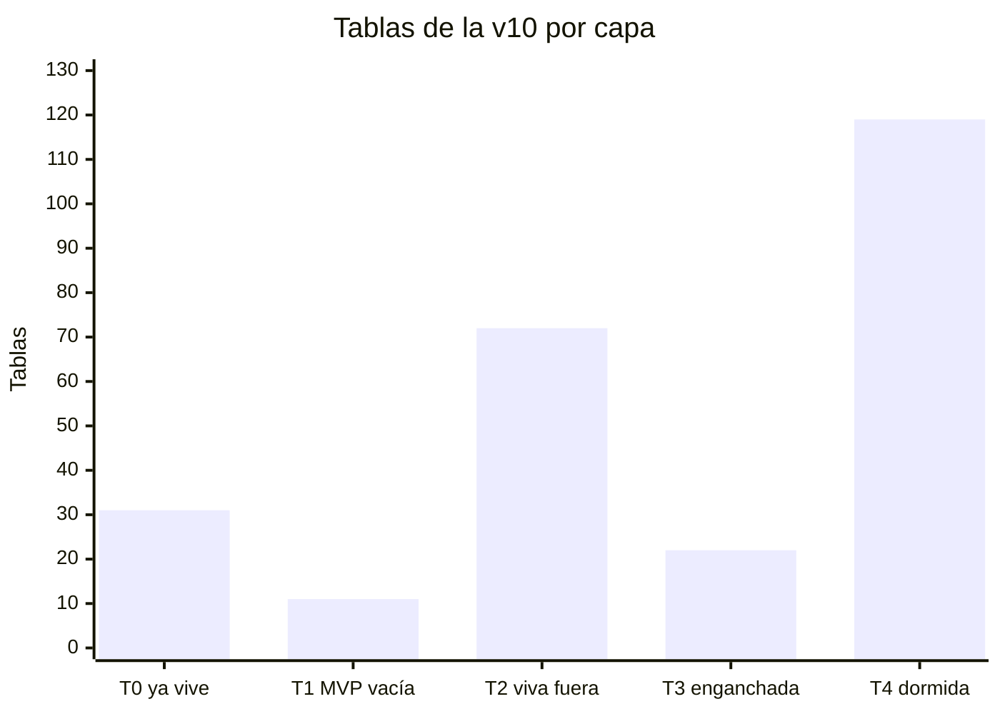
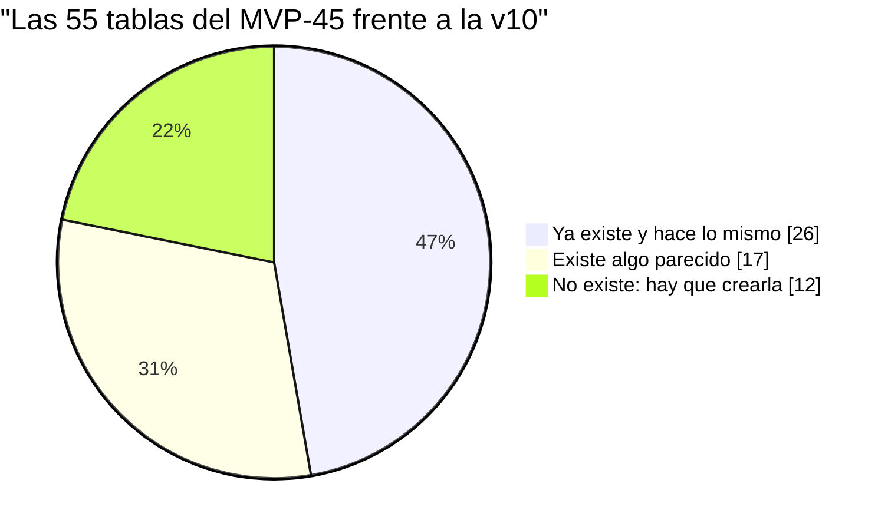
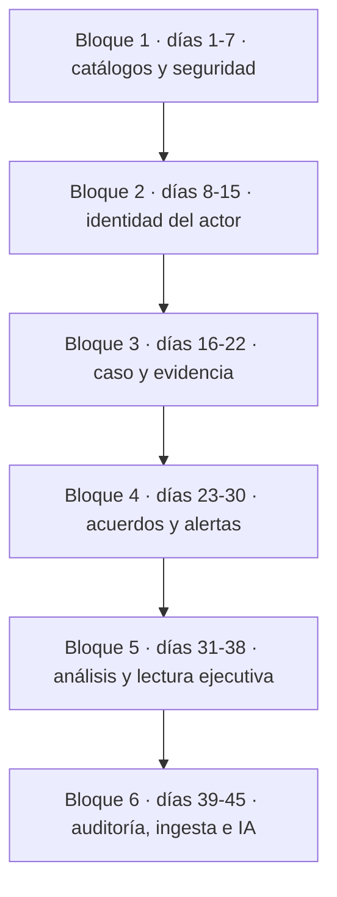

# Qué construir primero — capas de la v10 y puente con el MVP-45

**Para qué sirve este documento.** La v10 tiene 255 tablas; el MVP-45 pide 55 objetos para 45 días. Este documento dice, con medición sobre la base viva, **qué parte de la v10 ya está en pie, qué parte hay que crear primero y qué parte puede esperar**. No reemplaza al `mvp.md` ni al `AVISA_PRODUCE_v10.md`: los ordena en el tiempo.

**Cómo se lee.** Cinco capas, de la que ya funciona a la que duerme. Después, el puente entre los nombres del MVP y los de la v10. Al final, el orden de construcción del backend, bloque por bloque.

---

## 1. Las cinco capas

Cada tabla de la v10 cae en una sola capa. La regla es simple: **primero lo que el MVP pide y ya tiene datos; al final lo que no toca nada**.



| Capa   | Qué significa                                        | Tablas |  Columnas |      Filas |
| ------ | ---------------------------------------------------- | -----: | --------: | ---------: |
| **T0** | El MVP la exige y ya tiene datos o cargador          |     31 |       321 |  **8 537** |
| **T1** | El MVP la exige y todavía está vacía                 |     11 |        89 |          0 |
| **T2** | No la pide el MVP, pero está viva (datos o cargador) |     72 |       508 |  **3 720** |
| **T3** | Vacía, pero algo vivo la usa (una FK, un disparador) |     22 |       226 |          0 |
| **T4** | Vacía y sin nada vivo que la toque                   |    119 |       892 |          0 |
| Total  |                                                      |    255 | **2 036** | **12 257** |

Las 12 257 filas se reparten solo entre T0 y T2. **La mitad baja del modelo está vacía hoy**: 141 tablas (T3 + T4) no tienen una sola fila.

---

## 2. Cómo se midió

Cinco señales por tabla, todas verificables:

| Señal            | Qué pregunta                                         | Fuente                                                 |
| ---------------- | ---------------------------------------------------- | ------------------------------------------------------ |
| **Filas**        | ¿tiene datos hoy?                                    | `count(*)` real, tabla por tabla                       |
| **Cargador**     | ¿alguna fase del cargador de legado escribe en ella? | `migration/loader/*.py`                                |
| **Dependencia**  | ¿cuántas tablas **vivas** la referencian?            | claves foráneas del catálogo                           |
| **Consumidores** | ¿el código de la aplicación la nombra?               | `app/`, `components/`, `lib/`, `frontend/`, `backend/` |
| **Contrato**     | ¿el MVP-45 la exige?                                 | `mvp.md` §2.4 y §2.5                                   |

Dos advertencias para no sobreinterpretar:

- **Los consumidores casi no aportan todavía.** El código de la aplicación es un esqueleto: el backend tiene 147 líneas y el frontend 21. Ninguna tabla tiene consumo real, así que esa señal vale cero hoy y valdrá mucho dentro de tres semanas.
- **El DDL no es un consumidor.** Al medir por primera vez aparecieron 115 tablas "usadas por el código"; todas eran falsos positivos: el escáner estaba leyendo el archivo `PRODUCE_OAIPCS_AVISA_v9_ddl(1).sql`, que **define** las tablas, no las consulta.

---

## 3. Capa T0 — lo que ya vive (31 tablas)

Es el punto de partida real. Todo esto ya tiene filas en la base y ya es parte del MVP.

| Tabla                           | Filas | La referencian | Columnas |
| ------------------------------- | ----: | -------------: | -------: |
| `core.usuarios`                 |    32 |             80 |       13 |
| `core.cat_clasificacion`        |     3 |             60 |        2 |
| `core.casos`                    |    35 |             45 |       40 |
| `core.actores`                  | 1 160 |             34 |       26 |
| `core.distritos`                |   698 |             18 |        4 |
| `kag.documento_fuente`          |    10 |             12 |       10 |
| `core.alertas_tempranas`        |    83 |              6 |       33 |
| `core.compromisos`              |     8 |              5 |       25 |
| `kag.aristas`                   |   450 |              3 |       17 |
| `core.caso_cronologia`          |    80 |              2 |       20 |
| `core.cat_estados_caso`         |     4 |              2 |        3 |
| `core.cat_estados_hito`         |     5 |              2 |        3 |
| `core.cat_niveles_conflicto`    |     4 |              2 |        4 |
| `core.cat_niveles_riesgo`       |     3 |              2 |        3 |
| `core.cat_estados_compromiso`   |     5 |              1 |        4 |
| `core.cat_prioridades_alerta`   |     4 |              1 |        3 |
| `core.cat_tipos_actor`          |     7 |              1 |        3 |
| `core.cat_tipos_hecho`          |     9 |              1 |        2 |
| `core.hitos_compromiso`         |    12 |              1 |       12 |
| `core.roles`                    |     9 |              1 |        3 |
| `audit.datos_personales_acceso` | 2 241 |              0 |        8 |
| `core.actor_datos_personales`   |   847 |              0 |       16 |
| `core.actor_membresia`          |   292 |              0 |        6 |
| `core.alertas_actores`          |   161 |              0 |        2 |
| `core.caso_estado_historial`    |    35 |              0 |       11 |
| `core.casos_actores`            |    60 |              0 |        4 |
| `core.cronologia_vinculos`      |     5 |              0 |        3 |
| `core.log_accesos`              |   857 |              0 |        9 |
| `core.organizaciones`           |   224 |              0 |       21 |
| `core.usuario_roles`            |    34 |              0 |        4 |
| `kag.actor_name_history`        | 1 160 |              0 |        7 |

**Qué dice la columna «la referencian».** Si es alta, esa tabla hay que crearla antes que las demás: `core.usuarios` (80) y `core.cat_clasificacion` (60) son la base de todo. Si es cero, no significa que sobre: `core.actor_datos_personales` (847 filas) no la referencia ninguna clave foránea, pero es donde vive el DNI cifrado.

Dos sorpresas útiles:

- **`kag` no es futuro.** `kag.aristas` tiene 450 filas y `kag.documento_fuente` 10: el grafo ya empezó a escribirse con el cargador. No es una capa diferida, es parte del presente.
- **`audit.datos_personales_acceso` (2 241 filas) es la tabla más movida de todo el modelo.** Es el registro de quién miró qué dato sensible.

---

## 4. Capa T1 — lo que el MVP pide y aún no tiene datos (11 tablas)

| Tabla                           | Columnas |
| ------------------------------- | -------: |
| `agent.run_log`                 |       13 |
| `core.compromiso_colaboradores` |        2 |
| `core.output_contracts`         |       12 |
| `core.permiso_aprobacion`       |        6 |
| `core.reunion_participantes`    |        5 |
| `ind.resultado`                 |       16 |
| `kag.documento_fragmento`       |        9 |
| `kag.entity_merge_log`          |        7 |
| `policy.escenario_regla`        |        2 |
| `qda.mapeo_pseudonimo`          |        4 |
| `staging.lote`                  |       13 |

Son 89 columnas vacías que el MVP ya usa en su diseño. Se crean con su bloque (ver §6), no antes: una tabla vacía sin endpoint solo ocupa espacio.

---

## 5. Capa T2 — lo vivo que el MVP no pidió (72 tablas)

72 tablas con 3 720 filas que **no están en las 55 del MVP** pero ya tienen datos. No se tocan: se heredan.

| Esquema      | Tablas T2 | Qué es                                  |
| ------------ | --------: | --------------------------------------- |
| `core`       |        47 | catálogos, geografía y soporte del caso |
| `kag`        |         5 | resto del grafo                         |
| `config`     |         6 | parámetros y guardrails                 |
| `domain`     |         3 | reglas de negocio                       |
| `agent`      |         2 | bitácora de corridas                    |
| `analisis`   |         2 | planes de análisis                      |
| `ctx`        |         2 | captura de contexto                     |
| `policy`     |         2 | escenarios de política                  |
| `ind`        |         1 | indicadores                             |
| `model`      |         1 | ficha de modelo                         |
| `territorio` |         1 | catálogo de tipos de lugar              |

**Por qué importa.** El MVP se construye **sobre** estas tablas, no en paralelo. Si alguien "limpia" la base para dejar solo las 55 del MVP, borra 3 720 filas de historia.

---

## 6. Capa T3 y T4 — lo que espera

**T3 (22 tablas, 226 columnas):** vacías, pero enganchadas. 20 de las 22 llevan un disparador (18 solo eso, 1 además aparece en el código); 3 las referencia una tabla viva (`policy.gobierno`, `policy.titular`, `core.reuniones_dialogo`). **Ninguna se recorta**: están cableadas al modelo.

**T4 (119 tablas, 892 columnas):** vacías y sin nada vivo que las toque. Se agrupan en 49 islas: 9 islas de más de una tabla y 40 tablas sueltas. Las mayores:

| Isla | Integrantes                                                | Esquemas                                                                              |
| ---- | ---------------------------------------------------------- | ------------------------------------------------------------------------------------- |
| 37   | conversación, ingesta cruda, territorio, encuestas         | `chat`, `avisa`, `territorio`, `ctx`, `pesca`, `policy`, `community`, `core`, `agent` |
| 20   | sesiones de agente, planes de análisis, corpus léxico, QDA | `agent`, `analisis`, `lex`, `qda`                                                     |
| 6    | herramientas de captura, indicadores y vacíos del grafo    | `ctx`, `ind`, `kag`                                                                   |
| 4    | procesos de consulta                                       | `consultation`                                                                        |
| 3    | predicciones y deriva de modelos                           | `forecast`                                                                            |
| 3    | perfiles de actor y vectores                               | `kag`                                                                                 |
| 2    | acciones y planes de acción                                | `core`                                                                                |
| 2    | hipótesis y su evidencia                                   | `kag`                                                                                 |
| 40   | una tabla cada una                                         | todos                                                                                 |

**Decisión recomendada: no borrar nada, no construir nada.** La v10 es el producto completo y estas islas son su alcance de año 2. Lo que sí conviene es **sacarlas del camino crítico**: que ningún entregable del MVP dependa de ellas.

> **Lo que la isla de 37 revela.** Está unida por una clave foránea curiosa: `chat.repositorio.territorio_lugar_id → territorio.lugares`. Un repositorio de conversación apuntando a un lugar pesquero es herencia del bloque de columnas de gobierno que se aplicó de forma desigual ( `nivel_clasificacion` está en 53 tablas, `caso_id` en 35, `created_at` en 46, pero `sujeto_actor_uid` solo en 2 ). No rompe nada; sí conviene revisarlo antes de que alguien lo interprete como diseño intencional.

---

## 7. El puente: 55 tablas del MVP contra 255 de la v10

La correspondencia no se inventó aquí: sigue el **Anexo D.2** de `AVISA_PRODUCE_v10.md`. Al contrastarla con la base viva aparece el dato que ordena todo el trabajo:



**26 exactas.** El MVP puede usar la tabla tal cual (por ejemplo `core.actores`, `core.casos`, `core.actor_datos_personales`, los nueve catálogos, `core.usuarios`, `core.roles`, `core.usuario_roles`, `audit.datos_personales_acceso`).

**17 parciales.** Existe algo que cubre parte, o con otro nombre de esquema. Los cuatro que más van a doler:

| MVP                        | Hoy en v10                   | Qué falta                                        |
| -------------------------- | ---------------------------- | ------------------------------------------------ |
| `core.hecho`               | `core.caso_cronologia`       | el hecho como entidad con tipo propio            |
| `core.cita`                | `kag.documento_fragmento`    | `offset_inicio` y `offset_fin` para citar exacto |
| `core.padron_asistencia`   | `core.reunion_participantes` | el padrón de una asamblea, no solo de reunión    |
| `core.alerta_destinatario` | `core.alertas_actores`       | el destinatario externo (no solo el actor)       |

**12 a crear.** Estas no existen en ninguna forma y **bloquean entregables**:

| Objeto del MVP                      | Por qué existe en el MVP                                           |
| ----------------------------------- | ------------------------------------------------------------------ |
| `ref.nivel_identificacion`          | niveles 0–5 de identificación gradual del actor                    |
| `ref.base_legal_tratamiento`        | base legal por finalidad (Ley 29733)                               |
| `core.alerta_fuente`                | vínculo alerta → fuente que la disparó                             |
| `core.actor_consentimiento`         | consentimiento por finalidad (§2.3.bis)                            |
| `core.situacion_judicial_restricta` | presunción de inocencia, repositorio restringido                   |
| `core.banco_datos_tratamiento`      | inscripción del banco en la ANPDP                                  |
| `analisis.caso_analogo`             | `forecast.whatif_scenarios`, prevista y no creada                  |
| `analisis.calidad_fuente`           | indicador de calidad de la información (vacíos, sesgos, caducidad) |
| `seg.usuario_actor_externo`         | qué usuario externo ve qué actor (perfil C)                        |
| `seg.usuario_caso`                  | qué usuario ve qué caso                                            |
| `audit.exportacion`                 | cada salida del perímetro, con hash                                |
| `audit.incidente_seguridad`         | reloj de las 48 horas ante incidentes                              |

Nueve de las doce son de cumplimiento o de seguridad, no de funcionalidad. Es decir: **si el MVP se construye solo con lo que ya existe, no cumple la ley.**

---

## 8. Orden de construcción del backend

Seis bloques. Cada uno termina en algo demostrable y no abre el siguiente hasta cerrar su criterio.



### Bloque 1 — Catálogos y seguridad (días 1–7)

**Ya existe (T0):** `core.cat_clasificacion`, `core.cat_niveles_conflicto`, `core.cat_niveles_riesgo`, `core.cat_estados_caso`, `core.cat_estados_compromiso`, `core.cat_estados_hito`, `core.cat_prioridades_alerta`, `core.cat_tipos_actor`, `core.cat_tipos_hecho`, `core.usuarios`, `core.roles`, `core.usuario_roles`, `core.log_accesos`, `audit.datos_personales_acceso`.

**Crear:** `ref.nivel_identificacion`, `ref.base_legal_tratamiento`, `seg.usuario_actor_externo`, `seg.usuario_caso`.

**Relaciones primero:** las 60 claves foráneas que apuntan a `core.cat_clasificacion` y las 80 que apuntan a `core.usuarios`. Son las que hacen que todo lo demás pueda existir.

**Cierra cuando:** dos perfiles distintos consultan la misma tabla y ven cosas distintas (RLS probado), y cada catálogo tiene sus filas semilla.

### Bloque 2 — Identidad del actor (días 8–15)

**Ya existe (T0):** `core.actores` (1 160), `core.actor_datos_personales` (847), `core.organizaciones` (224), `core.actor_membresia` (292), `kag.actor_name_history` (1 160), `kag.aristas` (450).

**Crear:** `core.actor_consentimiento` y, si el MVP necesita alias libres, `core.actor_alias` (hoy solo hay historial de nombres en `kag`).

**Endpoints:** `GET/POST/PATCH /actores`, `POST /actores/{id}/promover`, `POST /actores/fusionar`.

**Cierra cuando:** un actor sin DNI se registra, se promueve de nivel y se fusiona con otro **sin perder historial** — que es la brecha A1 del Anexo D.3.

### Bloque 3 — Caso y evidencia (días 16–22)

**Ya existe (T0):** `core.casos` (35), `core.casos_actores` (60), `core.caso_cronologia` (80), `core.cronologia_vinculos` (5), `core.caso_estado_historial` (35), `kag.documento_fuente` (10).

**Ya existe (T2):** `core.documentos` (153) y `core.distritos` (698).

**Crear:** `core.alerta_fuente` (se usa en el bloque 4, se define aquí).

**Endpoints:** `GET /casos`, `GET /casos/{id}/hechos`, `GET /casos/{id}/red`.

**Cierra cuando:** la ficha de un caso muestra su línea de tiempo con fuente por hecho, y nadie puede leer una fila de un caso que no le corresponde.

### Bloque 4 — Acuerdos y alertas (días 23–30)

**Ya existe (T0):** `core.compromisos` (8), `core.hitos_compromiso` (12), `core.alertas_tempranas` (83), `core.alertas_actores` (161).

**Ya existe (T2):** `core.envios_comunicacion` (17).

**Ya existe vacío (T1):** `core.compromiso_colaboradores`, `core.reunion_participantes`, `core.permiso_aprobacion`.

**Endpoints:** `POST /ingesta/alertas`, `POST /alertas/{id}/aprobar`, `POST /alertas/{id}/descartar`.

**Cierra cuando:** una alerta nace como candidata, un humano la aprueba o la descarta con motivo, y el compromiso queda con su hito y su responsable.

### Bloque 5 — Análisis y lectura ejecutiva (días 31–38)

**Ya existe vacío (T1):** `policy.escenario_regla`, `core.output_contracts`.

**Vacías y sin uso (T4):** `core.riesgo_social_ordinal` (K1 y K5) y `policy.snapshot`. Aquí el trabajo no es crear tablas: es poblarlas desde cero y probar que el simulador devuelve algo.

**Crear:** `analisis.caso_analogo` y `analisis.calidad_fuente`.

**Endpoints:** `POST /simulaciones`, `GET /casos/{id}/analogos`, `GET /ejecutivo/kpis`, `POST /informes/generar`.

**Cierra cuando:** el informe OE1–OE3 sale con cada afirmación enlazada a una cita verificable, y el tablero del Ministro carga en menos de dos minutos de lectura.

### Bloque 6 — Auditoría, ingesta e IA (días 39–45)

**Ya existe vacío (T1):** `agent.run_log`, `staging.lote`.

**Crear:** `audit.exportacion`, `audit.incidente_seguridad`.

**Cierra cuando:** toda exportación deja hash y destinatario, y un incidente abre el reloj de 48 horas con sus dos notificaciones.

---

## 9. Lo que no se construye ahora

- **15 tablas de `territorio`**, 12 de `chat`, 16 de `kag`, 11 de `lex`, 6 de `qda`, 8 de `agent`, 5 de `impact`, 4 de `consultation`, 3 de `forecast`, 3 de `economic`. Todas en T4: vacías y sin consumidor.
- **Los dos planes de acción.** `core.plan_acciones` (9 columnas) y `core.planes_accion` (4 columnas) coexisten, ambas vacías, con nombres casi idénticos y contenidos distintos: una describe acciones de un plan, la otra un documento presupuestal. Antes de construir cualquiera, conviene decidir cuál sobrevive.
- **La analítica de largo plazo** (`forecast`, `economic`, `impact`). Es el año 2.

---

## 10. Cómo se reproduce

```
python migration/prioridad_mvp.py
```

Lee la base, escribe `docs/mvp_prioridad_tablas.csv` (una fila por tabla, con capa y causa) e imprime el resumen. **Solo lee**: no crea, no borra, no comenta.

Si se añade una tabla a la v10 o se cambia el contrato del MVP, se edita el diccionario `MVP` del script y se vuelve a ejecutar. Las cifras de este documento salen de esa ejecución, no de una estimación.

---

## 11. Referencias

1. `docs/AVISA_PRODUCE_v10.md` — arquitectura objetivo; **Anexo D.2** (correspondencia de nombres MVP → v10) y **Anexo D.3** (brechas A1–R4).
2. `docs/mvp.md` — contrato del MVP-45: §2.4 y §2.5 (las 55 tablas), §3.5 (endpoints), §6 (plan día por día).
3. `docs/LEGADO_A_V10_SIMILITUDES_Y_DIFERENCIAS.md` — puente sistema anterior ↔ v10, con la estadística en §11 y los componentes en §12.
4. `docs/DICCIONARIO_DATOS.md` — significado de cada tabla y columna; versión máquina en `docs/diccionario_datos.csv`.
5. `docs/mvp_prioridad_tablas.csv` — la medición completa, una fila por tabla.
6. `migration/prioridad_mvp.py` — el medidor.
7. `migration/loader/phases/` — las 14 fases del cargador de legado.
8. Ley N.° 29733 y su Reglamento (D.S. N.° 003-2013-JUS) — medidas de seguridad de nivel alto, bancos de datos y Oficial de Datos Personales.
9. D.U. N.° 007-2020 y D.S. N.° 029-2021-PCM — Marco de Confianza Digital y notificación de incidentes en 48 horas.
10. R.M. N.° 00207-2026-PRODUCE — Guía para la Prevención y Gestión de Conflictos Sociales del Sector Producción; triangulación y Marco Situacional.
11. D.S. N.° 115-2025-PCM — Reglamento de la Ley de Inteligencia Artificial; prohibición de perfilamiento y supervisión humana.
