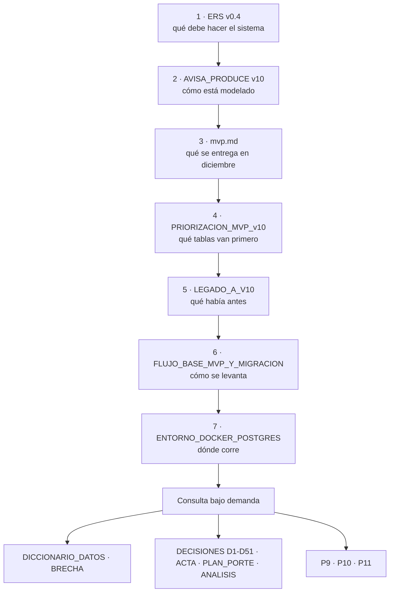

# 2. Orden de lectura canónico

Leer primero (1→7): obligatorio para cualquiera que entre al proyecto. Son 7 archivos.

Consulta: DICCIONARIO_DATOS, BRECHA, DECISIONES, ACTA, PLAN_PORTE, ANALISIS, P9, P10, P11. Se abren para resolver una pregunta concreta, no se leen de corrido.

