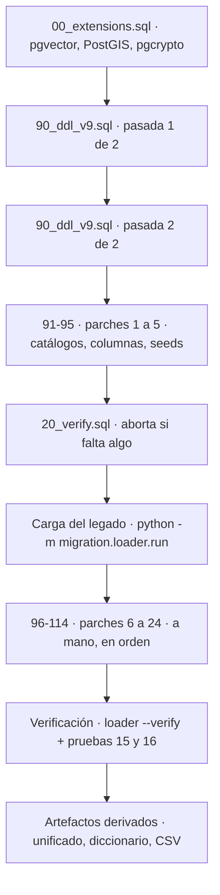
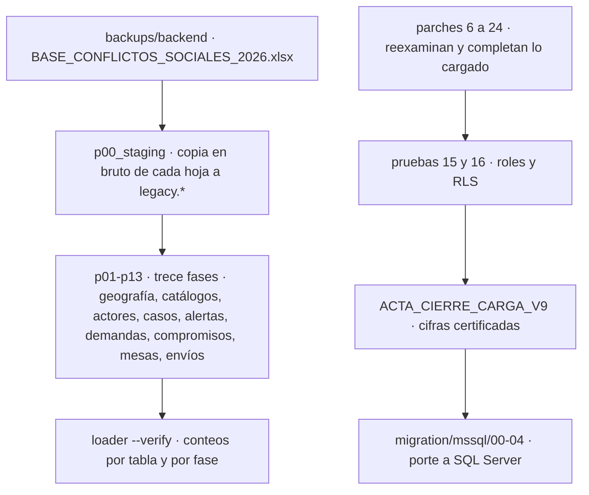

# Índice documental — AVISA / SIPRECS (OAIPCS · PRODUCE)

Este archivo es el **punto de entrada único**. Si un documento contradice a otro, manda el que esta tabla marca como autoridad. No se crea ningún documento nuevo sin registrarlo aquí primero.

Última revisión: **2026-11-24**. Qué está hecho y qué falta, pantalla por pantalla, en `07_frontend/frontend.md`; el estado de la migración a Angular, en `07_frontend/angular/ESTADO_MIGRACION_ANGULAR.md`.

**En dos minutos.** Siete carpetas, en orden de lectura:

| #   | Carpeta            | Qué responde                                                                                                                                                      |
| --- | ------------------ | ----------------------------------------------------------------------------------------------------------------------------------------------------------------- |
| 1   | `01_requisitos/`   | qué **debe hacer** el sistema (`ERS_AVISA_PRODUCE_v0.6.md`, documento rector nº 1)                                                                                |
| 2   | `02_arquitectura/` | cómo está **modelado** (`AVISA_PRODUCE_v10.md`)                                                                                                                   |
| 3   | `03_ejecucion/`    | qué se **entrega** en diciembre (`mvp.md`) y qué tablas **van primero** (`PRIORIZACION_MVP_v10.md`, su CSV y `AVISA_V10_PRIORIZACION.sql`)                        |
| 4   | `04_migracion/`    | por qué y cómo se cargó el legado (`DECISIONES_CARGA_LEGADO_V9.md`, `PLAN_PORTE_LEGADO_V9.md`, `ACTA_CIERRE_CARGA_V9.md`) y los diecinueve informes de `parches/` |
| 5   | `05_datos/`        | el diccionario, las mediciones y el puente legado ↔ v10                                                                                                           |
| 6   | `06_operacion/`    | los runbooks: levantar la base y migrar, y el entorno Docker                                                                                                      |
| 7   | `07_frontend/`     | qué falta en **interfaz**, por vista (`frontend.md`); el detalle está en `frontend_detalle.md`                                                                    |

Los **24 scripts SQL** viven en la raíz de `docs/`, no en una carpeta: su ruta es contrato de
`compose.yaml`. El orden en que se aplican está en **§6**, y el de la migración del legado en **§7**.

---

## 1. Jerarquía

Cada documento vive en una carpeta temática. La jerarquía es la de la autoridad (quién manda
sobre quién); la carpeta es solo la estantería donde está guardado.

```
01_requisitos/ERS_AVISA_PRODUCE_v0.6.md ── documento rector nº 1: autoridad de requisitos (qué debe hacer el sistema)
        │
02_arquitectura/AVISA_PRODUCE_v10.md  ── autoridad arquitectónica (v10 ⊇ v9)
        │
        ├── 03_ejecucion/mvp.md ──────────── autoridad de ejecución (45 días, SQL Server)
        │        └── 03_ejecucion/PRIORIZACION_MVP_v10.md ── orden de construcción: capas de la v10 (266 tablas) y puente del MVP-45: 55 piezas pedidas, 46 tablas existentes que las cubren
        │                ├── 03_ejecucion/mvp_prioridad_tablas.csv · se regenera con migration/prioridad_mvp.py
        │                └── AVISA_V10_PRIORIZACION.sql · esquema `priorizacion`: la medición y los seis bloques
        │
        ├── 04_migracion/DECISIONES_CARGA_LEGADO_V9.md ── autoridad de migración (MIG D1–D51)
        │        └── Anexos A (clases), B y C (absorben el literal de `_archivo/MAPA_CARGA_LEGADO_A_V9.md`)
        │
        ├── 04_migracion/PLAN_PORTE_LEGADO_V9.md ── especificación de carga (§2 corrige el mapa)
        │        └── Anexo E (mapa de fuentes: el detalle de `ANALISIS_PORTABILIDAD` §3 NO se traslada)
        │
        ├── 04_migracion/ACTA_CIERRE_CARGA_V9.md ── cifras certificadas
        ├── 05_datos/LEGADO_A_V10_SIMILITUDES_Y_DIFERENCIAS.md ── puente único sistema anterior ↔ v10 (lectura de entrada)
        │        └── §11 (estadística de atributos) y §12 (componentes) viven dentro del documento; SVG en img/*.svg
        ├── 05_datos/BRECHA_CAPA_DATOS_V9.md ── diagnóstico de la base viva (§12–13)
        ├── 05_datos/DICCIONARIO_DATOS.md ── diccionario único de las dos capas (sistema anterior + v10) y su correspondencia
        │        └── versión máquina en 05_datos/diccionario_datos.csv · se regenera con migration/generar_diccionario.py
        ├── 06_operacion/FLUJO_BASE_MVP_Y_MIGRACION.md ── runbook: crear la base del MVP y migrar
        ├── 06_operacion/ENTORNO_DOCKER_POSTGRES.md ── runbook del entorno
        ├── 06_operacion/DESPLIEGUE_VERCEL_NEON.md ── qué se despliega, qué se acotó y el destino .NET
        └── 07_frontend/frontend.md ── autoridad de interfaz: qué falta, pantalla por pantalla (33 rutas)
                 └── 07_frontend/frontend_detalle.md ── anexo del índice: catálogo de ítems, hallazgos de base y de carga, capa GIS y contrato de API
```

**Árbol físico de `docs/`.** Los siete primeros directorios agrupan documentos; `sql/` no existe
porque los scripts SQL se quedan en la raíz de `docs/` (ver §5.c). El orden de los números es el
orden de lectura de §5.b.

```
docs/
├── README.md                          este archivo: único punto de entrada del árbol documental
├── 01_requisitos/                     qué debe hacer el sistema
├── 02_arquitectura/                   cómo está modelado
├── 03_ejecucion/                      qué se entrega y en qué orden se construye
├── 04_migracion/                      por qué y cómo se cargó el legado
│   └── parches/                       los diecinueve informes de parche que existen
├── 05_datos/                          diccionario, mediciones y puente legado ↔ v10
├── 06_operacion/                      runbooks: levantar la base, migrar, entorno y despliegue
├── 07_frontend/                       interfaz: qué falta pantalla por pantalla (`frontend.md`) y la migración a Angular
├── sql_server/                        salida de extraer_fks.py: esquema sin FK, claves ajenas e informe
├── img/                               los 11 SVG enlazados por el ERS y por LEGADO_A_V10
├── casos_uso/                         el .puml que genera las cinco láminas del ERS
├── avisa_actual/                      el sistema anterior, tal como está en producción
├── _archivo/                          lo archivado el 2026-11-20 (11 archivos)
├── 5 PREPARACION_V9_CARGA_LEGADO*.sql    parches 1–5 · los aplica el initdb
├── 19 PARCHE_6…PARCHE_24.sql             parches 6–24 · se aplican a mano tras la carga
├── AVISA_V10_ESQUEMA_UNIFICADO.sql   todo el esquema en un archivo · generado
└── AVISA_V10_PRIORIZACION.sql        la medición y los seis bloques · a mano
```

Los flujos de esos archivos SQL —cómo se implementa la base y cómo se migra el legado— están en
**§6** y **§7**.

---

## 2. Estado y destino de cada documento

Las rutas de la primera columna son **relativas a `docs/`**, salvo las filas `migration/…`, que son
relativas a la raíz del repositorio. Los scripts SQL viven en la raíz de `docs/`, no en una carpeta:
su ruta es contrato de `compose.yaml` (ver §5.c).

| Documento                                            | Estado                                                        | Rol                                                                                                                                                                                                                                                                                                                                                                                                                                                                                                                                                                                                                                                                                                                                                                                                                                                                                                                                | Destino                                                             |
| ---------------------------------------------------- | ------------------------------------------------------------- | ---------------------------------------------------------------------------------------------------------------------------------------------------------------------------------------------------------------------------------------------------------------------------------------------------------------------------------------------------------------------------------------------------------------------------------------------------------------------------------------------------------------------------------------------------------------------------------------------------------------------------------------------------------------------------------------------------------------------------------------------------------------------------------------------------------------------------------------------------------------------------------------------------------------------------------- | ------------------------------------------------------------------- |
| `01_requisitos/ERS_AVISA_PRODUCE_v0.6.md`            | **vigente · autoridad de requisitos (documento rector nº 1)** | qué debe hacer el sistema: requisitos funcionales, roles, pantallas, arquitectura C4 y §3.4 con las cinco láminas de casos de uso                                                                                                                                                                                                                                                                                                                                                                                                                                                                                                                                                                                                                                                                                                                                                                                                  | se conserva                                                         |
| `01_requisitos/guia.md`                              | **vigente · normativo · fuente sectorial**                    | Guía de Prevención y Gestión de Conflictos Sociales del Sector Producción (PRODUCE · OAIPCS): fuente de la que se derivan los once ejes que fija `GLOSARIO_ALINEACION_GUIA.md`. Ante cualquier discrepancia de vocabulario, manda este documento                                                                                                                                                                                                                                                                                                                                                                                                                                                                                                                                                                                                                                                                                   | se conserva                                                         |
| `01_requisitos/GLOSARIO_ALINEACION_GUIA.md`          | **vigente · normativo**                                       | traducción comprobable de la Guía a vocabulario: los once ejes (conflictividad, riesgo, prioridad de atención, temáticas, subsectores, actores, alertas, estados de hito, alcance, ciclo, anexos), la tabla de reemplazos y las reglas de cirugía con las que se alinean el ERS, la v10, el MVP, la migración y el diccionario                                                                                                                                                                                                                                                                                                                                                                                                                                                                                                                                                                                                     | se edita a mano                                                     |
| `01_requisitos/GAPS_GUIA_SQL_UI.md`                  | **vigente · diagnóstico**                                     | registro de gaps entre la Guía, la base y la interfaz: catálogos desalineados, conteos de uso real, gaps estructurales y decisiones pendientes                                                                                                                                                                                                                                                                                                                                                                                                                                                                                                                                                                                                                                                                                                                                                                                     | se edita a mano                                                     |
| `01_requisitos/AUDITORIA_ALINEACION_2026-11-22.md`   | **vigente · auditoría**                                       | reglas del barrido de alineación documental del 2026-11-22: vocabulario congelado, hechos verificados en la base y cierre bloque por bloque                                                                                                                                                                                                                                                                                                                                                                                                                                                                                                                                                                                                                                                                                                                                                                                        | se edita a mano                                                     |
| `02_arquitectura/AVISA_PRODUCE_v10.md`               | **vigente · autoridad**                                       | arquitectura objetivo; bloques `.v10` y Anexo E (DC-01…DC-12)                                                                                                                                                                                                                                                                                                                                                                                                                                                                                                                                                                                                                                                                                                                                                                                                                                                                      | se conserva                                                         |
| `03_ejecucion/mvp.md`                                | **vigente**                                                   | MVP-45 sobre SQL Server; §2.3.bis, §2.3.ter, §2.5 nuevos                                                                                                                                                                                                                                                                                                                                                                                                                                                                                                                                                                                                                                                                                                                                                                                                                                                                           | se conserva                                                         |
| `03_ejecucion/PRIORIZACION_MVP_v10.md`               | **vigente · medido**                                          | orden de construcción: cinco capas de la v10 (33 / 13 / 77 / 22 / 121 tablas, 266 en total) y puente del MVP-45: 55 piezas pedidas, cubiertas hoy con 46 tablas de la v10                                                                                                                                                                                                                                                                                                                                                                                                                                                                                                                                                                                                                                                                                                                                                          | se edita a mano                                                     |
| `03_ejecucion/mvp_prioridad_tablas.csv`              | **vigente · generado**                                        | una fila por tabla lógica (266) con capa, filas, dependencias, cargador y causa                                                                                                                                                                                                                                                                                                                                                                                                                                                                                                                                                                                                                                                                                                                                                                                                                                                    | se regenera con `migration/prioridad_mvp.py`                        |
| `AVISA_V10_PRIORIZACION.sql`                         | **vigente · nuevo**                                           | la medición y los seis bloques de construcción en un esquema propio (`priorizacion`): capas, bloques, puente, 51 tablas asignadas y verificación de totales y de huérfanas                                                                                                                                                                                                                                                                                                                                                                                                                                                                                                                                                                                                                                                                                                                                                         | se ejecuta a mano · no lo monta `compose.yaml`                      |
| `migration/prioridad_mvp.py`                         | **vigente**                                                   | mide filas, cargador, dependencias y consumidores, y aplica el contrato del MVP; **sólo escribe el CSV**                                                                                                                                                                                                                                                                                                                                                                                                                                                                                                                                                                                                                                                                                                                                                                                                                           | se ejecuta                                                          |
| `04_migracion/DECISIONES_CARGA_LEGADO_V9.md`         | **vigente**                                                   | decisiones MIG D1–D51; recibe Anexos A, B y C                                                                                                                                                                                                                                                                                                                                                                                                                                                                                                                                                                                                                                                                                                                                                                                                                                                                                      | se conserva y crece                                                 |
| `04_migracion/PLAN_PORTE_LEGADO_V9.md`               | **vigente**                                                   | especificación de carga; su §2 corrige el mapa                                                                                                                                                                                                                                                                                                                                                                                                                                                                                                                                                                                                                                                                                                                                                                                                                                                                                     | se conserva y crece                                                 |
| `04_migracion/ACTA_CIERRE_CARGA_V9.md`               | **vigente**                                                   | cifras certificadas de la carga                                                                                                                                                                                                                                                                                                                                                                                                                                                                                                                                                                                                                                                                                                                                                                                                                                                                                                    | se conserva                                                         |
| `05_datos/LEGADO_A_V10_SIMILITUDES_Y_DIFERENCIAS.md` | **vigente**                                                   | **puente único** sistema anterior ↔ v10: qué no cambia, qué cambia, clases, estadística (§11), calidad del dato (§11.6), componentes (§12) y referencias (§13)                                                                                                                                                                                                                                                                                                                                                                                                                                                                                                                                                                                                                                                                                                                                                                     | se conserva                                                         |
| `06_operacion/FLUJO_BASE_MVP_Y_MIGRACION.md`         | **vigente**                                                   | runbook de la base MVP: crear la base (sección A), cargar el legado, aplicar los parches 6–24, regenerar los artefactos derivados (§5.6), preparar la copia para SQL Server y rehacer desde cero                                                                                                                                                                                                                                                                                                                                                                                                                                                                                                                                                                                                                                                                                                                                   | se conserva                                                         |
| `05_datos/DICCIONARIO_DATOS.md`                      | **vigente · generado**                                        | diccionario único de las dos capas: 87 tablas del sistema anterior + 266 tablas lógicas de v10, con propósito, claves, relaciones, columnas y correspondencia (§8)                                                                                                                                                                                                                                                                                                                                                                                                                                                                                                                                                                                                                                                                                                                                                                 | se regenera con `migration/generar_diccionario.py`                  |
| `05_datos/diccionario_datos.csv`                     | **vigente · generado**                                        | versión máquina del diccionario: una fila por columna física (3 334)                                                                                                                                                                                                                                                                                                                                                                                                                                                                                                                                                                                                                                                                                                                                                                                                                                                               | se regenera con el mismo script                                     |
| `migration/generar_diccionario.py`                   | **vigente**                                                   | genera el diccionario y el CSV leyendo el catálogo de la base; las particiones heredan la descripción de su padre; sólo lee                                                                                                                                                                                                                                                                                                                                                                                                                                                                                                                                                                                                                                                                                                                                                                                                        | se ejecuta                                                          |
| `migration/curacion_v10.py`                          | **vigente**                                                   | propósito de las 263 tablas lógicas; las 2 tablas del parche 18 llevan su comentario dentro del propio parche 18, por eso la curaduría no las lista                                                                                                                                                                                                                                                                                                                                                                                                                                                                                                                                                                                                                                                                                                                                                                                | se edita a mano                                                     |
| `migration/curacion_v10_columnas.py`                 | **vigente**                                                   | descripción de las 2 107 columnas lógicas que la curaduría escribe a mano; las 47 que crearon los parches 17 (19), 18 (19), 21 (2), 22 (1) y 23 (6) llevan su comentario dentro del propio parche, por eso la curaduría no las lista. En la base: 2 161 de 2 161 comentadas (las siete últimas las cerró el parche 24)                                                                                                                                                                                                                                                                                                                                                                                                                                                                                                                                                                                                             | se edita a mano                                                     |
| `migration/generar_comentarios_sql.py`               | **vigente**                                                   | escribe el parche 12 desde la curaduría y verifica cada tabla y columna contra el catálogo; sólo lee                                                                                                                                                                                                                                                                                                                                                                                                                                                                                                                                                                                                                                                                                                                                                                                                                               | se ejecuta                                                          |
| `migration/curacion_vistas.py`                       | **vigente**                                                   | propósito, tipo y tablas que lee cada vista y matview                                                                                                                                                                                                                                                                                                                                                                                                                                                                                                                                                                                                                                                                                                                                                                                                                                                                              | se edita a mano                                                     |
| `migration/curacion_legacy.py`                       | **vigente**                                                   | propósito de las 87 tablas del sistema anterior y significado de sus columnas documentadas                                                                                                                                                                                                                                                                                                                                                                                                                                                                                                                                                                                                                                                                                                                                                                                                                                         | se edita a mano                                                     |
| `ESTADISTICA_LEGADO_V10.md`                          | **eliminado**                                                 | tabla de 86 correspondencias con filas origen y destino medidas en vivo                                                                                                                                                                                                                                                                                                                                                                                                                                                                                                                                                                                                                                                                                                                                                                                                                                                            | absorbido en `LEGADO_A_V10` §11.5; retirado el 2026-11-18           |
| `migration/reporte_estadistica.py`                   | **vigente**                                                   | mide la base viva, genera seis SVG de atributos e inyecta la tabla de §11.5                                                                                                                                                                                                                                                                                                                                                                                                                                                                                                                                                                                                                                                                                                                                                                                                                                                        | se ejecuta; su salida no se edita a mano                            |
| `img/delta_*.svg`                                    | **vigente · generado**                                        | seis gráficos de atributos lado a lado: `delta_estructura`, `delta_clases_legacy`, `delta_atributos`, `delta_esquemas`, `delta_calidad`, `delta_componentes`                                                                                                                                                                                                                                                                                                                                                                                                                                                                                                                                                                                                                                                                                                                                                                       | se regeneran con el script                                          |
| `casos_uso/AVISA_CASOS_USO.puml`                     | **vigente**                                                   | casos de uso del sistema en PlantUML (UML 2 puro, sin librería C4), en cinco láminas (el día del analista, lo que se valida y envía, 2027 con sus dos tramos, el mapa de trazabilidad actor → objetivo → caso → pieza y los contenedores con el caso de uso dentro de cada pieza); es la fuente del §3.4 del ERS, donde cada caso lleva su código RF. La décima pasada lo llevó de **913 a 1 248 líneas** y rehizo las láminas: **CU-11 pasa a 2027**, **CU-12** vuelve a estar, **CU-35** y **CU-36** entran como MVP, **PAN-10** queda como pantalla primaria, y aparecen los tres niveles de gravedad, un `Host` por tablero y la Alta Dirección con 4 usuarios. Los cinco SVG de `img/` **ya están regenerados** —2026-11-20, con `-Playout=smetana`—; el comando es el del ERS §3.4: `java -jar plantuml.jar -tsvg -charset UTF-8 -o ../img docs/casos_uso/AVISA_CASOS_USO.puml`, o con `-Playout=smetana` si no hay Graphviz | se edita a mano; render con PlantUML y Graphviz                     |
| `img/AVISA_CU_*.svg`                                 | **vigente · generado**                                        | las cinco láminas incrustadas en el ERS §3.4: `AVISA_CU_MVP_DIA`, `AVISA_CU_MVP_SALIDA`, `AVISA_CU_2027`, `AVISA_CU_MAPA_VISTAS` y `AVISA_CU_CONTENEDORES`; regeneradas el 2026-11-20 desde el `.puml` vigente                                                                                                                                                                                                                                                                                                                                                                                                                                                                                                                                                                                                                                                                                                                     | se regeneran desde el `.puml`                                       |
| `05_datos/BRECHA_CAPA_DATOS_V9.md`                   | **vigente**                                                   | diagnóstico de la base en vivo; recibe §12–§13                                                                                                                                                                                                                                                                                                                                                                                                                                                                                                                                                                                                                                                                                                                                                                                                                                                                                     | se conserva y crece                                                 |
| `06_operacion/ENTORNO_DOCKER_POSTGRES.md`            | **vigente**                                                   | runbook del contenedor y credenciales                                                                                                                                                                                                                                                                                                                                                                                                                                                                                                                                                                                                                                                                                                                                                                                                                                                                                              | se conserva                                                         |
| `06_operacion/DESPLIEGUE_VERCEL_NEON.md`             | **vigente**                                                   | topología real de despliegue con un solo proyecto: Vercel sirve la API (`app/api/**`) y la consola Angular desde `public/`; cómo se construye (`npm ci` + `ng build` + copia a `public/`), qué construye y qué omite `vercel.json`, el entorno local con Docker, lo que sólo se resuelve en el panel, la verificación, el inventario de lo que se retiró y el destino decidido: API en .NET en un servidor de PRODUCE                                                                                                                                                                                                                                                                                                                                                                                                                                                                                                              | se edita a mano                                                     |
| `07_frontend/frontend.md`                            | **vigente · índice**                                          | qué falta, pantalla por pantalla: pendientes de interfaz por vista del mapa del sitio (33 rutas), con el motivo de cada hueco (implementar, dato, API, diseño o bloqueado), el artboard de referencia y las reglas ya decididas. No repite lo hecho                                                                                                                                                                                                                                                                                                                                                                                                                                                                                                                                                                                                                                                                                | se edita a mano                                                     |
| `07_frontend/frontend_detalle.md`                    | **vigente · anexo**                                           | detalle que respalda al índice: catálogo de los 131 items con su estado, hallazgos de base y carga, capa GIS, contrato de API, duplicidades resueltas y prioridad de mockups                                                                                                                                                                                                                                                                                                                                                                                                                                                                                                                                                                                                                                                                                                                                                       | se conserva y crece                                                 |
| `07_frontend/migracion_angular.md`                   | **vigente · diagnóstico**                                     | análisis previo de la migración del frontend a Angular: medición del código real, mapa Next.js → Angular, estrategias de corte y marco de paridad                                                                                                                                                                                                                                                                                                                                                                                                                                                                                                                                                                                                                                                                                                                                                                                  | se edita a mano                                                     |
| `07_frontend/angular/DISENO_MIGRACION_ANGULAR.md`    | **vigente · diseño**                                          | diseño que **decide** la migración: workspace Angular, rutas, servicios de datos, estado con Signals contra el backend actual, fases y criterios de aceptación. Complementa al inventario y, donde difiere de `migracion_angular.md`, lo dice en §0.3                                                                                                                                                                                                                                                                                                                                                                                                                                                                                                                                                                                                                                                                              | se edita a mano                                                     |
| `07_frontend/angular/INVENTARIO_PARIDAD_UI.md`       | **vigente · inventario**                                      | checklist de porting: enumera vistas, componentes y dependencias de la UI actual con cita `ruta:línea`, y marca como «no verificado» lo que no pudo comprobar. Complementa al diseño, que decide                                                                                                                                                                                                                                                                                                                                                                                                                                                                                                                                                                                                                                                                                                                                   | se edita a mano                                                     |
| `07_frontend/angular/CONTRATO_API_SPA.md`            | **vigente · contrato**                                        | inventario verificado de lo que la SPA consume de la API —método, ruta, parámetros, cuerpo y forma de respuesta por recurso y pantalla—, con la lista de lo que la API en .NET debe preservar y las divergencias abiertas; contrastado contra `angular/src/app` y `app/api/**`                                                                                                                                                                                                                                                                                                                                                                                                                                                                                                                                                                                                                                                     | se edita a mano                                                     |
| `07_frontend/angular/ESTADO_MIGRACION_ANGULAR.md`    | **vigente · estado**                                          | estado técnico real de la SPA: base, sesión, servicios y pantalla por pantalla de lo construido y verificado, con la verificación ejecutada y lo que sigue. Es el documento que manda cuando discrepa un plan                                                                                                                                                                                                                                                                                                                                                                                                                                                                                                                                                                                                                                                                                                                      | se edita a mano                                                     |
| `07_frontend/angular/MAPEO_MOCKUPS_A_ANGULAR.md`     | **vigente · puente**                                          | correspondencia entre los ocho mockups consolidados y las pantallas Angular ya existentes, con el estado de cada artboard                                                                                                                                                                                                                                                                                                                                                                                                                                                                                                                                                                                                                                                                                                                                                                                                          | se edita a mano                                                     |
| `07_frontend/angular/CORREO_INSTITUCIONAL.md`        | **vigente · integración**                                     | envío por Gmail SMTP desde la cuenta institucional: transporte, `POST /api/v1/mensajes/correo` y la acción de la SPA en Reuniones, con lo verificado y lo que no                                                                                                                                                                                                                                                                                                                                                                                                                                                                                                                                                                                                                                                                                                                                                                   | se edita a mano                                                     |
| `07_frontend/mapa-sitio.md`                          | **vigente · referencia**                                      | mapa del sitio de la SPA: los 23 enlaces del menú en ocho grupos con su condición de rol, las rutas fuera del menú y las redirecciones                                                                                                                                                                                                                                                                                                                                                                                                                                                                                                                                                                                                                                                                                                                                                                                             | se edita a mano                                                     |
| `07_frontend/NUDOS_CRITICOS.md`                      | **vigente · diseño**                                          | nudos críticos: `core.caso_nudo_critico`, sus endpoints y los bloques «Nudos de la semana» de `/casos` y de la ficha, con el estado del dato declarado                                                                                                                                                                                                                                                                                                                                                                                                                                                                                                                                                                                                                                                                                                                                                                             | se edita a mano                                                     |
| `07_frontend/MATRIZ_CONFLICTOS_EQUIPO.md`            | **vigente · referencia**                                      | anatomía del Excel de la matriz del equipo, regla de parseo, cobertura columna a columna y contrato de los endpoints de exportación e importación                                                                                                                                                                                                                                                                                                                                                                                                                                                                                                                                                                                                                                                                                                                                                                                  | se edita a mano                                                     |
| `07_frontend/MATRIZ_DIAGNOSTICO_EXCEL.md`            | **vigente · referencia**                                      | diagnóstico de qué columnas del Excel tienen destino en el modelo AVISA y cuáles no, con los conteos recalculados celda por celda                                                                                                                                                                                                                                                                                                                                                                                                                                                                                                                                                                                                                                                                                                                                                                                                  | se conserva                                                         |
| `07_frontend/DISENO_LOTE_C.md`                       | **vigente · diseño**                                          | contrato de datos y permisos previo a dibujar los items 98, 99, 105, 113, 117 y 119–124, más el contrato del KML del 125                                                                                                                                                                                                                                                                                                                                                                                                                                                                                                                                                                                                                                                                                                                                                                                                           | se conserva                                                         |
| `07_frontend/auditoria-tema-oscuro.md`               | **vigente · auditoría**                                       | auditoría de contraste y tokens del tema oscuro en `angular/src/app/**`, con los hallazgos y lo que no cubre                                                                                                                                                                                                                                                                                                                                                                                                                                                                                                                                                                                                                                                                                                                                                                                                                       | se conserva                                                         |
| `05_datos/ANALISIS_PORTABILIDAD_AVISA_2026_A_V9.md`  | **absorbido en parte**                                        | clases A/B/C/D/X; su **§3 (columna a columna) sigue aquí** como fuente única y es entrada de `migration/generar_diccionario.py`                                                                                                                                                                                                                                                                                                                                                                                                                                                                                                                                                                                                                                                                                                                                                                                                    | → `DECISIONES` Anexo A (totales) + `PLAN` Anexo E (mapa de fuentes) |
| `migration/mssql/`                                   | **vigente**                                                   | los seis archivos del porte a SQL Server: `00_alcance_mvp.sql` (alcance del MVP), `01_rol_migracion.sql` (rol `avisa`), `02_normalizar_tipos.sql`, `03_mapa_tipos_ssma.md`, `04_chequeos_postmigracion.sql` (chequeos de llegada y traslado de la seguridad por fila de las 30 tablas del origen) e `INFORME_TIPOS.md`                                                                                                                                                                                                                                                                                                                                                                                                                                                                                                                                                                                                             | se conserva                                                         |
| `PARCHE_6_CIERRE_CUMPLIMIENTO.sql`                   | **vigente · aplicado 2026-11-18**                             | CHECK de guardrails a G1–G25; 34 documentos `RED-` a `ayuda_memoria`                                                                                                                                                                                                                                                                                                                                                                                                                                                                                                                                                                                                                                                                                                                                                                                                                                                               | aplicado en la base viva                                            |
| `PARCHE_7_GUARDRAILS_G19_G25.sql`                    | **vigente · aplicado 2026-11-18**                             | contrato de guardrails de 18 a 25 filas: las 7 nuevas son `block`                                                                                                                                                                                                                                                                                                                                                                                                                                                                                                                                                                                                                                                                                                                                                                                                                                                                  | aplicado en la base viva                                            |
| `PARCHE_8_ICD_TOPE_Q40.sql`                          | **vigente · aplicado 2026-11-18**                             | Q40: `ICD.ajuste_tope_puntos` = 10 y `core.icd_aplicar_ajuste`                                                                                                                                                                                                                                                                                                                                                                                                                                                                                                                                                                                                                                                                                                                                                                                                                                                                     | aplicado en la base viva                                            |
| `PARCHE_9_SEGURIDAD_NIVEL_ALTO.sql`                  | **vigente · aplicado 2026-11-18**                             | AES-256 de PII, `audit` append-only, vista segura y descifrado auditado                                                                                                                                                                                                                                                                                                                                                                                                                                                                                                                                                                                                                                                                                                                                                                                                                                                            | aplicado en la base viva                                            |
| `PARCHE_10_FLUJO_PROCESO_D17.sql`                    | **vigente · aplicado 2026-11-18**                             | D17: `flujo_definicion` 7, `flujo_estado` 5, `proceso_instancia` 135                                                                                                                                                                                                                                                                                                                                                                                                                                                                                                                                                                                                                                                                                                                                                                                                                                                               | aplicado en la base viva                                            |
| `PARCHE_11_GRAFO_KAG.sql`                            | **vigente · aplicado 2026-11-18**                             | grafo KAG: nodos de caso y demanda, aristas mínimas, tipo `MIEMBRO_DE`, marcas de tiempo y triggers de sincronía                                                                                                                                                                                                                                                                                                                                                                                                                                                                                                                                                                                                                                                                                                                                                                                                                   | aplicado en la base viva                                            |
| `PARCHE_12_COMENTARIOS_COLUMNAS.sql`                 | **vigente · aplicado 2026-11-18**                             | comentario de 259 tablas lógicas y de 2 067 columnas del modelo v10; las 6 tablas y 78 columnas restantes las comentan los parches 14, 17, 18 y 19                                                                                                                                                                                                                                                                                                                                                                                                                                                                                                                                                                                                                                                                                                                                                                                 | aplicado en la base viva                                            |
| `PARCHE_13_CLASIFICACION.sql`                        | **vigente · aplicado 2026-11-18**                             | nivel de clasificación único: `consultation.procesos` a `smallint`, FK al catálogo y 5 comentarios                                                                                                                                                                                                                                                                                                                                                                                                                                                                                                                                                                                                                                                                                                                                                                                                                                 | aplicado en la base viva                                            |
| `PARCHE_14_CIERRE_ERS.sql`                           | **vigente · aplicado**                                        | brechas del ERS: RLS efectiva con `avisa_app`, alerta con estado, niveles 0–5, enlace territorial y bases legales ligadas al KAG                                                                                                                                                                                                                                                                                                                                                                                                                                                                                                                                                                                                                                                                                                                                                                                                   | aplicado en la base viva                                            |
| `PARCHE_15_ROLES_Y_BORRADO.sql`                      | **vigente · aplicado**                                        | el rol manda: `clasificacion_max()` se deduce de `core.roles`; capacidades crear/editar/eliminar con RLS restrictivas; `avisa_api` como rol de login                                                                                                                                                                                                                                                                                                                                                                                                                                                                                                                                                                                                                                                                                                                                                                               | aplicado en la base viva                                            |
| `PARCHE_16_RLS_CORE_Y_DC04.sql`                      | **vigente · aplicado 2026-11-19**                             | RLS de `core` de 12 a 44 tablas y de 76 a 301 políticas; banco de datos `BD-GSCS` (DC-04) registrado, inscripción pendiente                                                                                                                                                                                                                                                                                                                                                                                                                                                                                                                                                                                                                                                                                                                                                                                                        | aplicado en la base viva                                            |
| `PARCHE_17_RENIEC_Y_COSTOS.sql`                      | **vigente · aplicado 2026-11-19**                             | consulta PIDE-RENIEC cifrada e inmutable (sólo agregar, con huella HMAC y auditoría); privilegio nominal en `core.cat_privilegio` y `core.privilegio_usuario`; columnas de costo de Gemini en `agent.llm_call` y de WhatsApp en `core.envios_comunicacion`                                                                                                                                                                                                                                                                                                                                                                                                                                                                                                                                                                                                                                                                         | aplicado en la base viva · montado como `107`                       |
| `PARCHE_18_COSTOS_Y_RLS_ADMIN.sql`                   | **vigente · aplicado 2026-11-20**                             | tope de gasto con aviso (RNF-13): `config.servicio_externo` con 4 servicios, `config.tope_gasto` vacía (H-65), vistas de consumo y `puede_gastar()`; RLS y escritura restringida en `core.roles`, `core.usuarios` y `core.usuario_roles`; 20 políticas                                                                                                                                                                                                                                                                                                                                                                                                                                                                                                                                                                                                                                                                             | aplicado en la base viva · montado como `108`                       |
| `PARCHE_19_COMENTARIOS_FALTANTES.sql`                | **vigente · aplicado 2026-11-20**                             | los 19 comentarios que faltaban: `core.cat_privilegio`, `core.privilegio_usuario`, `core.consulta_reniec` y dos columnas de `core.envios_comunicacion`; dejó el modelo con 2 145 de 2 145 columnas descritas                                                                                                                                                                                                                                                                                                                                                                                                                                                                                                                                                                                                                                                                                                                       | aplicado en la base viva · montado como `109`                       |
| `PARCHE_20_FLUJO_ALERTA.sql`                         | **vigente · aplicado 2026-11-20**                             | flujo de alerta en dos niveles: 5 pasos, rol `direccion_oaipcs`, RLS del catálogo de pasos y 83 instancias del Archivo renumeradas 4→5 (72 del paso 1 intactas, 218 filas en total)                                                                                                                                                                                                                                                                                                                                                                                                                                                                                                                                                                                                                                                                                                                                                | aplicado en la base viva · montado como `110`                       |
| `PARCHE_21_DIRECCION_Y_FLUJO.sql`                    | **vigente · aplicado 2026-11-20**                             | la Dirección ejecuta su paso: cuenta de `direccion_oaipcs` para la Directora (`SEC-11`); `rol_responsable` de los 7 pasos de `caso` y `reporte` normalizado a código de rol (CHECK y trigger); G21 con `aprobada_por`/`aprobada_en` y `vw_alerta_estado` de 17 a 19 columnas; RLS de los 2 catálogos del flujo                                                                                                                                                                                                                                                                                                                                                                                                                                                                                                                                                                                                                     | aplicado en la base viva · montado como `111`                       |
| `PARCHE_22_VISIBILIDAD_Y_G21.sql`                    | **vigente · aplicado 2026-11-20**                             | cierra los pendientes de base del 20 y el 21: `visibilidad` en `core.alertas_tempranas` (de 35 a 36 columnas, tres valores), trigger `alertas_g21_visibilidad` que hace ejecutable G21, `core.puede_aprobar()` como consumidor de `core.permiso_aprobacion`, `vw_alerta_estado` a 20 columnas y `paso_actual` corregido a 5 en las 83 alertas                                                                                                                                                                                                                                                                                                                                                                                                                                                                                                                                                                                      | aplicado en la base viva · montado como `112`                       |
| `PARCHE_23_DESTINATARIOS_Y_CUATRO_OJOS.sql`          | **vigente · aplicado 2026-11-20**                             | destinatarios nombrados, cuatro ojos y escala de gravedad: `es_grave` en `core.cat_prioridades_alerta`, `validada_por` en `core.alertas_tempranas` (37 columnas), gate G21 con cuatro ojos y destinatario obligatorio para la visibilidad sectorial, `core.alerta_destinatario`, contrato G21 corregido y `vw_alerta_estado` a 22 columnas                                                                                                                                                                                                                                                                                                                                                                                                                                                                                                                                                                                         | aplicado en la base viva · montado como `113`                       |
| `PARCHE_24_COMENTARIOS_DESTINATARIO.sql`             | **vigente · aplicado 2026-11-21**                             | los siete comentarios de columna que faltaban en `core.alerta_destinatario`; deja el modelo en 2 161 de 2 161 columnas descritas y devuelve al parche 19 su reejecutabilidad                                                                                                                                                                                                                                                                                                                                                                                                                                                                                                                                                                                                                                                                                                                                                       | aplicado en la base viva · montado como `114`                       |
| `AVISA_V10_ESQUEMA_UNIFICADO.sql`                    | **vigente · generado**                                        | todo el esquema v10 en un solo archivo, sin `\i` externos: sección A (base vacía, parches 1–5) y sección B (post-carga, parches 6–24)                                                                                                                                                                                                                                                                                                                                                                                                                                                                                                                                                                                                                                                                                                                                                                                              | se regenera con `migration/consolidar_esquema.py`                   |
| `migration/consolidar_esquema.py`                    | **vigente**                                                   | compone el archivo unificado con el texto literal del DDL base y de los 19 parches post-carga (6–24); busca el DDL en `backend/` y en `backups/backend/`; sólo lee                                                                                                                                                                                                                                                                                                                                                                                                                                                                                                                                                                                                                                                                                                                                                                 | se ejecuta                                                          |
| `sql_server/`                                        | **vigente · generado**                                        | salida del corte para SQL Server: `AVISA_V10_ESQUEMA_SIN_FK.sql`, `AVISA_V10_CLAVES_AJENAS.sql` (532 claves ajenas únicas, tras descartar 452 repetidas del doble pase) e `INFORME_FKS.md`                                                                                                                                                                                                                                                                                                                                                                                                                                                                                                                                                                                                                                                                                                                                         | se regenera con `migration/extraer_fks.py`                          |
| `_archivo/MAPA_CARGA_LEGADO_A_V9.md`                 | **archivado 2026-11-20**                                      | redundante; sólo sobrevive su literal de las líneas 26-31, absorbido en `DECISIONES` Anexos B y C                                                                                                                                                                                                                                                                                                                                                                                                                                                                                                                                                                                                                                                                                                                                                                                                                                  | `docs/_archivo/`                                                    |
| `_archivo/REVISION_DICCIONARIO_Y_V10.md`             | **archivado 2026-11-20**                                      | bitácora fechada de una sesión, no auditoría viva; sus propuestas quedaron aplicadas                                                                                                                                                                                                                                                                                                                                                                                                                                                                                                                                                                                                                                                                                                                                                                                                                                               | `docs/_archivo/`                                                    |
| `_archivo/P7_G19_G25.md`                             | **archivado 2026-11-20**                                      | su contenido está en `PARCHE_7` y en el informe posterior                                                                                                                                                                                                                                                                                                                                                                                                                                                                                                                                                                                                                                                                                                                                                                                                                                                                          | `docs/_archivo/`                                                    |
| `_archivo/P8_ICD_Q40.md`                             | **archivado 2026-11-20**                                      | su contenido está en `PARCHE_8` y en el informe posterior                                                                                                                                                                                                                                                                                                                                                                                                                                                                                                                                                                                                                                                                                                                                                                                                                                                                          | `docs/_archivo/`                                                    |
| `_archivo/P12_COMENTARIOS.md`                        | **archivado 2026-11-20**                                      | desactualizado; `PARCHE_12` lo genera `migration/generar_comentarios_sql.py`                                                                                                                                                                                                                                                                                                                                                                                                                                                                                                                                                                                                                                                                                                                                                                                                                                                       | `docs/_archivo/`                                                    |
| `_archivo/P13_CLASIFICACION.md`                      | **archivado 2026-11-20**                                      | desactualizado y contradicho por el parche 16                                                                                                                                                                                                                                                                                                                                                                                                                                                                                                                                                                                                                                                                                                                                                                                                                                                                                      | `docs/_archivo/`                                                    |
| `_archivo/reporte-avisa-ers-y-comparacion-visual.md` | **archivado 2026-11-20**                                      | foto del prototipo del 2026-11-19; nadie lo citaba y no es R6                                                                                                                                                                                                                                                                                                                                                                                                                                                                                                                                                                                                                                                                                                                                                                                                                                                                      | `docs/_archivo/`                                                    |
| `_archivo/_legacy_samples.txt`                       | **archivado 2026-11-20**                                      | regenerable con `migration/dump_samples.py`; contenía datos personales en claro                                                                                                                                                                                                                                                                                                                                                                                                                                                                                                                                                                                                                                                                                                                                                                                                                                                    | `docs/_archivo/`                                                    |
| `_archivo/js_content.html`                           | **archivado 2026-11-20**                                      | 94 % de su contenido ya está en `avisa_actual/Código.txt`                                                                                                                                                                                                                                                                                                                                                                                                                                                                                                                                                                                                                                                                                                                                                                                                                                                                          | `docs/_archivo/`                                                    |
| `_archivo/clases.svg`                                | **archivado 2026-11-20**                                      | imagen anterior al `.puml`; se regenera desde él                                                                                                                                                                                                                                                                                                                                                                                                                                                                                                                                                                                                                                                                                                                                                                                                                                                                                   | `docs/_archivo/`                                                    |
| `_archivo/clasesAvisa_fixed.gaphor`                  | **archivado 2026-11-20**                                      | repite las 145 clases del `.puml`                                                                                                                                                                                                                                                                                                                                                                                                                                                                                                                                                                                                                                                                                                                                                                                                                                                                                                  | `docs/_archivo/`                                                    |
| `avisa_actual/CLASIFICACION_INPUT_PROCESO_OUTPUT.md` | **vigente**                                                   | clasificación por flujo (entrada / proceso / salida)                                                                                                                                                                                                                                                                                                                                                                                                                                                                                                                                                                                                                                                                                                                                                                                                                                                                               | se conserva                                                         |
| `avisa_actual/README.md`                             | **vigente**                                                   | qué es cada artefacto del sistema en producción (antes `LEEME.md`)                                                                                                                                                                                                                                                                                                                                                                                                                                                                                                                                                                                                                                                                                                                                                                                                                                                                 | se conserva                                                         |
| `avisa_actual/CLASIFICACION_BASE_V9_EN_VIVO.md`      | **eliminado**                                                 | inventario de las 279 tablas (255 lógicas) / 26 esquemas                                                                                                                                                                                                                                                                                                                                                                                                                                                                                                                                                                                                                                                                                                                                                                                                                                                                           | absorbido en `BRECHA` §12–§13 y retirado el 2026-11-18              |
| `AVISA_PRODUCE_v9(1).md`                             | **eliminado**                                                 | texto íntegro contenido en v10 (283/284 encabezados; sólo difiere el título y 57 líneas)                                                                                                                                                                                                                                                                                                                                                                                                                                                                                                                                                                                                                                                                                                                                                                                                                                           | absorbido en `AVISA_PRODUCE_v10.md`; retirado el 2026-11-18         |

### 2.1 · Migraciones de alineación con la Guía (12–36)

Se aplican a mano, en orden, sobre la base ya cargada y con los parches 6–24 puestos. Todas van en una
transacción y traen su bloque de reversión comentado.

| #   | Archivo                                               | Qué añade                                                                                                                      | Estado       |
| --- | ----------------------------------------------------- | ------------------------------------------------------------------------------------------------------------------------------ | ------------ |
| 12  | `migration/12_anulacion_y_secuencia.sql`              | anulación lógica en 7 tablas, `core.secuencia_codigo` y `core.siguiente_codigo()`                                              | **aplicada** |
| 13  | `migration/13_anulacion_segura.sql`                   | `SECURITY DEFINER` de las cuatro funciones de anulación y `core.exigir_anulacion`                                              | **aplicada** |
| 14  | `migration/14_alineacion_guia.sql`                    | S1–S12: tipos y roles de actor, posicionamiento, subsectores, niveles de conflicto, niveles de alerta y Anexo 3                | **aplicada** |
| 15  | `migration/15_fusion_hechos_y_tematicas.sql`          | D1 (fusión de tipos de hecho) y D2 (retiro de `Otros`), más la ortografía de los catálogos de estado y prioridad               | **aplicada** |
| 16  | `migration/16_recodificacion_anexo15.sql`             | recodificación de los 35 casos, de sus compromisos e hitos, y el contador persistente por (año, subsector, temática)           | **aplicada** |
| 17  | `migration/17_usuarios_y_privilegios.sql`             | cuentas demo, rol primario por jerarquía y separación de `administrador` de la cuenta de la Directora                          | **aplicada** |
| 18  | `migration/18_normalizacion_refs.sql`                 | `core.normalizar_ref(text)`: comparación tolerante a mayúsculas, tildes y separadores                                          | **aplicada** |
| 19  | `migration/19_codigos_genericos.sql`                  | sigla `GEN` cuando falta subsector o temática, en lugar de `XX`/`XXX`                                                          | **aplicada** |
| 20  | `migration/20_tipos_documento_anexos.sql`             | D3: Anexos 1 y 2 como tipo documental (los 14–17 no: son registros ya modelados)                                               | **aplicada** |
| 21  | `migration/21_retiro_cat_tipos_reunion.sql`           | D7: retira `cat_tipos_reunion` si no hay dependientes; hoy queda marcada obsoleta por la FK de `reuniones_dialogo`             | **aplicada** |
| 22  | `migration/22_ciclos_intervencion_guia.sql`           | D9: alinea `cat_ciclos_intervencion` a las 5 etiquetas de la Guía §8.1–8.4                                                     | **aplicada** |
| 23  | `migration/23_vistas_anexos_security_invoker.sql`     | E4: las vistas de los anexos 16 y 17 pasan a `security_invoker` y respetan la RLS de `core`                                    | **aplicada** |
| 24  | `migration/24_estado_atencion_legible.sql`            | G-09: `core.demandas.estado_atencion` con `En proceso` en lugar de `En_proceso`                                                | **aplicada** |
| 25  | `migration/25_retiro_sobrecarga_siguiente_codigo.sql` | G-03: retira la sobrecarga de cero argumentos de `core.siguiente_codigo_caso()` tras comprobar 0 dependientes                  | **aplicada** |
| 26  | `migration/26_papelera_compromisos_documentos.sql`    | política `p_anulados` en `core.compromisos` y `core.documentos` para que la API pueda listar lo anulado                        | **aplicada** |
| 27  | `migration/27_papelera_tablas_anulables.sql`          | la misma política en `core.casos`, `core.alertas_tempranas` y `core.demandas`                                                  | **aplicada** |
| 28  | `migration/28_fix_anular_registro_found.sql`          | `core.anular_registro` cuenta con `GET DIAGNOSTICS`: un `EXECUTE` no actualiza `FOUND`                                         | **aplicada** |
| 29  | `migration/29_restauracion_por_fila.sql`              | `core.restaurar_registro` restaura por `id` y no por `anulacion_id`: la restauración deja de ser por lote                      | **aplicada** |
| 30  | `migration/30_alcance_derivado.sql`                   | alcance derivado de `core.caso_regiones` (`core.alcance_caso`), `regiones.alcance_id` y `security_invoker` del Anexo 15        | **aplicada** |
| 31  | `migration/31_casos_en_seguimiento.sql`               | los 35 casos del legado pasan de `Activo` a `En seguimiento`, con su tramo de historial                                        | **aplicada** |
| 32  | `migration/32_exigir_anulacion_puede_eliminar.sql`    | `core.exigir_anulacion` exige `puede_eliminar`, no `puede_editar`: anular y restaurar quedan en `administrador` + `sectorista` | **aplicada** |
| 32b | `migration/32_anexo15_left_join.sql`                  | Anexo 15: los ocho `JOIN` de catálogo pasan a `LEFT JOIN` y las columnas sin dato publican `—` en lugar de perder la fila      | **aplicada** |
| 33  | `migration/33_estado_abierto_unico.sql`               | `Activo` y `En seguimiento` se unifican en `Abierto`; el catálogo queda en 1, 3 y 4                                            | **aplicada** |
| 34  | `migration/34_historial_tramo_unico.sql`              | retira los tramos sintéticos del historial y deja un solo tramo abierto por caso                                               | **aplicada** |
| 35  | `migration/35_fecha_inicio_real.sql`                  | `core.casos.fecha_inicio` toma la fecha del legado, no la del día de carga                                                     | **aplicada** |
| 36  | `migration/36_historial_desde_fecha_inicio.sql`       | el tramo abierto de `core.caso_estado_historial` se fecha con `fecha_inicio` (32 de 35; 3 sin fecha la conservan)              | **aplicada** |

Hay dos archivos numerados `32`: `32_exigir_anulacion_puede_eliminar.sql` (fila 32) y
`32_anexo15_left_join.sql` (fila 32b). Es una colisión de numeración heredada; ambos están aplicados y
no se renombró ninguno para no romper los enlaces que ya los citan.

Las migraciones 32b y 33–36 se aplicaron también en **Neon** el 2026-11-22 con `neondb_owner` desde el
host directo. Verificado allí: 35 casos como dueño y 34 como `avisa_api` con `app.rol_codigo`
(RLS intacta: 0 filas sin sesión), tres estados en el catálogo, 35 tramos de historial abiertos —32
con la fecha real del caso y 3 en la fecha de carga— y 35 filas en la vista del Anexo 15. El detalle
está en `docs/neon/README.md` §7.1.

El detalle de lo que cada una resolvió, y lo que sigue abierto, está en
`01_requisitos/GAPS_GUIA_SQL_UI.md` y en `04_migracion/DECISIONES_D3_D4_D7_D9_D10.md`.

**Regla de retirada.** Un archivo solo se elimina si su contenido **completo**
vive ya en otro documento verificable, y su retirada se anota en esta tabla. Los
absorbidos que aún conservan algo único (`ANALISIS_PORTABILIDAD` §3, `ACTA`) se quedan.
El 2026-11-20 se archivaron once archivos (no se borraron): su lista, con el motivo
de cada uno, está en §5.f.

Retirados el 2026-11-18: `ESTADISTICA_LEGADO_V10.md`, absorbido en
`LEGADO_A_V10` §11.5; `img/delta_documentos.svg`, que era el gráfico del «parche 6»
y desaparece con ese eje; `avisa_actual/CLASIFICACION_BASE_V9_EN_VIVO.md`; y los
siete fragmentos `avisa_actual/js1..js7.html`, que eran un único flujo base64
consolidado en `avisa_actual/legacy_bundle.js` (ver `avisa_actual/README.md`). Ese
mismo día se borró `img/delta_integridad.svg`, un gráfico huérfano de una versión
anterior del script: ni lo regenera `migration/reporte_estadistica.py` ni lo enlaza
documento alguno. También se retiró `_archivo/AVISA_PRODUCE_v9(1).md`: su contenido
íntegro vive en `AVISA_PRODUCE_v10.md` (283 de 284 encabezados idénticos y 3 268 de
3 325 líneas literales; las 57 restantes son el título, una línea reescrita y la tabla
§3.14, que en v10 aparece ampliada). Antes de borrarlo se repuntó el enlace vivo de
`ANALISIS_PORTABILIDAD_AVISA_2026_A_V9.md` §fuentes a `AVISA_PRODUCE_v10.md`.

Retirados del árbol de trabajo el 2026-11-18: `migration/_tmp_cols.py` y
`migration/_tmp_diff.py` (esbozos sin referencias) y `migration/out_v9_columns.txt`
(foto obsoleta del esquema, regenerable con la receta de `migration/README.md`).

**Parches SQL.** Son veinticuatro y se aplican en orden. Los cinco primeros forman parte del
`initdb`; los diecinueve últimos se aplican **a mano, después de cargar el legado**.

| #   | Archivo                                     | Qué cierra                                                                                                                                                    | Se aplica en       |
| --- | ------------------------------------------- | ------------------------------------------------------------------------------------------------------------------------------------------------------------- | ------------------ |
| 1   | `PREPARACION_V9_CARGA_LEGADO.sql`           | preparación de v9: catálogos y columnas que el legado necesita                                                                                                | `initdb` · `91`    |
| 2   | `PREPARACION_V9_CARGA_LEGADO_2.sql`         | huecos columna a columna del `PLAN` §5; 16 tablas de clase D ganan destino                                                                                    | `initdb` · `92`    |
| 3   | `PREPARACION_V9_CARGA_LEGADO_3.sql`         | cierre de los bloqueos D43–D49                                                                                                                                | `initdb` · `93`    |
| 4   | `PREPARACION_V9_CARGA_LEGADO_4.sql`         | membresías sin fecha (D50)                                                                                                                                    | `initdb` · `94`    |
| 5   | `PREPARACION_V9_CARGA_LEGADO_5.sql`         | seeds de cierre: etapas PIP, schemas y plantillas `ind`                                                                                                       | `initdb` · `95`    |
| 6   | `PARCHE_6_CIERRE_CUMPLIMIENTO.sql`          | CHECK de guardrails a G1–G25; 34 documentos `RED-` a `ayuda_memoria`                                                                                          | post-carga · `96`  |
| 7   | `PARCHE_7_GUARDRAILS_G19_G25.sql`           | contrato de 18 a 25 filas; las 7 nuevas son `block` y traen reason code                                                                                       | post-carga · `97`  |
| 8   | `PARCHE_8_ICD_TOPE_Q40.sql`                 | Q40: `ICD.ajuste_tope_puntos` = 10 y `core.icd_aplicar_ajuste`                                                                                                | post-carga · `98`  |
| 9   | `PARCHE_9_SEGURIDAD_NIVEL_ALTO.sql`         | cifrado AES-256 de datos personales, `audit` append-only, vista y descifrado                                                                                  | post-carga · `99`  |
| 10  | `PARCHE_10_FLUJO_PROCESO_D17.sql`           | D17: `flujo_definicion` 7, `flujo_estado` 5, `proceso_instancia` 135                                                                                          | post-carga · `100` |
| 11  | `PARCHE_11_GRAFO_KAG.sql`                   | grafo KAG: nodos de caso y demanda, aristas mínimas y `MIEMBRO_DE`                                                                                            | post-carga · `101` |
| 12  | `PARCHE_12_COMENTARIOS_COLUMNAS.sql`        | comentario de 259 tablas lógicas y de 2 067 columnas del modelo v10; las 6 tablas y 78 columnas restantes las comentan los parches 14, 17, 18 y 19            | post-carga · `102` |
| 13  | `PARCHE_13_CLASIFICACION.sql`               | nivel de clasificación único: tipo, FK y comentarios                                                                                                          | post-carga · `103` |
| 14  | `PARCHE_14_CIERRE_ERS.sql`                  | brechas del ERS: RLS efectiva, alerta con estado, niveles 0–5 y enlace territorial                                                                            | post-carga         |
| 15  | `PARCHE_15_ROLES_Y_BORRADO.sql`             | el rol manda: nivel desde `core.roles` y capacidades crear/editar/eliminar                                                                                    | post-carga         |
| 16  | `PARCHE_16_RLS_CORE_Y_DC04.sql`             | RLS de `core` de 12 a 44 tablas; banco de datos `BD-GSCS` (DC-04)                                                                                             | post-carga         |
| 17  | `PARCHE_17_RENIEC_Y_COSTOS.sql`             | consulta PIDE-RENIEC cifrada e inmutable; privilegio nominal; costo de Gemini y WhatsApp                                                                      | post-carga, a mano |
| 18  | `PARCHE_18_COSTOS_Y_RLS_ADMIN.sql`          | tope de gasto con aviso (RNF-13); RLS y escritura restringida en roles y usuarios                                                                             | post-carga, a mano |
| 19  | `PARCHE_19_COMENTARIOS_FALTANTES.sql`       | los 19 comentarios de columna que faltaban; el modelo queda sin columnas sin describir                                                                        | post-carga, a mano |
| 20  | `PARCHE_20_FLUJO_ALERTA.sql`                | flujo de alerta en dos niveles: aprobación definitiva de la Dirección y RLS del catálogo de pasos                                                             | post-carga, a mano |
| 21  | `PARCHE_21_DIRECCION_Y_FLUJO.sql`           | Dirección con cuenta, rol normalizado y G21: dos columnas de aprobación                                                                                       | post-carga, a mano |
| 22  | `PARCHE_22_VISIBILIDAD_Y_G21.sql`           | visibilidad de la alerta con tres valores, gate G21 ejecutable y consumidor de la suplencia                                                                   | post-carga, a mano |
| 23  | `PARCHE_23_DESTINATARIOS_Y_CUATRO_OJOS.sql` | destinatarios nombrados, cuatro ojos y escala de gravedad: `es_grave`, `validada_por`, gate G21 ampliado, `core.alerta_destinatario` y contrato G21 corregido | post-carga · `113` |
| 24  | `PARCHE_24_COMENTARIOS_DESTINATARIO.sql`    | los siete comentarios de columna que faltaban en `core.alerta_destinatario`; el modelo queda sin columnas sin describir                                       | post-carga · `114` |

**Por qué los parches 6–24 no van en el `initdb`.** Los parches 6, 9, 10, 11 y 14
dependen de datos que sólo existen después de la carga: el 6 reclasifica documentos
`RED-%`; el 9 y el 10 leen `legacy.dim_actores`, `legacy.dim_paso_proceso` y
`legacy.fact_proceso_*`; el 11 rellena el grafo con las filas ya cargadas, de modo
que en un arranque limpio crearía cero nodos; y el 14 copia el departamento de
`legacy.dim_actores` y crea una fila de proceso por alerta. El 12 no depende de
datos, pero comenta columnas que añade el 11 y se aplica después. El 15, el 16 y
el 17 se apoyan en lo ya aplicado: el 16 exige las funciones del 15 y el 17 usa
las del 15 y las tablas del 16; el 18 crea dos tablas de `config` y las políticas de
`core.roles`, `core.usuarios` y `core.usuario_roles`; el 20 renumera instancias ya
cargadas —las 83 del Archivo, del paso 4 al 5—, así que sobre una base vacía no
tendría nada que renumerar; y el 21 normaliza el `rol_responsable` de los pasos ya
cargados y asigna el rol a una cuenta existente, que tampoco existe en un arranque
limpio. El 22 exige el flujo de cinco pasos, las dos columnas de aprobación y las 218
instancias de proceso del Archivo —su bloque 0 aborta si faltan—, y de ahí deriva el
`paso_actual` de las 83 alertas. Los parches 14–24 no tienen
hueco en el `initdb`: se aplican desde `docs/`, en el orden de la tabla. El `initdb`
se detiene en el parche 5; el procedimiento manual está en
`ENTORNO_DOCKER_POSTGRES.md` **§9**. Los cinco de preparación (`91`–`95`) sí los
aplica el `initdb`; los parches 6 a 24 (`96`–`114`) están montados como _bind mount_
en `compose.yaml`, pero nadie los ejecuta al arrancar: se lanzan a mano.

Verificación del parche 6: 34/34 filas movidas, 0 `RED-` restantes en tipo 15, y la
instantánea `core.patch6_documentos_snapshot` retirada tras validar. El parche 7 dejó
el contrato de `config.guardrail_contract` en 25 filas (G1–G25): 22 `block` y 3 `warn`.
Los parches 7–13 también quedaron ejecutados y verificados el 2026-11-18; sus cifras
están en los informes de `docs/04_migracion/parches/`. El parche 11 dejó el grafo con 1 520 nodos
y 450 aristas, el 12 con 2 107 columnas comentadas —el parche 19 cerró después las que
faltaban, de modo que hoy no queda ninguna sin describir— y el 13 con 59 de 59 columnas
de nivel validadas contra un catálogo único.
El parche 16 dejó `core` con 44 de 99 tablas con RLS (eran 12) y 301 políticas (eran
76); su prueba, `migration/tests/test_16_rls_core.sql`, pasa las 11 comprobaciones con
`SET LOCAL ROLE avisa_app` y datos sintéticos que terminan en `ROLLBACK`. El parche 17
sumó una tabla protegida y dos políticas más (45 de 102 tablas y 303 políticas) y el
parche 18 cerró el catálogo de identidad y los topes de gasto; el 20 protegió
`core.flujo_definicion` con cuatro políticas más y el 21 los dos últimos catálogos del
flujo con otras ocho, de modo que hoy **52 de 103 tablas
y 331 políticas** en `core`.

---

## 3. De dónde salió cada cifra (cadena de autoridad)

La comparación legacy ↔ v10 tiene documento propio (`05_datos/LEGADO_A_V10_SIMILITUDES_Y_DIFERENCIAS.md`),
pero ese documento **no fija cifras**: las hereda de esta cadena y las mide contra la
base. Cuando una cifra del puente y una de estos documentos discrepen, manda el
documento de la cadena y se corrige el puente.

| Salto                        | Documento que lo establece                                                                                                 |
| ---------------------------- | -------------------------------------------------------------------------------------------------------------------------- |
| legado (86 tablas) → v9      | `05_datos/ANALISIS_PORTABILIDAD_AVISA_2026_A_V9.md` §1.1 (clases A/B/C/D/X) y §5 (las 23 tablas clase D)                   |
| decisiones de esa carga      | `04_migracion/DECISIONES_CARGA_LEGADO_V9.md` (MIG D1–D51)                                                                  |
| corrección del mapa de carga | `04_migracion/PLAN_PORTE_LEGADO_V9.md` **§2** (manda sobre `_archivo/MAPA_CARGA_LEGADO_A_V9.md`)                           |
| v9 → v10                     | `02_arquitectura/AVISA_PRODUCE_v10.md` §0 (mapa de bloques B11–B16) y **Anexo D.2** (puente de nombres)                    |
| cifras de la base viva       | **medición**, no herencia: `migration/reporte_estadistica.py` → `05_datos/LEGADO_A_V10_SIMILITUDES_Y_DIFERENCIAS.md` §11.5 |

Totales vigentes tras el ajuste a v10, los parches 6–10 y la corrección de `legacy.dim_intervencion`: **A 14 / 1 342 · B 48 / 3 205 · C 11 / 90 · D 2 / 6 · X 11 / 0** (suman 4 643, el total medido). El desglose y la corrección de la cifra anterior están en `DECISIONES` **Anexo A**. El reparto de las 86 hojas es idéntico en tablas y filas al del análisis de portabilidad; lo único que cambia es el destino de 21 tablas de la clase D, que pasan a B: 16 con el parche 2, 4 con el parche 10 (las 142 filas del flujo por pasos) y 1 con la corrección de `legacy.dim_intervencion`, idéntica a `core.cat_ciclos_intervencion`, que ya existe con sus 4 filas. En D quedan solo `dim_tipo_actor_radar` (3 filas) y `dim_responsable` (3).

**Cifras estructurales (tablas, columnas, FK, RLS, triggers) no se heredan: se
miden.** Se obtienen con `count(*)` tabla por tabla sobre la base viva y quedan en
`LEGADO_A_V10…` §11 (la tabla de correspondencias, en §11.5). La única cifra del
conjunto que no cuadra con la réplica es `fact_historial_estado` (33 declaradas /
27 medidas); la nota que manda está en `DECISIONES` **A.3**.

**Medición del 2026-11-18**, tras los parches 6–13: 26 esquemas AVISA, 279 tablas
físicas (24 particiones, 255 lógicas), 2 366 columnas, 12 257 filas (103 tablas con
datos y 152 vacías), 590 FK, 48 tablas con RLS (todas `FORCE`, contando como una la
particionada `agent.llm_call`), 173 políticas y 60 triggers. `legacy`: 87 tablas, 807
columnas y 4 729 filas. De las 2 366 columnas del modelo, todas las lógicas tenían
comentario y las 330 restantes eran copias de partición que heredan la descripción de
su tabla padre.

**Medición del 2026-11-21** (base viva, tras los parches 6–24). Modelo: **266 tablas
lógicas** —T0 33 · T1 13 · T2 77 · T3 22 · T4 121, que suman las 266—, de ellas 4
particionadas, con **24 particiones** (90 objetos de partición si se cuentan sus
índices), lo que da 290 tablas físicas; 110 tablas lógicas con datos y 156 vacías.
**2 161 columnas lógicas, todas con comentario** (el parche 19 cerró las 19 últimas
de la curaduría, el 21 trae el comentario de sus dos columnas nuevas, el 22 el de
`visibilidad` y el 24 las siete que el 23 dejó sin describir en
`core.alerta_destinatario`); las 266 tablas también están comentadas. Objetos derivados:
**37** (31 vistas y 6 tablas materializadas) con **313 columnas**. Seguridad: **556
políticas sobre 91 tablas** (todas `FORCE`, contando como una cada tabla
particionada); en `core`, 52 de sus 103 tablas con RLS y 331 políticas, y **51 tablas
de `core` sin RLS a
propósito** —catálogos `cat_*`, geografía, roles y configuración de servicio—: no
guardan dato personal del actor y aplicarles nivel rompería las uniones y el login.
`core.log_accesos` protege lectura y corrección y deja abierta la escritura, porque
`consulta_lectura` (17 de los 32 usuarios) debe registrar su propio acceso;
`core.usuarios` es la otra excepción deliberada, porque el login tiene que leer el
usuario antes de conocer su rol. Grafo KAG: **1 520 nodos y 450 aristas**. Accesos
registrados en `audit.datos_personales_acceso`: 3 088. Usuarios migrados: **32**,
de ellos 28 activos; roles de acceso en `core.roles`: **10**, y una sola cuenta con el
rol `direccion_oaipcs` (la Directora, `SEC-11`). `legacy`: **87 objetos**
y 4 729 filas sobre las **86 hojas** del sistema anterior.

El **diccionario** (`DICCIONARIO_DATOS.md`) no fija cifras propias: se genera midiendo
esa misma base, de modo que sus totales coinciden con esta medición por construcción;
la última regeneración (2026-11-20) dejó 266 tablas lógicas y **3 334 filas** en
`diccionario_datos.csv`. Si alguna cifra discrepa, el que está desactualizado es el
diccionario y se regenera.

---

### 3.1 Las dos clasificaciones no son la misma

Se confunden porque ambas usan letras para hablar de «clases». Son ejes distintos y
una tabla puede estar en dos a la vez:

| Qué clasifica                 | Documento                                                              | Clases                                     | Unidad                                       |
| ----------------------------- | ---------------------------------------------------------------------- | ------------------------------------------ | -------------------------------------------- |
| **Función en el flujo**       | `avisa_actual/CLASIFICACION_INPUT_PROCESO_OUTPUT.md`                   | I / P / O / INF / M                        | 244 + 450 funciones del código               |
| **Función de la tabla viva**  | `05_datos/BRECHA_CAPA_DATOS_V9.md` **§12**                             | I / P / O / INF / X                        | medición anterior: 255 lógicas / 279 físicas |
| **Destino de la hoja legacy** | `ANALISIS_PORTABILIDAD` §1.1 y §5; totales en `DECISIONES` **Anexo A** | A / B / C / D / X                          | 86 hojas                                     |
| **Estado del documento base** | este índice §2                                                         | vigente / absorbido / superado / archivado | filas de §2                                  |

El desglose I/P/O/INF/X de `BRECHA` **§12** es una medición anterior y no se
reconcilia con las cifras de hoy; lo que sí se sostiene es el conteo. El modelo
tiene hoy **266 tablas lógicas**, todas ya clasificadas en capas, 4 de ellas
particionadas, que dan **24 tablas
hijas**, y por eso **290 relaciones físicas** (266 + 24 = 290).

**Regla**: A/B/C/D/X describen **destino** (¿dónde cabe?); I/P/O/INF describen
**función** (¿qué hace?). `core.demandas` es clase B para el cargador (cambia la
granularidad) y clase I en el modelo (recibe el dato del mundo). No hay contradicción.

---

## 4. Numeración: qué serie es cuál

Las series se confunden con facilidad porque comparten letra. Son cuatro y no se mezclan:

| Serie           | Qué es                                         | Vive en                                      |
| --------------- | ---------------------------------------------- | -------------------------------------------- |
| `D9`–`D12`      | **diagramas** de clase                         | `v10` §3.12.bis                              |
| `D22`–`D29`     | **decisiones v10** (propuestas)                | `v10` §18.ter                                |
| `MIG D1`–`D51`  | **decisiones de migración**                    | `04_migracion/DECISIONES_CARGA_LEGADO_V9.md` |
| `DC-01`–`DC-12` | **decisiones de cumplimiento** (Ley 29733, IA) | `v10` **Anexo E**                            |
| `T91`–`T105`    | pruebas v10                                    | `v10` §22.3.ter                              |
| `T106`–`T110`   | pruebas de cumplimiento                        | `v10` Anexo E                                |

Regla de citación: desde el MVP hacia v10, `[v10 §3.6.v10]`. Desde v10 hacia el MVP, `[MVP §2.3]`. Las secciones del **DDL** se citan siempre con el prefijo, `DDL §4.5.bis`, porque su numeración es independiente de la de v10.

---

## 5. Curaduría del árbol documental (2026-11-20)

**a) Para qué existe esta sección.** El árbol creció por absorción y por parches, y hasta hoy el orden de lectura se reconstruía mirando fechas. Esta sección lo deja escrito: qué documento se lee primero, cuáles son de consulta, qué no se mueve y qué se archivó. No sustituye a §2 —que dice el estado de cada archivo—; fija el orden y las reglas.

**b) Orden de lectura canónico.** Nueve documentos, en este orden. Cada uno responde una pregunta distinta y no se adelanta el siguiente sin haber entendido el anterior.

| #   | Documento                                            | Qué responde                                                                            |
| --- | ---------------------------------------------------- | --------------------------------------------------------------------------------------- |
| 0   | `01_requisitos/guia.md`                              | cuál es el **marco normativo sectorial**: manda sobre el vocabulario de todos los demás |
| 1   | `01_requisitos/ERS_AVISA_PRODUCE_v0.6.md`            | qué **debe hacer** el sistema: requisitos, roles, pantallas y arquitectura C4           |
| 2   | `02_arquitectura/AVISA_PRODUCE_v10.md`               | cómo está **modelado** el sistema                                                       |
| 3   | `03_ejecucion/mvp.md`                                | qué se **entrega** en diciembre                                                         |
| 4   | `03_ejecucion/PRIORIZACION_MVP_v10.md`               | qué tablas se **construyen primero**                                                    |
| 5   | `05_datos/LEGADO_A_V10_SIMILITUDES_Y_DIFERENCIAS.md` | qué **había antes** y cómo se reconoce                                                  |
| 6   | `06_operacion/FLUJO_BASE_MVP_Y_MIGRACION.md`         | cómo se **levanta** la base y se migra                                                  |
| 7   | `06_operacion/ENTORNO_DOCKER_POSTGRES.md`            | **dónde corre** el entorno                                                              |
| 8   | `07_frontend/angular/DISENO_MIGRACION_ANGULAR.md`    | cómo se **reescribe la interfaz** en Angular sin tocar el backend                       |

**Consulta bajo demanda.** No se leen de corrido: se abren para responder una pregunta concreta. `05_datos/DICCIONARIO_DATOS.md` y su versión máquina `05_datos/diccionario_datos.csv` (una columna descrita); `05_datos/BRECHA_CAPA_DATOS_V9.md` (estado medido de la base); `04_migracion/DECISIONES_CARGA_LEGADO_V9.md` (por qué se cargó como se cargó); `04_migracion/ACTA_CIERRE_CARGA_V9.md` (cifras certificadas); `04_migracion/PLAN_PORTE_LEGADO_V9.md` (especificación de la carga); `05_datos/ANALISIS_PORTABILIDAD_AVISA_2026_A_V9.md` (clases y §3 columna a columna); `04_migracion/parches/P6_CIERRE_CUMPLIMIENTO.md`, `04_migracion/parches/P7_GUARDRAILS_G19_G25.md`, `04_migracion/parches/P8_ICD_TOPE_Q40.md`, `04_migracion/parches/P9_SEGURIDAD.md`, `04_migracion/parches/P10_FLUJO_D17.md`, `04_migracion/parches/P11_GRAFO_KAG.md`, `04_migracion/parches/P12_COMENTARIOS_COLUMNAS.md`, `04_migracion/parches/P13_CLASIFICACION.md`, `04_migracion/parches/P14_CIERRE_ERS.md`, `04_migracion/parches/P15_ROLES_Y_BORRADO.md`, `04_migracion/parches/P16_RLS_CORE_Y_DC04.md`, `04_migracion/parches/P17_RENIEC_Y_COSTOS.md`, `04_migracion/parches/P18_COSTOS_Y_RLS_ADMIN.md`, `04_migracion/parches/P19_COMENTARIOS_FALTANTES.md`, `04_migracion/parches/P20_FLUJO_ALERTA_DOS_NIVELES.md`, `04_migracion/parches/P21_DIRECCION_Y_FLUJO.md`, `04_migracion/parches/P22_VISIBILIDAD_Y_G21.md` `04_migracion/parches/P23_DESTINATARIOS_Y_CUATRO_OJOS.md` y `04_migracion/parches/P24_COMENTARIOS_DESTINATARIO.md` (los diecinueve informes de parche existentes, ver §5.e).

El puente del MVP está medido y descompuesto en `PRIORIZACION_MVP_v10.md` §7 —30 objetos exactos, 17 parciales y 8 por crear— y en la tabla `priorizacion.puente` de `AVISA_V10_PRIORIZACION.sql`.

**c) Regla de qué no se mueve nunca.** Hay **36 archivos intocables** (24 + 11 + 1) y moverlos o editarlos rompe algo:

- Los **24 SQL que `compose.yaml` monta como _bind mount_** —`PREPARACION_V9_CARGA_LEGADO.sql` y `_2` a `_5` (cinco) y `PARCHE_6` a `PARCHE_24` (diecinueve)—: cambiar su ruta o su nombre rompe `docker compose up`. Por eso, y aunque el resto de los documentos se agrupó en carpetas el 2026-11-20, los scripts SQL **siguen en la raíz de `docs/`**.
- Los **11 SVG de `img/`**: `AVISA_CU_2027`, `AVISA_CU_MVP_DIA`, `AVISA_CU_MVP_SALIDA`, `AVISA_CU_MAPA_VISTAS` y `AVISA_CU_CONTENEDORES` los enlaza el ERS §3.4; los seis `delta_*` (`delta_estructura`, `delta_clases_legacy`, `delta_atributos`, `delta_esquemas`, `delta_calidad`, `delta_componentes`) los enlaza `LEGADO_A_V10`.
- `casos_uso/AVISA_CASOS_USO.puml`: es la fuente de esas cinco láminas; los SVG se regeneran desde él, no al revés.

**Rutas fijas en el código.** Los documentos de esta tabla no están «intocables», pero su ruta está
escrita en un script: si se mueven otra vez, hay que cambiar la constante o el script deja de
encontrarlos (y varios de ellos no se pueden regenerar sin la base encendida).

| Archivo                                              | Ruta escrita en                                                                      | Constante                     |
| ---------------------------------------------------- | ------------------------------------------------------------------------------------ | ----------------------------- |
| `05_datos/BRECHA_CAPA_DATOS_V9.md`                   | `migration/generar_diccionario.py`                                                   | `BRECHA`                      |
| `05_datos/ANALISIS_PORTABILIDAD_AVISA_2026_A_V9.md`  | `migration/generar_diccionario.py` y `migration/reporte_estadistica.py`              | `ANEXO_A`                     |
| `05_datos/LEGADO_A_V10_SIMILITUDES_Y_DIFERENCIAS.md` | `migration/reporte_estadistica.py` (inyecta §11.5)                                   | `PADRE`                       |
| `05_datos/DICCIONARIO_DATOS.md`                      | `migration/generar_diccionario.py` (lo escribe)                                      | `DESTINO_MD`                  |
| `05_datos/diccionario_datos.csv`                     | `migration/generar_diccionario.py` (lo escribe)                                      | `DESTINO_CSV`                 |
| `03_ejecucion/mvp_prioridad_tablas.csv`              | `migration/prioridad_mvp.py` (lo escribe) y `migration/extraer_fks.py` (lo lee)      | `SALIDA_CSV`, `CSV_PRIORIDAD` |
| `docs/img/`                                          | `migration/reporte_estadistica.py` (escribe los SVG)                                 | `IMG`                         |
| `AVISA_V10_ESQUEMA_UNIFICADO.sql`                    | `migration/consolidar_esquema.py` (lo escribe) y `migration/extraer_fks.py` (lo lee) | `DESTINO`, `UNIFICADO`        |

Sobre los archivos de §5.c recaen, además, tres reglas de generación:

- Los **24 SQL de `PREPARACION_*` y `PARCHE_*`** son **entrada de `migration/consolidar_esquema.py`**: sin ellos no se puede regenerar `AVISA_V10_ESQUEMA_UNIFICADO.sql`.
- `PARCHE_12_COMENTARIOS_COLUMNAS.sql` es un **artefacto generado** por `migration/generar_comentarios_sql.py`; no se edita a mano: se regenera.
- `AVISA_V10_ESQUEMA_UNIFICADO.sql` es un **artefacto generado** por `migration/consolidar_esquema.py`; tampoco se edita a mano.

**d) Riesgos fuera del alcance documental.** Uno abierto y uno ya cerrado; no se resuelven moviendo documentos, pero deben quedar registrados:

- `docs/avisa_actual/Código.txt` (línea **5401**, en `var GEMINI_API_KEY = 'AQ.…'`) contiene una **clave de API de Gemini en texto claro**. Debe rotarse. No confundir con las líneas 5 790-5 810, que solo son validaciones del formato `AIza`.
- ~~`docs/` contiene dos **TDR** (`TDR_LOCADOR_Nov-Dic_26_REVF_2productos_45d.docx` y su anexo `.pdf`) con **datos personales de un proveedor**~~ **Resuelto (2026-11-20):** los dos TDR se movieron a `backups/tdr/`, que está en `.gitignore`. Siguen en disco para quien los necesite; ya no viven en el árbol documental ni entran al control de versiones.

**e) Informes de parche.** Hay **diecinueve** informes, uno por cada parche aplicado: `04_migracion/parches/P6_CIERRE_CUMPLIMIENTO.md`, `04_migracion/parches/P7_GUARDRAILS_G19_G25.md`, `04_migracion/parches/P8_ICD_TOPE_Q40.md`, `04_migracion/parches/P9_SEGURIDAD.md`, `04_migracion/parches/P10_FLUJO_D17.md`, `04_migracion/parches/P11_GRAFO_KAG.md`, `04_migracion/parches/P12_COMENTARIOS_COLUMNAS.md`, `04_migracion/parches/P13_CLASIFICACION.md`, `04_migracion/parches/P14_CIERRE_ERS.md`, `04_migracion/parches/P15_ROLES_Y_BORRADO.md`, `04_migracion/parches/P16_RLS_CORE_Y_DC04.md`, `04_migracion/parches/P17_RENIEC_Y_COSTOS.md`, `04_migracion/parches/P18_COSTOS_Y_RLS_ADMIN.md`, `04_migracion/parches/P19_COMENTARIOS_FALTANTES.md`, `04_migracion/parches/P20_FLUJO_ALERTA_DOS_NIVELES.md`, `04_migracion/parches/P21_DIRECCION_Y_FLUJO.md`, `04_migracion/parches/P22_VISIBILIDAD_Y_G21.md`, `04_migracion/parches/P23_DESTINATARIOS_Y_CUATRO_OJOS.md` y `04_migracion/parches/P24_COMENTARIOS_DESTINATARIO.md`. La decimocuarta pasada del 2026-11-21 cerró el hueco: escribió los seis que faltaban —**6**, **7**, **8**, **12**, **13** y **19**—, de modo que ya no queda parche aplicado sin informe. Dos riesgos de reejecución quedan dichos en esos informes y conviene no perderlos: reejecutar `PARCHE_7` después del 23 revierte la corrección de G21 que el 23 dejó en la base —su `ON CONFLICT` sobrescribe el contrato con el texto anterior, `perfil_b` en vez de `ejecutiva`—, El segundo ya está cerrado: `PARCHE_19` volvió a reejecutarse entero cuando el parche 24 describió las siete columnas de `core.alerta_destinatario` que el 23 dejó sin comentario.

**f) Lo archivado el 2026-11-20 (11 archivos).** Se movieron a `docs/_archivo/`; no se borraron, para que la trazabilidad no dependa de la memoria de quien hizo el cambio. Los dos TDR no se archivan ahí: salieron a `backups/tdr/` (ver d).

| Archivo                                              | Motivo                                                                                                  |
| ---------------------------------------------------- | ------------------------------------------------------------------------------------------------------- |
| `_archivo/MAPA_CARGA_LEGADO_A_V9.md`                 | redundante; sólo sobrevive su literal de las líneas 26-31, absorbido en `DECISIONES_CARGA_LEGADO_V9.md` |
| `_archivo/_legacy_samples.txt`                       | regenerable con `migration/dump_samples.py`; contenía datos personales en claro                         |
| `_archivo/REVISION_DICCIONARIO_Y_V10.md`             | bitácora fechada de una sesión, no auditoría viva                                                       |
| `_archivo/reporte-avisa-ers-y-comparacion-visual.md` | foto del prototipo del 2026-11-19; nadie lo citaba y no es R6                                           |
| `_archivo/P7_G19_G25.md`                             | su contenido está en `PARCHE_7` y en el informe posterior                                               |
| `_archivo/P8_ICD_Q40.md`                             | su contenido está en `PARCHE_8` y en el informe posterior                                               |
| `_archivo/P12_COMENTARIOS.md`                        | desactualizado; `PARCHE_12` es generado por `migration/generar_comentarios_sql.py`                      |
| `_archivo/P13_CLASIFICACION.md`                      | desactualizado y contradicho por el parche 16                                                           |
| `_archivo/js_content.html`                           | 94 % de su contenido ya está en `avisa_actual/Código.txt`                                               |
| `_archivo/clases.svg`                                | imagen anterior al `.puml`; se regenera desde él                                                        |
| `_archivo/clasesAvisa_fixed.gaphor`                  | repite las 145 clases del `.puml`                                                                       |

---

## 6. Flujo de los archivos SQL — cómo se implementa la base

**a) La idea en una línea.** Hay dos momentos que no se pueden mezclar: lo que se puede aplicar
sobre una base **vacía** (extensiones, DDL, parches 1–5) y lo que **exige los datos ya cargados**
(parches 6–24). Todo lo demás es consecuencia de ese corte.

**b) Qué es cada grupo de archivos.**

| Grupo        | Archivos (en la raíz de `docs/`)                     | Se monta como   | Quién lo aplica                         | Exige datos   |
| ------------ | ---------------------------------------------------- | --------------- | --------------------------------------- | ------------- |
| DDL base     | `backups/backend/PRODUCE_OAIPCS_AVISA_v9_ddl(1).sql` | `90_ddl_v9.sql` | `initdb`, **dos pasadas**               | no            |
| Parches 1–5  | `PREPARACION_V9_CARGA_LEGADO.sql` y `_2` a `_5`      | `91`–`95`       | `initdb`                                | no            |
| Parches 6–24 | `PARCHE_6…PARCHE_24` (diecinueve)                    | `96`–`114`      | **a mano**, después de la carga         | **sí**        |
| Unificado    | `AVISA_V10_ESQUEMA_UNIFICADO.sql`                    | no se monta     | `psql` sobre una base vacía o copiada   | según sección |
| Priorización | `AVISA_V10_PRIORIZACION.sql`                         | no se monta     | a mano; esquema `priorizacion`, aislado | no            |

El `initdb` son tres scripts (`docker/postgres/initdb/`): `00_extensions.sql`, `10_apply_v9.sql`
y `20_verify.sql`. El `10_apply_v9.sql` corre el DDL **con `ON_ERROR_STOP off`** (la primera pasada
deja dos errores conocidos y esperados: una FK adelantada y una semilla que viola su catálogo) y
los cinco parches de preparación **con `ON_ERROR_STOP on`**. El `20_verify.sql` no solo informa:
**aborta** la inicialización si el esquema no quedó completo.

**c) El orden, de principio a fin.**



El detalle de comandos, con los errores conocidos y qué hacer con cada uno, está en
`06_operacion/FLUJO_BASE_MVP_Y_MIGRACION.md` §4 y §5; el entorno, en
`06_operacion/ENTORNO_DOCKER_POSTGRES.md` §9.

**d) Qué se puede repetir.** Todo. Los parches son idempotentes y se han reejecutado sin daño (el
18, cuatro veces). `AVISA_V10_PRIORIZACION.sql` es el único que además recarga datos: reemplaza
entera su tabla de medición desde el CSV y sus semillas, y no toca nada fuera de `priorizacion`.
No borra el esquema —si una versión anterior dejó tablas con otra forma, `DROP SCHEMA priorizacion
CASCADE` es una decisión humana, no algo que el archivo haga solo— y **no toca ninguna tabla T0**.
Para empezar de cero hay dos caminos: `./scripts/db.sh reset` (rehace el volumen y repite el
`initdb`) o `./scripts/db.sh snapshot` + `./scripts/db.sh fresh` (recrea desde la plantilla vacía
y obliga a recargar y reaplicar).

**e) Los artefactos derivados, en orden de dependencias.** Ninguno se edita a mano; se regeneran
cuando cambia su fuente, y siempre en este orden porque cada uno puede alimentar al siguiente:

| #   | Artefacto                                                                                                 | Lo genera                              | Depende de                                         |
| --- | --------------------------------------------------------------------------------------------------------- | -------------------------------------- | -------------------------------------------------- |
| 1   | `PARCHE_12_COMENTARIOS_COLUMNAS.sql`                                                                      | `migration/generar_comentarios_sql.py` | `migration/curacion_*.py` + catálogo vivo          |
| 2   | `AVISA_V10_ESQUEMA_UNIFICADO.sql`                                                                         | `migration/consolidar_esquema.py`      | DDL base + los 24 SQL                              |
| 3   | `05_datos/DICCIONARIO_DATOS.md` y `05_datos/diccionario_datos.csv`                                        | `migration/generar_diccionario.py`     | catálogo vivo + `BRECHA` + `ANALISIS_PORTABILIDAD` |
| 4   | `img/delta_*.svg` y §11.5 de `LEGADO_A_V10`                                                               | `migration/reporte_estadistica.py`     | catálogo vivo + `ANALISIS_PORTABILIDAD`            |
| 5   | `03_ejecucion/mvp_prioridad_tablas.csv`                                                                   | `migration/prioridad_mvp.py`           | catálogo vivo + `migration/loader`                 |
| 6   | `sql_server/AVISA_V10_ESQUEMA_SIN_FK.sql` y `sql_server/AVISA_V10_CLAVES_AJENAS.sql` (+ `INFORME_FKS.md`) | `migration/extraer_fks.py`             | el unificado del paso 2                            |

Sin base encendida solo se pueden regenerar los pasos **2 y 6** (el 2 lee archivos y el 6 lee el
unificado del 2): los demás leen el catálogo. Por eso mover un documento que un script lee por ruta
(la tabla de §5.c) no se detecta hasta que se corre el script. La secuencia con los comandos y la
comprobación de coherencia de cada paso está en `06_operacion/FLUJO_BASE_MVP_Y_MIGRACION.md` **§5.6**.

---

## 7. Flujo de la migración — del libro de cálculo a la v10

**a) Qué se migra.** El sistema anterior vive en un libro de cálculo:
`backups/backend/BASE_CONFLICTOS_SOCIALES_2026.xlsx`, con **86 hojas**. La carga crea **87 tablas
`legacy.*`** (las 86 hojas más una de control, una fila por hoja) y **4 729 filas**: **4 643** de
las hojas —la cifra medida; las hojas declaran 4 649— más las 86 de control. El reparto por clase
de destino (A 14 / 1 342 · B 48 / 3 205 · C 11 / 90 · D 2 / 6 · X 11 / 0) suma las **4 643**; el
reparto y la nota de medición están en `04_migracion/DECISIONES_CARGA_LEGADO_V9.md` **Anexo A.3** y
el `ACTA_CIERRE_CARGA_V9.md` certifica la carga en sí: 86 hojas y 4 643 filas.

**b) Las tres etapas.**



**c) Reglas que hacen la carga segura.**

- **Una sola transacción.** `python -m migration.loader.run` confirma al final: si una fase falla,
  la base queda como estaba. `--per-phase-commit` existe solo para depurar y pierde esa garantía.
- **Reanudable.** `--from N --to M` y `--only N` permiten repetir un tramo sin recargar todo.
- **El cifrado va en la carga.** Los datos personales entran cifrados desde la fase 5; el parche 9
  es el que añade el cifrado de nivel alto y su auditoría, no el cargador.
- **La verificación antes de los parches avisa, no falla.** La línea de roles del `--verify` exige
  **35** filas y antes del parche 16 hay una menos: es lo esperado, no un error de carga.

**d) Por qué los parches van después.** El parche 6 reclasifica documentos `RED-%` que solo existen
tras la carga; el 9 y el 10 leen `legacy.dim_actores`, `legacy.dim_paso_proceso` y
`legacy.fact_proceso_*`; el 11 rellena el grafo con las filas ya cargadas (sobre una base vacía
crearía cero nodos); el 14 copia el departamento de `legacy.dim_actores`. El razonamiento completo
está en la nota «Por qué los parches 6–24 no van en el `initdb`» de §2.

**e) El porte a SQL Server no es otra migración, es la entrega.** Se hace sobre una **copia**
(`CREATE DATABASE avisa_mssql TEMPLATE avisa`), nunca sobre la base de trabajo, y en cuatro pasos:
recorte del alcance (`00_alcance_mvp.sql`: 78 tablas, 685 columnas, 169 claves ajenas), rol de solo
lectura `ssql_migrator` (`01_rol_migracion.sql`, porque sin él la seguridad por fila devuelve cero
filas **sin error**), normalización de tipos (`02_normalizar_tipos.sql`: `uuid`, `jsonb`,
`timestamptz`, arreglos) y verificación (`04_chequeos_postmigracion.sql`). El detalle está en
`06_operacion/FLUJO_BASE_MVP_Y_MIGRACION.md` §6 y §7 y en `migration/mssql/03_mapa_tipos_ssma.md`.

---

## 8. Pendientes que bloquean el cierre

| #   | Pendiente                                                                                   | Quién decide  |
| --- | ------------------------------------------------------------------------------------------- | ------------- |
| 1   | Versión de SQL Server de OGTI: ¿2022+ o proxy para TLS 1.3? (DC-01)                         | OGTI          |
| 2   | Inscripción del banco `BD-GSCS` ante la ANPDP: registrado, no inscrito (DC-04)              | ODP / PRODUCE |
| 3   | Criterio de los 51 documentos `RED-%`: ¿`ayuda_memoria` o `relatoria`? (hoy 44 + 7)         | OAIPCS        |
| 4   | TLS en tránsito, `pgaudit` y custodia/rotación de `APP_CRYPTO_KEY` (no hay `clave_version`) | OGTI + OAIPCS |

**Cerrado, no pendiente: `alta_direccion` y datos personales.** La OAIPCS decidió que
`alta_direccion` puede leer datos personales (nivel 3) y que eso **no** es una violación
de la Ley N° 29733; la Oficial de Datos Personales es, además, `administrador` del
sistema. El punto queda cerrado.

Los pendientes que quedan son de cumplimiento y de infraestructura, no de carga. El
parche 10 dio destino a las 142 filas que no lo tenían, así que no queda ninguna fila
del legado sin casa. El parche 9 dejó cifrados 642 DNI (587 distintos), 141 correos y
606 teléfonos, con 3 088 registros en `audit.datos_personales_acceso`. Lo que falta de
esa serie es el tránsito (TLS), el registro de sentencias (`pgaudit`, que no está en
`pg_available_extensions`) y la custodia de la clave: `APP_CRYPTO_KEY` no tiene
`clave_version`, así que rotarla obliga a re-cifrar todo. El parche 16 cerró además la
seguridad por fila de `core` —de 12 a 44 tablas con RLS y de 76 a 301 políticas—; el
parche 17 añadió `consulta_reniec` (45 de 102 tablas y 303 políticas) y el parche 18
cerró el catálogo de identidad y los topes de gasto, el 20 el catálogo de pasos y el 21
los dos últimos catálogos del flujo (`core.flujo_estado` y `core.permiso_aprobacion`): hoy
son **52 de 103 tablas protegidas y 331 políticas**. Ese mismo parche 16 registró el banco de datos con `fecha_inscripcion_anpdp` en NULL, que significa «trámite pendiente»:
el esquema registra la inscripción, no la tramita, así que DC-04 está **registrado en el
sistema**, no cumplido.

Los 51 documentos `RED-%` se reparten hoy 44 en `ayuda_memoria` (tipo 10) y 7 en
`relatoria` (tipo 11). El traslado de anexos y secciones quedó hecho el 2026-11-18 y ya
no figura aquí.

**Abierto al 2026-11-24.** No queda ningún gap de catálogo ni estructural: todos están cerrados
salvo **G-01, parcial** (la siembra de los roles de actor 4–6 vive en el DDL heredado que el
generador incrusta en el esquema unificado). Lo que bloquea el cierre ya no es la base, sino la
captura: el hueco de fechas de compromisos, la siembra de los nudos críticos y el estado de
proyecto de las redes RADAR y de cada DPA. Las dos observaciones que siguen abiertas —el caso sin
ciclo (G-10) y el orden del catálogo de ciclos por `id` (G-11)— no son gaps de catálogo. El
detalle, con severidad y responsable, está en `01_requisitos/GAPS_GUIA_SQL_UI.md` §1.2, §2.3 y §9.

---

## 9. Cómo se mantiene

1. Los cambios van al documento que esta tabla marca como autoridad, no a un archivo nuevo.
2. Toda decisión nueva entra en su serie (`MIG`, `DC`, `D22–D29`) con su fila de prueba. Sin prueba, no es decisión: es una intención.
3. Al absorber un documento se le pone el encabezado de §10 **antes** de mover nada.
4. Al archivar o mover, se verifica que no queden enlaces vivos: `grep -rn "MAPA_CARGA\|v9(1)" docs -r` (y, si se movió una carpeta, `grep -rn "docs/<nombre viejo>" docs migration compose.yaml docker`).
5. `05_datos/DICCIONARIO_DATOS.md` y `05_datos/diccionario_datos.csv` no se editan a mano: se regeneran con
   `python migration/generar_diccionario.py` cada vez que cambie el esquema o la carga.
6. `AVISA_V10_ESQUEMA_UNIFICADO.sql` tampoco se edita a mano: se recompone con
   `python migration/consolidar_esquema.py` cada vez que cambie el DDL base o cualquiera de
   los veinticuatro parches. El consolidador busca el DDL fuente en `backend/` y, si no está,
   en `backups/backend/`: hoy vive en `backups/backend/PRODUCE_OAIPCS_AVISA_v9_ddl(1).sql`.
   `PARCHE_12_COMENTARIOS_COLUMNAS.sql` se regenera con
   `python migration/generar_comentarios_sql.py` cuando cambie la curaduría de columnas.
7. `03_ejecucion/PRIORIZACION_MVP_v10.md` se edita a mano: `migration/prioridad_mvp.py` **sólo escribe
   `03_ejecucion/mvp_prioridad_tablas.csv`**; no regenera el `.md`.
   Los seis bloques y la tabla que asigna cada tabla a su bloque viven además en
   `AVISA_V10_PRIORIZACION.sql`, que se edita a mano cuando cambie el cuadro del §8 de
   `03_ejecucion/PRIORIZACION_MVP_v10.md`.
8. Si se mueve un documento de carpeta, se actualiza su fila en §2, su celda en §5.b si aparece y,
   sobre todo, la constante del script que lo lee por ruta (tabla de §5.c).

---

## 10. Encabezado de estado para documentos absorbidos o archivados

```markdown
> **Estado documental:** absorbido. No editar.
> Contenido vigente en: `<documento destino> §<sección>`.
> Se conserva por trazabilidad histórica. Índice: `docs/README.md`.
```
